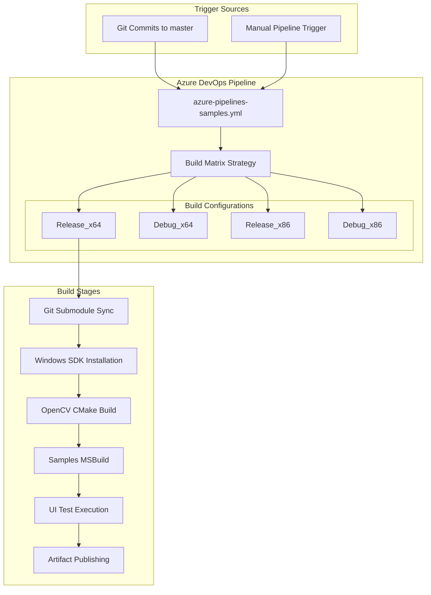
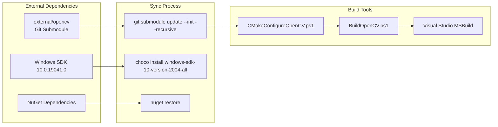
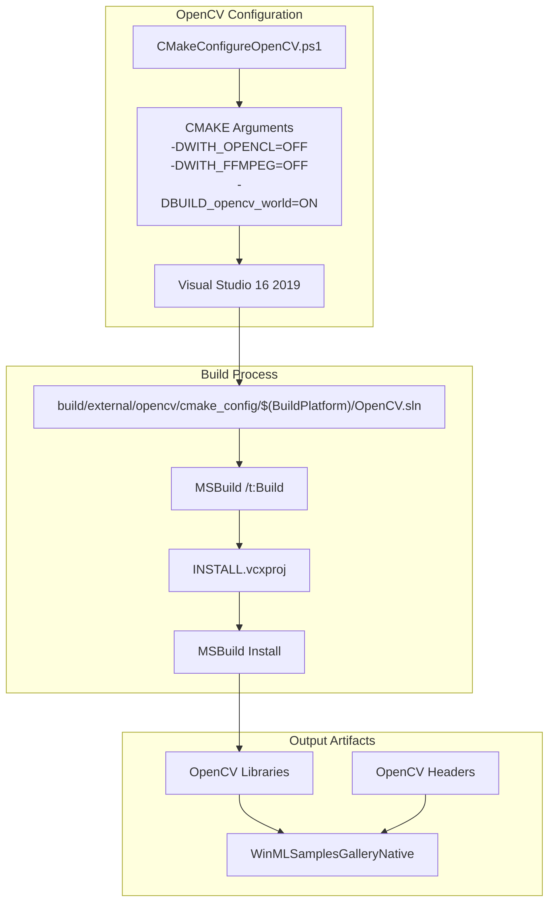
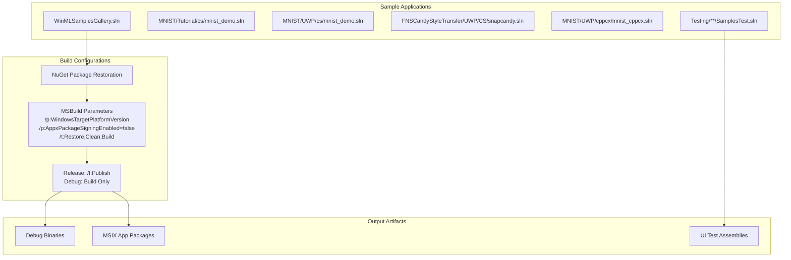
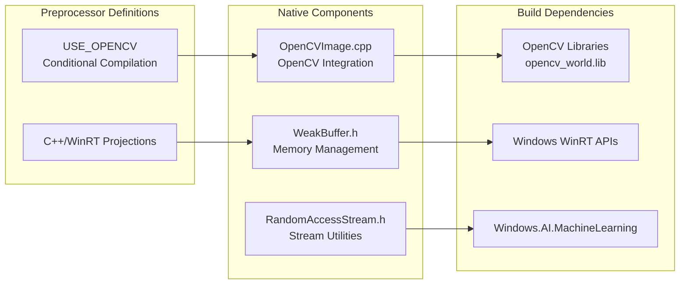
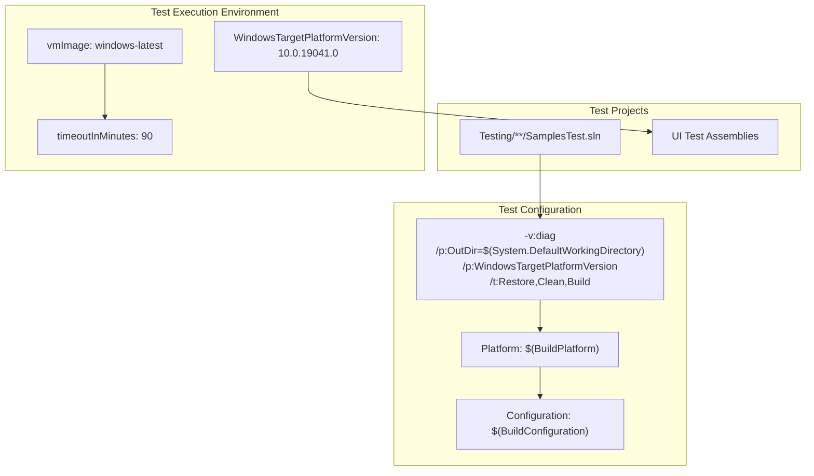
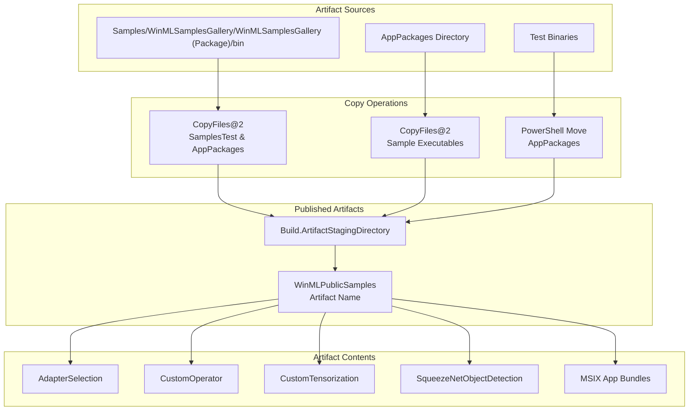

<!-- source: DeepWiki mcp.deepwiki.com · repo microsoft/Windows-Machine-Learning · page 6 Build System and CI/CD · fetched 2026-10-26 -->

# Build System and CI/CD

Relevant source files

The following files were used as context for generating this wiki page:

- [Samples/WinMLSamplesGallery/WinMLSamplesGallery/Samples/OpenCVInterop/README.md](Samples/WinMLSamplesGallery/WinMLSamplesGallery/Samples/OpenCVInterop/README.md)
- [Samples/WinMLSamplesGallery/WinMLSamplesGalleryNative/OpenCVImage.cpp](Samples/WinMLSamplesGallery/WinMLSamplesGalleryNative/OpenCVImage.cpp)
- [Samples/WinMLSamplesGallery/WinMLSamplesGalleryNative/OpenCVImage.h](Samples/WinMLSamplesGallery/WinMLSamplesGalleryNative/OpenCVImage.h)
- [Samples/WinMLSamplesGallery/WinMLSamplesGalleryNative/RandomAccessStream.h](Samples/WinMLSamplesGallery/WinMLSamplesGalleryNative/RandomAccessStream.h)
- [Samples/WinMLSamplesGallery/WinMLSamplesGalleryNative/WeakBuffer.h](Samples/WinMLSamplesGallery/WinMLSamplesGalleryNative/WeakBuffer.h)
- [azure-pipelines-samples.yml](azure-pipelines-samples.yml)
- [external/tools/BuildOpenCV.ps1](external/tools/BuildOpenCV.ps1)
- [external/tools/CMakeConfigureOpenCV.ps1](external/tools/CMakeConfigureOpenCV.ps1)
- [package.config](package.config)

This document describes the automated build system, continuous integration, and deployment pipeline for the Windows Machine Learning repository. It covers the Azure DevOps pipeline configuration, dependency management including OpenCV integration, multi-platform build orchestration, and artifact publishing workflows.

For information about the development tools built by this system, see [Development Tools](#3). For details about the sample applications that are built and tested, see [Sample Applications](#4).

## Pipeline Architecture

The build system is orchestrated through Azure DevOps using a matrix build strategy that targets multiple platforms and configurations simultaneously.

### CI/CD Pipeline Overview

Sources: [azure-pipelines-samples.yml:1-219]()

### Build Matrix Configuration

The pipeline executes builds across multiple platform and configuration combinations using a parallel execution strategy:

| Platform | Configuration | Build Target | Package Output |
|----------|---------------|--------------|----------------|
| x64 | Release | Full samples + AppPackages | MSIX bundles |
| x64 | Debug | Samples only | Debug binaries |
| x86 | Release | Full samples + AppPackages | MSIX bundles |
| x86 | Debug | Samples only | Debug binaries |

Sources: [azure-pipelines-samples.yml:30-45]()

## Dependency Management

### Git Submodule Integration

The build system manages external dependencies through Git submodules, particularly for OpenCV integration:

Sources: [azure-pipelines-samples.yml:47-52](), [azure-pipelines-samples.yml:58-63]()

### OpenCV Build Pipeline

The OpenCV integration requires a multi-stage build process using CMake and MSBuild:

Sources: [external/tools/CMakeConfigureOpenCV.ps1:1-63](), [azure-pipelines-samples.yml:64-92]()

## Sample Application Build Process

### MSBuild Orchestration

The pipeline builds multiple sample applications using MSBuild with specific configurations and parameters:

Sources: [azure-pipelines-samples.yml:94-186]()

### Native Component Integration

The WinMLSamplesGalleryNative component requires special handling for OpenCV dependencies:

Sources: [Samples/WinMLSamplesGallery/WinMLSamplesGalleryNative/OpenCVImage.cpp:1-117](), [Samples/WinMLSamplesGallery/WinMLSamplesGalleryNative/WeakBuffer.h:1-76]()

## Testing and Quality Assurance

### UI Test Execution

The pipeline includes automated UI testing to validate sample functionality:

Sources: [azure-pipelines-samples.yml:128-138]()

## Artifact Publishing

### Build Output Management

The pipeline publishes build artifacts for distribution and deployment:

Sources: [azure-pipelines-samples.yml:188-218]()

## Build Variables and Configuration

### Environment Variables

The pipeline uses several key environment variables for build configuration:

| Variable | Value | Purpose |
|----------|-------|---------|
| `SamplesBin` | SamplesBin | Binary output directory |
| `WINDOWS_WINMD` | C:\Program Files (x86)\Windows Kits\10\UnionMetadata\10.0.19041.0\Windows.winmd | Windows metadata path |
| `WindowsTargetPlatformVersion` | 10.0.19041.0 | SDK version target |

Sources: [azure-pipelines-samples.yml:11-15]()

### Build Tools and Versions

The build system requires specific tool versions for consistent builds:

- **NuGet**: Version 5.11.0 for package management
- **Visual Studio**: Version 16.0 (Visual Studio 2019) for MSBuild
- **CMake**: Visual Studio 16 2019 generator for OpenCV
- **Windows SDK**: Version 10.0.19041.0 (Version 2004)

Sources: [azure-pipelines-samples.yml:53-57](), [external/tools/CMakeConfigureOpenCV.ps1:10-14]()

---

