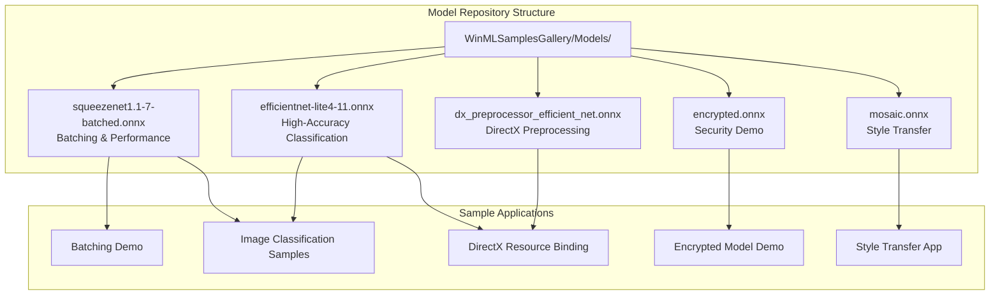
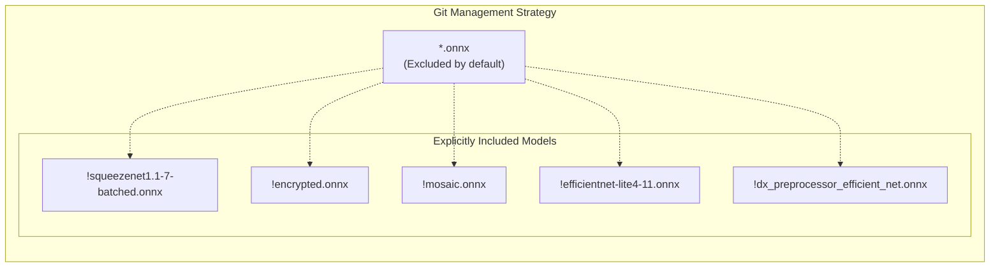
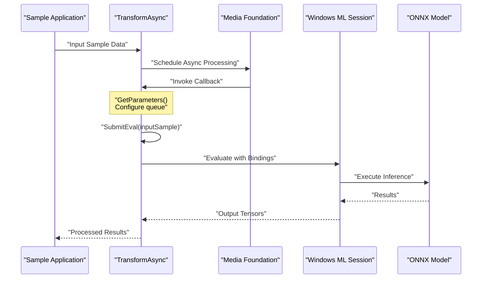
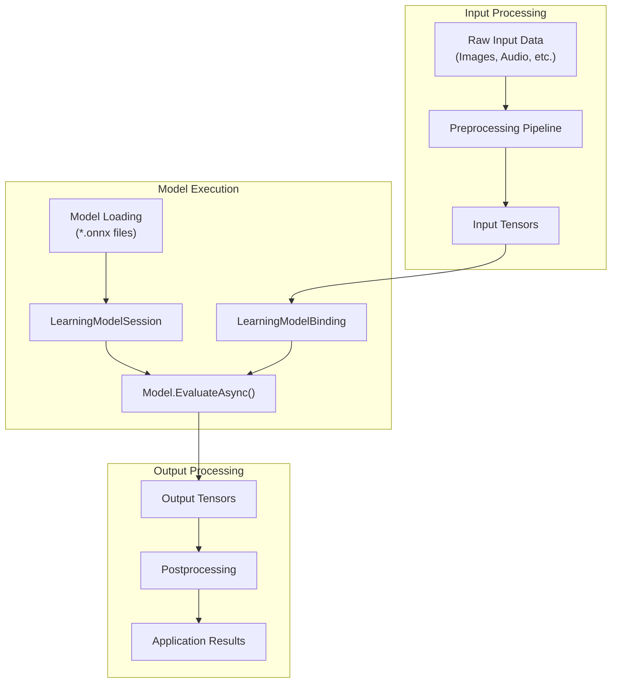
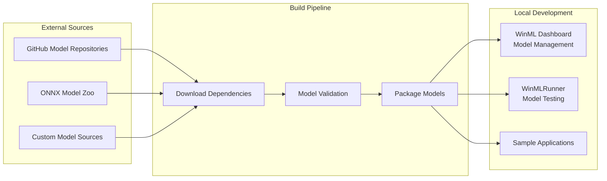
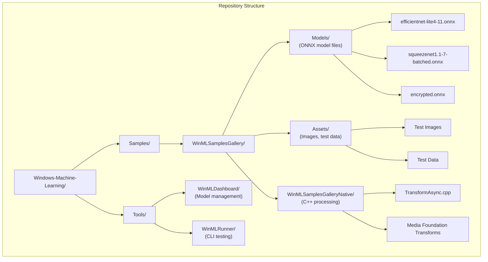
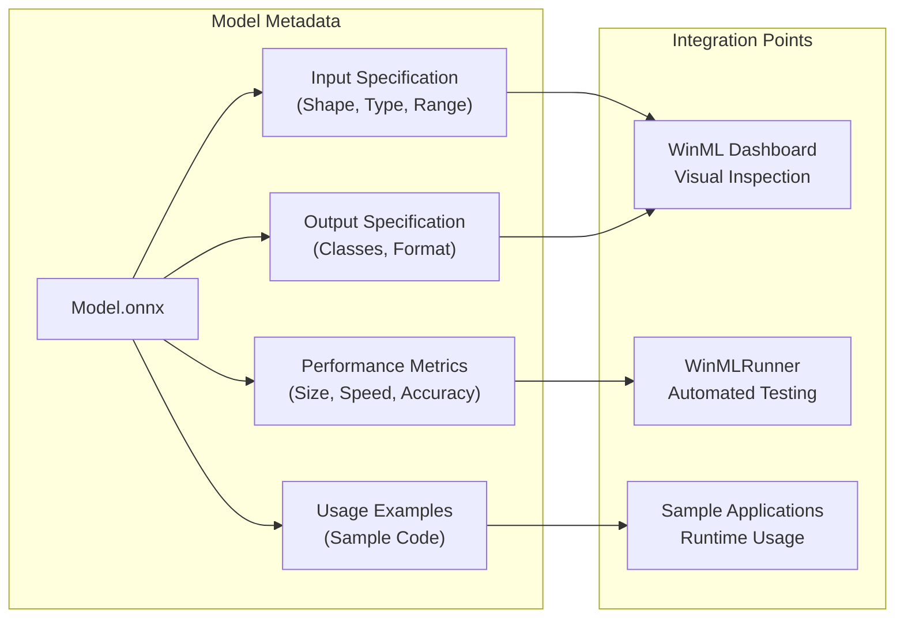

<!-- source: DeepWiki mcp.deepwiki.com · repo microsoft/Windows-Machine-Learning · page 7 Model Assets and Data · fetched 2026-10-26 -->

# Model Assets and Data

Relevant source files

The following files were used as context for generating this wiki page:

- [Samples/WinMLSamplesGallery/.gitignore](Samples/WinMLSamplesGallery/.gitignore)
- [Samples/WinMLSamplesGallery/WinMLSamplesGallery/InputData/fish.png](Samples/WinMLSamplesGallery/WinMLSamplesGallery/InputData/fish.png)
- [Samples/WinMLSamplesGallery/WinMLSamplesGallery/Models/efficientnet-lite4-11.onnx](Samples/WinMLSamplesGallery/WinMLSamplesGallery/Models/efficientnet-lite4-11.onnx)
- [Samples/WinMLSamplesGallery/WinMLSamplesGallery/Models/mosaic.onnx](Samples/WinMLSamplesGallery/WinMLSamplesGallery/Models/mosaic.onnx)
- [Samples/WinMLSamplesGallery/WinMLSamplesGalleryNative/TransformAsync_IMFAsyncCallback.cpp](Samples/WinMLSamplesGallery/WinMLSamplesGalleryNative/TransformAsync_IMFAsyncCallback.cpp)

This document covers the model assets, test data, and data management infrastructure within the Windows Machine Learning repository. It details the included ONNX models, data processing pipelines, and asset organization patterns used across the sample applications and development tools.

For information about model conversion and editing tools, see [WinML Dashboard](#3.1). For details about model performance evaluation, see [WinMLRunner](#3.2). For sample application usage of these models, see [WinML Samples Gallery](#4.1).

## Repository Model Assets

The Windows ML repository includes several pre-configured ONNX models that serve as reference implementations and testing assets for the sample applications. These models are strategically selected to demonstrate different machine learning capabilities and performance characteristics.

### Included Model Files

The repository contains the following core model assets, as specified in the `.gitignore` configuration:

| Model File | Purpose | Size Category | Use Cases |
|------------|---------|---------------|-----------|
| `squeezenet1.1-7-batched.onnx` | Image classification with batching support | Lightweight | Batching demonstrations, performance comparisons |
| `efficientnet-lite4-11.onnx` | Advanced image classification | Medium | High-accuracy classification, feature extraction |
| `dx_preprocessor_efficient_net.onnx` | DirectX-optimized preprocessing | Preprocessing | GPU memory optimization, DirectX integration |
| `encrypted.onnx` | Security demonstration model | Varies | Model encryption, security scenarios |
| `mosaic.onnx` | Style transfer operations | Medium | Real-time video effects, artistic processing |

**Sources:** [Samples/WinMLSamplesGallery/.gitignore:1-11]()

### Model Selection Strategy

The repository's model selection follows a strategic approach to cover different scenarios:

- **Lightweight Models**: SqueezeNet provides fast inference for demonstration purposes
- **High-Accuracy Models**: EfficientNet-Lite4 offers state-of-the-art accuracy for quality comparisons
- **Specialized Models**: DirectX preprocessor models demonstrate GPU optimization techniques
- **Security Models**: Encrypted models showcase Windows ML security capabilities
- **Creative Models**: Style transfer models enable real-time video effects

## Model File Management

The repository implements a selective model inclusion strategy using `.gitignore` patterns to manage repository size while ensuring essential models are available for development and testing.

### Git Ignore Configuration

The `.gitignore` configuration prevents accidental inclusion of large model files while explicitly allowing essential models:

This approach ensures that:
- Repository clones remain manageable in size
- Essential demonstration models are always available
- Developers can add custom models without accidental commits
- CI/CD pipelines have consistent model availability

**Sources:** [Samples/WinMLSamplesGallery/.gitignore:1-11]()

## Data Processing Pipeline

The Windows ML data processing pipeline handles model input preparation, inference execution, and output processing through a structured asynchronous architecture.

### Asynchronous Processing Architecture

The data processing system utilizes Media Foundation's asynchronous callback mechanism for efficient model inference:

The asynchronous callback implementation in `TransformAsync` coordinates this pipeline:

- **Queue Configuration**: Uses `MFASYNC_CALLBACK_QUEUE_MULTITHREADED` for parallel processing
- **Sample Processing**: Extracts `IMFSample` objects from async results
- **State Management**: Maintains transform state across async operations
- **Error Handling**: Propagates evaluation results through `SetStatus`

**Sources:** [Samples/WinMLSamplesGallery/WinMLSamplesGalleryNative/TransformAsync_IMFAsyncCallback.cpp:4-59]()

### Model Data Flow

**Sources:** [Samples/WinMLSamplesGallery/WinMLSamplesGalleryNative/TransformAsync_IMFAsyncCallback.cpp:44-56]()

## External Model Integration

The repository supports integration with external model sources through the build pipeline and development tools, allowing developers to work with models beyond the included set.

### Build Pipeline Model Handling

The Azure DevOps build pipeline downloads external models as needed:

### Model Format Support

The Windows ML ecosystem supports various model formats and conversion scenarios:

| Source Format | Target Format | Conversion Tool | Use Case |
|---------------|---------------|-----------------|----------|
| TensorFlow | ONNX | tf2onnx | Cross-platform deployment |
| PyTorch | ONNX | torch.onnx | Research model integration |
| Core ML | ONNX | onnxmltools | iOS model porting |
| Keras | ONNX | keras2onnx | High-level API models |
| ONNX | Optimized ONNX | WinML Tools | Windows optimization |

## Asset Organization Structure

The repository organizes model assets and related data according to functional categories and usage patterns within the sample applications.

### Directory Structure

### Model Metadata Management

Each model in the repository is associated with metadata that describes its characteristics and usage:

### File Type Categories

The repository manages several categories of assets:

| Category | File Types | Purpose | Storage Location |
|----------|------------|---------|------------------|
| Models | `.onnx` | ML inference | `Models/` |
| Test Images | `.jpg`, `.png`, `.bmp` | Input validation | `Assets/` |
| Test Data | `.csv`, `.json`, `.txt` | Ground truth | `Assets/` |
| Metadata | `.json`, `.xml` | Model descriptions | Alongside models |
| Documentation | `.md`, `.txt` | Usage instructions | Various |

**Sources:** [Samples/WinMLSamplesGallery/.gitignore:1-11](), [Samples/WinMLSamplesGallery/WinMLSamplesGallery/Models/efficientnet-lite4-11.onnx:1-10]()