# Page: Overview

# Overview

<details>
<summary>Relevant source files</summary>

The following files were used as context for generating this wiki page:

- [README.md](README.md)
- [Samples/StyleTransfer/README.md](Samples/StyleTransfer/README.md)
- [Samples/WinMLSamplesGallery/README.md](Samples/WinMLSamplesGallery/README.md)
- [Samples/WinMLSamplesGallery/WinMLSamplesGallery/Samples/Batching/README.md](Samples/WinMLSamplesGallery/WinMLSamplesGallery/Samples/Batching/README.md)
- [Samples/WinMLSamplesGallery/WinMLSamplesGallery/Samples/ImageClassifier/docs/screenshot.png](Samples/WinMLSamplesGallery/WinMLSamplesGallery/Samples/ImageClassifier/docs/screenshot.png)
- [Samples/WinMLSamplesGallery/WinMLSamplesGallery/Samples/ImageEffects/README.md](Samples/WinMLSamplesGallery/WinMLSamplesGallery/Samples/ImageEffects/README.md)
- [Samples/WinMLSamplesGallery/WinMLSamplesGallery/Samples/ImageEffects/docs/screenshot.png](Samples/WinMLSamplesGallery/WinMLSamplesGallery/Samples/ImageEffects/docs/screenshot.png)
- [Samples/WinMLSamplesGallery/WinMLSamplesGallery/Samples/ImageSharpInterop/ImageSharpExtensions.cs](Samples/WinMLSamplesGallery/WinMLSamplesGallery/Samples/ImageSharpInterop/ImageSharpExtensions.cs)
- [Samples/WinMLSamplesGallery/WinMLSamplesGallery/Samples/ImageSharpInterop/README.md](Samples/WinMLSamplesGallery/WinMLSamplesGallery/Samples/ImageSharpInterop/README.md)
- [Samples/WinMLSamplesGallery/WinMLSamplesGallery/Samples/ImageSharpInterop/docs/screenshot.png](Samples/WinMLSamplesGallery/WinMLSamplesGallery/Samples/ImageSharpInterop/docs/screenshot.png)
- [Samples/WinMLSamplesGallery/docs/WinMLSamplesGalleryLanding.png](Samples/WinMLSamplesGallery/docs/WinMLSamplesGalleryLanding.png)
- [ThirdPartyNotices.txt](ThirdPartyNotices.txt)

</details>


## Purpose and Scope

The Windows Machine Learning repository provides a comprehensive ecosystem for integrating machine learning inference capabilities into Windows applications. This repository contains samples, tools, and documentation that demonstrate how to use the Windows ML API for high-performance, low-latency machine learning scenarios across desktop, UWP, and .NET applications.

The repository focuses on ONNX model inference using the `Windows.AI.MachineLearning` API, which is powered by ONNX Runtime and DirectML for GPU acceleration. For information about the core Windows ML API concepts, see [Core API and Architecture](#2). For details about specific development tools, see [Development Tools](#3).

Sources: [README.md:1-21](), [README.md:36-46]()

## Core Architecture

Windows ML provides a layered architecture built around the `Windows.AI.MachineLearning` namespace, with ONNX Runtime serving as the inference engine and DirectML providing GPU acceleration.

### High-Level System Architecture

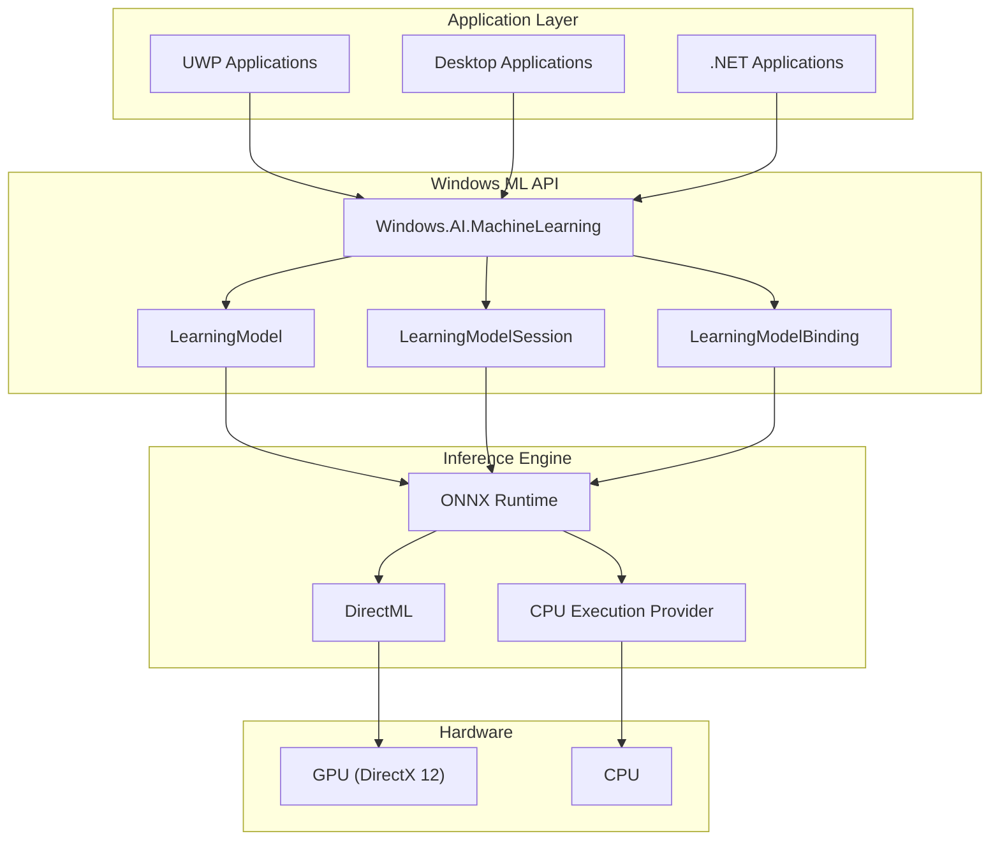

Sources: [README.md:3](), [README.md:8]()

### Distribution Options

Windows ML is available through two primary distribution mechanisms:

| Distribution | Availability | Servicing | Forward Compatibility |
|--------------|--------------|-----------|----------------------|
| **In-Box** | Windows 10 Build 17763+ | Microsoft-driven | Automatic |
| **NuGet** | Windows 8.1+ | Developer-driven | Manual updates |

The in-box version provides automatic updates through Windows Update, while the NuGet package (`Microsoft.AI.MachineLearning`) allows developers to bundle and control versioning independently.

Sources: [README.md:36-46]()

## Development Tools and Utilities

The repository includes several tools to support the complete development lifecycle for Windows ML applications.

### Tool Ecosystem

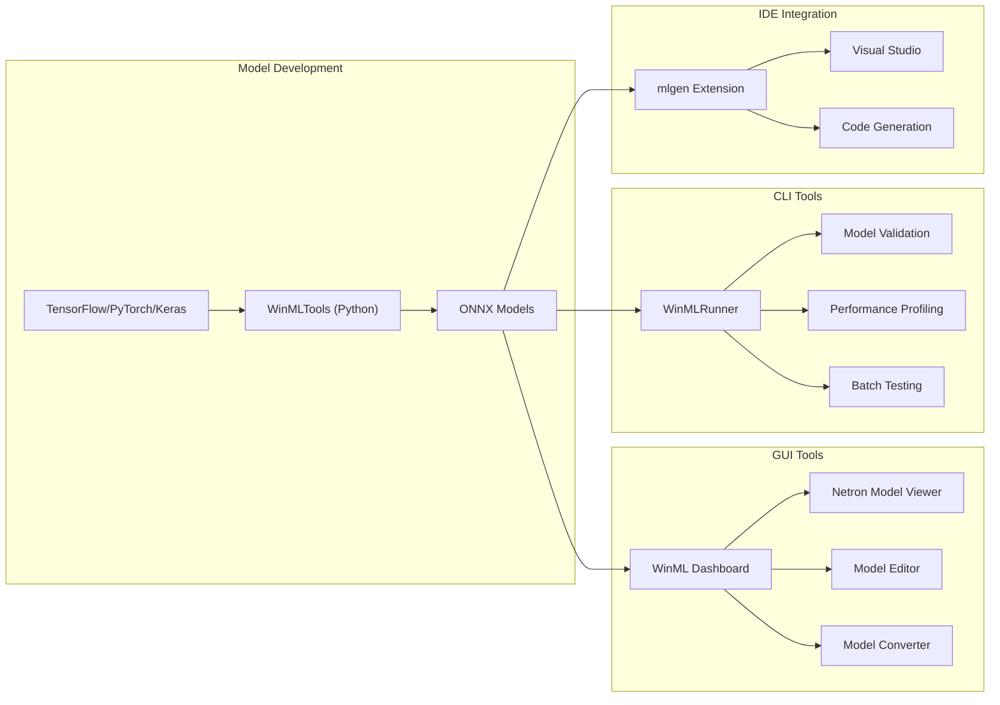

The **WinML Dashboard** serves as a comprehensive GUI tool for model viewing, editing, conversion, and validation. It integrates the Netron model viewer and provides capabilities for enabling free dimensions on models with fixed dimensions.

The **WinMLRunner** is a command-line tool that validates ONNX models and captures performance measurements. It supports various input formats including tensors and images, and provides detailed diagnostic output.

Sources: [README.md:115-143](), [README.md:128](), [README.md:136-138]()

## Sample Applications

The repository contains extensive samples demonstrating various Windows ML capabilities across different application types and use cases.

### Sample Application Architecture

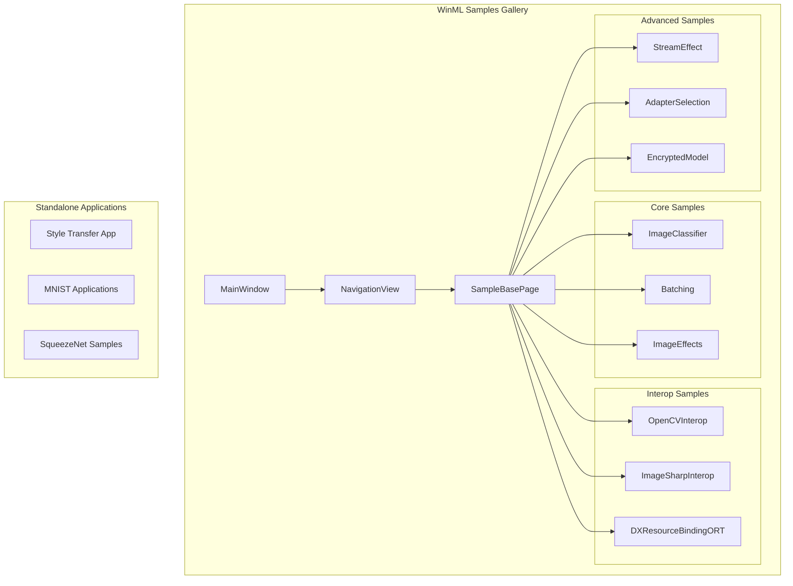

The **WinML Samples Gallery** serves as the primary showcase application, built with WinUI 3 and demonstrating interactive machine learning scenarios. Each sample implements the `SampleBasePage` pattern for consistent user experience.

Key sample categories include:

- **Image Classification**: Supports multiple models from the ONNX Model Zoo including AlexNet, EfficientNet, ResNet50, and SqueezeNet
- **Performance Optimization**: Batching samples that demonstrate performance improvements with the `BatchSizeOverride` property
- **Library Integration**: Interoperability with OpenCV and ImageSharp for image processing workflows
- **Real-time Processing**: Stream effects and video processing capabilities

Sources: [Samples/WinMLSamplesGallery/README.md:1-3](), [Samples/WinMLSamplesGallery/README.md:32-50](), [README.md:48-73]()

## Integration Ecosystem

Windows ML provides extensive integration capabilities with graphics APIs, computer vision libraries, and media processing frameworks.

### Integration Points

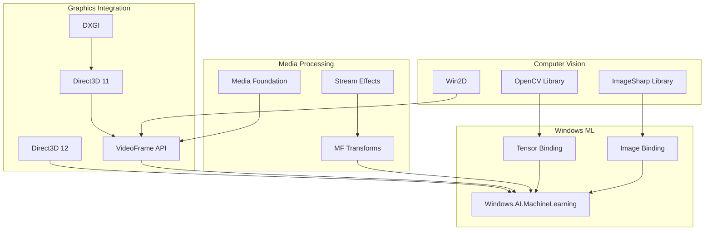

**DirectX Resource Binding** enables GPU memory sharing through Direct3D 12 surfaces, allowing efficient processing pipelines without CPU-GPU memory transfers.

**OpenCV Integration** provides computer vision preprocessing capabilities, with samples demonstrating image loading, manipulation, and tensor conversion workflows.

**ImageSharp Integration** offers cross-platform graphics processing with extension methods for converting between ImageSharp formats and Windows ML tensors.

Sources: [Samples/WinMLSamplesGallery/WinMLSamplesGallery/Samples/ImageSharpInterop/ImageSharpExtensions.cs:1-49](), [Samples/WinMLSamplesGallery/README.md:39](), [Samples/WinMLSamplesGallery/README.md:47](), [ThirdPartyNotices.txt:1-8]()

## Platform Support and Build System

The repository supports multiple Windows application types and development frameworks through a comprehensive build system.

### Supported Application Types

| Application Type | In-Box API | NuGet API | Sample Coverage |
|------------------|------------|-----------|-----------------|
| **UWP** | ✓ | ✓ | MNIST, SqueezeNet, Style Transfer |
| **Desktop (Win32)** | ✓ | ✓ | SqueezeNet, Custom Operators |
| **.NET 5/Core** | - | ✓ | Samples Gallery, SqueezeNet |
| **WinUI 3** | ✓ | ✓ | Samples Gallery |

The build pipeline uses Azure DevOps with automated testing across multiple configurations. OpenCV is built as a submodule using CMake and Visual Studio build tools.

**Language Support** includes C++/WinRT, C#, JavaScript, and experimental Rust bindings, demonstrating the API's versatility across different development ecosystems.

Sources: [README.md:55-73](), [README.md:24-28](), [README.md:32-34]()

---

# Page: Core API and Architecture

# Core API and Architecture

<details>
<summary>Relevant source files</summary>

The following files were used as context for generating this wiki page:

- [Samples/BatchSupport/BatchSupport.sln](Samples/BatchSupport/BatchSupport.sln)
- [Samples/BatchSupport/BatchSupport/BatchSupport.vcxproj](Samples/BatchSupport/BatchSupport/BatchSupport.vcxproj)
- [Samples/BatchSupport/BatchSupport/BatchSupport.vcxproj.filters](Samples/BatchSupport/BatchSupport/BatchSupport.vcxproj.filters)
- [Samples/BatchSupport/BatchSupport/PropertySheet.props](Samples/BatchSupport/BatchSupport/PropertySheet.props)
- [Samples/BatchSupport/BatchSupport/SampleHelper.cpp](Samples/BatchSupport/BatchSupport/SampleHelper.cpp)
- [Samples/BatchSupport/BatchSupport/SampleHelper.h](Samples/BatchSupport/BatchSupport/SampleHelper.h)
- [Samples/BatchSupport/BatchSupport/main.cpp](Samples/BatchSupport/BatchSupport/main.cpp)
- [Samples/BatchSupport/BatchSupport/packages.config](Samples/BatchSupport/BatchSupport/packages.config)
- [Samples/BatchSupport/BatchSupport/pch.cpp](Samples/BatchSupport/BatchSupport/pch.cpp)
- [Samples/BatchSupport/BatchSupport/pch.h](Samples/BatchSupport/BatchSupport/pch.h)
- [Samples/BatchSupport/forReadMe/fixBatchSize.png](Samples/BatchSupport/forReadMe/fixBatchSize.png)
- [Samples/BatchSupport/forReadMe/freeBatchSize.png](Samples/BatchSupport/forReadMe/freeBatchSize.png)
- [Samples/BatchSupport/readme.md](Samples/BatchSupport/readme.md)
- [Samples/SampleSharedLib/SampleSharedLib/SampleSharedLib.vcxproj](Samples/SampleSharedLib/SampleSharedLib/SampleSharedLib.vcxproj)
- [Samples/SampleSharedLib/SampleSharedLib/SampleSharedLib.vcxproj.filters](Samples/SampleSharedLib/SampleSharedLib/SampleSharedLib.vcxproj.filters)
- [Samples/SampleSharedLib/SampleSharedLib/packages.config](Samples/SampleSharedLib/SampleSharedLib/packages.config)
- [Samples/WinMLSamplesGallery/WinMLSamplesGallery/Samples/TensorizationModels.cs](Samples/WinMLSamplesGallery/WinMLSamplesGallery/Samples/TensorizationModels.cs)

</details>


This document explains the Windows.AI.MachineLearning API, its integration with ONNX Runtime, and the fundamental concepts including models, sessions, bindings, and tensor operations. This covers the core programming model and architectural components that developers use to perform machine learning inference on Windows.

For information about development tools and utilities, see [Development Tools](#3). For sample applications demonstrating these APIs, see [Sample Applications](#4). For advanced integration scenarios like DirectX interoperability, see [Advanced Integration](#5).

## API Overview

Windows ML provides machine learning inference capabilities through two primary API surfaces:

- **Windows.AI.MachineLearning** - The in-box Windows Runtime API available on Windows 10 version 1809 and later
- **Microsoft.AI.MachineLearning** - The NuGet package providing the same API surface with additional features and broader platform support

The core architecture is built on ONNX Runtime with DirectML providing GPU acceleration capabilities.

### Windows ML API Layers

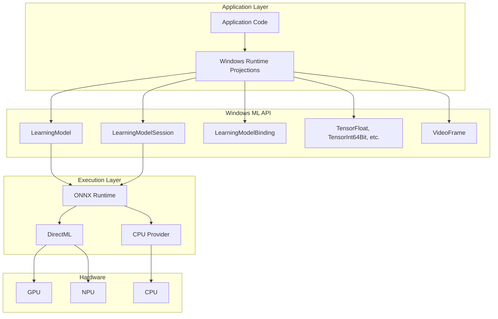

**Sources:** [Samples/BatchSupport/BatchSupport/main.cpp:1-50](), [Samples/BatchSupport/BatchSupport/pch.h:1-19]()

## Core Components

### LearningModel

The `LearningModel` class represents a trained ONNX model and provides metadata about inputs, outputs, and model properties.

| Property | Description | Usage |
|----------|-------------|--------|
| `InputFeatures` | Collection of input feature descriptors | Define expected input data types and shapes |
| `OutputFeatures` | Collection of output feature descriptors | Define output data types and shapes |
| `Author`, `Name`, `Version` | Model metadata | Retrieve model information |

**Key Methods:**
- `LoadFromFilePath(hstring)` - Load model from file path
- `LoadFromStreamAsync(IRandomAccessStreamReference)` - Load model from stream

### LearningModelSession

The `LearningModelSession` manages the inference execution context and device selection.

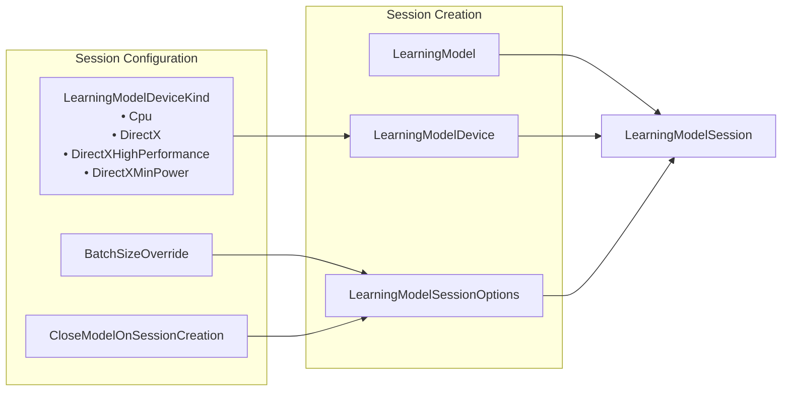

**Sources:** [Samples/BatchSupport/BatchSupport/main.cpp:41-53]()

### LearningModelBinding

The `LearningModelBinding` class manages input and output data binding for model evaluation.

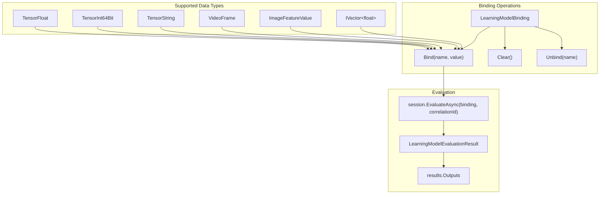

**Sources:** [Samples/BatchSupport/BatchSupport/main.cpp:54-96](), [Samples/BatchSupport/BatchSupport/SampleHelper.cpp:84-114]()

## Tensor Types and Data Handling

### Core Tensor Types

Windows ML provides strongly-typed tensor classes for different data types:

| Tensor Type | Description | Creation Methods |
|-------------|-------------|------------------|
| `TensorFloat` | 32-bit floating point tensors | `Create()`, `CreateFromArray()`, `CreateFromIterable()` |
| `TensorInt64Bit` | 64-bit integer tensors | `Create()`, `CreateFromArray()`, `CreateFromIterable()` |
| `TensorString` | String tensors | `CreateFromArray()` |
| `TensorUInt8` | 8-bit unsigned integer tensors | `Create()`, `CreateFromArray()` |

### Tensor Creation Patterns

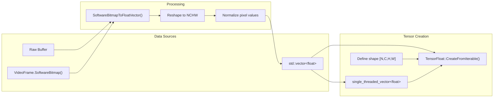

**Sources:** [Samples/BatchSupport/BatchSupport/SampleHelper.cpp:25-102]()

### Batching Support

Windows ML supports both fixed and dynamic batch sizes:

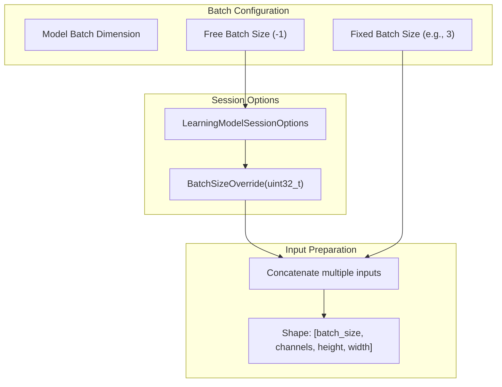

**Sources:** [Samples/BatchSupport/BatchSupport/main.cpp:18-50](), [Samples/BatchSupport/BatchSupport/SampleHelper.cpp:84-101]()

## Device Selection and Execution Providers

### Device Types

Windows ML supports multiple execution providers through the `LearningModelDeviceKind` enumeration:

| Device Kind | Description | Use Case |
|-------------|-------------|----------|
| `Cpu` | CPU execution using ONNX Runtime CPU provider | General compatibility, debugging |
| `DirectX` | Default DirectX device selection | Balanced performance and compatibility |
| `DirectXHighPerformance` | High-performance GPU selection | Maximum throughput |
| `DirectXMinPower` | Power-efficient GPU selection | Battery-powered devices |

### Execution Flow

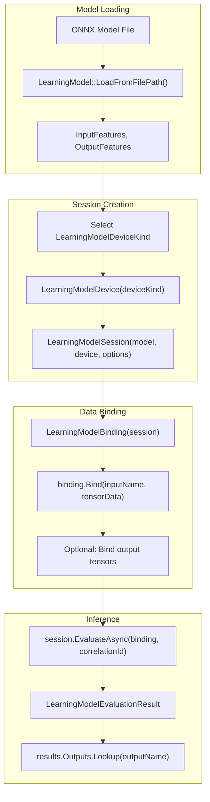

**Sources:** [Samples/BatchSupport/BatchSupport/main.cpp:27-96]()

## Advanced Model Building

The experimental `LearningModelBuilder` API allows creating ONNX models programmatically:

### Model Builder Components

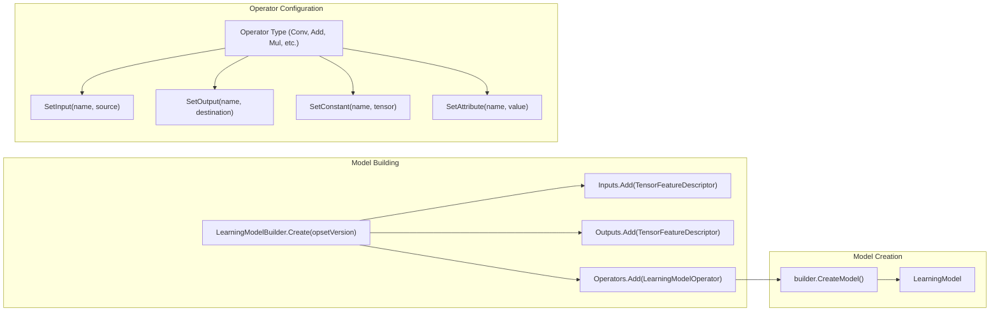

**Sources:** [Samples/WinMLSamplesGallery/WinMLSamplesGallery/Samples/TensorizationModels.cs:44-50](), [Samples/WinMLSamplesGallery/WinMLSamplesGallery/Samples/TensorizationModels.cs:114-141]()

### Common ONNX Operators

The model builder supports various ONNX operators for image processing and tensor manipulation:

| Operator | Purpose | Key Attributes |
|----------|---------|----------------|
| `Identity` | Pass-through operation | None |
| `Conv` | Convolution operation | `kernel_shape`, `auto_pad` |
| `Resize` | Image resizing | `mode`, `scales` or `sizes` |
| `Transpose` | Tensor dimension reordering | `perm` |
| `Slice` | Tensor slicing | `starts`, `ends`, `axes`, `steps` |
| `Cast` | Data type conversion | `to` |

**Sources:** [Samples/WinMLSamplesGallery/WinMLSamplesGallery/Samples/TensorizationModels.cs:37-51](), [Samples/WinMLSamplesGallery/WinMLSamplesGallery/Samples/TensorizationModels.cs:405-426]()

## Error Handling and Performance

### Performance Optimization

- **Batch Size Override**: For models with free dimensions, specify batch size at session creation for better performance
- **Device Selection**: Choose appropriate device kind based on performance vs. power requirements  
- **Pre-allocated Outputs**: Optionally bind output tensors to avoid allocation during inference
- **Session Reuse**: Create sessions once and reuse for multiple evaluations

### Common Integration Patterns

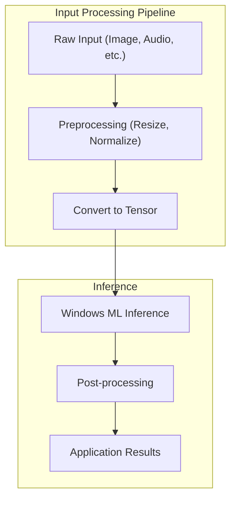

**Sources:** [Samples/BatchSupport/BatchSupport/main.cpp:80-95](), [Samples/BatchSupport/BatchSupport/SampleHelper.cpp:116-141]()

---

# Page: Development Tools

# Development Tools

<details>
<summary>Relevant source files</summary>

The following files were used as context for generating this wiki page:

- [Testing/WinMLRunnerTest/WinMLRunnerTest.cpp](Testing/WinMLRunnerTest/WinMLRunnerTest.cpp)
- [Testing/WinMLRunnerTest/WinMLRunnerTest.vcxproj](Testing/WinMLRunnerTest/WinMLRunnerTest.vcxproj)
- [Tools/WinMLDashboard/.gitignore](Tools/WinMLDashboard/.gitignore)
- [Tools/WinMLDashboard/.vscode/launch.json](Tools/WinMLDashboard/.vscode/launch.json)
- [Tools/WinMLDashboard/README.md](Tools/WinMLDashboard/README.md)
- [Tools/WinMLDashboard/build.js](Tools/WinMLDashboard/build.js)
- [Tools/WinMLDashboard/package.json](Tools/WinMLDashboard/package.json)
- [Tools/WinMLDashboard/public/Converter.png](Tools/WinMLDashboard/public/Converter.png)
- [Tools/WinMLDashboard/public/DebugPngs.png](Tools/WinMLDashboard/public/DebugPngs.png)
- [Tools/WinMLDashboard/public/about.css](Tools/WinMLDashboard/public/about.css)
- [Tools/WinMLDashboard/public/about.html](Tools/WinMLDashboard/public/about.html)
- [Tools/WinMLDashboard/public/progress_bar.gif](Tools/WinMLDashboard/public/progress_bar.gif)
- [Tools/WinMLDashboard/public/questionmark.png](Tools/WinMLDashboard/public/questionmark.png)
- [Tools/WinMLDashboard/public/questionmark2.png](Tools/WinMLDashboard/public/questionmark2.png)
- [Tools/WinMLDashboard/src/electronMain.js](Tools/WinMLDashboard/src/electronMain.js)
- [Tools/WinMLDashboard/src/native/dialog.ts](Tools/WinMLDashboard/src/native/dialog.ts)
- [Tools/WinMLDashboard/src/native/menu.ts](Tools/WinMLDashboard/src/native/menu.ts)
- [Tools/WinMLDashboard/test/test.js](Tools/WinMLDashboard/test/test.js)
- [Tools/WinMLRunner/README.md](Tools/WinMLRunner/README.md)
- [Tools/WinMLRunner/src/BindingUtilities.h](Tools/WinMLRunner/src/BindingUtilities.h)
- [Tools/WinMLRunner/src/CommandLineArgs.cpp](Tools/WinMLRunner/src/CommandLineArgs.cpp)
- [Tools/WinMLRunner/src/CommandLineArgs.h](Tools/WinMLRunner/src/CommandLineArgs.h)
- [Tools/WinMLRunner/src/Common.h](Tools/WinMLRunner/src/Common.h)
- [Tools/WinMLRunner/src/Filehelper.cpp](Tools/WinMLRunner/src/Filehelper.cpp)
- [Tools/WinMLRunner/src/Filehelper.h](Tools/WinMLRunner/src/Filehelper.h)
- [Tools/WinMLRunner/src/LearningModelDeviceHelper.cpp](Tools/WinMLRunner/src/LearningModelDeviceHelper.cpp)
- [Tools/WinMLRunner/src/LearningModelDeviceHelper.h](Tools/WinMLRunner/src/LearningModelDeviceHelper.h)
- [Tools/WinMLRunner/src/OutputHelper.h](Tools/WinMLRunner/src/OutputHelper.h)
- [Tools/WinMLRunner/src/Run.cpp](Tools/WinMLRunner/src/Run.cpp)
- [Tools/WinMLRunner/src/Run.h](Tools/WinMLRunner/src/Run.h)
- [Tools/WinMLRunner/src/TimerHelper.h](Tools/WinMLRunner/src/TimerHelper.h)
- [Tools/WinMLRunner/src/TypeHelper.h](Tools/WinMLRunner/src/TypeHelper.h)
- [Tools/WinMLRunner/src/main.cpp](Tools/WinMLRunner/src/main.cpp)

</details>


This document covers the development tools provided in the Windows Machine Learning repository for working with ONNX models. The tools include both command-line and GUI applications for model evaluation, performance testing, conversion, and validation. For information about the core Windows ML APIs these tools utilize, see [Core API and Architecture](#2). For sample applications demonstrating Windows ML usage, see [Sample Applications](#4).

## Overview

The Windows ML repository provides two primary development tools:

- **WinMLRunner**: A command-line tool for model evaluation, performance benchmarking, and testing
- **WinML Dashboard**: A GUI application for model viewing, editing, conversion, and validation

Both tools are designed to work with ONNX models and leverage the Windows.AI.MachineLearning API for inference operations.

## WinMLRunner Command-Line Tool

WinMLRunner is a comprehensive command-line utility for evaluating ONNX models, measuring performance, and testing various execution configurations.

### Architecture and Core Components

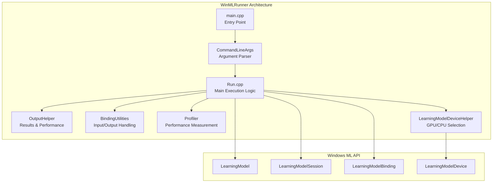

**Key Components:**

| Component | File Path | Purpose |
|-----------|-----------|---------|
| `CommandLineArgs` | `Tools/WinMLRunner/src/CommandLineArgs.h` | Parse and validate command-line arguments |
| `run()` function | `Tools/WinMLRunner/src/Run.cpp` | Main execution orchestration |
| `OutputHelper` | `Tools/WinMLRunner/src/OutputHelper.h` | Performance data collection and output formatting |
| `BindingUtilities` | `Tools/WinMLRunner/src/BindingUtilities.h` | Input tensor and image binding operations |
| `Profiler` | `Tools/WinMLRunner/src/TimerHelper.h` | CPU/GPU performance measurement |

**Sources:** [Tools/WinMLRunner/src/main.cpp:1-59](), [Tools/WinMLRunner/src/Run.h:1-7](), [Tools/WinMLRunner/src/CommandLineArgs.h:1-223](), [Tools/WinMLRunner/src/OutputHelper.h:1-91]()

### Execution Flow

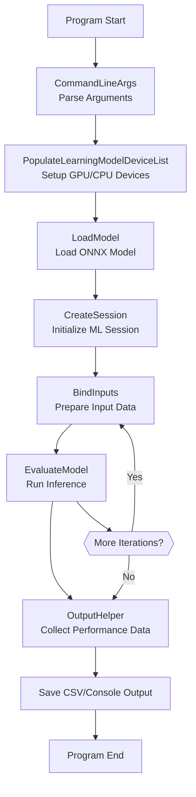

**Sources:** [Tools/WinMLRunner/src/Run.cpp:528-646](), [Tools/WinMLRunner/src/Run.cpp:95-127](), [Tools/WinMLRunner/src/Run.cpp:165-195]()

### Capabilities and Features

WinMLRunner supports extensive configuration options for testing different scenarios:

**Device Selection:**
- CPU execution (`-CPU`)
- Default GPU (`-GPU`) 
- High-performance GPU (`-GPUHighPerformance`)
- Low-power GPU (`-GPUMinPower`)
- GPU adapter by name (`-GPUAdapterName`)

**Input Data Types:**
- Tensor data (`-Tensor`)
- RGB images (`-RGB`)
- BGR images (`-BGR`)
- CSV data files
- Synthetic garbage data (default)

**Performance Measurement:**
- Wall-clock timing
- GPU execution time
- CPU execution time  
- Memory usage (working set, dedicated, shared)
- ETW trace logging support

**Sources:** [Tools/WinMLRunner/README.md:32-90](), [Tools/WinMLRunner/src/CommandLineArgs.cpp:114-407]()

## WinML Dashboard GUI Application

WinML Dashboard is an Electron-based desktop application that provides a visual interface for working with ONNX models.

### Architecture and Components

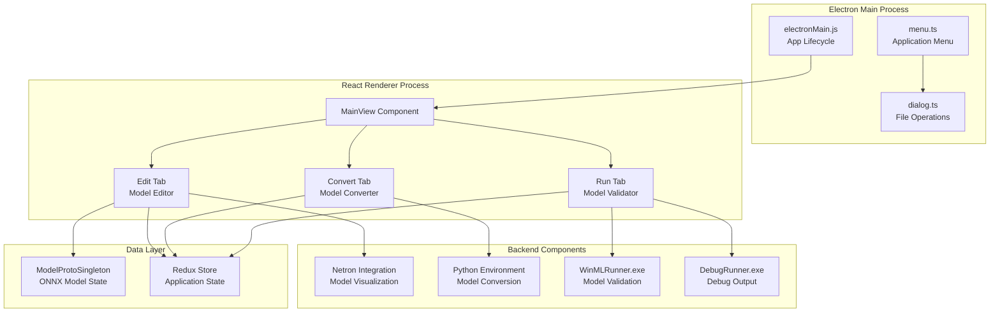

**Sources:** [Tools/WinMLDashboard/src/electronMain.js:1-171](), [Tools/WinMLDashboard/src/native/menu.ts:1-141](), [Tools/WinMLDashboard/package.json:1-77]()

### Key Features and Workflow

**Model Viewing and Editing:**
- Netron-based model visualization
- Model metadata editing (properties, input/output nodes)
- ONNX model structure inspection

**Model Conversion:**
- Support for multiple input formats: Core ML, TensorFlow, Keras, Scikit-learn, XGBoost, LibSVM
- ONNX version targeting (1.2, 1.3)
- Quantization options (Type1, Type2)
- Automated Python environment setup

**Model Validation:**
- Integration with WinMLRunner for model testing
- CPU/GPU execution options
- Debug output capture with intermediate tensor visualization
- Synthetic and real input data support

**Sources:** [Tools/WinMLDashboard/README.md:17-82](), [Tools/WinMLDashboard/README.md:29-51](), [Tools/WinMLDashboard/README.md:54-82]()

### Build System and Dependencies

The Dashboard uses a Node.js-based build system with the following key dependencies:

| Component | Purpose | Configuration |
|-----------|---------|---------------|
| Electron | Desktop app framework | Version 3.0.11 |
| React + TypeScript | UI framework | react-scripts-ts |
| Netron | Model visualization | Git submodule integration |
| MSBuild | C++ component builds | Visual Studio integration |
| Python | Model conversion backend | Automated environment setup |

**Build Process:**
1. `yarn install` - Install Node.js dependencies
2. `yarn copy-netron` - Setup Netron visualization component  
3. `yarn build-cpp` - Build C++ debugging components
4. `yarn build-electron` - Build React application
5. `electron .` - Launch desktop application

**Sources:** [Tools/WinMLDashboard/package.json:10-23](), [Tools/WinMLDashboard/README.md:109-118]()

## Tool Integration and Ecosystem

Both development tools integrate with the broader Windows ML ecosystem and share common architectural patterns.

### Windows ML API Integration

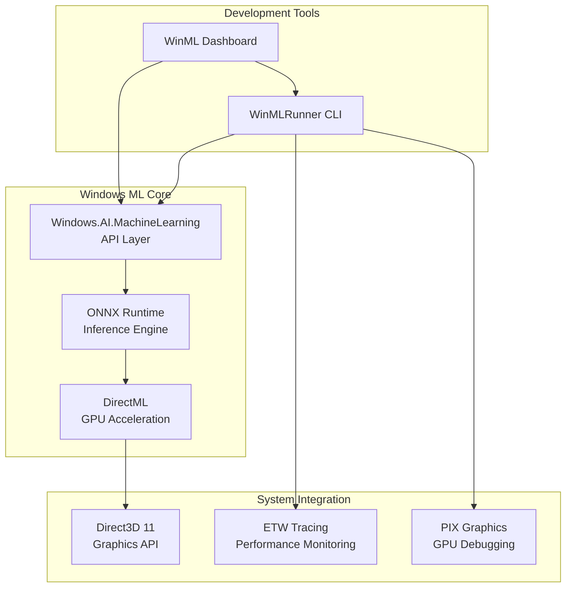

**Shared Components:**
- Both tools use `Windows.AI.MachineLearning` API for model loading and inference
- Common ONNX model format support
- Unified device selection (CPU/GPU) mechanisms
- Consistent performance measurement approaches

**Testing Infrastructure:**
- WinMLRunner serves as validation backend for Dashboard
- Automated testing via `WinMLRunnerTest` project
- CI/CD integration through Azure DevOps pipelines

**Sources:** [Tools/WinMLRunner/src/Common.h:7-11](), [Tools/WinMLRunner/src/Run.cpp:345-401](), [Testing/WinMLRunnerTest/WinMLRunnerTest.cpp:1-50]()

### Build and Development Workflow

The tools integrate into the repository's build system:

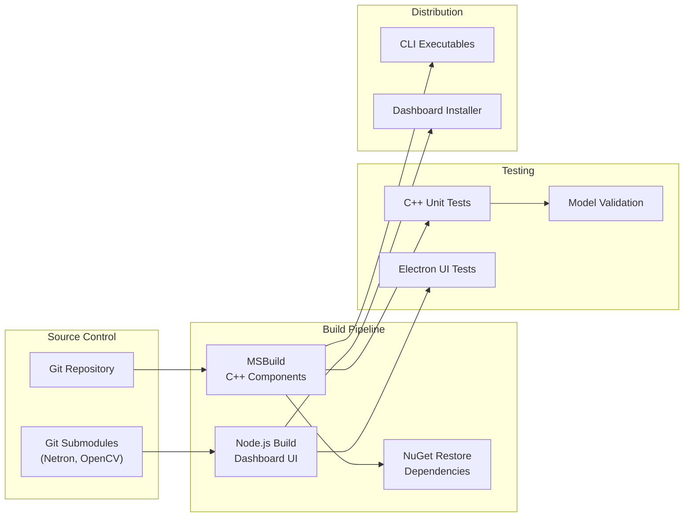

**Sources:** [Tools/WinMLDashboard/package.json:17-22](), [Tools/WinMLDashboard/build.js:1-19](), [Testing/WinMLRunnerTest/WinMLRunnerTest.vcxproj:1-50]()

---

# Page: WinML Dashboard

# WinML Dashboard

<details>
<summary>Relevant source files</summary>

The following files were used as context for generating this wiki page:

- [Tools/WinMLDashboard/.gitignore](Tools/WinMLDashboard/.gitignore)
- [Tools/WinMLDashboard/.vscode/launch.json](Tools/WinMLDashboard/.vscode/launch.json)
- [Tools/WinMLDashboard/README.md](Tools/WinMLDashboard/README.md)
- [Tools/WinMLDashboard/build.js](Tools/WinMLDashboard/build.js)
- [Tools/WinMLDashboard/package.json](Tools/WinMLDashboard/package.json)
- [Tools/WinMLDashboard/public/Converter.png](Tools/WinMLDashboard/public/Converter.png)
- [Tools/WinMLDashboard/public/DebugPngs.png](Tools/WinMLDashboard/public/DebugPngs.png)
- [Tools/WinMLDashboard/public/about.css](Tools/WinMLDashboard/public/about.css)
- [Tools/WinMLDashboard/public/about.html](Tools/WinMLDashboard/public/about.html)
- [Tools/WinMLDashboard/public/convert.py](Tools/WinMLDashboard/public/convert.py)
- [Tools/WinMLDashboard/public/progress_bar.gif](Tools/WinMLDashboard/public/progress_bar.gif)
- [Tools/WinMLDashboard/public/questionmark.png](Tools/WinMLDashboard/public/questionmark.png)
- [Tools/WinMLDashboard/public/questionmark2.png](Tools/WinMLDashboard/public/questionmark2.png)
- [Tools/WinMLDashboard/public/requirements.txt](Tools/WinMLDashboard/public/requirements.txt)
- [Tools/WinMLDashboard/src/components/Resizable.tsx](Tools/WinMLDashboard/src/components/Resizable.tsx)
- [Tools/WinMLDashboard/src/datastore/actionCreators.ts](Tools/WinMLDashboard/src/datastore/actionCreators.ts)
- [Tools/WinMLDashboard/src/datastore/actions.ts](Tools/WinMLDashboard/src/datastore/actions.ts)
- [Tools/WinMLDashboard/src/datastore/reducers.ts](Tools/WinMLDashboard/src/datastore/reducers.ts)
- [Tools/WinMLDashboard/src/datastore/state.ts](Tools/WinMLDashboard/src/datastore/state.ts)
- [Tools/WinMLDashboard/src/electronMain.js](Tools/WinMLDashboard/src/electronMain.js)
- [Tools/WinMLDashboard/src/native/dialog.ts](Tools/WinMLDashboard/src/native/dialog.ts)
- [Tools/WinMLDashboard/src/native/menu.ts](Tools/WinMLDashboard/src/native/menu.ts)
- [Tools/WinMLDashboard/src/view/convert/View.css](Tools/WinMLDashboard/src/view/convert/View.css)
- [Tools/WinMLDashboard/src/view/convert/View.tsx](Tools/WinMLDashboard/src/view/convert/View.tsx)
- [Tools/WinMLDashboard/src/view/edit/LeftPanel.tsx](Tools/WinMLDashboard/src/view/edit/LeftPanel.tsx)
- [Tools/WinMLDashboard/src/view/edit/Panel.css](Tools/WinMLDashboard/src/view/edit/Panel.css)
- [Tools/WinMLDashboard/src/view/edit/RightPanel.tsx](Tools/WinMLDashboard/src/view/edit/RightPanel.tsx)
- [Tools/WinMLDashboard/src/view/edit/netron/Netron.tsx](Tools/WinMLDashboard/src/view/edit/netron/Netron.tsx)
- [Tools/WinMLDashboard/src/view/edit/netron/fixed-position-override.css](Tools/WinMLDashboard/src/view/edit/netron/fixed-position-override.css)
- [Tools/WinMLDashboard/src/view/run/View.tsx](Tools/WinMLDashboard/src/view/run/View.tsx)
- [Tools/WinMLDashboard/test/test.js](Tools/WinMLDashboard/test/test.js)
- [Tools/WinMLDashboard/tsconfig.json](Tools/WinMLDashboard/tsconfig.json)

</details>


WinML Dashboard is a desktop application for viewing, editing, converting, and validating machine learning models for the Windows ML inference engine. It provides a comprehensive GUI tool for working with ONNX models and converting models from various machine learning frameworks to ONNX format. The dashboard supports model visualization through Netron integration, model metadata editing, cross-framework conversion via Python tools, and model validation using the built-in Windows ML runtime.

For information about the Windows ML API itself and core inference capabilities, see [Core API and Architecture](#2). For sample applications demonstrating Windows ML usage, see [Sample Applications](#4).

## Architecture Overview

WinML Dashboard is built as an Electron application with a React-based user interface. The application follows a multi-layered architecture combining web technologies with native system integration.

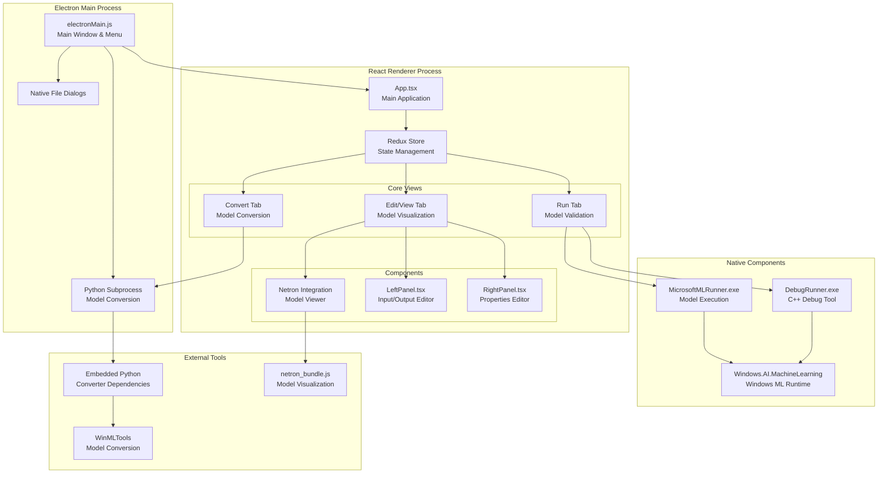

Sources: [Tools/WinMLDashboard/src/electronMain.js:1-171](), [Tools/WinMLDashboard/package.json:1-76](), [Tools/WinMLDashboard/README.md:1-142]()

## Core Views and Navigation

The application is organized around three primary tabs that handle different aspects of model management. Each view is implemented as a React component with Redux state management.

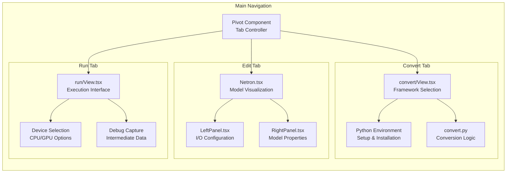

Sources: [Tools/WinMLDashboard/src/view/edit/netron/Netron.tsx:1-360](), [Tools/WinMLDashboard/src/view/convert/View.tsx:1-387](), [Tools/WinMLDashboard/src/view/run/View.tsx:1-427]()

### Edit/View Tab

The Edit tab provides model visualization and editing capabilities through Netron integration. It supports viewing model graphs and editing ONNX model properties.

| Component | Purpose | File Location |
|-----------|---------|---------------|
| `Netron.tsx` | Main model viewer integration | [src/view/edit/netron/Netron.tsx]() |
| `LeftPanel.tsx` | Input/output node editor | [src/view/edit/LeftPanel.tsx]() |
| `RightPanel.tsx` | Model properties editor | [src/view/edit/RightPanel.tsx]() |

The Netron component manages the integration with the Netron model viewer, handling model loading and providing edit/view mode switching functionality.

Sources: [Tools/WinMLDashboard/src/view/edit/netron/Netron.tsx:51-360](), [Tools/WinMLDashboard/src/view/edit/LeftPanel.tsx:79-319](), [Tools/WinMLDashboard/src/view/edit/RightPanel.tsx:22-59]()

### Convert Tab

The Convert tab handles model conversion from various machine learning frameworks to ONNX format. It manages Python environment setup and conversion execution.

Key conversion steps managed by [convert/View.tsx:59-375]():

1. **Python Environment Setup**: Downloads and configures embedded Python with required dependencies
2. **Framework Selection**: Supports CoreML, Keras, scikit-learn, XGBoost, LibSVM, and TensorFlow
3. **Conversion Execution**: Runs [convert.py:1-170]() with framework-specific parameters
4. **Output Management**: Handles converted model file saving and loading

Sources: [Tools/WinMLDashboard/src/view/convert/View.tsx:59-375](), [Tools/WinMLDashboard/public/convert.py:1-170](), [Tools/WinMLDashboard/public/requirements.txt:1-19]()

### Run Tab

The Run tab provides model validation and debugging capabilities using the Windows ML runtime. It supports both standard inference and debug capture modes.

Runtime execution modes:
- **Standard Validation**: Uses `MicrosoftMLRunner.exe` for basic model testing
- **Debug Capture**: Uses `DebugRunner.exe` for intermediate data capture and visualization
- **Performance Profiling**: Includes ETW tracing capabilities for performance analysis

Sources: [Tools/WinMLDashboard/src/view/run/View.tsx:88-427]()

## Model Conversion Pipeline

The conversion system integrates multiple machine learning frameworks through a Python-based conversion pipeline. The system automatically manages dependencies and provides a unified interface for cross-framework conversion.

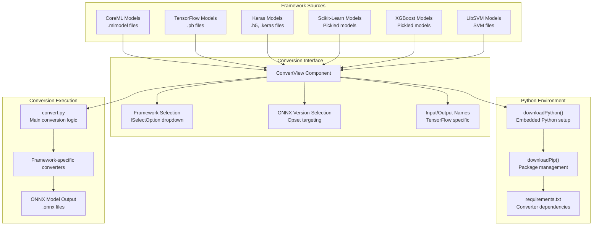

### Framework-Specific Conversion

The conversion system uses specialized converters for each supported framework, implemented in [convert.py:123-131]():

| Framework | Converter Function | Dependencies |
|-----------|-------------------|--------------|
| CoreML | `coreml_converter()` | `coremltools`, `onnxmltools` |
| Keras | `keras_converter()` | `keras`, `onnxmltools` |
| TensorFlow | `tensorFlow_converter()` | `tensorflow`, `tf2onnx` |
| Scikit-Learn | `scikit_learn_converter()` | `scikit-learn`, `skl2onnx` |
| XGBoost | `xgboost_converter()` | `xgboost`, `onnxmltools` |
| LibSVM | `libSVM_converter()` | `libsvm`, `onnxmltools` |

Sources: [Tools/WinMLDashboard/public/convert.py:50-131](), [Tools/WinMLDashboard/public/requirements.txt:1-19]()

## State Management and Data Flow

The application uses Redux for centralized state management, coordinating between the various views and components. The state structure supports model data, UI configuration, and debugging information.

```mermaid
graph TB
    subgraph "Redux Store Structure"
        state["IState Interface"]
        
        subgraph "Model Data"
            file["file: File<br/>Current model file"]
            nodes["nodes: object<br/>ONNX graph nodes"]
            inputs["inputs: object<br/>Model input specs"]
            outputs["outputs: object<br/>Model output specs"]
            properties["properties: IProperties<br/>Model metadata"]
        end
        
        subgraph "UI State"
            showLeft["showLeft: boolean<br/>Left panel visibility"]
            showRight["showRight: boolean<br/>Right panel visibility"]
            selectedNode["selectedNode: string<br/>Selected graph node"]
        end
        
        subgraph "Debug State"
            debugNodes["debugNodes: IDebugNodeMap<br/>Debug capture config"]
        end
    end
    
    subgraph "Action Creators"
        setFile["setFile()<br/>SET_FILE action"]
        setNodes["setNodes()<br/>SET_NODES action"]
        setInputs["setInputs()<br/>SET_INPUTS action"]
        setOutputs["setOutputs()<br/>SET_OUTPUTS action"]
        setProperties["setProperties()<br/>SET_PROPERTIES action"]
        setSelectedNode["setSelectedNode()<br/>SET_SELECTED_NODE action"]
        setDebugNodes["setDebugNodes()<br/>SET_DEBUG_NODES action"]
    end
    
    subgraph "Reducers"
        rootReducer["rootReducer()<br/>State transitions"]
    end
    
    state --> file
    state --> nodes
    state --> inputs
    state --> outputs
    state --> properties
    state --> showLeft
    state --> showRight
    state --> selectedNode
    state --> debugNodes
    
    setFile --> rootReducer
    setNodes --> rootReducer
    setInputs --> rootReducer
    setOutputs --> rootReducer
    setProperties --> rootReducer
    setSelectedNode --> rootReducer
    setDebugNodes --> rootReducer
    
    rootReducer --> state
```

Sources: [Tools/WinMLDashboard/src/datastore/state.ts:1-35](), [Tools/WinMLDashboard/src/datastore/actionCreators.ts:1-68](), [Tools/WinMLDashboard/src/datastore/reducers.ts:1-37]()

## Native Integration and File Management

The application provides seamless integration with the native Windows environment through Electron's file system APIs and custom dialog implementations.

### File Dialog System

The dialog system abstracts file operations to work both in Electron and web environments:

```mermaid
graph LR
    subgraph "Dialog Interface"
        showOpenDialog["showOpenDialog()<br/>Unified file opening"]
        showSaveDialog["showNativeSaveDialog()<br/>File saving interface"]
        fileFromPath["fileFromPath()<br/>File object creation"]
    end
    
    subgraph "Native Implementation"
        electronDialog["Electron remote.dialog<br/>Native file dialogs"]
        fsOperations["Node.js fs module<br/>File system access"]
    end
    
    subgraph "Web Fallback"
        webFileInput["HTML file input<br/>Web file selection"]
        webDownload["Blob download<br/>Web file saving"]
    end
    
    showOpenDialog --> electronDialog
    showOpenDialog --> webFileInput
    showSaveDialog --> electronDialog
    showSaveDialog --> webDownload
    fileFromPath --> fsOperations
```

### Menu System

The application menu provides standard file operations and help functions, implemented in [src/native/menu.ts:8-141]():

- **File Menu**: Open, Save, Save As operations with keyboard shortcuts
- **Help Menu**: Documentation links, issue reporting, third-party notices, and about dialog

Sources: [Tools/WinMLDashboard/src/native/dialog.ts:1-86](), [Tools/WinMLDashboard/src/native/menu.ts:8-141]()

## Model Debugging and Validation

The debugging system provides detailed insights into model execution and intermediate data visualization. It supports both text-based data capture and image visualization for computer vision models.

### Debug Capture Workflow

```mermaid
graph TD
    subgraph "Debug Configuration"
        debugSelection["Debug Format Selection<br/>text, png options"]
        nodeSelection["Graph Node Selection<br/>Operator targeting"]
        outputConfig["Output Directory<br/>Debug data destination"]
    end
    
    subgraph "Debug Execution"
        modelSerialization["ModelProtoSingleton.serialize()<br/>Debug model generation"]
        debugRunner["DebugRunner.exe<br/>Native debug execution"]
        dataCapture["Intermediate Data Capture<br/>Per-operator output"]
    end
    
    subgraph "Debug Output"
        textFiles["Text Files<br/>Raw tensor data"]
        imageFiles["PNG Files<br/>Visual tensor data"]
        debugExport["exportDebug()<br/>Output directory copy"]
    end
    
    debugSelection --> modelSerialization
    nodeSelection --> modelSerialization
    outputConfig --> debugExport
    
    modelSerialization --> debugRunner
    debugRunner --> dataCapture
    
    dataCapture --> textFiles
    dataCapture --> imageFiles
    debugExport --> textFiles
    debugExport --> imageFiles
```

The debug system captures intermediate data at specified graph nodes and formats it for analysis. For computer vision models, tensor data can be visualized as PNG images to inspect feature maps and intermediate processing stages.

Sources: [Tools/WinMLDashboard/src/view/run/View.tsx:346-414](), [Tools/WinMLDashboard/src/view/edit/LeftPanel.tsx:253-282]()

## Build System and Dependencies

The build system manages the complex integration of multiple technologies and external dependencies required for the dashboard's functionality.

### Build Configuration

Key build scripts in [package.json:10-22]():
- `electron-prod`: Full production build with C++ components
- `build-cpp`: Native component compilation via MSBuild
- `copy-netron`: Netron integration and dependency management
- `lock-netron-deps`: Netron version pinning and compatibility

### External Dependencies

| Dependency | Purpose | Integration Point |
|------------|---------|-------------------|
| Netron | Model visualization | [netron_bundle.js]() bundled asset |
| Python Environment | Model conversion | Embedded Python with [requirements.txt]() |
| C++ Debug Tools | Native debugging | [DebugRunner.exe](), [MicrosoftMLRunner.exe]() |
| Windows ML Runtime | Model execution | System-provided Windows ML APIs |

Sources: [Tools/WinMLDashboard/package.json:1-76](), [Tools/WinMLDashboard/public/requirements.txt:1-19]()

---

# Page: WinMLRunner

# WinMLRunner

<details>
<summary>Relevant source files</summary>

The following files were used as context for generating this wiki page:

- [Testing/WinMLRunnerTest/WinMLRunnerTest.cpp](Testing/WinMLRunnerTest/WinMLRunnerTest.cpp)
- [Testing/WinMLRunnerTest/WinMLRunnerTest.vcxproj](Testing/WinMLRunnerTest/WinMLRunnerTest.vcxproj)
- [Tools/WinMLRunner/README.md](Tools/WinMLRunner/README.md)
- [Tools/WinMLRunner/WinMLRunner.vcxproj](Tools/WinMLRunner/WinMLRunner.vcxproj)
- [Tools/WinMLRunner/WinMLRunnerScenarios.vcxproj](Tools/WinMLRunner/WinMLRunnerScenarios.vcxproj)
- [Tools/WinMLRunner/WinMLRunnerStaticLib.vcxproj](Tools/WinMLRunner/WinMLRunnerStaticLib.vcxproj)
- [Tools/WinMLRunner/WinMLRunnerStaticLib.vcxproj.filters](Tools/WinMLRunner/WinMLRunnerStaticLib.vcxproj.filters)
- [Tools/WinMLRunner/packages.config](Tools/WinMLRunner/packages.config)
- [Tools/WinMLRunner/src/BindingUtilities.cpp](Tools/WinMLRunner/src/BindingUtilities.cpp)
- [Tools/WinMLRunner/src/BindingUtilities.h](Tools/WinMLRunner/src/BindingUtilities.h)
- [Tools/WinMLRunner/src/CommandLineArgs.cpp](Tools/WinMLRunner/src/CommandLineArgs.cpp)
- [Tools/WinMLRunner/src/CommandLineArgs.h](Tools/WinMLRunner/src/CommandLineArgs.h)
- [Tools/WinMLRunner/src/Common.h](Tools/WinMLRunner/src/Common.h)
- [Tools/WinMLRunner/src/EventTraceHelper.cpp](Tools/WinMLRunner/src/EventTraceHelper.cpp)
- [Tools/WinMLRunner/src/EventTraceHelper.h](Tools/WinMLRunner/src/EventTraceHelper.h)
- [Tools/WinMLRunner/src/Filehelper.cpp](Tools/WinMLRunner/src/Filehelper.cpp)
- [Tools/WinMLRunner/src/Filehelper.h](Tools/WinMLRunner/src/Filehelper.h)
- [Tools/WinMLRunner/src/LearningModelDeviceHelper.cpp](Tools/WinMLRunner/src/LearningModelDeviceHelper.cpp)
- [Tools/WinMLRunner/src/LearningModelDeviceHelper.h](Tools/WinMLRunner/src/LearningModelDeviceHelper.h)
- [Tools/WinMLRunner/src/OutputHelper.h](Tools/WinMLRunner/src/OutputHelper.h)
- [Tools/WinMLRunner/src/Run.cpp](Tools/WinMLRunner/src/Run.cpp)
- [Tools/WinMLRunner/src/Run.h](Tools/WinMLRunner/src/Run.h)
- [Tools/WinMLRunner/src/TimerHelper.h](Tools/WinMLRunner/src/TimerHelper.h)
- [Tools/WinMLRunner/src/TypeHelper.h](Tools/WinMLRunner/src/TypeHelper.h)
- [Tools/WinMLRunner/src/main.cpp](Tools/WinMLRunner/src/main.cpp)

</details>


WinMLRunner is a command-line tool for evaluating ONNX and Protobuf machine learning models using the Windows Machine Learning (WinML) API. It provides comprehensive model testing capabilities including performance benchmarking, device selection, input data binding, and result validation.

This tool serves as both a standalone evaluation utility and a reference implementation for integrating Windows ML into applications. For information about the GUI-based model development tool, see [WinML Dashboard](#3.1). For sample applications demonstrating Windows ML integration patterns, see [WinML Samples Gallery](#4.1).

## Architecture Overview

WinMLRunner follows a modular architecture that separates command-line parsing, model execution, and performance monitoring into distinct components.

### Core Components Architecture

```mermaid
graph TB
    subgraph "Entry Point"
        main["main.cpp::main()"]
    end
    
    subgraph "Configuration"
        CommandLineArgs["CommandLineArgs"]
        sessionOptions["LearningModelSessionOptions"]
    end
    
    subgraph "Execution Engine"
        run["Run.cpp::run()"]
        LoadModel["LoadModel()"]
        CreateSession["CreateSession()"]
        BindInputs["BindInputs()"]
        EvaluateModel["EvaluateModel()"]
    end
    
    subgraph "Device Management" 
        DeviceHelper["LearningModelDeviceHelper"]
        DeviceList["LearningModelDeviceWithMetadata"]
    end
    
    subgraph "Input Processing"
        BindingUtilities["BindingUtilities"]
        CreateBindableTensor["CreateBindableTensor()"]
        CreateBindableImage["CreateBindableImage()"]
    end
    
    subgraph "Performance & Output"
        Profiler["Profiler<WINML_MODEL_TEST_PERF>"]
        OutputHelper["OutputHelper"]
        EventTraceHelper["EventTraceHelper"]
    end
    
    main --> CommandLineArgs
    main --> run
    run --> LoadModel
    run --> DeviceHelper
    run --> CreateSession
    run --> BindInputs
    run --> EvaluateModel
    BindInputs --> BindingUtilities
    BindingUtilities --> CreateBindableTensor
    BindingUtilities --> CreateBindableImage
    run --> Profiler
    run --> OutputHelper
    run --> EventTraceHelper
```

Sources: [Tools/WinMLRunner/src/main.cpp:22-58](), [Tools/WinMLRunner/src/Run.cpp:528-645](), [Tools/WinMLRunner/src/CommandLineArgs.h:25-222](), [Tools/WinMLRunner/src/Run.h:1-7]()

## Command Line Interface

The tool accepts models via `-model` (single file) or `-folder` (directory) arguments and supports extensive configuration options for execution parameters.

### Key Configuration Categories

| Category | Options | Purpose |
|----------|---------|---------|
| Device Selection | `-CPU`, `-GPU`, `-GPUHighPerformance`, `-GPUMinPower` | Choose execution device |
| Input Binding | `-CPUBoundInput`, `-GPUBoundInput` | Control where input data resides |
| Input Format | `-RGB`, `-BGR`, `-Tensor` | Specify input data format |
| Device Creation | `-CreateDeviceOnClient`, `-CreateDeviceInWinML` | Control D3D device creation location |
| Performance | `-Perf`, `-Iterations`, `-SavePerIterationPerf` | Enable performance monitoring |
| Input Data | `-Input`, `-InputImageFolder` | Provide real input data |

### Command Line Processing Flow

```mermaid
graph LR
    subgraph "CommandLineArgs Constructor"
        Parse["Parse arguments"]
        Validate["Validate combinations"]
        SetupPaths["Setup output paths"]
    end
    
    subgraph "Fetch Methods"
        FetchDeviceTypes["FetchDeviceTypes()"]
        FetchInputBindingTypes["FetchInputBindingTypes()"] 
        FetchInputDataTypes["FetchInputDataTypes()"]
        FetchDeviceCreationLocations["FetchDeviceCreationLocations()"]
    end
    
    Parse --> Validate
    Validate --> SetupPaths
    SetupPaths --> FetchDeviceTypes
    FetchDeviceTypes --> FetchInputBindingTypes
    FetchInputBindingTypes --> FetchInputDataTypes
    FetchInputDataTypes --> FetchDeviceCreationLocations
```

Sources: [Tools/WinMLRunner/src/CommandLineArgs.cpp:106-442](), [Tools/WinMLRunner/src/CommandLineArgs.cpp:568-627]()

## Core Execution Flow

The main execution logic in `Run.cpp` orchestrates model loading, session creation, input binding, and evaluation across multiple iterations and device configurations.

### Primary Execution Sequence

```mermaid
sequenceDiagram
    participant main as "main()"
    participant run as "run()"
    participant LoadModel as "LoadModel()"
    participant CreateSession as "CreateSession()"
    participant BindInputs as "BindInputs()"
    participant EvaluateModel as "EvaluateModel()"
    participant OutputHelper as "OutputHelper"
    
    main->>run: Start execution
    run->>LoadModel: Load ONNX/PB model
    LoadModel-->>run: LearningModel
    
    loop For each device configuration
        run->>CreateSession: Create session with device
        CreateSession-->>run: LearningModelSession
        
        loop For each iteration
            run->>BindInputs: Bind input features
            BindInputs-->>run: Success/Failure
            run->>EvaluateModel: Evaluate model
            EvaluateModel-->>run: Results
            run->>OutputHelper: Record performance
        end
    end
    
    run->>OutputHelper: Generate final reports
    OutputHelper-->>main: Performance data
```

Sources: [Tools/WinMLRunner/src/Run.cpp:95-127](), [Tools/WinMLRunner/src/Run.cpp:165-195](), [Tools/WinMLRunner/src/Run.cpp:197-249](), [Tools/WinMLRunner/src/Run.cpp:310-342]()

### Configuration Iteration Strategy

The tool supports comprehensive testing by iterating through multiple configuration combinations:

```mermaid
graph TB
    subgraph "Iteration Loops"
        ModelLoop["For each model path"]
        DeviceLoop["For each device type"]
        InputDataLoop["For each input data type"] 
        InputBindingLoop["For each input binding type"]
        SessionLoop["For each session creation iteration"]
        EvalLoop["For each evaluation iteration"]
    end
    
    ModelLoop --> DeviceLoop
    DeviceLoop --> InputDataLoop
    InputDataLoop --> InputBindingLoop
    InputBindingLoop --> SessionLoop
    SessionLoop --> EvalLoop
    
    subgraph "Performance Capture Points"
        LoadPerf["LOAD_MODEL"]
        SessionPerf["CREATE_SESSION"]
        BindPerf["BIND_VALUE"]
        EvalPerf["EVAL_MODEL"]
    end
    
    EvalLoop --> LoadPerf
    EvalLoop --> SessionPerf 
    EvalLoop --> BindPerf
    EvalLoop --> EvalPerf
```

Sources: [Tools/WinMLRunner/src/Run.cpp:568-625](), [Tools/WinMLRunner/src/Common.h:39-49]()

## Input Data Binding

The `BindingUtilities` module handles creation of appropriate input feature values based on the specified input data type and binding location.

### Input Feature Creation Flow

```mermaid
graph TB
    subgraph "GenerateInputFeatures"
        CheckInputType["Check inputDataType"]
        TensorPath["InputDataType::Tensor"]
        ImagePath["InputDataType::ImageRGB/BGR"]
        CreateTensor["CreateBindableTensor()"]
        CreateImage["CreateBindableImage()"]
    end
    
    subgraph "Tensor Creation"
        LoadCSV["Load CSV data"]
        GenerateGarbage["Generate garbage data"]
        ApplyTensorize["Apply tensorization functions"]
        CreateTensorFloat["TensorFloat::CreateFromArray()"]
    end
    
    subgraph "Image Creation"
        LoadImageFile["Load image file"]
        DecodeImage["Decode with WIC"]
        ColorManage["Apply color management"]
        CreateVideoFrame["VideoFrame::CreateWithSoftwareBitmap()"]
        CreateImageFeature["ImageFeatureValue::CreateFromVideoFrame()"]
    end
    
    CheckInputType --> TensorPath
    CheckInputType --> ImagePath
    TensorPath --> CreateTensor
    ImagePath --> CreateImage
    
    CreateTensor --> LoadCSV
    CreateTensor --> GenerateGarbage
    GenerateGarbage --> ApplyTensorize
    ApplyTensorize --> CreateTensorFloat
    
    CreateImage --> LoadImageFile
    LoadImageFile --> DecodeImage
    DecodeImage --> ColorManage
    ColorManage --> CreateVideoFrame
    CreateVideoFrame --> CreateImageFeature
```

Sources: [Tools/WinMLRunner/src/Run.cpp:14-50](), [Tools/WinMLRunner/src/BindingUtilities.cpp:215-480](), [Tools/WinMLRunner/src/BindingUtilities.cpp:482-650]()

## Performance Monitoring

WinMLRunner provides comprehensive performance monitoring through multiple measurement systems.

### Performance Measurement Architecture

```mermaid
graph TB
    subgraph "Profiler System"
        ProfilerEnum["WINML_MODEL_TEST_PERF enum"]
        ProfilerClass["Profiler<WINML_MODEL_TEST_PERF>"]
        TimerHelper["Timer class"]
        CpuPerfCounter["CpuPerfCounter"]
        GpuPerfCounter["GpuPerfCounter"]
    end
    
    subgraph "Measurement Points" 
        LoadModel["LOAD_MODEL"]
        CreateSession["CREATE_SESSION"]
        BindValue["BIND_VALUE"] 
        EvalModel["EVAL_MODEL"]
        FirstRunVariants["BIND_VALUE_FIRST_RUN<br/>EVAL_MODEL_FIRST_RUN"]
    end
    
    subgraph "Output Systems"
        OutputHelper["OutputHelper"]
        CSVOutput["CSV file output"]
        ConsoleOutput["Console output"]
        PerIterOutput["Per-iteration files"]
    end
    
    ProfilerClass --> TimerHelper
    ProfilerClass --> CpuPerfCounter
    ProfilerClass --> GpuPerfCounter
    
    LoadModel --> ProfilerClass
    CreateSession --> ProfilerClass
    BindValue --> ProfilerClass
    EvalModel --> ProfilerClass
    FirstRunVariants --> ProfilerClass
    
    ProfilerClass --> OutputHelper
    OutputHelper --> CSVOutput
    OutputHelper --> ConsoleOutput
    OutputHelper --> PerIterOutput
```

### Event Tracing Integration

The tool includes ETW (Event Tracing for Windows) support for detailed execution analysis:

```mermaid
graph LR
    subgraph "Event Trace System"
        EventTraceHelper["EventTraceHelper"]
        ETWSession["ETW Session"]
        WinMLProvider["WINML_PROVIDER_GUID"]
        CPUFallbackDetection["CPU Fallback Detection"]
    end
    
    subgraph "Trace Processing"
        EventRecordCallback["EventRecordCallback()"]
        FormatDataForCPUFallback["FormatDataForCPUFallback()"]
        OperatorAnalysis["Operator execution analysis"]
    end
    
    EventTraceHelper --> ETWSession
    ETWSession --> WinMLProvider
    WinMLProvider --> EventRecordCallback
    EventRecordCallback --> FormatDataForCPUFallback
    FormatDataForCPUFallback --> OperatorAnalysis
    OperatorAnalysis --> CPUFallbackDetection
```

Sources: [Tools/WinMLRunner/src/TimerHelper.h:14-38](), [Tools/WinMLRunner/src/EventTraceHelper.cpp:1-34](), [Tools/WinMLRunner/src/EventTraceHelper.cpp:356-430](), [Tools/WinMLRunner/src/Common.h:39-49]()

## Build Configurations

WinMLRunner supports multiple build configurations to accommodate different deployment scenarios.

### Configuration Matrix

| Configuration | Purpose | Target Binary | WinML Source |
|---------------|---------|---------------|---------------|
| `Debug/Release` | Standard Windows ML | `WinMLRunner.exe` | System Windows ML |
| `Debug_NuGet/Release_NuGet` | NuGet package testing | `MicrosoftMLRunner.exe` | Microsoft.AI.MachineLearning NuGet |

### Project Structure

```mermaid
graph TB
    subgraph "Project Dependencies"
        WinMLRunner["WinMLRunner.vcxproj"]
        StaticLib["WinMLRunnerStaticLib.vcxproj"] 
        Scenarios["WinMLRunnerScenarios.vcxproj"]
        Tests["WinMLRunnerTest.vcxproj"]
    end
    
    subgraph "NuGet Packages"
        CppWinRT["Microsoft.Windows.CppWinRT"]
        MLNuGet["Microsoft.AI.MachineLearning"]
        DirectML["Microsoft.AI.DirectML"]
    end
    
    subgraph "Conditional Compilation"
        USE_WINML_NUGET["#ifdef USE_WINML_NUGET"]
        NuGetHeaders["Microsoft.AI.MachineLearning.h"]
        SystemHeaders["Windows.AI.MachineLearning.h"]
    end
    
    WinMLRunner --> StaticLib
    WinMLRunner --> Scenarios
    Tests --> StaticLib
    
    WinMLRunner --> CppWinRT
    WinMLRunner --> MLNuGet
    WinMLRunner --> DirectML
    
    USE_WINML_NUGET --> NuGetHeaders
    USE_WINML_NUGET --> SystemHeaders
```

The build system uses preprocessor definitions to switch between the in-box Windows ML API and the NuGet package version, enabling testing of different WinML versions.

Sources: [Tools/WinMLRunner/WinMLRunner.vcxproj:1-447](), [Tools/WinMLRunner/WinMLRunnerStaticLib.vcxproj:1-400](), [Tools/WinMLRunner/src/Common.h:7-11](), [Tools/WinMLRunner/packages.config:1-6]()

---

# Page: Sample Applications

# Sample Applications

<details>
<summary>Relevant source files</summary>

The following files were used as context for generating this wiki page:

- [README.md](README.md)
- [Samples/StyleTransfer/README.md](Samples/StyleTransfer/README.md)
- [Samples/WinMLSamplesGallery/README.md](Samples/WinMLSamplesGallery/README.md)
- [Samples/WinMLSamplesGallery/WinMLSamplesGallery (Package)/Package.appxmanifest](Samples/WinMLSamplesGallery/WinMLSamplesGallery (Package)/Package.appxmanifest)
- [Samples/WinMLSamplesGallery/WinMLSamplesGallery (Package)/WinMLSamplesGallery (Package).wapproj](Samples/WinMLSamplesGallery/WinMLSamplesGallery (Package)/WinMLSamplesGallery (Package).wapproj)
- [Samples/WinMLSamplesGallery/WinMLSamplesGallery/Samples/Batching/README.md](Samples/WinMLSamplesGallery/WinMLSamplesGallery/Samples/Batching/README.md)
- [Samples/WinMLSamplesGallery/WinMLSamplesGallery/Samples/ImageClassifier/docs/screenshot.png](Samples/WinMLSamplesGallery/WinMLSamplesGallery/Samples/ImageClassifier/docs/screenshot.png)
- [Samples/WinMLSamplesGallery/WinMLSamplesGallery/Samples/ImageEffects/README.md](Samples/WinMLSamplesGallery/WinMLSamplesGallery/Samples/ImageEffects/README.md)
- [Samples/WinMLSamplesGallery/WinMLSamplesGallery/Samples/ImageEffects/docs/screenshot.png](Samples/WinMLSamplesGallery/WinMLSamplesGallery/Samples/ImageEffects/docs/screenshot.png)
- [Samples/WinMLSamplesGallery/WinMLSamplesGallery/Samples/ImageSharpInterop/ImageSharpExtensions.cs](Samples/WinMLSamplesGallery/WinMLSamplesGallery/Samples/ImageSharpInterop/ImageSharpExtensions.cs)
- [Samples/WinMLSamplesGallery/WinMLSamplesGallery/Samples/ImageSharpInterop/README.md](Samples/WinMLSamplesGallery/WinMLSamplesGallery/Samples/ImageSharpInterop/README.md)
- [Samples/WinMLSamplesGallery/WinMLSamplesGallery/Samples/ImageSharpInterop/docs/screenshot.png](Samples/WinMLSamplesGallery/WinMLSamplesGallery/Samples/ImageSharpInterop/docs/screenshot.png)
- [Samples/WinMLSamplesGallery/WinMLSamplesGallery/WinMLSamplesGallery.csproj](Samples/WinMLSamplesGallery/WinMLSamplesGallery/WinMLSamplesGallery.csproj)
- [Samples/WinMLSamplesGallery/WinMLSamplesGalleryNative.Interop/WinMLSamplesGalleryNative.Interop.csproj](Samples/WinMLSamplesGallery/WinMLSamplesGalleryNative.Interop/WinMLSamplesGalleryNative.Interop.csproj)
- [Samples/WinMLSamplesGallery/WinMLSamplesGalleryNative/TransformAsync.h](Samples/WinMLSamplesGallery/WinMLSamplesGalleryNative/TransformAsync.h)
- [Samples/WinMLSamplesGallery/WinMLSamplesGalleryNative/WinMLSamplesGalleryNative.vcxproj](Samples/WinMLSamplesGallery/WinMLSamplesGalleryNative/WinMLSamplesGalleryNative.vcxproj)
- [Samples/WinMLSamplesGallery/WinMLSamplesGalleryNative/WinMLSamplesGalleryNative.vcxproj.filters](Samples/WinMLSamplesGallery/WinMLSamplesGalleryNative/WinMLSamplesGalleryNative.vcxproj.filters)
- [Samples/WinMLSamplesGallery/WinMLSamplesGalleryNative/packages.config](Samples/WinMLSamplesGallery/WinMLSamplesGalleryNative/packages.config)
- [Samples/WinMLSamplesGallery/docs/WinMLSamplesGalleryLanding.png](Samples/WinMLSamplesGallery/docs/WinMLSamplesGalleryLanding.png)
- [ThirdPartyNotices.txt](ThirdPartyNotices.txt)

</details>


This document provides an overview of the sample applications included in the Windows Machine Learning repository. These applications demonstrate various Windows ML capabilities through practical implementations ranging from basic image classification to advanced real-time video processing scenarios.

For information about the core Windows ML API architecture, see [Core API and Architecture](#2). For details about development tools used with these samples, see [Development Tools](#3).

## Overview

The repository contains two primary sample application categories:

1. **WinML Samples Gallery** - An interactive desktop application showcasing multiple Windows ML scenarios in a single interface
2. **Standalone Applications** - Individual applications demonstrating specific use cases like style transfer and MNIST classification

## WinML Samples Gallery

The WinML Samples Gallery serves as the primary demonstration application, implemented as a WinUI 3 desktop application targeting .NET 6. The gallery provides an interactive interface for exploring various Windows ML capabilities.

### Application Architecture

```mermaid
graph TB
    MainApp["WinMLSamplesGallery.csproj<br/>.NET 6 WinUI 3 App"]
    
    subgraph "Managed Layer"
        SampleBase["SampleBasePage<br/>Base Sample Framework"]
        ImageClassifier["ImageClassifier<br/>Classification Samples"]
        ImageEffects["ImageEffects<br/>Effects Pipeline"]
        Batching["Batching<br/>Performance Samples"]
        OpenCVSample["OpenCVInterop<br/>Computer Vision"]
        ImageSharpSample["ImageSharpInterop<br/>Graphics Library Integration"]
        AdapterSel["AdapterSelection<br/>Device Selection"]
        StreamEffect["StreamEffect<br/>Real-time Processing"]
    end
    
    subgraph "Native Layer"
        NativeLib["WinMLSamplesGalleryNative.vcxproj<br/>C++ Performance Components"]
        TransformAsync["TransformAsync<br/>Media Foundation Transform"]
        DXBinding["DXResourceBinding<br/>DirectX Integration"]
        ORTHelpers["ORTHelpers<br/>ONNX Runtime Utilities"]
        StreamModel["StreamModelBase<br/>Inference Engine"]
    end
    
    subgraph "Interop"
        CsWinRT["WinMLSamplesGalleryNative.Interop<br/>C#/WinRT Projections"]
    end
    
    MainApp --> SampleBase
    SampleBase --> ImageClassifier
    SampleBase --> ImageEffects
    SampleBase --> Batching
    SampleBase --> OpenCVSample
    SampleBase --> ImageSharpSample
    SampleBase --> AdapterSel
    SampleBase --> StreamEffect
    
    StreamEffect --> CsWinRT
    CsWinRT --> TransformAsync
    TransformAsync --> StreamModel
    DXBinding --> ORTHelpers
    NativeLib --> TransformAsync
    NativeLib --> DXBinding
    NativeLib --> ORTHelpers
```

Sources: [Samples/WinMLSamplesGallery/WinMLSamplesGallery/WinMLSamplesGallery.csproj](), [Samples/WinMLSamplesGallery/WinMLSamplesGalleryNative/WinMLSamplesGalleryNative.vcxproj](), [Samples/WinMLSamplesGallery/WinMLSamplesGalleryNative.Interop/WinMLSamplesGalleryNative.Interop.csproj]()

### Sample Categories

The gallery contains several categories of samples, each demonstrating different aspects of Windows ML:

| Sample Type | Implementation | Key Components |
|-------------|---------------|----------------|
| Image Classification | C# WinUI | `ImageClassifier.xaml.cs`, Multiple ONNX models |
| Image Effects | C# WinUI | `ImageEffects.xaml.cs`, Model chaining |
| Batching | C# WinUI | `Batching.xaml.cs`, `BatchSizeOverride` |
| OpenCV Interop | C# + Native | `OpenCVInterop.xaml.cs`, `OpenCVImage.cpp` |
| ImageSharp Interop | C# | `ImageSharpInterop.xaml.cs`, `ImageSharpExtensions.cs` |
| Stream Effects | C# + Native | `StreamEffect.xaml.cs`, `TransformAsync.cpp` |
| DX Resource Binding | Native | `DXResourceBindingORT.xaml`, `DXResourceBinding.cpp` |

### Model Management

The application automatically downloads ONNX models from the ONNX Model Zoo during build:

```mermaid
graph LR
    BuildTarget["DownloadContentFiles<br/>MSBuild Target"]
    
    subgraph "Small Models"
        DenseNet["densenet-9.onnx"]
        EfficientNet["efficientnet-lite4-11.onnx"]
        ShuffleNet["shufflenet-9.onnx"]
        SqueezeNet["squeezenet1.1-7.onnx"]
        FCN["fcn-resnet50-12.onnx"]
    end
    
    subgraph "Large Models (Optional)"
        AlexNet["bvlcalexnet-9.onnx"]
        CaffeNet["caffenet-9.onnx"]
        GoogleNet["googlenet-9.onnx"]
        ResNet["resnet50-caffe2-v1-9.onnx"]
        VGG["vgg19-7.onnx"]
    end
    
    BuildTarget --> DenseNet
    BuildTarget --> EfficientNet
    BuildTarget --> ShuffleNet
    BuildTarget --> SqueezeNet
    BuildTarget --> FCN
    
    UseLargeModels["UseLargeModels=True"] --> AlexNet
    UseLargeModels --> CaffeNet
    UseLargeModels --> GoogleNet
    UseLargeModels --> ResNet
    UseLargeModels --> VGG
```

Sources: [Samples/WinMLSamplesGallery/WinMLSamplesGallery/WinMLSamplesGallery.csproj:190-245]()

### Native Components

The native layer provides performance-critical functionality through several key components:

#### Media Foundation Transform
The `TransformAsync` class implements `IMFTransform` for real-time video processing:

```mermaid
graph TB
    TransformAsync["TransformAsync<br/>IMFTransform Implementation"]
    
    subgraph "Media Foundation Interfaces"
        IMFTransform["IMFTransform<br/>Core Transform Interface"]
        IMFAsyncCallback["IMFAsyncCallback<br/>Async Processing"]
        IMFMediaEventGenerator["IMFMediaEventGenerator<br/>Event Handling"]
        IMFShutdown["IMFShutdown<br/>Cleanup"]
    end
    
    subgraph "Processing Pipeline"
        InputQueue["CSampleQueue<br/>Input Sample Queue"]
        OutputQueue["CSampleQueue<br/>Output Sample Queue"]
        StreamModel["StreamModelBase<br/>Inference Engine"]
        D3DDevice["ID3D11Device5<br/>DirectX Device"]
    end
    
    TransformAsync --> IMFTransform
    TransformAsync --> IMFAsyncCallback
    TransformAsync --> IMFMediaEventGenerator
    TransformAsync --> IMFShutdown
    
    TransformAsync --> InputQueue
    TransformAsync --> OutputQueue
    TransformAsync --> StreamModel
    TransformAsync --> D3DDevice
```

Sources: [Samples/WinMLSamplesGallery/WinMLSamplesGalleryNative/TransformAsync.h:44-351]()

## Style Transfer Application

The Style Transfer application demonstrates real-time neural style transfer on video streams using a standalone UWP implementation.

### Architecture

```mermaid
graph TB
    StyleApp["StyleTransfer UWP Application"]
    
    subgraph "Video Effects"
        VideoEffect["StyleTransferEffectCpp<br/>IBasicVideoEffect"]
        WinMLModel["LearningModel<br/>Style Transfer ONNX"]
        MediaPipeline["Media Foundation Pipeline"]
    end
    
    subgraph "Input Sources"
        Camera["Camera Stream"]
        ImageFile["Image Files"]
    end
    
    subgraph "Processing"
        Preprocessor["Input Preprocessing"]
        Inference["Windows ML Inference"]
        Postprocessor["Output Processing"]
    end
    
    StyleApp --> VideoEffect
    VideoEffect --> WinMLModel
    VideoEffect --> MediaPipeline
    
    Camera --> Preprocessor
    ImageFile --> Preprocessor
    Preprocessor --> Inference
    Inference --> Postprocessor
    Postprocessor --> MediaPipeline
```

Sources: [Samples/StyleTransfer/README.md:1-51]()

## MNIST and Basic Samples

Several standalone applications demonstrate basic Windows ML integration patterns across different application types:

| Application Type | Project Structure | Key Features |
|------------------|-------------------|--------------|
| UWP C++/CX | `Samples/MNIST/UWP` | Basic digit recognition |
| UWP C# | `Samples/MNIST/Tutorial/cs` | Managed implementation |
| Desktop C++/WinRT | `Samples/SqueezeNetObjectDetection/Desktop/cpp` | Object detection |
| .NET 5 | `Samples/SqueezeNetObjectDetection/NET5` | Cross-platform |
| .NET Core 2 | `Samples/SqueezeNetObjectDetection/NETCore/cs` | Legacy framework |

## Advanced Integration Samples

### OpenCV Integration

The OpenCV interoperability sample demonstrates computer vision pipeline integration:

```mermaid
graph LR
    OpenCVSample["OpenCVInterop.xaml.cs"]
    OpenCVExt["OpenCVImage.cpp<br/>Native Extensions"]
    OpenCVLib["opencv_world454.lib<br/>OpenCV Library"]
    WinMLTensor["ITensor<br/>Windows ML"]
    
    OpenCVSample --> OpenCVExt
    OpenCVExt --> OpenCVLib
    OpenCVExt --> WinMLTensor
```

Sources: [Samples/WinMLSamplesGallery/WinMLSamplesGalleryNative/OpenCVImage.cpp](), [Samples/WinMLSamplesGallery/WinMLSamplesGalleryNative/WinMLSamplesGalleryNative.vcxproj:115-131]()

### ImageSharp Integration

The ImageSharp sample provides managed graphics library integration through extension methods:

```mermaid
graph LR
    ImageSharpSample["ImageSharpInterop.xaml.cs"]
    Extensions["ImageSharpExtensions.cs<br/>Extension Methods"]
    
    subgraph "Extension Methods"
        AsBuffer["AsBuffer<TPixel>()"]
        AsTensor["AsTensor<TPixel>()"]
        AsSoftwareBitmap["AsSoftwareBitmap<TPixel>()"]
    end
    
    ImageSharpSample --> Extensions
    Extensions --> AsBuffer
    Extensions --> AsTensor
    Extensions --> AsSoftwareBitmap
```

Sources: [Samples/WinMLSamplesGallery/WinMLSamplesGallery/Samples/ImageSharpInterop/ImageSharpExtensions.cs:18-47]()

## Build Configuration

The samples support conditional compilation based on feature flags:

| Build Flag | Effect | Components Affected |
|------------|--------|-------------------|
| `USE_LARGE_MODELS` | Includes additional ONNX models | Model download targets |
| `USE_OPENCV` | Enables OpenCV integration | Native compilation, OpenCV samples |
| Platform targets | x86, x64, ARM64 support | All components |

The build system automatically detects OpenCV availability and conditionally compiles related samples based on library presence.

Sources: [Samples/WinMLSamplesGallery/WinMLSamplesGallery/WinMLSamplesGallery.csproj:11-19](), [Samples/WinMLSamplesGallery/WinMLSamplesGalleryNative/WinMLSamplesGalleryNative.vcxproj:115-131]()

---

# Page: WinML Samples Gallery

# WinML Samples Gallery

<details>
<summary>Relevant source files</summary>

The following files were used as context for generating this wiki page:

- [Samples/WinMLSamplesGallery/WinMLSamplesGallery (Package)/Package.appxmanifest](Samples/WinMLSamplesGallery/WinMLSamplesGallery (Package)/Package.appxmanifest)
- [Samples/WinMLSamplesGallery/WinMLSamplesGallery (Package)/WinMLSamplesGallery (Package).wapproj](Samples/WinMLSamplesGallery/WinMLSamplesGallery (Package)/WinMLSamplesGallery (Package).wapproj)
- [Samples/WinMLSamplesGallery/WinMLSamplesGallery.sln](Samples/WinMLSamplesGallery/WinMLSamplesGallery.sln)
- [Samples/WinMLSamplesGallery/WinMLSamplesGallery/MainWindow.xaml](Samples/WinMLSamplesGallery/WinMLSamplesGallery/MainWindow.xaml)
- [Samples/WinMLSamplesGallery/WinMLSamplesGallery/MainWindow.xaml.cs](Samples/WinMLSamplesGallery/WinMLSamplesGallery/MainWindow.xaml.cs)
- [Samples/WinMLSamplesGallery/WinMLSamplesGallery/Pages/SampleBasePage.xaml.cs](Samples/WinMLSamplesGallery/WinMLSamplesGallery/Pages/SampleBasePage.xaml.cs)
- [Samples/WinMLSamplesGallery/WinMLSamplesGallery/Pages/SamplesGrid.xaml](Samples/WinMLSamplesGallery/WinMLSamplesGallery/Pages/SamplesGrid.xaml)
- [Samples/WinMLSamplesGallery/WinMLSamplesGallery/SampleMetadata/SampleMetadata.json](Samples/WinMLSamplesGallery/WinMLSamplesGallery/SampleMetadata/SampleMetadata.json)
- [Samples/WinMLSamplesGallery/WinMLSamplesGallery/Samples/AdapterSelection/AdapterSelection.xaml](Samples/WinMLSamplesGallery/WinMLSamplesGallery/Samples/AdapterSelection/AdapterSelection.xaml)
- [Samples/WinMLSamplesGallery/WinMLSamplesGallery/Samples/AdapterSelection/AdapterSelection.xaml.cs](Samples/WinMLSamplesGallery/WinMLSamplesGallery/Samples/AdapterSelection/AdapterSelection.xaml.cs)
- [Samples/WinMLSamplesGallery/WinMLSamplesGallery/Samples/DXResourceBindingORT/DXResourceBindingORT.xaml](Samples/WinMLSamplesGallery/WinMLSamplesGallery/Samples/DXResourceBindingORT/DXResourceBindingORT.xaml)
- [Samples/WinMLSamplesGallery/WinMLSamplesGallery/Samples/DXResourceBindingORT/DXResourceBindingORT.xaml.cs](Samples/WinMLSamplesGallery/WinMLSamplesGallery/Samples/DXResourceBindingORT/DXResourceBindingORT.xaml.cs)
- [Samples/WinMLSamplesGallery/WinMLSamplesGallery/WinMLSamplesGallery.csproj](Samples/WinMLSamplesGallery/WinMLSamplesGallery/WinMLSamplesGallery.csproj)
- [Samples/WinMLSamplesGallery/WinMLSamplesGalleryNative.Interop/WinMLSamplesGalleryNative.Interop.csproj](Samples/WinMLSamplesGallery/WinMLSamplesGalleryNative.Interop/WinMLSamplesGalleryNative.Interop.csproj)
- [Samples/WinMLSamplesGallery/WinMLSamplesGalleryNative/AdapterList.cpp](Samples/WinMLSamplesGallery/WinMLSamplesGalleryNative/AdapterList.cpp)
- [Samples/WinMLSamplesGallery/WinMLSamplesGalleryNative/AdapterList.h](Samples/WinMLSamplesGallery/WinMLSamplesGalleryNative/AdapterList.h)
- [Samples/WinMLSamplesGallery/WinMLSamplesGalleryNative/DXResourceBinding.h](Samples/WinMLSamplesGallery/WinMLSamplesGalleryNative/DXResourceBinding.h)
- [Samples/WinMLSamplesGallery/WinMLSamplesGalleryNative/TransformAsync.h](Samples/WinMLSamplesGallery/WinMLSamplesGalleryNative/TransformAsync.h)
- [Samples/WinMLSamplesGallery/WinMLSamplesGalleryNative/WinMLSamplesGalleryNative.idl](Samples/WinMLSamplesGallery/WinMLSamplesGalleryNative/WinMLSamplesGalleryNative.idl)
- [Samples/WinMLSamplesGallery/WinMLSamplesGalleryNative/WinMLSamplesGalleryNative.vcxproj](Samples/WinMLSamplesGallery/WinMLSamplesGalleryNative/WinMLSamplesGalleryNative.vcxproj)
- [Samples/WinMLSamplesGallery/WinMLSamplesGalleryNative/WinMLSamplesGalleryNative.vcxproj.filters](Samples/WinMLSamplesGallery/WinMLSamplesGalleryNative/WinMLSamplesGalleryNative.vcxproj.filters)
- [Samples/WinMLSamplesGallery/WinMLSamplesGalleryNative/packages.config](Samples/WinMLSamplesGallery/WinMLSamplesGalleryNative/packages.config)

</details>


The WinML Samples Gallery is the primary demonstration application within the Windows Machine Learning repository, serving as an interactive showcase of various Windows ML capabilities and integration patterns. This document covers the application's architecture, sample framework, individual sample implementations, and native component integration. For information about the underlying Windows ML API concepts, see [Core API and Architecture](#2). For details about specific sample categories, see [Image Classification Samples](#4.3), [Batching and Performance](#4.2), and [Advanced Integration](#5).

## Application Architecture

The WinML Samples Gallery consists of four main projects that work together to provide a comprehensive demonstration platform:

```mermaid
graph TB
    subgraph "WinML Samples Gallery Solution"
        MainApp["WinMLSamplesGallery.csproj<br/>.NET 6.0 WinUI Application"]
        NativeLib["WinMLSamplesGalleryNative.vcxproj<br/>C++ WinRT Runtime Component"]
        InteropLib["WinMLSamplesGalleryNative.Interop.csproj<br/>C#/WinRT Projection"]
        PackageProj["WinMLSamplesGallery (Package).wapproj<br/>MSIX Packaging Project"]
    end
    
    subgraph "Runtime Dependencies"
        WinMLAPI["Microsoft.AI.MachineLearning"]
        ONNXRuntime["Microsoft.ML.OnnxRuntime.DirectML"]
        OpenCVLib["OpenCV Native Library"]
        WindowsAppSDK["Microsoft.WindowsAppSDK"]
    end
    
    subgraph "Sample Navigation"
        MainWindow["MainWindow"]
        NavigationView["NavigationView (nvSample)"]
        ContentFrame["contentFrame"]
        SampleBasePage["SampleBasePage"]
    end
    
    MainApp --> InteropLib
    InteropLib --> NativeLib
    PackageProj --> MainApp
    
    MainApp --> WinMLAPI
    MainApp --> WindowsAppSDK
    NativeLib --> ONNXRuntime
    NativeLib --> OpenCVLib
    
    MainWindow --> NavigationView
    NavigationView --> ContentFrame
    ContentFrame --> SampleBasePage
```

**Sources:** [Samples/WinMLSamplesGallery/WinMLSamplesGallery/WinMLSamplesGallery.csproj:1-248](), [Samples/WinMLSamplesGallery/WinMLSamplesGalleryNative/WinMLSamplesGalleryNative.vcxproj:1-281](), [Samples/WinMLSamplesGallery/WinMLSamplesGallery/MainWindow.xaml.cs:17-36]()

## Sample Framework Architecture

The application uses a metadata-driven approach to manage and navigate between different samples:

```mermaid
graph TB
    subgraph "Sample Navigation Framework"
        SampleMetadataJson["SampleMetadata.json<br/>Sample Definitions"]
        SampleMetadata["SampleMetadata Class<br/>Title, Description, Tag, Icon"]
        MainWindow["MainWindow.xaml.cs<br/>Navigation Controller"]
        SampleBasePage["SampleBasePage.xaml.cs<br/>Sample Container"]
    end
    
    subgraph "Individual Sample Pages"
        ImageClassifier["ImageClassifier<br/>Tag: ImageClassifier"]
        Batching["Batching<br/>Tag: Batching"] 
        ImageEffects["ImageEffects<br/>Tag: ImageEffects"]
        OpenCVInterop["OpenCVInterop<br/>Tag: OpenCVInterop"]
        ImageSharpInterop["ImageSharpInterop<br/>Tag: ImageSharpInterop"]
        EncryptedModel["EncryptedModel<br/>Tag: EncryptedModel"]
        AdapterSelection["AdapterSelection<br/>Tag: AdapterSelection"]
        StreamEffect["StreamEffect<br/>Tag: StreamEffect"]
        DXResourceBindingORT["DXResourceBindingORT<br/>Tag: DXResourceBindingORT"]
    end
    
    subgraph "Navigation Process"
        NavigationView["NavigationView.ItemInvoked"]
        NavViewNavigate["NavView_Navigate()"]
        OnNavigatedTo["SampleBasePage.OnNavigatedTo()"]
        SampleFrame["SampleFrame.Navigate()"]
    end
    
    SampleMetadataJson --> SampleMetadata
    SampleMetadata --> MainWindow
    
    NavigationView --> NavViewNavigate
    NavViewNavigate --> OnNavigatedTo
    OnNavigatedTo --> SampleFrame
    
    SampleFrame --> ImageClassifier
    SampleFrame --> Batching
    SampleFrame --> ImageEffects
    SampleFrame --> OpenCVInterop
    SampleFrame --> ImageSharpInterop
    SampleFrame --> EncryptedModel
    SampleFrame --> AdapterSelection
    SampleFrame --> StreamEffect
    SampleFrame --> DXResourceBindingORT
```

**Sources:** [Samples/WinMLSamplesGallery/WinMLSamplesGallery/SampleMetadata/SampleMetadata.json:1-109](), [Samples/WinMLSamplesGallery/WinMLSamplesGallery/Pages/SampleBasePage.xaml.cs:19-56](), [Samples/WinMLSamplesGallery/WinMLSamplesGallery/MainWindow.xaml.cs:38-63]()

## Sample Categories and Implementation

The gallery includes nine primary sample categories, each demonstrating different aspects of Windows ML integration:

| Sample | Tag | Primary Focus | Key Technologies |
|--------|-----|---------------|------------------|
| Image Classification | `ImageClassifier` | Basic model inference | `LearningModel`, `LearningModelSession` |
| Batched Inputs | `Batching` | Performance optimization | `BatchSizeOverride` |
| Image Effects | `ImageEffects` | Pre/post-processing | Image manipulation pipelines |
| OpenCV Interop | `OpenCVInterop` | Native library integration | OpenCV + Windows ML |
| ImageSharp Interop | `ImageSharpInterop` | Managed library integration | ImageSharp + Windows ML |
| Encrypted Models | `EncryptedModel` | Model security | Encrypted resource loading |
| Adapter Selection | `AdapterSelection` | Device management | `LearningModelDevice`, GPU adapters |
| Real-Time Inference | `StreamEffect` | Media Foundation integration | Video streaming + inference |
| DX Resource Binding | `DXResourceBindingORT` | Direct GPU memory access | ONNX Runtime + DirectX |

**Sources:** [Samples/WinMLSamplesGallery/WinMLSamplesGallery/SampleMetadata/SampleMetadata.json:2-108]()

## Native Component Integration

The `WinMLSamplesGalleryNative` project provides C++ implementations for performance-critical operations and advanced DirectX integration:

```mermaid
graph TB
    subgraph "Native Runtime Components"
        WinRTIDL["WinMLSamplesGalleryNative.idl<br/>WinRT Interface Definitions"]
        AdapterListCpp["AdapterList.cpp<br/>DXCore Adapter Enumeration"]
        DXResourceBinding["DXResourceBinding.cpp<br/>DirectX + ONNX Runtime"]
        OpenCVImage["OpenCVImage.cpp<br/>OpenCV Image Processing"]
        StreamEffect["StreamEffect.cpp<br/>Media Foundation Transform"]
        EncryptedModels["EncryptedModels.cpp<br/>Model Decryption"]
    end
    
    subgraph "C#/WinRT Interop"
        CSWinRTProj["WinMLSamplesGalleryNative.Interop<br/>Generated C# Projections"]
        CSWinRTCommand["cswinrt.exe<br/>Projection Generation"]
    end
    
    subgraph "External Dependencies"
        DirectML["DirectML.lib"]
        ONNXRuntimeLib["onnxruntime.dll"]
        D3D12Lib["d3d12.lib"]
        OpenCVLib["opencv_world454.lib"]
    end
    
    WinRTIDL --> CSWinRTCommand
    CSWinRTCommand --> CSWinRTProj
    
    AdapterListCpp --> DirectML
    DXResourceBinding --> ONNXRuntimeLib
    DXResourceBinding --> D3D12Lib
    OpenCVImage --> OpenCVLib
    
    CSWinRTProj --> AdapterListCpp
    CSWinRTProj --> DXResourceBinding
    CSWinRTProj --> OpenCVImage
    CSWinRTProj --> StreamEffect
    CSWinRTProj --> EncryptedModels
```

**Sources:** [Samples/WinMLSamplesGallery/WinMLSamplesGalleryNative/WinMLSamplesGalleryNative.idl:1-44](), [Samples/WinMLSamplesGallery/WinMLSamplesGalleryNative.Interop/WinMLSamplesGalleryNative.Interop.csproj:20-37](), [Samples/WinMLSamplesGallery/WinMLSamplesGalleryNative/WinMLSamplesGalleryNative.vcxproj:114-131]()

## Model Management and Build Process

The application implements automatic model downloading and conditional compilation features:

```mermaid
graph TB
    subgraph "Model Categories"
        SmallModels["Small Models<br/>Always Included"]
        LargeModels["Large Models<br/>Conditional (UseLargeModels)"]
        CustomModels["Custom Models<br/>Built-in Assets"]
    end
    
    subgraph "Download Process"
        DownloadTarget["DownloadContentFiles Target"]
        GitHubONNX["GitHub ONNX Model Zoo"]
        CheckExists["File Existence Check"]
        DownloadFile["MSBuild DownloadFile Task"]
    end
    
    subgraph "Model Files"
        DenseNet["densenet-9.onnx"]
        EfficientNet["efficientnet-lite4-11.onnx"]
        ShuffleNet["shufflenet-9.onnx"]
        SqueezeNet["squeezenet1.1-7.onnx"]
        FCNResNet["fcn-resnet50-12.onnx"]
    end
    
    subgraph "Conditional Features"
        OpenCVFlag["USE_OPENCV<br/>Preprocessor Definition"]
        LargeModelsFlag["USE_LARGE_MODELS<br/>Preprocessor Definition"]
        OpenCVPath["OpenCVLibFullPath<br/>Library Detection"]
    end
    
    DownloadTarget --> CheckExists
    CheckExists --> DownloadFile
    DownloadFile --> GitHubONNX
    
    GitHubONNX --> DenseNet
    GitHubONNX --> EfficientNet
    GitHubONNX --> ShuffleNet
    GitHubONNX --> SqueezeNet
    GitHubONNX --> FCNResNet
    
    SmallModels --> DenseNet
    SmallModels --> EfficientNet
    LargeModels --> ShuffleNet
    
    OpenCVPath --> OpenCVFlag
    LargeModelsFlag --> LargeModels
```

**Sources:** [Samples/WinMLSamplesGallery/WinMLSamplesGallery/WinMLSamplesGallery.csproj:190-245](), [Samples/WinMLSamplesGallery/WinMLSamplesGallery/WinMLSamplesGallery.csproj:11-18](), [Samples/WinMLSamplesGallery/WinMLSamplesGallery/WinMLSamplesGallery.csproj:82-96]()

## Key Implementation Patterns

### Sample Page Navigation

The `SampleBasePage` class implements a tag-based navigation pattern that routes to specific sample implementations:

- Tag resolution occurs in `SampleBasePage.OnNavigatedTo()` using a switch statement
- Each sample tag corresponds to a specific `Page` type in the `WinMLSamplesGallery.Samples` namespace
- Navigation cleanup is handled in `OnNavigatingFrom()` for samples with background operations

**Sources:** [Samples/WinMLSamplesGallery/WinMLSamplesGallery/Pages/SampleBasePage.xaml.cs:22-51](), [Samples/WinMLSamplesGallery/WinMLSamplesGallery/Pages/SampleBasePage.xaml.cs:58-78]()

### Telemetry Integration

The application includes telemetry support through the `LearningModelExperimental` class:

- Model names are set using `SetModelNameForTelemetry()` static method
- Telemetry model names follow the pattern `{modelName}_{sampleName}`
- Implementation appears in multiple samples including `AdapterSelection` and `DXResourceBindingORT`

**Sources:** [Samples/WinMLSamplesGallery/WinMLSamplesGallery/Pages/SampleBasePage.xaml.cs:80-85](), [Samples/WinMLSamplesGallery/WinMLSamplesGallery/Samples/AdapterSelection/AdapterSelection.xaml.cs:107-116]()

### Conditional Compilation

The project uses MSBuild properties to enable/disable features:

- `UseOpenCV` property controls OpenCV integration based on library availability
- `UseLargeModels` property controls inclusion of large model assets
- Preprocessor definitions `USE_OPENCV` and `USE_LARGE_MODELS` are set conditionally

**Sources:** [Samples/WinMLSamplesGallery/WinMLSamplesGallery/WinMLSamplesGallery.csproj:15-18](), [Samples/WinMLSamplesGallery/WinMLSamplesGalleryNative/WinMLSamplesGalleryNative.vcxproj:119-131]()

---

# Page: Batching and Performance

# Batching and Performance

<details>
<summary>Relevant source files</summary>

The following files were used as context for generating this wiki page:

- [Samples/WinMLSamplesGallery/WinMLSamplesGallery/Controls/DeviceComboBox.xaml](Samples/WinMLSamplesGallery/WinMLSamplesGallery/Controls/DeviceComboBox.xaml)
- [Samples/WinMLSamplesGallery/WinMLSamplesGallery/Controls/DeviceComboBox.xaml.cs](Samples/WinMLSamplesGallery/WinMLSamplesGallery/Controls/DeviceComboBox.xaml.cs)
- [Samples/WinMLSamplesGallery/WinMLSamplesGallery/InputData/fish.png](Samples/WinMLSamplesGallery/WinMLSamplesGallery/InputData/fish.png)
- [Samples/WinMLSamplesGallery/WinMLSamplesGallery/Pages/HomePage.xaml](Samples/WinMLSamplesGallery/WinMLSamplesGallery/Pages/HomePage.xaml)
- [Samples/WinMLSamplesGallery/WinMLSamplesGallery/Pages/SampleBasePage.xaml](Samples/WinMLSamplesGallery/WinMLSamplesGallery/Pages/SampleBasePage.xaml)
- [Samples/WinMLSamplesGallery/WinMLSamplesGallery/Samples/Batching/Batching.xaml](Samples/WinMLSamplesGallery/WinMLSamplesGallery/Samples/Batching/Batching.xaml)
- [Samples/WinMLSamplesGallery/WinMLSamplesGallery/Samples/Batching/Batching.xaml.cs](Samples/WinMLSamplesGallery/WinMLSamplesGallery/Samples/Batching/Batching.xaml.cs)
- [Samples/WinMLSamplesGallery/WinMLSamplesGallery/Samples/ImageClassifier/ImageClassifier.xaml](Samples/WinMLSamplesGallery/WinMLSamplesGallery/Samples/ImageClassifier/ImageClassifier.xaml)
- [Samples/WinMLSamplesGallery/WinMLSamplesGallery/Samples/ImageEffects/ImageEffects.xaml](Samples/WinMLSamplesGallery/WinMLSamplesGallery/Samples/ImageEffects/ImageEffects.xaml)
- [Samples/WinMLSamplesGallery/WinMLSamplesGallery/Samples/ImageSharpInterop/ImageSharpInterop.xaml](Samples/WinMLSamplesGallery/WinMLSamplesGallery/Samples/ImageSharpInterop/ImageSharpInterop.xaml)
- [Samples/WinMLSamplesGallery/WinMLSamplesGallery/Samples/ObjectDetector/ObjectDetector.xaml](Samples/WinMLSamplesGallery/WinMLSamplesGallery/Samples/ObjectDetector/ObjectDetector.xaml)

</details>


This document covers the batching functionality and performance optimization techniques demonstrated in the Windows ML Samples Gallery. It focuses on the batching sample implementation, performance measurement methodologies, and optimization strategies for machine learning inference.

For general information about the Windows ML Samples Gallery architecture, see [WinML Samples Gallery](#4.1). For device adapter selection details, see [Adapter Selection](#4.7).

## Batching Concepts

Windows ML supports batched inference to improve performance when processing multiple inputs. Batching allows the runtime to optimize memory usage and computation by processing multiple inputs simultaneously rather than sequentially.

The batching sample demonstrates performance differences between individual inference calls and batched inference using the `LearningModelSessionOptions.BatchSizeOverride` property.

```mermaid
graph TB
    subgraph "Batching Architecture"
        Model["squeezenet1.1-7-batched.onnx"]
        NonBatchSession["LearningModelSession<br/>(no batch override)"]
        BatchSession["LearningModelSession<br/>(with BatchSizeOverride)"]
        
        Model --> NonBatchSession
        Model --> BatchSession
        
        subgraph "Input Processing"
            InputImages["50 Input Images<br/>(25 bird, 25 cat)"]
            SingleBinding["LearningModelBinding<br/>(single image)"]
            BatchBinding["LearningModelBinding<br/>(image list)"]
        end
        
        InputImages --> SingleBinding
        InputImages --> BatchBinding
        
        NonBatchSession --> SingleBinding
        BatchSession --> BatchBinding
        
        subgraph "Performance Measurement"
            Timer["HighResolutionClock"]
            NonBatchEval["Evaluate (single)"]
            BatchEval["EvaluateBatched"]
            Results["EvalResult<br/>(time comparison)"]
        end
        
        Timer --> NonBatchEval
        Timer --> BatchEval
        NonBatchEval --> Results
        BatchEval --> Results
    end
```

Sources: [Samples/WinMLSamplesGallery/WinMLSamplesGallery/Samples/Batching/Batching.xaml.cs:1-265]()

## Implementation Architecture

The batching sample creates two separate `LearningModelSession` instances to compare performance:

```mermaid
graph LR
    subgraph "Session Creation"
        CreateSession["CreateLearningModelSession"]
        Device["LearningModelDevice"]
        Options["LearningModelSessionOptions"]
        
        Device --> CreateSession
        Options --> CreateSession
        
        subgraph "Batch Configuration"
            BatchOverride["options.BatchSizeOverride = batchSize"]
            NoOverride["batchSizeOverride = -1"]
        end
        
        BatchOverride --> Options
        NoOverride --> Options
    end
    
    subgraph "Inference Methods"
        Evaluate["Evaluate(session, inputImages)"]
        EvaluateBatched["EvaluateBatched(session, inputImages, batchSize)"]
        
        subgraph "Timing"
            StartTime["HighResolutionClock.UtcNow()"]
            EndTime["HighResolutionClock.UtcNow()"]
            Duration["HighResolutionClock.DurationInMs()"]
        end
        
        StartTime --> Evaluate
        StartTime --> EvaluateBatched
        Evaluate --> EndTime
        EvaluateBatched --> EndTime
        EndTime --> Duration
    end
```

The `CreateLearningModelSession` method handles both session types:

Sources: [Samples/WinMLSamplesGallery/WinMLSamplesGallery/Samples/Batching/Batching.xaml.cs:121-132]()

## Performance Measurement

The sample implements comprehensive performance measurement using a controlled testing methodology:

| Measurement Parameter | Value | Purpose |
|----------------------|-------|---------|
| `NumInputImages` | 50 | Consistent test dataset size |
| `NumEvalIterations` | 100 | Statistical significance |
| Input composition | 25 bird + 25 cat images | Balanced dataset |
| Timing precision | `HighResolutionClock` | High-precision measurement |

```mermaid
sequenceDiagram
    participant UI as "Batching UI"
    participant Sample as "Batching Sample"
    participant NonBatch as "Non-Batching Session"
    participant Batch as "Batching Session"
    participant Timer as "HighResolutionClock"
    
    UI->>Sample: StartInference()
    Sample->>Sample: GetInputImages() (50 images)
    Sample->>Sample: CreateLearningModelSession() x2
    
    loop 100 iterations
        Sample->>Timer: Start timing
        Sample->>NonBatch: Evaluate single images
        Sample->>Timer: Stop timing
        Sample->>Sample: Accumulate duration
    end
    
    loop 100 iterations  
        Sample->>Timer: Start timing
        Sample->>Batch: EvaluateBatched with batch size
        Sample->>Timer: Stop timing
        Sample->>Sample: Accumulate duration
    end
    
    Sample->>Sample: Calculate averages and ratio
    Sample->>UI: Display results
```

The performance comparison calculates the percentage improvement:

Sources: [Samples/WinMLSamplesGallery/WinMLSamplesGallery/Samples/Batching/Batching.xaml.cs:134-149](), [Samples/WinMLSamplesGallery/WinMLSamplesGallery/Samples/Batching/Batching.xaml.cs:173-185](), [Samples/WinMLSamplesGallery/WinMLSamplesGallery/Samples/Batching/Batching.xaml.cs:237-243]()

## Batch Processing Implementation

The `EvaluateBatched` method handles variable batch sizes with padding for incomplete batches:

```mermaid
flowchart TD
    Start["EvaluateBatched(session, input, batchSize)"]
    CalcBatches["numBatches = ceil(input.Count / batchSize)"]
    InitLoop["i = 0"]
    
    Start --> CalcBatches
    CalcBatches --> InitLoop
    
    InitLoop --> LoopCheck{"i < numBatches?"}
    LoopCheck -->|No| Return["Return totalDuration"]
    
    LoopCheck -->|Yes| CalcRange["rangeStart = batchSize * i"]
    CalcRange --> CheckRange{"rangeStart + batchSize > input.Count?"}
    
    CheckRange -->|No| GetBatch["batch = input.GetRange(rangeStart, batchSize)"]
    CheckRange -->|Yes| PadBatch["Add padding from start of input"]
    
    PadBatch --> GetBatch
    GetBatch --> StartTimer["Start HighResolutionClock"]
    StartTimer --> Bind["binding.Bind(inputName, batch)"]
    Bind --> Evaluate["session.Evaluate(binding, '')"]
    Evaluate --> StopTimer["Stop HighResolutionClock"]
    StopTimer --> AddDuration["totalDuration += duration"]
    AddDuration --> Increment["i++"]
    Increment --> LoopCheck
```

Sources: [Samples/WinMLSamplesGallery/WinMLSamplesGallery/Samples/Batching/Batching.xaml.cs:187-222]()

## Device Selection for Performance

The batching sample integrates with the `DeviceComboBox` control to allow performance comparison across different execution devices:

```mermaid
graph TB
    subgraph "Device Selection Components"
        DeviceCombo["DeviceComboBox"]
        DeviceKind["LearningModelDeviceKind"]
        Device["LearningModelDevice"]
        
        DeviceCombo --> DeviceKind
        DeviceKind --> Device
        
        subgraph "Device Options"
            CPU["CPU (index 0)"]
            DirectML["DirectXHighPerformance (index 1)"]
        end
        
        CPU --> DeviceKind
        DirectML --> DeviceKind
    end
    
    subgraph "Performance Impact"
        CPUPerf["CPU Performance<br/>(sequential processing)"]
        GPUPerf["GPU Performance<br/>(parallel processing)"]
        BatchBenefit["Batching Benefits<br/>(more pronounced on GPU)"]
    end
    
    CPU --> CPUPerf
    DirectML --> GPUPerf
    GPUPerf --> BatchBenefit
```

The `GetDeviceKind()` method maps UI selection to device types:

Sources: [Samples/WinMLSamplesGallery/WinMLSamplesGallery/Controls/DeviceComboBox.xaml.cs:25-31](), [Samples/WinMLSamplesGallery/WinMLSamplesGallery/Samples/Batching/Batching.xaml.cs:123-124]()

## UI Controls and User Experience

The batching sample provides interactive controls for performance experimentation:

| Control | Range | Purpose |
|---------|-------|---------|
| `BatchSizeSlider` | 1-50 | Adjustable batch size |
| `DeviceComboBox` | CPU/DirectML | Device selection |
| `StartInferenceBtn` | - | Trigger performance test |
| `EvalProgressBar` | 0-100 | Progress indication |

The UI updates dynamically during testing:

Sources: [Samples/WinMLSamplesGallery/WinMLSamplesGallery/Samples/Batching/Batching.xaml:40-55](), [Samples/WinMLSamplesGallery/WinMLSamplesGallery/Samples/Batching/Batching.xaml.cs:224-227](), [Samples/WinMLSamplesGallery/WinMLSamplesGallery/Samples/Batching/Batching.xaml.cs:229-233]()

## Results Display and Analysis

The sample presents performance results through the `EvalResult` class and data binding:

```mermaid
graph LR
    subgraph "Results Calculation"
        NonBatchTime["_avgNonBatchedDuration"]
        BatchTime["_avgBatchDuration"] 
        Ratio["ratio = (1 - (batchTime / nonBatchTime)) * 100"]
    end
    
    subgraph "EvalResult Object"
        Result["EvalResult"]
        NonBatchProp["nonBatchedAvgTime"]
        BatchProp["batchedAvgTime"]
        RatioProp["timeRatio"]
        
        Result --> NonBatchProp
        Result --> BatchProp
        Result --> RatioProp
    end
    
    subgraph "UI Display"
        ResultsGrid["EvalResults GridView"]
        Template["EvalResultsTemplate"]
        TextBlocks["TextBlock bindings"]
    end
    
    NonBatchTime --> NonBatchProp
    BatchTime --> BatchProp
    Ratio --> RatioProp
    
    Result --> ResultsGrid
    Template --> TextBlocks
```

Sources: [Samples/WinMLSamplesGallery/WinMLSamplesGallery/Samples/Batching/Batching.xaml.cs:14-19](), [Samples/WinMLSamplesGallery/WinMLSamplesGallery/Samples/Batching/Batching.xaml.cs:237-252](), [Samples/WinMLSamplesGallery/WinMLSamplesGallery/Samples/Batching/Batching.xaml:13-36]()

---

# Page: Image Classification Samples

# Image Classification Samples

<details>
<summary>Relevant source files</summary>

The following files were used as context for generating this wiki page:

- [Samples/SqueezeNetObjectDetection/Desktop/cpp/SqueezeNetObjectDetectionCPP.vcxproj](Samples/SqueezeNetObjectDetection/Desktop/cpp/SqueezeNetObjectDetectionCPP.vcxproj)
- [Samples/SqueezeNetObjectDetection/Desktop/cpp/SqueezeNetObjectDetectionCPP.vcxproj.filters](Samples/SqueezeNetObjectDetection/Desktop/cpp/SqueezeNetObjectDetectionCPP.vcxproj.filters)
- [Samples/SqueezeNetObjectDetection/Desktop/cpp/main.cpp](Samples/SqueezeNetObjectDetection/Desktop/cpp/main.cpp)
- [Samples/SqueezeNetObjectDetection/Desktop/cpp/packages.config](Samples/SqueezeNetObjectDetection/Desktop/cpp/packages.config)
- [Samples/SqueezeNetObjectDetection/NET5/SqueezeNetObjectDetectionNET5.csproj](Samples/SqueezeNetObjectDetection/NET5/SqueezeNetObjectDetectionNET5.csproj)
- [Samples/SqueezeNetObjectDetection/NETCore/cs/SqueezeNetObjectDetectionNC.csproj](Samples/SqueezeNetObjectDetection/NETCore/cs/SqueezeNetObjectDetectionNC.csproj)
- [Samples/SqueezeNetObjectDetection/SqueezeNetObjectDetection.sln](Samples/SqueezeNetObjectDetection/SqueezeNetObjectDetection.sln)
- [Samples/SqueezeNetObjectDetection/UWP/cs/SqueezeNetObjectDetectionCS.csproj](Samples/SqueezeNetObjectDetection/UWP/cs/SqueezeNetObjectDetectionCS.csproj)
- [Samples/WinMLSamplesGallery/.editorconfig](Samples/WinMLSamplesGallery/.editorconfig)
- [Samples/WinMLSamplesGallery/WinMLSamplesGallery/Common/ImageHelper.cs](Samples/WinMLSamplesGallery/WinMLSamplesGallery/Common/ImageHelper.cs)
- [Samples/WinMLSamplesGallery/WinMLSamplesGallery/Samples/ImageClassifier/ImageClassifier.xaml.cs](Samples/WinMLSamplesGallery/WinMLSamplesGallery/Samples/ImageClassifier/ImageClassifier.xaml.cs)
- [Samples/WinMLSamplesGallery/WinMLSamplesGallery/Samples/ImageEffects/ImageEffects.xaml.cs](Samples/WinMLSamplesGallery/WinMLSamplesGallery/Samples/ImageEffects/ImageEffects.xaml.cs)
- [Samples/WinMLSamplesGallery/WinMLSamplesGallery/Samples/ImageSharpInterop/ImageSharpInterop.xaml.cs](Samples/WinMLSamplesGallery/WinMLSamplesGallery/Samples/ImageSharpInterop/ImageSharpInterop.xaml.cs)
- [Samples/WinMLSamplesGallery/WinMLSamplesGallery/Samples/ObjectDetector/ObjectDetector.xaml.cs](Samples/WinMLSamplesGallery/WinMLSamplesGallery/Samples/ObjectDetector/ObjectDetector.xaml.cs)
- [Samples/WinMLSamplesGallery/WinMLSamplesGallery/Samples/OpenCVInterop/OpenCVInterop.xaml](Samples/WinMLSamplesGallery/WinMLSamplesGallery/Samples/OpenCVInterop/OpenCVInterop.xaml)
- [Samples/WinMLSamplesGallery/WinMLSamplesGallery/Samples/OpenCVInterop/OpenCVInterop.xaml.cs](Samples/WinMLSamplesGallery/WinMLSamplesGallery/Samples/OpenCVInterop/OpenCVInterop.xaml.cs)

</details>


This document covers the image classification samples in the Windows Machine Learning repository, which demonstrate how to perform image classification using various neural network models, frameworks, and integration approaches. These samples showcase the `Windows.AI.MachineLearning` API for classifying images into predefined categories using pre-trained ONNX models.

For information about object detection samples, see [Object Detection Samples](#4.4). For advanced DirectX integration patterns, see [DirectX Resource Binding](#5.1). For comprehensive coverage of the samples gallery application architecture, see [WinML Samples Gallery](#4.1).

## Overview

The image classification samples demonstrate several key scenarios:

- **Multi-model classification** in the WinML Samples Gallery with support for 15+ different models
- **Standalone console applications** using SqueezeNet across multiple platforms and languages
- **Library interoperability** with ImageSharp and OpenCV for image processing
- **Image effects pipeline** with classification integration
- **Performance optimization** with GPU acceleration and preprocessing chains

## Sample Architecture

The image classification samples follow a consistent pipeline architecture across different implementations:

### Classification Pipeline Flow

```mermaid
graph TB
    ImageInput["Image Input<br/>(StorageFile/VideoFrame)"]
    Preprocessing["Preprocessing<br/>(Resize, Normalize, Tensorize)"]
    ModelInference["Model Inference<br/>(LearningModelSession.Evaluate)"]
    Postprocessing["Postprocessing<br/>(SoftMax, TopK)"]
    Results["Classification Results<br/>(Labels + Probabilities)"]

    ImageInput --> Preprocessing
    Preprocessing --> ModelInference
    ModelInference --> Postprocessing
    Postprocessing --> Results

    subgraph "Core Classes"
        LearningModelSession["LearningModelSession"]
        LearningModelBinding["LearningModelBinding"]
        TensorFloat["TensorFloat"]
        ImageFeatureValue["ImageFeatureValue"]
    end

    Preprocessing -.-> TensorFloat
    ModelInference -.-> LearningModelSession
    ModelInference -.-> LearningModelBinding
    ImageInput -.-> ImageFeatureValue
```

Sources: [Samples/WinMLSamplesGallery/WinMLSamplesGallery/Samples/ImageClassifier/ImageClassifier.xaml.cs:271-348](), [Samples/SqueezeNetObjectDetection/Desktop/cpp/main.cpp:41-92]()

## Main ImageClassifier Sample

The primary image classification sample is implemented in the `ImageClassifier` class within the WinML Samples Gallery. This sample supports multiple pre-trained models and demonstrates comprehensive preprocessing and postprocessing pipelines.

### Supported Models

The `ImageClassifier` class supports 15 different classification models through the `Classifier` enum:

| Model | Enum Value | Preprocessing Required |
|-------|------------|----------------------|
| SqueezeNet | `Classifier.SqueezeNet` | None |
| DenseNet-121 | `Classifier.DenseNet121` | Z-score normalization |
| EfficientNet-Lite4 | `Classifier.EfficientNetLite4` | -1 to 1 normalization |
| ShuffleNet V1/V2 | `Classifier.ShuffleNet_V1` | Z-score normalization |
| ResNet-50 | `Classifier.ResNet` | Z-score normalization |
| VGG-19 | `Classifier.VGG` | Z-score normalization |

### ImageClassifier Class Architecture

```mermaid
graph TB
    ImageClassifier["ImageClassifier : Page"]
    
    subgraph "Model Management"
        ModelDictionary["_modelDictionary<br/>Dictionary&lt;Classifier, string&gt;"]
        PreProcessorDict["_preProcessorDictionary<br/>Dictionary&lt;Classifier, Func&lt;LearningModel&gt;&gt;"]
        PostProcessorDict["_postProcessorDictionary<br/>Dictionary&lt;Classifier, Func&lt;LearningModel&gt;&gt;"]
    end
    
    subgraph "ML Sessions"
        InferenceSession["_inferenceSession<br/>LearningModelSession"]
        PreProcessingSession["_preProcessingSession<br/>LearningModelSession"]
        PostProcessingSession["_postProcessingSession<br/>LearningModelSession"]
        TensorizationSession["_tensorizationSession<br/>LearningModelSession"]
    end
    
    subgraph "Core Methods"
        Classify["Classify(BitmapDecoder)<br/>→ (IEnumerable&lt;string&gt;, IReadOnlyList&lt;float&gt;)"]
        EnsureInitialized["EnsureInitialized()"]
        CreateLearningModelSession["CreateLearningModelSession()"]
    end

    ImageClassifier --> ModelDictionary
    ImageClassifier --> PreProcessorDict
    ImageClassifier --> PostProcessorDict
    ImageClassifier --> InferenceSession
    ImageClassifier --> PreProcessingSession
    ImageClassifier --> PostProcessingSession
    ImageClassifier --> TensorizationSession
    ImageClassifier --> Classify
    ImageClassifier --> EnsureInitialized
    ImageClassifier --> CreateLearningModelSession
```

Sources: [Samples/WinMLSamplesGallery/WinMLSamplesGallery/Samples/ImageClassifier/ImageClassifier.xaml.cs:21-82](), [Samples/WinMLSamplesGallery/WinMLSamplesGallery/Samples/ImageClassifier/ImageClassifier.xaml.cs:131-231]()

### Model Loading and Session Management

The `ImageClassifier` implements lazy initialization of models and preprocessing chains through the `EnsureInitialized()` method. Model paths are resolved from the application package, and different preprocessing requirements are handled via factory functions:

```
_modelDictionary = new Dictionary<Classifier, string>{
    { Classifier.DenseNet121, Path.Combine(installPath, "Models\\densenet-9.onnx") },
    { Classifier.EfficientNetLite4, Path.Combine(installPath, "Models\\efficientnet-lite4-11.onnx") },
    { Classifier.SqueezeNet, Path.Combine(installPath, "Models\\squeezenet1.1-7.onnx") }
}
```

Preprocessing requirements vary by model and are implemented using `TensorizationModels` factory methods:

```
_preProcessorDictionary = new Dictionary<Classifier, Func<LearningModel>>{
    { Classifier.DenseNet121, () => TensorizationModels.Normalize0_1ThenZScore(...) },
    { Classifier.EfficientNetLite4, () => TensorizationModels.NormalizeMinusOneToOneThenTransposeNHWC() },
    { Classifier.SqueezeNet, null } // No preprocessing required
}
```

Sources: [Samples/WinMLSamplesGallery/WinMLSamplesGallery/Samples/ImageClassifier/ImageClassifier.xaml.cs:134-156](), [Samples/WinMLSamplesGallery/WinMLSamplesGallery/Samples/ImageClassifier/ImageClassifier.xaml.cs:186-228]()

## Standalone SqueezeNet Samples

The repository includes standalone SqueezeNet classification samples across multiple platforms and languages, demonstrating Windows ML usage outside the main samples gallery.

### Platform Coverage

| Platform | Language | Project Path | Key Features |
|----------|----------|--------------|-------------|
| Desktop C++ | C++/WinRT | `SqueezeNetObjectDetection/Desktop/cpp/` | Console application, color management |
| UWP C# | C# | `SqueezeNetObjectDetection/UWP/cs/` | UWP application, JSON labels |
| .NET Core | C# | `SqueezeNetObjectDetection/NETCore/cs/` | Cross-platform console |
| .NET 5 | C# | `SqueezeNetObjectDetection/NET5/` | Modern .NET with NuGet |

### C++ Console Implementation

The C++ implementation demonstrates core Windows ML concepts without UI dependencies:

```mermaid
graph LR
    main["main()"]
    ParseArgs["ParseArgs()"]
    LoadModel["LearningModel::LoadFromFilePath()"]
    LoadImage["LoadImageFile()"]
    CreateSession["LearningModelSession(model, device)"]
    CreateBinding["LearningModelBinding(session)"]
    Evaluate["session.Evaluate()"]
    PrintResults["PrintResults()"]

    main --> ParseArgs
    main --> LoadModel
    main --> LoadImage
    main --> CreateSession
    main --> CreateBinding
    main --> Evaluate
    main --> PrintResults

    subgraph "Color Management"
        GetColorManagementMode["GetColorManagementMode()"]
        ColorManagementMode["ColorManagementMode"]
    end

    LoadImage --> GetColorManagementMode
    GetColorManagementMode --> ColorManagementMode
```

The C++ sample includes sophisticated color management based on model metadata:

```cpp
ColorManagementMode GetColorManagementMode(const LearningModel& model)
{
    hstring gammaSpace = model.Metadata().Lookup(L"Image.ColorSpaceGamma");
    if (gammaSpace == L"" || _wcsicmp(gammaSpace.c_str(), L"SRGB") == 0)
        return ColorManagementMode::ColorManageToSRgb;
    return ColorManagementMode::DoNotColorManage;
}
```

Sources: [Samples/SqueezeNetObjectDetection/Desktop/cpp/main.cpp:41-92](), [Samples/SqueezeNetObjectDetection/Desktop/cpp/main.cpp:123-142]()

## Library Interoperability Samples

The samples gallery includes specialized samples demonstrating integration with popular image processing libraries.

### ImageSharp Integration

The `ImageSharpInterop` sample demonstrates using SixLabors.ImageSharp for image manipulation before classification:

```mermaid
graph TB
    ImageSharpInterop["ImageSharpInterop : Page"]
    
    subgraph "ImageSharp Processing"
        ImageBgra32["Image&lt;Bgra32&gt;"]
        Rotate["image.Mutate(ctx =&gt; ctx.Rotate(angle))"]
        Resize["image.Mutate(ctx =&gt; ctx.Resize(options))"]
        AsTensor["image.AsTensor()"]
    end
    
    subgraph "ML Pipeline"
        TensorizationSession["_tensorizationSession"]
        InferenceSession["_inferenceSession"] 
        PostProcessingSession["_postProcessingSession"]
    end
    
    subgraph "Extension Methods"
        AsSoftwareBitmap["image.AsSoftwareBitmap()"]
        Clone["image.Clone()"]
    end

    ImageSharpInterop --> ImageBgra32
    ImageBgra32 --> Rotate
    Rotate --> Resize  
    Resize --> AsTensor
    AsTensor --> TensorizationSession
    TensorizationSession --> InferenceSession
    InferenceSession --> PostProcessingSession
    
    ImageBgra32 --> AsSoftwareBitmap
    ImageBgra32 --> Clone
```

The sample provides real-time image rotation and classification:

```
var (labels, probabilities) = Classify(CurrentImage.Clone(), angle);
```

Key integration points include:
- `Image<Bgra32>` as the primary image container
- Real-time rotation via `RotationSlider.Value`
- Crop resizing to 224x224 for model input
- Extension methods for Windows ML interop

Sources: [Samples/WinMLSamplesGallery/WinMLSamplesGallery/Samples/ImageSharpInterop/ImageSharpInterop.xaml.cs:73-122](), [Samples/WinMLSamplesGallery/WinMLSamplesGallery/Samples/ImageSharpInterop/ImageSharpInterop.xaml.cs:158-228]()

### OpenCV Integration

The `OpenCVInterop` sample demonstrates noise reduction using OpenCV before classification:

```mermaid
graph TB
    OpenCVInterop["OpenCVInterop : Page"]
    
    subgraph "OpenCV Processing Chain"
        Original["WinMLSamplesGalleryNative.OpenCVImage.CreateFromPath()"]
        AddNoise["WinMLSamplesGalleryNative.OpenCVImage.AddSaltAndPepperNoise()"]
        Denoise["WinMLSamplesGalleryNative.OpenCVImage.DenoiseMedianBlur()"]
    end
    
    subgraph "Classification Options"
        ClassifyOriginal["Classify(Original)"]
        ClassifyNoisy["Classify(Noisy)"]
        ClassifyDenoised["Classify(Denoised)"]
    end
    
    subgraph "UI Controls"
        InferOriginal["InferOriginal_Click()"]
        InferNoisy["InferNoisy_Click()"]
        InferDenoised["InferDenoised_Click()"]
    end

    Original --> AddNoise
    AddNoise --> Denoise
    
    Original --> ClassifyOriginal
    AddNoise --> ClassifyNoisy
    Denoise --> ClassifyDenoised
    
    InferOriginal --> ClassifyOriginal
    InferNoisy --> ClassifyNoisy  
    InferDenoised --> ClassifyDenoised
```

The sample creates three image variants and allows comparison of classification accuracy:

```
Original = WinMLSamplesGalleryNative.OpenCVImage.CreateFromPath(CurrentImagePath);
Noisy = WinMLSamplesGalleryNative.OpenCVImage.AddSaltAndPepperNoise(Original);
Denoised = WinMLSamplesGalleryNative.OpenCVImage.DenoiseMedianBlur(Noisy);
```

Sources: [Samples/WinMLSamplesGallery/WinMLSamplesGallery/Samples/OpenCVInterop/OpenCVInterop.xaml.cs:214-226](), [Samples/WinMLSamplesGallery/WinMLSamplesGallery/Samples/OpenCVInterop/OpenCVInterop.xaml.cs:128-173]()

## Image Effects Pipeline

The `ImageEffects` sample demonstrates a comprehensive image processing pipeline that can be combined with classification. This sample shows advanced GPU-accelerated image transformations using the Windows ML tensorization system.

### Effects Architecture

```mermaid
graph TB
    ImageEffects["ImageEffects : Page"]
    
    subgraph "Effect Categories"
        ResizeEffects["Resize Effects<br/>(Cubic, Linear, Nearest)"]
        BlurEffects["Blur Effects<br/>(3x3, 5x5, 7x7)"]
        OrientationEffects["Orientation Effects<br/>(Rotate, Mirror)"]
        PixelSwizzle["Pixel Swizzle<br/>(Channel Reordering)"]
        ContrastEffects["Contrast & Brightness"]
        ArtisticEffects["Artistic Effects<br/>(Sobel, etc.)"]
    end
    
    subgraph "Processing Sessions"
        TensorizationSession["tensorizationSession_"]
        DetensorizationSession["detensorizationSession_"]
        EffectSessions["resizeEffectSession_<br/>blurSharpenEffectSession_<br/>orientationEffectSession_<br/>pixelSwizzleEffectSession_<br/>contrastEffectSession_<br/>artisticEffectsEffectSession_"]
    end
    
    subgraph "Pipeline Flow"
        RawInput["Raw Image Buffer"]
        Tensorize["Tensorize<br/>(ReshapeFlatBufferToNCHW)"]
        ApplyEffects["Apply Effects Chain"]
        Detensorize["Detensorize<br/>(IdentityNCHW)"]
        OutputFrame["VideoFrame Output"]
    end

    ImageEffects --> ResizeEffects
    ImageEffects --> BlurEffects
    ImageEffects --> OrientationEffects
    ImageEffects --> PixelSwizzle
    ImageEffects --> ContrastEffects
    ImageEffects --> ArtisticEffects
    
    RawInput --> Tensorize
    Tensorize --> ApplyEffects
    ApplyEffects --> Detensorize
    Detensorize --> OutputFrame
    
    TensorizationSession -.-> Tensorize
    EffectSessions -.-> ApplyEffects
    DetensorizationSession -.-> Detensorize
```

### Effects Processing Chain

The `ApplyEffects()` method implements a sequential processing pipeline where each effect operates on the output of the previous stage:

```
// Tensorize → Resize → Pixel Swizzle → Blur → Contrast → Artistic → Orientation → Detensorize
```

Each effect is implemented using `TensorizationModels` factory methods:

| Effect Type | Factory Method | Parameters |
|-------------|---------------|------------|
| Resize | `UniformScaleAndCenterFill()` | Target size, interpolation mode |
| Blur | `AveragePool()` | Kernel size (3, 5, or 7) |
| Rotation | `RotateRight90()`, `RotateLeft90()` | None |
| Mirror | `MirrorHorizontalNCHW()`, `MirrorVerticalNCHW()` | None |
| Pixel Swizzle | `Swizzle()` | Channel order (e.g., 3,2,1 for BGR→RGB) |

Sources: [Samples/WinMLSamplesGallery/WinMLSamplesGallery/Samples/ImageEffects/ImageEffects.xaml.cs:156-310](), [Samples/WinMLSamplesGallery/WinMLSamplesGallery/Samples/ImageEffects/ImageEffects.xaml.cs:312-357]()

## Performance Monitoring

All image classification samples include comprehensive performance monitoring through the `PerformanceMetricsMonitor` class. The monitoring breaks down timing into distinct pipeline stages:

### Performance Metrics

| Stage | Description | Measured In |
|-------|-------------|-------------|
| Pixel Access | Image loading and buffer creation | Microseconds |
| Tensorize | Image to tensor conversion | Microseconds |
| Pre-process | Model-specific preprocessing | Microseconds |
| Inference | Model evaluation | Microseconds |
| Post-process | SoftMax and TopK operations | Microseconds |

Performance monitoring is implemented consistently across samples:

```
PerformanceMetricsMonitor.ClearLog();
start = HighResolutionClock.UtcNow();
// ... operation ...
stop = HighResolutionClock.UtcNow();
var duration = HighResolutionClock.DurationInMs(start, stop);
PerformanceMetricsMonitor.Log("Operation Name", duration);
```

This enables detailed analysis of bottlenecks in the classification pipeline and comparison of CPU vs GPU performance.

Sources: [Samples/WinMLSamplesGallery/WinMLSamplesGallery/Samples/ImageClassifier/ImageClassifier.xaml.cs:341-346](), [Samples/WinMLSamplesGallery/WinMLSamplesGallery/Samples/ImageSharpInterop/ImageSharpInterop.xaml.cs:113-117]()

---

# Page: Style Transfer Application

# Style Transfer Application

<details>
<summary>Relevant source files</summary>

The following files were used as context for generating this wiki page:

- [Samples/StyleTransfer/AppModel.cs](Samples/StyleTransfer/AppModel.cs)
- [Samples/StyleTransfer/AppViewModel.cs](Samples/StyleTransfer/AppViewModel.cs)
- [Samples/StyleTransfer/BooleanToVisibilityConverter.cs](Samples/StyleTransfer/BooleanToVisibilityConverter.cs)
- [Samples/StyleTransfer/ImageHelper.cs](Samples/StyleTransfer/ImageHelper.cs)
- [Samples/StyleTransfer/MainPage.xaml](Samples/StyleTransfer/MainPage.xaml)
- [Samples/StyleTransfer/MainPage.xaml.cs](Samples/StyleTransfer/MainPage.xaml.cs)
- [Samples/StyleTransfer/Package.appxmanifest](Samples/StyleTransfer/Package.appxmanifest)
- [Samples/StyleTransfer/StyleTransfer.csproj](Samples/StyleTransfer/StyleTransfer.csproj)

</details>


## Purpose and Scope

The Style Transfer Application is a standalone UWP application that demonstrates real-time neural style transfer using Windows ML. It showcases how to apply artistic styles to live camera feeds and static images using ONNX models, with support for both CPU and GPU inference. The application illustrates advanced Windows ML integration including video effects, media foundation transforms, and real-time processing pipelines.

For information about other Windows ML samples, see [WinML Samples Gallery](#4.1). For details about DirectX integration patterns, see [DirectX Resource Binding](#5.1). For real-time video processing concepts, see [Real-time Video Processing](#5.3).

## Application Architecture

The Style Transfer Application follows an MVVM architecture pattern with specialized components for media processing and Windows ML integration.

### Core Application Structure

```mermaid
graph TB
    subgraph "UI Layer"
        MainPage["MainPage.xaml<br/>XAML UI Definition"]
        MainPageCs["MainPage.xaml.cs<br/>Code-behind"]
        Converters["BooleanToVisibilityConverter<br/>UI Data Converters"]
    end
    
    subgraph "MVVM Layer"
        AppViewModel["AppViewModel<br/>Main Business Logic"]
        AppModel["AppModel<br/>Data Model"]
        Commands["RelayCommand Handlers<br/>User Actions"]
    end
    
    subgraph "Windows ML Integration"
        LearningModel["LearningModel<br/>ONNX Model Loading"]
        LearningModelSession["LearningModelSession<br/>Inference Execution"]
        LearningModelBinding["LearningModelBinding<br/>Input/Output Binding"]
    end
    
    subgraph "Media Processing"
        MediaCapture["MediaCapture<br/>Camera Input"]
        VideoEffect["StyleTransferEffectComponent<br/>Real-time Processing"]
        VideoFrame["VideoFrame<br/>Image Data Container"]
        ImageHelper["ImageHelper<br/>Image Utilities"]
    end
    
    MainPage --> MainPageCs
    MainPageCs --> AppViewModel
    AppViewModel --> AppModel
    AppViewModel --> Commands
    
    AppViewModel --> LearningModel
    AppViewModel --> LearningModelSession
    AppViewModel --> LearningModelBinding
    
    AppViewModel --> MediaCapture
    AppViewModel --> VideoEffect
    AppViewModel --> VideoFrame
    AppViewModel --> ImageHelper
    
    MainPage --> Converters
```

**Sources:** [Samples/StyleTransfer/MainPage.xaml:1-340](), [Samples/StyleTransfer/MainPage.xaml.cs:1-50](), [Samples/StyleTransfer/AppViewModel.cs:1-642](), [Samples/StyleTransfer/AppModel.cs:1-157](), [Samples/StyleTransfer/BooleanToVisibilityConverter.cs:1-52]()

### Input Media Types and Processing Modes

The application supports three distinct input modes, each with different processing workflows:

```mermaid
graph TB
    subgraph "Input Media Types"
        LiveStream["InputMediaType.LiveStream<br/>Real-time Camera"]
        AcquireImage["InputMediaType.AcquireImage<br/>Camera Capture"]
        FilePick["InputMediaType.FilePick<br/>File Selection"]
    end
    
    subgraph "Processing Workflows"
        RealTimeFlow["Real-time Video Effect<br/>StyleTransferEffectComponent"]
        StaticFlow["Static Image Processing<br/>LearningModelSession.Evaluate"]
    end
    
    subgraph "Output Mechanisms"
        CaptureElement["CaptureElement<br/>Live Preview"]
        SoftwareBitmapSource["SoftwareBitmapSource<br/>Static Display"]
    end
    
    LiveStream --> RealTimeFlow
    AcquireImage --> StaticFlow
    FilePick --> StaticFlow
    
    RealTimeFlow --> CaptureElement
    StaticFlow --> SoftwareBitmapSource
```

**Sources:** [Samples/StyleTransfer/AppModel.cs:19-25](), [Samples/StyleTransfer/AppViewModel.cs:258-282](), [Samples/StyleTransfer/AppViewModel.cs:395-490]()

## Core Components

### AppViewModel Class

The `AppViewModel` class serves as the central orchestrator for the application, managing Windows ML models, media capture, and UI state coordination.

| Component | Property/Method | Purpose |
|-----------|----------------|---------|
| Model Management | `_learningModel`, `_session`, `_binding` | Windows ML model lifecycle |
| Media Processing | `_mediaCapture`, `_isPreviewing` | Camera and video management |
| Threading | `_processLock`, `NumThreads` | Synchronization and performance |
| Device Selection | `UseGpu`, `_inferenceDeviceSelected` | CPU/GPU inference control |

Key responsibilities include:

- **Model Loading**: Dynamically loads ONNX models from application assets via `LoadModelAsync()`
- **Device Management**: Configures inference devices (`LearningModelDeviceKind.DirectX` or `LearningModelDeviceKind.Cpu`)
- **Media Coordination**: Manages `MediaCapture` initialization and video effect integration
- **State Synchronization**: Thread-safe coordination between UI updates and inference operations

**Sources:** [Samples/StyleTransfer/AppViewModel.cs:36-91](), [Samples/StyleTransfer/AppViewModel.cs:498-523]()

### Windows ML Integration Pattern

The application demonstrates a sophisticated Windows ML integration pattern with dynamic model switching and device selection:

```mermaid
graph LR
    subgraph "Model Loading Workflow"
        StorageFile["StorageFile.GetFileFromApplicationUriAsync<br/>ms-appx:///Assets/{model}.onnx"]
        LoadModel["LearningModel.LoadFromStorageFileAsync"]
        CreateSession["new LearningModelSession<br/>with LearningModelDevice"]
        CreateBinding["new LearningModelBinding"]
    end
    
    subgraph "Inference Execution"
        BindInput["binding.Bind(inputName, ImageFeatureValue)"]
        BindOutput["binding.Bind(outputName, ImageFeatureValue)"]
        Evaluate["session.Evaluate(binding)"]
        ParseResults["Parse IReadOnlyDictionary outputs"]
    end
    
    StorageFile --> LoadModel
    LoadModel --> CreateSession
    CreateSession --> CreateBinding
    
    CreateBinding --> BindInput
    BindInput --> BindOutput
    BindOutput --> Evaluate
    Evaluate --> ParseResults
```

**Sources:** [Samples/StyleTransfer/AppViewModel.cs:498-523](), [Samples/StyleTransfer/AppViewModel.cs:363-394]()

### Real-time Video Effect Integration

For live camera streams, the application uses a custom video effect component that integrates Windows ML directly into the Media Foundation pipeline:

```mermaid
graph TB
    subgraph "Media Foundation Integration"
        MediaCaptureSettings["MediaCaptureInitializationSettings<br/>VideoDeviceId, MemoryPreference"]
        MediaCaptureInit["mediaCapture.InitializeAsync"]
        VideoEffectDef["VideoEffectDefinition<br/>StyleTransferEffectId"]
        AddEffect["mediaCapture.AddVideoEffectAsync"]
    end
    
    subgraph "Effect Configuration"
        PropertySet["PropertySet Configuration"]
        ModelPath["ModelName: ./Assets/{model}.onnx"]
        UseGpuProp["UseGpu: boolean"]
        NotifierProp["Notifier: StyleTransferEffectNotifier"]
        NumThreadsProp["NumThreads: integer"]
    end
    
    subgraph "Runtime Components"
        StyleTransferEffect["StyleTransferEffectComponent<br/>Native Video Effect"]
        FrameRateNotifier["StyleTransferEffectNotifier<br/>Performance Monitoring"]
    end
    
    MediaCaptureSettings --> MediaCaptureInit
    MediaCaptureInit --> VideoEffectDef
    VideoEffectDef --> AddEffect
    
    PropertySet --> ModelPath
    PropertySet --> UseGpuProp
    PropertySet --> NotifierProp
    PropertySet --> NumThreadsProp
    
    VideoEffectDef --> PropertySet
    AddEffect --> StyleTransferEffect
    StyleTransferEffect --> FrameRateNotifier
```

**Sources:** [Samples/StyleTransfer/AppViewModel.cs:432-490](), [Samples/StyleTransfer/AppViewModel.cs:472-478](), [Samples/StyleTransfer/StyleTransfer.csproj:193-197]()

## Processing Workflows

### Static Image Processing Workflow

For static images (file picker or camera capture), the application performs synchronous inference using the Windows ML session directly:

```mermaid
graph TB
    subgraph "Image Acquisition"
        FilePicker["FileOpenPicker<br/>jpg/png selection"]
        CameraCapture["CameraCaptureUI<br/>Photo capture"]
        DefaultImage["Default: ms-appx:///Assets/Input.jpg"]
    end
    
    subgraph "Image Processing Pipeline"
        LoadVideoFrame["ImageHelper.LoadVideoFrameFromStorageFileAsync"]
        CenterCrop["ImageHelper.CenterCropImageAsync<br/>Resize to model dimensions"]
        CreateBinding["LearningModelBinding configuration"]
        BindInputOutput["Bind input/output VideoFrames"]
        Evaluate["session.Evaluate with lock"]
        UpdateUI["Update SoftwareBitmapSource"]
    end
    
    FilePicker --> LoadVideoFrame
    CameraCapture --> LoadVideoFrame
    DefaultImage --> LoadVideoFrame
    
    LoadVideoFrame --> CenterCrop
    CenterCrop --> CreateBinding
    CreateBinding --> BindInputOutput
    BindInputOutput --> Evaluate
    Evaluate --> UpdateUI
```

**Sources:** [Samples/StyleTransfer/AppViewModel.cs:328-361](), [Samples/StyleTransfer/AppViewModel.cs:363-394](), [Samples/StyleTransfer/ImageHelper.cs:32-85]()

### Real-time Stream Processing

Live camera processing leverages the `StyleTransferEffectComponent` for frame-by-frame processing within the Media Foundation pipeline:

```mermaid
graph LR
    subgraph "Media Pipeline"
        CameraInput["Camera VideoDeviceController<br/>Frame Generation"]
        VideoEffect["StyleTransferEffectComponent<br/>Frame Processing"]
        CaptureElement["CaptureElement<br/>UI Display"]
    end
    
    subgraph "Effect Internal Processing"
        FrameReceive["IVideoEffectDefinition<br/>Frame Input"]
        ModelInference["Windows ML Inference<br/>Per-frame Style Transfer"]
        FrameOutput["Processed Frame Output"]
    end
    
    subgraph "Performance Monitoring"
        FPSCapture["Capture FPS<br/>VideoEncodingProperties"]
        FPSRender["Render FPS<br/>StyleTransferEffectNotifier"]
        UIUpdate["DispatcherHelper.RunAsync<br/>UI Thread Updates"]
    end
    
    CameraInput --> VideoEffect
    VideoEffect --> CaptureElement
    
    VideoEffect --> FrameReceive
    FrameReceive --> ModelInference
    ModelInference --> FrameOutput
    
    CameraInput --> FPSCapture
    VideoEffect --> FPSRender
    FPSRender --> UIUpdate
```

**Sources:** [Samples/StyleTransfer/AppViewModel.cs:78-86](), [Samples/StyleTransfer/AppViewModel.cs:480-484](), [Samples/StyleTransfer/AppViewModel.cs:30-44]()

## Model and Asset Management

### Supported Style Transfer Models

The application includes four pre-trained ONNX style transfer models, each implementing different artistic styles:

| Model File | Style Description | Usage Context |
|------------|------------------|---------------|
| `candy.onnx` | Bright, colorful candy-like effects | Default model selection |
| `mosaic.onnx` | Mosaic tile artistic style | Alternative artistic rendering |
| `la_muse.onnx` | Classical painting style | Fine art style transfer |
| `udnie.onnx` | Modern abstract art style | Contemporary artistic effects |

**Sources:** [Samples/StyleTransfer/AppModel.cs:35-46](), [Samples/StyleTransfer/StyleTransfer.csproj:183-187]()

### Model I/O Configuration

The application dynamically inspects model input/output specifications to configure processing dimensions:

```mermaid
graph TB
    subgraph "Model Introspection"
        InputFeatures["learningModel.InputFeatures<br/>Feature Descriptors"]
        OutputFeatures["learningModel.OutputFeatures<br/>Feature Descriptors"]
        FeatureTypes["ImageFeatureDescriptor vs<br/>TensorFeatureDescriptor"]
    end
    
    subgraph "Dimension Extraction"
        InputDimensions["_inWidth, _inHeight<br/>from imgDesc or tfDesc.Shape"]
        OutputDimensions["_outWidth, _outHeight<br/>from imgDesc or tfDesc.Shape"]
        FeatureNames["_inputImageDescription<br/>_outputImageDescription"]
    end
    
    subgraph "Runtime Configuration"
        VideoFrameCreation["new VideoFrame(BitmapPixelFormat.Bgra8,<br/>width, height)"]
        CropConfiguration["ImageHelper.CenterCropImageAsync<br/>target dimensions"]
    end
    
    InputFeatures --> FeatureTypes
    OutputFeatures --> FeatureTypes
    FeatureTypes --> InputDimensions
    FeatureTypes --> OutputDimensions
    FeatureTypes --> FeatureNames
    
    InputDimensions --> VideoFrameCreation
    OutputDimensions --> VideoFrameCreation
    InputDimensions --> CropConfiguration
```

**Sources:** [Samples/StyleTransfer/AppViewModel.cs:525-558](), [Samples/StyleTransfer/AppViewModel.cs:519-521]()

## Dependencies and Build Configuration

### Key Package References

The application leverages several critical NuGet packages for Windows ML and UI functionality:

| Package | Version | Purpose |
|---------|---------|---------|
| `Microsoft.AI.MachineLearning` | 1.4.0 | Core Windows ML functionality |
| `Microsoft.NETCore.UniversalWindowsPlatform` | 6.2.10 | UWP runtime support |
| `Microsoft.UI.Xaml` | 2.4.2 | Modern XAML controls |
| `MvvmLightLibs` | 5.4.1.1 | MVVM framework and commands |

### Native Component Integration

The application references a native Windows Runtime Component for real-time video effects:

```
StyleTransferEffectComponent.winmd
Location: VideoEffect\StyleTransferEffectComponent\x64\Release\
```

This component implements the `IVideoEffectDefinition` interface for Media Foundation integration, enabling frame-by-frame processing with minimal latency.

**Sources:** [Samples/StyleTransfer/StyleTransfer.csproj:166-181](), [Samples/StyleTransfer/StyleTransfer.csproj:193-197](), [Samples/StyleTransfer/AppViewModel.cs:54]()

---

# Page: MNIST and Basic Samples

# MNIST and Basic Samples

<details>
<summary>Relevant source files</summary>

The following files were used as context for generating this wiki page:

- [Samples/FNSCandyStyleTransfer/UWP/cs/SnapCandy.csproj](Samples/FNSCandyStyleTransfer/UWP/cs/SnapCandy.csproj)
- [Samples/FNSCandyStyleTransfer/UWP/cs/SnapCandy_TemporaryKey.pfx](Samples/FNSCandyStyleTransfer/UWP/cs/SnapCandy_TemporaryKey.pfx)
- [Samples/MNIST/Tutorial/cs/MNIST_Demo.csproj](Samples/MNIST/Tutorial/cs/MNIST_Demo.csproj)
- [Samples/MNIST/Tutorial/cs/MNIST_Demo.sln](Samples/MNIST/Tutorial/cs/MNIST_Demo.sln)
- [Samples/MNIST/Tutorial/cs/MNIST_Demo_TemporaryKey.pfx](Samples/MNIST/Tutorial/cs/MNIST_Demo_TemporaryKey.pfx)
- [Samples/MNIST/UWP/cppcx/mnist_cppcx.sln](Samples/MNIST/UWP/cppcx/mnist_cppcx.sln)
- [Samples/MNIST/UWP/cppcx/mnist_cppcx.vcxproj](Samples/MNIST/UWP/cppcx/mnist_cppcx.vcxproj)
- [Samples/MNIST/UWP/cppcx/mnist_cppcx_TemporaryKey.pfx](Samples/MNIST/UWP/cppcx/mnist_cppcx_TemporaryKey.pfx)
- [Samples/MNIST/UWP/cs/MNIST_Demo.csproj](Samples/MNIST/UWP/cs/MNIST_Demo.csproj)
- [Samples/MNIST/UWP/cs/MNIST_Demo.sln](Samples/MNIST/UWP/cs/MNIST_Demo.sln)
- [Samples/MNIST/UWP/cs/MNIST_Demo_TemporaryKey.pfx](Samples/MNIST/UWP/cs/MNIST_Demo_TemporaryKey.pfx)
- [Samples/SqueezeNetObjectDetection/UWP/cs/SqueezeNetObjectDetectionCS_TemporaryKey.pfx](Samples/SqueezeNetObjectDetection/UWP/cs/SqueezeNetObjectDetectionCS_TemporaryKey.pfx)
- [Samples/SqueezeNetObjectDetection/UWP/js/SqueezeNetObjectDetectionJS.jsproj](Samples/SqueezeNetObjectDetection/UWP/js/SqueezeNetObjectDetectionJS.jsproj)

</details>


## Purpose and Scope

This document covers the MNIST digit recognition samples and other basic getting-started examples in the Windows Machine Learning repository. These samples demonstrate fundamental Windows ML concepts through simple digit classification tasks, serving as entry points for developers new to Windows ML. For more complex image classification scenarios, see [Image Classification Samples](#4.3). For the comprehensive samples collection, see [WinML Samples Gallery](#4.1).

## Overview

The MNIST samples provide multiple implementations of handwritten digit recognition using a pre-trained ONNX model. These samples demonstrate basic Windows ML workflows including model loading, input binding, inference execution, and result processing.

```mermaid
graph TB
    subgraph "MNIST Sample Variants"
        UWP_CS["MNIST_Demo.csproj<br/>(C# UWP)"]
        UWP_CPP["mnist_cppcx.vcxproj<br/>(C++/CX UWP)"] 
        Tutorial["MNIST_Demo.csproj<br/>(Tutorial)"]
    end
    
    subgraph "Shared Assets"
        Model["mnist.onnx<br/>ONNX Model"]
        WinMLAPI["Windows.AI.MachineLearning"]
    end
    
    subgraph "UI Frameworks"
        Win2D["Win2D.uwp<br/>Graphics Library"]
        XAML["XAML UI"]
    end
    
    UWP_CS --> Model
    UWP_CPP --> Model
    Tutorial --> Model
    
    UWP_CS --> WinMLAPI
    UWP_CPP --> WinMLAPI  
    Tutorial --> WinMLAPI
    
    UWP_CS --> Win2D
    Tutorial --> Win2D
    
    UWP_CS --> XAML
    UWP_CPP --> XAML
    Tutorial --> XAML
```

**Sample Variants:**
- **UWP C# Version**: Full-featured implementation with NuGet and Inbox configurations
- **UWP C++/CX Version**: Native C++ implementation demonstrating C++/CX bindings
- **Tutorial Version**: Simplified version focused on learning fundamentals

Sources: [Samples/MNIST/UWP/cs/MNIST_Demo.csproj:1-273](), [Samples/MNIST/UWP/cppcx/mnist_cppcx.vcxproj:1-201](), [Samples/MNIST/Tutorial/cs/MNIST_Demo.csproj:1-152]()

## Implementation Architecture

### Core Components

```mermaid
graph TB
    subgraph "Application Layer"
        MainPage["MainPage.xaml.cs<br/>UI Controller"]
        App["App.xaml.cs<br/>Application Entry"]
        Helper["Helper.cs<br/>Utility Functions"]
    end
    
    subgraph "Windows ML Layer" 
        LearningModel["LearningModel<br/>Model Container"]
        LearningModelSession["LearningModelSession<br/>Execution Context"]
        LearningModelBinding["LearningModelBinding<br/>Input/Output Binding"]
    end
    
    subgraph "Graphics Layer"
        Win2DCanvas["Win2D CanvasControl<br/>Drawing Surface"]
        VideoFrame["VideoFrame<br/>Image Data"]
    end
    
    subgraph "Model Assets"
        MnistModel["mnist.onnx<br/>Trained Model"]
        GeneratedCode["mnist.cs<br/>Generated Wrapper"]
    end
    
    MainPage --> Helper
    MainPage --> LearningModel
    MainPage --> Win2DCanvas
    
    Helper --> LearningModelSession
    Helper --> LearningModelBinding
    Helper --> VideoFrame
    
    LearningModel --> MnistModel
    LearningModelSession --> LearningModel
    LearningModelBinding --> VideoFrame
    
    GeneratedCode --> LearningModel
    Win2DCanvas --> VideoFrame
```

The MNIST samples follow a standard Windows ML application pattern with clear separation between UI, ML processing, and graphics components.

Sources: [Samples/MNIST/UWP/cs/MNIST_Demo.csproj:105-109](), [Samples/MNIST/Tutorial/cs/MNIST_Demo.csproj:96-103]()

## Build Configurations

### Configuration Matrix

| Configuration | Platform Support | Windows ML Source | Purpose |
|---------------|------------------|-------------------|---------|
| Debug/Release | x86, x64, ARM | NuGet Package | Standard development |
| Debug_Inbox/Release_Inbox | x86, x64, ARM | Inbox Windows ML | System integration testing |

### Key Dependencies

```mermaid
graph LR
    subgraph "NuGet Packages"
        WinMLPkg["Microsoft.AI.MachineLearning<br/>v1.9.1"]
        UWPPkg["Microsoft.NETCore.UniversalWindowsPlatform<br/>v6.1.9"]
        Win2DPkg["Win2D.uwp<br/>v1.21.0"]
    end
    
    subgraph "Target Platforms"
        UWP["Universal Windows Platform<br/>10.0.17763.0"]
        Frameworks[".NET Core<br/>UWP Framework"]
    end
    
    subgraph "Build Tools"
        MSBuild["MSBuild<br/>Build System"]
        DotNetNative[".NET Native<br/>Compilation"]
    end
    
    WinMLPkg --> UWP
    UWPPkg --> Frameworks
    Win2DPkg --> UWP
    
    MSBuild --> DotNetNative
    UWP --> MSBuild
```

**Conditional Compilation Symbols:**
- `USE_WINML_NUGET`: Enables NuGet package usage
- `NETFX_CORE`: UWP framework indicator
- `WINDOWS_UWP`: Platform-specific code paths

Sources: [Samples/MNIST/UWP/cs/MNIST_Demo.csproj:32-33](), [Samples/MNIST/UWP/cs/MNIST_Demo.csproj:138-146]()

## Project Structure Comparison

### C# UWP Implementation

```mermaid
graph TB
    subgraph "Source Files"
        AppXamlCs["App.xaml.cs<br/>Application Logic"]
        MainPageXamlCs["MainPage.xaml.cs<br/>UI Code-Behind"] 
        HelperCs["Helper.cs<br/>ML Helper Functions"]
        MnistCs["mnist.cs<br/>Generated Model Wrapper"]
    end
    
    subgraph "UI Definition"
        AppXaml["App.xaml<br/>Application Resources"]
        MainPageXaml["MainPage.xaml<br/>UI Layout"]
    end
    
    subgraph "Assets"
        MnistOnnx["Assets/mnist.onnx<br/>Model File"]
        AppImages["Assets/*.png<br/>App Icons"]
    end
    
    subgraph "Configuration"
        Manifest["Package.appxmanifest<br/>App Manifest"]
        Certificate["MNIST_Demo_TemporaryKey.pfx<br/>Signing Certificate"]
    end
    
    MainPageXamlCs --> HelperCs
    MainPageXamlCs --> MnistCs
    MnistCs --> MnistOnnx
    AppXamlCs --> AppXaml
    MainPageXamlCs --> MainPageXaml
```

### C++/CX Implementation

```mermaid
graph TB
    subgraph "Header Files"
        AppH["App.xaml.h<br/>Application Header"]
        MainPageH["MainPage.xaml.h<br/>UI Header"]
        MnistH["mnist.h<br/>ML Logic Header"]
        MnistAssetH["Assets/mnist.h<br/>Generated Model Header"]
        PchH["pch.h<br/>Precompiled Header"]
    end
    
    subgraph "Source Files"
        AppCpp["App.xaml.cpp<br/>Application Implementation"]
        MainPageCpp["MainPage.xaml.cpp<br/>UI Implementation"]
        PchCpp["pch.cpp<br/>Precompiled Source"]
    end
    
    subgraph "Assets"
        MnistOnnxCpp["Assets/mnist.onnx<br/>Model File"]
    end
    
    MainPageCpp --> MnistH
    MnistH --> MnistAssetH
    MnistAssetH --> MnistOnnxCpp
    PchCpp --> PchH
```

**Key Differences:**
- C# version includes `Helper.cs` for ML operations abstraction
- C++/CX version uses header/implementation file separation
- Both versions share the same `mnist.onnx` model file
- Tutorial version omits generated model wrapper for learning purposes

Sources: [Samples/MNIST/UWP/cs/MNIST_Demo.csproj:102-110](), [Samples/MNIST/UWP/cppcx/mnist_cppcx.vcxproj:146-197]()

## Solution Configurations

### Multi-Configuration Support

The MNIST samples support both development and distribution scenarios through multiple solution configurations:

**Standard Configurations:**
- `Debug|Release` with `x86|x64|ARM` platforms
- Uses Microsoft.AI.MachineLearning NuGet package

**Inbox Configurations:**  
- `Debug_Inbox|Release_Inbox` with same platform matrix
- Uses Windows inbox Windows ML APIs
- Includes `CODE_ANALYSIS` define for static analysis

**Build Optimization:**
- Release builds enable `.NET Native` compilation on x64 and ARM
- `UseDotNetNativeToolchain` improves startup performance
- Platform-specific optimizations for each architecture

Sources: [Samples/MNIST/UWP/cs/MNIST_Demo.sln:9-22](), [Samples/MNIST/UWP/cs/MNIST_Demo.csproj:160-201]()

---

# Page: Audio Processing Samples

# Audio Processing Samples

<details>
<summary>Relevant source files</summary>

The following files were used as context for generating this wiki page:

- [Samples/AudioPreprocessing/WinUI/AudioPreprocessing/AudioPreprocessing/MainWindow.xaml](Samples/AudioPreprocessing/WinUI/AudioPreprocessing/AudioPreprocessing/MainWindow.xaml)
- [Samples/AudioPreprocessing/WinUI/AudioPreprocessing/AudioPreprocessing/MainWindow.xaml.cs](Samples/AudioPreprocessing/WinUI/AudioPreprocessing/AudioPreprocessing/MainWindow.xaml.cs)
- [Samples/AudioPreprocessing/WinUI/AudioPreprocessing/AudioPreprocessing/Model/PreprocessModel.cs](Samples/AudioPreprocessing/WinUI/AudioPreprocessing/AudioPreprocessing/Model/PreprocessModel.cs)
- [Samples/AudioPreprocessing/WinUI/AudioPreprocessing/AudioPreprocessing/ViewModel/PreprocessViewModel.cs](Samples/AudioPreprocessing/WinUI/AudioPreprocessing/AudioPreprocessing/ViewModel/PreprocessViewModel.cs)

</details>


This document covers the audio preprocessing sample application that demonstrates how to use Windows ML experimental operators for audio signal processing. The sample specifically shows mel spectrogram generation from WAV audio files using a custom-built ONNX model with experimental operators like STFT (Short-Time Fourier Transform) and mel filterbank operations.

For general information about Windows ML samples architecture, see [WinML Samples Gallery](#4.1). For other signal processing examples, see [Image Classification Samples](#4.3).

## Application Overview

The audio preprocessing sample is a WinUI application that converts WAV audio files into mel spectrograms using Windows ML experimental operators. The application demonstrates real-time audio signal processing pipeline construction using the `LearningModelBuilder` API and visualization of the resulting spectrograms.

### Core Features

| Feature | Description | Implementation |
|---------|-------------|----------------|
| WAV File Loading | Reads audio signals from WAV files | NAudio library integration |
| Mel Spectrogram Generation | Converts audio signals to mel spectrograms | Custom ONNX model with experimental operators |
| Spectrogram Visualization | Displays spectrograms as images | WinUI Image control with SoftwareBitmap |
| Colorization | Optional color enhancement of spectrograms | Direct pixel manipulation |
| Export Functionality | Save generated spectrograms as JPEG | Windows Storage APIs |

Sources: [Samples/AudioPreprocessing/WinUI/AudioPreprocessing/AudioPreprocessing/Model/PreprocessModel.cs:32-38]()

## Application Architecture

The application follows MVVM pattern with clear separation between UI, business logic, and data processing components.

```mermaid
graph TB
    subgraph "UI Layer"
        MainWindow["MainWindow (XAML)"]
        MainWindowCS["MainWindow.xaml.cs"]
        FileOpenPicker["FileOpenPicker"]
        ImageControl["Image Control"]
        CheckBoxColor["ColorMelSpectrogramCheckBox"]
    end
    
    subgraph "ViewModel Layer"
        PreprocessViewModel["PreprocessViewModel"]
        PropertyNotification["INotifyPropertyChanged"]
        SaveFileCommand["SaveFileCommand"]
    end
    
    subgraph "Model Layer"
        PreprocessModel["PreprocessModel"]
        NAudioReader["AudioFileReader"]
        LearningModelBuilder["LearningModelBuilder"]
        ExperimentalOperators["Experimental Operators"]
    end
    
    subgraph "Windows ML Pipeline"
        STFTOperator["STFT Operator"]
        HannWindow["HannWindow Operator"]
        MelWeightMatrix["MelWeightMatrix Operator"]
        LearningModelSession["LearningModelSession"]
    end
    
    MainWindowCS --> PreprocessViewModel
    MainWindowCS --> FileOpenPicker
    PreprocessViewModel --> PreprocessModel
    PreprocessModel --> NAudioReader
    PreprocessModel --> LearningModelBuilder
    LearningModelBuilder --> STFTOperator
    LearningModelBuilder --> HannWindow
    LearningModelBuilder --> MelWeightMatrix
    LearningModelBuilder --> LearningModelSession
    
    MainWindowCS --> ImageControl
    PreprocessViewModel --> SaveFileCommand
    PreprocessViewModel --> PropertyNotification
```

Sources: [Samples/AudioPreprocessing/WinUI/AudioPreprocessing/AudioPreprocessing/MainWindow.xaml.cs:26-78](), [Samples/AudioPreprocessing/WinUI/AudioPreprocessing/AudioPreprocessing/ViewModel/PreprocessViewModel.cs:15-141](), [Samples/AudioPreprocessing/WinUI/AudioPreprocessing/AudioPreprocessing/Model/PreprocessModel.cs:24-175]()

## Audio Processing Pipeline

The core audio processing pipeline transforms raw audio signals into mel spectrograms through a series of Windows ML experimental operators.

### Signal Processing Flow

```mermaid
graph LR
    subgraph "Input Processing"
        WAVFile["WAV File"]
        AudioFileReader["NAudio.AudioFileReader"]
        RawSignal["float[] signal"]
        AmplitudeScaling["Amplitude Scaling (* 5000)"]
    end
    
    subgraph "Windows ML Model Construction"
        LearningModelBuilder["LearningModelBuilder.Create(13)"]
        InputDescriptor["TimeSignal Input (batchSize, signalSize)"]
        OutputDescriptor["MelSpectrogram Output (batchSize, 1, nDFT, nMelBins)"]
    end
    
    subgraph "Experimental Operators Pipeline"
        HannWindowOp["HannWindow Operator (windowSize=256)"]
        STFTOp["STFT Operator (frame_length=256, frame_step=3)"]
        ReduceSumSquareOp["ReduceSumSquare Operator"]
        DivOp["Div Operator (/ dftSize)"]
        MelWeightMatrixOp["MelWeightMatrix Operator (nMelBins=1024)"]
        MatMulOp["MatMul Operator"]
        ReshapeOp1["Reshape Operator (flatten)"]
        ReshapeOp2["Reshape Operator (final shape)"]
    end
    
    subgraph "Output Processing"
        LearningModelSession["LearningModelSession"]
        VideoFrameBinding["VideoFrame Binding"]
        SoftwareBitmap["SoftwareBitmap Output"]
        Colorization["Optional Colorization"]
    end
    
    WAVFile --> AudioFileReader
    AudioFileReader --> RawSignal
    RawSignal --> AmplitudeScaling
    AmplitudeScaling --> LearningModelBuilder
    
    LearningModelBuilder --> InputDescriptor
    LearningModelBuilder --> OutputDescriptor
    LearningModelBuilder --> HannWindowOp
    
    HannWindowOp --> STFTOp
    STFTOp --> ReduceSumSquareOp
    ReduceSumSquareOp --> DivOp
    DivOp --> ReshapeOp1
    ReshapeOp1 --> MatMulOp
    MelWeightMatrixOp --> MatMulOp
    MatMulOp --> ReshapeOp2
    
    ReshapeOp2 --> LearningModelSession
    LearningModelSession --> VideoFrameBinding
    VideoFrameBinding --> SoftwareBitmap
    SoftwareBitmap --> Colorization
```

Sources: [Samples/AudioPreprocessing/WinUI/AudioPreprocessing/AudioPreprocessing/Model/PreprocessModel.cs:55-143]()

### Processing Parameters

The audio processing pipeline uses the following default parameters, which can be customized:

| Parameter | Default Value | Purpose |
|-----------|---------------|---------|
| `windowSize` | 256 | STFT window size |
| `dftSize` | 256 | DFT size for frequency analysis |
| `hopSize` | 3 | Step size between windows |
| `nMelBins` | 1024 | Number of mel frequency bins |
| `samplingRate` | 8192 | Audio sampling rate |
| `amplitude` | 5000 | Signal amplitude scaling factor |

Sources: [Samples/AudioPreprocessing/WinUI/AudioPreprocessing/AudioPreprocessing/Model/PreprocessModel.cs:55-64]()

## Key Implementation Components

### PreprocessModel Class

The `PreprocessModel` class contains the core audio processing logic and Windows ML model construction.

#### Signal Loading

The `GetSignalFromFile` method uses NAudio to read WAV files:

```csharp
private IEnumerable<float> GetSignalFromFile(string filename)
{
    using (var reader = new AudioFileReader(filename))
    {
        var nSamples = reader.Length / sizeof(float);
        var signal = Array.CreateInstance(typeof(float), nSamples);
        var read = reader.Read(signal as float[], 0, signal.Length);
        return (IEnumerable<float>)signal;
    }
}
```

Sources: [Samples/AudioPreprocessing/WinUI/AudioPreprocessing/AudioPreprocessing/Model/PreprocessModel.cs:40-53]()

#### Experimental Operators

The model uses several Windows ML experimental operators from the `com.microsoft.experimental` domain:

- **HannWindow**: Generates Hann window for windowing
- **STFT**: Performs Short-Time Fourier Transform
- **MelWeightMatrix**: Creates mel filterbank matrix
- **ReduceSumSquare**: Computes magnitude squared
- **MatMul**: Matrix multiplication for mel filtering

Sources: [Samples/AudioPreprocessing/WinUI/AudioPreprocessing/AudioPreprocessing/Model/PreprocessModel.cs:81-118]()

### Colorization Feature

The application includes optional spectrogram colorization through direct pixel manipulation:

```mermaid
graph LR
    subgraph "Colorization Process"
        BWSpectrogram["B&W SoftwareBitmap"]
        BitmapBuffer["BitmapBuffer.LockBuffer()"]
        MemoryBufferAccess["IMemoryBufferByteAccess"]
        PixelManipulation["BGRA Pixel Manipulation"]
        ColorizedOutput["Colorized SoftwareBitmap"]
    end
    
    BWSpectrogram --> BitmapBuffer
    BitmapBuffer --> MemoryBufferAccess
    MemoryBufferAccess --> PixelManipulation
    PixelManipulation --> ColorizedOutput
```

The colorization applies custom color filters by modifying BGRA channels:
- Blue channel: `(255 - dataInBytes[pixel + 0]) / 2`
- Green channel: `dataInBytes[pixel + 1] / 2`
- Red channel: unchanged
- Alpha channel: set to 255 (opaque)

Sources: [Samples/AudioPreprocessing/WinUI/AudioPreprocessing/AudioPreprocessing/Model/PreprocessModel.cs:145-173]()

### UI Integration

The `MainWindow` class handles file selection and spectrogram display:

#### File Picker Integration

The application uses `FileOpenPicker` with proper initialization for Win32 applications:

```csharp
private async Task<string> GetFilePath()
{
    FileOpenPicker openPicker = new FileOpenPicker();
    openPicker.ViewMode = PickerViewMode.Thumbnail;
    openPicker.FileTypeFilter.Add(".wav");
    
    // Win32 initialization
    if (Window.Current == null)
    {
        var picker_unknown = Marshal.GetComInterfaceForObject(openPicker, typeof(IInitializeWithWindow));
        var initializeWithWindowWrapper = (IInitializeWithWindow)Marshal.GetTypedObjectForIUnknown(picker_unknown, typeof(IInitializeWithWindow));
        IntPtr hwnd = GetActiveWindow();
        initializeWithWindowWrapper.Initialize(hwnd);
    }
}
```

Sources: [Samples/AudioPreprocessing/WinUI/AudioPreprocessing/AudioPreprocessing/MainWindow.xaml.cs:60-77]()

#### Image Display

The generated spectrograms are displayed using WinUI `Image` control with `SoftwareBitmapSource`. The application handles pixel format conversion to ensure compatibility:

```csharp
if (softwareBitmap.BitmapPixelFormat != BitmapPixelFormat.Bgra8 ||
    softwareBitmap.BitmapAlphaMode != BitmapAlphaMode.Premultiplied)
{
    softwareBitmap = SoftwareBitmap.Convert(softwareBitmap, BitmapPixelFormat.Bgra8, BitmapAlphaMode.Premultiplied);
}
```

Sources: [Samples/AudioPreprocessing/WinUI/AudioPreprocessing/AudioPreprocessing/MainWindow.xaml.cs:47-57]()

## Dependencies and Requirements

The audio preprocessing sample requires several key dependencies:

| Dependency | Purpose | Usage |
|------------|---------|-------|
| NAudio | WAV file reading | Audio signal extraction |
| Microsoft.AI.MachineLearning.Experimental | Experimental operators | STFT, mel filterbank operations |
| Windows.Graphics.Imaging | Image processing | SoftwareBitmap manipulation |
| WinUI 3 | User interface | File pickers, image display |

Sources: [Samples/AudioPreprocessing/WinUI/AudioPreprocessing/AudioPreprocessing/Model/PreprocessModel.cs:1-12]()

---

# Page: Adapter Selection

# Adapter Selection

<details>
<summary>Relevant source files</summary>

The following files were used as context for generating this wiki page:

- [Samples/AdapterSelection/AdapterSelection.sln](Samples/AdapterSelection/AdapterSelection.sln)
- [Samples/AdapterSelection/AdapterSelection/cpp/AdapterSelection.vcxproj](Samples/AdapterSelection/AdapterSelection/cpp/AdapterSelection.vcxproj)
- [Samples/AdapterSelection/AdapterSelection/cpp/AdapterSelection.vcxproj.filters](Samples/AdapterSelection/AdapterSelection/cpp/AdapterSelection.vcxproj.filters)
- [Samples/AdapterSelection/AdapterSelection/cpp/Labels.txt](Samples/AdapterSelection/AdapterSelection/cpp/Labels.txt)
- [Samples/AdapterSelection/AdapterSelection/cpp/README.md](Samples/AdapterSelection/AdapterSelection/cpp/README.md)
- [Samples/AdapterSelection/AdapterSelection/cpp/main.cpp](Samples/AdapterSelection/AdapterSelection/cpp/main.cpp)
- [Samples/AdapterSelection/AdapterSelection/cpp/pch.cpp](Samples/AdapterSelection/AdapterSelection/cpp/pch.cpp)
- [Samples/AdapterSelection/AdapterSelection/cpp/pch.h](Samples/AdapterSelection/AdapterSelection/cpp/pch.h)
- [Samples/SqueezeNetObjectDetection/Desktop/cpp/pch.h](Samples/SqueezeNetObjectDetection/Desktop/cpp/pch.h)
- [Samples/SqueezeNetObjectDetection/NETCore/cs/Assets/Labels.json](Samples/SqueezeNetObjectDetection/NETCore/cs/Assets/Labels.json)
- [Samples/SqueezeNetObjectDetection/NETCore/cs/Program.cs](Samples/SqueezeNetObjectDetection/NETCore/cs/Program.cs)
- [Samples/SqueezeNetObjectDetection/NETCore/cs/README.md](Samples/SqueezeNetObjectDetection/NETCore/cs/README.md)
- [Samples/SqueezeNetObjectDetection/UWP/cs/MainPage.xaml.cs](Samples/SqueezeNetObjectDetection/UWP/cs/MainPage.xaml.cs)
- [Samples/SqueezeNetObjectDetection/UWP/js/js/main.js](Samples/SqueezeNetObjectDetection/UWP/js/js/main.js)

</details>


This document covers the Adapter Selection sample application, which demonstrates how to enumerate available GPU adapters on a system and allow users to select a specific adapter for Windows ML inference. The sample shows the integration between DXGI adapter enumeration, Direct3D 12 device creation, and Windows ML device selection.

For information about other device selection approaches in Windows ML, see [Core API and Architecture](#2). For DirectX resource binding and GPU memory management, see [DirectX Resource Binding](#5.1).

## Purpose and Architecture

The Adapter Selection sample provides a command-line application that enumerates available GPU adapters, presents them to the user for selection, and demonstrates how to create a Windows ML device bound to the selected adapter. This enables developers to target specific GPUs in multi-adapter systems for optimal performance.

### System Overview

```mermaid
flowchart TD
    DXGI["DXGI Factory\n(IDXGIFactory1)"] --> Enum["Adapter Enumeration\n(EnumAdapters1)"]
    Enum --> Filter["Filter Valid Adapters\n(exclude software)"]
    Filter --> Display["Display to User"]
    Display --> Select["User Selection"]
    Select --> D3D12["D3D12 Device Creation\n(D3D12CreateDevice)"]
    D3D12 --> Queue["Command Queue\n(ID3D12CommandQueue)"]
    Queue --> Factory["LearningModelDeviceFactoryNative"]
    Factory --> WinMLDevice["LearningModelDevice"]
    WinMLDevice --> Session["LearningModelSession"]
    Session --> Inference["Model Inference"]
```

**Sources:** [Samples/AdapterSelection/AdapterSelection/cpp/main.cpp:23-110]()

The application follows a clear pipeline from low-level adapter enumeration through DirectX device creation to high-level Windows ML inference.

### Core Components

| Component | Purpose | Key Classes |
|-----------|---------|-------------|
| Adapter Enumeration | Discover available GPU hardware | `IDXGIFactory1`, `IDXGIAdapter1` |
| Device Creation | Create DirectX compute device | `ID3D12Device`, `ID3D12CommandQueue` |
| Windows ML Integration | Bridge DirectX to Windows ML | `ILearningModelDeviceFactoryNative` |
| Model Execution | Run inference on selected device | `LearningModelSession`, `LearningModelBinding` |

**Sources:** [Samples/AdapterSelection/AdapterSelection/cpp/main.cpp:1-174](), [Samples/AdapterSelection/AdapterSelection/cpp/pch.h:16-26]()

## Adapter Enumeration Process

The sample implements a comprehensive adapter discovery mechanism that filters hardware-accelerated adapters suitable for machine learning workloads.

### Enumeration Implementation

```mermaid
sequenceDiagram
    participant Main as "main()"
    participant Factory as "IDXGIFactory1"
    participant Adapter as "IDXGIAdapter1"
    participant User as "User Input"
    
    Main->>Factory: CreateDXGIFactory()
    Main->>Factory: EnumAdapters1(i, adapter)
    loop For each adapter
        Factory->>Adapter: GetDesc1(&pDesc)
        Adapter->>Main: DXGI_ADAPTER_DESC1
        Main->>Main: Check if software adapter
        alt Hardware adapter
            Main->>Main: Add to validAdapters
        end
    end
    Main->>User: Display adapter list
    User->>Main: Select adapter index
```

**Sources:** [Samples/AdapterSelection/AdapterSelection/cpp/main.cpp:33-74]()

The enumeration logic implements several key filtering steps:

1. **Factory Creation**: Creates `IDXGIFactory1` instance for adapter access
2. **Adapter Iteration**: Loops through available adapters using `EnumAdapters1`
3. **Software Filtering**: Excludes adapters with `DXGI_ADAPTER_FLAG_SOFTWARE` flag
4. **Vendor Filtering**: Excludes Microsoft Basic Render Driver (VendorId 0x1414, DeviceId 0x8c)

**Sources:** [Samples/AdapterSelection/AdapterSelection/cpp/main.cpp:34-54]()

### Adapter Validation Logic

The sample applies specific criteria to identify suitable adapters:

```cpp
// Filter software adapters and basic render driver
if (pDesc.Flags == DXGI_ADAPTER_FLAG_SOFTWARE || 
    (pDesc.VendorId == 0x1414 && pDesc.DeviceId == 0x8c)) {
    continue;
}
```

**Sources:** [Samples/AdapterSelection/AdapterSelection/cpp/main.cpp:46-48]()

Valid adapters are stored in a `std::vector<com_ptr<IDXGIAdapter1>>` collection and presented to the user with descriptive names from `DXGI_ADAPTER_DESC1::Description`.

## Device Creation Workflow

The `getLearningModelDeviceFromAdapter` function implements the critical bridge between DXGI adapter selection and Windows ML device creation.

### DirectX Device Creation

```mermaid
flowchart LR
    Adapter["IDXGIAdapter1"] --> IUnknown["IUnknown Interface"]
    IUnknown --> D3D12Create["D3D12CreateDevice()"]
    D3D12Create --> Device["ID3D12Device"]
    Device --> QueueDesc["D3D12_COMMAND_QUEUE_DESC"]
    QueueDesc --> Queue["ID3D12CommandQueue"]
    Queue --> Factory["ILearningModelDeviceFactoryNative"]
    Factory --> WinMLDevice["LearningModelDevice"]
```

**Sources:** [Samples/AdapterSelection/AdapterSelection/cpp/main.cpp:112-133]()

The device creation process involves several steps:

1. **Interface Conversion**: Convert `IDXGIAdapter1` to `IUnknown` for D3D12 compatibility
2. **D3D12 Device**: Create `ID3D12Device` using `D3D12CreateDevice` with minimum feature level D3D_FEATURE_LEVEL_11_0
3. **Command Queue**: Create direct command queue with `D3D12_COMMAND_LIST_TYPE_DIRECT`
4. **Windows ML Device**: Use native factory to create `LearningModelDevice` from command queue

**Sources:** [Samples/AdapterSelection/AdapterSelection/cpp/main.cpp:114-132]()

### Command Queue Configuration

The sample creates a command queue with specific parameters optimized for machine learning workloads:

```cpp
D3D12_COMMAND_QUEUE_DESC queueDesc = {};
queueDesc.Flags = D3D12_COMMAND_QUEUE_FLAG_NONE;
queueDesc.Type = D3D12_COMMAND_LIST_TYPE_DIRECT;
```

**Sources:** [Samples/AdapterSelection/AdapterSelection/cpp/main.cpp:121-123]()

This configuration provides direct GPU access without additional command list overhead, suitable for the computational requirements of neural network inference.

## Windows ML Integration

The integration with Windows ML leverages the native interop interfaces to create device objects that can execute on the selected adapter.

### Native Factory Usage

```mermaid
classDiagram
    class ILearningModelDeviceFactoryNative {
        +CreateFromD3D12CommandQueue()
    }
    class LearningModelDevice {
        +Device properties
    }
    class LearningModelSession {
        +Model
        +Device
    }
    class LearningModelBinding {
        +Session
        +Input bindings
        +Output bindings
    }
    
    ILearningModelDeviceFactoryNative --> LearningModelDevice
    LearningModelDevice --> LearningModelSession
    LearningModelSession --> LearningModelBinding
```

**Sources:** [Samples/AdapterSelection/AdapterSelection/cpp/main.cpp:128-132](), [Samples/AdapterSelection/AdapterSelection/cpp/main.cpp:84-98]()

The native factory approach provides direct control over device creation:

```cpp
com_ptr<ILearningModelDeviceFactoryNative> dFactory =
    get_activation_factory<LearningModelDevice, ILearningModelDeviceFactoryNative>();
com_ptr<::IUnknown> spLearningDevice;
dFactory->CreateFromD3D12CommandQueue(spCommandQueue.get(), spLearningDevice.put());
return spLearningDevice.as<LearningModelDevice>();
```

**Sources:** [Samples/AdapterSelection/AdapterSelection/cpp/main.cpp:128-132]()

### Session and Binding Setup

Once the device is created, the sample demonstrates standard Windows ML workflow:

1. **Model Loading**: Load ONNX model using `LearningModel::LoadFromFilePath`
2. **Session Creation**: Create `LearningModelSession` with model and selected device
3. **Input Binding**: Bind image input using `ImageFeatureValue::CreateFromVideoFrame`
4. **Output Binding**: Pre-allocate output tensor with `TensorFloat::Create`

**Sources:** [Samples/AdapterSelection/AdapterSelection/cpp/main.cpp:76-98]()

## Usage and Command Line Interface

The sample provides a command-line interface for model evaluation with adapter selection.

### Command Line Arguments

| Argument | Purpose | Example |
|----------|---------|---------|
| modelfile | Path to ONNX model | `SqueezeNet.onnx` |
| imagefile | Path to input image | `kitten_224.png` |

**Sources:** [Samples/AdapterSelection/AdapterSelection/cpp/README.md:33-36]()

### Interactive Adapter Selection

The application presents available adapters and prompts for user selection:

```
Index: 0, Description: AMD Radeon Pro WX 3100
Please enter the index of the adapter you want to use...
```

**Sources:** [Samples/AdapterSelection/AdapterSelection/cpp/README.md:38-44](), [Samples/AdapterSelection/AdapterSelection/cpp/main.cpp:51-72]()

Input validation ensures the selected index is within the valid range of enumerated adapters.

### Fallback Behavior

When no valid adapters are found, the sample gracefully falls back to CPU execution:

```cpp
if (validAdapters.size() == 0) {
    printf("There are no available adapters, running on CPU...\n");
    device = LearningModelDevice(LearningModelDeviceKind::Cpu);
}
```

**Sources:** [Samples/AdapterSelection/AdapterSelection/cpp/main.cpp:56-59]()

This ensures the sample can run on systems without suitable GPU hardware while still demonstrating the adapter selection workflow.

## Build Configuration

The sample is configured as a Visual Studio C++ project with specific dependencies and settings for Windows ML and DirectX integration.

### Project Dependencies

| Dependency | Purpose | Link Target |
|------------|---------|-------------|
| `DXGI.lib` | DirectX Graphics Infrastructure | Adapter enumeration |
| `windowsapp.lib` | Windows Runtime | WinRT projections |
| `SampleSharedLib.lib` | Shared utilities | File helpers and utilities |

**Sources:** [Samples/AdapterSelection/AdapterSelection/cpp/AdapterSelection.vcxproj:142](), [Samples/AdapterSelection/AdapterSelection/cpp/AdapterSelection.vcxproj:160]()

The project targets Windows SDK 17763+ and uses C++17 standard for modern language features and Windows ML compatibility.

**Sources:** [Samples/AdapterSelection/AdapterSelection/cpp/AdapterSelection.vcxproj:34-35](), [Samples/AdapterSelection/AdapterSelection/cpp/AdapterSelection.vcxproj:135]()

---

# Page: Advanced Integration

# Advanced Integration

<details>
<summary>Relevant source files</summary>

The following files were used as context for generating this wiki page:

- [Samples/WinMLSamplesGallery/WinMLSamplesGallery/Samples/OpenCVInterop/README.md](Samples/WinMLSamplesGallery/WinMLSamplesGallery/Samples/OpenCVInterop/README.md)
- [Samples/WinMLSamplesGallery/WinMLSamplesGalleryNative/D3D12Quad.cpp](Samples/WinMLSamplesGallery/WinMLSamplesGalleryNative/D3D12Quad.cpp)
- [Samples/WinMLSamplesGallery/WinMLSamplesGalleryNative/D3D12Quad.h](Samples/WinMLSamplesGallery/WinMLSamplesGalleryNative/D3D12Quad.h)
- [Samples/WinMLSamplesGallery/WinMLSamplesGalleryNative/DXResourceBinding.cpp](Samples/WinMLSamplesGallery/WinMLSamplesGalleryNative/DXResourceBinding.cpp)
- [Samples/WinMLSamplesGallery/WinMLSamplesGalleryNative/ORTHelpers.cpp](Samples/WinMLSamplesGallery/WinMLSamplesGalleryNative/ORTHelpers.cpp)
- [Samples/WinMLSamplesGallery/WinMLSamplesGalleryNative/ORTHelpers.h](Samples/WinMLSamplesGallery/WinMLSamplesGalleryNative/ORTHelpers.h)
- [Samples/WinMLSamplesGallery/WinMLSamplesGalleryNative/OpenCVImage.cpp](Samples/WinMLSamplesGallery/WinMLSamplesGalleryNative/OpenCVImage.cpp)
- [Samples/WinMLSamplesGallery/WinMLSamplesGalleryNative/OpenCVImage.h](Samples/WinMLSamplesGallery/WinMLSamplesGalleryNative/OpenCVImage.h)
- [Samples/WinMLSamplesGallery/WinMLSamplesGalleryNative/RandomAccessStream.h](Samples/WinMLSamplesGallery/WinMLSamplesGalleryNative/RandomAccessStream.h)
- [Samples/WinMLSamplesGallery/WinMLSamplesGalleryNative/WeakBuffer.h](Samples/WinMLSamplesGallery/WinMLSamplesGalleryNative/WeakBuffer.h)
- [Samples/WinMLSamplesGallery/WinMLSamplesGalleryNative/Win32Application.cpp](Samples/WinMLSamplesGallery/WinMLSamplesGalleryNative/Win32Application.cpp)
- [Samples/WinMLSamplesGallery/WinMLSamplesGalleryNative/Win32Application.h](Samples/WinMLSamplesGallery/WinMLSamplesGalleryNative/Win32Application.h)
- [Samples/WinMLSamplesGallery/WinMLSamplesGalleryNative/stdafx.h](Samples/WinMLSamplesGallery/WinMLSamplesGalleryNative/stdafx.h)
- [azure-pipelines-samples.yml](azure-pipelines-samples.yml)
- [external/tools/BuildOpenCV.ps1](external/tools/BuildOpenCV.ps1)
- [external/tools/CMakeConfigureOpenCV.ps1](external/tools/CMakeConfigureOpenCV.ps1)
- [package.config](package.config)

</details>


This document provides an overview of advanced integration scenarios available in the Windows Machine Learning repository, covering DirectX resource binding, OpenCV interoperability, and real-time video processing capabilities. These integrations demonstrate sophisticated use cases that go beyond basic machine learning inference to enable high-performance, specialized workflows.

For basic Windows ML API usage, see [Core API and Architecture](#2). For specific implementation details of each integration type, see [DirectX Resource Binding](#5.1), [OpenCV Integration](#5.2), and [Real-time Video Processing](#5.3).

## Integration Architecture Overview

The Windows ML repository supports three primary advanced integration scenarios that extend beyond standard inference workflows:

```mermaid
graph TB
    subgraph "Windows ML Core"
        WinMLAPI["Windows.AI.MachineLearning API"]
        ONNXRuntime["ONNX Runtime"]
        DirectML["DirectML"]
    end
    
    subgraph "DirectX Integration"
        D3D12Quad["D3D12Quad"]
        DXResourceBinding["DXResourceBinding"]
        ORTHelpers["ORTHelpers"]
        Win32Application["Win32Application"]
    end
    
    subgraph "OpenCV Integration"
        OpenCVImage["OpenCVImage"]
        WeakBuffer["WeakBuffer"]
        RandomAccessStream["RandomAccessStream"]
    end
    
    subgraph "Real-time Processing"
        MediaFoundation["Media Foundation Transforms"]
        StreamEffects["Stream Effects Pipeline"]
        D3D12Resources["D3D12 Resource Sharing"]
    end
    
    WinMLAPI --> ONNXRuntime
    ONNXRuntime --> DirectML
    
    DirectML --> D3D12Quad
    D3D12Quad --> DXResourceBinding
    DXResourceBinding --> ORTHelpers
    
    WinMLAPI --> OpenCVImage
    OpenCVImage --> WeakBuffer
    
    D3D12Resources --> StreamEffects
    StreamEffects --> MediaFoundation
    
    ORTHelpers --> DirectML
```

**Advanced Integration Capabilities Overview**

Sources: [Samples/WinMLSamplesGallery/WinMLSamplesGalleryNative/DXResourceBinding.cpp:1-57](), [Samples/WinMLSamplesGallery/WinMLSamplesGalleryNative/OpenCVImage.cpp:1-117](), [azure-pipelines-samples.yml:64-93]()

## DirectX Resource Binding Integration

The DirectX integration enables direct GPU memory sharing between Direct3D 12 resources and ONNX Runtime, eliminating CPU-GPU memory transfers for high-performance scenarios.

```mermaid
graph LR
    subgraph "DirectX Pipeline"
        D3D12Device["ID3D12Device"]
        D3D12Resource["ID3D12Resource"]
        SwapChain["IDXGISwapChain3"]
        CommandQueue["ID3D12CommandQueue"]
    end
    
    subgraph "ONNX Runtime Integration"
        OrtSession["Ort::Session"]
        OrtDmlApi["OrtDmlApi"]
        OrtValue["Ort::Value"]
        DMLProvider["DirectML Provider"]
    end
    
    subgraph "WinML Native Bridge"
        DXResourceBinding["DXResourceBinding::EvalORT()"]
        CreateTensorValueFromD3DResource["CreateTensorValueFromD3DResource()"]
        Preprocess["Preprocess()"]
        Eval["Eval()"]
    end
    
    D3D12Resource --> CreateTensorValueFromD3DResource
    CreateTensorValueFromD3DResource --> OrtValue
    OrtValue --> Preprocess
    Preprocess --> Eval
    
    OrtDmlApi --> DMLProvider
    DMLProvider --> OrtSession
    OrtSession --> Eval
    
    DXResourceBinding --> D3D12Resource
    DXResourceBinding --> OrtSession
```

**Key Components and Data Flow**

| Component | Class/Function | Purpose |
|-----------|----------------|---------|
| DirectX Window Management | `D3D12Quad` | Manages D3D12 rendering pipeline and texture resources |
| Resource Binding | `DXResourceBinding::EvalORT()` | Coordinates GPU memory sharing between D3D12 and ORT |
| Tensor Creation | `CreateTensorValueFromD3DResource()` | Creates ORT tensors directly from D3D12 resources |
| Session Management | `CreateSession()` | Initializes ORT sessions with DirectML provider |

Sources: [Samples/WinMLSamplesGallery/WinMLSamplesGalleryNative/DXResourceBinding.cpp:17-56](), [Samples/WinMLSamplesGallery/WinMLSamplesGalleryNative/D3D12Quad.cpp:19-27](), [Samples/WinMLSamplesGallery/WinMLSamplesGalleryNative/ORTHelpers.cpp:121-158]()

## OpenCV Interoperability Integration

The OpenCV integration provides seamless interoperability between OpenCV's computer vision operations and Windows ML inference, enabling preprocessing and postprocessing workflows.

```mermaid
graph TB
    subgraph "OpenCV Operations"
        cvMat["cv::Mat"]
        ImageIO["cv::imread()"]
        NoiseOps["cv::medianBlur()"]
        ColorConvert["cv::cvtColor()"]
    end
    
    subgraph "WinML Bridge Components"
        OpenCVImage["OpenCVImage"]
        WeakBuffer["WeakBuffer<uint8_t>"]
        AsWeakBuffer["AsWeakBuffer()"]
        AsTensor["AsTensor()"]
        AsSoftwareBitmap["AsSoftwareBitmap()"]
    end
    
    subgraph "Windows ML Types"
        ITensor["ITensor"]
        TensorUInt8Bit["TensorUInt8Bit"]
        SoftwareBitmap["SoftwareBitmap"]
        IBuffer["IBuffer"]
    end
    
    cvMat --> OpenCVImage
    ImageIO --> cvMat
    NoiseOps --> cvMat
    ColorConvert --> cvMat
    
    OpenCVImage --> AsWeakBuffer
    OpenCVImage --> AsTensor
    OpenCVImage --> AsSoftwareBitmap
    
    AsWeakBuffer --> WeakBuffer
    WeakBuffer --> IBuffer
    AsTensor --> TensorUInt8Bit
    TensorUInt8Bit --> ITensor
    AsSoftwareBitmap --> SoftwareBitmap
```

**OpenCV-WinML Type Conversions**

| OpenCV Type | Bridge Method | Windows ML Type | Purpose |
|-------------|---------------|-----------------|---------|
| `cv::Mat` | `AsWeakBuffer()` | `IBuffer` | Memory-efficient buffer sharing |
| `cv::Mat` | `AsTensor()` | `TensorUInt8Bit` | Direct tensor creation for inference |
| `cv::Mat` | `AsSoftwareBitmap()` | `SoftwareBitmap` | UI display integration |

Sources: [Samples/WinMLSamplesGallery/WinMLSamplesGalleryNative/OpenCVImage.cpp:33-74](), [Samples/WinMLSamplesGallery/WinMLSamplesGalleryNative/WeakBuffer.h:15-71](), [Samples/WinMLSamplesGallery/WinMLSamplesGallery/Samples/OpenCVInterop/README.md:1-49]()

## Real-time Video Processing Integration

Real-time video processing combines DirectX resource management with Media Foundation transforms to enable low-latency inference on video streams.

```mermaid
graph LR
    subgraph "Media Pipeline"
        MediaFoundation["Media Foundation"]
        VideoFrame["VideoFrame"]
        Transform["MF Transform"]
    end
    
    subgraph "DirectX Resources"
        TextureBuffer["textureBuffer"]
        CurrentBuffer["currentBuffer"]
        RenderTargets["m_renderTargets"]
        CommandList["m_commandList"]
    end
    
    subgraph "Processing Flow"
        LoadImageTexture["LoadImageTexture()"]
        CopyTextureIntoCurrentBuffer["CopyTextureIntoCurrentBuffer()"]
        GetCurrentBuffer["GetCurrentBuffer()"]
        ShowNextImage["ShowNextImage()"]
    end
    
    MediaFoundation --> VideoFrame
    VideoFrame --> TextureBuffer
    TextureBuffer --> LoadImageTexture
    LoadImageTexture --> RenderTargets
    RenderTargets --> CopyTextureIntoCurrentBuffer
    CopyTextureIntoCurrentBuffer --> CurrentBuffer
    CurrentBuffer --> GetCurrentBuffer
    GetCurrentBuffer --> Transform
    Transform --> ShowNextImage
```

**Real-time Processing Components**

Sources: [Samples/WinMLSamplesGallery/WinMLSamplesGalleryNative/D3D12Quad.cpp:285-343](), [Samples/WinMLSamplesGallery/WinMLSamplesGalleryNative/D3D12Quad.cpp:347-393](), [Samples/WinMLSamplesGallery/WinMLSamplesGalleryNative/D3D12Quad.h:25-107]()

## Build System Integration

The advanced integrations require specialized build configurations that handle external dependencies and platform-specific compilation requirements.

**Build Pipeline Integration**

| Integration | Build Requirement | Configuration |
|-------------|-------------------|---------------|
| DirectX | Windows SDK 10.0.19041.0 | Native C++ with D3D12 |
| OpenCV | External submodule build | CMake configuration with `BuildOpenCV.ps1` |
| Media Foundation | Platform-specific MF SDK | UWP/Desktop targeting |

**OpenCV Build Process**

The OpenCV integration requires a multi-stage build process:

1. **Submodule Synchronization**: `git submodule update --init --recursive`
2. **CMake Configuration**: `CMakeConfigureOpenCV.ps1 -Architecture x64`
3. **MSBuild Compilation**: Platform-specific OpenCV library generation
4. **Integration**: Link with `WinMLSamplesGalleryNative` project

Sources: [azure-pipelines-samples.yml:47-92](), [external/tools/CMakeConfigureOpenCV.ps1:24-62](), [external/tools/BuildOpenCV.ps1:22-47]()

## Performance Considerations

Advanced integrations optimize performance through several mechanisms:

- **Zero-copy memory sharing** between DirectX and ONNX Runtime via `CreateTensorValueFromD3DResource()`
- **GPU-resident processing** eliminating CPU-GPU transfers in DirectX scenarios  
- **Weak buffer references** in OpenCV integration avoiding unnecessary memory copies
- **Asynchronous processing pipelines** for real-time video scenarios

Sources: [Samples/WinMLSamplesGallery/WinMLSamplesGalleryNative/ORTHelpers.cpp:121-158](), [Samples/WinMLSamplesGallery/WinMLSamplesGalleryNative/WeakBuffer.h:28-70](), [Samples/WinMLSamplesGallery/WinMLSamplesGalleryNative/RandomAccessStream.h:207-234]()

---

# Page: DirectX Resource Binding

# DirectX Resource Binding

<details>
<summary>Relevant source files</summary>

The following files were used as context for generating this wiki page:

- [Samples/WinMLSamplesGallery/WinMLSamplesGallery/Pages/SampleBasePage.xaml.cs](Samples/WinMLSamplesGallery/WinMLSamplesGallery/Pages/SampleBasePage.xaml.cs)
- [Samples/WinMLSamplesGallery/WinMLSamplesGallery/Pages/SamplesGrid.xaml](Samples/WinMLSamplesGallery/WinMLSamplesGallery/Pages/SamplesGrid.xaml)
- [Samples/WinMLSamplesGallery/WinMLSamplesGallery/SampleMetadata/SampleMetadata.json](Samples/WinMLSamplesGallery/WinMLSamplesGallery/SampleMetadata/SampleMetadata.json)
- [Samples/WinMLSamplesGallery/WinMLSamplesGallery/Samples/AdapterSelection/AdapterSelection.xaml](Samples/WinMLSamplesGallery/WinMLSamplesGallery/Samples/AdapterSelection/AdapterSelection.xaml)
- [Samples/WinMLSamplesGallery/WinMLSamplesGallery/Samples/AdapterSelection/AdapterSelection.xaml.cs](Samples/WinMLSamplesGallery/WinMLSamplesGallery/Samples/AdapterSelection/AdapterSelection.xaml.cs)
- [Samples/WinMLSamplesGallery/WinMLSamplesGallery/Samples/DXResourceBindingORT/DXResourceBindingORT.xaml](Samples/WinMLSamplesGallery/WinMLSamplesGallery/Samples/DXResourceBindingORT/DXResourceBindingORT.xaml)
- [Samples/WinMLSamplesGallery/WinMLSamplesGallery/Samples/DXResourceBindingORT/DXResourceBindingORT.xaml.cs](Samples/WinMLSamplesGallery/WinMLSamplesGallery/Samples/DXResourceBindingORT/DXResourceBindingORT.xaml.cs)
- [Samples/WinMLSamplesGallery/WinMLSamplesGalleryNative/AdapterList.cpp](Samples/WinMLSamplesGallery/WinMLSamplesGalleryNative/AdapterList.cpp)
- [Samples/WinMLSamplesGallery/WinMLSamplesGalleryNative/AdapterList.h](Samples/WinMLSamplesGallery/WinMLSamplesGalleryNative/AdapterList.h)
- [Samples/WinMLSamplesGallery/WinMLSamplesGalleryNative/D3D12Quad.cpp](Samples/WinMLSamplesGallery/WinMLSamplesGalleryNative/D3D12Quad.cpp)
- [Samples/WinMLSamplesGallery/WinMLSamplesGalleryNative/D3D12Quad.h](Samples/WinMLSamplesGallery/WinMLSamplesGalleryNative/D3D12Quad.h)
- [Samples/WinMLSamplesGallery/WinMLSamplesGalleryNative/DXResourceBinding.cpp](Samples/WinMLSamplesGallery/WinMLSamplesGalleryNative/DXResourceBinding.cpp)
- [Samples/WinMLSamplesGallery/WinMLSamplesGalleryNative/DXResourceBinding.h](Samples/WinMLSamplesGallery/WinMLSamplesGalleryNative/DXResourceBinding.h)
- [Samples/WinMLSamplesGallery/WinMLSamplesGalleryNative/ORTHelpers.cpp](Samples/WinMLSamplesGallery/WinMLSamplesGalleryNative/ORTHelpers.cpp)
- [Samples/WinMLSamplesGallery/WinMLSamplesGalleryNative/ORTHelpers.h](Samples/WinMLSamplesGallery/WinMLSamplesGalleryNative/ORTHelpers.h)
- [Samples/WinMLSamplesGallery/WinMLSamplesGalleryNative/Win32Application.cpp](Samples/WinMLSamplesGallery/WinMLSamplesGalleryNative/Win32Application.cpp)
- [Samples/WinMLSamplesGallery/WinMLSamplesGalleryNative/Win32Application.h](Samples/WinMLSamplesGallery/WinMLSamplesGalleryNative/Win32Application.h)
- [Samples/WinMLSamplesGallery/WinMLSamplesGalleryNative/WinMLSamplesGalleryNative.idl](Samples/WinMLSamplesGallery/WinMLSamplesGalleryNative/WinMLSamplesGalleryNative.idl)
- [Samples/WinMLSamplesGallery/WinMLSamplesGalleryNative/stdafx.h](Samples/WinMLSamplesGallery/WinMLSamplesGalleryNative/stdafx.h)

</details>


This document covers the DirectX Resource Binding system in Windows Machine Learning, which demonstrates how to share GPU memory directly between Direct3D 12 and ONNX Runtime for efficient inference without CPU-GPU memory transfers. This system showcases advanced GPU integration capabilities using the DirectML execution provider.

For information about basic Windows ML API usage, see [Core API and Architecture](#2). For OpenCV interoperability, see [OpenCV Integration](#5.2).

## Overview

The DirectX Resource Binding sample demonstrates zero-copy GPU memory sharing between Direct3D 12 graphics resources and ONNX Runtime. Instead of copying image data from GPU to CPU and back to GPU for inference, this system keeps all data resident on the GPU throughout the entire pipeline.

**Core Components:**

| Component | Purpose | Key Files |
|-----------|---------|-----------|
| `D3D12Quad` | Direct3D 12 rendering pipeline | [D3D12Quad.cpp](), [D3D12Quad.h]() |
| `DXResourceBinding` | Coordination layer | [DXResourceBinding.cpp](), [DXResourceBinding.h]() |
| `ORTHelpers` | ONNX Runtime integration | [ORTHelpers.cpp](), [ORTHelpers.h]() |
| `DXResourceBindingORT` | UI layer | [DXResourceBindingORT.xaml.cs]() |

Sources: [Samples/WinMLSamplesGallery/WinMLSamplesGalleryNative/DXResourceBinding.cpp:1-57](), [Samples/WinMLSamplesGallery/WinMLSamplesGalleryNative/D3D12Quad.h:1-109](), [Samples/WinMLSamplesGallery/WinMLSamplesGalleryNative/ORTHelpers.h:1-27]()

## System Architecture

### High-Level Component Flow

```mermaid
graph TB
    subgraph "WinMLSamplesGallery"
        UI["DXResourceBindingORT.xaml.cs<br/>UI Controller"]
    end
    
    subgraph "WinMLSamplesGalleryNative"
        DXBinding["DXResourceBinding.cpp<br/>Coordination Layer"]
        D3DQuad["D3D12Quad.cpp<br/>D3D12 Rendering Pipeline"]
        ORTHelpers["ORTHelpers.cpp<br/>ONNX Runtime Integration"]
        Win32App["Win32Application.cpp<br/>Window Management"]
    end
    
    subgraph "GPU Resources"
        RenderTarget["Render Target Buffer<br/>ID3D12Resource"]
        CurrentBuffer["Current Buffer<br/>Resource Dimension Buffer"]
        TextureBuffer["Texture Buffer<br/>Image Data"]
    end
    
    subgraph "ONNX Runtime"
        PreprocessSession["Preprocessing Session<br/>dx_preprocessor_efficient_net.onnx"]
        InferenceSession["Inference Session<br/>efficientnet-lite4-11.onnx"]
        DMLProvider["DirectML Provider<br/>GPU Execution"]
    end
    
    UI --> DXBinding
    DXBinding --> D3DQuad
    DXBinding --> ORTHelpers
    D3DQuad --> Win32App
    
    D3DQuad --> RenderTarget
    D3DQuad --> CurrentBuffer
    D3DQuad --> TextureBuffer
    
    ORTHelpers --> PreprocessSession
    ORTHelpers --> InferenceSession
    ORTHelpers --> DMLProvider
    
    CurrentBuffer -.-> PreprocessSession
    PreprocessSession -.-> InferenceSession
```

Sources: [Samples/WinMLSamplesGallery/WinMLSamplesGalleryNative/DXResourceBinding.cpp:17-33](), [Samples/WinMLSamplesGallery/WinMLSamplesGallery/Samples/DXResourceBindingORT/DXResourceBindingORT.xaml.cs:39-49]()

### DirectX Resource Management

The `D3D12Quad` class manages the Direct3D 12 pipeline and creates specialized GPU resources for sharing with ONNX Runtime:

```mermaid
graph TB
    subgraph "D3D12Quad Resource Pipeline"
        LoadPipeline["LoadPipeline()<br/>Initialize D3D12 Device & SwapChain"]
        CreateDescriptorHeaps["CreateDescriptorHeaps()<br/>RTV and SRV Heaps"]
        CreateFrameResources["CreateFrameResources()<br/>Render Target Views"]
        LoadImageTexture["LoadImageTexture()<br/>Load Images from Files"]
        CreateCurrentBuffer["CreateCurrentBuffer()<br/>Buffer for ORT Sharing"]
        CopyTextureIntoCurrentBuffer["CopyTextureIntoCurrentBuffer()<br/>Copy for Inference"]
    end
    
    subgraph "GPU Memory Layout"
        RenderTargets["m_renderTargets[FrameCount]<br/>Swap Chain Buffers"]
        TextureBuffer["textureBuffer<br/>Image Texture Resource"]
        CurrentBuffer["currentBuffer<br/>Resource Dimension Buffer<br/>D3D12_RESOURCE_FLAG_ALLOW_UNORDERED_ACCESS"]
    end
    
    LoadPipeline --> CreateDescriptorHeaps
    CreateDescriptorHeaps --> CreateFrameResources
    CreateFrameResources --> LoadImageTexture
    LoadImageTexture --> CreateCurrentBuffer
    CreateCurrentBuffer --> CopyTextureIntoCurrentBuffer
    
    CreateFrameResources --> RenderTargets
    LoadImageTexture --> TextureBuffer
    CreateCurrentBuffer --> CurrentBuffer
```

Sources: [Samples/WinMLSamplesGallery/WinMLSamplesGalleryNative/D3D12Quad.cpp:45-161](), [Samples/WinMLSamplesGallery/WinMLSamplesGalleryNative/D3D12Quad.cpp:347-369]()

## ONNX Runtime DirectML Integration

### Session Creation and Configuration

The system creates two separate ONNX Runtime sessions optimized for GPU execution:

```mermaid
graph LR
    subgraph "Session Configuration"
        CreateSession["CreateSession()<br/>ORT Session Factory"]
        SessionOptions["Ort::SessionOptions<br/>Sequential Execution<br/>Disable Memory Pattern<br/>Enable All Optimizations"]
        DMLProvider["DirectML Provider<br/>GPU Device 0<br/>OrtSessionOptionsAppendExecutionProvider_DML"]
    end
    
    subgraph "Model Sessions"
        PreprocessSession["preprocesingSession<br/>dx_preprocessor_efficient_net.onnx<br/>800x600x4 → 224x224x3"]
        InferenceSession["inferenceSession<br/>efficientnet-lite4-11.onnx<br/>ImageNet Classification"]
    end
    
    CreateSession --> SessionOptions
    SessionOptions --> DMLProvider
    DMLProvider --> PreprocessSession
    DMLProvider --> InferenceSession
```

Sources: [Samples/WinMLSamplesGallery/WinMLSamplesGalleryNative/ORTHelpers.cpp:28-43](), [Samples/WinMLSamplesGallery/WinMLSamplesGalleryNative/DXResourceBinding.cpp:22-23]()

### GPU Resource Binding Process

The core innovation is the `CreateTensorValueFromD3DResource` function that creates ONNX Runtime tensors directly from Direct3D 12 resources:

```mermaid
graph TB
    subgraph "Resource Binding Pipeline"
        D3DResource["ID3D12Resource*<br/>Direct3D Buffer"]
        DMLAllocator["ortDmlApi.CreateGPUAllocationFromD3DResource()<br/>Wrap D3D Resource for ORT"]
        MemoryInfo["Ort::MemoryInfo<br/>DML Device Allocator"]
        TensorDimensions["std::span<int64_t><br/>Tensor Shape Information"]
        OrtValue["Ort::Value<br/>Tensor from GPU Memory"]
    end
    
    subgraph "Tensor Creation"
        CreateTensor["Ort::Value::CreateTensor()<br/>Memory Info + GPU Allocation<br/>+ Dimensions + Data Type"]
    end
    
    D3DResource --> DMLAllocator
    DMLAllocator --> CreateTensor
    MemoryInfo --> CreateTensor
    TensorDimensions --> CreateTensor
    CreateTensor --> OrtValue
```

Sources: [Samples/WinMLSamplesGallery/WinMLSamplesGalleryNative/ORTHelpers.cpp:121-158](), [Samples/WinMLSamplesGallery/WinMLSamplesGalleryNative/ORTHelpers.cpp:69-76]()

## Inference Pipeline

### Complete Processing Flow

The system implements a two-stage inference pipeline that processes images entirely on the GPU:

```mermaid
graph TB
    subgraph "Input Processing"
        GetCurrentBuffer["GetCurrentBuffer()<br/>Retrieve Active Render Target"]
        CalculateShape["Calculate Input Shape<br/>width=800, height=600<br/>rowPitchInBytes = (width*4+255)&~255"]
        CreateInputTensor["CreateTensorValueFromD3DResource()<br/>ONNX_TENSOR_ELEMENT_DATA_TYPE_UINT8"]
    end
    
    subgraph "Preprocessing Stage"
        PreprocessRun["preprocesingSession.Run()<br/>Input: {1, bufferInBytes}<br/>Output: {1, 3, 224, 224}"]
        Resize["Resize Operation<br/>800x600x4 → 224x224x3<br/>GPU Shader Pipeline"]
    end
    
    subgraph "Classification Stage"
        InferenceRun["inferenceSession.Run()<br/>Input: images:0<br/>Output: Softmax:0"]
        EfficientNet["EfficientNet Model<br/>1000 ImageNet Classes"]
        ExtractResults["Extract float array<br/>1000 classification scores"]
    end
    
    GetCurrentBuffer --> CalculateShape
    CalculateShape --> CreateInputTensor
    CreateInputTensor --> PreprocessRun
    PreprocessRun --> Resize
    Resize --> InferenceRun
    InferenceRun --> EfficientNet
    EfficientNet --> ExtractResults
```

Sources: [Samples/WinMLSamplesGallery/WinMLSamplesGalleryNative/ORTHelpers.cpp:48-92](), [Samples/WinMLSamplesGallery/WinMLSamplesGalleryNative/ORTHelpers.cpp:95-118](), [Samples/WinMLSamplesGallery/WinMLSamplesGalleryNative/DXResourceBinding.cpp:37-51]()

### Memory Layout and Tensor Shapes

The system handles specific tensor shapes and memory layouts for GPU efficiency:

| Stage | Input Shape | Output Shape | Data Type | Memory Layout |
|-------|-------------|--------------|-----------|---------------|
| D3D12 Buffer | `{1, bufferInBytes}` | - | `UINT8` | Row-major, 256-byte aligned |
| Preprocessing | `{1, bufferInBytes}` | `{1, 3, 224, 224}` | `UINT8` → `FLOAT32` | GPU texture format |
| Classification | `{1, 3, 224, 224}` | `{1, 1000}` | `FLOAT32` | ImageNet classes |

Sources: [Samples/WinMLSamplesGallery/WinMLSamplesGalleryNative/ORTHelpers.cpp:62-67](), [Samples/WinMLSamplesGallery/WinMLSamplesGalleryNative/D3D12Quad.cpp:356]()

## UI Integration and Control Flow

### Sample Application Architecture

The UI layer provides user control over the DirectX Resource Binding demonstration:

```mermaid
graph TB
    subgraph "XAML UI Layer"
        LaunchButton["LaunchWindowBtn<br/>Trigger Window Creation"]
        LoadingText["LoadingTxt<br/>Session Creation Feedback"]
        ResultsList["Top10Results ListView<br/>Classification Display"]
    end
    
    subgraph "Background Processing"
        LaunchWindow["LaunchWindow()<br/>Async D3D Window Creation"]
        ClassifyCube["ClassifyCube()<br/>Continuous Inference Loop"]
        UpdateResults["UpdateClassificationResults()<br/>Process ImageNet Labels"]
    end
    
    subgraph "Native Integration"
        DXResourceBindingNative["WinMLSamplesGalleryNative.DXResourceBinding<br/>WinRT Component"]
        EvalORT["EvalORT()<br/>Single Inference Call"]
        CloseWindow["CloseWindow()<br/>Cleanup Resources"]
    end
    
    LaunchButton --> LaunchWindow
    LaunchWindow --> DXResourceBindingNative
    LaunchWindow --> ClassifyCube
    ClassifyCube --> EvalORT
    EvalORT --> UpdateResults
    UpdateResults --> ResultsList
```

Sources: [Samples/WinMLSamplesGallery/WinMLSamplesGallery/Samples/DXResourceBindingORT/DXResourceBindingORT.xaml.cs:39-75](), [Samples/WinMLSamplesGallery/WinMLSamplesGallery/Samples/DXResourceBindingORT/DXResourceBindingORT.xaml.cs:77-93]()

### Classification Results Processing

The system processes raw inference outputs into user-friendly results:

```mermaid
graph LR
    subgraph "Result Processing Pipeline"
        FloatArray["float* floatArray<br/>Raw ORT Output<br/>1000 scores"]
        ComArray["winrt::com_array<float><br/>Managed Array Wrapper"]
        TopIndices["top_1k_imagenet_indices<br/>Sorted by Score"]
        Top10["top_10_imagenet_indices<br/>Highest Confidence"]
        LabelLookup["ClassificationLabels.ImageNet<br/>Index to Label Mapping"]
        DXResults["List<DXClassifierResult><br/>UI Display Objects"]
    end
    
    FloatArray --> ComArray
    ComArray --> TopIndices
    TopIndices --> Top10
    Top10 --> LabelLookup
    LabelLookup --> DXResults
```

Sources: [Samples/WinMLSamplesGallery/WinMLSamplesGallery/Samples/DXResourceBindingORT/DXResourceBindingORT.xaml.cs:77-93](), [Samples/WinMLSamplesGallery/WinMLSamplesGalleryNative/ORTHelpers.cpp:109-118]()

## Key Implementation Details

### DirectML API Integration

The system uses specific DirectML APIs for GPU resource management:

- `ortDmlApi.CreateGPUAllocationFromD3DResource()` - Wraps D3D12 resources for ONNX Runtime
- `OrtSessionOptionsAppendExecutionProvider_DML()` - Enables DirectML execution provider
- `D3D12_RESOURCE_FLAG_ALLOW_UNORDERED_ACCESS` - Required flag for DML resource sharing

### Resource Synchronization

The D3D12 pipeline includes proper resource state transitions:
- `D3D12_RESOURCE_STATE_COPY_DEST` - For buffer creation and updates
- `D3D12_RESOURCE_STATE_COPY_SOURCE` - For copying render targets to inference buffers
- `D3D12_RESOURCE_STATE_PRESENT` - For display pipeline integration

### Memory Alignment Requirements

The system handles GPU memory alignment requirements:
- Row pitch calculation: `(width * 4 + 255) & ~255` for 256-byte alignment
- Buffer size: `rowPitchInBytes * height` for proper GPU memory layout

Sources: [Samples/WinMLSamplesGallery/WinMLSamplesGalleryNative/ORTHelpers.cpp:132-134](), [Samples/WinMLSamplesGallery/WinMLSamplesGalleryNative/D3D12Quad.cpp:353](), [Samples/WinMLSamplesGallery/WinMLSamplesGalleryNative/D3D12Quad.cpp:373-393]()

---

# Page: OpenCV Integration

# OpenCV Integration

<details>
<summary>Relevant source files</summary>

The following files were used as context for generating this wiki page:

- [Samples/WinMLSamplesGallery/WinMLSamplesGallery/Samples/OpenCVInterop/README.md](Samples/WinMLSamplesGallery/WinMLSamplesGallery/Samples/OpenCVInterop/README.md)
- [Samples/WinMLSamplesGallery/WinMLSamplesGalleryNative/OpenCVImage.cpp](Samples/WinMLSamplesGallery/WinMLSamplesGalleryNative/OpenCVImage.cpp)
- [Samples/WinMLSamplesGallery/WinMLSamplesGalleryNative/OpenCVImage.h](Samples/WinMLSamplesGallery/WinMLSamplesGalleryNative/OpenCVImage.h)
- [Samples/WinMLSamplesGallery/WinMLSamplesGalleryNative/RandomAccessStream.h](Samples/WinMLSamplesGallery/WinMLSamplesGalleryNative/RandomAccessStream.h)
- [Samples/WinMLSamplesGallery/WinMLSamplesGalleryNative/WeakBuffer.h](Samples/WinMLSamplesGallery/WinMLSamplesGalleryNative/WeakBuffer.h)
- [azure-pipelines-samples.yml](azure-pipelines-samples.yml)
- [external/tools/BuildOpenCV.ps1](external/tools/BuildOpenCV.ps1)
- [external/tools/CMakeConfigureOpenCV.ps1](external/tools/CMakeConfigureOpenCV.ps1)
- [package.config](package.config)

</details>


This document covers the integration of OpenCV (Open Source Computer Vision Library) with the Windows Machine Learning ecosystem. The integration enables interoperability between OpenCV's image processing capabilities and Windows ML's machine learning inference, allowing developers to leverage OpenCV for image preprocessing and Windows ML for model execution within the same application.

For information about other library integrations, see [DirectX Resource Binding](#5.1). For real-time processing capabilities, see [Real-time Video Processing](#5.3).

## Build System Integration

The OpenCV integration is implemented as part of the CI/CD pipeline and requires a multi-stage build process involving CMake configuration, Visual Studio compilation, and installation.

### Pipeline Integration

The Azure DevOps pipeline handles OpenCV as a git submodule and builds it for multiple architectures and configurations:

```mermaid
graph TB
    subgraph "CI/CD Pipeline (azure-pipelines-samples.yml)"
        GitSync["git submodule update --init --recursive"]
        CMakeConfig["CMakeConfigureOpenCV.ps1"]
        VSBuild["VSBuild OpenCV.sln"]
        VSInstall["VSBuild INSTALL.vcxproj"]
        SampleBuild["Build WinMLSamplesGallery"]
    end
    
    subgraph "Build Scripts"
        ConfigScript["CMakeConfigureOpenCV.ps1"]
        BuildScript["BuildOpenCV.ps1"]
    end
    
    subgraph "Build Matrix"
        x64Debug["x64 Debug"]
        x64Release["x64 Release"] 
        x86Debug["x86 Debug"]
        x86Release["x86 Release"]
    end
    
    GitSync --> CMakeConfig
    CMakeConfig --> ConfigScript
    ConfigScript --> VSBuild
    VSBuild --> VSInstall
    VSInstall --> SampleBuild
    
    BuildScript --> ConfigScript
    BuildScript --> VSBuild
    
    CMakeConfig --> x64Debug
    CMakeConfig --> x64Release
    CMakeConfig --> x86Debug
    CMakeConfig --> x86Release
```

**Sources:** [azure-pipelines-samples.yml:47-92]()

### CMake Configuration

The `CMakeConfigureOpenCV.ps1` script configures OpenCV with specific build options optimized for Windows ML integration:

| Configuration Option | Value | Purpose |
|----------------------|-------|---------|
| `WITH_OPENCL` | OFF | Disable OpenCL to avoid conflicts |
| `WITH_FFMPEG` | OFF | Reduce dependencies |
| `WITH_CUDA` | OFF | Use DirectML instead |
| `BUILD_EXAMPLES` | OFF | Minimize build size |
| `BUILD_TESTS` | OFF | Skip test builds |
| `BUILD_opencv_world` | ON | Create single OpenCV library |

**Sources:** [external/tools/CMakeConfigureOpenCV.ps1:36-44]()

## Runtime Interoperability

The core interoperability is implemented through the `OpenCVImage` class, which provides bidirectional conversion between OpenCV's `cv::Mat` format and Windows ML's tensor and bitmap formats.

### Data Conversion Architecture

```mermaid
graph LR
    subgraph "OpenCV Domain"
        cvMat["cv::Mat"]
        ImageProcessing["Image Processing Functions"]
    end
    
    subgraph "OpenCVImage Bridge"
        OpenCVImageClass["OpenCVImage"]
        AsWeakBuffer["AsWeakBuffer()"]
        AsTensor["AsTensor()"]
        AsSoftwareBitmap["AsSoftwareBitmap()"]
    end
    
    subgraph "Windows ML Domain"
        ITensor["ITensor"]
        TensorUInt8Bit["TensorUInt8Bit"]
        SoftwareBitmap["SoftwareBitmap"]
        IBuffer["IBuffer"]
    end
    
    subgraph "Supporting Infrastructure"
        WeakBuffer["WeakBuffer<uint8_t>"]
        RandomAccessStream["RandomAccessStream"]
    end
    
    cvMat --> OpenCVImageClass
    ImageProcessing --> cvMat
    
    OpenCVImageClass --> AsWeakBuffer
    OpenCVImageClass --> AsTensor
    OpenCVImageClass --> AsSoftwareBitmap
    
    AsWeakBuffer --> IBuffer
    AsTensor --> TensorUInt8Bit
    AsSoftwareBitmap --> SoftwareBitmap
    
    IBuffer --> WeakBuffer
    IBuffer --> RandomAccessStream
    
    TensorUInt8Bit --> ITensor
```

**Sources:** [Samples/WinMLSamplesGallery/WinMLSamplesGalleryNative/OpenCVImage.h:11-31](), [Samples/WinMLSamplesGallery/WinMLSamplesGalleryNative/OpenCVImage.cpp:19-116]()

### Core Conversion Methods

The `OpenCVImage` class provides three primary conversion methods:

#### Buffer Conversion
The `AsWeakBuffer()` method creates a Windows Runtime `IBuffer` that wraps the OpenCV `cv::Mat` data without copying:

```mermaid
graph LR
    cvMatPtr["cv::Mat.ptr()"] --> WeakBufferInit["WeakBuffer<uint8_t>::Initialize"]
    MatSize["cv::Mat.total() * elemSize()"] --> WeakBufferInit
    WeakBufferInit --> IBuffer["IBuffer interface"]
```

**Sources:** [Samples/WinMLSamplesGallery/WinMLSamplesGalleryNative/OpenCVImage.cpp:33-44]()

#### Tensor Conversion
The `AsTensor()` method creates a `TensorUInt8Bit` with dimensions `[1, rows, cols, 3]`:

**Sources:** [Samples/WinMLSamplesGallery/WinMLSamplesGalleryNative/OpenCVImage.cpp:46-55]()

#### Bitmap Conversion
The `AsSoftwareBitmap()` method performs color space conversion from RGB to BGRA format:

**Sources:** [Samples/WinMLSamplesGallery/WinMLSamplesGalleryNative/OpenCVImage.cpp:58-74]()

## Sample Implementation

The OpenCV interop sample demonstrates a complete image processing pipeline combining OpenCV preprocessing with Windows ML inference.

### Image Processing Pipeline

```mermaid
graph TB
    subgraph "Image Loading"
        ImagePath["Image File Path"]
        CreateFromPath["OpenCVImage::CreateFromPath()"]
        cvImread["cv::imread()"]
    end
    
    subgraph "OpenCV Processing"
        BaseImage["Base cv::Mat"]
        AddNoise["AddSaltAndPepperNoise()"]
        NoisyImage["Noisy cv::Mat"]
        DenoiseBlur["DenoiseMedianBlur()"]
        CleanImage["Denoised cv::Mat"]
    end
    
    subgraph "Windows ML Processing"
        AsTensorCall["AsTensor()"]
        TensorUInt8Bit["TensorUInt8Bit"]
        SqueezeNetModel["SqueezeNet Model"]
        Classification["Image Classification"]
    end
    
    ImagePath --> CreateFromPath
    CreateFromPath --> cvImread
    cvImread --> BaseImage
    
    BaseImage --> AddNoise
    AddNoise --> NoisyImage
    NoisyImage --> DenoiseBlur
    DenoiseBlur --> CleanImage
    
    CleanImage --> AsTensorCall
    AsTensorCall --> TensorUInt8Bit
    TensorUInt8Bit --> SqueezeNetModel
    SqueezeNetModel --> Classification
```

**Sources:** [Samples/WinMLSamplesGallery/WinMLSamplesGallery/Samples/OpenCVInterop/README.md:6-9]()

### Noise Processing Functions

The sample includes two image processing functions implemented using OpenCV:

#### Salt and Pepper Noise Addition
The `AddSaltAndPepperNoise()` function creates random noise using `cv::randu()` and applies thresholds to create salt (white) and pepper (black) pixels:

**Sources:** [Samples/WinMLSamplesGallery/WinMLSamplesGalleryNative/OpenCVImage.cpp:87-104]()

#### Median Blur Denoising  
The `DenoiseMedianBlur()` function applies a 5x5 median filter using `cv::medianBlur()`:

**Sources:** [Samples/WinMLSamplesGallery/WinMLSamplesGalleryNative/OpenCVImage.cpp:106-115]()

## Supporting Infrastructure

### WeakBuffer Implementation

The `WeakBuffer<T>` template class provides a non-owning wrapper around memory buffers, implementing both `IBuffer` and `IBufferByteAccess` interfaces:

**Sources:** [Samples/WinMLSamplesGallery/WinMLSamplesGalleryNative/WeakBuffer.h:15-71]()

### RandomAccessStream Components

The `RandomAccessStream` infrastructure enables streaming data access for large images and provides async operation support:

**Sources:** [Samples/WinMLSamplesGallery/WinMLSamplesGalleryNative/RandomAccessStream.h:103-256]()

## Build Requirements

To enable OpenCV integration in the samples:

1. **Submodule Initialization**: `git submodule update --init --recursive`
2. **Architecture-Specific Build**: Run `BuildOpenCV.ps1 -Architecture <ARCH> -Configuration <CONFIG>`
3. **Conditional Compilation**: OpenCV features are gated behind `USE_OPENCV` preprocessor define

**Sources:** [Samples/WinMLSamplesGallery/WinMLSamplesGallery/Samples/OpenCVInterop/README.md:24-36](), [Samples/WinMLSamplesGallery/WinMLSamplesGalleryNative/OpenCVImage.cpp:23-25]()

---

# Page: Real-time Video Processing

# Real-time Video Processing

<details>
<summary>Relevant source files</summary>

The following files were used as context for generating this wiki page:

- [Samples/WinMLSamplesGallery/WinMLSamplesGallery/Samples/StreamEffect/StreamEffect.xaml](Samples/WinMLSamplesGallery/WinMLSamplesGallery/Samples/StreamEffect/StreamEffect.xaml)
- [Samples/WinMLSamplesGallery/WinMLSamplesGallery/Samples/StreamEffect/StreamEffect.xaml.cs](Samples/WinMLSamplesGallery/WinMLSamplesGallery/Samples/StreamEffect/StreamEffect.xaml.cs)
- [Samples/WinMLSamplesGallery/WinMLSamplesGalleryNative/Capture.cpp](Samples/WinMLSamplesGallery/WinMLSamplesGalleryNative/Capture.cpp)
- [Samples/WinMLSamplesGallery/WinMLSamplesGalleryNative/Capture.h](Samples/WinMLSamplesGallery/WinMLSamplesGalleryNative/Capture.h)
- [Samples/WinMLSamplesGallery/WinMLSamplesGalleryNative/External/CSampleQueue.cpp](Samples/WinMLSamplesGallery/WinMLSamplesGalleryNative/External/CSampleQueue.cpp)
- [Samples/WinMLSamplesGallery/WinMLSamplesGalleryNative/SegmentModel.cpp](Samples/WinMLSamplesGallery/WinMLSamplesGalleryNative/SegmentModel.cpp)
- [Samples/WinMLSamplesGallery/WinMLSamplesGalleryNative/SegmentModel.h](Samples/WinMLSamplesGallery/WinMLSamplesGalleryNative/SegmentModel.h)
- [Samples/WinMLSamplesGallery/WinMLSamplesGalleryNative/StreamEffect.cpp](Samples/WinMLSamplesGallery/WinMLSamplesGalleryNative/StreamEffect.cpp)
- [Samples/WinMLSamplesGallery/WinMLSamplesGalleryNative/StreamEffect.h](Samples/WinMLSamplesGallery/WinMLSamplesGalleryNative/StreamEffect.h)
- [Samples/WinMLSamplesGallery/WinMLSamplesGalleryNative/TransformAsync.cpp](Samples/WinMLSamplesGallery/WinMLSamplesGalleryNative/TransformAsync.cpp)
- [Samples/WinMLSamplesGallery/WinMLSamplesGalleryNative/TransformAsync_IMFVideoSampleAllocatorNotify.cpp](Samples/WinMLSamplesGallery/WinMLSamplesGalleryNative/TransformAsync_IMFVideoSampleAllocatorNotify.cpp)
- [Samples/WinMLSamplesGallery/WinMLSamplesGalleryNative/TransformBlur.cpp](Samples/WinMLSamplesGallery/WinMLSamplesGalleryNative/TransformBlur.cpp)
- [Samples/WinMLSamplesGallery/WinMLSamplesGalleryNative/TransformBlur.h](Samples/WinMLSamplesGallery/WinMLSamplesGalleryNative/TransformBlur.h)

</details>


This document covers the real-time video processing system in Windows ML, which demonstrates how to apply machine learning inference to live camera streams using Media Foundation transforms and DirectX integration. The system provides real-time effects like background blur and style transfer on video feeds.

For information about DirectX resource binding and GPU memory sharing, see [DirectX Resource Binding](#5.1). For details about the sample applications gallery, see [WinML Samples Gallery](#4.1).

## System Architecture

The real-time video processing system consists of several integrated components that work together to capture video, apply ML inference, and display results in real-time.

### High-Level Architecture

```mermaid
graph TD
    UI["StreamEffect.xaml.cs<br/>WinUI Interface"] --> Native["StreamEffect.cpp<br/>Win32 Window"]
    Native --> Capture["CaptureManager<br/>Media Foundation Capture"]
    Capture --> Transform["TransformAsync<br/>Media Foundation Transform"]
    Transform --> Models["ML Models<br/>BackgroundBlur | StyleTransfer"]
    Transform --> DX["DirectX 11<br/>Surface Sharing"]
    Models --> DX
    DX --> Display["Preview Window<br/>Real-time Display"]
    
    Capture --> Camera["Camera Device<br/>Video Input"]
```

**Sources:** [Samples/WinMLSamplesGallery/WinMLSamplesGallery/Samples/StreamEffect/StreamEffect.xaml.cs:1-89](), [Samples/WinMLSamplesGallery/WinMLSamplesGalleryNative/StreamEffect.cpp:1-470](), [Samples/WinMLSamplesGallery/WinMLSamplesGalleryNative/Capture.h:89-232]()

### Media Foundation Pipeline

The system uses Media Foundation's capture engine with custom transforms to process video frames in real-time:

```mermaid
graph LR
    Camera["Camera Source"] --> CE["IMFCaptureEngine"]
    CE --> MFT["TransformAsync<br/>(IMFTransform)"]
    MFT --> Preview["IMFCapturePreviewSink"]
    Preview --> Window["Preview Window"]
    
    MFT --> Models["ML Model Pool<br/>BackgroundBlur[]"]
    Models --> GPU["D3D11 Surface<br/>Processing"]
    GPU --> MFT
```

**Sources:** [Samples/WinMLSamplesGallery/WinMLSamplesGalleryNative/Capture.cpp:258-314](), [Samples/WinMLSamplesGallery/WinMLSamplesGalleryNative/TransformAsync.cpp:37-51]()

## Core Components

### StreamEffect Entry Point

The `StreamEffect` class provides the main interface for launching the real-time video processing demo. It manages the lifecycle of the native processing window.

| Component | File | Purpose |
|-----------|------|---------|
| `StreamEffect.xaml.cs` | [Samples/WinMLSamplesGallery/WinMLSamplesGallery/Samples/StreamEffect/StreamEffect.xaml.cs]() | WinUI interface for launching demo |
| `StreamEffect.cpp` | [Samples/WinMLSamplesGallery/WinMLSamplesGalleryNative/StreamEffect.cpp]() | Native window creation and message loop |
| `CaptureManager` | [Samples/WinMLSamplesGallery/WinMLSamplesGalleryNative/Capture.h:92-232]() | Camera capture and preview management |

The demo is launched when the user clicks the toggle button, which calls `LaunchNewWindow()` in the native component:

```mermaid
sequenceDiagram
    participant UI as StreamEffect.xaml.cs
    participant Native as StreamEffect.cpp
    participant Capture as CaptureManager
    participant MFT as TransformAsync
    
    UI->>Native: LaunchNewWindow(modelPath)
    Native->>Native: ShowWindow(g_hwnd)
    Native->>Native: Message Loop
    UI->>Capture: InitializeCaptureManager()
    Capture->>MFT: CreateInstance()
    Capture->>Capture: StartPreview()
```

**Sources:** [Samples/WinMLSamplesGallery/WinMLSamplesGallery/Samples/StreamEffect/StreamEffect.xaml.cs:60-85](), [Samples/WinMLSamplesGallery/WinMLSamplesGalleryNative/StreamEffect.cpp:454-468]()

### TransformAsync Media Foundation Transform

`TransformAsync` is the core component that implements `IMFTransform` for asynchronous video processing with ML inference:

```mermaid
graph TD
    Input["IMFSample Input"] --> Queue["CSampleQueue<br/>m_inputSampleQueue"]
    Queue --> Schedule["ScheduleFrameInference()"]
    Schedule --> WorkQueue["MF Work Queue<br/>MFASYNC_CALLBACK_QUEUE_MULTITHREADED"]
    WorkQueue --> Invoke["Invoke()<br/>Async Callback"]
    Invoke --> Eval["SubmitEval()"]
    Eval --> Model["Model Pool<br/>m_models[m_modelIndex]"]
    Model --> Surface["D3D Surface<br/>Conversion"]
    Surface --> Output["IMFSample Output"]
    Output --> Event["METransformHaveOutput"]
```

**Key Features:**
- Asynchronous processing using Media Foundation work queues
- Multiple model instances for parallel processing ([TransformAsync.cpp:182-184]())
- D3D11 surface sharing for GPU acceleration
- Sample allocator for efficient memory management

**Sources:** [Samples/WinMLSamplesGallery/WinMLSamplesGalleryNative/TransformAsync.cpp:149-172](), [Samples/WinMLSamplesGallery/WinMLSamplesGalleryNative/TransformAsync.cpp:175-236]()

### Model Processing Pipeline

The system supports multiple ML models that can be applied to video streams:

```mermaid
graph LR
    subgraph "Model Types"
        BG["BackgroundBlur<br/>FCN-ResNet50"]
        ST["StyleTransfer<br/>Mosaic Model"]
    end
    
    subgraph "Processing Pipeline"
        Input["VideoFrame Input"] --> Preprocess["Normalize0_1ThenZScore"]
        Preprocess --> Inference["Model.Evaluate()"]
        Inference --> Postprocess["PostProcess()"]
        Postprocess --> Output["VideoFrame Output"]
    end
    
    BG --> Inference
    ST --> Inference
```

**Model Implementations:**
- `BackgroundBlur`: Uses FCN-ResNet50 for semantic segmentation with custom post-processing
- `StyleTransfer`: Applies artistic style transfer using pre-trained models

**Sources:** [Samples/WinMLSamplesGallery/WinMLSamplesGalleryNative/SegmentModel.cpp:81-136](), [Samples/WinMLSamplesGallery/WinMLSamplesGalleryNative/SegmentModel.cpp:44-79]()

## DirectX Integration

### Surface Conversion and GPU Processing

The system uses DirectX 11 for efficient GPU processing and surface sharing between Media Foundation and Windows ML:

```mermaid
graph TD
    MFSample["IMFSample"] --> MFBuffer["IMFMediaBuffer"]
    MFBuffer --> DXGIBuffer["IMFDXGIBuffer"]
    DXGIBuffer --> Texture["ID3D11Texture2D"]
    Texture --> DXGISurface["IDXGISurface"]
    DXGISurface --> D3DSurface["IDirect3DSurface"]
    D3DSurface --> VideoFrame["VideoFrame"]
    VideoFrame --> WinML["Windows ML Inference"]
```

The `SampleToD3Dsurface()` method handles this conversion chain:

**Sources:** [Samples/WinMLSamplesGallery/WinMLSamplesGalleryNative/TransformAsync.cpp:613-628]()

### Device Management

The system manages DirectX devices and handles device loss scenarios:

| Component | Purpose |
|-----------|---------|
| `IMFDXGIDeviceManager` | Manages D3D11 device sharing across components |
| `CheckDX11Device()` | Validates device health and handles device loss |
| `UpdateDX11Device()` | Recreates device resources when needed |
| `IMFVideoSampleAllocatorEx` | Efficiently allocates D3D-backed video samples |

**Sources:** [Samples/WinMLSamplesGallery/WinMLSamplesGalleryNative/TransformAsync.cpp:404-417](), [Samples/WinMLSamplesGallery/WinMLSamplesGalleryNative/TransformAsync.cpp:329-353]()

## Performance Optimizations

### Asynchronous Processing

The system uses several techniques to maintain real-time performance:

1. **Multi-threaded Model Pool**: Multiple model instances process frames in parallel ([TransformAsync.cpp:653-656]())
2. **Asynchronous MFT**: Uses Media Foundation's async callback system ([TransformAsync.cpp:169-171]())
3. **Frame Dropping**: Skips frames when models are busy to maintain smooth playback ([TransformAsync.cpp:215-233]())
4. **GPU Memory Sharing**: Avoids CPU-GPU memory copies using D3D surfaces

### Memory Management

```mermaid
graph LR
    Allocator["IMFVideoSampleAllocatorEx"] --> Pool["Sample Pool<br/>MIN_ALLOCATED_SAMPLES to MAX_ALLOCATED_SAMPLES"]
    Pool --> Render["D3D11_BIND_RENDER_TARGET"]
    Pool --> Default["D3D11_USAGE_DEFAULT"]
    Render --> GPU["GPU Memory"]
    Default --> GPU
```

The sample allocator is configured for optimal GPU usage:

**Sources:** [Samples/WinMLSamplesGallery/WinMLSamplesGalleryNative/TransformAsync.cpp:361-402](), [Samples/WinMLSamplesGallery/WinMLSamplesGalleryNative/TransformAsync.cpp:14-16]()

## Frame Rate Monitoring

The system includes frame rate monitoring using D3D11 fences to track rendering performance:

```mermaid
graph LR
    Signal["ID3D11DeviceContext4::Signal()"] --> Fence["ID3D11Fence"]
    Fence --> Event["SetEventOnCompletion()"]
    Event --> Calculate["Calculate FPS"]
    Calculate --> Display["Update Status Bar"]
```

**Sources:** [Samples/WinMLSamplesGallery/WinMLSamplesGalleryNative/TransformAsync_IMFVideoSampleAllocatorNotify.cpp:6-54]()

## Usage Flow

The complete flow from user interaction to processed video output:

1. **Initialization**: User launches demo from WinUI interface
2. **Window Creation**: Native window created with capture preview area
3. **Device Setup**: Camera enumeration and selection dialog
4. **Capture Start**: Media Foundation capture engine starts with custom MFT
5. **Frame Processing**: Each frame goes through ML inference pipeline
6. **Display**: Processed frames displayed in real-time preview window

**Sources:** [Samples/WinMLSamplesGallery/WinMLSamplesGallery/Samples/StreamEffect/StreamEffect.xaml.cs:60-85](), [Samples/WinMLSamplesGallery/WinMLSamplesGalleryNative/StreamEffect.cpp:321-331](), [Samples/WinMLSamplesGallery/WinMLSamplesGalleryNative/Capture.cpp:258-314]()

---

# Page: Build System and CI/CD

# Build System and CI/CD

<details>
<summary>Relevant source files</summary>

The following files were used as context for generating this wiki page:

- [Samples/WinMLSamplesGallery/WinMLSamplesGallery/Samples/OpenCVInterop/README.md](Samples/WinMLSamplesGallery/WinMLSamplesGallery/Samples/OpenCVInterop/README.md)
- [Samples/WinMLSamplesGallery/WinMLSamplesGalleryNative/OpenCVImage.cpp](Samples/WinMLSamplesGallery/WinMLSamplesGalleryNative/OpenCVImage.cpp)
- [Samples/WinMLSamplesGallery/WinMLSamplesGalleryNative/OpenCVImage.h](Samples/WinMLSamplesGallery/WinMLSamplesGalleryNative/OpenCVImage.h)
- [Samples/WinMLSamplesGallery/WinMLSamplesGalleryNative/RandomAccessStream.h](Samples/WinMLSamplesGallery/WinMLSamplesGalleryNative/RandomAccessStream.h)
- [Samples/WinMLSamplesGallery/WinMLSamplesGalleryNative/WeakBuffer.h](Samples/WinMLSamplesGallery/WinMLSamplesGalleryNative/WeakBuffer.h)
- [azure-pipelines-samples.yml](azure-pipelines-samples.yml)
- [external/tools/BuildOpenCV.ps1](external/tools/BuildOpenCV.ps1)
- [external/tools/CMakeConfigureOpenCV.ps1](external/tools/CMakeConfigureOpenCV.ps1)
- [package.config](package.config)

</details>


This document describes the automated build system, continuous integration, and deployment pipeline for the Windows Machine Learning repository. It covers the Azure DevOps pipeline configuration, dependency management including OpenCV integration, multi-platform build orchestration, and artifact publishing workflows.

For information about the development tools built by this system, see [Development Tools](#3). For details about the sample applications that are built and tested, see [Sample Applications](#4).

## Pipeline Architecture

The build system is orchestrated through Azure DevOps using a matrix build strategy that targets multiple platforms and configurations simultaneously.

### CI/CD Pipeline Overview

```mermaid
graph TB
    subgraph "Trigger Sources"
        GitCommit["Git Commits to master"]
        ManualTrigger["Manual Pipeline Trigger"]
    end
    
    subgraph "Azure DevOps Pipeline"
        PipelineYml["azure-pipelines-samples.yml"]
        MatrixBuild["Build Matrix Strategy"]
        
        subgraph "Build Configurations"
            ReleaseX64["Release_x64"]
            DebugX64["Debug_x64"] 
            ReleaseX86["Release_x86"]
            DebugX86["Debug_x86"]
        end
    end
    
    subgraph "Build Stages"
        SubmoduleSync["Git Submodule Sync"]
        SDKInstall["Windows SDK Installation"]
        OpenCVBuild["OpenCV CMake Build"]
        SamplesBuild["Samples MSBuild"]
        UITests["UI Test Execution"]
        ArtifactPublish["Artifact Publishing"]
    end
    
    GitCommit --> PipelineYml
    ManualTrigger --> PipelineYml
    PipelineYml --> MatrixBuild
    MatrixBuild --> ReleaseX64
    MatrixBuild --> DebugX64
    MatrixBuild --> ReleaseX86
    MatrixBuild --> DebugX86
    
    ReleaseX64 --> SubmoduleSync
    SubmoduleSync --> SDKInstall
    SDKInstall --> OpenCVBuild
    OpenCVBuild --> SamplesBuild
    SamplesBuild --> UITests
    UITests --> ArtifactPublish
```

Sources: [azure-pipelines-samples.yml:1-219]()

### Build Matrix Configuration

The pipeline executes builds across multiple platform and configuration combinations using a parallel execution strategy:

| Platform | Configuration | Build Target | Package Output |
|----------|---------------|--------------|----------------|
| x64 | Release | Full samples + AppPackages | MSIX bundles |
| x64 | Debug | Samples only | Debug binaries |
| x86 | Release | Full samples + AppPackages | MSIX bundles |
| x86 | Debug | Samples only | Debug binaries |

Sources: [azure-pipelines-samples.yml:30-45]()

## Dependency Management

### Git Submodule Integration

The build system manages external dependencies through Git submodules, particularly for OpenCV integration:

```mermaid
graph LR
    subgraph "External Dependencies"
        OpenCVSubmodule["external/opencv<br/>Git Submodule"]
        WindowsSDK["Windows SDK 10.0.19041.0"]
        NuGetPackages["NuGet Dependencies"]
    end
    
    subgraph "Sync Process"
        GitSubmoduleUpdate["git submodule update --init --recursive"]
        ChocoInstall["choco install windows-sdk-10-version-2004-all"]
        NuGetRestore["nuget restore"]
    end
    
    subgraph "Build Tools"
        CMakeConfigureOpenCV["CMakeConfigureOpenCV.ps1"]
        BuildOpenCV["BuildOpenCV.ps1"]
        VSBuild["Visual Studio MSBuild"]
    end
    
    OpenCVSubmodule --> GitSubmoduleUpdate
    WindowsSDK --> ChocoInstall
    NuGetPackages --> NuGetRestore
    
    GitSubmoduleUpdate --> CMakeConfigureOpenCV
    CMakeConfigureOpenCV --> BuildOpenCV
    BuildOpenCV --> VSBuild
```

Sources: [azure-pipelines-samples.yml:47-52](), [azure-pipelines-samples.yml:58-63]()

### OpenCV Build Pipeline

The OpenCV integration requires a multi-stage build process using CMake and MSBuild:

```mermaid
graph TB
    subgraph "OpenCV Configuration"
        CMakeConfigureScript["CMakeConfigureOpenCV.ps1"]
        CMakeArgs["CMAKE Arguments<br/>-DWITH_OPENCL=OFF<br/>-DWITH_FFMPEG=OFF<br/>-DBUILD_opencv_world=ON"]
        GeneratorSelection["Visual Studio 16 2019"]
    end
    
    subgraph "Build Process"
        OpenCVSolution["build/external/opencv/cmake_config/$(BuildPlatform)/OpenCV.sln"]
        BuildTarget["MSBuild /t:Build"]
        InstallTarget["INSTALL.vcxproj"]
        InstallExecution["MSBuild Install"]
    end
    
    subgraph "Output Artifacts"
        OpenCVLibs["OpenCV Libraries"]
        OpenCVHeaders["OpenCV Headers"]
        NativeIntegration["WinMLSamplesGalleryNative"]
    end
    
    CMakeConfigureScript --> CMakeArgs
    CMakeArgs --> GeneratorSelection
    GeneratorSelection --> OpenCVSolution
    OpenCVSolution --> BuildTarget
    BuildTarget --> InstallTarget
    InstallTarget --> InstallExecution
    
    InstallExecution --> OpenCVLibs
    OpenCVLibs --> NativeIntegration
    OpenCVHeaders --> NativeIntegration
```

Sources: [external/tools/CMakeConfigureOpenCV.ps1:1-63](), [azure-pipelines-samples.yml:64-92]()

## Sample Application Build Process

### MSBuild Orchestration

The pipeline builds multiple sample applications using MSBuild with specific configurations and parameters:

```mermaid
graph TB
    subgraph "Sample Applications"
        WinMLSamplesGallery["WinMLSamplesGallery.sln"]
        MNISTTutorial["MNIST/Tutorial/cs/mnist_demo.sln"]
        MNISTUWP["MNIST/UWP/cs/mnist_demo.sln"]
        FNSCandyStyle["FNSCandyStyleTransfer/UWP/CS/snapcandy.sln"]
        MNISTCppCx["MNIST/UWP/cppcx/mnist_cppcx.sln"]
        SamplesTest["Testing/**/SamplesTest.sln"]
    end
    
    subgraph "Build Configurations"
        NuGetRestore["NuGet Package Restoration"]
        MSBuildParams["MSBuild Parameters<br/>/p:WindowsTargetPlatformVersion<br/>/p:AppxPackageSigningEnabled=false<br/>/t:Restore,Clean,Build"]
        PublishMode["Release: /t:Publish<br/>Debug: Build Only"]
    end
    
    subgraph "Output Artifacts"
        DebugBinaries["Debug Binaries"]
        AppPackages["MSIX App Packages"]
        TestAssemblies["UI Test Assemblies"]
    end
    
    WinMLSamplesGallery --> NuGetRestore
    NuGetRestore --> MSBuildParams
    MSBuildParams --> PublishMode
    
    PublishMode --> DebugBinaries
    PublishMode --> AppPackages
    SamplesTest --> TestAssemblies
```

Sources: [azure-pipelines-samples.yml:94-186]()

### Native Component Integration

The WinMLSamplesGalleryNative component requires special handling for OpenCV dependencies:

```mermaid
graph LR
    subgraph "Native Components"
        OpenCVImage["OpenCVImage.cpp<br/>OpenCV Integration"]
        WeakBuffer["WeakBuffer.h<br/>Memory Management"]
        RandomAccessStream["RandomAccessStream.h<br/>Stream Utilities"]
    end
    
    subgraph "Build Dependencies"
        OpenCVLibraries["OpenCV Libraries<br/>opencv_world.lib"]
        WindowsWinRT["Windows WinRT APIs"]
        MachineLearningAPI["Windows.AI.MachineLearning"]
    end
    
    subgraph "Preprocessor Definitions"
        USEOpenCV["USE_OPENCV<br/>Conditional Compilation"]
        WinRTProjections["C++/WinRT Projections"]
    end
    
    OpenCVImage --> OpenCVLibraries
    WeakBuffer --> WindowsWinRT
    RandomAccessStream --> MachineLearningAPI
    
    USEOpenCV --> OpenCVImage
    WinRTProjections --> WeakBuffer
```

Sources: [Samples/WinMLSamplesGallery/WinMLSamplesGalleryNative/OpenCVImage.cpp:1-117](), [Samples/WinMLSamplesGallery/WinMLSamplesGalleryNative/WeakBuffer.h:1-76]()

## Testing and Quality Assurance

### UI Test Execution

The pipeline includes automated UI testing to validate sample functionality:

```mermaid
graph TB
    subgraph "Test Projects"
        SamplesTestSln["Testing/**/SamplesTest.sln"]
        UITestAssemblies["UI Test Assemblies"]
    end
    
    subgraph "Test Configuration"
        TestMSBuildArgs["-v:diag<br/>/p:OutDir=$(System.DefaultWorkingDirectory)<br/>/p:WindowsTargetPlatformVersion<br/>/t:Restore,Clean,Build"]
        TestPlatform["Platform: $(BuildPlatform)"]
        TestConfiguration["Configuration: $(BuildConfiguration)"]
    end
    
    subgraph "Test Execution Environment"
        VMImage["vmImage: windows-latest"]
        WindowsTargetPlatform["WindowsTargetPlatformVersion: 10.0.19041.0"]
        TestTimeout["timeoutInMinutes: 90"]
    end
    
    SamplesTestSln --> TestMSBuildArgs
    TestMSBuildArgs --> TestPlatform
    TestPlatform --> TestConfiguration
    
    VMImage --> TestTimeout
    WindowsTargetPlatform --> UITestAssemblies
```

Sources: [azure-pipelines-samples.yml:128-138]()

## Artifact Publishing

### Build Output Management

The pipeline publishes build artifacts for distribution and deployment:

```mermaid
graph TB
    subgraph "Artifact Sources"
        SamplesGalleryBin["Samples/WinMLSamplesGallery/WinMLSamplesGallery (Package)/bin"]
        AppPackagesDir["AppPackages Directory"]
        TestBinaries["Test Binaries"]
    end
    
    subgraph "Copy Operations"
        CopyFiles1["CopyFiles@2<br/>SamplesTest & AppPackages"]
        CopyFiles2["CopyFiles@2<br/>Sample Executables"]
        MoveAppPackages["PowerShell Move<br/>AppPackages"]
    end
    
    subgraph "Published Artifacts"
        ArtifactStaging["Build.ArtifactStagingDirectory"]
        PublishedArtifact["WinMLPublicSamples<br/>Artifact Name"]
    end
    
    subgraph "Artifact Contents"
        AdapterSelection["AdapterSelection"]
        CustomOperator["CustomOperator"] 
        CustomTensorization["CustomTensorization"]
        SqueezeNetObjectDetection["SqueezeNetObjectDetection"]
        MSIXBundles["MSIX App Bundles"]
    end
    
    SamplesGalleryBin --> CopyFiles1
    AppPackagesDir --> CopyFiles2
    TestBinaries --> MoveAppPackages
    
    CopyFiles1 --> ArtifactStaging
    CopyFiles2 --> ArtifactStaging
    MoveAppPackages --> ArtifactStaging
    
    ArtifactStaging --> PublishedArtifact
    PublishedArtifact --> AdapterSelection
    PublishedArtifact --> CustomOperator
    PublishedArtifact --> CustomTensorization
    PublishedArtifact --> SqueezeNetObjectDetection
    PublishedArtifact --> MSIXBundles
```

Sources: [azure-pipelines-samples.yml:188-218]()

## Build Variables and Configuration

### Environment Variables

The pipeline uses several key environment variables for build configuration:

| Variable | Value | Purpose |
|----------|-------|---------|
| `SamplesBin` | SamplesBin | Binary output directory |
| `WINDOWS_WINMD` | C:\Program Files (x86)\Windows Kits\10\UnionMetadata\10.0.19041.0\Windows.winmd | Windows metadata path |
| `WindowsTargetPlatformVersion` | 10.0.19041.0 | SDK version target |

Sources: [azure-pipelines-samples.yml:11-15]()

### Build Tools and Versions

The build system requires specific tool versions for consistent builds:

- **NuGet**: Version 5.11.0 for package management
- **Visual Studio**: Version 16.0 (Visual Studio 2019) for MSBuild
- **CMake**: Visual Studio 16 2019 generator for OpenCV
- **Windows SDK**: Version 10.0.19041.0 (Version 2004)

Sources: [azure-pipelines-samples.yml:53-57](), [external/tools/CMakeConfigureOpenCV.ps1:10-14]()

---

# Page: Model Assets and Data

# Model Assets and Data

<details>
<summary>Relevant source files</summary>

The following files were used as context for generating this wiki page:

- [Samples/WinMLSamplesGallery/.gitignore](Samples/WinMLSamplesGallery/.gitignore)
- [Samples/WinMLSamplesGallery/WinMLSamplesGallery/InputData/fish.png](Samples/WinMLSamplesGallery/WinMLSamplesGallery/InputData/fish.png)
- [Samples/WinMLSamplesGallery/WinMLSamplesGallery/Models/efficientnet-lite4-11.onnx](Samples/WinMLSamplesGallery/WinMLSamplesGallery/Models/efficientnet-lite4-11.onnx)
- [Samples/WinMLSamplesGallery/WinMLSamplesGallery/Models/mosaic.onnx](Samples/WinMLSamplesGallery/WinMLSamplesGallery/Models/mosaic.onnx)
- [Samples/WinMLSamplesGallery/WinMLSamplesGalleryNative/TransformAsync_IMFAsyncCallback.cpp](Samples/WinMLSamplesGallery/WinMLSamplesGalleryNative/TransformAsync_IMFAsyncCallback.cpp)

</details>


This document covers the model assets, test data, and data management infrastructure within the Windows Machine Learning repository. It details the included ONNX models, data processing pipelines, and asset organization patterns used across the sample applications and development tools.

For information about model conversion and editing tools, see [WinML Dashboard](#3.1). For details about model performance evaluation, see [WinMLRunner](#3.2). For sample application usage of these models, see [WinML Samples Gallery](#4.1).

## Repository Model Assets

The Windows ML repository includes several pre-configured ONNX models that serve as reference implementations and testing assets for the sample applications. These models are strategically selected to demonstrate different machine learning capabilities and performance characteristics.

### Included Model Files

The repository contains the following core model assets, as specified in the `.gitignore` configuration:

| Model File | Purpose | Size Category | Use Cases |
|------------|---------|---------------|-----------|
| `squeezenet1.1-7-batched.onnx` | Image classification with batching support | Lightweight | Batching demonstrations, performance comparisons |
| `efficientnet-lite4-11.onnx` | Advanced image classification | Medium | High-accuracy classification, feature extraction |
| `dx_preprocessor_efficient_net.onnx` | DirectX-optimized preprocessing | Preprocessing | GPU memory optimization, DirectX integration |
| `encrypted.onnx` | Security demonstration model | Varies | Model encryption, security scenarios |
| `mosaic.onnx` | Style transfer operations | Medium | Real-time video effects, artistic processing |

```mermaid
graph TB
    subgraph "Model Repository Structure"
        ModelDir["WinMLSamplesGallery/Models/"]
        
        ModelDir --> SqueezeNet["squeezenet1.1-7-batched.onnx<br/>Batching & Performance"]
        ModelDir --> EfficientNet["efficientnet-lite4-11.onnx<br/>High-Accuracy Classification"]
        ModelDir --> DXPreprocess["dx_preprocessor_efficient_net.onnx<br/>DirectX Preprocessing"]
        ModelDir --> Encrypted["encrypted.onnx<br/>Security Demo"]
        ModelDir --> Mosaic["mosaic.onnx<br/>Style Transfer"]
    end
    
    subgraph "Sample Applications"
        ImageClass["Image Classification Samples"]
        BatchDemo["Batching Demo"]
        StyleApp["Style Transfer App"]
        SecurityDemo["Encrypted Model Demo"]
        DXBinding["DirectX Resource Binding"]
    end
    
    SqueezeNet --> BatchDemo
    SqueezeNet --> ImageClass
    EfficientNet --> ImageClass
    EfficientNet --> DXBinding
    DXPreprocess --> DXBinding
    Encrypted --> SecurityDemo
    Mosaic --> StyleApp
```

**Sources:** [Samples/WinMLSamplesGallery/.gitignore:1-11]()

### Model Selection Strategy

The repository's model selection follows a strategic approach to cover different scenarios:

- **Lightweight Models**: SqueezeNet provides fast inference for demonstration purposes
- **High-Accuracy Models**: EfficientNet-Lite4 offers state-of-the-art accuracy for quality comparisons
- **Specialized Models**: DirectX preprocessor models demonstrate GPU optimization techniques
- **Security Models**: Encrypted models showcase Windows ML security capabilities
- **Creative Models**: Style transfer models enable real-time video effects

## Model File Management

The repository implements a selective model inclusion strategy using `.gitignore` patterns to manage repository size while ensuring essential models are available for development and testing.

### Git Ignore Configuration

The `.gitignore` configuration prevents accidental inclusion of large model files while explicitly allowing essential models:

```mermaid
graph LR
    subgraph "Git Management Strategy"
        AllONNX["*.onnx<br/>(Excluded by default)"]
        
        subgraph "Explicitly Included Models"
            Essential1["!squeezenet1.1-7-batched.onnx"]
            Essential2["!encrypted.onnx"]
            Essential3["!mosaic.onnx"]
            Essential4["!efficientnet-lite4-11.onnx"]
            Essential5["!dx_preprocessor_efficient_net.onnx"]
        end
    end
    
    AllONNX -.-> Essential1
    AllONNX -.-> Essential2
    AllONNX -.-> Essential3
    AllONNX -.-> Essential4
    AllONNX -.-> Essential5
```

This approach ensures that:
- Repository clones remain manageable in size
- Essential demonstration models are always available
- Developers can add custom models without accidental commits
- CI/CD pipelines have consistent model availability

**Sources:** [Samples/WinMLSamplesGallery/.gitignore:1-11]()

## Data Processing Pipeline

The Windows ML data processing pipeline handles model input preparation, inference execution, and output processing through a structured asynchronous architecture.

### Asynchronous Processing Architecture

The data processing system utilizes Media Foundation's asynchronous callback mechanism for efficient model inference:

```mermaid
sequenceDiagram
    participant App as "Sample Application"
    participant Transform as "TransformAsync"
    participant MF as "Media Foundation"
    participant WinML as "Windows ML Session"
    participant Model as "ONNX Model"
    
    App->>Transform: "Input Sample Data"
    Transform->>MF: "Schedule Async Processing"
    MF->>Transform: "Invoke Callback"
    
    Note over Transform: "GetParameters()<br/>Configure queue"
    
    Transform->>Transform: "SubmitEval(inputSample)"
    Transform->>WinML: "Evaluate with Bindings"
    WinML->>Model: "Execute Inference"
    Model-->>WinML: "Results"
    WinML-->>Transform: "Output Tensors"
    Transform-->>App: "Processed Results"
```

The asynchronous callback implementation in `TransformAsync` coordinates this pipeline:

- **Queue Configuration**: Uses `MFASYNC_CALLBACK_QUEUE_MULTITHREADED` for parallel processing
- **Sample Processing**: Extracts `IMFSample` objects from async results
- **State Management**: Maintains transform state across async operations
- **Error Handling**: Propagates evaluation results through `SetStatus`

**Sources:** [Samples/WinMLSamplesGallery/WinMLSamplesGalleryNative/TransformAsync_IMFAsyncCallback.cpp:4-59]()

### Model Data Flow

```mermaid
graph TB
    subgraph "Input Processing"
        RawData["Raw Input Data<br/>(Images, Audio, etc.)"]
        Preprocess["Preprocessing Pipeline"]
        Tensors["Input Tensors"]
    end
    
    subgraph "Model Execution"
        LoadModel["Model Loading<br/>(*.onnx files)"]
        Session["LearningModelSession"]
        Binding["LearningModelBinding"]
        Inference["Model.EvaluateAsync()"]
    end
    
    subgraph "Output Processing"
        Results["Output Tensors"]
        Postprocess["Postprocessing"]
        FinalData["Application Results"]
    end
    
    RawData --> Preprocess
    Preprocess --> Tensors
    LoadModel --> Session
    Tensors --> Binding
    Session --> Inference
    Binding --> Inference
    Inference --> Results
    Results --> Postprocess
    Postprocess --> FinalData
```

**Sources:** [Samples/WinMLSamplesGallery/WinMLSamplesGalleryNative/TransformAsync_IMFAsyncCallback.cpp:44-56]()

## External Model Integration

The repository supports integration with external model sources through the build pipeline and development tools, allowing developers to work with models beyond the included set.

### Build Pipeline Model Handling

The Azure DevOps build pipeline downloads external models as needed:

```mermaid
graph LR
    subgraph "External Sources"
        GitHub["GitHub Model Repositories"]
        ONNXHub["ONNX Model Zoo"]
        Custom["Custom Model Sources"]
    end
    
    subgraph "Build Pipeline"
        Download["Download Dependencies"]
        Validate["Model Validation"]
        Package["Package Models"]
    end
    
    subgraph "Local Development"
        Dashboard["WinML Dashboard<br/>Model Management"]
        Runner["WinMLRunner<br/>Model Testing"]
        Samples["Sample Applications"]
    end
    
    GitHub --> Download
    ONNXHub --> Download
    Custom --> Download
    
    Download --> Validate
    Validate --> Package
    Package --> Dashboard
    Package --> Runner
    Package --> Samples
```

### Model Format Support

The Windows ML ecosystem supports various model formats and conversion scenarios:

| Source Format | Target Format | Conversion Tool | Use Case |
|---------------|---------------|-----------------|----------|
| TensorFlow | ONNX | tf2onnx | Cross-platform deployment |
| PyTorch | ONNX | torch.onnx | Research model integration |
| Core ML | ONNX | onnxmltools | iOS model porting |
| Keras | ONNX | keras2onnx | High-level API models |
| ONNX | Optimized ONNX | WinML Tools | Windows optimization |

## Asset Organization Structure

The repository organizes model assets and related data according to functional categories and usage patterns within the sample applications.

### Directory Structure

```mermaid
graph TB
    subgraph "Repository Structure"
        Root["Windows-Machine-Learning/"]
        
        Root --> Samples["Samples/"]
        Samples --> Gallery["WinMLSamplesGallery/"]
        
        Gallery --> Models["Models/<br/>(ONNX model files)"]
        Gallery --> Assets["Assets/<br/>(Images, test data)"]
        Gallery --> Native["WinMLSamplesGalleryNative/<br/>(C++ processing)"]
        
        Root --> Tools["Tools/"]
        Tools --> Dashboard["WinMLDashboard/<br/>(Model management)"]
        Tools --> Runner["WinMLRunner/<br/>(CLI testing)"]
        
        Models --> ONNX1["efficientnet-lite4-11.onnx"]
        Models --> ONNX2["squeezenet1.1-7-batched.onnx"]
        Models --> ONNX3["encrypted.onnx"]
        
        Assets --> TestImages["Test Images"]
        Assets --> TestData["Test Data"]
        
        Native --> Transform["TransformAsync.cpp"]
        Native --> MFT["Media Foundation Transforms"]
    end
```

### Model Metadata Management

Each model in the repository is associated with metadata that describes its characteristics and usage:

```mermaid
graph LR
    subgraph "Model Metadata"
        ModelFile["Model.onnx"]
        
        ModelFile --> InputSpec["Input Specification<br/>(Shape, Type, Range)"]
        ModelFile --> OutputSpec["Output Specification<br/>(Classes, Format)"]
        ModelFile --> Performance["Performance Metrics<br/>(Size, Speed, Accuracy)"]
        ModelFile --> Usage["Usage Examples<br/>(Sample Code)"]
    end
    
    subgraph "Integration Points"
        Dashboard["WinML Dashboard<br/>Visual Inspection"]
        Runner["WinMLRunner<br/>Automated Testing"]
        Samples["Sample Applications<br/>Runtime Usage"]
    end
    
    InputSpec --> Dashboard
    OutputSpec --> Dashboard
    Performance --> Runner
    Usage --> Samples
```

### File Type Categories

The repository manages several categories of assets:

| Category | File Types | Purpose | Storage Location |
|----------|------------|---------|------------------|
| Models | `.onnx` | ML inference | `Models/` |
| Test Images | `.jpg`, `.png`, `.bmp` | Input validation | `Assets/` |
| Test Data | `.csv`, `.json`, `.txt` | Ground truth | `Assets/` |
| Metadata | `.json`, `.xml` | Model descriptions | Alongside models |
| Documentation | `.md`, `.txt` | Usage instructions | Various |

**Sources:** [Samples/WinMLSamplesGallery/.gitignore:1-11](), [Samples/WinMLSamplesGallery/WinMLSamplesGallery/Models/efficientnet-lite4-11.onnx:1-10]()