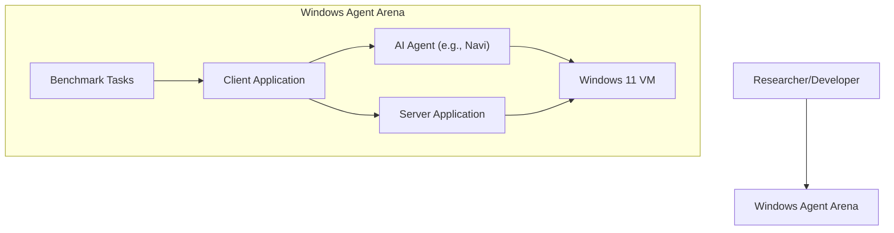
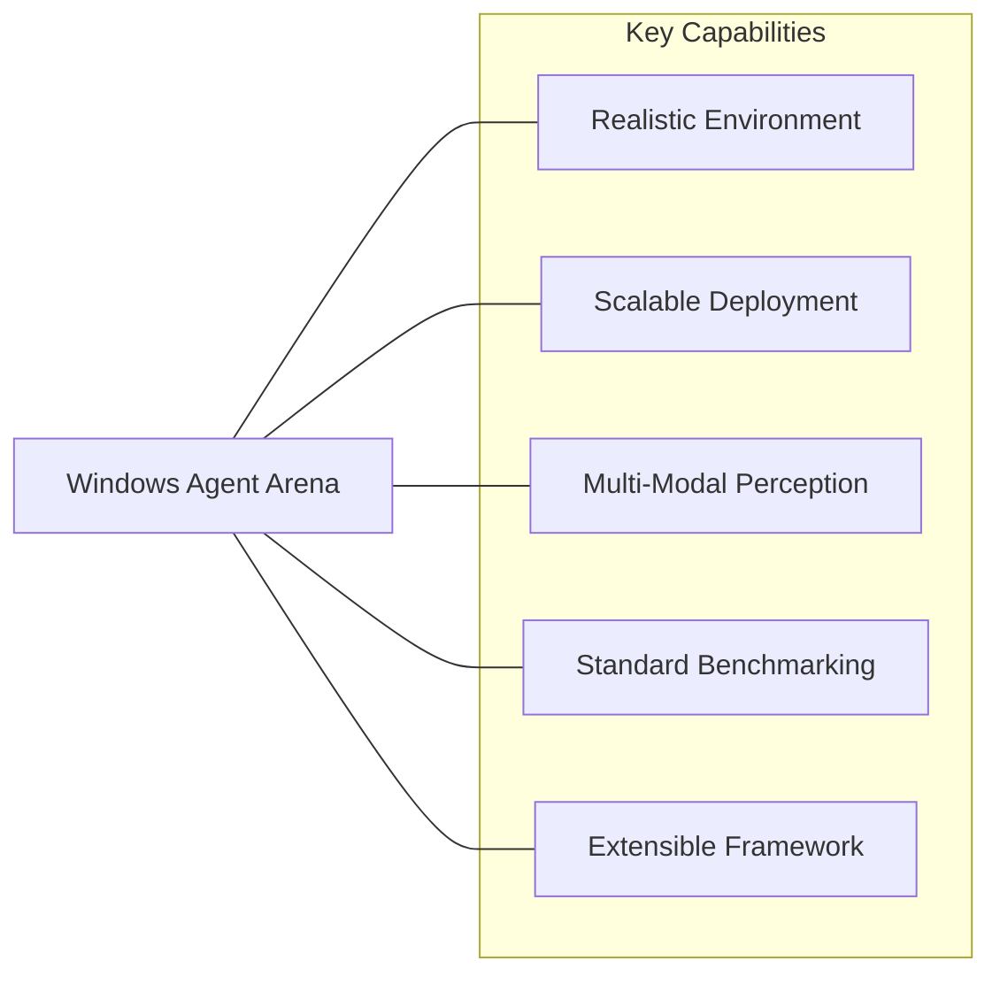
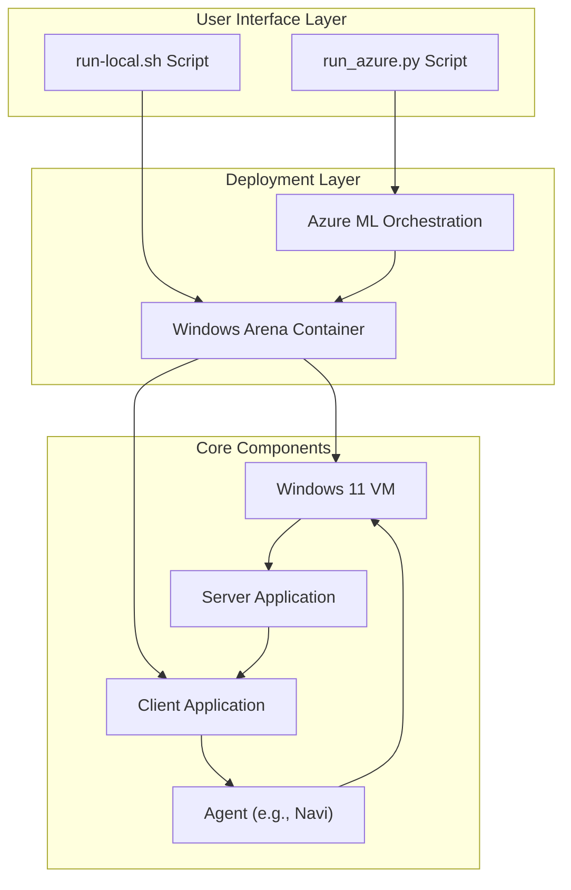
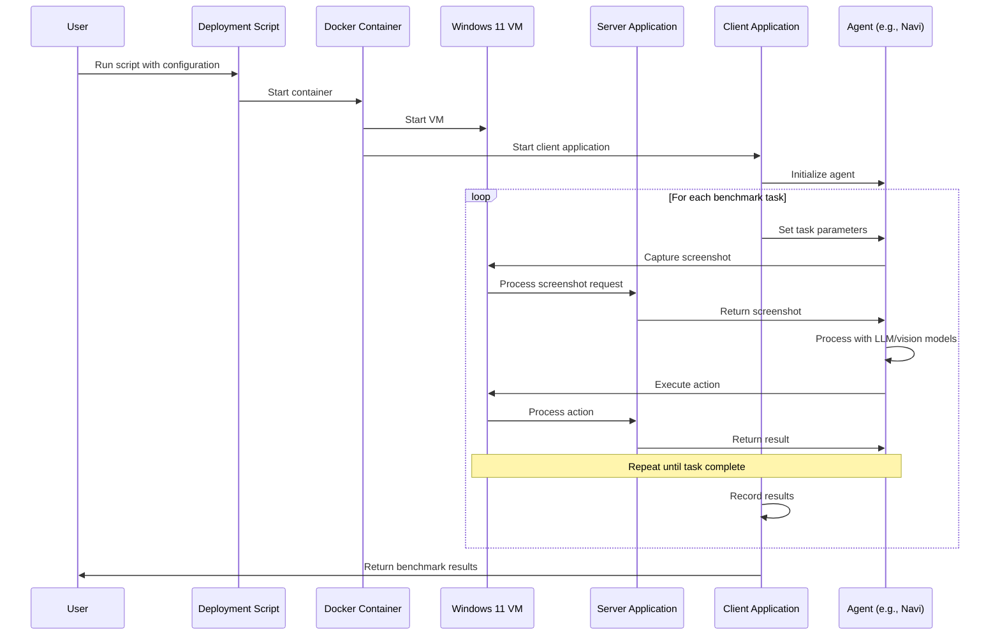
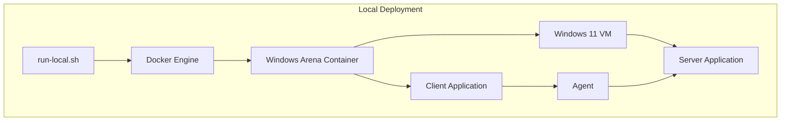
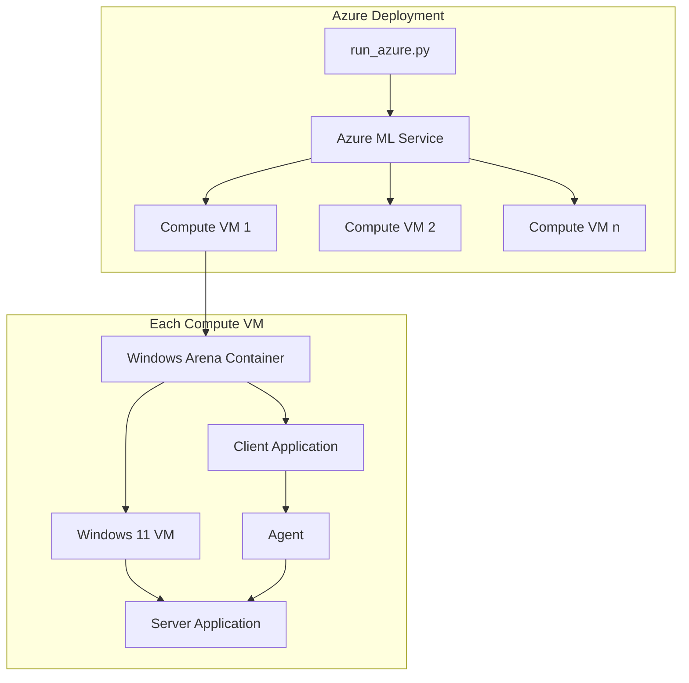
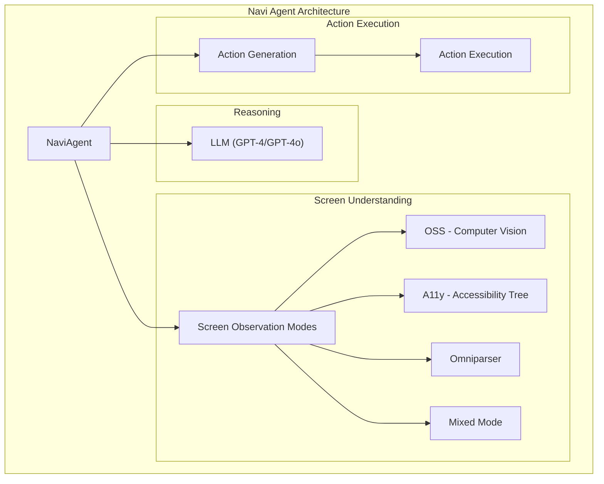

<!-- source: DeepWiki mcp.deepwiki.com · repo microsoft/WindowsAgentArena · page 1 Overview · fetched 2026-10-26 -->

# Overview

Relevant source files

The following files were used as context for generating this wiki page:

- [README.md](README.md)

This page provides an introduction to the Windows Agent Arena (WAA), a scalable platform designed for evaluating multi-modal AI agents in a realistic Windows operating system environment. WAA enables researchers and developers to test and benchmark AI agents across diverse Windows desktop tasks.

For detailed installation instructions, see [Installation and Setup](#2), and for running experiments, refer to [Running Experiments](#3).

## What is Windows Agent Arena?

Windows Agent Arena is an open-source framework that provides a reproducible Windows 11 environment where AI agents can be deployed and evaluated on realistic desktop tasks. The platform enables consistent benchmarking of AI agents that interact with a Windows OS through screenshots, accessibility information, and computer control actions.

Sources: [README.md:12-14]()

## Key Capabilities

Windows Agent Arena offers several key capabilities that make it valuable for AI agent research:

1. **Realistic Environment**: Provides a full Windows 11 VM with standard applications pre-installed
2. **Scalable Deployment**: Supports both local testing and cloud-based parallel execution on Azure ML
3. **Multi-Modal Perception**: Enables agents to perceive the desktop environment through screenshots and accessibility information
4. **Standard Benchmarking**: Offers a diverse set of tasks for evaluating agent performance
5. **Extensible Framework**: Allows researchers to add new agents and tasks

Sources: [README.md:12-14](), [README.md:20-23]()

## System Architecture

The Windows Agent Arena consists of several core components that work together to provide the agent evaluation environment:

The system consists of the following key components:

1. **Windows 11 VM**: A virtualized Windows 11 environment where the agent performs tasks
2. **Server Application**: A Python-based server running inside the VM that receives and executes actions
3. **Client Application**: Manages the benchmarking process, sends commands to the agent, and records results
4. **Agent**: The AI agent being evaluated (e.g., Navi), which interprets the desktop environment and decides on actions
5. **Deployment Infrastructure**: Either local Docker container or Azure ML cloud resources

Sources: [README.md:102-105]()

## Execution Workflow

The following diagram illustrates how the system components interact during a benchmark run:

Sources: [README.md:159-181]()

## Deployment Options

Windows Agent Arena supports two primary deployment modes:

### Local Deployment

Local deployment runs the entire system on a single machine using Docker. This is ideal for development, testing, and running individual agent evaluations.

Sources: [README.md:58-130]()

### Azure Deployment

Azure deployment leverages Azure ML services to run multiple instances of the evaluation platform in parallel, significantly reducing benchmark completion time.

Sources: [README.md:204-326]()

## Agent Architecture

The Windows Agent Arena provides a reference agent implementation called Navi, which can be used as a baseline or as a template for custom agents.

The agent's architecture comprises:

1. **Screen Understanding**: Multiple modes for interpreting the desktop environment
2. **LLM Integration**: Reasoning using large language models to determine appropriate actions
3. **Action Execution**: Converting high-level decisions into concrete desktop interactions

Sources: [README.md:184-197]()

## Getting Started

To begin using Windows Agent Arena:

1. Review the [Installation and Setup](#2) section for environment prerequisites and setup instructions
2. Follow the [Running Experiments](#3) guide to execute your first benchmark
3. Explore the [System Components](#4) section to understand how all parts work together
4. If you want to create your own agent, check out the [Development Guide](#5)

Sources: [README.md:39-56](), [README.md:159-181]()

---

