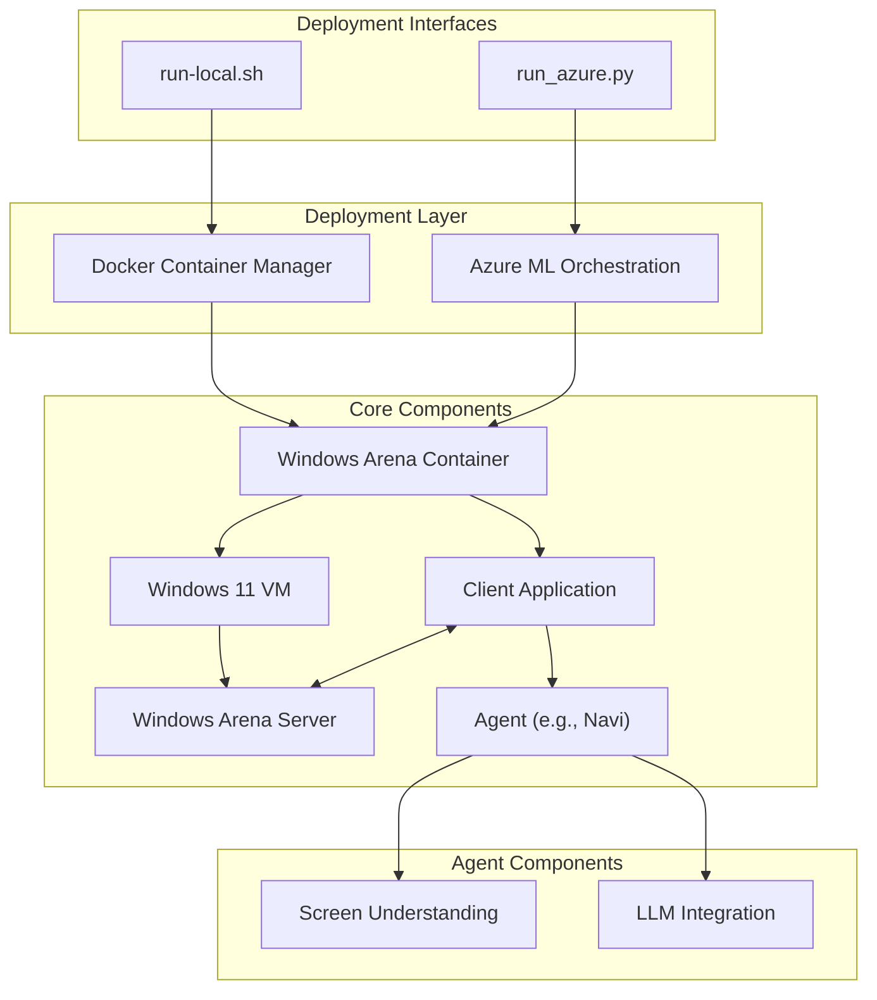
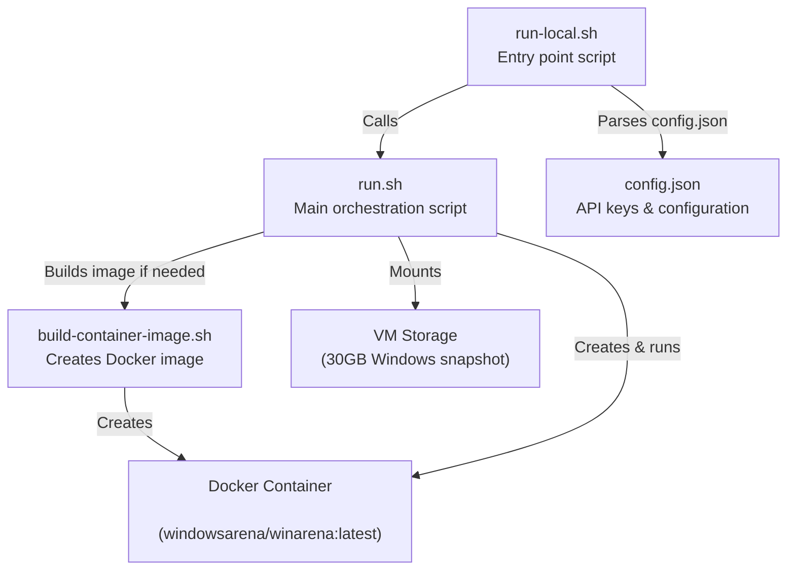
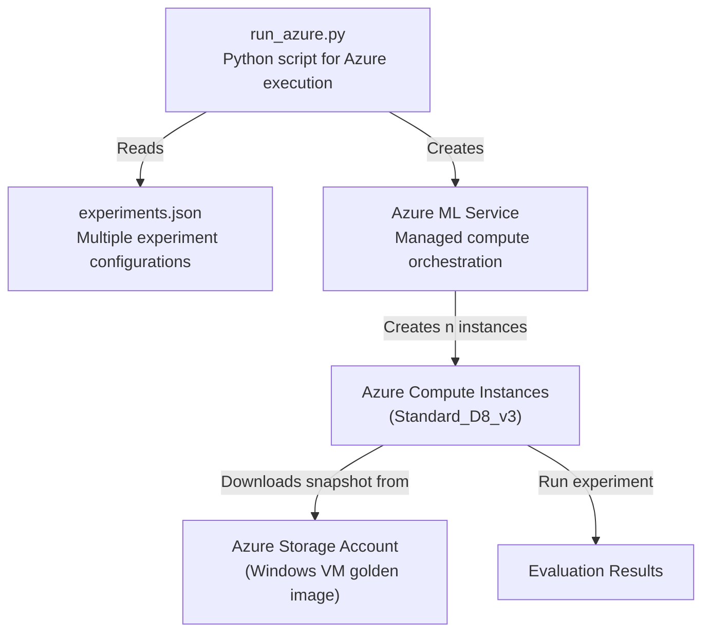
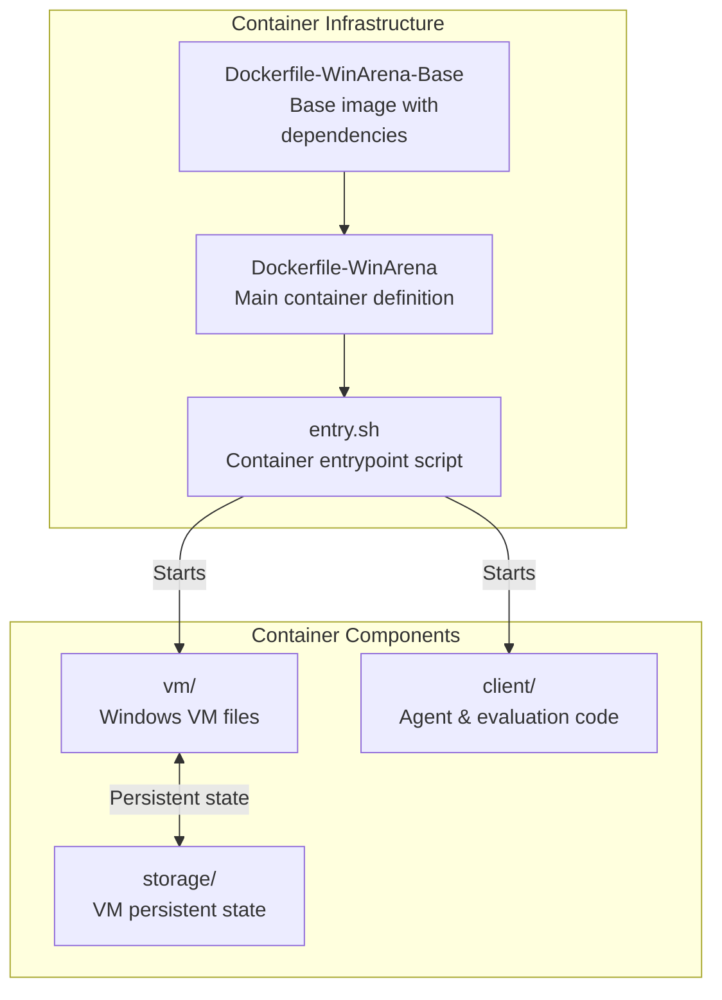
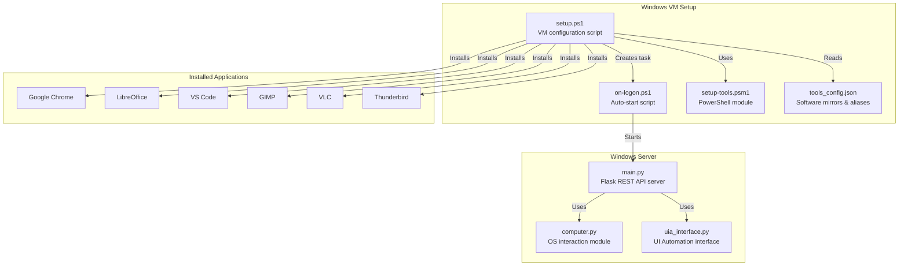
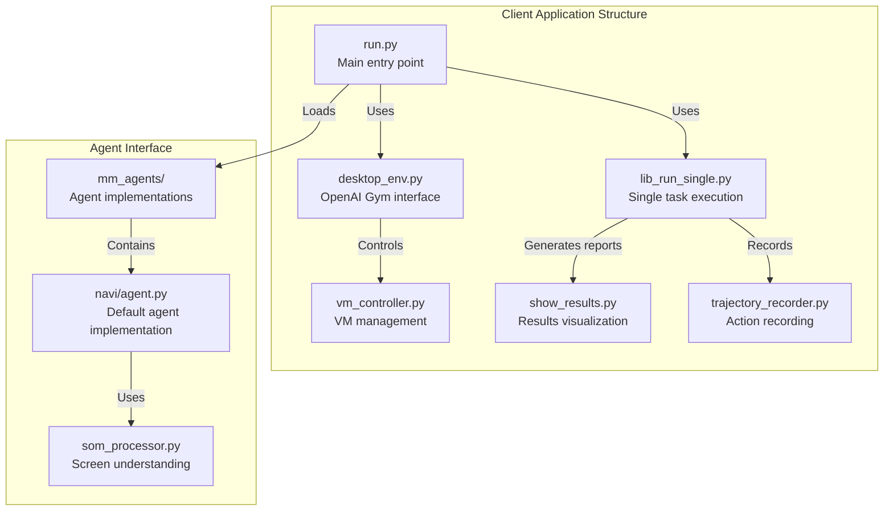
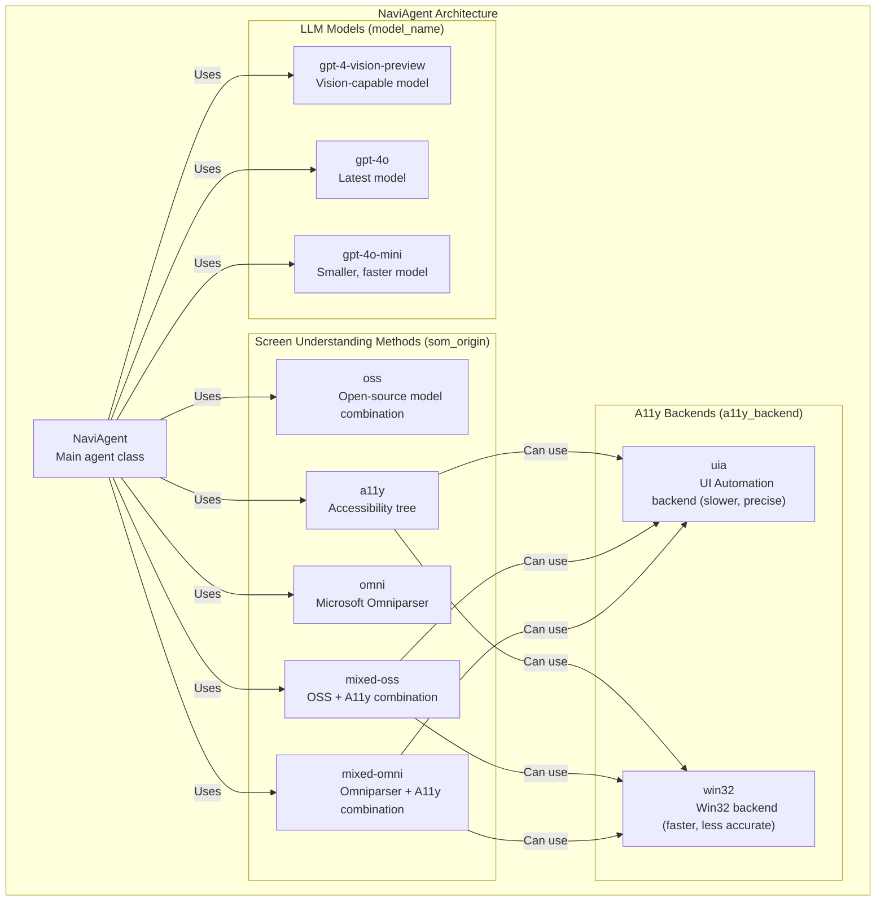
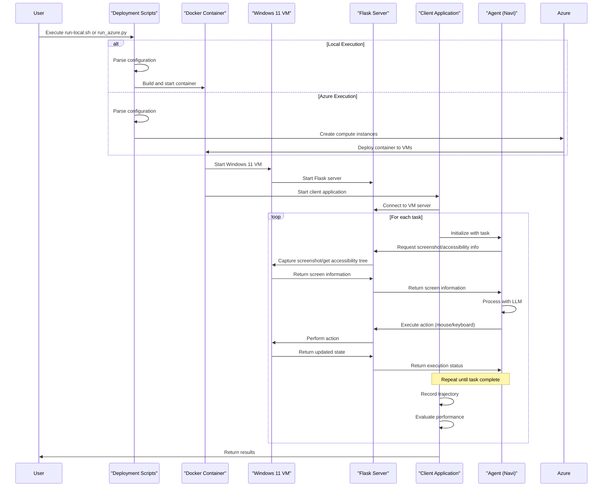
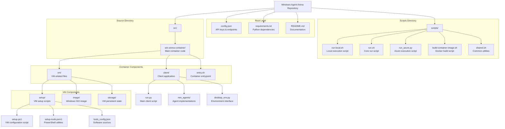

<!-- source: DeepWiki mcp.deepwiki.com · repo microsoft/WindowsAgentArena · page 1.1 System Architecture · fetched 2026-10-26 -->

# System Architecture

Relevant source files

The following files were used as context for generating this wiki page:

- [README.md](README.md)
- [scripts/run-local.sh](scripts/run-local.sh)
- [scripts/run.sh](scripts/run.sh)
- [scripts/run_azure.py](scripts/run_azure.py)
- [src/win-arena-container/vm/setup/setup.ps1](src/win-arena-container/vm/setup/setup.ps1)

This document provides a comprehensive overview of the Windows Agent Arena (WAA) system architecture, explaining the relationships between major components and how they work together to enable the evaluation of multi-modal AI agents in a Windows environment. For information about specific installation procedures, see [Installation and Setup](#2), and for details about the individual components, see [System Components](#4).

## High-Level Architecture Overview

The Windows Agent Arena is a platform designed for evaluating multi-modal AI agents within a realistic Windows OS environment. It provides researchers and developers with a reproducible environment for AI research, where agentic AI workflows can be tested across diverse tasks. WAA supports both local deployment using Docker and scalable cloud deployment using Azure ML infrastructure.

**Diagram: High-Level Architecture Components**

Sources: [README.md:12-14](), [scripts/run-local.sh:1-143](), [scripts/run_azure.py:1-50]()

## Deployment Options

The Windows Agent Arena provides two deployment paths to meet different needs:

### Local Deployment

Local deployment uses Docker to run the Windows Arena container on a local machine. This is useful for development, debugging, and running individual agent evaluations.

**Diagram: Local Deployment Flow**

Sources: [README.md:58-66](), [scripts/run-local.sh:26-164](), [scripts/run.sh:1-341]()

### Azure Deployment

Azure deployment leverages Azure Machine Learning to run multiple containers in parallel across various compute instances. This approach significantly reduces the time needed to evaluate agents across many tasks.

**Diagram: Azure Deployment Flow**

Sources: [README.md:204-242](), [scripts/run_azure.py:199-242]()

## Core Components

### Container Infrastructure

The Windows Agent Arena runs within a Docker container that encapsulates all necessary components. This provides a consistent and reproducible environment across different systems.

**Diagram: Container Infrastructure**

Sources: [README.md:72-99](), [scripts/run.sh:172-315]()

### Windows VM Component

The Windows VM is a core component that provides the realistic Windows environment in which agents operate. It runs Windows 11 and hosts a server application that interfaces with the client.

**Diagram: Windows VM Component**

Sources: [src/win-arena-container/vm/setup/setup.ps1:1-429]()

### Client Application

The client application runs within the Docker container and manages the execution of tasks, agent communication, and performance evaluation.

**Diagram: Client Application Structure**

### Agent Architecture

The default Navi agent is responsible for understanding the Windows environment and taking actions to complete tasks. It has several configurable components.

**Diagram: Agent Architecture**

Sources: [README.md:184-197]()

## Execution Workflow

The following sequence diagram illustrates the typical execution flow when running the Windows Agent Arena:

**Diagram: Execution Workflow**

Sources: [README.md:163-164](), [scripts/run.sh:301-315]()

## Configuration Options

The Windows Agent Arena can be configured through various parameters to control behavior:

| Parameter | Description | Default | Options |
|-----------|-------------|---------|---------|
| `--agent` | Agent to use | `navi` | Current options: `navi` |
| `--model` | LLM model to use | `gpt-4-vision-preview` | `gpt-4o-mini`, `gpt-4-vision-preview`, `gpt-4o`, `gpt-4-1106-vision-preview` |
| `--som-origin` | Screen understanding method | `oss` | `oss`, `a11y`, `mixed-oss`, `omni`, `mixed-omni` |
| `--a11y-backend` | Accessibility backend | `uia` | `uia` (more accurate), `win32` (faster) |
| `--gpu-enabled` | Enable GPU support | `false` | `true`, `false` |
| `--ram-size` | RAM size for the VM | `8G` | Any valid size (e.g., `4G`, `16G`) |
| `--cpu-cores` | CPU cores for the VM | `8` | Any integer value |
| `--use-kvm` | Use KVM acceleration | `true` | `true`, `false` |

Sources: [README.md:347-365](), [scripts/run-local.sh:20-143]()

## File Structure

The key files and directories in the Windows Agent Arena codebase:

**Diagram: File Structure**

Sources: [README.md:49-57](), [scripts/run.sh:186-199]()

## Local vs. Azure Performance Comparison

When deciding between local and Azure deployment, consider these performance characteristics:

| Aspect | Local Deployment | Azure Deployment |
|--------|------------------|------------------|
| Setup Time | ~20 minutes (one-time) | Minimal (uses pre-created VM image) |
| Execution Speed | Sequential (1 VM) | Parallel (multiple VMs) |
| Resource Usage | Limited by local hardware | Scalable with cloud resources |
| Benchmark Time (40 tasks) | Several hours | ~35 minutes with 40 VMs |
| Cost | Local compute resources | ~$8 for VMs + ~$15-100 for LLM API calls |
| Debugging Capability | Direct access to container/VM | Limited to logs |

Sources: [README.md:341-347]()

## Summary

The Windows Agent Arena provides a comprehensive platform for evaluating multi-modal AI agents in a Windows environment. Its architecture supports both local development and scalable cloud-based evaluation, with configurable components for different screen understanding methods and LLM backends. The modular design allows researchers to extend the platform with new agents or evaluation tasks.

---

