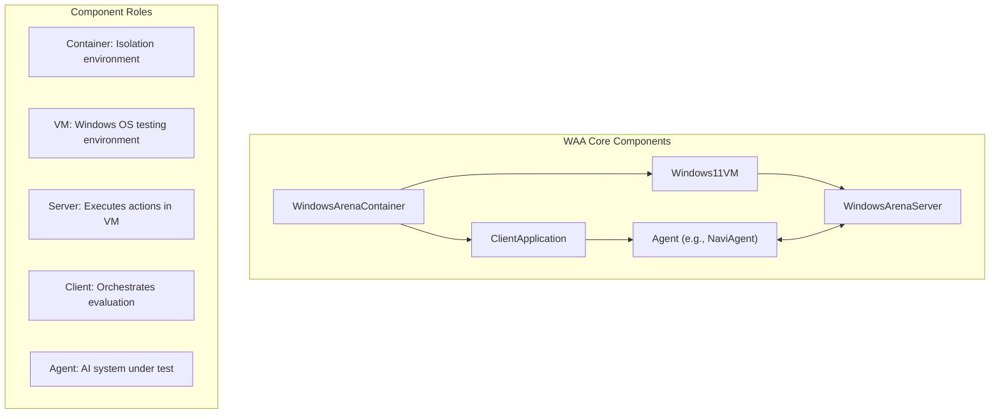
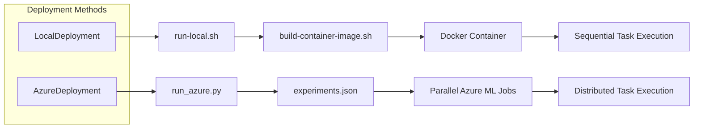
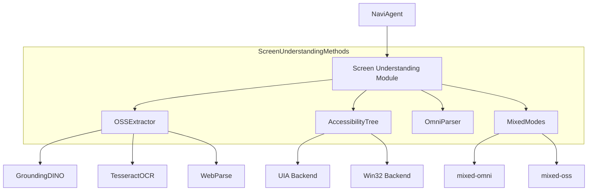
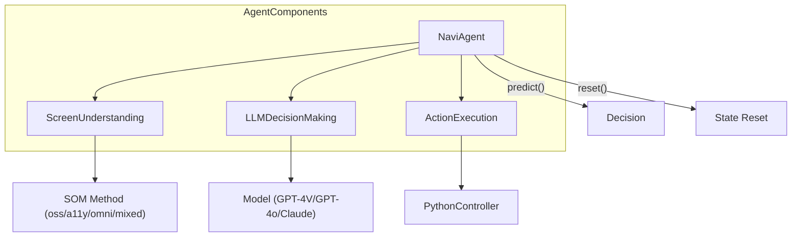
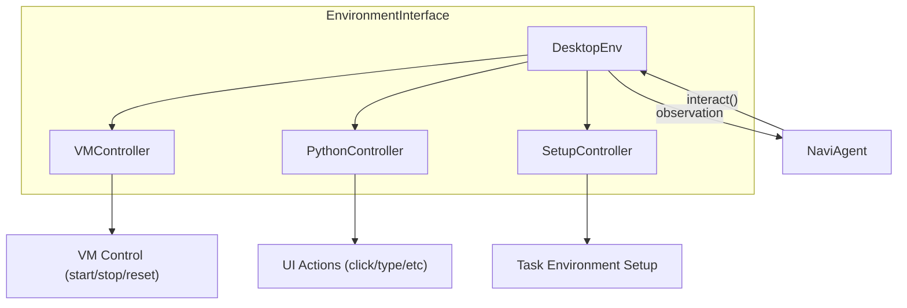
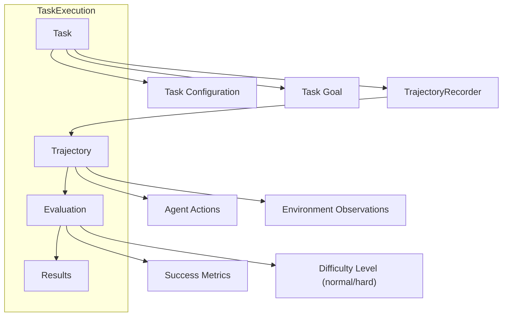
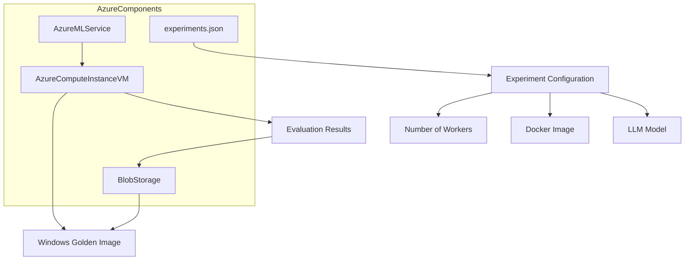

<!-- source: DeepWiki mcp.deepwiki.com · repo microsoft/WindowsAgentArena · page 1.2 Key Concepts and Terminology · fetched 2026-10-26 -->

# Key Concepts and Terminology

Relevant source files

The following files were used as context for generating this wiki page:

- [README.md](README.md)

This document defines the essential terms and concepts used throughout the Windows Agent Arena (WAA) system. It provides a foundation for understanding the architecture, components, and operation of the platform. For information about system architecture, see [System Architecture](#1.1).

## Core System Components

The Windows Agent Arena consists of several key components that work together to provide a scalable platform for evaluating AI agents in a Windows environment.

- **Windows Arena Container**: The Docker container that encapsulates all components needed to run the Windows Agent Arena.
- **Windows 11 VM**: A virtualized Windows 11 environment running inside the container where agents perform tasks.
- **Windows Arena Server**: A Python server running inside the VM that receives commands from the client and executes them.
- **Client Application**: The component that manages task execution, agent initialization, and result recording.
- **Agent**: The AI system being evaluated (e.g., Navi), which uses screen understanding and LLMs to interact with the Windows environment.

Sources: [README.md:100-107]()

## Deployment Methods

The Windows Agent Arena supports two primary deployment methods:

- **Local Deployment**: Running the system on a local machine using Docker, suitable for development and testing.
- **Azure Deployment**: Running the system on Azure Machine Learning, allowing parallel execution of multiple agents and rapid benchmarking.
- **Golden Image**: A snapshot of a fully configured Windows 11 VM with all necessary applications installed, used as a starting point for evaluation.

Sources: [README.md:58-70](), [README.md:204-212]()

## Screen Understanding Methods

Screen understanding methods are techniques used by agents to interpret the visual content and structure of the Windows UI.

- **OSS Extractor**: Uses open-source models (GroundingDINO, TesseractOCR) for detecting UI elements and text.
- **Accessibility Tree (A11y)**: Extracts UI information using Windows accessibility APIs.
  - **UIA Backend**: Uses UI Automation API, slower but more accurate.
  - **Win32 Backend**: Uses Win32 API, faster but less accurate.
- **OmniParser**: Microsoft's screen understanding model for interpreting UI elements.
- **Mixed Modes**: Combines multiple screen understanding methods:
  - **mixed-omni**: Combines Omniparser with accessibility tree.
  - **mixed-oss**: Combines OSS detections with accessibility tree.

Sources: [README.md:188-196]()

## Agent Components

Agents in Windows Agent Arena consist of several components that enable them to interpret the environment and take actions.

- **Screen Understanding**: The component that interprets the screen content using various methods.
- **LLM Decision Making**: The large language model that makes decisions based on screen information.
- **Action Execution**: The component that translates agent decisions into Windows actions.
- **Agent Methods**:
  - **predict()**: The method called to get the next action from the agent.
  - **reset()**: The method called to reset the agent's state between tasks.

Sources: [README.md:329-330]()

## Environment Interface

The environment interface provides a standardized way for agents to interact with the Windows environment.

- **DesktopEnv**: An OpenAI Gym-like interface that provides a standardized way to interact with the Windows environment.
- **VMController**: Manages VM lifecycle operations (start, stop, reset).
- **PythonController**: Executes actions in the Windows environment (click, type, etc.).
- **SetupController**: Prepares the environment for specific tasks.

Sources: [README.md:83-95]()

## Task Execution Concepts

The execution of tasks in Windows Agent Arena involves several key concepts:

- **Task**: A specific Windows interaction scenario that the agent must complete.
- **Task Configuration**: The initial setup for a task, including applications and files.
- **Difficulty Level**: The complexity level of tasks:
  - **Normal**: Tasks where the environment is pre-set up.
  - **Hard**: Tasks where the agent must also initialize/set up the environment.
- **Trajectory**: The sequence of actions and observations during task execution.
- **Trajectory Recorder**: Records the agent's actions and environmental responses.
- **Evaluation**: The process of determining how successfully an agent completed a task.
- **Results**: The outcome of evaluation, typically success/failure and efficiency metrics.

Sources: [README.md:20-22]()

## Deployment Configuration

Configuration parameters control how Windows Agent Arena operates:

| Parameter | Description | Options |
|-----------|-------------|---------|
| `som-origin` | Screen understanding method | `oss`, `a11y`, `omni`, `mixed-oss`, `mixed-omni` |
| `a11y-backend` | Accessibility backend | `uia`, `win32` |
| `ram-size` | VM RAM allocation | e.g., `4G`, `8G` |
| `cpu-cores` | VM CPU allocation | e.g., `4`, `8` |
| `use-kvm` | KVM acceleration | `true`, `false` |
| `gpu-enabled` | GPU support | `true`, `false` |
| `diff_lvl` | Task difficulty | `normal`, `hard` |

Sources: [README.md:189-197](), [README.md:349-365]()

## Cloud Execution Components

For Azure deployment, additional components are involved:

- **Azure ML Service**: The Azure service that orchestrates the execution of agent evaluations.
- **Experiments JSON**: Configuration file defining experiment parameters.
- **Azure Compute Instance VM**: The virtual machine on Azure that runs the Windows Arena Container.
- **Blob Storage**: The storage for the Windows golden image and evaluation results.
- **Worker**: A single Azure compute instance running one copy of the agent on a subset of tasks.

Sources: [README.md:277-292]()

## File Organization

The Windows Agent Arena codebase is organized into several key directories:

| Directory | Purpose |
|-----------|---------|
| `src/win-arena-container` | Main container code |
| `src/win-arena-container/client` | Client application code |
| `src/win-arena-container/client/mm_agents` | Agent implementations |
| `src/win-arena-container/vm` | VM-related code and resources |
| `src/win-arena-container/vm/image` | Windows ISO and VM image |
| `src/win-arena-container/vm/storage` | Golden image storage |
| `scripts` | Deployment and utility scripts |

Sources: [README.md:85-95]()

---

