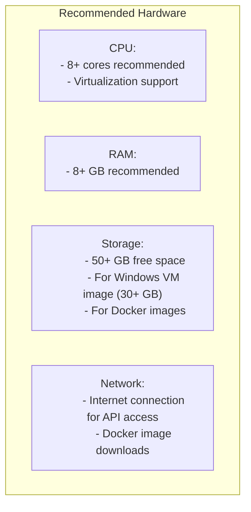
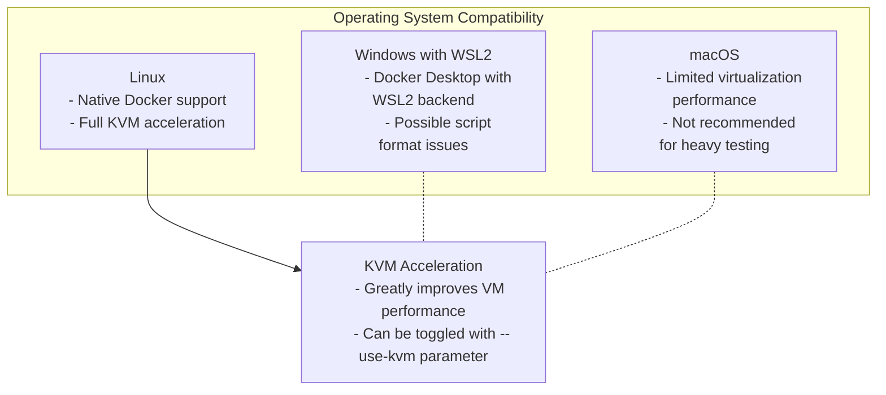
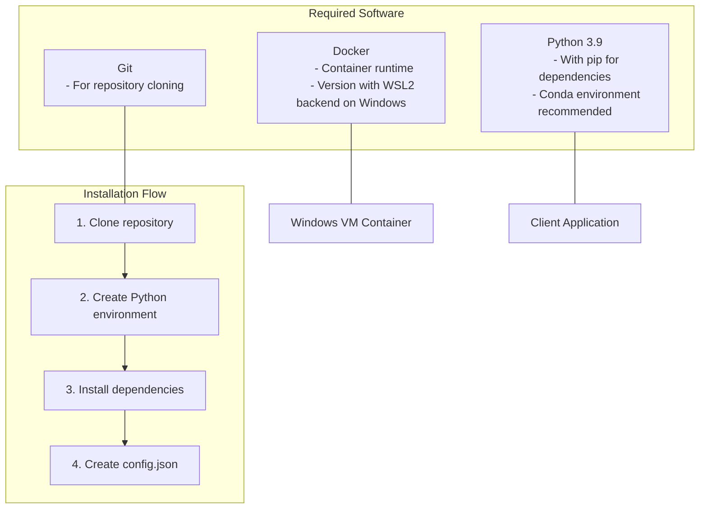
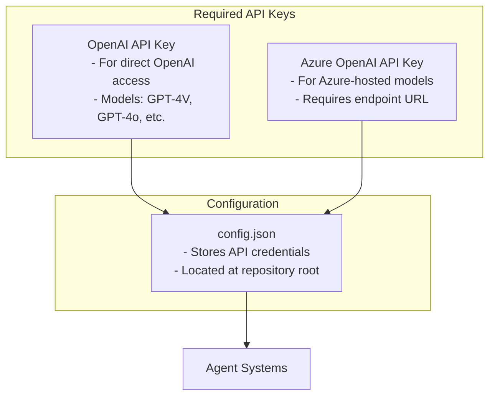
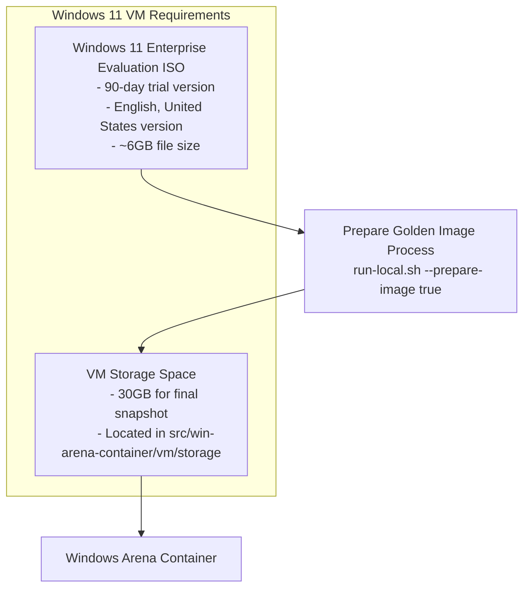
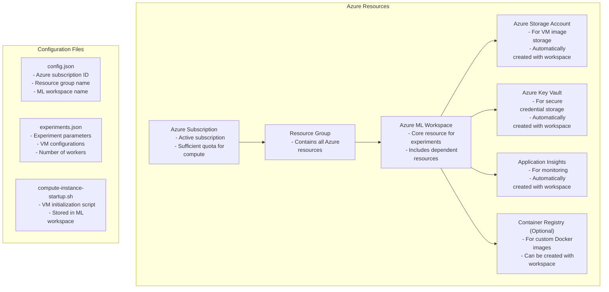
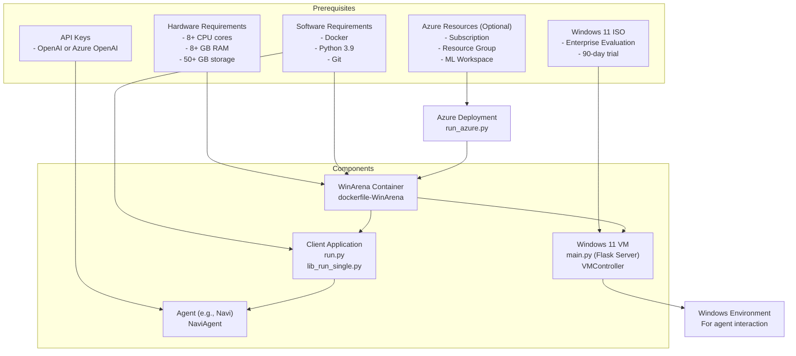

<!-- source: DeepWiki mcp.deepwiki.com · repo microsoft/WindowsAgentArena · page 2.1 Prerequisites · fetched 2026-10-26 -->

# Prerequisites

<details>
<summary>Relevant source files</summary>

The following files were used as context for generating this wiki page:

- [README.md](README.md)

</details>


This page outlines all the requirements needed to set up and run the Windows Agent Arena (WAA) platform. WAA is designed to evaluate multi-modal AI agents within a realistic Windows OS environment, and requires specific hardware, software, and configuration elements to function properly. For information about the actual setup procedures, see [Local Environment Setup](#2.2) and [Azure Environment Setup](#2.3).

## System Requirements

Before attempting to install and run the Windows Agent Arena, ensure your system meets the following hardware and operating system requirements:

### Hardware Requirements



Sources: [README.md:351-356]()

**Customizing Resource Allocation:**
- RAM and CPU allocation can be adjusted using command-line parameters
- Default: 8GB RAM and 8 CPU cores
- Example for systems with limited resources: `--ram-size 4G --cpu-cores 4`

### Operating System Support

Windows Agent Arena can be run on:
- Linux (recommended)
- Windows with WSL2
- macOS (with limitations)

KVM acceleration is recommended for improved performance, particularly on Linux systems. On Windows systems, ensure that WSL2 is properly configured for Docker integration.



Sources: [README.md:358-366]()

## Software Prerequisites

The following software must be installed and properly configured before setting up the Windows Agent Arena:



Sources: [README.md:45-56]()

### Docker

Docker is essential for creating the containerized environment that hosts both the Windows VM and the client application.

- **On Linux**: Install the standard Docker Engine
- **On Windows**: Install [Docker Desktop with WSL 2 backend](https://docs.docker.com/desktop/wsl/)
- **On macOS**: Install Docker Desktop for Mac

### Python 3.9

Python 3.9 is required for running the client-side scripts and agent code.

- Using [Conda](https://docs.conda.io/projects/conda/en/latest/user-guide/getting-started.html) is recommended for creating an isolated environment
- Create a dedicated environment with: `conda create -n winarena python=3.9`
- Required Python packages are listed in `requirements.txt`

### Git

Git is needed to clone the repository and manage updates.

## API Keys

The Windows Agent Arena requires API access to large language models (LLMs) for agent functionality:



Sources: [README.md:60-70]()

You must have **at least one** of the following:

1. **OpenAI API Key**
   - Obtained from [OpenAI Platform](https://platform.openai.com/docs/introduction)
   - Used for direct access to OpenAI models (GPT-4V, GPT-4o, etc.)

2. **Azure OpenAI API Key**
   - Obtained from [Azure OpenAI Service](https://azure.microsoft.com/en-us/products/ai-services/openai-service)
   - Requires both API key and endpoint URL
   - Used for access to Azure-hosted OpenAI models

API keys must be specified in a `config.json` file at the root of the project:

```json
{
    "OPENAI_API_KEY": "<OPENAI_API_KEY>",  // if using OpenAI endpoint
    "AZURE_API_KEY": "<AZURE_API_KEY>",    // if using Azure endpoint
    "AZURE_ENDPOINT": "https://yourendpoint.openai.azure.com/",  // if using Azure endpoint
}
```

## Windows 11 VM Image

The Windows Agent Arena requires a Windows 11 Enterprise Evaluation ISO to create the Windows VM environment where agents operate:



Sources: [README.md:107-146]()

### Windows 11 ISO

- Download the ISO file from [Microsoft Evaluation Center](https://info.microsoft.com/ww-landing-windows-11-enterprise.html)
- Specifically, you need the **Windows 11 Enterprise Evaluation (90-day trial, English, United States)** version
- Rename the downloaded file to `setup.iso`
- Place the file in `src/win-arena-container/vm/image` directory

### Storage Requirements

- The preparation process creates a "golden image" (VM snapshot) of approximately 30GB
- This snapshot contains a fully functional Windows 11 VM with all required programs and a Python server
- The snapshot is stored in `src/win-arena-container/vm/storage`

## Azure-Specific Prerequisites

If you plan to deploy the Windows Agent Arena on Azure (for parallel execution of benchmark tasks), you'll need these additional prerequisites:



Sources: [README.md:204-226](), [README.md:262-293]()

### Azure Account and Resources

1. **Azure Subscription**
   - Required for all Azure resources
   - New users can start with a [free trial](https://azure.microsoft.com/en-us/free/)

2. **Azure Resource Group**
   - Container for all related Azure resources
   - Create in the Azure portal with a name like `agents`

3. **Azure Machine Learning Workspace**
   - Central resource for ML experiments
   - Create within the resource group with a name like `agents_ml`
   - During creation, check boxes to automatically create:
     - Storage Account (for VM image storage)
     - Key Vault (for secure credential storage)
     - Application Insights (for monitoring)
     - Container Registry (optional, for custom Docker images)

4. **Compute Quota**
   - Sufficient quota for the VM size you plan to use (e.g., `Standard_D8_v3`)
   - Each VM uses 8 cores by default
   - Machine type must support [nested virtualization](https://learn.microsoft.com/en-us/answers/questions/813416/how-do-i-know-what-size-azure-vm-supports-nested-v)

### Azure Configuration Files

1. **`config.json`**
   - Must include Azure subscription ID, resource group name, and ML workspace name
   - Example:
     ```json
     {
         "AZURE_SUBSCRIPTION_ID": "<YOUR_AZURE_SUBSCRIPTION_ID>",
         "AZURE_ML_RESOURCE_GROUP": "<YOUR_AZURE_ML_RESOURCE_GROUP>",
         "AZURE_ML_WORKSPACE_NAME": "<YOUR_AZURE_ML_WORKSPACE_NAME>"
     }
     ```

2. **`experiments.json`**
   - Defines experiment parameters, VM configurations, and number of workers
   - Example in `scripts/experiments.json`

3. **`compute-instance-startup.sh`**
   - VM initialization script
   - Must be uploaded to the ML workspace's notebook storage

## Integrated Prerequisites Overview

The following diagram shows how the various prerequisites relate to the components of the Windows Agent Arena system:



Sources: [README.md:39-56](), [README.md:107-146](), [README.md:204-226]()

## Prerequisites Checklist

Use this checklist to ensure you have all the required prerequisites before proceeding with installation:

| Prerequisite | Description | Required For |
|--------------|-------------|--------------|
| **Hardware** | | |
| CPU | 8+ cores with virtualization support | All deployments |
| RAM | 8+ GB (can be reduced with `--ram-size` parameter) | All deployments |
| Storage | 50+ GB free space for VM image and Docker images | All deployments |
| **Software** | | |
| Docker | Container runtime (with WSL2 backend on Windows) | All deployments |
| Python 3.9 | With pip for dependencies (Conda environment recommended) | All deployments |
| Git | For repository cloning | All deployments |
| **API Keys** | | |
| OpenAI API Key | For direct access to OpenAI models | Either OpenAI or Azure OpenAI required |
| Azure OpenAI API Key | For access to Azure-hosted OpenAI models | Either OpenAI or Azure OpenAI required |
| **Windows 11** | | |
| Windows 11 ISO | Enterprise Evaluation (90-day trial) | All deployments |
| 30GB Storage | For VM snapshot/golden image | All deployments |
| **Azure** (Optional) | | |
| Azure Subscription | Active subscription with sufficient quota | Azure deployments only |
| Resource Group | Container for Azure resources | Azure deployments only |
| ML Workspace | Core resource for experiments | Azure deployments only |
| Storage Account | For VM image storage | Azure deployments only |
| Startup Script | VM initialization script | Azure deployments only |

Sources: [README.md:39-56](), [README.md:107-146](), [README.md:204-226]()

Once you have gathered all the required prerequisites, you can proceed to [Local Environment Setup](#2.2) or [Azure Environment Setup](#2.3) depending on your deployment preference.

---

