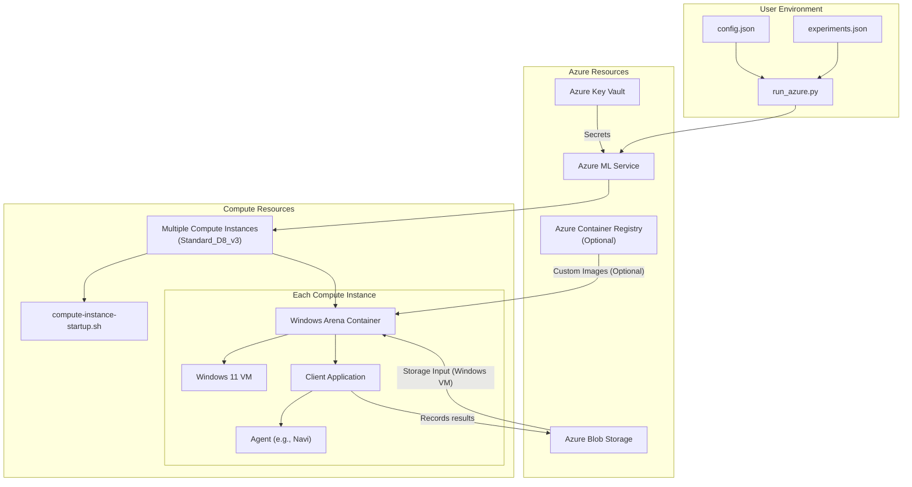
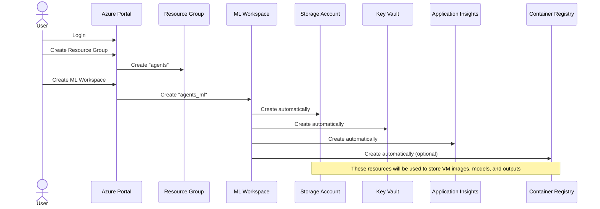
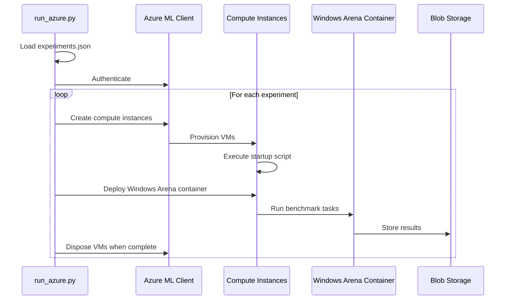

<!-- source: DeepWiki mcp.deepwiki.com · repo microsoft/WindowsAgentArena · page 2.3 Azure Environment Setup · fetched 2026-10-26 -->

# Azure Environment Setup

<details>
<summary>Relevant source files</summary>

The following files were used as context for generating this wiki page:

- [README.md](README.md)
- [scripts/run_azure.py](scripts/run_azure.py)
- [src/win-arena-container/vm/setup/setup.ps1](src/win-arena-container/vm/setup/setup.ps1)

</details>


This document provides detailed instructions for setting up and deploying the Windows Agent Arena (WAA) in Azure. Using Azure deployment enables running the benchmarks at scale, significantly reducing evaluation time from hours/days to minutes. For information about local deployment, see [Local Environment Setup](#2.2).

## 1. Architecture Overview

The Windows Agent Arena Azure deployment uses Azure Machine Learning services to orchestrate the execution of agent evaluations across multiple parallel compute instances.



Sources: [README.md:204-262]()

## 2. Prerequisites

Before setting up Windows Agent Arena on Azure, ensure you have:

1. An Azure subscription - You can create a [free trial](https://azure.microsoft.com/en-us/free/) if needed
2. The Azure CLI installed - Required for authentication and resource management
3. A local Windows Agent Arena repository clone with the dependencies installed
4. A Windows 11 VM golden image prepared according to the [Local Environment Setup](#2.2)

Sources: [README.md:210-211]()

## 3. Setting Up Azure Resources

### 3.1 Creating Resource Group and ML Workspace

1. Login to the [Azure portal](https://portal.azure.com/)
2. Create a new resource group (e.g., `agents`)
3. Within this resource group, create an Azure Machine Learning resource (e.g., `agents_ml`)
4. During ML workspace creation, enable automatic creation of:
   - Storage Account
   - Key Vault
   - Application Insights
   - Container Registry (optional)



Sources: [README.md:210-222]()

### 3.2 Configuring Compute Instance Startup Script

1. Navigate to the [Azure Machine Learning portal](https://ml.azure.com/home)
2. Select your workspace (`agents`)
3. Navigate to the `Notebooks` tab
4. In your user-assigned folder, create a new bash file named `compute-instance-startup.sh`
5. Copy the content from `scripts/azure_files/compute-instance-startup.sh` in your local repository
6. Save the file and note its path (typically `Users/<YOUR_USER>/compute-instance-startup.sh`)

This script will be executed when each compute instance starts, performing necessary configurations.

Sources: [README.md:223-232]()

### 3.3 Requesting Compute Quota (Optional)

If you plan to run many parallel instances, you may need to request additional compute quota:

1. Navigate to the [Azure Quota page](https://ml.azure.com/quota/)
2. Request quota increase for `Standard Dv3 Family Cluster Dedicated vCPUs`
3. WAA uses `Standard_D8_v3` VM size by default, which requires 8 cores per instance

Sources: [README.md:234-238]()

## 4. Uploading Required Assets

### 4.1 Uploading Windows 11 VM Image

After preparing the Windows 11 golden image locally, upload the VM storage folder to Azure:

1. Find your Azure Storage Account associated with the ML workspace 
2. Locate the blob container linked to the default datastore (typically named `workspaceblobstore`)
3. Upload the `WindowsAgentArena/src/win-arena-container/vm/storage` folder using one of these methods:

#### Using Azure Storage Explorer (Recommended)

1. Download [Azure Storage Explorer](https://azure.microsoft.com/en-us/features/storage-explorer/)
2. Connect to your Azure account
3. Locate your storage account and blob container
4. Upload the `storage` folder

#### Using Azure CLI

```bash
az login --use-device-code
az storage blob upload-batch --account-name <STORAGE_ACCOUNT_NAME> --destination <CONTAINER_NAME> --source <LOCAL_FOLDER>
```

Sources: [README.md:243-251]()

### 4.2 Using Custom Docker Images (Optional)

If you're using a custom Docker image instead of the default `windowsarena/winarena:latest`:

1. Push your custom image to Azure Container Registry:

```bash
az login --use-device-code
docker login <ACR_NAME>.azurecr.io
docker tag <IMAGE_NAME> <ACR_NAME>.azurecr.io/<IMAGE_NAME>:<TAG>
docker push <ACR_NAME>.azurecr.io/<IMAGE_NAME>:<TAG>
```

2. Reference this custom image in your `experiments.json` configuration

Sources: [README.md:253-260]()

## 5. Configuration Setup

### 5.1 Azure Configuration

Create or update the `config.json` file at the root of your project with the following Azure-specific keys:

```json
{
    "OPENAI_API_KEY": "<OPENAI_API_KEY>", 
    "AZURE_API_KEY": "<AZURE_API_KEY>",
    "AZURE_ENDPOINT": "https://yourendpoint.openai.azure.com/",
    "AZURE_SUBSCRIPTION_ID": "<YOUR_AZURE_SUBSCRIPTION_ID>", 
    "AZURE_ML_RESOURCE_GROUP": "<YOUR_AZURE_ML_RESOURCE_GROUP>",
    "AZURE_ML_WORKSPACE_NAME": "<YOUR_AZURE_ML_WORKSPACE_NAME>"
}
```

You must include either an OpenAI API key OR both Azure OpenAI keys (API key and endpoint).

Sources: [README.md:264-273]()

### 5.2 Experiment Configuration

Create an `experiments.json` file that defines the experiments you want to run. This file controls:

- The compute startup script path
- Which agent to deploy
- The location of the VM image in the datastore
- The Docker image to use
- Number of parallel workers
- LLM model configuration
- Screen understanding method

Example configuration:

```json
{
  "experiment_1": {
    "ci_startup_script_path": "Users/<YOUR_USER>/compute-instance-startup.sh",
    "agent": "navi",
    "datastore_input_path": "storage",
    "docker_img_name": "windowsarena/winarena:latest",
    "exp_name": "experiment_1",
    "num_workers": 4,
    "use_managed_identity": false,
    "json_name": "evaluation_examples_windows/test_all.json",
    "model_name": "gpt-4o-mini",
    "som_origin": "oss",
    "a11y_backend": "win32"
  }
}
```

You can define multiple experiments with different configurations in this file.

Sources: [README.md:275-292](), [scripts/run_azure.py:46-64]()

#### Experiment Configuration Generator (Optional)

Alternatively, you can generate or update the `experiments.json` file using the `run_azure.py` script:

```bash
cd scripts
python run_azure.py --experiments_json "experiments.json" --update_json --exp_name "experiment_1" --ci_startup_script_path "Users/<YOUR_USER>/compute-instance-startup.sh" --agent "navi" --json_name "evaluation_examples_windows/test_all.json" --num_workers 4 --som_origin oss --a11y_backend win32
```

This approach provides a command-line interface for updating your experiment configuration.

Sources: [README.md:294-298](), [scripts/run_azure.py:268-313]()

## 6. Deploying and Running Experiments

### 6.1 Azure Authentication

Before running experiments, authenticate with Azure:

```bash
az login --use-device-code
```

If you have multiple tenants or subscriptions, select the correct ones:

```bash
az login --use-device-code --tenant "<YOUR_AZURE_AD_TENANT_ID>"
az account set --subscription "<YOUR_AZURE_SUBSCRIPTION_ID>"
```

Sources: [README.md:301-305]()

### 6.2 Running Experiments

Once authenticated and configured, run the experiments:

```bash
cd scripts
python run_azure.py --experiments_json "experiments.json"
```

The script will:

1. Read the experiment configurations from `experiments.json`
2. For each experiment, create the specified number of Azure Compute Instance VMs
3. Deploy Windows Arena containers to these VMs
4. Run the benchmark tasks in parallel across all VMs
5. Collect results and store them in the blob storage
6. Automatically dispose of the VMs once tasks are completed



Sources: [README.md:312-321](), [scripts/run_azure.py:64-197]()

### 6.3 Execution Workflow

The execution workflow for each compute instance:

1. The VM is provisioned with the specified compute resources (typically `Standard_D8_v3`)
2. The startup script (`compute-instance-startup.sh`) runs to configure the VM
3. The Windows Arena container is deployed from the specified Docker image
4. The container:
   - Starts the Windows 11 VM using the image from blob storage
   - Runs the client application which initializes the specified agent
   - Executes the benchmark tasks assigned to this instance
5. Results are stored in the blob container
6. The compute instance is deleted after job completion

Sources: [scripts/run_azure.py:148-197]()

## 7. Analyzing Results

### 7.1 Retrieving Results

Results from the experiments are saved in an `agent_outputs` folder in the same blob container where the Windows 11 image was uploaded. To analyze them:

1. Download the `agent_outputs` folder using Azure Storage Explorer or the Azure CLI
2. Run the `show_azure.py` script to process and display the results:

```bash
cd scripts
python show_azure.py --json_config "experiments.json" --result_dir <path_to_downloaded_agent_outputs_folder>
```

This will generate a markdown table summarizing the performance across all experiments.

Sources: [README.md:322-326]()

### 7.2 Performance and Cost Considerations

When planning Azure deployments, consider the following performance and cost estimates:

| Component | Approximate Cost | Execution Time |
|-----------|-----------------|----------------|
| Standard_D8_v3 VM | ~$8 ($0.38/h * 40 * 0.5h) | - |
| GPT-4V | $100 | ~35min with 40 VMs |
| GPT-4o | $100 | ~35min with 40 VMs |
| GPT-4o-mini | $15 | ~30min with 40 VMs |

Adjusting the number of VMs allows you to balance between execution speed and cost.

Sources: [README.md:340-347]()

## 8. Troubleshooting

### Common Issues

1. **Authentication Failures**: Ensure you're properly authenticated with `az login` and have the correct subscription selected.

2. **VM Provisioning Failures**: Verify you have sufficient quota for the requested VM size (`Standard_D8_v3`).

3. **Storage Upload Errors**: If you encounter issues uploading the large VM image, try using Azure Storage Explorer instead of the portal interface.

4. **Missing API Keys**: Ensure all required API keys and endpoints are correctly configured in `config.json`.

Sources: [README.md:301-305](), [scripts/run_azure.py:153-164]()

---

