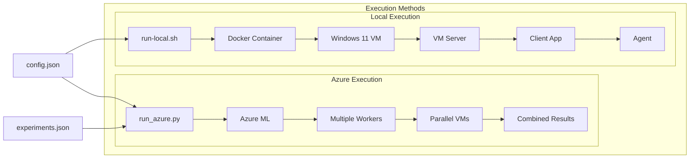
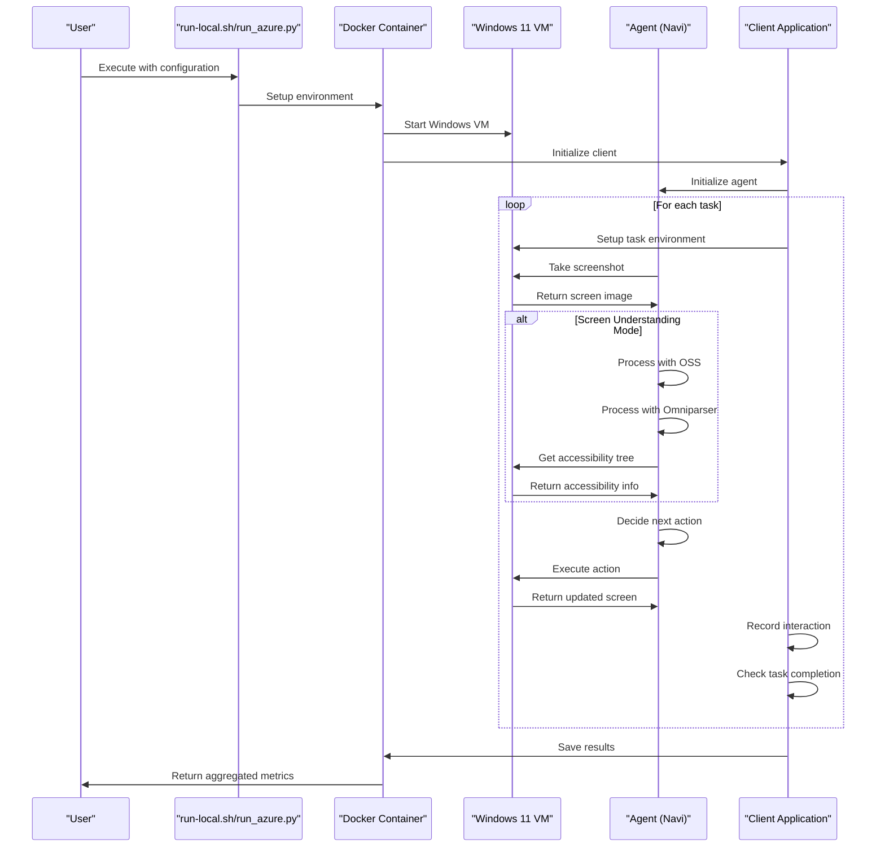
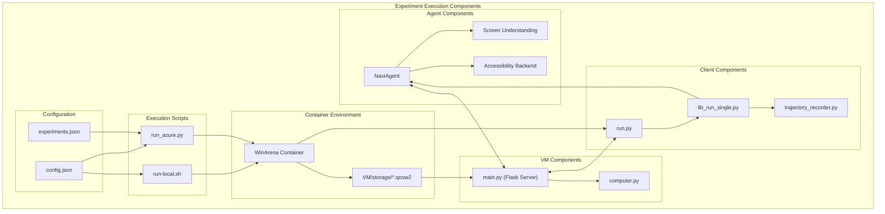

<!-- source: DeepWiki mcp.deepwiki.com · repo microsoft/WindowsAgentArena · page 3 Running Experiments · fetched 2026-10-26 -->

# Running Experiments

<details>
<summary>Relevant source files</summary>

The following files were used as context for generating this wiki page:

- [README.md](README.md)

</details>


This page explains how to run experiments using the Windows Agent Arena (WAA) platform. Experiments in WAA involve deploying AI agents to perform tasks within a Windows 11 virtual environment and evaluating their performance. This document covers both local and cloud-based execution methods, configuration options, and results analysis.

For installation and setup instructions, see [Installation and Setup](#2).

## Experiment Overview

Windows Agent Arena experiments involve running an AI agent to perform a series of Windows tasks, with the system automatically recording the agent's interactions, success rate, and other metrics.

```mermaid
flowchart TD
    subgraph "Experiment Execution Flow"
        config["Configuration Setup"] --> deploy["Deploy Environment"]
        deploy --> tasks["Load Task Definitions"]
        tasks --> agentInit["Initialize Agent"]
        agentInit --> loop["Task Loop"]
        loop --> evaluate["Evaluate Performance"]
        evaluate --> results["Generate Results"]
    end
    
    subgraph "Task Loop"
        taskSetup["Setup Task Environment"] --> observe["Agent Observes Screen"]
        observe --> decide["Agent Decides Action"]
        decide --> act["Agent Executes Action"]
        act --> check["Check Task Completion"]
        check -->|"Task Incomplete"| observe
        check -->|"Task Complete"| nextTask["Move to Next Task"]
    end
```



Sources: [README.md:158-160]()

## Execution Methods

WAA supports two primary methods for running experiments:

1. **Local Execution**: Run experiments on your local machine using Docker and a Windows 11 VM
2. **Azure Execution**: Run experiments at scale in the cloud using Azure ML



Sources: [README.md:158-176](), [README.md:204-226]()

## Local Execution

To run experiments locally, use the `run-local.sh` script which sets up a Docker container with a Windows 11 VM running the agent:

```bash
cd scripts
./run-local.sh
```

You can monitor the Windows VM with the agent running at http://localhost:8006.

For the strongest agent configuration with GPU support:

```bash
./run-local.sh --gpu-enabled true --som-origin mixed-omni --a11y-backend uia
```

Sources: [README.md:158-182]()

## Azure Execution

For running large-scale experiments efficiently, WAA supports parallel execution on Azure ML:

1. Create an `experiments.json` file defining experiment parameters:

```json
{
  "experiment_1": {
    "ci_startup_script_path": "Users/<YOUR_USER>/compute-instance-startup.sh",
    "agent": "navi",
    "datastore_input_path": "storage",
    "docker_img_name": "windowsarena/winarena:latest",
    "exp_name": "experiment_1",
    "num_workers": 4,
    "use_managed_identity": false,
    "json_name": "evaluation_examples_windows/test_all.json",
    "model_name": "gpt-4-1106-vision-preview",
    "som_origin": "oss",
    "a11y_backend": "win32"
  }
}
```

2. Execute using the `run_azure.py` script:

```bash
cd scripts
python run_azure.py --experiments_json "experiments.json"
```

This will create the specified number of Azure Compute Instance VMs, run the experiments in parallel, and dispose of the VMs when completed.

Sources: [README.md:274-321]()

## Experiment Configuration Options

WAA offers extensive configuration options to customize your experiments:

### Agent Configurations

Different agent configurations can be specified when running experiments:

| Configuration | Command | Description |
|---------------|---------|-------------|
| Best Performance | `--som-origin mixed-omni --a11y-backend uia` | Combines Omniparser with accessibility tree information |
| Omniparser | `--som-origin omni` | Uses Omniparser for screen understanding |
| OSS Baseline | `--som-origin oss` | Uses webparse, groundingdino, and OCR (TesseractOCR) |
| UIA Accessibility | `--som-origin a11y --a11y-backend uia` | Uses slower, more accurate accessibility tree |
| Win32 Accessibility | `--som-origin a11y --a11y-backend win32` | Uses faster, less accurate accessibility tree |
| Mixed OSS | `--som-origin mixed-oss --a11y-backend uia` | Combines OSS detections with accessibility tree |

Sources: [README.md:184-197]()

### Hardware Configuration

You can customize resource allocation for local runs:

```bash
./run-local.sh --ram-size 4G --cpu-cores 4
```

KVM acceleration can be toggled with:

```bash
./run-local.sh --use-kvm false
```

Sources: [README.md:349-366]()

### Azure Scale Configuration

For Azure deployments, you can configure:

- `num_workers`: Number of parallel VMs to create
- `json_name`: Task definition file to use
- `model_name`: LLM model to use (e.g., "gpt-4-1106-vision-preview")

Sources: [README.md:274-299]()

## Experiment Execution Workflow

The following diagram shows the detailed workflow during experiment execution:



Sources: [README.md:158-176]()

## Analyzing Results

After completing experiments, you can view and analyze the results:

### Local Results

For local runs, view results using:

```bash
cd src/win-arena-container/client
python show_results.py --result_dir <path_to_results_folder>
```

Sources: [README.md:177-181]()

### Azure Results

For Azure runs, download the results and view them with:

```bash
cd scripts
python show_azure.py --json_config "experiments.json" --result_dir <path_to_downloaded_agent_outputs_folder>
```

Sources: [README.md:322-327]()

## System Components Interaction

The following diagram shows how the different system components interact during experiment execution:



Sources: [README.md:1-394]()

## Resource Requirements and Performance

Running experiments has different resource requirements depending on the execution method:

| Execution Method | CPU Cores | RAM | Time (40 Tasks) | Approximate Cost |
|------------------|-----------|-----|-----------------|------------------|
| Local (OSS) | 8+ | 8GB+ | 8-12 hours | - |
| Local (Omniparser) | 8+ | 8GB+ | 4-6 hours | - |
| Azure (40 VMs, GPT-4V) | 320 | 320GB | ~35 minutes | ~$108 |
| Azure (40 VMs, GPT-4o) | 320 | 320GB | ~35 minutes | ~$108 |
| Azure (40 VMs, GPT-4o-mini) | 320 | 320GB | ~30 minutes | ~$23 |

Sources: [README.md:340-347]()

For detailed instructions on running experiments locally, see [Local Execution](#3.1).
For detailed instructions on running experiments on Azure, see [Azure Execution](#3.2).
For a complete list of configuration options, see [Configuration Options](#3.3).

---

