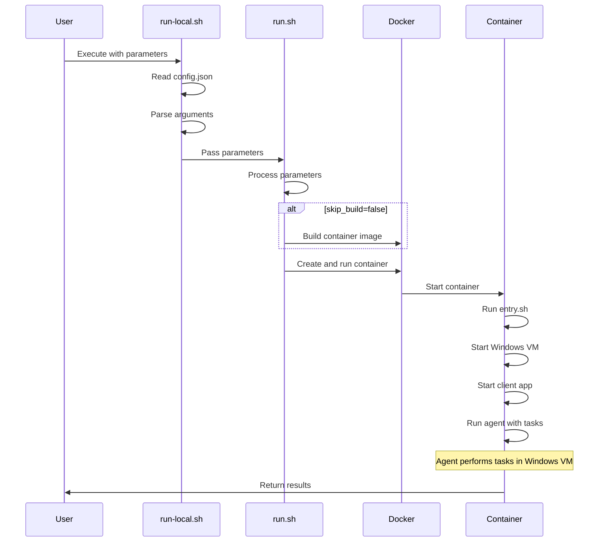

<!-- source: DeepWiki mcp.deepwiki.com · repo microsoft/WindowsAgentArena · page 3.1 Local Execution · fetched 2026-10-26 -->

# Local Execution

<details>
<summary>Relevant source files</summary>

The following files were used as context for generating this wiki page:

- [scripts/run-local.sh](scripts/run-local.sh)
- [scripts/run.sh](scripts/run.sh)

</details>


## Purpose and Scope

This document explains how to run Windows Agent Arena experiments locally on your machine. Local execution uses Docker containers to create an isolated environment containing a Windows 11 VM and the necessary components to run agent evaluations. For information about running experiments on Azure, see [Azure Execution](#3.2).

The local execution mode is useful for:
- Development and testing of agents
- Running individual experiments
- Debugging agent behavior in a controlled environment
- Customizing the Windows VM configuration

Sources: [scripts/run-local.sh:1-12]()

## Overview of Local Execution Architecture

The local execution workflow creates a Docker container that hosts both a Windows 11 VM and the client application controlling the agent. The following diagram illustrates the architecture:

**Local Execution Architecture**
```mermaid
flowchart TD
    subgraph "Host Machine"
        config["config.json\nAPI Keys"]
        runLocal["run-local.sh"]
        runSh["run.sh"]
        buildImg["build-container-image.sh"]
        
        runLocal --> |"reads"| config
        runLocal --> |"calls"| runSh
        runSh --> |"may call"| buildImg
    end

    subgraph "Docker Container (winarena)"
        entry["entry.sh"]
        clientApp["Client Application\n(/client)"]
        winVM["Windows 11 VM"]
        
        entry --> |"starts"| clientApp
        entry --> |"starts"| winVM
        clientApp <--> |"interacts with"| winVM
    end

    subgraph "Mounts"
        vmStorage["VM Storage Directory\n(/storage)"]
        clientDir["Client Directory\n(/client)"]
        serverDir["Server Directory\n(/shared)"]
    end

    runSh --> |"creates"| "Docker Container (winarena)"
    "Docker Container (winarena)" --> |"uses"| Mounts
```

Sources: [scripts/run-local.sh:144-164](), [scripts/run.sh:186-204]()

## Prerequisites

Before running experiments locally, ensure you have:

1. Docker installed and running
2. Sufficient system resources (minimum recommended: 8GB RAM, 8 CPU cores)
3. A valid API key for either:
   - OpenAI API (for GPT-4 models)
   - Azure OpenAI API (with endpoint URL)
4. The Windows Agent Arena repository cloned to your local machine
5. A properly configured `config.json` file in the repository root

**Configuration File Structure**
```
{
  "OPENAI_API_KEY": "your-openai-api-key",
  "AZURE_API_KEY": "your-azure-api-key",
  "AZURE_ENDPOINT": "your-azure-endpoint"
}
```

Sources: [scripts/run-local.sh:148-162]()

## Running Experiments Locally

The main entry point for local execution is the `run-local.sh` script, which provides a convenient wrapper around the more detailed `run.sh` script.

**Basic Execution Flow**


Sources: [scripts/run-local.sh:30-143](), [scripts/run.sh:163-315]()

### Basic Usage

To run a basic experiment:

```bash
./scripts/run-local.sh
```

This will:
1. Build the Docker container if needed
2. Start the Windows VM with default settings (8GB RAM, 8 CPU cores)
3. Run the default Navi agent using the GPT-4 Vision model
4. Use OSS (open-source) screen understanding
5. Use UIA (UI Automation) for accessibility

Sources: [scripts/run-local.sh:8-28]()

### Configuration Options

The `run-local.sh` script supports numerous command-line options for customizing the execution:

| Option | Description | Default Value |
|--------|-------------|---------------|
| `--container-name` | Name of the Docker container | `winarena` |
| `--prepare-image` | Prepare a new Windows VM image | `false` |
| `--skip-build` | Skip building the container image | `false` |
| `--interactive` | Launch container in interactive mode | `false` |
| `--connect` | Connect to an existing container | `false` |
| `--use-kvm` | Use KVM acceleration for the VM | `true` |
| `--ram-size` | RAM size for the Windows VM | `8G` |
| `--cpu-cores` | Number of CPU cores for the VM | `8` |
| `--mount-vm-storage` | Mount VM storage directory | `true` |
| `--mount-client` | Mount client directory | `true` |
| `--mount-server` | Mount server directory | `true` |
| `--browser-port` | Port for browser-based VM access | `8006` |
| `--rdp-port` | Port for RDP access to the VM | `3390` |
| `--start-client` | Start the client application | `true` |
| `--agent` | Agent type to use | `navi` |
| `--model` | LLM model to use | `gpt-4-vision-preview` |
| `--som-origin` | Screen understanding method | `oss` |
| `--a11y-backend` | Accessibility backend | `uia` |
| `--gpu-enabled` | Enable GPU support | `false` |
| `--mode` | Execution mode | `azure` |

Sources: [scripts/run-local.sh:30-143](), [scripts/run.sh:33-161]()

### Advanced Configuration

#### Agent Models

The following models are supported:
- `gpt-4-vision-preview`: Default GPT-4 Vision model
- `gpt-4o`: GPT-4o model with multimodal capabilities
- `gpt-4o-mini`: Smaller and faster version of GPT-4o
- `gpt-4-1106-vision-preview`: The November 2023 version of GPT-4 Vision

#### Screen Understanding Methods

The agent can use different methods to understand the screen:
- `oss`: Open-source screen understanding
- `a11y`: Accessibility tree-based understanding
- `mixed-oss`: Combined approach with OSS priority
- `omni`: Omniparser-based understanding
- `mixed-omni`: Combined approach with Omniparser priority

#### Accessibility Backends

Two accessibility backends are supported:
- `uia`: UI Automation (slower but more accurate)
- `win32`: Win32 API (faster but less comprehensive)

Sources: [scripts/run.sh:146-148]()

## Example Usage Scenarios

### 1. Basic Run with Default Settings

```bash
./scripts/run-local.sh
```

### 2. Run with Alternative Model and Screen Understanding

```bash
./scripts/run-local.sh --model gpt-4o --som-origin a11y
```

### 3. Run with Custom VM Resources

```bash
./scripts/run-local.sh --ram-size 16G --cpu-cores 4
```

### 4. Connect to an Existing Container

```bash
./scripts/run-local.sh --connect true
```

### 5. Run in Interactive Mode (for Debugging)

```bash
./scripts/run-local.sh --interactive true
```

Sources: [scripts/run-local.sh:1-164](), [scripts/run.sh:316-340]()

## Accessing the Windows VM

Once the container is running, you can access the Windows VM in two ways:

1. **Browser-based access**: Navigate to `http://localhost:8006` (or the custom port if specified)
2. **RDP access**: Connect to `localhost:3390` (or the custom port if specified) using an RDP client

These interfaces allow you to observe the agent's actions in real-time and intervene if necessary.

Sources: [scripts/run.sh:235-236]()

## Technical Implementation Details

The local execution flow involves several key components working together:

**Key Components and Their Relationships**
```mermaid
graph TD
    subgraph "Local Execution Scripts"
        runLocal["run-local.sh\nWrapper script"]
        runSh["run.sh\nMain script"]
        buildImg["build-container-image.sh\nContainer builder"]
        
        runLocal --> |"calls"| runSh
        runSh --> |"may call"| buildImg
    end
    
    subgraph "Docker Container"
        entrySh["entry.sh\nContainer entrypoint"]
        
        subgraph "Windows VM"
            qemu["QEMU\nVM hypervisor"]
            vm["Windows 11\nOperating system"]
            server["Flask server\nVM control API"]
        end
        
        subgraph "Client Application"
            client["run.py\nClient application"]
            naviAgent["NaviAgent\nAI agent"]
            screenUnderstanding["Screen Understanding\nPerception module"]
        end
        
        entrySh --> |"starts"| qemu
        qemu --> |"runs"| vm
        vm --> |"hosts"| server
        
        entrySh --> |"starts"| client
        client --> |"instantiates"| naviAgent
        naviAgent --> |"uses"| screenUnderstanding
        client <--> |"communicates with"| server
    end
    
    runSh --> |"creates and runs"| "Docker Container"
```

Sources: [scripts/run.sh:217-315]()

## File System Structure

The Docker container created by the local execution scripts has the following mount points for sharing data with the host:

| Mount Point | Host Directory | Purpose |
|-------------|---------------|---------|
| `/storage` | `src/win-arena-container/vm/storage` | Persistent VM disk storage |
| `/shared` | `src/win-arena-container/vm/setup` | Server scripts and shared files |
| `/client` | `src/win-arena-container/client` | Client application code |

These mount points enable persistence across container runs and allow for easier development and debugging.

Sources: [scripts/run.sh:189-204](), [scripts/run.sh:262-275]()

## Troubleshooting

### Common Issues

1. **Docker container fails to start**
   - Ensure Docker daemon is running
   - Check if there's enough memory and disk space available
   - Verify that the specified ports are not already in use

2. **API key issues**
   - Verify your API keys in `config.json` are correct and up-to-date
   - Ensure you've provided either an OpenAI API key or both Azure API key and endpoint

3. **Windows VM does not start**
   - Check if KVM is available (`/dev/kvm` should exist)
   - Try increasing the RAM allocation with `--ram-size`
   - Check container logs for QEMU errors

4. **Agent does not perform actions**
   - Verify that the correct agent and model are specified
   - Check that the screen understanding method is appropriate for the task
   - Try using a different accessibility backend

Sources: [scripts/run.sh:174-184](), [scripts/run.sh:206-214]()

---

