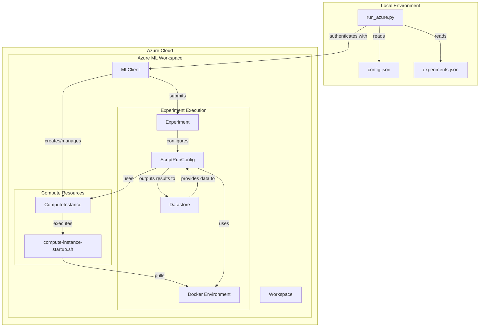
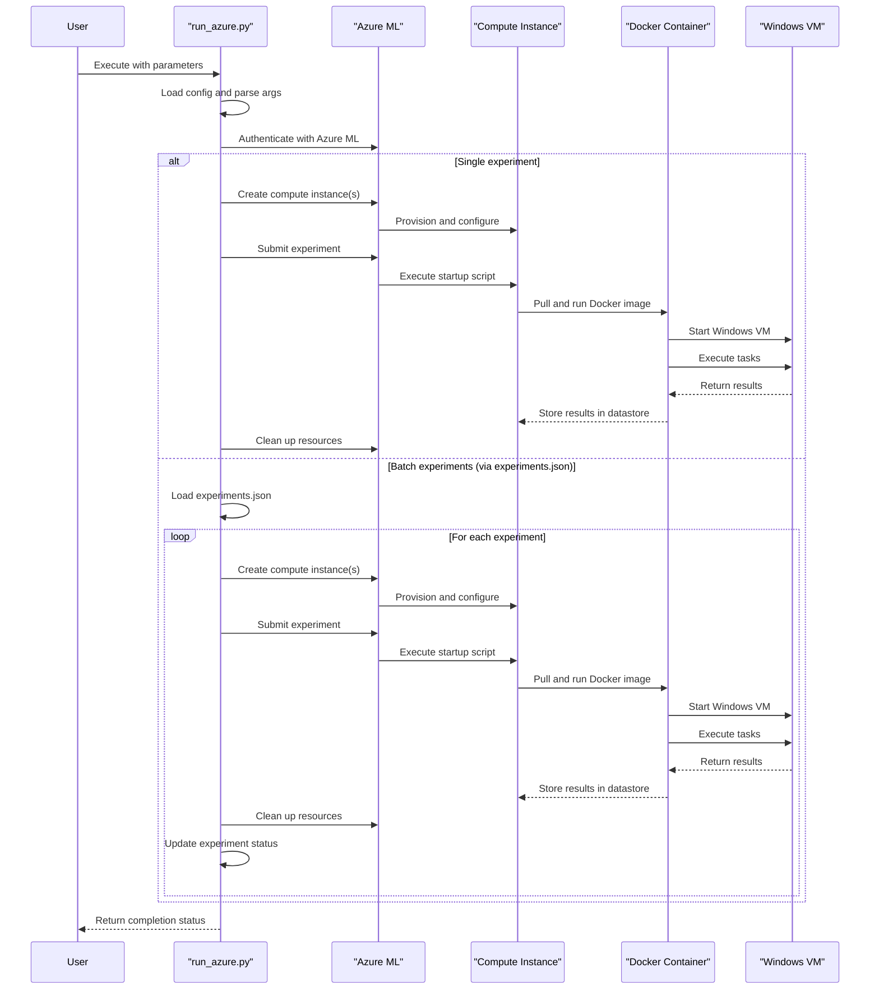
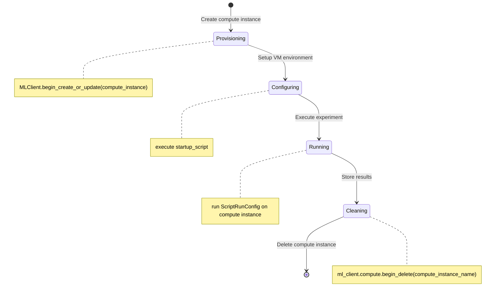

<!-- source: DeepWiki mcp.deepwiki.com · repo microsoft/WindowsAgentArena · page 3.2 Azure Execution · fetched 2026-10-26 -->

# Azure Execution

<details>
<summary>Relevant source files</summary>

The following files were used as context for generating this wiki page:

- [scripts/run_azure.py](scripts/run_azure.py)
- [src/win-arena-container/vm/setup/setup.ps1](src/win-arena-container/vm/setup/setup.ps1)

</details>


This document details how to run experiments on Azure using the Windows Agent Arena (WAA) platform. It covers the process of configuring, deploying, and managing experiments in the Azure cloud environment. For information about running experiments locally, see [Local Execution](#3.1).

## Overview

Azure execution leverages Azure Machine Learning (AML) services to deploy and run Windows Agent Arena experiments at scale. This approach offers several advantages over local execution:

- **Scalability**: Run multiple experiments in parallel across different compute instances
- **Resource Efficiency**: Utilize Azure's compute resources without local hardware limitations
- **Automation**: Automatically provision and deprovision resources as needed
- **Experiment Tracking**: Leverage Azure ML's experiment tracking capabilities

## Architecture

The following diagram illustrates the high-level architecture of Azure execution in Windows Agent Arena:



Sources: [scripts/run_azure.py:12-26](), [scripts/run_azure.py:80-89](), [scripts/run_azure.py:211-214]()

## Prerequisites

Before running experiments on Azure, ensure you have:

1. **Azure Subscription**: Active Azure subscription with access to Azure ML
2. **Configuration File**: A properly configured `config.json` file with Azure credentials
3. **Docker Image**: Access to the Windows Arena Docker image (default: `windowsarena/winarena:latest`)
4. **API Keys**: OpenAI API key or Azure OpenAI API key and endpoint

### Configuration File Setup

Your `config.json` should contain the following Azure-specific keys:

```
{
    "AZURE_SUBSCRIPTION_ID": "your-subscription-id",
    "AZURE_ML_RESOURCE_GROUP": "your-resource-group",
    "AZURE_ML_WORKSPACE_NAME": "your-workspace-name",
    "OPENAI_API_KEY": "your-openai-api-key"  // or AZURE_API_KEY and AZURE_ENDPOINT
}
```

Sources: [scripts/run_azure.py:202-204](), [scripts/run_azure.py:154-164]()

## Running Experiments

### Basic Usage

The simplest way to run an experiment on Azure is:

```bash
python scripts/run_azure.py --exp_name my_experiment --json_name evaluation_examples_windows/my_tasks.json
```

This will:
1. Create a compute instance on Azure
2. Deploy the Windows Arena container
3. Run the specified tasks
4. Store results in Azure
5. Delete the compute instance when complete

### Command Line Parameters

| Parameter | Default | Description |
|-----------|---------|-------------|
| `--exp_name` | `exp0` | Experiment name used for tracking in Azure ML |
| `--json_name` | `evaluation_examples_windows/test_all.json` | Path to JSON file containing tasks to run |
| `--agent` | `navi` | Agent to use for experiments |
| `--model_name` | `gpt-4o-mini` | Model name (e.g., `gpt-4o`, `gpt-4-vision-preview`) |
| `--som_origin` | `oss` | Screen understanding method (`oss`, `a11y`, or `mixed`) |
| `--a11y_backend` | `uia` | Accessibility backend (`uia` more precise, `win32` faster) |
| `--num_workers` | `2` | Number of parallel compute instances to create |
| `--docker_img_name` | `windowsarena/winarena:latest` | Docker image to use |
| `--use_managed_identity` | `False` | Whether to use Azure Managed Identity |
| `--ci_startup_script_path` | `Users/rbonatti/compute-instance-startup.sh` | Path to compute instance startup script |

Sources: [scripts/run_azure.py:48-61]()

## Execution Workflow

The following diagram illustrates the execution flow when running an experiment on Azure:



Sources: [scripts/run_azure.py:64-197](), [scripts/run_azure.py:243-267]()

## Batch Execution with experiments.json

For running multiple experiments with different configurations, you can use an `experiments.json` file:

```json
{
  "experiment1": {
    "exp_name": "experiment1",
    "agent": "navi",
    "model_name": "gpt-4o",
    "som_origin": "oss",
    "num_workers": 3,
    "json_name": "evaluation_examples_windows/test_set1.json"
  },
  "experiment2": {
    "exp_name": "experiment2",
    "agent": "navi",
    "model_name": "gpt-4-vision-preview",
    "som_origin": "a11y",
    "num_workers": 2,
    "json_name": "evaluation_examples_windows/test_set2.json"
  }
}
```

Run all experiments in the file:
```bash
python scripts/run_azure.py --experiments_json path/to/experiments.json
```

The script will:
1. Process each experiment sequentially
2. Track progress in the experiments.json file, allowing restarts if interrupted
3. Mark experiments as complete once finished

Sources: [scripts/run_azure.py:243-273](), [scripts/run_azure.py:275-334]()

## Azure Resource Management

### Compute Instance Lifecycle

Each experiment creates compute instances that follow this lifecycle:

1. **Creation**: Instances are created with the specified configuration
2. **Configuration**: The startup script installs necessary components
3. **Execution**: The Windows Arena container runs on the instance
4. **Cleanup**: Instances are automatically deleted when the experiment completes



Sources: [scripts/run_azure.py:103-144](), [scripts/run_azure.py:186-196]()

### Environment Configuration

The Windows VM within the container is configured using setup scripts that install required software and tools. The VM setup process includes:

1. Installing Python and required packages
2. Installing common applications like Chrome, LibreOffice, GIMP, and others
3. Configuring the Windows Arena server
4. Setting up firewall rules and scheduled tasks

Sources: [src/win-arena-container/vm/setup/setup.ps1:1-429]()

## Troubleshooting

### Common Issues

| Issue | Possible Solution |
|-------|------------------|
| Authentication failure | Ensure your Azure credentials in config.json are correct and that your account has appropriate permissions |
| Resource quota exceeded | Check your Azure subscription limits and request quota increases if needed |
| Experiment timeout | Increase the timeout value or simplify the experiment |
| Missing API keys | Ensure OpenAI API key or Azure OpenAI keys are properly configured |
| Compute instance creation fails | Check for resource constraints or name conflicts in your Azure subscription |

### Logging

The script creates detailed logs in the `./azure_logs` directory with timestamps for each run. These logs contain information about:

- Compute instance creation and status
- Experiment submission and execution
- Any errors encountered during the process

To monitor logs during execution:
```bash
tail -f ./azure_logs/run_YYYY-MM-DD_HH-MM-SS.log
```

Sources: [scripts/run_azure.py:28-44]()

## Advanced Usage

### Using Managed Identity

For secure Azure operations, you can use Azure Managed Identity instead of direct credentials:

```bash
python scripts/run_azure.py --use_managed_identity True --exp_name secure_experiment
```

When using managed identity, ensure your config.json contains the necessary managed identity configuration:

```json
{
  "AZURE_MANAGED_IDENTITY_CLIENT_ID": "your-client-id",
  "AZURE_MANAGED_IDENTITY_OBJECT_ID": "your-object-id",
  "AZURE_MANAGED_IDENTITY_PRINCIPAL_ID": "your-principal-id",
  "AZURE_ML_USER_ASSIGNED_IDENTITY": "your-identity-name"
}
```

Sources: [scripts/run_azure.py:116-142]()

### Updating Experiment Configurations

You can update experiment configurations without rerunning them:

```bash
python scripts/run_azure.py --experiments_json path/to/experiments.json --update_json --exp_name experiment1 --model_name gpt-4o
```

This will update the specified parameters for the named experiment in the experiments.json file without executing it.

Sources: [scripts/run_azure.py:280-317]()

---

