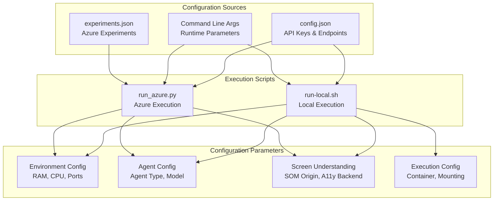
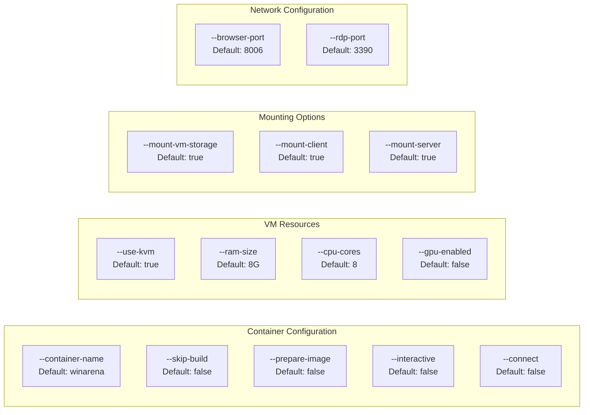
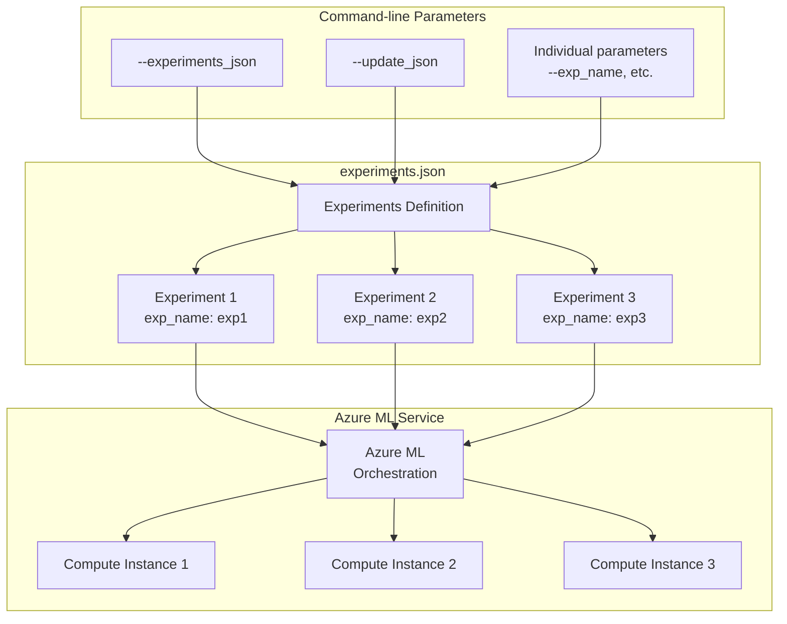
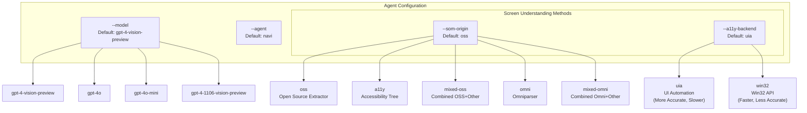

<!-- source: DeepWiki mcp.deepwiki.com · repo microsoft/WindowsAgentArena · page 3.3 Configuration Options · fetched 2026-10-26 -->

# Configuration Options

<details>
<summary>Relevant source files</summary>

The following files were used as context for generating this wiki page:

- [scripts/run-local.sh](scripts/run-local.sh)
- [scripts/run_azure.py](scripts/run_azure.py)
- [src/win-arena-container/vm/setup/setup.ps1](src/win-arena-container/vm/setup/setup.ps1)

</details>


This document provides a comprehensive overview of the configuration options available for running experiments in the Windows Agent Arena (WAA). It covers configuration parameters for both local and Azure deployment modes, as well as agent and environment settings.

For information on how to execute experiments locally or on Azure, please refer to [Local Execution](#3.1) and [Azure Execution](#3.2) respectively.

## 1. Configuration Overview

The Windows Agent Arena platform offers a flexible configuration system that allows you to customize various aspects of the environment, agents, and execution parameters. Configuration options can be specified through command-line arguments, configuration files, or a combination of both.



**Diagram: Configuration Flow in Windows Agent Arena**

Sources: [scripts/run-local.sh:1-164](), [scripts/run_azure.py:1-46]()

## 2. Main Configuration File

The primary configuration file is `config.json`, located in the root directory of the repository. This file contains API keys and Azure configuration details required for running experiments.

### 2.1 Required Fields

| Field | Required For | Description |
|-------|--------------|-------------|
| `OPENAI_API_KEY` | OpenAI API | API key for accessing OpenAI models (e.g., GPT-4, GPT-4o) |
| `AZURE_API_KEY` | Azure OpenAI | API key for accessing Azure OpenAI Service |
| `AZURE_ENDPOINT` | Azure OpenAI | Endpoint URL for Azure OpenAI Service |
| `AZURE_SUBSCRIPTION_ID` | Azure Execution | Azure Subscription ID |
| `AZURE_ML_RESOURCE_GROUP` | Azure Execution | Resource group for Azure ML workspace |
| `AZURE_ML_WORKSPACE_NAME` | Azure Execution | Name of Azure ML workspace |

You must provide either `OPENAI_API_KEY` or both `AZURE_API_KEY` and `AZURE_ENDPOINT` to run experiments with LLM agents.

Sources: [scripts/run-local.sh:150-162](), [scripts/run_azure.py:78-81]()

## 3. Local Execution Configuration Options

When running experiments locally using `run-local.sh`, you can configure the following options:

### 3.1 Container and VM Configuration



**Diagram: Local Execution Configuration Parameters**

| Parameter | Default | Description |
|-----------|---------|-------------|
| `--container-name` | winarena | Name of the Docker container |
| `--prepare-image` | false | Prepare a golden image for faster startup |
| `--skip-build` | false | Skip building the container image |
| `--interactive` | false | Launch container in interactive mode (shell access) |
| `--connect` | false | Connect to an existing container |
| `--use-kvm` | true | Use KVM for VM acceleration |
| `--ram-size` | 8G | RAM allocated to the VM |
| `--cpu-cores` | 8 | CPU cores allocated to the VM |
| `--mount-vm-storage` | true | Mount VM storage directory |
| `--mount-client` | true | Mount client directory |
| `--mount-server` | true | Mount server directory (only for dev mode) |
| `--browser-port` | 8006 | Port for browser access to the VM |
| `--rdp-port` | 3390 | Port for RDP access to the VM |
| `--start-client` | true | Start the client process |
| `--gpu-enabled` | false | Enable GPU support |
| `--mode` | azure | Mode (dev/azure) |

Sources: [scripts/run-local.sh:9-29](), [scripts/run-local.sh:114-137]()

## 4. Azure Execution Configuration Options

For running experiments on Azure using `run_azure.py`, you can configure the following options:

### 4.1 Basic Azure Configuration

| Parameter | Default | Description |
|-----------|---------|-------------|
| `--exp_name` | exp0 | Experiment name |
| `--num_workers` | 2 | Number of worker instances to run in parallel |
| `--docker_img_name` | windowsarena/winarena:latest | Docker image to use |
| `--datastore_input_path` | storage | Path to input data in the datastore |
| `--use_managed_identity` | False | Use Azure managed identity |
| `--ci_startup_script_path` | Users/rbonatti/compute-instance-startup.sh | Path to compute instance startup script |

### 4.2 Experiments JSON File

For batch execution, Azure mode supports an `experiments.json` file that defines multiple experiments to run in sequence:



**Diagram: Azure Experiments Configuration**

The experiments JSON file allows you to define and queue multiple experiments with different configurations. Each entry in the JSON can have its own set of parameters.

Sources: [scripts/run_azure.py:48-60](), [scripts/run_azure.py:242-268]()

## 5. Agent Configuration Options

Both local and Azure execution modes share common agent configuration options:



**Diagram: Agent Configuration Options**

| Parameter | Default | Options | Description |
|-----------|---------|---------|-------------|
| `--agent` | navi | navi | Agent type to use |
| `--model` | gpt-4-vision-preview | gpt-4o-mini, gpt-4-vision-preview, gpt-4o, gpt-4-1106-vision-preview | LLM model to use |
| `--som-origin` | oss | oss, a11y, mixed-oss, omni, mixed-omni | Screen understanding method |
| `--a11y-backend` | uia | uia, win32 | Accessibility backend to use |

### 5.1 Model Options

- **gpt-4-vision-preview**: GPT-4 with vision capabilities
- **gpt-4o**: Latest GPT-4 model with multimodal capabilities
- **gpt-4o-mini**: Smaller, faster version of GPT-4o
- **gpt-4-1106-vision-preview**: November 2023 version of GPT-4 with vision

### 5.2 Screen Understanding Methods (SOM)

- **oss**: Open-source screen understanding model
- **a11y**: Uses the accessibility tree for screen understanding
- **mixed-oss**: Combined approach using OSS and other methods
- **omni**: Uses the Omniparser for screen understanding
- **mixed-omni**: Combined approach using Omniparser and other methods

### 5.3 Accessibility Backend Options

- **uia**: Uses UI Automation API (more accurate but slower)
- **win32**: Uses Win32 API (faster but less accurate)

Sources: [scripts/run-local.sh:24-27](), [scripts/run-local.sh:130-133](), [scripts/run_azure.py:57-60]()

## 6. VM Environment Configuration

The Windows VM is configured with various applications and tools to provide a realistic environment for agent evaluation. These are installed automatically during setup.

| Application Category | Installed Tools |
|---------------------|-----------------|
| Productivity | LibreOffice, VS Code |
| Media | VLC, GIMP, ffmpeg |
| Internet | Google Chrome, Thunderbird |
| Development | Python, Git, 7zip |
| Server | Caddy Proxy |

The VM setup process includes:
1. Installing required applications
2. Configuring firewall rules
3. Setting up scheduled tasks
4. Disabling auto-updates for applications

Sources: [src/win-arena-container/vm/setup/setup.ps1:30-356]()

## 7. Usage Examples

### 7.1 Local Execution with Custom Settings

```bash
./scripts/run-local.sh --container-name my_arena --ram-size 16G --cpu-cores 12 --agent navi --model gpt-4o --som-origin a11y --a11y-backend win32
```

### 7.2 Azure Execution with Multiple Workers

```bash
python scripts/run_azure.py --exp_name benchmark_test --num_workers 4 --model_name gpt-4o --som_origin mixed-oss --json_name evaluation_examples_windows/full_benchmarks.json
```

### 7.3 Creating and Running Batch Experiments

First, create an experiments JSON file:

```bash
python scripts/run_azure.py --experiments_json experiments.json --update_json --exp_name exp1 --model_name gpt-4o --som_origin oss
python scripts/run_azure.py --experiments_json experiments.json --update_json --exp_name exp2 --model_name gpt-4o-mini --som_origin a11y
```

Then run all experiments:

```bash
python scripts/run_azure.py --experiments_json experiments.json
```

## 8. Troubleshooting Configuration Issues

If you encounter issues with configuration:

1. Verify that all required API keys are correctly set in `config.json`
2. For local execution, ensure Docker is installed and running
3. For Azure execution, verify that all Azure-related configuration parameters are correctly set
4. Check that the VM resource allocations (RAM, CPU) are appropriate for your system

For more detailed troubleshooting information, see [Troubleshooting](#6).

## 9. Key Configuration Files

The following files contain important configuration settings:

1. `config.json`: API keys and endpoints
2. `experiments.json`: Azure experiment configurations
3. `scripts/run-local.sh`: Local execution configuration 
4. `scripts/run_azure.py`: Azure execution configuration
5. `src/win-arena-container/vm/setup/setup.ps1`: VM environment setup

Sources: [scripts/run-local.sh](), [scripts/run_azure.py]()

---

