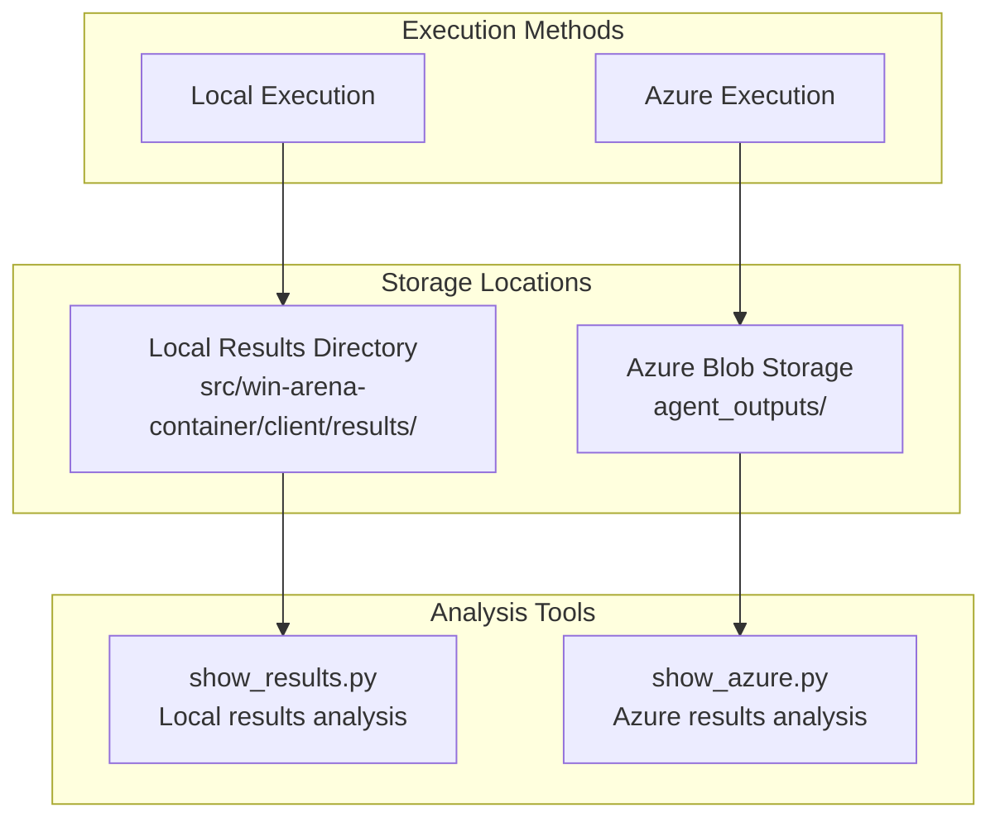
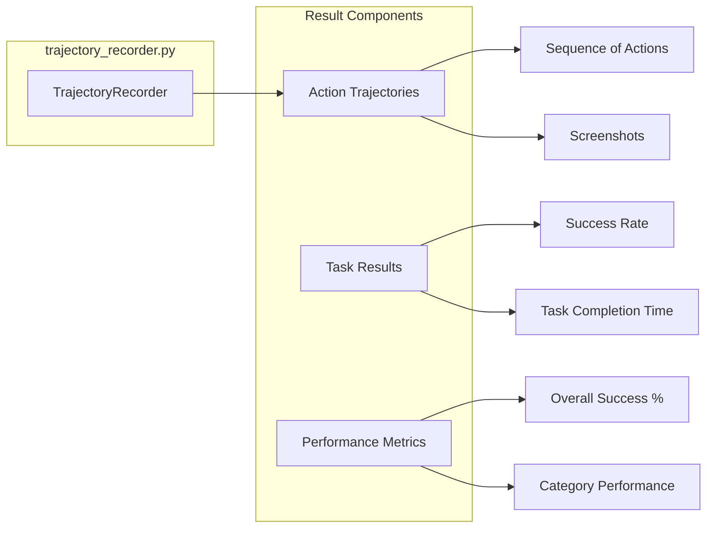
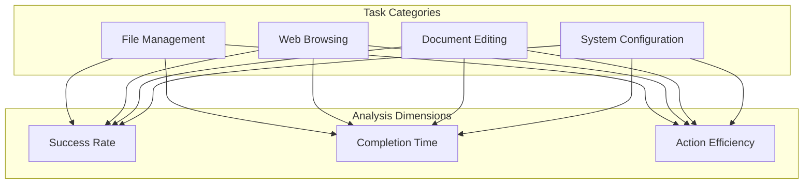

<!-- source: DeepWiki mcp.deepwiki.com · repo microsoft/WindowsAgentArena · page 3.4 Analyzing Results · fetched 2026-10-26 -->

# Analyzing Results

<details>
<summary>Relevant source files</summary>

The following files were used as context for generating this wiki page:

- [README.md](README.md)

</details>


This document explains how to access, view, and analyze the results from experiments run in the Windows Agent Arena. Whether you've executed experiments locally or on Azure, this guide will help you understand your agent's performance across benchmark tasks.

For information about running experiments, see [Running Experiments](#3) and for configuring tasks, see [Configuration Options](#3.3).

## Result Storage Locations

Before analyzing results, you need to know where they are stored based on your execution method.



Sources: [README.md:176-181](), [README.md:320-327]()

## Viewing Local Execution Results

After running experiments locally using the `run-local.sh` script, results are stored in a specified directory. To view and analyze these results:

```bash
cd src/win-arena-container/client
python show_results.py --result_dir <path_to_results_folder>
```

The script processes the result data and generates a summary of agent performance across all tasks, displaying metrics in a readable format.

Sources: [README.md:176-181]()

## Viewing Azure Execution Results

For experiments run on Azure using the `run_azure.py` script, follow these steps to analyze results:

1. Download the `agent_outputs` folder from your blob container to your local machine
2. Run the analysis script:

```bash
cd scripts
python show_azure.py --json_config "experiments.json" --result_dir <path_to_downloaded_agent_outputs_folder>
```

This script correlates results with the experiment configurations in your `experiments.json` file and presents them as a markdown table for easy comparison between different experiments.

Sources: [README.md:320-327]()

## Result Structure and Metrics



Sources: [README.md:12-14](), [README.md:181-181]()

The results include information about task completion success, action trajectories, and performance metrics. The `TrajectoryRecorder` component captures detailed logs of agent actions during task execution.

### Key Metrics

| Metric | Description | Importance |
|--------|-------------|------------|
| Success Rate | Percentage of tasks completed successfully | Primary benchmark metric |
| Completion Time | Time taken to complete each task | Efficiency indicator |
| Action Count | Number of actions taken to complete a task | Measure of agent efficiency |
| Category Performance | Success rates across different task categories | Identifies agent strengths/weaknesses |

## Comparing Agent Configurations

One of the most valuable aspects of the Windows Agent Arena is the ability to compare different agent configurations. The results scripts generate tables that make these comparisons easy to visualize.

### Configuration Impact Analysis

You can analyze how different agent configurations impact performance by comparing results across experiments with varying parameters:

| Configuration Parameter | Options | Purpose |
|------------------------|---------|---------|
| `--som-origin` | mixed-omni, omni, oss, a11y, mixed-oss | Screen understanding method |
| `--a11y-backend` | uia, win32 | Accessibility backend type |
| `model_name` | gpt-4-1106-vision-preview, gpt-4o, etc. | LLM model selection |

Example comparison from the README:

| Command | Description | Notes |
|---------|-------------|-------|
| `--som-origin mixed-omni --a11y-backend uia` | Combines Omniparser with accessibility tree | ⭐Recommended for best results |
| `--som-origin omni` | Uses Omniparser for screen understanding | |
| `--som-origin oss` | Uses webparse, groundingdino, and OCR | 🌲Baseline |
| `--som-origin a11y --a11y-backend uia` | Uses slower, more accurate accessibility tree | |
| `--som-origin a11y --a11y-backend win32` | Uses faster, less accurate accessibility tree | 🐇Fastest |
| `--som-origin mixed-oss --a11y-backend uia` | Combines OSS detections with accessibility tree | |

Sources: [README.md:184-194]()

## Performance Analysis by Task Categories



Analyzing performance across different task categories can help identify your agent's strengths and weaknesses. The results typically show per-category success rates, allowing you to target specific areas for improvement.

## Benchmark Costs and Running Times

When analyzing results, it's helpful to understand the computational costs and time investment required for different configurations:

| Component | Cost | Time |
|----------|----------|----------|
| Azure Standard_D8_v3 VM | ~$8 ($0.38/h * 40 * 0.5h) | |
| GPT-4V | $100 | ~35min with 40 VMs |
| GPT-4o | $100 | ~35min with 40 VMs |
| GPT-4o-mini | $15 | ~30min with 40 VMs |

Sources: [README.md:340-347]()

## Advanced Analysis Techniques

For deeper insights into agent performance, consider these advanced analysis approaches:

1. **Error Pattern Analysis**: Examine failed tasks to identify common failure modes
2. **Trajectory Analysis**: Review the sequence of actions taken by the agent to identify inefficiencies or unnecessary steps
3. **Comparative Analysis**: Compare your agent against baseline configurations to measure improvement
4. **Cross-Model Analysis**: Compare the same agent architecture across different foundation models to isolate performance factors

## Tips for Iterative Improvement

Based on your analysis results:

1. Identify tasks with lowest success rates and focus improvements there
2. Examine trajectories for successful completions to understand optimal strategies
3. Compare your agent against the recommended configurations (mixed-omni with UIA backend)
4. For tasks requiring high accuracy, favor the UIA backend; for speed-critical tasks, consider win32

Sources: [README.md:184-197]()

## Conclusion

Thorough analysis of benchmark results is essential for improving agent performance. The Windows Agent Arena provides standardized tools for viewing and comparing results across different agent configurations and task categories. By systematically analyzing these results, you can identify specific areas for improvement and measure progress in your agent's development.

---

