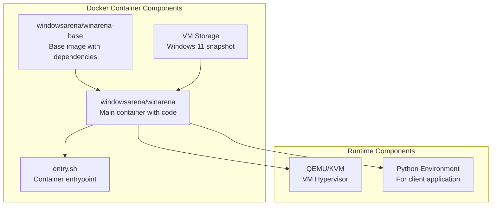
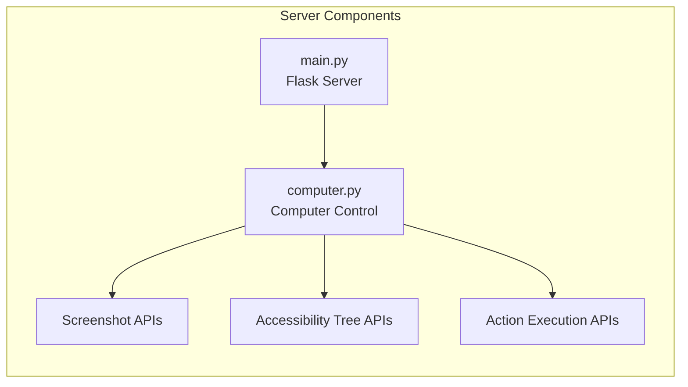
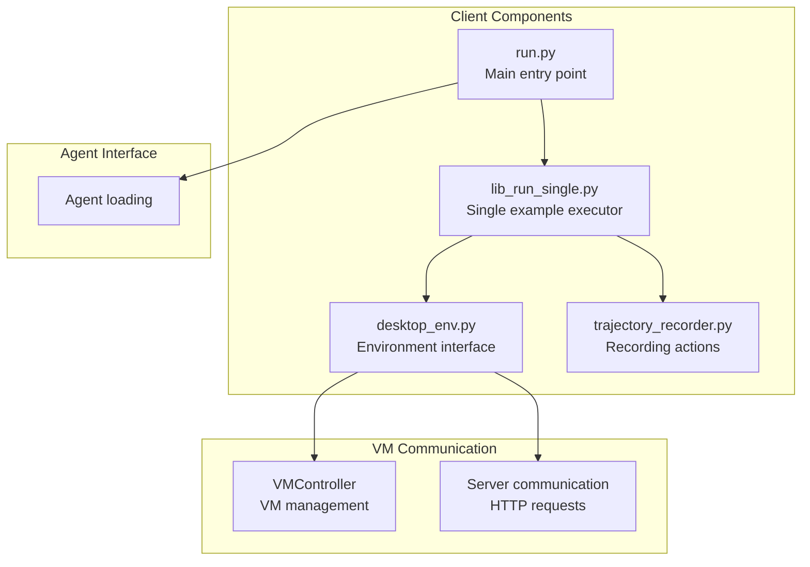
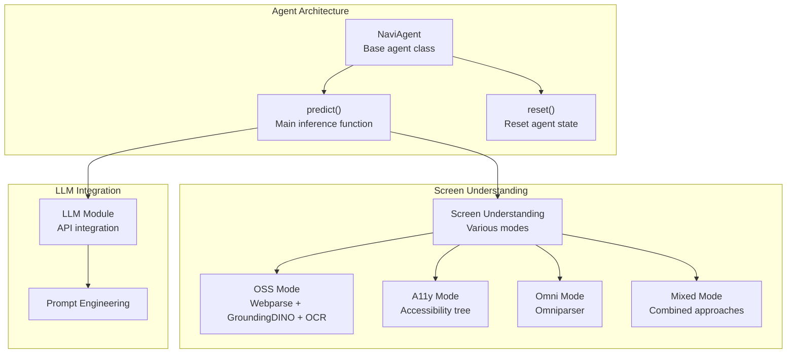
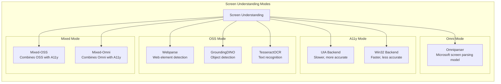
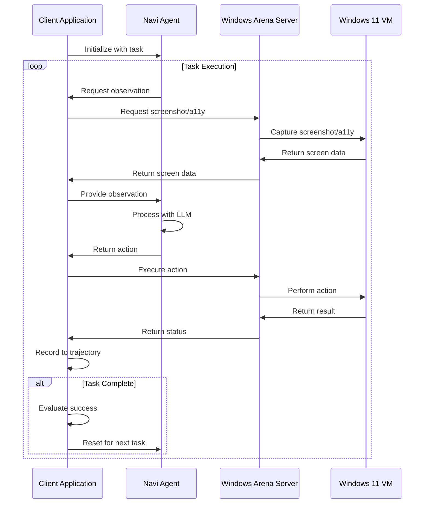
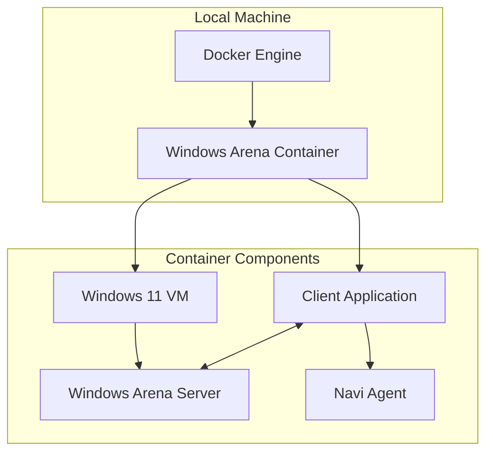
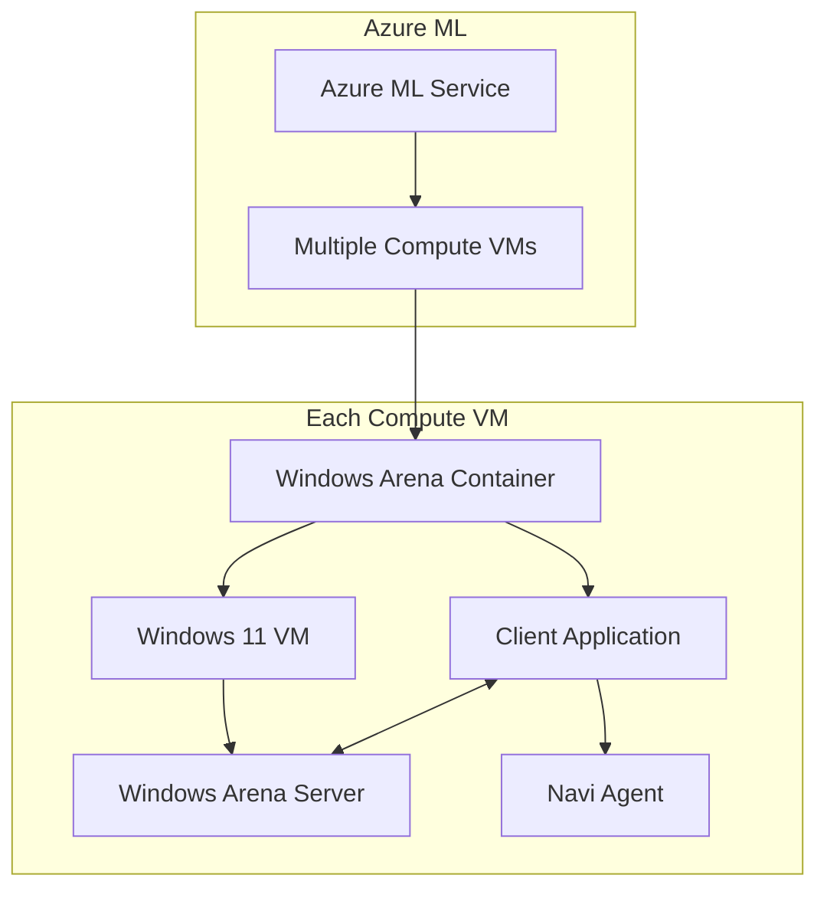
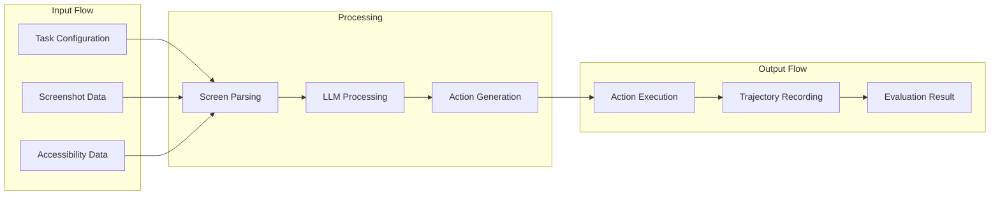

<!-- source: DeepWiki mcp.deepwiki.com · repo microsoft/WindowsAgentArena · page 4 System Components · fetched 2026-10-26 -->

# System Components

<details>
<summary>Relevant source files</summary>

The following files were used as context for generating this wiki page:

- [README.md](README.md)

</details>


This page provides a comprehensive overview of the Windows Agent Arena (WAA) system components, their purpose, and how they interact with each other. For installation instructions, see [Installation and Setup](#2), and for running experiments, see [Running Experiments](#3).

## Overview

The Windows Agent Arena consists of several interconnected components that work together to provide a platform for evaluating multi-modal AI agents in a Windows environment. The system is designed to be modular, allowing for different components to be swapped or upgraded independently.

```mermaid
graph TD
    subgraph "Container Layer"
        dockerContainer["Docker Container<br>windowsarena/winarena"]
    end
    
    subgraph "Core System Components"
        winVM["Windows 11 VM"]
        server["Windows Arena Server"]
        clientApp["Client Application"]
        naviAgent["Navi Agent"]
        screenUnd["Screen Understanding"]
    end
    
    dockerContainer --> winVM
    dockerContainer --> clientApp
    clientApp --> naviAgent
    naviAgent --> screenUnd
    clientApp <--> server
    server <--> winVM
    
    class naviAgent,screenUnd style="stroke-dasharray: 5 5"
    class winVM,server style="stroke-width:2px"
    class clientApp style="stroke-width:2px"
```

Sources: [README.md:12-14]()

## Windows Arena Container

The Windows Arena Container is the foundational component that encapsulates the entire system. It uses Docker to provide a consistent and reproducible environment for running experiments.

### Container Structure



Sources: [README.md:72-99]()

The container provides:
- A consistent environment for running the Windows VM
- QEMU/KVM virtualization for the Windows 11 VM
- Python environment for the client application
- Storage for the Windows 11 VM snapshot (golden image)

## Windows VM

The Windows 11 VM runs inside the Docker container and provides the operating system environment where tasks are executed. For detailed documentation, see [Windows VM](#4.1).

Key characteristics:
- Based on Windows 11 Enterprise Evaluation
- Pre-configured with necessary software for the benchmark tasks
- Contains the Windows Arena Server for receiving and executing commands

Sources: [README.md:101-150]()

## Server Application

The Server Application runs inside the Windows VM and provides an API for interacting with the Windows environment. For detailed documentation, see [Server Application](#4.3).



Sources: [README.md:101-150]()

The server provides APIs for:
- Capturing screenshots
- Retrieving accessibility tree information
- Executing actions (mouse clicks, keyboard input, etc.)
- Managing the Windows environment

## Client Application

The Client Application runs inside the Docker container (but outside the Windows VM) and coordinates the execution of experiments. For detailed documentation, see [Client Application](#4.2).



Sources: [README.md:12-14](), [README.md:176-197]()

The client application:
- Loads and initializes agents
- Communicates with the Windows Arena Server
- Manages the execution of tasks
- Records trajectories (sequence of actions and observations)
- Evaluates agent performance

## Navi Agent

The Navi Agent is the default agent provided with the Windows Agent Arena. It uses GPT-4 or other LLMs to understand the screen and decide what actions to take. For detailed documentation, see [Navi Agent](#4.4).



Sources: [README.md:186-197]()

The Navi Agent features:
- Multiple screen understanding modes (OSS, A11y, Omni, Mixed)
- Integration with LLMs (GPT-4, GPT-4o, Claude)
- Task-specific prompt engineering
- Action generation and execution

## Screen Understanding

The Screen Understanding component is responsible for parsing the Windows screen and providing a structured representation to the agent. For detailed documentation, see [Screen Understanding](#4.5).



Sources: [README.md:186-197]()

The Screen Understanding component provides different modes:
- OSS Mode: Uses web parsing, object detection, and OCR
- A11y Mode: Uses the Windows accessibility tree with UIA or Win32 backends
- Omni Mode: Uses Microsoft's Omniparser model
- Mixed Mode: Combines different approaches for better performance

## Component Interactions

The following diagram illustrates how the components interact during the execution of a task:



Sources: [README.md:12-14]()

## Deployment Options

The Windows Agent Arena supports two deployment options: local and Azure.

| Feature | Local Deployment | Azure Deployment |
|---------|------------------|------------------|
| Container | Single Docker container | Multiple containers on Azure VMs |
| Execution | Sequential (one task at a time) | Parallel (multiple tasks simultaneously) |
| Setup | Local machine resources | Azure ML computing resources |
| Performance | Limited by local hardware | Scalable cloud resources |
| Use Case | Development, testing | Large-scale benchmarking |

Sources: [README.md:58-150](), [README.md:204-327]()

### Local Deployment Architecture



Sources: [README.md:58-150]()

### Azure Deployment Architecture



Sources: [README.md:204-327]()

## Data Flow

The following diagram illustrates the data flow through the system during task execution:



Sources: [README.md:176-197]()

The data flow encompasses:
1. Input: Task configuration and screen data (screenshots, accessibility info)
2. Processing: Screen parsing, LLM processing, and action generation
3. Output: Action execution, trajectory recording, and evaluation results

---

