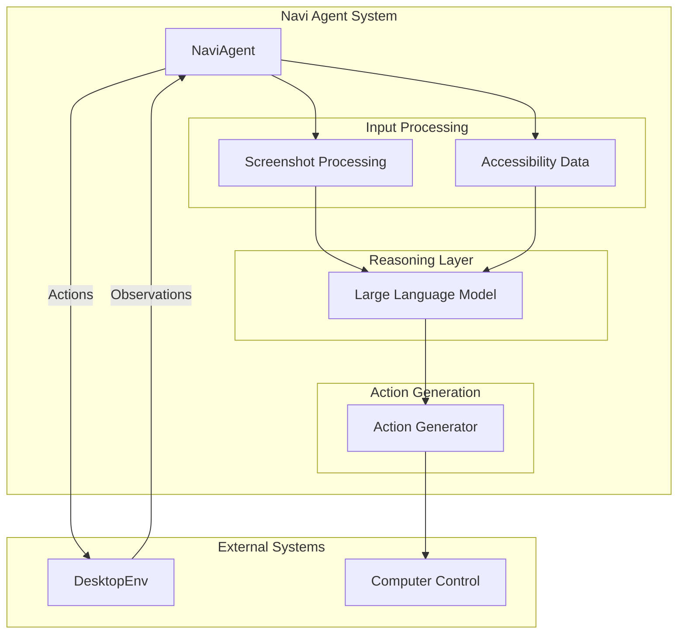
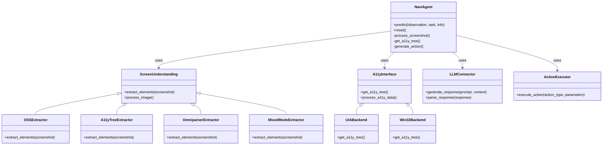
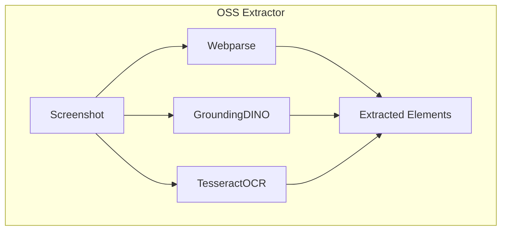
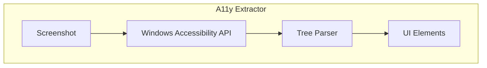
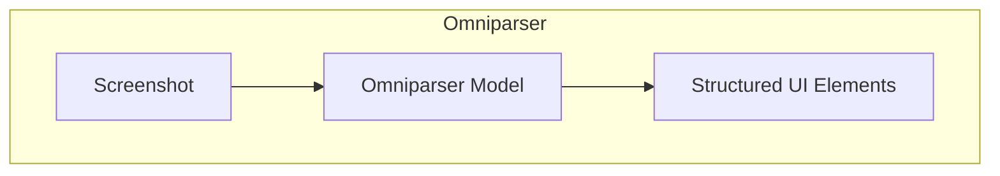
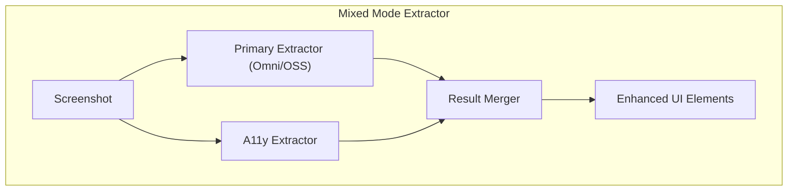
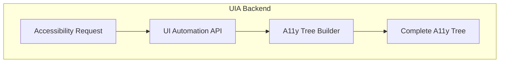
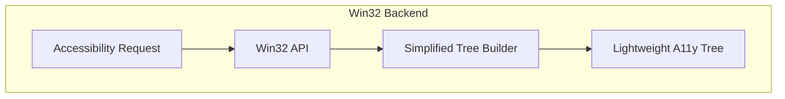
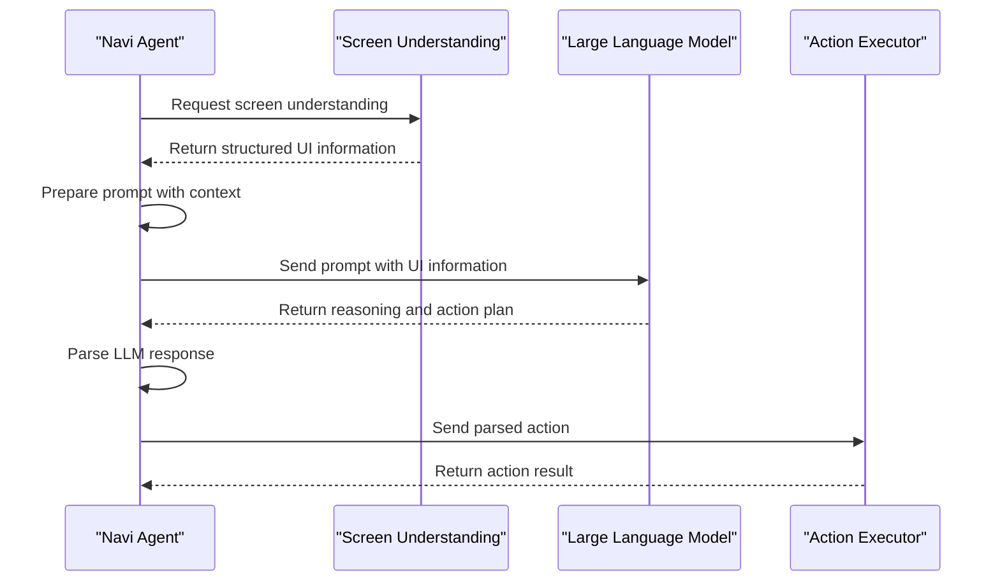
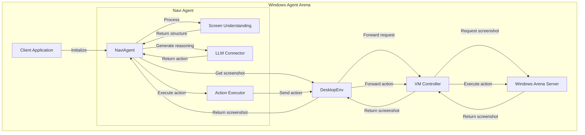

<!-- source: DeepWiki mcp.deepwiki.com · repo microsoft/WindowsAgentArena · page 4.4 Navi Agent · fetched 2026-10-26 -->

# Navi Agent

<details>
<summary>Relevant source files</summary>

The following files were used as context for generating this wiki page:

- [README.md](README.md)

</details>


This document provides comprehensive technical information about the Navi Agent component within the Windows Agent Arena (WAA) framework. Navi is the default multi-modal AI agent designed to interact with Windows operating system interfaces by combining vision-based understanding with accessibility data to complete tasks.

For information about the overall WAA platform architecture, see [System Architecture](#1.1). For details on the specific screen understanding components Navi uses, see [Screen Understanding](#4.5).

## 1. Overview

Navi Agent is an AI agent that interfaces with the Windows operating system through a combination of screen understanding methods and large language models. It's designed to interpret visual information from the Windows UI and execute appropriate actions to complete tasks.



Sources:
- README.md

## 2. Component Architecture

Navi Agent is implemented as a modular system with multiple components that handle different aspects of perception, reasoning, and action.



The Navi Agent consists of several key classes that work together to process screen information, generate reasoning, and execute actions.

Sources:
- README.md

## 3. Screen Understanding Methods

Navi Agent supports multiple screen understanding methods (referred to as `som-origin` in the configuration), each with different characteristics:

| Method | Description | Accuracy | Speed | Use Case |
|--------|-------------|----------|-------|----------|
| `mixed-omni` | Combines Omniparser with accessibility tree | Highest | Moderate | Best overall performance |
| `omni` | Uses Omniparser for screen understanding | High | Moderate | Good general performance |
| `oss` | Uses webparse, groundingdino, and OCR | Moderate | Moderate | Baseline approach |
| `a11y` | Uses only accessibility tree | Varies | Fast | UI element focused tasks |
| `mixed-oss` | Combines OSS detections with accessibility tree | Good | Moderate | Enhanced baseline |

The screen understanding methods determine how Navi interprets what's displayed on the screen, which directly impacts its ability to accurately understand and interact with the Windows interface.

### 3.1 OSS Extractor

The OSS Extractor uses a combination of open-source models to understand screen content:



Sources:
- README.md (Line 372 mentions GroundingDINO for object detection)

### 3.2 Accessibility Tree (A11y)

The Accessibility Tree approach leverages Windows' built-in accessibility APIs to understand UI elements:



Sources:
- README.md

### 3.3 Omniparser

Omniparser is Microsoft's high-performance screen understanding model that was open-sourced as part of the WAA project:



Sources:
- README.md (Line 23 mentions Microsoft open-sourced Omniparser)

### 3.4 Mixed Modes

Mixed modes combine multiple screen understanding methods to leverage the strengths of each approach:



Sources:
- README.md

## 4. A11y Backends

When using Accessibility Tree methods, Navi Agent can use two different backends:

| Backend | Description | Accuracy | Speed | Use Case |
|---------|-------------|----------|-------|----------|
| `uia` | UI Automation API | Higher | Slower | When accuracy is critical |
| `win32` | Win32 API | Lower | Faster | When speed is prioritized |

### 4.1 UIA Backend



Sources:
- README.md

### 4.2 Win32 Backend



Sources:
- README.md

## 5. LLM Integration

Navi Agent integrates with various large language models to drive its reasoning:

| Model | Capabilities | Use Case |
|-------|-------------|----------|
| GPT-4 Vision | Multimodal understanding with image input | Visual reasoning tasks |
| GPT-4o | Advanced reasoning with optional vision capabilities | General purpose tasks |
| Claude | Alternative LLM option | Comparison benchmarking |

The LLM integration flow follows this pattern:



Sources:
- README.md

## 6. Configuration Options

Navi Agent can be configured with various options to optimize its performance for specific scenarios:

### 6.1 Basic Configuration

```bash
./run-local.sh  # Uses default configuration (OSS extractor)
```

### 6.2 Optimal Performance Configuration

```bash
./run-local.sh --som-origin mixed-omni --a11y-backend uia --gpu-enabled true
```

### 6.3 Fast Execution Configuration

```bash
./run-local.sh --som-origin a11y --a11y-backend win32
```

The table below shows the configuration options and their impact:

| Parameter | Options | Default | Description |
|-----------|---------|---------|-------------|
| `--som-origin` | `oss`, `a11y`, `omni`, `mixed-oss`, `mixed-omni` | `oss` | Screen understanding method |
| `--a11y-backend` | `uia`, `win32` | `win32` | Accessibility backend (when using `a11y` or mixed modes) |
| `--gpu-enabled` | `true`, `false` | `false` | Whether to use GPU acceleration |
| `--model-name` | `gpt-4-1106-vision-preview`, `gpt-4o`, etc. | `gpt-4-1106-vision-preview` | LLM model to use |

Sources:
- README.md (Lines 176-197 show configuration options)

## 7. Integration with WAA Components

Navi Agent integrates with other Windows Agent Arena components to form a complete system:



The Navi Agent primarily interacts with the DesktopEnv component, which serves as an OpenAI Gym interface to the Windows environment. The agent receives observations (screenshots, accessibility data) from the environment and returns actions to be executed.

Sources:
- README.md

## 8. Performance Considerations

When selecting and configuring Navi Agent, consider the following performance factors:

1. **Screen Understanding Method:**
   - `mixed-omni` with `uia` backend provides the highest accuracy but requires more computational resources
   - `a11y` with `win32` backend offers the fastest performance but may miss visual details

2. **Hardware Requirements:**
   - GPU acceleration is recommended for optimal performance when using Omniparser
   - Without GPU acceleration, OSS or A11y methods may be more practical

3. **Task Characteristics:**
   - Text-heavy interfaces benefit from OCR capabilities (OSS)
   - UI-focused tasks with standard controls benefit from A11y methods
   - Complex visual interfaces benefit from Omniparser or mixed methods

Sources:
- README.md

## 9. Usage Examples

### Example: Basic Usage

To run Navi Agent with the baseline configuration:

```bash
./run-local.sh
```

### Example: High-Performance Configuration

For the best performance on capable hardware:

```bash
./run-local.sh --som-origin mixed-omni --a11y-backend uia --gpu-enabled true
```

### Example: Speed-Optimized Configuration

For faster execution when accuracy can be compromised:

```bash
./run-local.sh --som-origin a11y --a11y-backend win32
```

Sources:
- README.md (Lines 176-197)

---

