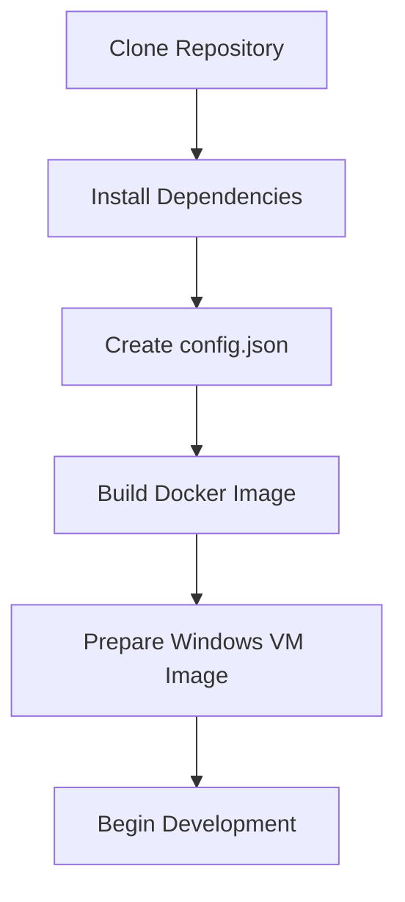
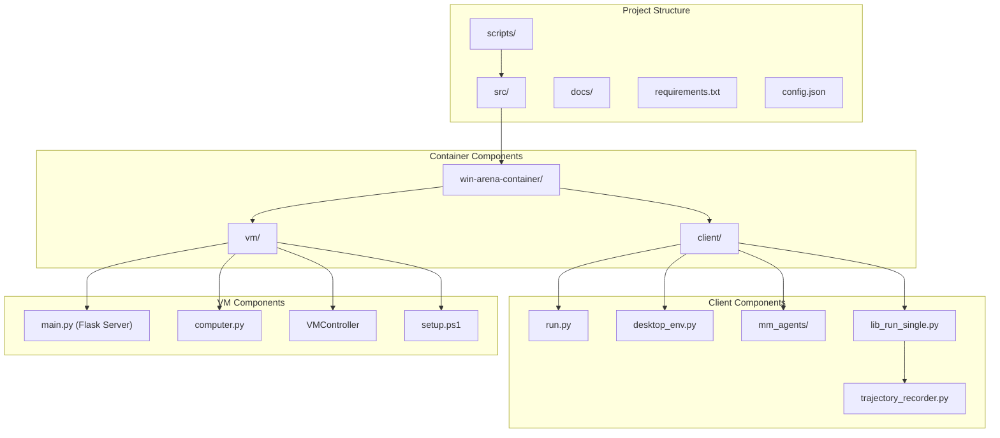
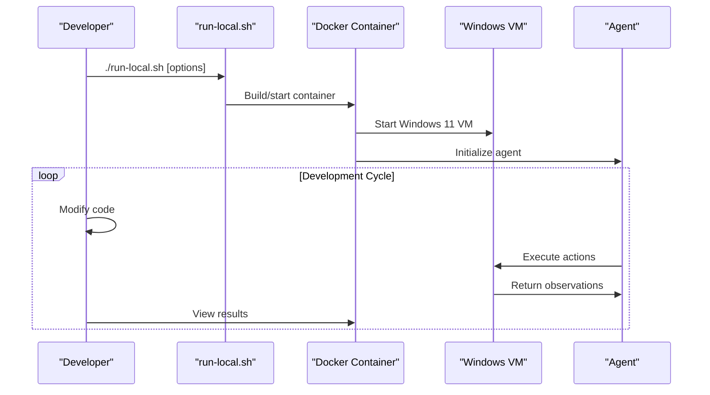
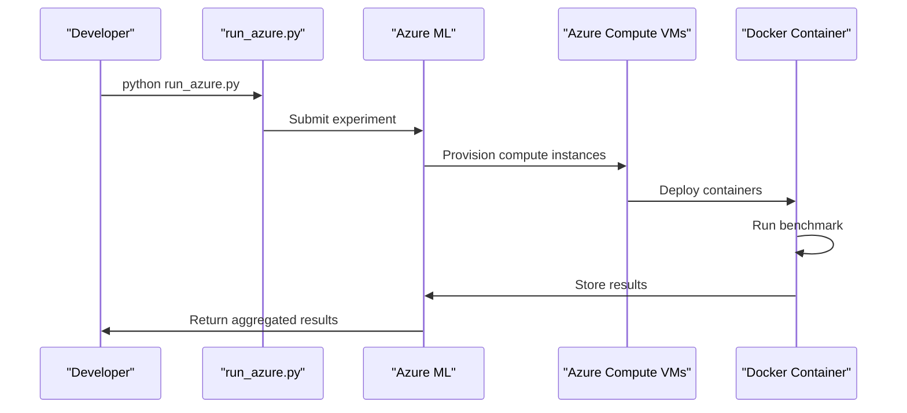
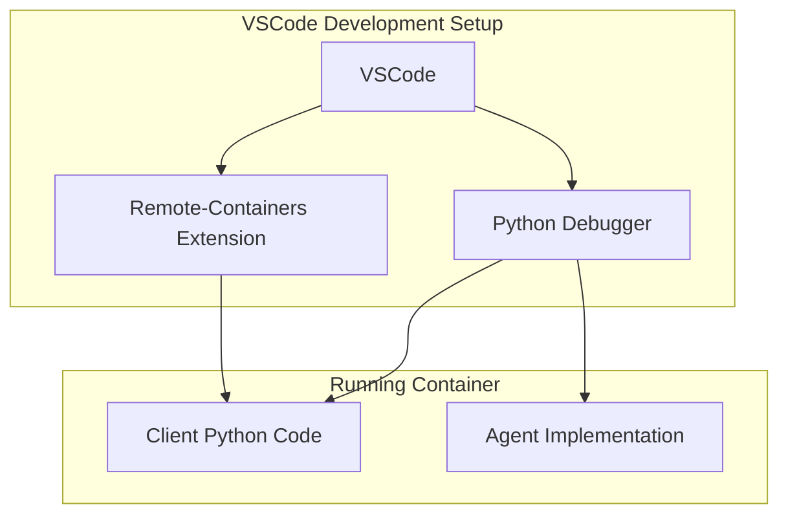
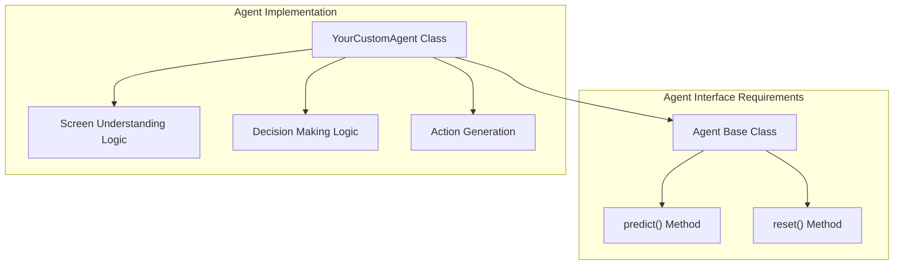
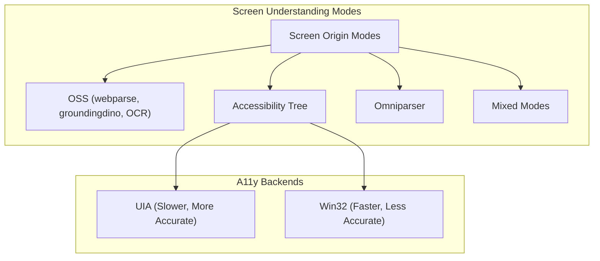

<!-- source: DeepWiki mcp.deepwiki.com · repo microsoft/WindowsAgentArena · page 5 Development Guide · fetched 2026-10-26 -->

# Development Guide

<details>
<summary>Relevant source files</summary>

The following files were used as context for generating this wiki page:

- [README.md](README.md)

</details>


This guide provides comprehensive information for developers who want to extend or modify the Windows Agent Arena (WAA) platform. It covers development environment setup, code architecture, customization approaches, and best practices for testing and debugging.

For specific information on implementing new agents, see [Adding New Agents](#5.1). For details on creating custom tasks, see [Customizing Tasks](#5.2).

## Development Environment Setup

Before you begin development, ensure you have the following prerequisites installed:

1. Docker daemon (with WSL 2 if on Windows)
2. Python 3.9 (preferably in a Conda environment)
3. An OpenAI or Azure OpenAI API Key
4. Windows 11 Evaluation ISO (for local development)

Follow these steps to set up your development environment:



1. Clone the repository and create a Python environment:
   ```bash
   git clone https://github.com/microsoft/WindowsAgentArena.git
   cd WindowsAgentArena
   conda create -n winarena python=3.9
   conda activate winarena
   pip install -r requirements.txt
   ```

2. Create a `config.json` file with your API keys in the project root.

3. Build the container image (only needed if modifying base infrastructure):
   ```bash
   cd scripts
   ./build-container-image.sh
   ```

4. Prepare the Windows VM image (required once before development):
   ```bash
   cd scripts
   ./run-local.sh --prepare-image true
   ```

Sources: [README.md:38-156]()

## Code Architecture Overview

The WAA codebase is organized into several key components with clearly defined responsibilities.



Sources: [README.md:170-204]()

### Key Components and Their Roles

| Component | Location | Purpose |
|-----------|----------|---------|
| **Scripts** | `scripts/` | Deployment scripts for local and Azure execution |
| **Client Application** | `src/win-arena-container/client/` | Manages agent execution and task evaluation |
| **Windows VM** | `src/win-arena-container/vm/` | Provides the Windows environment and server APIs |
| **Agent System** | `src/win-arena-container/client/mm_agents/` | Implements agent logic and screen understanding |
| **Task Definitions** | `src/win-arena-container/client/evaluation_examples_windows/` | Contains task configurations and success criteria |

## Development Workflows

The WAA platform supports two primary development workflows: local development and Azure cloud development.

### Local Development Workflow

The local development workflow allows for quick iteration and debugging on your machine:



To run the system locally:

```bash
cd scripts
./run-local.sh --som-origin mixed-omni --gpu-enabled true
```

During development, you can modify code in your local repository and have changes reflected in the container for immediate testing.

Sources: [README.md:158-169](), [README.md:182-197]()

### Azure Development Workflow

For scalable testing and benchmarking, use the Azure development workflow:



To run experiments in Azure:

1. Set up Azure resources as described in [Installation and Setup: Azure Environment Setup](#2.3)
2. Create or modify `experiments.json` with your experiment configurations
3. Run the Azure deployment script:
   ```bash
   cd scripts
   python run_azure.py --experiments_json "experiments.json"
   ```

Sources: [README.md:204-326]()

## Developing and Debugging

### VSCode Integration for Container Development

For efficient development, you can attach VSCode directly to the running container:

1. Install the "Remote - Containers" extension in VSCode
2. Start the WAA container with `run-local.sh`
3. In VSCode, click on the Remote Explorer icon and connect to the running container
4. Open the `/src/win-arena-container` directory in VSCode
5. Set breakpoints and debug the Python code directly



You can also enable code sharing between your local file system and the container by setting up volume mounts, allowing you to edit files locally and have changes reflected in the container.

Sources: [README.md:198-203]()

### Real-time Code Changes

The container is configured to allow for real-time code changes:

1. Client/agent code changes in your local repository are reflected in the container via volume mounts
2. For server code changes inside the VM, you'll need to restart the VM server or use the reload functionality

### Monitoring and Debugging the Windows VM

You can monitor the Windows VM through several methods:

1. Web interface at http://localhost:8006
2. VM logs available in the container
3. Agent trajectory recordings for post-analysis

## Extending Core Components

### Modifying the Client Application

The client application is responsible for orchestrating agent execution and task evaluation. Key files to modify include:

1. **Main Runner**: [`src/win-arena-container/client/run.py`]() - Entry point for the client
2. **Desktop Environment**: [`src/win-arena-container/client/desktop_env.py`]() - Interface to the Windows VM
3. **Execution Logic**: [`src/win-arena-container/client/lib_run_single.py`]() - Manages task execution
4. **Trajectory Recording**: [`src/win-arena-container/client/trajectory_recorder.py`]() - Records agent actions and results

When extending the client:
- Maintain compatibility with the gym-like interface in `desktop_env.py`
- Keep track of any new dependencies and update the Dockerfile-WinArena if needed

Sources: [README.md:329-330]()

### Agent Development

To develop a custom agent:



1. Create a new folder under `src/win-arena-container/client/mm_agents/your_agent_name/`
2. Implement a class that includes `predict()` and `reset()` methods
3. The `predict()` method should:
   - Take the current observation (screenshot)
   - Generate an action based on the observation
   - Return the action in the expected format
4. The `reset()` method should reset the agent's state at the start of a new task

You can reference the Navi agent implementation as a template.

Sources: [README.md:329-330]()

### Task Development

To develop new tasks:

1. Create a new JSON file in `src/win-arena-container/client/evaluation_examples_windows/`
2. Define the task configuration with steps, success criteria, and configuration parameters
3. Test the task locally before adding it to the benchmark suite

For more details on task structure and configuration options, refer to [Customizing Tasks](#5.2).

Sources: [README.md:332-338]()

### Screen Understanding Modes

The WAA platform supports multiple screen understanding approaches that can be used by agents:



When developing a custom agent, you can specify which screen understanding mode to use via command-line arguments:

```bash
./run-local.sh --som-origin mixed-omni --a11y-backend uia --agent your_agent_name
```

Sources: [README.md:184-197]()

## Testing and Benchmarking

### Local Testing

For rapid development and testing:

1. Run a single task or a small subset of tasks:
   ```bash
   ./run-local.sh --json-name "evaluation_examples_windows/your_test_file.json"
   ```

2. Test with different screen understanding modes:
   ```bash
   ./run-local.sh --som-origin mixed-omni --a11y-backend uia
   ```

3. Adjust resource allocation for testing on machines with limited resources:
   ```bash
   ./run-local.sh --ram-size 4G --cpu-cores 4
   ```

Sources: [README.md:349-366]()

### Azure Benchmarking

For comprehensive benchmarking:

1. Create an experiment configuration in `experiments.json`:
   ```json
   {
     "your_experiment": {
       "agent": "your_agent_name",
       "som_origin": "mixed-omni",
       "a11y_backend": "uia",
       "num_workers": 4,
       "json_name": "evaluation_examples_windows/test_all.json"
     }
   }
   ```

2. Run the Azure benchmark:
   ```bash
   python run_azure.py --experiments_json "experiments.json"
   ```

3. Analyze results:
   ```bash
   python show_azure.py --json_config "experiments.json" --result_dir path/to/results
   ```

Sources: [README.md:276-326]()

## Contribution Guidelines

We welcome contributions to the Windows Agent Arena project:

1. **Code Contributions**:
   - Follow the existing code style and architecture
   - Include appropriate tests for new functionality
   - Document your changes thoroughly

2. **New Agents**:
   - Place in `src/win-arena-container/client/mm_agents/`
   - Include documentation explaining the agent's approach
   - Benchmark against existing agents

3. **New Tasks**:
   - Follow the task development guidelines
   - Ensure tasks are realistic and well-documented
   - Test tasks across multiple agents

4. **Submit Pull Requests**:
   - Create a fork of the repository
   - Make your changes in a feature branch
   - Submit a pull request with a clear description of changes

Sources: [README.md:332-338](), [README.md:375-393]()

## Troubleshooting

For common development issues, refer to [Troubleshooting](#6). Some frequent issues include:

1. **Docker Permissions**: You may need to run scripts with `sudo` depending on your Docker setup

2. **Windows VM Preparation**: If VM preparation fails, delete the contents of the `storage` directory and try again

3. **Script Format Issues**: If running on WSL2 and encountering interpreter errors, convert scripts to Unix format:
   ```bash
   cd ./scripts
   find . -maxdepth 1 -type f -exec dos2unix {} +
   ```

4. **Resource Limitations**: If experiencing performance issues, adjust resource allocation:
   ```bash
   ./run-local.sh --ram-size 4G --cpu-cores 4
   ```

5. **KVM Acceleration**: If your system doesn't support KVM acceleration:
   ```bash
   ./run-local.sh --use-kvm false
   ```

Sources: [README.md:150-157](), [README.md:349-366]()

---

