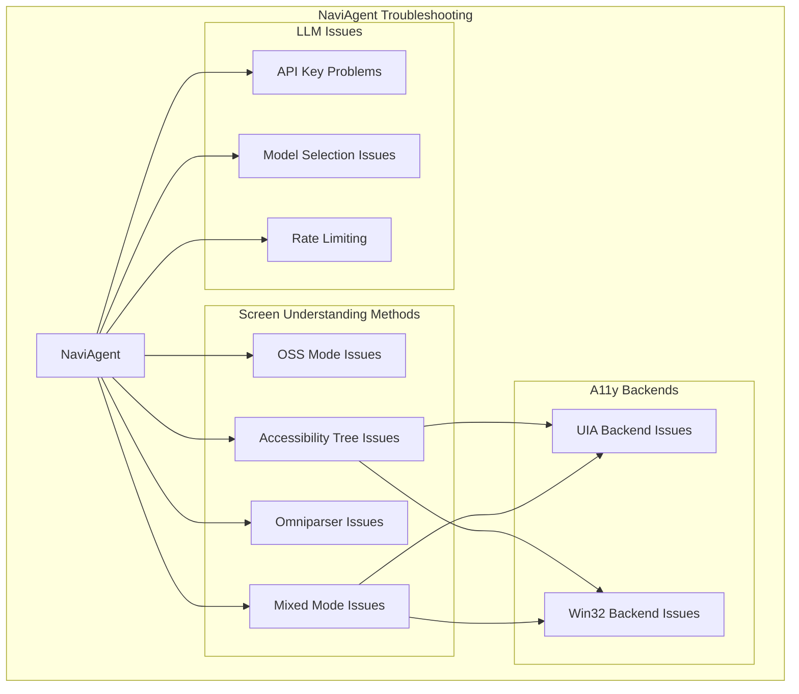
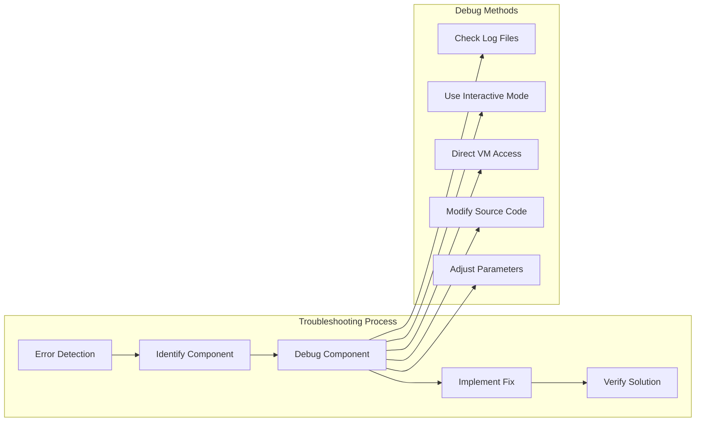

<!-- source: DeepWiki mcp.deepwiki.com · repo microsoft/WindowsAgentArena · page 6 Troubleshooting · fetched 2026-10-26 -->

# Troubleshooting

<details>
<summary>Relevant source files</summary>

The following files were used as context for generating this wiki page:

- [README.md](README.md)
- [scripts/run-local.sh](scripts/run-local.sh)
- [scripts/run_azure.py](scripts/run_azure.py)
- [src/win-arena-container/vm/setup/setup.ps1](src/win-arena-container/vm/setup/setup.ps1)

</details>


This page provides guidance for diagnosing and resolving common issues encountered when using the Windows Agent Arena (WAA). It covers configuration problems, Docker container issues, VM setup challenges, networking difficulties, agent execution errors, and Azure deployment troubleshooting.

For general setup instructions, see [Installation and Setup](#2). For information on running experiments, see [Running Experiments](#3).

## Common Error Sources

Understanding where issues typically originate in the WAA system helps in efficiently diagnosing problems:

```mermaid
flowchart TD
    subgraph "Error Sources"
        Config["Configuration Issues"]
        Docker["Docker/Container Issues"]
        VM["VM Setup Issues"]
        Network["Network Issues"]
        Agent["Agent Execution Issues"]
        Azure["Azure Deployment Issues"]
    end
    
    subgraph "System Components"
        ConfigFile["config.json"]
        RunScripts["run-local.sh / run_azure.py"]
        BuildScript["build-container-image.sh"]
        DockerFiles["Dockerfile-WinArena"]
        SetupPS["setup.ps1"]
        VMStorage["VM storage/ directory"]
        ServerPy["Server (main.py)"]
        Ports["Port Exposure (8006, 3390)"]
        NaviAgent["NaviAgent"]
        SOM["Screen Understanding Methods"]
        LLMIntegration["LLM API Integration"]
        AzureConfig["Azure ML Configuration"]
        BlobStorage["Azure Blob Storage"]
    end
    
    Config --> ConfigFile
    Config --> RunScripts
    Docker --> BuildScript
    Docker --> DockerFiles
    VM --> SetupPS
    VM --> VMStorage
    VM --> ServerPy
    Network --> Ports
    Network --> ServerPy
    Agent --> NaviAgent
    Agent --> SOM
    Agent --> LLMIntegration
    Azure --> AzureConfig
    Azure --> BlobStorage
```



Sources: [README.md:39-56](), [scripts/run-local.sh:6-143]()

## 1. Configuration Issues

### 1.1 API Key Problems

**Issue**: Missing or invalid API keys.

**Solutions**:
- Ensure `config.json` at the project root contains either an OpenAI API key or both Azure OpenAI credentials:

```json
{
    "OPENAI_API_KEY": "<OPENAI_API_KEY>", 
    // OR
    "AZURE_API_KEY": "<AZURE_API_KEY>",  
    "AZURE_ENDPOINT": "https://yourendpoint.openai.azure.com/"
}
```

- For Azure deployment, verify that the additional required fields are present:

```json
{
    "AZURE_SUBSCRIPTION_ID": "<YOUR_AZURE_SUBSCRIPTION_ID>", 
    "AZURE_ML_RESOURCE_GROUP": "<YOUR_AZURE_ML_RESOURCE_GROUP>",
    "AZURE_ML_WORKSPACE_NAME": "<YOUR_AZURE_ML_WORKSPACE_NAME>"
}
```

**Common Error Message**:
```
Either OPENAI_API_KEY must be set or both AZURE_API_KEY and AZURE_ENDPOINT must be set
```

Sources: [README.md:61-69](), [scripts/run-local.sh:154-161](), [scripts/run_azure.py:154-164]()

### 1.2 Script Execution Problems

**Issue**: Scripts fail to execute properly.

**Solutions**:
- For WSL2 users who encounter `/bin/bash: bad interpreter: No such file or directory`, convert bash scripts to Unix format:

```bash
cd ./scripts
find . -maxdepth 1 -type f -exec dos2unix {} +
```

- Ensure you have the correct permissions to execute the scripts:
```bash
chmod +x scripts/*.sh
```

Sources: [README.md:152-156]()

## 2. Docker and Container Issues

### 2.1 Container Build Failures

**Issue**: Docker container fails to build.

**Solutions**:
1. Verify Docker daemon is running with sufficient resources:
   ```bash
   docker info
   ```

2. Explicitly pull the base image:
   ```bash
   docker pull windowsarena/winarena-base:latest
   ```

3. Rebuild with verbose output:
   ```bash
   cd scripts
   ./build-container-image.sh --build-base-image true
   ```

4. Check disk space availability:
   ```bash
   df -h
   ```

Sources: [README.md:72-97](), [scripts/run-local.sh:38-44]()

### 2.2 Container Runtime Issues

**Issue**: Container starts but crashes or behaves unexpectedly.

**Solutions**:
1. Adjust VM resource allocation for better performance:
   ```bash
   ./run-local.sh --ram-size 4G --cpu-cores 4
   ```

2. If using WSL2, increase its memory allocation in `.wslconfig`

3. Check if the container is already running and remove it if needed:
   ```bash
   docker ps -a
   docker rm -f winarena
   ```

4. Try running in interactive mode to debug:
   ```bash
   ./run-local.sh --interactive true
   ```

Sources: [README.md:349-365](), [scripts/run-local.sh:13-17](), [scripts/run-local.sh:56-64]()

## 3. VM Setup Issues

### 3.1 Golden Image Creation Problems

**Issue**: Failed to create the Windows 11 VM golden image.

**Solutions**:
1. Verify the Windows 11 ISO:
   - Renamed to `setup.iso`
   - Placed in `WindowsAgentArena/src/win-arena-container/vm/image`
   - Using Windows 11 Enterprise Evaluation (90-day trial)

2. Check KVM acceleration support on your system:
   ```bash
   grep -E --color=auto 'vmx|svm' /proc/cpuinfo
   ```
   If not supported:
   ```bash
   ./run-local.sh --use-kvm false
   ```

3. If previous attempts left partial files, clean the storage directory:
   ```bash
   rm -rf WindowsAgentArena/src/win-arena-container/vm/storage/*
   ```

4. Monitor the installation process at http://localhost:8006

Sources: [README.md:101-105](), [README.md:107-130](), [scripts/run-local.sh:53-55]()

### 3.2 Windows Software Installation Issues

**Issue**: Applications fail to install during VM setup.

**Solutions**:
1. The setup script attempts to download software from multiple mirrors. If downloads fail, check your internet connection.

2. If specific applications fail to install, examine the Windows PowerShell output in the VM console for error messages.

3. For persistent issues, check the `setup.ps1` script and the `tools_config.json` file for correct download URLs.

Sources: [src/win-arena-container/vm/setup/setup.ps1:29-239]()

## 4. Network and Connectivity Issues

### 4.1 Port Access Problems

**Issue**: Cannot connect to the VM via browser or RDP.

**Solutions**:
1. Check if ports are already in use:
   ```bash
   netstat -tuln | grep 8006
   netstat -tuln | grep 3390
   ```

2. Try different ports:
   ```bash
   ./run-local.sh --browser-port 8007 --rdp-port 3391
   ```

3. Verify container port mapping:
   ```bash
   docker ps
   ```

Sources: [scripts/run-local.sh:20-22](), [scripts/run-local.sh:77-84]()

### 4.2 VM Server Connection Issues

**Issue**: Client cannot connect to the server running in the VM.

**Solutions**:
1. Check if the Flask server in the VM is running properly.

2. Verify Windows firewall settings in the VM:
   - The setup script should have created rules for Python HTTP server on port 5000.
   - Check `PythonHTTPServer-5000` firewall rule exists in Windows Defender Firewall.

3. Test connectivity within the container:
   ```bash
   ping host.lan
   curl http://host.lan:5000/health
   ```

Sources: [src/win-arena-container/vm/setup/setup.ps1:402-407]()

## 5. Agent Execution Issues

### 5.1 LLM Integration Problems

**Issue**: Agent fails due to LLM connection issues.

**Solutions**:
1. Verify API key validity by testing with a simple API call.

2. Check for API rate limits or quota exhaustion.

3. Try a different model:
   ```bash
   ./run-local.sh --model gpt-4o-mini
   ```

4. For Azure OpenAI, verify that the specified model is deployed in your Azure OpenAI resource.

Sources: [scripts/run-local.sh:92-96](), [README.md:184-197]()

### 5.2 Screen Understanding Issues

**Issue**: Agent cannot correctly interpret the Windows screen.

**Solutions**:
1. Try different screen understanding methods:

   ```bash
   # Best results but computationally intensive
   ./run-local.sh --som-origin mixed-omni --a11y-backend uia
   
   # Baseline approach using OSS models
   ./run-local.sh --som-origin oss
   
   # Fastest approach with accessibility tree
   ./run-local.sh --som-origin a11y --a11y-backend win32
   ```

2. If using GPU acceleration, ensure it's enabled:
   ```bash
   ./run-local.sh --gpu-enabled true
   ```

3. For accessibility tree issues, try switching backends:
   ```bash
   ./run-local.sh --a11y-backend uia  # More accurate but slower
   ./run-local.sh --a11y-backend win32  # Faster but less accurate
   ```

Sources: [README.md:175-197](), [scripts/run-local.sh:97-108]()



Sources: [README.md:185-197]()

## 6. Azure Deployment Issues

### 6.1 Azure Resource Problems

**Issue**: Azure deployment fails due to resource issues.

**Solutions**:
1. Verify all required fields in `config.json`:
   ```json
   {
       "AZURE_SUBSCRIPTION_ID": "<YOUR_AZURE_SUBSCRIPTION_ID>", 
       "AZURE_ML_RESOURCE_GROUP": "<YOUR_AZURE_ML_RESOURCE_GROUP>",
       "AZURE_ML_WORKSPACE_NAME": "<YOUR_AZURE_ML_WORKSPACE_NAME>"
   }
   ```

2. Check Azure quota limits for VM size `Standard_D8_v3`

3. Verify resource group and workspace exist in the Azure portal

4. Ensure compute startup script exists at the path specified in `experiments.json`

Sources: [README.md:264-273](), [scripts/run_azure.py:207-214]()

### 6.2 Storage Upload Issues

**Issue**: VM image not properly uploaded to Azure.

**Solutions**:
1. Verify storage account access and container permissions

2. Re-upload the storage folder to the blob container using Azure Storage Explorer

3. Verify the path specified in `experiments.json` matches the uploaded location:
   ```json
   {
     "experiment_1": {
       "datastore_input_path": "storage",
       ...
     }
   }
   ```

4. Check that you have the right permissions to access the Azure Storage account

Sources: [README.md:242-252](), [scripts/run_azure.py:166-168]()

### 6.3 Experiment Configuration Issues

**Issue**: Experiments fail to start or complete.

**Solutions**:
1. Check experiment configuration in `experiments.json`:
   ```json
   {
     "experiment_1": {
       "ci_startup_script_path": "Users/<YOUR_USER>/compute-instance-startup.sh",
       "agent": "navi",
       "datastore_input_path": "storage",
       "docker_img_name": "windowsarena/winarena:latest",
       "exp_name": "experiment_1",
       "num_workers": 4,
       "use_managed_identity": false,
       "json_name": "evaluation_examples_windows/test_all.json",
       "model_name": "gpt-4-1106-vision-preview",
       "som_origin": "oss",
       "a11y_backend": "win32"
     }
   }
   ```

2. Reduce `num_workers` if hitting quota limits

3. Check that `ci_startup_script_path` points to a valid startup script

4. Ensure you've properly authenticated with Azure:
   ```bash
   az login --use-device-code
   ```

Sources: [README.md:274-297](), [scripts/run_azure.py:232-240]()

## 7. Debugging Techniques

### 7.1 Local Debugging

**Issue**: Need more information about local execution errors.

**Solutions**:
1. Connect to the running container interactively:
   ```bash
   ./run-local.sh --interactive true
   ```

2. View container logs:
   ```bash
   docker logs winarena
   ```

3. Mount source directories for real-time debugging:
   ```bash
   ./run-local.sh --mount-client true --mount-server true
   ```

4. Access VM through browser console at http://localhost:8006

Sources: [README.md:118-121](), [scripts/run-local.sh:42-43](), [scripts/run-local.sh:65-76]()

### 7.2 Azure Debugging

**Issue**: Need to debug Azure deployment failures.

**Solutions**:
1. Check Azure ML logs in the portal

2. View experiment status and details:
   ```bash
   cd scripts
   python show_azure.py --json_config "experiments.json" --result_dir <path_to_downloaded_agent_outputs_folder>
   ```

3. Examine compute instance creation logs:
   ```bash
   az ml compute list --resource-group <resource-group> --workspace-name <workspace>
   ```

4. Check for stale or failed compute instances that might need manual cleanup

Sources: [README.md:323-326](), [scripts/run_azure.py:324-331]()



Sources: [README.md:198-203]()

## 8. Common Error Messages and Solutions

| Error Message | Possible Cause | Solution |
|---------------|----------------|----------|
| `Either OPENAI_API_KEY must be set or both AZURE_API_KEY and AZURE_ENDPOINT must be set` | Missing API credentials | Update `config.json` with proper API keys |
| `Docker: Error response from daemon: pull access denied` | Docker Hub rate limiting | Authenticate to Docker Hub or wait for rate limit reset |
| `The Windows Machine is not yet ready` | VM still booting | Wait for Windows VM to completely initialize |
| `KVM is required` | System doesn't support virtualization | Use `--use-kvm false` flag, but expect slower performance |
| `WindowsAI.dll not found` | Missing DirectML components | Try reinstalling DirectML dependencies in the VM |
| `AccessibleObjectNotFoundException` | Accessibility tree issue | Try switching accessibility backends (`--a11y-backend win32`) |
| `The model [...] does not exist` | Model name incorrect | Update model name parameter to match available models |
| `InvalidAuthenticationTokenError` | Invalid API key | Verify and update API keys in `config.json` |
| `Container already exists` | Previous container not removed | Use `docker rm -f winarena` to remove existing container |
| `Quota exceeded for compute type` | Azure resource limits reached | Reduce `num_workers` or request quota increase |

Sources: [scripts/run-local.sh:160-162](), [scripts/run_azure.py:162-164]()

## 9. Performance Optimization

If your system is performing poorly, consider these optimizations:

1. **Resource Allocation**:
   - Increase RAM and CPU allocated to the VM:
     ```bash
     ./run-local.sh --ram-size 16G --cpu-cores 8
     ```

2. **Screen Understanding Method**:
   - For slow systems, use lightweight options:
     ```bash
     ./run-local.sh --som-origin a11y --a11y-backend win32
     ```
   - For powerful systems with GPU:
     ```bash
     ./run-local.sh --som-origin mixed-omni --a11y-backend uia --gpu-enabled true
     ```

3. **Model Selection**:
   - Use smaller models for faster execution:
     ```bash
     ./run-local.sh --model gpt-4o-mini
     ```

4. **KVM Acceleration**:
   - Ensure KVM is enabled when possible:
     ```bash
     ./run-local.sh --use-kvm true
     ```

Sources: [README.md:184-197](), [README.md:349-366]()

By following this troubleshooting guide, you should be able to diagnose and resolve most common issues encountered when using the Windows Agent Arena. If you continue to experience problems, consider checking the GitHub repository issues section for additional guidance.