# Page: Overview

# Overview

<details>
<summary>Relevant source files</summary>

The following files were used as context for generating this wiki page:

- [README.md](README.md)

</details>


This page provides an introduction to the Windows Agent Arena (WAA), a scalable platform designed for evaluating multi-modal AI agents in a realistic Windows operating system environment. WAA enables researchers and developers to test and benchmark AI agents across diverse Windows desktop tasks.

For detailed installation instructions, see [Installation and Setup](#2), and for running experiments, refer to [Running Experiments](#3).

## What is Windows Agent Arena?

Windows Agent Arena is an open-source framework that provides a reproducible Windows 11 environment where AI agents can be deployed and evaluated on realistic desktop tasks. The platform enables consistent benchmarking of AI agents that interact with a Windows OS through screenshots, accessibility information, and computer control actions.

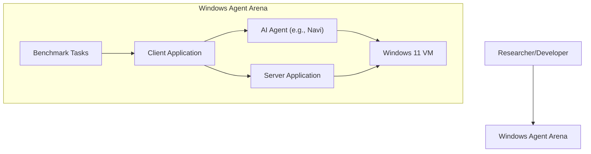

Sources: [README.md:12-14]()

## Key Capabilities

Windows Agent Arena offers several key capabilities that make it valuable for AI agent research:

1. **Realistic Environment**: Provides a full Windows 11 VM with standard applications pre-installed
2. **Scalable Deployment**: Supports both local testing and cloud-based parallel execution on Azure ML
3. **Multi-Modal Perception**: Enables agents to perceive the desktop environment through screenshots and accessibility information
4. **Standard Benchmarking**: Offers a diverse set of tasks for evaluating agent performance
5. **Extensible Framework**: Allows researchers to add new agents and tasks

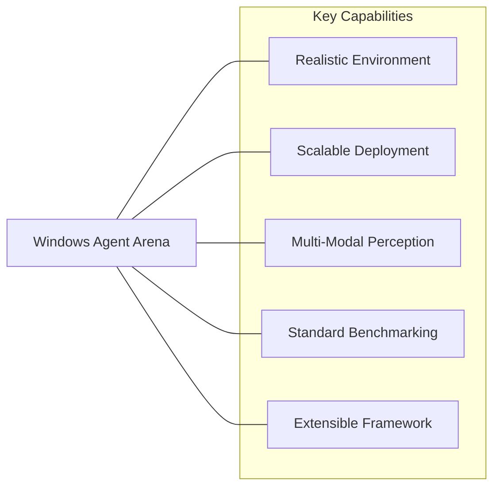

Sources: [README.md:12-14](), [README.md:20-23]()

## System Architecture

The Windows Agent Arena consists of several core components that work together to provide the agent evaluation environment:

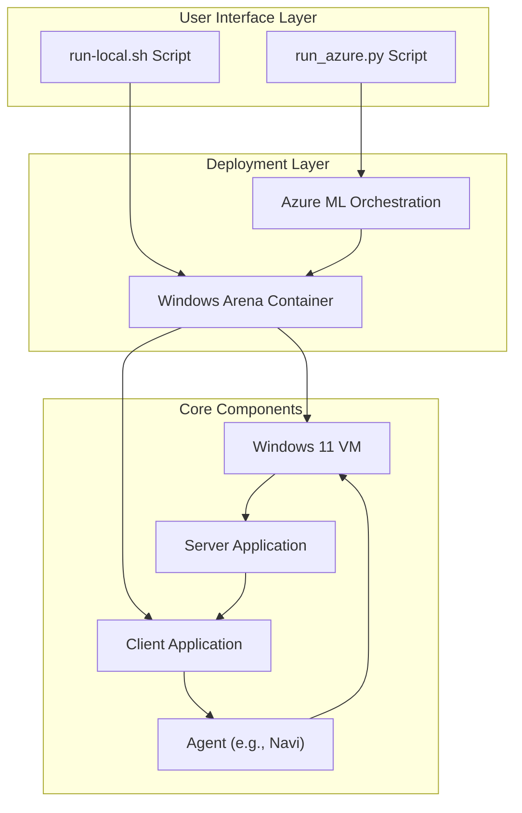

The system consists of the following key components:

1. **Windows 11 VM**: A virtualized Windows 11 environment where the agent performs tasks
2. **Server Application**: A Python-based server running inside the VM that receives and executes actions
3. **Client Application**: Manages the benchmarking process, sends commands to the agent, and records results
4. **Agent**: The AI agent being evaluated (e.g., Navi), which interprets the desktop environment and decides on actions
5. **Deployment Infrastructure**: Either local Docker container or Azure ML cloud resources

Sources: [README.md:102-105]()

## Execution Workflow

The following diagram illustrates how the system components interact during a benchmark run:

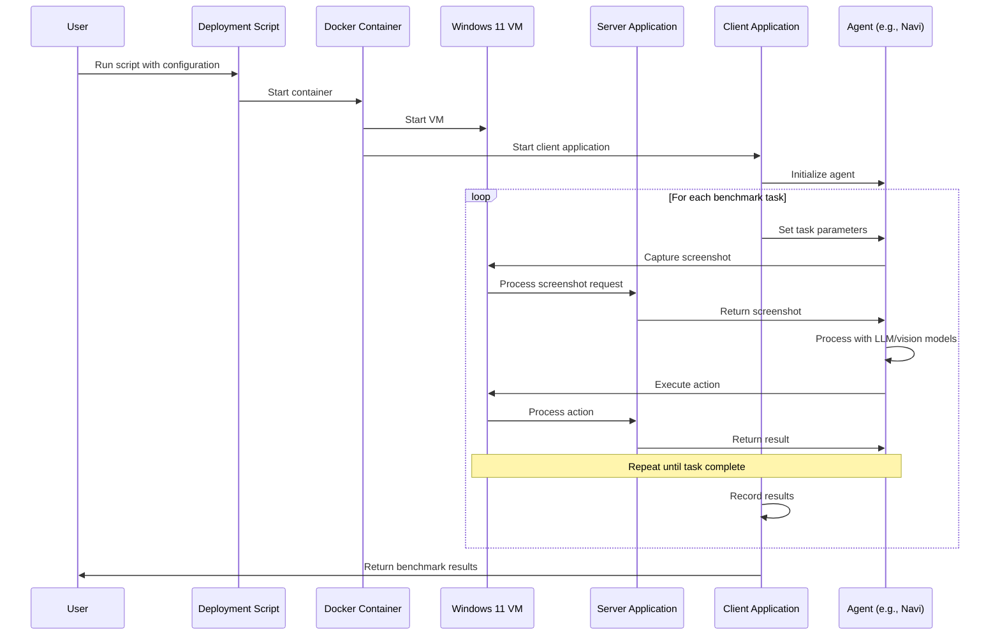

Sources: [README.md:159-181]()

## Deployment Options

Windows Agent Arena supports two primary deployment modes:

### Local Deployment

Local deployment runs the entire system on a single machine using Docker. This is ideal for development, testing, and running individual agent evaluations.

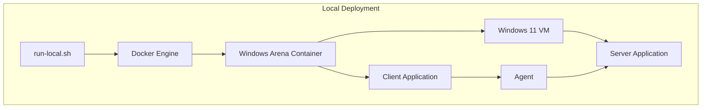

Sources: [README.md:58-130]()

### Azure Deployment

Azure deployment leverages Azure ML services to run multiple instances of the evaluation platform in parallel, significantly reducing benchmark completion time.

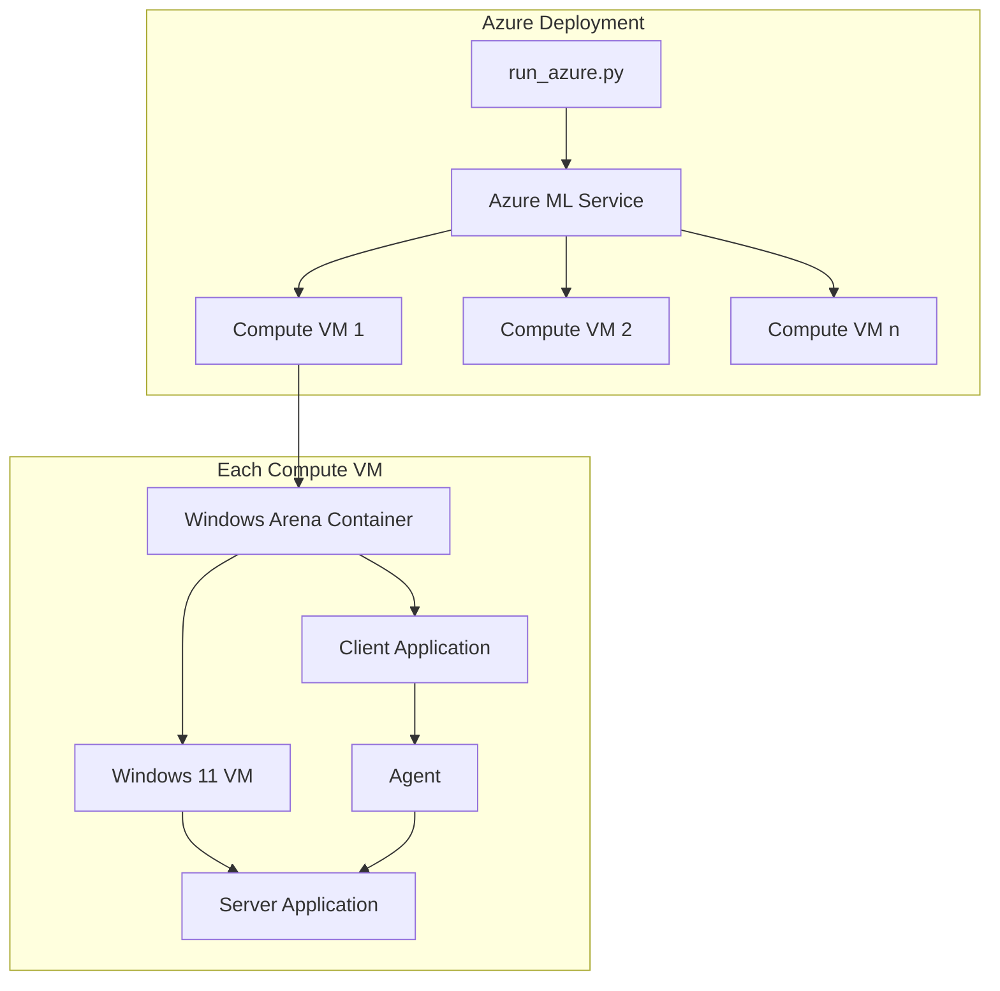

Sources: [README.md:204-326]()

## Agent Architecture

The Windows Agent Arena provides a reference agent implementation called Navi, which can be used as a baseline or as a template for custom agents.

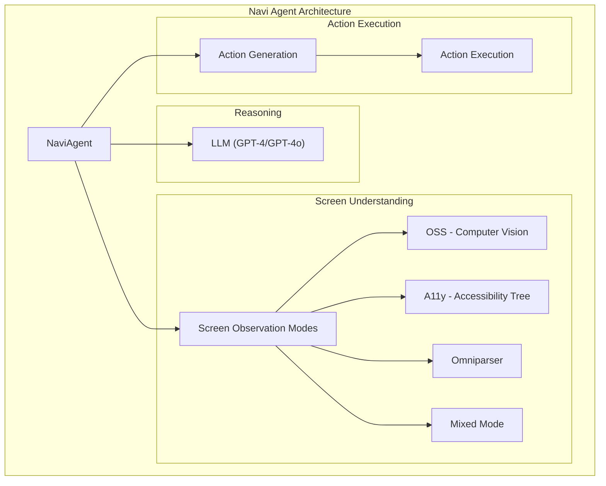

The agent's architecture comprises:

1. **Screen Understanding**: Multiple modes for interpreting the desktop environment
2. **LLM Integration**: Reasoning using large language models to determine appropriate actions
3. **Action Execution**: Converting high-level decisions into concrete desktop interactions

Sources: [README.md:184-197]()

## Getting Started

To begin using Windows Agent Arena:

1. Review the [Installation and Setup](#2) section for environment prerequisites and setup instructions
2. Follow the [Running Experiments](#3) guide to execute your first benchmark
3. Explore the [System Components](#4) section to understand how all parts work together
4. If you want to create your own agent, check out the [Development Guide](#5)

Sources: [README.md:39-56](), [README.md:159-181]()

---

# Page: System Architecture

# System Architecture

<details>
<summary>Relevant source files</summary>

The following files were used as context for generating this wiki page:

- [README.md](README.md)
- [scripts/run-local.sh](scripts/run-local.sh)
- [scripts/run.sh](scripts/run.sh)
- [scripts/run_azure.py](scripts/run_azure.py)
- [src/win-arena-container/vm/setup/setup.ps1](src/win-arena-container/vm/setup/setup.ps1)

</details>


This document provides a comprehensive overview of the Windows Agent Arena (WAA) system architecture, explaining the relationships between major components and how they work together to enable the evaluation of multi-modal AI agents in a Windows environment. For information about specific installation procedures, see [Installation and Setup](#2), and for details about the individual components, see [System Components](#4).

## High-Level Architecture Overview

The Windows Agent Arena is a platform designed for evaluating multi-modal AI agents within a realistic Windows OS environment. It provides researchers and developers with a reproducible environment for AI research, where agentic AI workflows can be tested across diverse tasks. WAA supports both local deployment using Docker and scalable cloud deployment using Azure ML infrastructure.

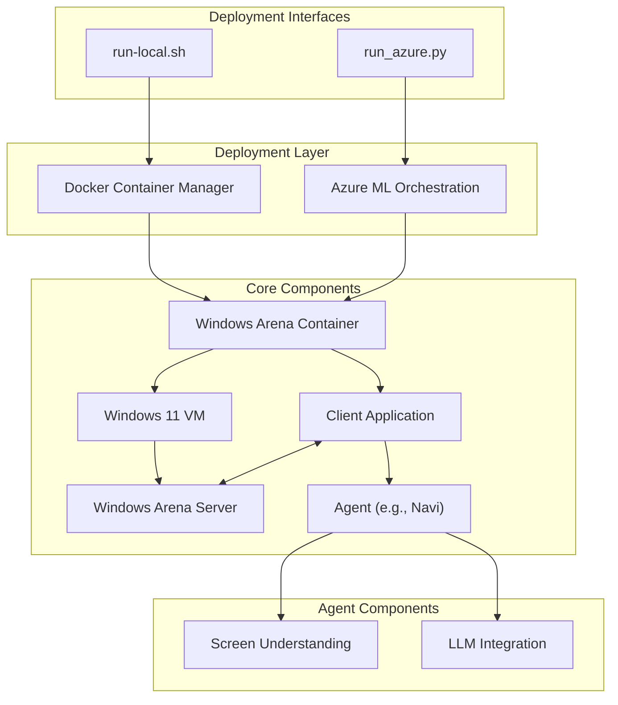

**Diagram: High-Level Architecture Components**

Sources: [README.md:12-14](), [scripts/run-local.sh:1-143](), [scripts/run_azure.py:1-50]()

## Deployment Options

The Windows Agent Arena provides two deployment paths to meet different needs:

### Local Deployment

Local deployment uses Docker to run the Windows Arena container on a local machine. This is useful for development, debugging, and running individual agent evaluations.

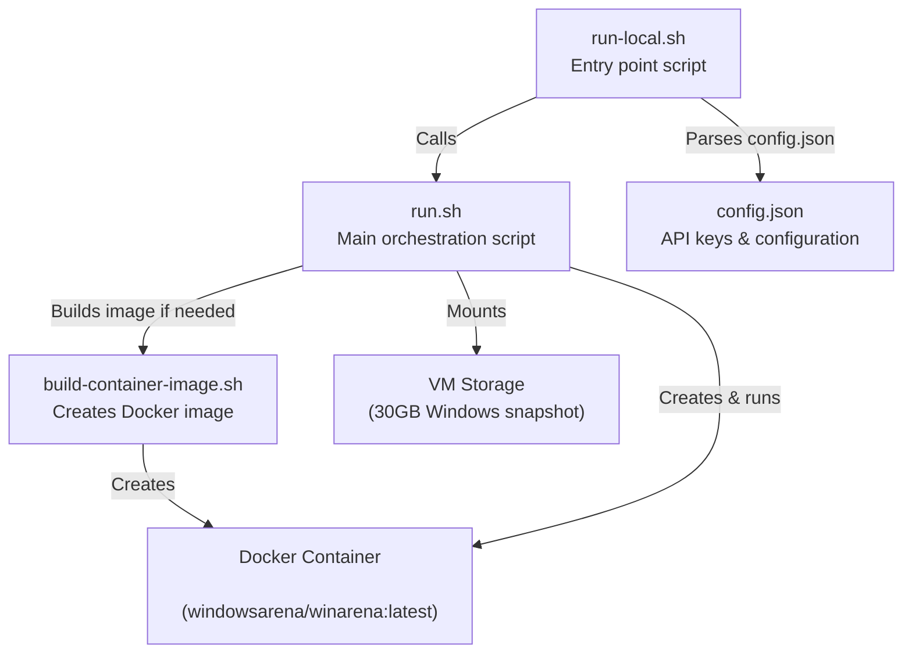

**Diagram: Local Deployment Flow**

Sources: [README.md:58-66](), [scripts/run-local.sh:26-164](), [scripts/run.sh:1-341]()

### Azure Deployment

Azure deployment leverages Azure Machine Learning to run multiple containers in parallel across various compute instances. This approach significantly reduces the time needed to evaluate agents across many tasks.

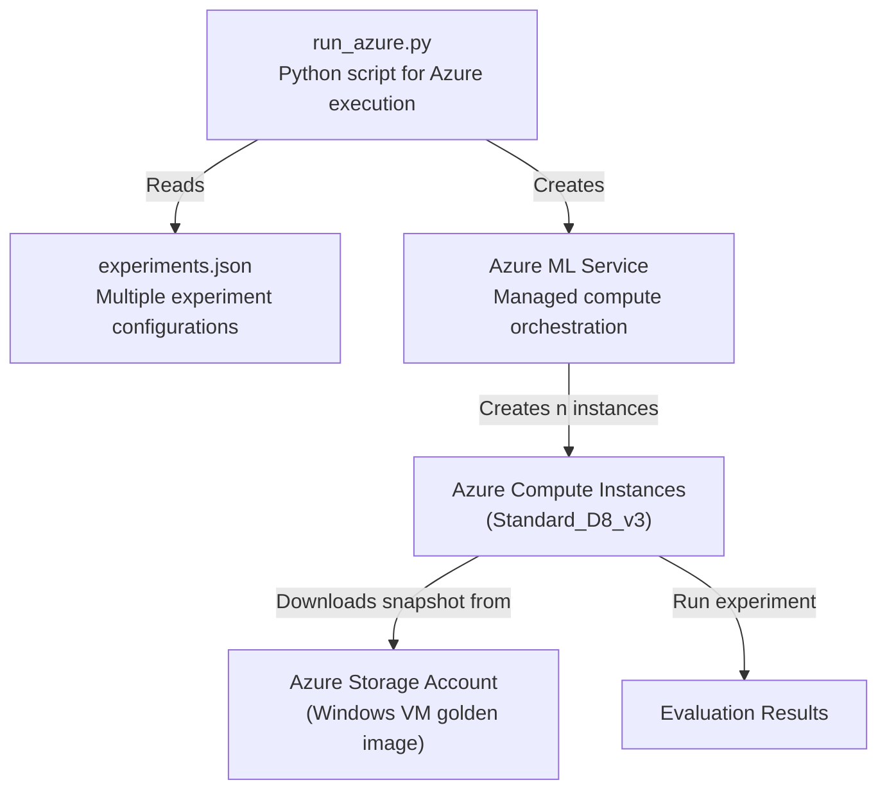

**Diagram: Azure Deployment Flow**

Sources: [README.md:204-242](), [scripts/run_azure.py:199-242]()

## Core Components

### Container Infrastructure

The Windows Agent Arena runs within a Docker container that encapsulates all necessary components. This provides a consistent and reproducible environment across different systems.

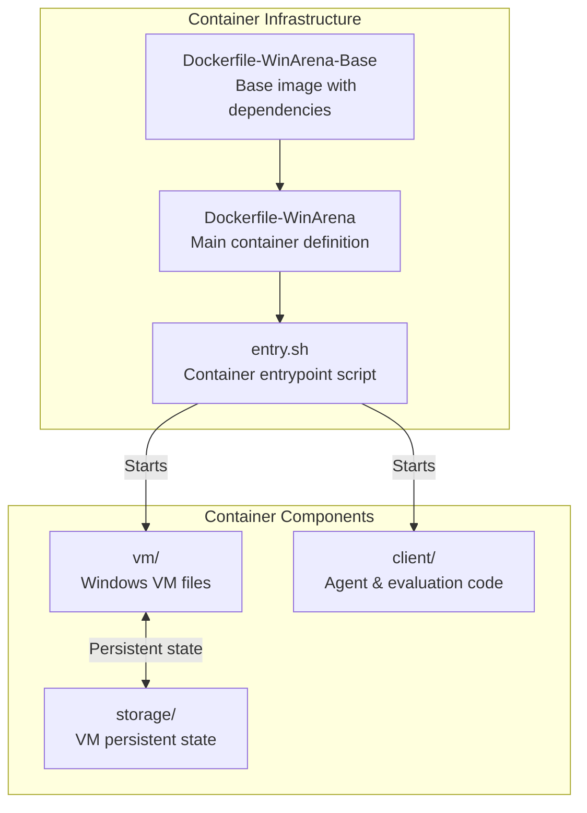

**Diagram: Container Infrastructure**

Sources: [README.md:72-99](), [scripts/run.sh:172-315]()

### Windows VM Component

The Windows VM is a core component that provides the realistic Windows environment in which agents operate. It runs Windows 11 and hosts a server application that interfaces with the client.

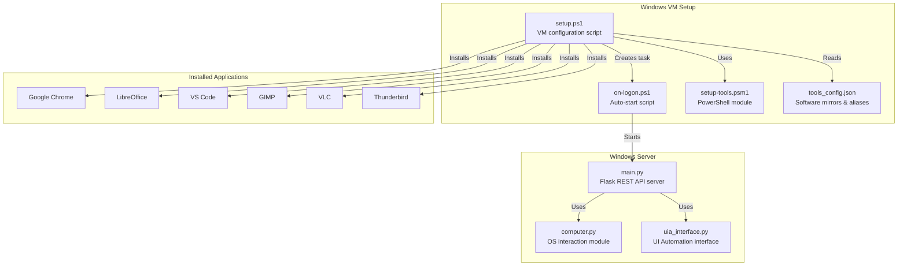

**Diagram: Windows VM Component**

Sources: [src/win-arena-container/vm/setup/setup.ps1:1-429]()

### Client Application

The client application runs within the Docker container and manages the execution of tasks, agent communication, and performance evaluation.

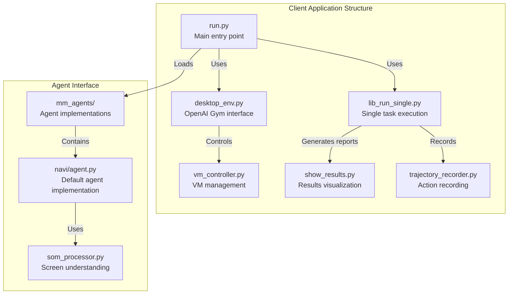

**Diagram: Client Application Structure**

### Agent Architecture

The default Navi agent is responsible for understanding the Windows environment and taking actions to complete tasks. It has several configurable components.

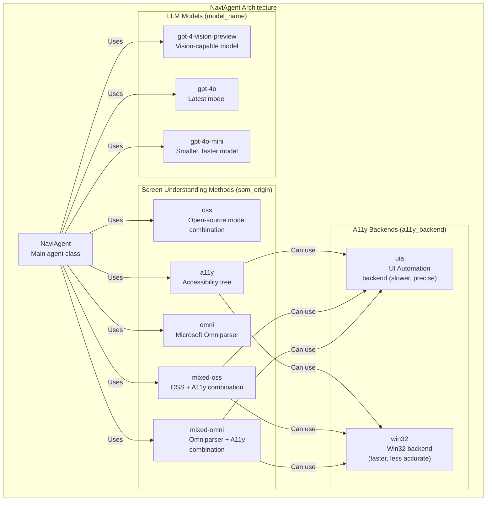

**Diagram: Agent Architecture**

Sources: [README.md:184-197]()

## Execution Workflow

The following sequence diagram illustrates the typical execution flow when running the Windows Agent Arena:

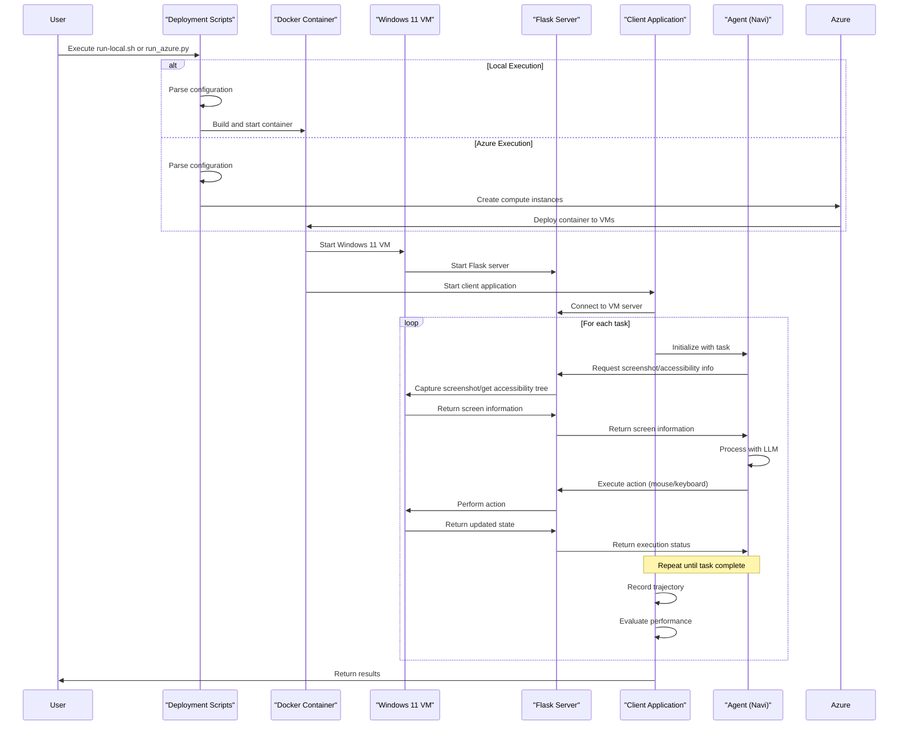

**Diagram: Execution Workflow**

Sources: [README.md:163-164](), [scripts/run.sh:301-315]()

## Configuration Options

The Windows Agent Arena can be configured through various parameters to control behavior:

| Parameter | Description | Default | Options |
|-----------|-------------|---------|---------|
| `--agent` | Agent to use | `navi` | Current options: `navi` |
| `--model` | LLM model to use | `gpt-4-vision-preview` | `gpt-4o-mini`, `gpt-4-vision-preview`, `gpt-4o`, `gpt-4-1106-vision-preview` |
| `--som-origin` | Screen understanding method | `oss` | `oss`, `a11y`, `mixed-oss`, `omni`, `mixed-omni` |
| `--a11y-backend` | Accessibility backend | `uia` | `uia` (more accurate), `win32` (faster) |
| `--gpu-enabled` | Enable GPU support | `false` | `true`, `false` |
| `--ram-size` | RAM size for the VM | `8G` | Any valid size (e.g., `4G`, `16G`) |
| `--cpu-cores` | CPU cores for the VM | `8` | Any integer value |
| `--use-kvm` | Use KVM acceleration | `true` | `true`, `false` |

Sources: [README.md:347-365](), [scripts/run-local.sh:20-143]()

## File Structure

The key files and directories in the Windows Agent Arena codebase:

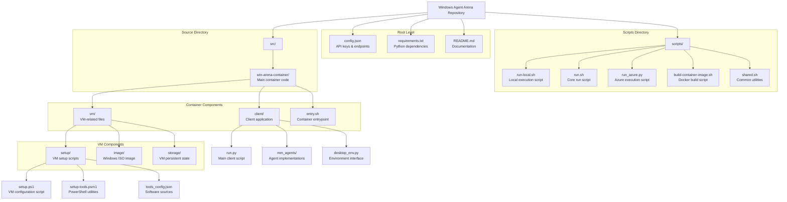

**Diagram: File Structure**

Sources: [README.md:49-57](), [scripts/run.sh:186-199]()

## Local vs. Azure Performance Comparison

When deciding between local and Azure deployment, consider these performance characteristics:

| Aspect | Local Deployment | Azure Deployment |
|--------|------------------|------------------|
| Setup Time | ~20 minutes (one-time) | Minimal (uses pre-created VM image) |
| Execution Speed | Sequential (1 VM) | Parallel (multiple VMs) |
| Resource Usage | Limited by local hardware | Scalable with cloud resources |
| Benchmark Time (40 tasks) | Several hours | ~35 minutes with 40 VMs |
| Cost | Local compute resources | ~$8 for VMs + ~$15-100 for LLM API calls |
| Debugging Capability | Direct access to container/VM | Limited to logs |

Sources: [README.md:341-347]()

## Summary

The Windows Agent Arena provides a comprehensive platform for evaluating multi-modal AI agents in a Windows environment. Its architecture supports both local development and scalable cloud-based evaluation, with configurable components for different screen understanding methods and LLM backends. The modular design allows researchers to extend the platform with new agents or evaluation tasks.

---

# Page: Key Concepts and Terminology

# Key Concepts and Terminology

<details>
<summary>Relevant source files</summary>

The following files were used as context for generating this wiki page:

- [README.md](README.md)

</details>


This document defines the essential terms and concepts used throughout the Windows Agent Arena (WAA) system. It provides a foundation for understanding the architecture, components, and operation of the platform. For information about system architecture, see [System Architecture](#1.1).

## Core System Components

The Windows Agent Arena consists of several key components that work together to provide a scalable platform for evaluating AI agents in a Windows environment.

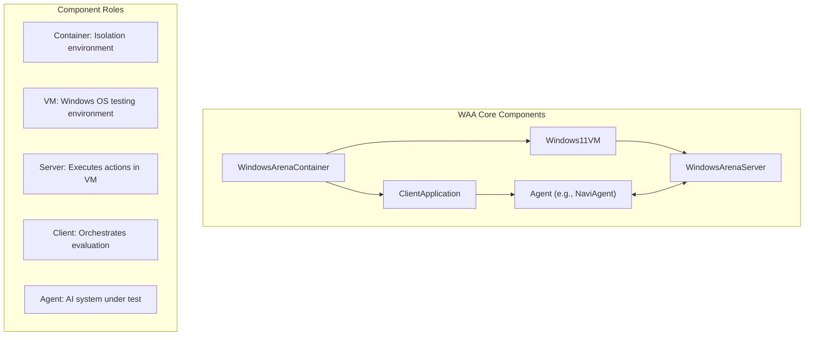

- **Windows Arena Container**: The Docker container that encapsulates all components needed to run the Windows Agent Arena.
- **Windows 11 VM**: A virtualized Windows 11 environment running inside the container where agents perform tasks.
- **Windows Arena Server**: A Python server running inside the VM that receives commands from the client and executes them.
- **Client Application**: The component that manages task execution, agent initialization, and result recording.
- **Agent**: The AI system being evaluated (e.g., Navi), which uses screen understanding and LLMs to interact with the Windows environment.

Sources: [README.md:100-107]()

## Deployment Methods

The Windows Agent Arena supports two primary deployment methods:

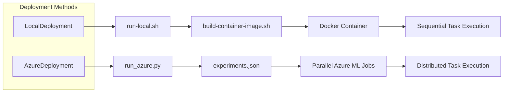

- **Local Deployment**: Running the system on a local machine using Docker, suitable for development and testing.
- **Azure Deployment**: Running the system on Azure Machine Learning, allowing parallel execution of multiple agents and rapid benchmarking.
- **Golden Image**: A snapshot of a fully configured Windows 11 VM with all necessary applications installed, used as a starting point for evaluation.

Sources: [README.md:58-70](), [README.md:204-212]()

## Screen Understanding Methods

Screen understanding methods are techniques used by agents to interpret the visual content and structure of the Windows UI.

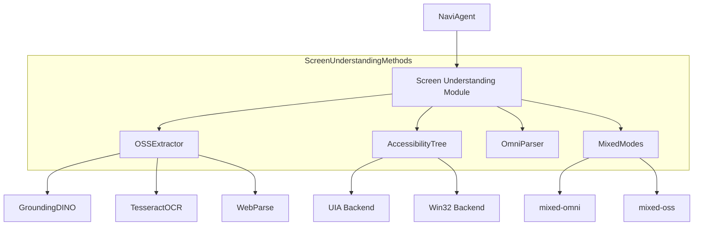

- **OSS Extractor**: Uses open-source models (GroundingDINO, TesseractOCR) for detecting UI elements and text.
- **Accessibility Tree (A11y)**: Extracts UI information using Windows accessibility APIs.
  - **UIA Backend**: Uses UI Automation API, slower but more accurate.
  - **Win32 Backend**: Uses Win32 API, faster but less accurate.
- **OmniParser**: Microsoft's screen understanding model for interpreting UI elements.
- **Mixed Modes**: Combines multiple screen understanding methods:
  - **mixed-omni**: Combines Omniparser with accessibility tree.
  - **mixed-oss**: Combines OSS detections with accessibility tree.

Sources: [README.md:188-196]()

## Agent Components

Agents in Windows Agent Arena consist of several components that enable them to interpret the environment and take actions.

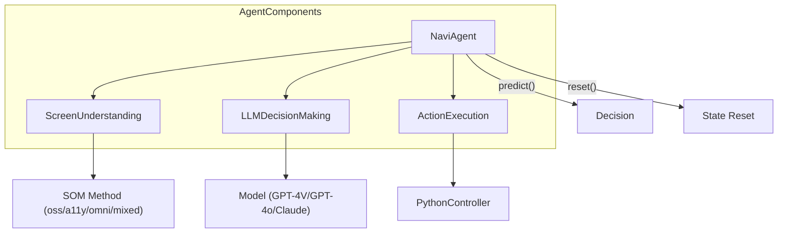

- **Screen Understanding**: The component that interprets the screen content using various methods.
- **LLM Decision Making**: The large language model that makes decisions based on screen information.
- **Action Execution**: The component that translates agent decisions into Windows actions.
- **Agent Methods**:
  - **predict()**: The method called to get the next action from the agent.
  - **reset()**: The method called to reset the agent's state between tasks.

Sources: [README.md:329-330]()

## Environment Interface

The environment interface provides a standardized way for agents to interact with the Windows environment.

```mermaid
graph TD
    subgraph "EnvironmentInterface"
        desktopEnv["DesktopEnv"]
        vmController["VMController"]
        pythonController["PythonController"]
        setupController["SetupController"]
    end

    desktopEnv --> vmController
    desktopEnv --> pythonController
    desktopEnv --> setupController

    vmController --> vmActions["VM Control (start/stop/reset)"]
    pythonController --> actions["UI Actions (click/type/etc)"]
    setupController --> taskSetup["Task Environment Setup"]
    
    agent["NaviAgent"] -- "interact()" --> desktopEnv
    desktopEnv -- "observation" --> agent
```

- **DesktopEnv**: An OpenAI Gym-like interface that provides a standardized way to interact with the Windows environment.
- **VMController**: Manages VM lifecycle operations (start, stop, reset).
- **PythonController**: Executes actions in the Windows environment (click, type, etc.).
- **SetupController**: Prepares the environment for specific tasks.

Sources: [README.md:83-95]()

## Task Execution Concepts

The execution of tasks in Windows Agent Arena involves several key concepts:

```mermaid
graph TD
    subgraph "TaskExecution"
        task["Task"]
        trajectory["Trajectory"]
        evaluation["Evaluation"]
        results["Results"]
    end

    task --> taskConfig["Task Configuration"]
    task --> taskGoal["Task Goal"]
    
    trajRecorder["TrajectoryRecorder"] --> trajectory
    trajectory --> actions["Agent Actions"]
    trajectory --> observations["Environment Observations"]
    
    evaluation --> metrics["Success Metrics"]
    evaluation --> diffLevel["Difficulty Level (normal/hard)"]
    
    task --> trajRecorder
    trajectory --> evaluation
    evaluation --> results
```

- **Task**: A specific Windows interaction scenario that the agent must complete.
- **Task Configuration**: The initial setup for a task, including applications and files.
- **Difficulty Level**: The complexity level of tasks:
  - **Normal**: Tasks where the environment is pre-set up.
  - **Hard**: Tasks where the agent must also initialize/set up the environment.
- **Trajectory**: The sequence of actions and observations during task execution.
- **Trajectory Recorder**: Records the agent's actions and environmental responses.
- **Evaluation**: The process of determining how successfully an agent completed a task.
- **Results**: The outcome of evaluation, typically success/failure and efficiency metrics.

Sources: [README.md:20-22]()

## Deployment Configuration

Configuration parameters control how Windows Agent Arena operates:

| Parameter | Description | Options |
|-----------|-------------|---------|
| `som-origin` | Screen understanding method | `oss`, `a11y`, `omni`, `mixed-oss`, `mixed-omni` |
| `a11y-backend` | Accessibility backend | `uia`, `win32` |
| `ram-size` | VM RAM allocation | e.g., `4G`, `8G` |
| `cpu-cores` | VM CPU allocation | e.g., `4`, `8` |
| `use-kvm` | KVM acceleration | `true`, `false` |
| `gpu-enabled` | GPU support | `true`, `false` |
| `diff_lvl` | Task difficulty | `normal`, `hard` |

Sources: [README.md:189-197](), [README.md:349-365]()

## Cloud Execution Components

For Azure deployment, additional components are involved:

```mermaid
graph TD
    subgraph "AzureComponents"
        azureML["AzureMLService"]
        experimentsJson["experiments.json"]
        computeVM["AzureComputeInstanceVM"]
        storageAccount["BlobStorage"]
    end

    experimentsJson --> expConfig["Experiment Configuration"]
    expConfig --> numWorkers["Number of Workers"]
    expConfig --> dockerImg["Docker Image"]
    expConfig --> modelName["LLM Model"]
    
    azureML --> computeVM
    computeVM --> goldenImage["Windows Golden Image"]
    computeVM --> results["Evaluation Results"]
    
    storageAccount --> goldenImage
    results --> storageAccount
```

- **Azure ML Service**: The Azure service that orchestrates the execution of agent evaluations.
- **Experiments JSON**: Configuration file defining experiment parameters.
- **Azure Compute Instance VM**: The virtual machine on Azure that runs the Windows Arena Container.
- **Blob Storage**: The storage for the Windows golden image and evaluation results.
- **Worker**: A single Azure compute instance running one copy of the agent on a subset of tasks.

Sources: [README.md:277-292]()

## File Organization

The Windows Agent Arena codebase is organized into several key directories:

| Directory | Purpose |
|-----------|---------|
| `src/win-arena-container` | Main container code |
| `src/win-arena-container/client` | Client application code |
| `src/win-arena-container/client/mm_agents` | Agent implementations |
| `src/win-arena-container/vm` | VM-related code and resources |
| `src/win-arena-container/vm/image` | Windows ISO and VM image |
| `src/win-arena-container/vm/storage` | Golden image storage |
| `scripts` | Deployment and utility scripts |

Sources: [README.md:85-95]()

---

# Page: Installation and Setup

# Installation and Setup

<details>
<summary>Relevant source files</summary>

The following files were used as context for generating this wiki page:

- [README.md](README.md)
- [scripts/build-container-image.sh](scripts/build-container-image.sh)
- [src/win-arena-container/entry.sh](src/win-arena-container/entry.sh)

</details>


This document provides detailed instructions for installing and setting up the Windows Agent Arena (WAA) platform. WAA requires specific prerequisites and configuration steps to properly function as a testing environment for multi-modal AI agents. For information about running experiments after installation, see [Running Experiments](#3).

## Overview

The Windows Agent Arena can be deployed in two primary ways:

1. **Local Deployment**: Running the platform on a local machine using Docker and a Windows 11 VM
2. **Azure Deployment**: Running the platform at scale on Azure infrastructure

This guide covers both deployment methods and explains the required steps for each.

```mermaid
flowchart TD
    subgraph "Setup Process"
        direction TB
        A["Prerequisites"] --> B["Configuration"]
        B --> C{"Deployment Type"}
        C -->|"Local"| D["Local Setup"]
        C -->|"Azure"| E["Azure Setup"]
        
        subgraph "D[Local Setup]"
            direction TB
            D1["Build Docker Image"] --> D2["Prepare Windows 11 VM"]
        end
        
        subgraph "E[Azure Setup]"
            direction TB
            E1["Create Azure Resources"] --> E2["Upload VM Image"] --> E3["Configure & Deploy"]
        end
    end
```

Sources: [README.md:38-58](), [README.md:58-152](), [README.md:204-326]()

## Prerequisites

Before installing the Windows Agent Arena, ensure you have the following prerequisites:

1. **Docker daemon** installed and running
   - On Windows, using [Docker with WSL 2](https://docs.docker.com/desktop/wsl/) is recommended

2. **API Keys**:
   - Either an [OpenAI](https://platform.openai.com/docs/introduction) API Key
   - Or an [Azure OpenAI](https://azure.microsoft.com/en-us/products/ai-services/openai-service) API Key

3. **Python 3.9**:
   - Recommended to use [Conda](https://docs.conda.io/projects/conda/en/latest/user-guide/getting-started.html)
   - Create a dedicated environment: `conda create -n winarena python=3.9`

4. **Repository**:
   ```bash
   git clone https://github.com/microsoft/WindowsAgentArena.git
   cd WindowsAgentArena
   pip install -r requirements.txt
   ```

Sources: [README.md:38-56]()

## Configuration

The first step after installing prerequisites is to create a configuration file containing your API keys:

1. Create a new file named `config.json` at the root of the project directory
2. Add your OpenAI or Azure OpenAI API keys:

```json
{
    "OPENAI_API_KEY": "<OPENAI_API_KEY>", // if using OpenAI endpoint
    "AZURE_API_KEY": "<AZURE_API_KEY>",  // if using Azure endpoint
    "AZURE_ENDPOINT": "https://yourendpoint.openai.azure.com/", // if using Azure endpoint
}
```

For Azure deployment, additional configuration values are required (covered in the Azure Environment Setup section).

Sources: [README.md:61-70]()

## Local Environment Setup

Setting up the Windows Agent Arena locally involves building the Docker image and preparing the Windows 11 VM.

```mermaid
sequenceDiagram
    participant User
    participant Scripts as "build-container-image.sh"
    participant Docker as "Docker"
    participant RunLocal as "run-local.sh"
    participant Entry as "entry.sh"
    
    User->>Scripts: Execute build-container-image.sh
    
    alt Build Base Image
        Scripts->>Docker: Build winarena-base image
        Docker-->>Scripts: Base image built
    end
    
    Scripts->>Docker: Build winarena image
    Docker-->>Scripts: winarena image built
    
    User->>RunLocal: Execute run-local.sh --prepare-image true
    RunLocal->>Docker: Start container with prepare flag
    Docker->>Entry: Run entry.sh with prepare-image=true
    Entry->>Entry: Start VM and wait for server ready
    Entry->>Entry: Trigger Windows shutdown for image creation
    Entry-->>RunLocal: VM prepared, container exits
    
    Note over User,Entry: The Windows 11 VM is now prepared and ready to use
```

Sources: [README.md:72-152](), [scripts/build-container-image.sh:1-56](), [src/win-arena-container/entry.sh:1-120]()

### 1. Preparing the Docker Image

The Docker image for Windows Agent Arena contains all the necessary dependencies and code to run the platform.

1. **Pull the WinArena-Base Image**:
   ```bash
   docker pull windowsarena/winarena-base:latest
   ```

2. **Build the WinArena Image**:
   ```bash
   cd scripts
   ./build-container-image.sh
   ```
   
   Additional options:
   - To build the base image locally: `./build-container-image.sh --build-base-image true`

The build process creates a Docker image named `windowsarena/winarena:latest` that contains the core components of the Windows Agent Arena.

Sources: [README.md:72-99](), [scripts/build-container-image.sh:1-56]()

### 2. Preparing the Windows 11 VM

The Windows Agent Arena requires a Windows 11 VM with specific configurations. This involves downloading the Windows 11 ISO and running an automated setup process:

1. **Download Windows 11 ISO**:
   - Download Windows 11 Enterprise Evaluation (90-day trial) from the [Microsoft Evaluation Center](https://info.microsoft.com/ww-landing-windows-11-enterprise.html)
   - Rename the downloaded file to `setup.iso`
   - Move it to `WindowsAgentArena/src/win-arena-container/vm/image`

2. **Prepare the Windows 11 Image**:
   ```bash
   cd scripts
   ./run-local.sh --prepare-image true
   ```

   This automated process:
   - Starts a Docker container with the Windows 11 ISO
   - Creates and configures a Windows 11 VM
   - Installs necessary software and sets up the server
   - Takes approximately 20 minutes to complete

3. **Verify Image Creation**:
   - The process is complete when the Docker container terminates
   - The VM image files will be in `WindowsAgentArena/src/win-arena-container/vm/storage`
   - Consider backing up this folder in case of accidental corruption later

Sources: [README.md:102-156](), [src/win-arena-container/entry.sh:86-100]()

## Azure Environment Setup

Azure deployment enables running multiple instances of the Windows Agent Arena in parallel, significantly reducing the time needed for comprehensive agent testing.

```mermaid
flowchart TD
    subgraph "Azure Setup Process"
        direction TB
        A1["Create Azure Resource Group"] --> A2["Create Azure ML Workspace"] 
        A2 --> A3["Create Startup Script"]
        A3 --> A4["Upload Windows 11 Image to Blob Storage"]
        A4 --> A5["Configure Azure Parameters in config.json"]
        A5 --> A6["Create experiments.json"]
        A6 --> A7["Deploy with run_azure.py"]
    end

    subgraph "Deployment Components"
        direction TB
        B1["Azure ML Service"] --> B2["Compute VMs"]
        B2 --> B3["Windows Arena Container"]
        B3 --> B4["Windows VM & Client"]
    end
    
    A7 --> B1
```

Sources: [README.md:204-326]()

### 1. Setting Up Azure Resources

1. **Create Azure Subscription**:
   - If needed, start a [free trial](https://azure.microsoft.com/en-us/free/)
   - Note your subscription ID (needed for `AZURE_SUBSCRIPTION_ID`)

2. **Create a Resource Group**:
   - Create a new resource group in the Azure portal (e.g., `agents`)
   - Note the resource group name (needed for `AZURE_ML_RESOURCE_GROUP`)

3. **Create an Azure Machine Learning Resource**:
   - Create a new Azure ML workspace (e.g., `agents_ml`)
   - Note the workspace name (needed for `AZURE_ML_WORKSPACE_NAME`)
   - Allow automatic creation of:
     - Storage Account (note name for uploading VM image)
     - Key vault
     - Application Insights
     - Container Registry (optional)

4. **Create Startup Script**:
   - Navigate to the [Azure Machine Learning portal](https://ml.azure.com/home)
   - In the Notebooks tab, create a new bash file named `compute-instance-startup.sh`
   - Copy content from `scripts/azure_files/compute-instance-startup.sh`
   - Note the path (in format `Users/<YOUR_USER>/compute-instance-startup.sh`)

5. **Optional**: Request additional compute quota if needed

Sources: [README.md:208-238]()

### 2. Uploading Windows 11 and Docker Images

After setting up Azure resources, you need to upload the Windows 11 image files to Azure Blob Storage:

1. **Upload Windows 11 Storage Folder**:
   - Use Azure Storage Explorer to upload the `storage` folder
   - Or use Azure CLI with the command:
     ```bash
     az login --use-device-code
     az storage blob upload-batch --account-name <STORAGE_ACCOUNT_NAME> --destination <CONTAINER_NAME> --source <LOCAL_FOLDER>
     ```

2. **Optional**: Upload custom Docker image to Azure Container Registry if not using the default

Sources: [README.md:242-260]()

### 3. Configuration and Deployment

1. **Update Configuration File**:
   - Add Azure-specific keys to your `config.json`:
   ```json
   {
       // Previous configs
       "AZURE_SUBSCRIPTION_ID": "<YOUR_AZURE_SUBSCRIPTION_ID>",
       "AZURE_ML_RESOURCE_GROUP": "<YOUR_AZURE_ML_RESOURCE_GROUP>",
       "AZURE_ML_WORKSPACE_NAME": "<YOUR_AZURE_ML_WORKSPACE_NAME>"
   }
   ```

2. **Create Experiments Configuration**:
   - Create a file named `experiments.json` at the root level
   - Define your experiments with parameters:
   ```json
   {
     "experiment_1": {
       "ci_startup_script_path": "Users/<YOUR_USER>/compute-instance-startup.sh",
       "agent": "navi",
       "datastore_input_path": "storage",
       "docker_img_name": "windowsarena/winarena:latest",
       "exp_name": "experiment_1",
       "num_workers": 4,
       "use_managed_identity": false,
       "json_name": "evaluation_examples_windows/test_all.json",
       "model_name": "gpt-4-1106-vision-preview",
       "som_origin": "oss",
       "a11y_backend": "win32"
     }
   }
   ```

3. **Deploy to Azure**:
   ```bash
   az login --use-device-code
   cd scripts
   python run_azure.py --experiments_json "experiments.json"
   ```

   This will:
   - Create Azure Compute Instance VMs based on `num_workers`
   - Run ML Training Jobs on each VM
   - Dispose of VMs when jobs complete
   - Store results in the `agent_outputs` folder in blob storage

Sources: [README.md:264-326]()

## Deployment Architecture

The following diagram illustrates the components involved in both local and Azure deployments:

```mermaid
graph TD
    subgraph "Local Deployment"
        direction TB
        buildScript["build-container-image.sh"]
        runLocal["run-local.sh"]
        docker["Docker Container (winarena)"]
        vm["Windows 11 VM"]
        server["Windows Arena Server"]
        client["Client Application"]

        buildScript --> docker
        runLocal --> docker
        docker --> vm
        docker --> client
        vm --> server
        client <--> server
    end

    subgraph "Azure Deployment"
        direction TB
        runAzure["run_azure.py"]
        experiments["experiments.json"]
        azureML["Azure ML Service"]
        computeVMs["Compute VMs"]
        containers["Docker Containers"]
        vm2["Windows 11 VMs"]
        server2["Windows Arena Servers"]
        client2["Client Applications"]

        runAzure --> experiments
        runAzure --> azureML
        azureML --> computeVMs
        computeVMs --> containers
        containers --> vm2
        containers --> client2
        vm2 --> server2
        client2 <--> server2
    end

    config["config.json"] --> runLocal
    config --> runAzure
```

Sources: [README.md:38-326]()

## Resource Requirements

When running the Windows Agent Arena locally, you might need to adjust resource allocation based on your system capabilities:

| Component | Default Allocation | Minimum Recommendation |
|-----------|-------------------|------------------------|
| RAM       | 8 GB              | 4 GB                   |
| CPU Cores | 8                 | 4                      |

You can customize these settings when running locally:

```bash
./run-local.sh --ram-size 4G --cpu-cores 4
```

For KVM acceleration (significantly improves performance):
```bash
./run-local.sh --use-kvm false  # Disable KVM if not supported
```

Note: Running without KVM acceleration is not recommended for performance reasons.

Sources: [README.md:349-366]()

## Next Steps

After completing the installation and setup process, you can run experiments with the Windows Agent Arena. For detailed instructions on running experiments locally or on Azure, see [Running Experiments](#3).

Sources: [README.md:158-203]()

---

# Page: Prerequisites

# Prerequisites

<details>
<summary>Relevant source files</summary>

The following files were used as context for generating this wiki page:

- [README.md](README.md)

</details>


This page outlines all the requirements needed to set up and run the Windows Agent Arena (WAA) platform. WAA is designed to evaluate multi-modal AI agents within a realistic Windows OS environment, and requires specific hardware, software, and configuration elements to function properly. For information about the actual setup procedures, see [Local Environment Setup](#2.2) and [Azure Environment Setup](#2.3).

## System Requirements

Before attempting to install and run the Windows Agent Arena, ensure your system meets the following hardware and operating system requirements:

### Hardware Requirements

```mermaid
flowchart TD
    subgraph "Recommended Hardware"
        CPU["CPU:
        - 8+ cores recommended
        - Virtualization support"]
        RAM["RAM:
        - 8+ GB recommended"]
        Storage["Storage:
        - 50+ GB free space
        - For Windows VM image (30+ GB)
        - For Docker images"]
        Network["Network:
        - Internet connection for API access
        - Docker image downloads"]
    end
```

Sources: [README.md:351-356]()

**Customizing Resource Allocation:**
- RAM and CPU allocation can be adjusted using command-line parameters
- Default: 8GB RAM and 8 CPU cores
- Example for systems with limited resources: `--ram-size 4G --cpu-cores 4`

### Operating System Support

Windows Agent Arena can be run on:
- Linux (recommended)
- Windows with WSL2
- macOS (with limitations)

KVM acceleration is recommended for improved performance, particularly on Linux systems. On Windows systems, ensure that WSL2 is properly configured for Docker integration.

```mermaid
flowchart TD
    subgraph "Operating System Compatibility"
        Linux["Linux
        - Native Docker support
        - Full KVM acceleration"]
        Windows["Windows with WSL2
        - Docker Desktop with WSL2 backend
        - Possible script format issues"]
        macOS["macOS
        - Limited virtualization performance
        - Not recommended for heavy testing"]
    end
    
    KVM["KVM Acceleration
    - Greatly improves VM performance
    - Can be toggled with --use-kvm parameter"]
    
    Linux --> KVM
    Windows -.- KVM
    macOS -.- KVM
```

Sources: [README.md:358-366]()

## Software Prerequisites

The following software must be installed and properly configured before setting up the Windows Agent Arena:

```mermaid
flowchart TD
    subgraph "Required Software"
        Docker["Docker
        - Container runtime
        - Version with WSL2 backend on Windows"]
        Python["Python 3.9
        - With pip for dependencies
        - Conda environment recommended"]
        Git["Git
        - For repository cloning"]
    end
    
    subgraph "Installation Flow"
        Clone["1. Clone repository"] --> 
        Env["2. Create Python environment"] -->
        Dependencies["3. Install dependencies"] -->
        Config["4. Create config.json"]
    end
    
    Docker --- VM["Windows VM Container"]
    Python --- Client["Client Application"]
    Git --- Clone
```

Sources: [README.md:45-56]()

### Docker

Docker is essential for creating the containerized environment that hosts both the Windows VM and the client application.

- **On Linux**: Install the standard Docker Engine
- **On Windows**: Install [Docker Desktop with WSL 2 backend](https://docs.docker.com/desktop/wsl/)
- **On macOS**: Install Docker Desktop for Mac

### Python 3.9

Python 3.9 is required for running the client-side scripts and agent code.

- Using [Conda](https://docs.conda.io/projects/conda/en/latest/user-guide/getting-started.html) is recommended for creating an isolated environment
- Create a dedicated environment with: `conda create -n winarena python=3.9`
- Required Python packages are listed in `requirements.txt`

### Git

Git is needed to clone the repository and manage updates.

## API Keys

The Windows Agent Arena requires API access to large language models (LLMs) for agent functionality:

```mermaid
flowchart TD
    subgraph "Required API Keys"
        OpenAI["OpenAI API Key
        - For direct OpenAI access
        - Models: GPT-4V, GPT-4o, etc."]
        AzureOpenAI["Azure OpenAI API Key
        - For Azure-hosted models
        - Requires endpoint URL"]
    end
    
    subgraph "Configuration"
        ConfigFile["config.json
        - Stores API credentials
        - Located at repository root"]
    end
    
    OpenAI --> ConfigFile
    AzureOpenAI --> ConfigFile
    ConfigFile --> Agent["Agent Systems"]
```

Sources: [README.md:60-70]()

You must have **at least one** of the following:

1. **OpenAI API Key**
   - Obtained from [OpenAI Platform](https://platform.openai.com/docs/introduction)
   - Used for direct access to OpenAI models (GPT-4V, GPT-4o, etc.)

2. **Azure OpenAI API Key**
   - Obtained from [Azure OpenAI Service](https://azure.microsoft.com/en-us/products/ai-services/openai-service)
   - Requires both API key and endpoint URL
   - Used for access to Azure-hosted OpenAI models

API keys must be specified in a `config.json` file at the root of the project:

```json
{
    "OPENAI_API_KEY": "<OPENAI_API_KEY>",  // if using OpenAI endpoint
    "AZURE_API_KEY": "<AZURE_API_KEY>",    // if using Azure endpoint
    "AZURE_ENDPOINT": "https://yourendpoint.openai.azure.com/",  // if using Azure endpoint
}
```

## Windows 11 VM Image

The Windows Agent Arena requires a Windows 11 Enterprise Evaluation ISO to create the Windows VM environment where agents operate:

```mermaid
flowchart TD
    subgraph "Windows 11 VM Requirements"
        ISOFile["Windows 11 Enterprise Evaluation ISO
        - 90-day trial version
        - English, United States version
        - ~6GB file size"]
        Storage["VM Storage Space
        - 30GB for final snapshot
        - Located in src/win-arena-container/vm/storage"]
    end
    
    ISOFile --> PrepareImage["Prepare Golden Image Process
    run-local.sh --prepare-image true"]
    PrepareImage --> Storage
    Storage --> Container["Windows Arena Container"]
```

Sources: [README.md:107-146]()

### Windows 11 ISO

- Download the ISO file from [Microsoft Evaluation Center](https://info.microsoft.com/ww-landing-windows-11-enterprise.html)
- Specifically, you need the **Windows 11 Enterprise Evaluation (90-day trial, English, United States)** version
- Rename the downloaded file to `setup.iso`
- Place the file in `src/win-arena-container/vm/image` directory

### Storage Requirements

- The preparation process creates a "golden image" (VM snapshot) of approximately 30GB
- This snapshot contains a fully functional Windows 11 VM with all required programs and a Python server
- The snapshot is stored in `src/win-arena-container/vm/storage`

## Azure-Specific Prerequisites

If you plan to deploy the Windows Agent Arena on Azure (for parallel execution of benchmark tasks), you'll need these additional prerequisites:

```mermaid
flowchart TD
    subgraph "Azure Resources"
        Subscription["Azure Subscription
        - Active subscription
        - Sufficient quota for compute"]
        ResourceGroup["Resource Group
        - Contains all Azure resources"]
        MLWorkspace["Azure ML Workspace
        - Core resource for experiments
        - Includes dependent resources"]
        Storage["Azure Storage Account
        - For VM image storage
        - Automatically created with workspace"]
        KeyVault["Azure Key Vault
        - For secure credential storage
        - Automatically created with workspace"]
        AppInsights["Application Insights
        - For monitoring
        - Automatically created with workspace"]
        Registry["Container Registry (Optional)
        - For custom Docker images
        - Can be created with workspace"]
    end
    
    Subscription --> ResourceGroup
    ResourceGroup --> MLWorkspace
    MLWorkspace --> Storage
    MLWorkspace --> KeyVault
    MLWorkspace --> AppInsights
    MLWorkspace --> Registry
    
    subgraph "Configuration Files"
        ConfigJSON["config.json
        - Azure subscription ID
        - Resource group name
        - ML workspace name"]
        ExperimentsJSON["experiments.json
        - Experiment parameters
        - VM configurations
        - Number of workers"]
        StartupScript["compute-instance-startup.sh
        - VM initialization script
        - Stored in ML workspace"]
    end
```

Sources: [README.md:204-226](), [README.md:262-293]()

### Azure Account and Resources

1. **Azure Subscription**
   - Required for all Azure resources
   - New users can start with a [free trial](https://azure.microsoft.com/en-us/free/)

2. **Azure Resource Group**
   - Container for all related Azure resources
   - Create in the Azure portal with a name like `agents`

3. **Azure Machine Learning Workspace**
   - Central resource for ML experiments
   - Create within the resource group with a name like `agents_ml`
   - During creation, check boxes to automatically create:
     - Storage Account (for VM image storage)
     - Key Vault (for secure credential storage)
     - Application Insights (for monitoring)
     - Container Registry (optional, for custom Docker images)

4. **Compute Quota**
   - Sufficient quota for the VM size you plan to use (e.g., `Standard_D8_v3`)
   - Each VM uses 8 cores by default
   - Machine type must support [nested virtualization](https://learn.microsoft.com/en-us/answers/questions/813416/how-do-i-know-what-size-azure-vm-supports-nested-v)

### Azure Configuration Files

1. **`config.json`**
   - Must include Azure subscription ID, resource group name, and ML workspace name
   - Example:
     ```json
     {
         "AZURE_SUBSCRIPTION_ID": "<YOUR_AZURE_SUBSCRIPTION_ID>",
         "AZURE_ML_RESOURCE_GROUP": "<YOUR_AZURE_ML_RESOURCE_GROUP>",
         "AZURE_ML_WORKSPACE_NAME": "<YOUR_AZURE_ML_WORKSPACE_NAME>"
     }
     ```

2. **`experiments.json`**
   - Defines experiment parameters, VM configurations, and number of workers
   - Example in `scripts/experiments.json`

3. **`compute-instance-startup.sh`**
   - VM initialization script
   - Must be uploaded to the ML workspace's notebook storage

## Integrated Prerequisites Overview

The following diagram shows how the various prerequisites relate to the components of the Windows Agent Arena system:

```mermaid
flowchart TD
    subgraph "Prerequisites"
        Hardware["Hardware Requirements
        - 8+ CPU cores
        - 8+ GB RAM
        - 50+ GB storage"]
        
        Software["Software Requirements
        - Docker
        - Python 3.9
        - Git"]
        
        Keys["API Keys
        - OpenAI or Azure OpenAI"]
        
        Windows11["Windows 11 ISO
        - Enterprise Evaluation
        - 90-day trial"]
        
        Azure["Azure Resources (Optional)
        - Subscription
        - Resource Group
        - ML Workspace"]
    end
    
    subgraph "Components"
        Container["WinArena Container
        dockerfile-WinArena"]
        
        VM["Windows 11 VM
        main.py (Flask Server)
        VMController"]
        
        Client["Client Application
        run.py
        lib_run_single.py"]
        
        Agent["Agent (e.g., Navi)
        NaviAgent"]
    end
    
    Hardware --> Container
    Software --> Container
    Software --> Client
    Keys --> Agent
    Windows11 --> VM
    Azure --> Deployment["Azure Deployment
    run_azure.py"]
    
    Container --> VM
    Container --> Client
    Client --> Agent
    VM --> WindowsEnv["Windows Environment
    For agent interaction"]
    Deployment --> Container
```

Sources: [README.md:39-56](), [README.md:107-146](), [README.md:204-226]()

## Prerequisites Checklist

Use this checklist to ensure you have all the required prerequisites before proceeding with installation:

| Prerequisite | Description | Required For |
|--------------|-------------|--------------|
| **Hardware** | | |
| CPU | 8+ cores with virtualization support | All deployments |
| RAM | 8+ GB (can be reduced with `--ram-size` parameter) | All deployments |
| Storage | 50+ GB free space for VM image and Docker images | All deployments |
| **Software** | | |
| Docker | Container runtime (with WSL2 backend on Windows) | All deployments |
| Python 3.9 | With pip for dependencies (Conda environment recommended) | All deployments |
| Git | For repository cloning | All deployments |
| **API Keys** | | |
| OpenAI API Key | For direct access to OpenAI models | Either OpenAI or Azure OpenAI required |
| Azure OpenAI API Key | For access to Azure-hosted OpenAI models | Either OpenAI or Azure OpenAI required |
| **Windows 11** | | |
| Windows 11 ISO | Enterprise Evaluation (90-day trial) | All deployments |
| 30GB Storage | For VM snapshot/golden image | All deployments |
| **Azure** (Optional) | | |
| Azure Subscription | Active subscription with sufficient quota | Azure deployments only |
| Resource Group | Container for Azure resources | Azure deployments only |
| ML Workspace | Core resource for experiments | Azure deployments only |
| Storage Account | For VM image storage | Azure deployments only |
| Startup Script | VM initialization script | Azure deployments only |

Sources: [README.md:39-56](), [README.md:107-146](), [README.md:204-226]()

Once you have gathered all the required prerequisites, you can proceed to [Local Environment Setup](#2.2) or [Azure Environment Setup](#2.3) depending on your deployment preference.

---

# Page: Local Environment Setup

# Local Environment Setup

<details>
<summary>Relevant source files</summary>

The following files were used as context for generating this wiki page:

- [README.md](README.md)
- [scripts/build-container-image.sh](scripts/build-container-image.sh)
- [scripts/run-local.sh](scripts/run-local.sh)
- [src/win-arena-container/entry.sh](src/win-arena-container/entry.sh)

</details>


This document provides detailed instructions for setting up the Windows Agent Arena (WAA) in a local environment. It covers the process from initial prerequisites through to preparing the Windows 11 VM and running experiments locally. For instructions on setting up in an Azure environment, see [Azure Environment Setup](#2.3).

## 1. System Requirements

Before beginning the local setup process, ensure your system meets these requirements:

- **Operating System**: Linux or Windows with WSL2
- **RAM**: Minimum 16GB recommended (8GB for the VM + additional for host system)
- **CPU**: 8+ cores recommended
- **Storage**: 50GB+ free space (30GB for the Windows VM image)
- **Virtualization**: CPU virtualization support enabled in BIOS/UEFI
- **KVM support**: Recommended for better performance (can be disabled with `--use-kvm false`)

Sources: [README.md:39-47](), [README.md:349-365]()

## 2. Prerequisites Installation

### 2.1 Docker Setup

Docker is required to run the Windows Arena Container:

- **Linux**: Install Docker Engine following the [official instructions](https://docs.docker.com/engine/install/)
- **Windows**: Install Docker Desktop with WSL2 backend

Verify Docker is properly installed and running:
```bash
docker --version
docker ps
```

### 2.2 Python Environment

The setup scripts require Python 3.9:

```bash
# Using Conda (recommended)
conda create -n winarena python=3.9
conda activate winarena

# Install dependencies
pip install -r requirements.txt
```

Sources: [README.md:45-56]()

## 3. Initial Configuration

### 3.1 Repository Setup

Clone the repository and prepare the environment:

```bash
git clone https://github.com/microsoft/WindowsAgentArena.git
cd WindowsAgentArena
pip install -r requirements.txt
```

### 3.2 API Configuration

Create a `config.json` file at the root of the project with your API keys:

```json
{
    "OPENAI_API_KEY": "<OPENAI_API_KEY>",        // Required if using OpenAI directly
    "AZURE_API_KEY": "<AZURE_API_KEY>",          // Required if using Azure OpenAI
    "AZURE_ENDPOINT": "https://yourendpoint.openai.azure.com/"  // Required if using Azure OpenAI
}
```

You must provide either an OpenAI API key or both Azure OpenAI keys. These credentials will be used by the agent to interact with the LLM models.

Sources: [README.md:61-70]()

## 4. Docker Image Preparation

### 4.1 Pulling the Base Image

Pull the pre-built base image that contains all dependencies:

```bash
docker pull windowsarena/winarena-base:latest
```

### 4.2 Building the Local Image

Build the Windows Arena Docker image using the provided script:

```bash
cd scripts
./build-container-image.sh
```

This builds the `windowsarena/winarena:latest` image with the code from the `src` directory.

For development purposes, you can rebuild the base image with:
```bash
./build-container-image.sh --build-base-image true
```

Sources: [README.md:72-101](), [scripts/build-container-image.sh:1-56]()

## 5. Windows 11 VM Preparation

### 5.1 Obtaining Windows 11 ISO

1. Download a Windows 11 Enterprise Evaluation ISO from the [Microsoft Evaluation Center](https://info.microsoft.com/ww-landing-windows-11-enterprise.html)
2. Rename the downloaded file to `setup.iso`
3. Copy it to `WindowsAgentArena/src/win-arena-container/vm/image/`

Sources: [README.md:107-109]()

### 5.2 Creating the Golden Image

Run the following command to automatically prepare the Windows 11 VM:

```bash
cd scripts
./run-local.sh --prepare-image true
```

This process:
1. Builds the Docker container if needed
2. Sets up a QEMU-based Windows 11 VM
3. Automatically installs Windows and required software
4. Creates a VM snapshot for future use

The process takes approximately 20 minutes and will terminate automatically when complete. You can monitor the progress at `http://localhost:8006`.

**Important**: Do not interact with the VM during the preparation process.

Sources: [README.md:111-143]()

## 6. Local Execution

### 6.1 Basic Execution

To run the benchmark with default settings:

```bash
cd scripts
./run-local.sh
```

This command:
1. Starts the Docker container
2. Launches the Windows 11 VM from the prepared golden image
3. Runs the client application with the default Navi agent
4. Executes benchmark tasks and records results

You can view the Windows VM in real-time at `http://localhost:8006`.

Sources: [README.md:159-175]()

### 6.2 Execution Flow

```mermaid
sequenceDiagram
    participant User
    participant RunLocal as "run-local.sh"
    participant RunSh as "run.sh"
    participant Docker as "Docker Container"
    participant Entry as "entry.sh"
    participant VM as "Windows 11 VM"
    participant Client as "Client Application"
    
    User->>RunLocal: ./run-local.sh
    RunLocal->>RunLocal: Parse arguments
    RunLocal->>RunLocal: Load config.json
    RunLocal->>RunSh: Invoke run.sh
    RunSh->>Docker: Start container
    Docker->>Entry: Execute entry.sh
    Entry->>VM: Start Windows VM
    Entry->>Entry: Wait for VM ready
    VM->>VM: Boot Windows
    VM->>VM: Start server.py
    Entry->>Client: Start client with agent
    Client->>VM: Connect to VM server
    Client->>VM: Execute benchmark tasks
    Client->>Client: Record results
    Client->>User: Return results
```

Sources: [scripts/run-local.sh:1-164](), [src/win-arena-container/entry.sh:1-120]()

### 6.3 Configuration Options

The `run-local.sh` script supports many options to customize execution:

| Option | Description | Default |
|--------|-------------|---------|
| `--prepare-image` | Create golden image | `false` |
| `--skip-build` | Skip building container | `false` |
| `--agent` | Agent to use | `navi` |
| `--model` | LLM model | `gpt-4-vision-preview` |
| `--som-origin` | Screen understanding method | `oss` |
| `--a11y-backend` | Accessibility backend | `uia` |
| `--ram-size` | VM RAM allocation | `8G` |
| `--cpu-cores` | VM CPU cores | `8` |
| `--gpu-enabled` | Enable GPU support | `false` |
| `--use-kvm` | Use KVM acceleration | `true` |
| `--browser-port` | Browser access port | `8006` |
| `--rdp-port` | RDP port | `3390` |

For example, to run with the strongest agent configuration:

```bash
./run-local.sh --gpu-enabled true --som-origin mixed-omni --a11y-backend uia
```

Sources: [scripts/run-local.sh:8-135](), [README.md:182-197]()

## 7. System Architecture

### 7.1 Local Deployment Components

```mermaid
graph TD
    subgraph "Host System"
        config["config.json"]
        runLocal["run-local.sh"]
        buildImg["build-container-image.sh"]
        
        config --> runLocal
        runLocal --> buildImg
    end
    
    subgraph "Docker Container"
        entrySh["entry.sh"]
        winVM["Windows 11 VM"]
        clientApp["Client Application"]
        
        subgraph "VM Components"
            serverPy["server.py"]
            computerPy["computer.py"]
        end
        
        subgraph "Client Components"
            runPy["run.py"]
            agentPy["agent.py"]
            screenParser["Screen Parser"]
        end
    end
    
    runLocal --> entrySh
    entrySh --> winVM
    entrySh --> clientApp
    winVM --> serverPy
    serverPy --> computerPy
    clientApp --> runPy
    runPy --> agentPy
    agentPy --> screenParser
    screenParser --> serverPy
```

Sources: [README.md:72-101](), [README.md:111-143](), [README.md:159-175]()

### 7.2 Directory Structure

```mermaid
graph TD
    root["WindowsAgentArena"]
    scripts["scripts/"]
    src["src/"]
    wac["win-arena-container/"]
    client["client/"]
    vm["vm/"]
    mmAgents["mm_agents/"]
    image["image/"]
    storage["storage/"]
    
    root --> scripts
    root --> src
    src --> wac
    wac --> client
    wac --> vm
    client --> mmAgents
    vm --> image
    vm --> storage
    
    scripts -- "Contains" --> runScripts["run-local.sh, build-container-image.sh"]
    wac -- "Contains" --> entryScript["entry.sh, start_client.sh"]
    client -- "Contains" --> clientFiles["run.py, desktop_env.py"]
    mmAgents -- "Contains" --> agentFiles["navi/agent.py"]
    image -- "Contains" --> isoFile["setup.iso"]
    storage -- "Contains" --> vmImage["windows.boot, windows.qcow2"]
```

Sources: [README.md:72-151]()

## 8. Viewing and Analyzing Results

After a benchmark run completes, you can view the results using:

```bash
cd src/win-arena-container/client
python show_results.py --result_dir <path_to_results_folder>
```

This will display metrics about agent performance across all benchmark tasks.

Sources: [README.md:176-181]()

## 9. Troubleshooting

### 9.1 Resource Allocation

If your system has limited resources, you can adjust the VM's resource allocation:

```bash
./run-local.sh --ram-size 4G --cpu-cores 4
```

### 9.2 KVM Acceleration

If your system doesn't support KVM acceleration:

```bash
./run-local.sh --use-kvm false
```

Note: Running without KVM will significantly reduce performance.

### 9.3 WSL2 Issues

If running on WSL2 and encountering script errors like `bad interpreter`, convert the scripts from DOS to Unix format:

```bash
cd ./scripts
find . -maxdepth 1 -type f -exec dos2unix {} +
```

### 9.4 Docker Permissions

On Linux, you might need to run docker commands with `sudo`. Alternatively, add your user to the docker group:

```bash
sudo usermod -aG docker $USER
```

Then log out and back in for the changes to take effect.

Sources: [README.md:349-365](), [README.md:152-157]()

## 10. Next Steps

Once you have successfully set up your local environment, you can:

1. Run the benchmark with different agent configurations
2. Develop your own agent (see [Adding New Agents](#5.1))
3. Create custom tasks (see [Customizing Tasks](#5.2))
4. Scale to Azure for faster evaluation (see [Azure Environment Setup](#2.3))

---

# Page: Azure Environment Setup

# Azure Environment Setup

<details>
<summary>Relevant source files</summary>

The following files were used as context for generating this wiki page:

- [README.md](README.md)
- [scripts/run_azure.py](scripts/run_azure.py)
- [src/win-arena-container/vm/setup/setup.ps1](src/win-arena-container/vm/setup/setup.ps1)

</details>


This document provides detailed instructions for setting up and deploying the Windows Agent Arena (WAA) in Azure. Using Azure deployment enables running the benchmarks at scale, significantly reducing evaluation time from hours/days to minutes. For information about local deployment, see [Local Environment Setup](#2.2).

## 1. Architecture Overview

The Windows Agent Arena Azure deployment uses Azure Machine Learning services to orchestrate the execution of agent evaluations across multiple parallel compute instances.

```mermaid
flowchart TD
    subgraph "User Environment"
        config["config.json"]
        experiments["experiments.json"]
        runAzure["run_azure.py"]
    end

    subgraph "Azure Resources"
        azureML["Azure ML Service"]
        blob["Azure Blob Storage"]
        acr["Azure Container Registry<br>(Optional)"]
        keyVault["Azure Key Vault"]
    end

    subgraph "Compute Resources"
        VMs["Multiple Compute Instances<br>(Standard_D8_v3)"]
        startup["compute-instance-startup.sh"]
        
        subgraph "Each Compute Instance"
            container["Windows Arena Container"]
            winVM["Windows 11 VM"]
            clientApp["Client Application"]
            agent["Agent (e.g., Navi)"]
        end
    end

    runAzure --> azureML
    azureML --> VMs
    VMs --> startup
    config --> runAzure
    experiments --> runAzure
    VMs --> container
    container --> winVM
    container --> clientApp
    clientApp --> agent
    clientApp -- "Records results" --> blob
    blob -- "Storage Input (Windows VM)" --> container
    acr -- "Custom Images (Optional)" --> container
    keyVault -- "Secrets" --> azureML
```

Sources: [README.md:204-262]()

## 2. Prerequisites

Before setting up Windows Agent Arena on Azure, ensure you have:

1. An Azure subscription - You can create a [free trial](https://azure.microsoft.com/en-us/free/) if needed
2. The Azure CLI installed - Required for authentication and resource management
3. A local Windows Agent Arena repository clone with the dependencies installed
4. A Windows 11 VM golden image prepared according to the [Local Environment Setup](#2.2)

Sources: [README.md:210-211]()

## 3. Setting Up Azure Resources

### 3.1 Creating Resource Group and ML Workspace

1. Login to the [Azure portal](https://portal.azure.com/)
2. Create a new resource group (e.g., `agents`)
3. Within this resource group, create an Azure Machine Learning resource (e.g., `agents_ml`)
4. During ML workspace creation, enable automatic creation of:
   - Storage Account
   - Key Vault
   - Application Insights
   - Container Registry (optional)

```mermaid
sequenceDiagram
    actor User
    participant Portal as Azure Portal
    participant RG as Resource Group
    participant ML as ML Workspace
    participant Storage as Storage Account
    participant KeyVault as Key Vault
    participant AppInsights as Application Insights
    participant ACR as Container Registry

    User->>Portal: Login
    User->>Portal: Create Resource Group
    Portal->>RG: Create "agents"
    User->>Portal: Create ML Workspace
    Portal->>ML: Create "agents_ml"
    ML->>Storage: Create automatically
    ML->>KeyVault: Create automatically
    ML->>AppInsights: Create automatically
    ML->>ACR: Create automatically (optional)
    Note over Storage,ACR: These resources will be used to store VM images, models, and outputs
```

Sources: [README.md:210-222]()

### 3.2 Configuring Compute Instance Startup Script

1. Navigate to the [Azure Machine Learning portal](https://ml.azure.com/home)
2. Select your workspace (`agents`)
3. Navigate to the `Notebooks` tab
4. In your user-assigned folder, create a new bash file named `compute-instance-startup.sh`
5. Copy the content from `scripts/azure_files/compute-instance-startup.sh` in your local repository
6. Save the file and note its path (typically `Users/<YOUR_USER>/compute-instance-startup.sh`)

This script will be executed when each compute instance starts, performing necessary configurations.

Sources: [README.md:223-232]()

### 3.3 Requesting Compute Quota (Optional)

If you plan to run many parallel instances, you may need to request additional compute quota:

1. Navigate to the [Azure Quota page](https://ml.azure.com/quota/)
2. Request quota increase for `Standard Dv3 Family Cluster Dedicated vCPUs`
3. WAA uses `Standard_D8_v3` VM size by default, which requires 8 cores per instance

Sources: [README.md:234-238]()

## 4. Uploading Required Assets

### 4.1 Uploading Windows 11 VM Image

After preparing the Windows 11 golden image locally, upload the VM storage folder to Azure:

1. Find your Azure Storage Account associated with the ML workspace 
2. Locate the blob container linked to the default datastore (typically named `workspaceblobstore`)
3. Upload the `WindowsAgentArena/src/win-arena-container/vm/storage` folder using one of these methods:

#### Using Azure Storage Explorer (Recommended)

1. Download [Azure Storage Explorer](https://azure.microsoft.com/en-us/features/storage-explorer/)
2. Connect to your Azure account
3. Locate your storage account and blob container
4. Upload the `storage` folder

#### Using Azure CLI

```bash
az login --use-device-code
az storage blob upload-batch --account-name <STORAGE_ACCOUNT_NAME> --destination <CONTAINER_NAME> --source <LOCAL_FOLDER>
```

Sources: [README.md:243-251]()

### 4.2 Using Custom Docker Images (Optional)

If you're using a custom Docker image instead of the default `windowsarena/winarena:latest`:

1. Push your custom image to Azure Container Registry:

```bash
az login --use-device-code
docker login <ACR_NAME>.azurecr.io
docker tag <IMAGE_NAME> <ACR_NAME>.azurecr.io/<IMAGE_NAME>:<TAG>
docker push <ACR_NAME>.azurecr.io/<IMAGE_NAME>:<TAG>
```

2. Reference this custom image in your `experiments.json` configuration

Sources: [README.md:253-260]()

## 5. Configuration Setup

### 5.1 Azure Configuration

Create or update the `config.json` file at the root of your project with the following Azure-specific keys:

```json
{
    "OPENAI_API_KEY": "<OPENAI_API_KEY>", 
    "AZURE_API_KEY": "<AZURE_API_KEY>",
    "AZURE_ENDPOINT": "https://yourendpoint.openai.azure.com/",
    "AZURE_SUBSCRIPTION_ID": "<YOUR_AZURE_SUBSCRIPTION_ID>", 
    "AZURE_ML_RESOURCE_GROUP": "<YOUR_AZURE_ML_RESOURCE_GROUP>",
    "AZURE_ML_WORKSPACE_NAME": "<YOUR_AZURE_ML_WORKSPACE_NAME>"
}
```

You must include either an OpenAI API key OR both Azure OpenAI keys (API key and endpoint).

Sources: [README.md:264-273]()

### 5.2 Experiment Configuration

Create an `experiments.json` file that defines the experiments you want to run. This file controls:

- The compute startup script path
- Which agent to deploy
- The location of the VM image in the datastore
- The Docker image to use
- Number of parallel workers
- LLM model configuration
- Screen understanding method

Example configuration:

```json
{
  "experiment_1": {
    "ci_startup_script_path": "Users/<YOUR_USER>/compute-instance-startup.sh",
    "agent": "navi",
    "datastore_input_path": "storage",
    "docker_img_name": "windowsarena/winarena:latest",
    "exp_name": "experiment_1",
    "num_workers": 4,
    "use_managed_identity": false,
    "json_name": "evaluation_examples_windows/test_all.json",
    "model_name": "gpt-4o-mini",
    "som_origin": "oss",
    "a11y_backend": "win32"
  }
}
```

You can define multiple experiments with different configurations in this file.

Sources: [README.md:275-292](), [scripts/run_azure.py:46-64]()

#### Experiment Configuration Generator (Optional)

Alternatively, you can generate or update the `experiments.json` file using the `run_azure.py` script:

```bash
cd scripts
python run_azure.py --experiments_json "experiments.json" --update_json --exp_name "experiment_1" --ci_startup_script_path "Users/<YOUR_USER>/compute-instance-startup.sh" --agent "navi" --json_name "evaluation_examples_windows/test_all.json" --num_workers 4 --som_origin oss --a11y_backend win32
```

This approach provides a command-line interface for updating your experiment configuration.

Sources: [README.md:294-298](), [scripts/run_azure.py:268-313]()

## 6. Deploying and Running Experiments

### 6.1 Azure Authentication

Before running experiments, authenticate with Azure:

```bash
az login --use-device-code
```

If you have multiple tenants or subscriptions, select the correct ones:

```bash
az login --use-device-code --tenant "<YOUR_AZURE_AD_TENANT_ID>"
az account set --subscription "<YOUR_AZURE_SUBSCRIPTION_ID>"
```

Sources: [README.md:301-305]()

### 6.2 Running Experiments

Once authenticated and configured, run the experiments:

```bash
cd scripts
python run_azure.py --experiments_json "experiments.json"
```

The script will:

1. Read the experiment configurations from `experiments.json`
2. For each experiment, create the specified number of Azure Compute Instance VMs
3. Deploy Windows Arena containers to these VMs
4. Run the benchmark tasks in parallel across all VMs
5. Collect results and store them in the blob storage
6. Automatically dispose of the VMs once tasks are completed

```mermaid
sequenceDiagram
    participant Script as run_azure.py
    participant Azure as Azure ML Client
    participant VM as Compute Instances
    participant Container as Windows Arena Container
    participant Storage as Blob Storage

    Script->>Script: Load experiments.json
    Script->>Azure: Authenticate
    
    loop For each experiment
        Script->>Azure: Create compute instances
        Azure->>VM: Provision VMs
        VM->>VM: Execute startup script
        Script->>VM: Deploy Windows Arena container
        VM->>Container: Run benchmark tasks
        Container->>Storage: Store results
        Script->>Azure: Dispose VMs when complete
    end
```

Sources: [README.md:312-321](), [scripts/run_azure.py:64-197]()

### 6.3 Execution Workflow

The execution workflow for each compute instance:

1. The VM is provisioned with the specified compute resources (typically `Standard_D8_v3`)
2. The startup script (`compute-instance-startup.sh`) runs to configure the VM
3. The Windows Arena container is deployed from the specified Docker image
4. The container:
   - Starts the Windows 11 VM using the image from blob storage
   - Runs the client application which initializes the specified agent
   - Executes the benchmark tasks assigned to this instance
5. Results are stored in the blob container
6. The compute instance is deleted after job completion

Sources: [scripts/run_azure.py:148-197]()

## 7. Analyzing Results

### 7.1 Retrieving Results

Results from the experiments are saved in an `agent_outputs` folder in the same blob container where the Windows 11 image was uploaded. To analyze them:

1. Download the `agent_outputs` folder using Azure Storage Explorer or the Azure CLI
2. Run the `show_azure.py` script to process and display the results:

```bash
cd scripts
python show_azure.py --json_config "experiments.json" --result_dir <path_to_downloaded_agent_outputs_folder>
```

This will generate a markdown table summarizing the performance across all experiments.

Sources: [README.md:322-326]()

### 7.2 Performance and Cost Considerations

When planning Azure deployments, consider the following performance and cost estimates:

| Component | Approximate Cost | Execution Time |
|-----------|-----------------|----------------|
| Standard_D8_v3 VM | ~$8 ($0.38/h * 40 * 0.5h) | - |
| GPT-4V | $100 | ~35min with 40 VMs |
| GPT-4o | $100 | ~35min with 40 VMs |
| GPT-4o-mini | $15 | ~30min with 40 VMs |

Adjusting the number of VMs allows you to balance between execution speed and cost.

Sources: [README.md:340-347]()

## 8. Troubleshooting

### Common Issues

1. **Authentication Failures**: Ensure you're properly authenticated with `az login` and have the correct subscription selected.

2. **VM Provisioning Failures**: Verify you have sufficient quota for the requested VM size (`Standard_D8_v3`).

3. **Storage Upload Errors**: If you encounter issues uploading the large VM image, try using Azure Storage Explorer instead of the portal interface.

4. **Missing API Keys**: Ensure all required API keys and endpoints are correctly configured in `config.json`.

Sources: [README.md:301-305](), [scripts/run_azure.py:153-164]()

---

# Page: Running Experiments

# Running Experiments

<details>
<summary>Relevant source files</summary>

The following files were used as context for generating this wiki page:

- [README.md](README.md)

</details>


This page explains how to run experiments using the Windows Agent Arena (WAA) platform. Experiments in WAA involve deploying AI agents to perform tasks within a Windows 11 virtual environment and evaluating their performance. This document covers both local and cloud-based execution methods, configuration options, and results analysis.

For installation and setup instructions, see [Installation and Setup](#2).

## Experiment Overview

Windows Agent Arena experiments involve running an AI agent to perform a series of Windows tasks, with the system automatically recording the agent's interactions, success rate, and other metrics.

```mermaid
flowchart TD
    subgraph "Experiment Execution Flow"
        config["Configuration Setup"] --> deploy["Deploy Environment"]
        deploy --> tasks["Load Task Definitions"]
        tasks --> agentInit["Initialize Agent"]
        agentInit --> loop["Task Loop"]
        loop --> evaluate["Evaluate Performance"]
        evaluate --> results["Generate Results"]
    end
    
    subgraph "Task Loop"
        taskSetup["Setup Task Environment"] --> observe["Agent Observes Screen"]
        observe --> decide["Agent Decides Action"]
        decide --> act["Agent Executes Action"]
        act --> check["Check Task Completion"]
        check -->|"Task Incomplete"| observe
        check -->|"Task Complete"| nextTask["Move to Next Task"]
    end
```

Sources: [README.md:158-160]()

## Execution Methods

WAA supports two primary methods for running experiments:

1. **Local Execution**: Run experiments on your local machine using Docker and a Windows 11 VM
2. **Azure Execution**: Run experiments at scale in the cloud using Azure ML

```mermaid
flowchart LR
    subgraph "Execution Methods"
        subgraph "Local Execution"
            runLocalSh["run-local.sh"] --> localDocker["Docker Container"]
            localDocker --> localVM["Windows 11 VM"]
            localVM --> localServer["VM Server"]
            localServer --> localClient["Client App"]
            localClient --> localAgent["Agent"]
        end
        
        subgraph "Azure Execution"
            runAzurePy["run_azure.py"] --> azureML["Azure ML"]
            azureML --> workers["Multiple Workers"]
            workers --> parallelVMs["Parallel VMs"]
            parallelVMs --> results["Combined Results"]
        end
    end
    
    config["config.json"] --> runLocalSh
    config --> runAzurePy
    experimentJson["experiments.json"] --> runAzurePy
```

Sources: [README.md:158-176](), [README.md:204-226]()

## Local Execution

To run experiments locally, use the `run-local.sh` script which sets up a Docker container with a Windows 11 VM running the agent:

```bash
cd scripts
./run-local.sh
```

You can monitor the Windows VM with the agent running at http://localhost:8006.

For the strongest agent configuration with GPU support:

```bash
./run-local.sh --gpu-enabled true --som-origin mixed-omni --a11y-backend uia
```

Sources: [README.md:158-182]()

## Azure Execution

For running large-scale experiments efficiently, WAA supports parallel execution on Azure ML:

1. Create an `experiments.json` file defining experiment parameters:

```json
{
  "experiment_1": {
    "ci_startup_script_path": "Users/<YOUR_USER>/compute-instance-startup.sh",
    "agent": "navi",
    "datastore_input_path": "storage",
    "docker_img_name": "windowsarena/winarena:latest",
    "exp_name": "experiment_1",
    "num_workers": 4,
    "use_managed_identity": false,
    "json_name": "evaluation_examples_windows/test_all.json",
    "model_name": "gpt-4-1106-vision-preview",
    "som_origin": "oss",
    "a11y_backend": "win32"
  }
}
```

2. Execute using the `run_azure.py` script:

```bash
cd scripts
python run_azure.py --experiments_json "experiments.json"
```

This will create the specified number of Azure Compute Instance VMs, run the experiments in parallel, and dispose of the VMs when completed.

Sources: [README.md:274-321]()

## Experiment Configuration Options

WAA offers extensive configuration options to customize your experiments:

### Agent Configurations

Different agent configurations can be specified when running experiments:

| Configuration | Command | Description |
|---------------|---------|-------------|
| Best Performance | `--som-origin mixed-omni --a11y-backend uia` | Combines Omniparser with accessibility tree information |
| Omniparser | `--som-origin omni` | Uses Omniparser for screen understanding |
| OSS Baseline | `--som-origin oss` | Uses webparse, groundingdino, and OCR (TesseractOCR) |
| UIA Accessibility | `--som-origin a11y --a11y-backend uia` | Uses slower, more accurate accessibility tree |
| Win32 Accessibility | `--som-origin a11y --a11y-backend win32` | Uses faster, less accurate accessibility tree |
| Mixed OSS | `--som-origin mixed-oss --a11y-backend uia` | Combines OSS detections with accessibility tree |

Sources: [README.md:184-197]()

### Hardware Configuration

You can customize resource allocation for local runs:

```bash
./run-local.sh --ram-size 4G --cpu-cores 4
```

KVM acceleration can be toggled with:

```bash
./run-local.sh --use-kvm false
```

Sources: [README.md:349-366]()

### Azure Scale Configuration

For Azure deployments, you can configure:

- `num_workers`: Number of parallel VMs to create
- `json_name`: Task definition file to use
- `model_name`: LLM model to use (e.g., "gpt-4-1106-vision-preview")

Sources: [README.md:274-299]()

## Experiment Execution Workflow

The following diagram shows the detailed workflow during experiment execution:

```mermaid
sequenceDiagram
    participant User as "User"
    participant Script as "run-local.sh/run_azure.py"
    participant Container as "Docker Container"
    participant VM as "Windows 11 VM"
    participant Agent as "Agent (Navi)"
    participant Client as "Client Application"
    
    User->>Script: Execute with configuration
    Script->>Container: Setup environment
    Container->>VM: Start Windows VM
    Container->>Client: Initialize client
    Client->>Agent: Initialize agent
    
    loop For each task
        Client->>VM: Setup task environment
        Agent->>VM: Take screenshot
        VM->>Agent: Return screen image
        alt Screen Understanding Mode
            Agent->>Agent: Process with OSS
            Agent->>Agent: Process with Omniparser
            Agent->>VM: Get accessibility tree
            VM->>Agent: Return accessibility info
        end
        Agent->>Agent: Decide next action
        Agent->>VM: Execute action
        VM->>Agent: Return updated screen
        Client->>Client: Record interaction
        Client->>Client: Check task completion
    end
    
    Client->>Container: Save results
    Container->>User: Return aggregated metrics
```

Sources: [README.md:158-176]()

## Analyzing Results

After completing experiments, you can view and analyze the results:

### Local Results

For local runs, view results using:

```bash
cd src/win-arena-container/client
python show_results.py --result_dir <path_to_results_folder>
```

Sources: [README.md:177-181]()

### Azure Results

For Azure runs, download the results and view them with:

```bash
cd scripts
python show_azure.py --json_config "experiments.json" --result_dir <path_to_downloaded_agent_outputs_folder>
```

Sources: [README.md:322-327]()

## System Components Interaction

The following diagram shows how the different system components interact during experiment execution:

```mermaid
flowchart TD
    subgraph "Experiment Execution Components"
        subgraph "Configuration"
            configJson["config.json"] 
            experimentJson["experiments.json"]
        end
        
        subgraph "Execution Scripts"
            runLocal["run-local.sh"]
            runAzure["run_azure.py"]
        end
        
        subgraph "Container Environment"
            container["WinArena Container"]
            vmStorage["VM/storage/*.qcow2"]
        end
        
        subgraph "VM Components"
            vmServer["main.py (Flask Server)"]
            computer["computer.py"]
        end
        
        subgraph "Client Components"
            runPy["run.py"]
            libRunSingle["lib_run_single.py"]
            traRecorder["trajectory_recorder.py"]
        end
        
        subgraph "Agent Components"
            naviAgent["NaviAgent"]
            screenParser["Screen Understanding"]
            a11yBackend["Accessibility Backend"]
        end
    end
    
    configJson --> runLocal
    configJson --> runAzure
    experimentJson --> runAzure
    
    runLocal --> container
    runAzure --> container
    
    container --> vmStorage
    container --> runPy
    
    vmStorage --> vmServer
    vmServer --> computer
    
    runPy --> libRunSingle
    libRunSingle --> traRecorder
    libRunSingle --> naviAgent
    
    naviAgent --> screenParser
    naviAgent --> a11yBackend
    
    vmServer <--> runPy
    naviAgent <--> vmServer
```

Sources: [README.md:1-394]()

## Resource Requirements and Performance

Running experiments has different resource requirements depending on the execution method:

| Execution Method | CPU Cores | RAM | Time (40 Tasks) | Approximate Cost |
|------------------|-----------|-----|-----------------|------------------|
| Local (OSS) | 8+ | 8GB+ | 8-12 hours | - |
| Local (Omniparser) | 8+ | 8GB+ | 4-6 hours | - |
| Azure (40 VMs, GPT-4V) | 320 | 320GB | ~35 minutes | ~$108 |
| Azure (40 VMs, GPT-4o) | 320 | 320GB | ~35 minutes | ~$108 |
| Azure (40 VMs, GPT-4o-mini) | 320 | 320GB | ~30 minutes | ~$23 |

Sources: [README.md:340-347]()

For detailed instructions on running experiments locally, see [Local Execution](#3.1).
For detailed instructions on running experiments on Azure, see [Azure Execution](#3.2).
For a complete list of configuration options, see [Configuration Options](#3.3).

---

# Page: Local Execution

# Local Execution

<details>
<summary>Relevant source files</summary>

The following files were used as context for generating this wiki page:

- [scripts/run-local.sh](scripts/run-local.sh)
- [scripts/run.sh](scripts/run.sh)

</details>


## Purpose and Scope

This document explains how to run Windows Agent Arena experiments locally on your machine. Local execution uses Docker containers to create an isolated environment containing a Windows 11 VM and the necessary components to run agent evaluations. For information about running experiments on Azure, see [Azure Execution](#3.2).

The local execution mode is useful for:
- Development and testing of agents
- Running individual experiments
- Debugging agent behavior in a controlled environment
- Customizing the Windows VM configuration

Sources: [scripts/run-local.sh:1-12]()

## Overview of Local Execution Architecture

The local execution workflow creates a Docker container that hosts both a Windows 11 VM and the client application controlling the agent. The following diagram illustrates the architecture:

**Local Execution Architecture**
```mermaid
flowchart TD
    subgraph "Host Machine"
        config["config.json\nAPI Keys"]
        runLocal["run-local.sh"]
        runSh["run.sh"]
        buildImg["build-container-image.sh"]
        
        runLocal --> |"reads"| config
        runLocal --> |"calls"| runSh
        runSh --> |"may call"| buildImg
    end

    subgraph "Docker Container (winarena)"
        entry["entry.sh"]
        clientApp["Client Application\n(/client)"]
        winVM["Windows 11 VM"]
        
        entry --> |"starts"| clientApp
        entry --> |"starts"| winVM
        clientApp <--> |"interacts with"| winVM
    end

    subgraph "Mounts"
        vmStorage["VM Storage Directory\n(/storage)"]
        clientDir["Client Directory\n(/client)"]
        serverDir["Server Directory\n(/shared)"]
    end

    runSh --> |"creates"| "Docker Container (winarena)"
    "Docker Container (winarena)" --> |"uses"| Mounts
```

Sources: [scripts/run-local.sh:144-164](), [scripts/run.sh:186-204]()

## Prerequisites

Before running experiments locally, ensure you have:

1. Docker installed and running
2. Sufficient system resources (minimum recommended: 8GB RAM, 8 CPU cores)
3. A valid API key for either:
   - OpenAI API (for GPT-4 models)
   - Azure OpenAI API (with endpoint URL)
4. The Windows Agent Arena repository cloned to your local machine
5. A properly configured `config.json` file in the repository root

**Configuration File Structure**
```
{
  "OPENAI_API_KEY": "your-openai-api-key",
  "AZURE_API_KEY": "your-azure-api-key",
  "AZURE_ENDPOINT": "your-azure-endpoint"
}
```

Sources: [scripts/run-local.sh:148-162]()

## Running Experiments Locally

The main entry point for local execution is the `run-local.sh` script, which provides a convenient wrapper around the more detailed `run.sh` script.

**Basic Execution Flow**
```mermaid
sequenceDiagram
    participant User
    participant runLocal as run-local.sh
    participant runSh as run.sh
    participant Docker
    participant Container
    
    User->>runLocal: Execute with parameters
    runLocal->>runLocal: Read config.json
    runLocal->>runLocal: Parse arguments
    runLocal->>runSh: Pass parameters
    runSh->>runSh: Process parameters
    
    alt skip_build=false
        runSh->>Docker: Build container image
    end
    
    runSh->>Docker: Create and run container
    Docker->>Container: Start container
    Container->>Container: Run entry.sh
    Container->>Container: Start Windows VM
    Container->>Container: Start client app
    Container->>Container: Run agent with tasks
    
    Note over Container: Agent performs tasks in Windows VM
    
    Container->>User: Return results
```

Sources: [scripts/run-local.sh:30-143](), [scripts/run.sh:163-315]()

### Basic Usage

To run a basic experiment:

```bash
./scripts/run-local.sh
```

This will:
1. Build the Docker container if needed
2. Start the Windows VM with default settings (8GB RAM, 8 CPU cores)
3. Run the default Navi agent using the GPT-4 Vision model
4. Use OSS (open-source) screen understanding
5. Use UIA (UI Automation) for accessibility

Sources: [scripts/run-local.sh:8-28]()

### Configuration Options

The `run-local.sh` script supports numerous command-line options for customizing the execution:

| Option | Description | Default Value |
|--------|-------------|---------------|
| `--container-name` | Name of the Docker container | `winarena` |
| `--prepare-image` | Prepare a new Windows VM image | `false` |
| `--skip-build` | Skip building the container image | `false` |
| `--interactive` | Launch container in interactive mode | `false` |
| `--connect` | Connect to an existing container | `false` |
| `--use-kvm` | Use KVM acceleration for the VM | `true` |
| `--ram-size` | RAM size for the Windows VM | `8G` |
| `--cpu-cores` | Number of CPU cores for the VM | `8` |
| `--mount-vm-storage` | Mount VM storage directory | `true` |
| `--mount-client` | Mount client directory | `true` |
| `--mount-server` | Mount server directory | `true` |
| `--browser-port` | Port for browser-based VM access | `8006` |
| `--rdp-port` | Port for RDP access to the VM | `3390` |
| `--start-client` | Start the client application | `true` |
| `--agent` | Agent type to use | `navi` |
| `--model` | LLM model to use | `gpt-4-vision-preview` |
| `--som-origin` | Screen understanding method | `oss` |
| `--a11y-backend` | Accessibility backend | `uia` |
| `--gpu-enabled` | Enable GPU support | `false` |
| `--mode` | Execution mode | `azure` |

Sources: [scripts/run-local.sh:30-143](), [scripts/run.sh:33-161]()

### Advanced Configuration

#### Agent Models

The following models are supported:
- `gpt-4-vision-preview`: Default GPT-4 Vision model
- `gpt-4o`: GPT-4o model with multimodal capabilities
- `gpt-4o-mini`: Smaller and faster version of GPT-4o
- `gpt-4-1106-vision-preview`: The November 2023 version of GPT-4 Vision

#### Screen Understanding Methods

The agent can use different methods to understand the screen:
- `oss`: Open-source screen understanding
- `a11y`: Accessibility tree-based understanding
- `mixed-oss`: Combined approach with OSS priority
- `omni`: Omniparser-based understanding
- `mixed-omni`: Combined approach with Omniparser priority

#### Accessibility Backends

Two accessibility backends are supported:
- `uia`: UI Automation (slower but more accurate)
- `win32`: Win32 API (faster but less comprehensive)

Sources: [scripts/run.sh:146-148]()

## Example Usage Scenarios

### 1. Basic Run with Default Settings

```bash
./scripts/run-local.sh
```

### 2. Run with Alternative Model and Screen Understanding

```bash
./scripts/run-local.sh --model gpt-4o --som-origin a11y
```

### 3. Run with Custom VM Resources

```bash
./scripts/run-local.sh --ram-size 16G --cpu-cores 4
```

### 4. Connect to an Existing Container

```bash
./scripts/run-local.sh --connect true
```

### 5. Run in Interactive Mode (for Debugging)

```bash
./scripts/run-local.sh --interactive true
```

Sources: [scripts/run-local.sh:1-164](), [scripts/run.sh:316-340]()

## Accessing the Windows VM

Once the container is running, you can access the Windows VM in two ways:

1. **Browser-based access**: Navigate to `http://localhost:8006` (or the custom port if specified)
2. **RDP access**: Connect to `localhost:3390` (or the custom port if specified) using an RDP client

These interfaces allow you to observe the agent's actions in real-time and intervene if necessary.

Sources: [scripts/run.sh:235-236]()

## Technical Implementation Details

The local execution flow involves several key components working together:

**Key Components and Their Relationships**
```mermaid
graph TD
    subgraph "Local Execution Scripts"
        runLocal["run-local.sh\nWrapper script"]
        runSh["run.sh\nMain script"]
        buildImg["build-container-image.sh\nContainer builder"]
        
        runLocal --> |"calls"| runSh
        runSh --> |"may call"| buildImg
    end
    
    subgraph "Docker Container"
        entrySh["entry.sh\nContainer entrypoint"]
        
        subgraph "Windows VM"
            qemu["QEMU\nVM hypervisor"]
            vm["Windows 11\nOperating system"]
            server["Flask server\nVM control API"]
        end
        
        subgraph "Client Application"
            client["run.py\nClient application"]
            naviAgent["NaviAgent\nAI agent"]
            screenUnderstanding["Screen Understanding\nPerception module"]
        end
        
        entrySh --> |"starts"| qemu
        qemu --> |"runs"| vm
        vm --> |"hosts"| server
        
        entrySh --> |"starts"| client
        client --> |"instantiates"| naviAgent
        naviAgent --> |"uses"| screenUnderstanding
        client <--> |"communicates with"| server
    end
    
    runSh --> |"creates and runs"| "Docker Container"
```

Sources: [scripts/run.sh:217-315]()

## File System Structure

The Docker container created by the local execution scripts has the following mount points for sharing data with the host:

| Mount Point | Host Directory | Purpose |
|-------------|---------------|---------|
| `/storage` | `src/win-arena-container/vm/storage` | Persistent VM disk storage |
| `/shared` | `src/win-arena-container/vm/setup` | Server scripts and shared files |
| `/client` | `src/win-arena-container/client` | Client application code |

These mount points enable persistence across container runs and allow for easier development and debugging.

Sources: [scripts/run.sh:189-204](), [scripts/run.sh:262-275]()

## Troubleshooting

### Common Issues

1. **Docker container fails to start**
   - Ensure Docker daemon is running
   - Check if there's enough memory and disk space available
   - Verify that the specified ports are not already in use

2. **API key issues**
   - Verify your API keys in `config.json` are correct and up-to-date
   - Ensure you've provided either an OpenAI API key or both Azure API key and endpoint

3. **Windows VM does not start**
   - Check if KVM is available (`/dev/kvm` should exist)
   - Try increasing the RAM allocation with `--ram-size`
   - Check container logs for QEMU errors

4. **Agent does not perform actions**
   - Verify that the correct agent and model are specified
   - Check that the screen understanding method is appropriate for the task
   - Try using a different accessibility backend

Sources: [scripts/run.sh:174-184](), [scripts/run.sh:206-214]()

---

# Page: Azure Execution

# Azure Execution

<details>
<summary>Relevant source files</summary>

The following files were used as context for generating this wiki page:

- [scripts/run_azure.py](scripts/run_azure.py)
- [src/win-arena-container/vm/setup/setup.ps1](src/win-arena-container/vm/setup/setup.ps1)

</details>


This document details how to run experiments on Azure using the Windows Agent Arena (WAA) platform. It covers the process of configuring, deploying, and managing experiments in the Azure cloud environment. For information about running experiments locally, see [Local Execution](#3.1).

## Overview

Azure execution leverages Azure Machine Learning (AML) services to deploy and run Windows Agent Arena experiments at scale. This approach offers several advantages over local execution:

- **Scalability**: Run multiple experiments in parallel across different compute instances
- **Resource Efficiency**: Utilize Azure's compute resources without local hardware limitations
- **Automation**: Automatically provision and deprovision resources as needed
- **Experiment Tracking**: Leverage Azure ML's experiment tracking capabilities

## Architecture

The following diagram illustrates the high-level architecture of Azure execution in Windows Agent Arena:

```mermaid
flowchart TD
    subgraph "Local Environment"
        runAzure["run_azure.py"]
        config["config.json"]
        exps["experiments.json"]
    end

    subgraph "Azure Cloud"
        subgraph "Azure ML Workspace"
            ml["MLClient"]
            ws["Workspace"]
            
            subgraph "Compute Resources"
                ci["ComputeInstance"]
                startupScript["compute-instance-startup.sh"]
            end
            
            subgraph "Experiment Execution"
                experiment["Experiment"]
                run["ScriptRunConfig"]
                env["Docker Environment"]
                datastore["Datastore"]
            end
        end
    end

    runAzure -->|"authenticates with"| ml
    runAzure -->|"reads"| config
    runAzure -->|"reads"| exps
    ml -->|"creates/manages"| ci
    ci -->|"executes"| startupScript
    startupScript -->|"pulls"| env
    ml -->|"submits"| experiment
    experiment -->|"configures"| run
    run -->|"uses"| env
    run -->|"uses"| ci
    datastore -->|"provides data to"| run
    run -->|"outputs results to"| datastore
```

Sources: [scripts/run_azure.py:12-26](), [scripts/run_azure.py:80-89](), [scripts/run_azure.py:211-214]()

## Prerequisites

Before running experiments on Azure, ensure you have:

1. **Azure Subscription**: Active Azure subscription with access to Azure ML
2. **Configuration File**: A properly configured `config.json` file with Azure credentials
3. **Docker Image**: Access to the Windows Arena Docker image (default: `windowsarena/winarena:latest`)
4. **API Keys**: OpenAI API key or Azure OpenAI API key and endpoint

### Configuration File Setup

Your `config.json` should contain the following Azure-specific keys:

```
{
    "AZURE_SUBSCRIPTION_ID": "your-subscription-id",
    "AZURE_ML_RESOURCE_GROUP": "your-resource-group",
    "AZURE_ML_WORKSPACE_NAME": "your-workspace-name",
    "OPENAI_API_KEY": "your-openai-api-key"  // or AZURE_API_KEY and AZURE_ENDPOINT
}
```

Sources: [scripts/run_azure.py:202-204](), [scripts/run_azure.py:154-164]()

## Running Experiments

### Basic Usage

The simplest way to run an experiment on Azure is:

```bash
python scripts/run_azure.py --exp_name my_experiment --json_name evaluation_examples_windows/my_tasks.json
```

This will:
1. Create a compute instance on Azure
2. Deploy the Windows Arena container
3. Run the specified tasks
4. Store results in Azure
5. Delete the compute instance when complete

### Command Line Parameters

| Parameter | Default | Description |
|-----------|---------|-------------|
| `--exp_name` | `exp0` | Experiment name used for tracking in Azure ML |
| `--json_name` | `evaluation_examples_windows/test_all.json` | Path to JSON file containing tasks to run |
| `--agent` | `navi` | Agent to use for experiments |
| `--model_name` | `gpt-4o-mini` | Model name (e.g., `gpt-4o`, `gpt-4-vision-preview`) |
| `--som_origin` | `oss` | Screen understanding method (`oss`, `a11y`, or `mixed`) |
| `--a11y_backend` | `uia` | Accessibility backend (`uia` more precise, `win32` faster) |
| `--num_workers` | `2` | Number of parallel compute instances to create |
| `--docker_img_name` | `windowsarena/winarena:latest` | Docker image to use |
| `--use_managed_identity` | `False` | Whether to use Azure Managed Identity |
| `--ci_startup_script_path` | `Users/rbonatti/compute-instance-startup.sh` | Path to compute instance startup script |

Sources: [scripts/run_azure.py:48-61]()

## Execution Workflow

The following diagram illustrates the execution flow when running an experiment on Azure:

```mermaid
sequenceDiagram
    participant User
    participant RunAzure as "run_azure.py"
    participant AzureML as "Azure ML"
    participant ComputeInstance as "Compute Instance"
    participant Container as "Docker Container"
    participant VM as "Windows VM"
    
    User->>RunAzure: Execute with parameters
    RunAzure->>RunAzure: Load config and parse args
    RunAzure->>AzureML: Authenticate with Azure ML
    
    alt Single experiment
        RunAzure->>AzureML: Create compute instance(s)
        AzureML->>ComputeInstance: Provision and configure
        RunAzure->>AzureML: Submit experiment
        AzureML->>ComputeInstance: Execute startup script
        ComputeInstance->>Container: Pull and run Docker image
        Container->>VM: Start Windows VM
        Container->>VM: Execute tasks
        VM-->>Container: Return results
        Container-->>ComputeInstance: Store results in datastore
        RunAzure->>AzureML: Clean up resources
    else Batch experiments (via experiments.json)
        RunAzure->>RunAzure: Load experiments.json
        loop For each experiment
            RunAzure->>AzureML: Create compute instance(s)
            AzureML->>ComputeInstance: Provision and configure
            RunAzure->>AzureML: Submit experiment
            AzureML->>ComputeInstance: Execute startup script
            ComputeInstance->>Container: Pull and run Docker image
            Container->>VM: Start Windows VM
            Container->>VM: Execute tasks
            VM-->>Container: Return results
            Container-->>ComputeInstance: Store results in datastore
            RunAzure->>AzureML: Clean up resources
            RunAzure->>RunAzure: Update experiment status
        end
    end
    
    RunAzure-->>User: Return completion status
```

Sources: [scripts/run_azure.py:64-197](), [scripts/run_azure.py:243-267]()

## Batch Execution with experiments.json

For running multiple experiments with different configurations, you can use an `experiments.json` file:

```json
{
  "experiment1": {
    "exp_name": "experiment1",
    "agent": "navi",
    "model_name": "gpt-4o",
    "som_origin": "oss",
    "num_workers": 3,
    "json_name": "evaluation_examples_windows/test_set1.json"
  },
  "experiment2": {
    "exp_name": "experiment2",
    "agent": "navi",
    "model_name": "gpt-4-vision-preview",
    "som_origin": "a11y",
    "num_workers": 2,
    "json_name": "evaluation_examples_windows/test_set2.json"
  }
}
```

Run all experiments in the file:
```bash
python scripts/run_azure.py --experiments_json path/to/experiments.json
```

The script will:
1. Process each experiment sequentially
2. Track progress in the experiments.json file, allowing restarts if interrupted
3. Mark experiments as complete once finished

Sources: [scripts/run_azure.py:243-273](), [scripts/run_azure.py:275-334]()

## Azure Resource Management

### Compute Instance Lifecycle

Each experiment creates compute instances that follow this lifecycle:

1. **Creation**: Instances are created with the specified configuration
2. **Configuration**: The startup script installs necessary components
3. **Execution**: The Windows Arena container runs on the instance
4. **Cleanup**: Instances are automatically deleted when the experiment completes

```mermaid
stateDiagram-v2
    [*] --> Provisioning: Create compute instance
    Provisioning --> Configuring: Setup VM environment
    Configuring --> Running: Execute experiment
    Running --> Cleaning: Store results
    Cleaning --> [*]: Delete compute instance
    
    note right of Provisioning: MLClient.begin_create_or_update(compute_instance)
    note right of Configuring: execute startup_script
    note right of Running: run ScriptRunConfig on compute instance
    note right of Cleaning: ml_client.compute.begin_delete(compute_instance_name)
```

Sources: [scripts/run_azure.py:103-144](), [scripts/run_azure.py:186-196]()

### Environment Configuration

The Windows VM within the container is configured using setup scripts that install required software and tools. The VM setup process includes:

1. Installing Python and required packages
2. Installing common applications like Chrome, LibreOffice, GIMP, and others
3. Configuring the Windows Arena server
4. Setting up firewall rules and scheduled tasks

Sources: [src/win-arena-container/vm/setup/setup.ps1:1-429]()

## Troubleshooting

### Common Issues

| Issue | Possible Solution |
|-------|------------------|
| Authentication failure | Ensure your Azure credentials in config.json are correct and that your account has appropriate permissions |
| Resource quota exceeded | Check your Azure subscription limits and request quota increases if needed |
| Experiment timeout | Increase the timeout value or simplify the experiment |
| Missing API keys | Ensure OpenAI API key or Azure OpenAI keys are properly configured |
| Compute instance creation fails | Check for resource constraints or name conflicts in your Azure subscription |

### Logging

The script creates detailed logs in the `./azure_logs` directory with timestamps for each run. These logs contain information about:

- Compute instance creation and status
- Experiment submission and execution
- Any errors encountered during the process

To monitor logs during execution:
```bash
tail -f ./azure_logs/run_YYYY-MM-DD_HH-MM-SS.log
```

Sources: [scripts/run_azure.py:28-44]()

## Advanced Usage

### Using Managed Identity

For secure Azure operations, you can use Azure Managed Identity instead of direct credentials:

```bash
python scripts/run_azure.py --use_managed_identity True --exp_name secure_experiment
```

When using managed identity, ensure your config.json contains the necessary managed identity configuration:

```json
{
  "AZURE_MANAGED_IDENTITY_CLIENT_ID": "your-client-id",
  "AZURE_MANAGED_IDENTITY_OBJECT_ID": "your-object-id",
  "AZURE_MANAGED_IDENTITY_PRINCIPAL_ID": "your-principal-id",
  "AZURE_ML_USER_ASSIGNED_IDENTITY": "your-identity-name"
}
```

Sources: [scripts/run_azure.py:116-142]()

### Updating Experiment Configurations

You can update experiment configurations without rerunning them:

```bash
python scripts/run_azure.py --experiments_json path/to/experiments.json --update_json --exp_name experiment1 --model_name gpt-4o
```

This will update the specified parameters for the named experiment in the experiments.json file without executing it.

Sources: [scripts/run_azure.py:280-317]()

---

# Page: Configuration Options

# Configuration Options

<details>
<summary>Relevant source files</summary>

The following files were used as context for generating this wiki page:

- [scripts/run-local.sh](scripts/run-local.sh)
- [scripts/run_azure.py](scripts/run_azure.py)
- [src/win-arena-container/vm/setup/setup.ps1](src/win-arena-container/vm/setup/setup.ps1)

</details>


This document provides a comprehensive overview of the configuration options available for running experiments in the Windows Agent Arena (WAA). It covers configuration parameters for both local and Azure deployment modes, as well as agent and environment settings.

For information on how to execute experiments locally or on Azure, please refer to [Local Execution](#3.1) and [Azure Execution](#3.2) respectively.

## 1. Configuration Overview

The Windows Agent Arena platform offers a flexible configuration system that allows you to customize various aspects of the environment, agents, and execution parameters. Configuration options can be specified through command-line arguments, configuration files, or a combination of both.

```mermaid
flowchart TD
    subgraph "Configuration Sources"
        configJson["config.json<br>API Keys & Endpoints"]
        cmdLineArgs["Command Line Args<br>Runtime Parameters"]
        experimentsJson["experiments.json<br>Azure Experiments"]
    end

    subgraph "Execution Scripts"
        runLocal["run-local.sh<br>Local Execution"]
        runAzure["run_azure.py<br>Azure Execution"]
    end

    subgraph "Configuration Parameters"
        envConfig["Environment Config<br>RAM, CPU, Ports"]
        agentConfig["Agent Config<br>Agent Type, Model"]
        screenConfig["Screen Understanding<br>SOM Origin, A11y Backend"]
        execConfig["Execution Config<br>Container, Mounting"]
    end

    configJson --> runLocal
    cmdLineArgs --> runLocal
    runLocal --> envConfig
    runLocal --> agentConfig
    runLocal --> screenConfig
    runLocal --> execConfig

    configJson --> runAzure
    cmdLineArgs --> runAzure
    experimentsJson --> runAzure
    runAzure --> envConfig
    runAzure --> agentConfig
    runAzure --> screenConfig
```

**Diagram: Configuration Flow in Windows Agent Arena**

Sources: [scripts/run-local.sh:1-164](), [scripts/run_azure.py:1-46]()

## 2. Main Configuration File

The primary configuration file is `config.json`, located in the root directory of the repository. This file contains API keys and Azure configuration details required for running experiments.

### 2.1 Required Fields

| Field | Required For | Description |
|-------|--------------|-------------|
| `OPENAI_API_KEY` | OpenAI API | API key for accessing OpenAI models (e.g., GPT-4, GPT-4o) |
| `AZURE_API_KEY` | Azure OpenAI | API key for accessing Azure OpenAI Service |
| `AZURE_ENDPOINT` | Azure OpenAI | Endpoint URL for Azure OpenAI Service |
| `AZURE_SUBSCRIPTION_ID` | Azure Execution | Azure Subscription ID |
| `AZURE_ML_RESOURCE_GROUP` | Azure Execution | Resource group for Azure ML workspace |
| `AZURE_ML_WORKSPACE_NAME` | Azure Execution | Name of Azure ML workspace |

You must provide either `OPENAI_API_KEY` or both `AZURE_API_KEY` and `AZURE_ENDPOINT` to run experiments with LLM agents.

Sources: [scripts/run-local.sh:150-162](), [scripts/run_azure.py:78-81]()

## 3. Local Execution Configuration Options

When running experiments locally using `run-local.sh`, you can configure the following options:

### 3.1 Container and VM Configuration

```mermaid
flowchart LR
    subgraph "Container Configuration"
        containerName["--container-name<br>Default: winarena"]
        skipBuild["--skip-build<br>Default: false"]
        prepImage["--prepare-image<br>Default: false"]
        interactive["--interactive<br>Default: false"]
        connect["--connect<br>Default: false"]
    end
    
    subgraph "VM Resources"
        useKvm["--use-kvm<br>Default: true"]
        ramSize["--ram-size<br>Default: 8G"]
        cpuCores["--cpu-cores<br>Default: 8"]
        gpuEnabled["--gpu-enabled<br>Default: false"]
    end
    
    subgraph "Mounting Options"
        mountVmStorage["--mount-vm-storage<br>Default: true"]
        mountClient["--mount-client<br>Default: true"]
        mountServer["--mount-server<br>Default: true"]
    end
    
    subgraph "Network Configuration"
        browserPort["--browser-port<br>Default: 8006"]
        rdpPort["--rdp-port<br>Default: 3390"]
    end
```

**Diagram: Local Execution Configuration Parameters**

| Parameter | Default | Description |
|-----------|---------|-------------|
| `--container-name` | winarena | Name of the Docker container |
| `--prepare-image` | false | Prepare a golden image for faster startup |
| `--skip-build` | false | Skip building the container image |
| `--interactive` | false | Launch container in interactive mode (shell access) |
| `--connect` | false | Connect to an existing container |
| `--use-kvm` | true | Use KVM for VM acceleration |
| `--ram-size` | 8G | RAM allocated to the VM |
| `--cpu-cores` | 8 | CPU cores allocated to the VM |
| `--mount-vm-storage` | true | Mount VM storage directory |
| `--mount-client` | true | Mount client directory |
| `--mount-server` | true | Mount server directory (only for dev mode) |
| `--browser-port` | 8006 | Port for browser access to the VM |
| `--rdp-port` | 3390 | Port for RDP access to the VM |
| `--start-client` | true | Start the client process |
| `--gpu-enabled` | false | Enable GPU support |
| `--mode` | azure | Mode (dev/azure) |

Sources: [scripts/run-local.sh:9-29](), [scripts/run-local.sh:114-137]()

## 4. Azure Execution Configuration Options

For running experiments on Azure using `run_azure.py`, you can configure the following options:

### 4.1 Basic Azure Configuration

| Parameter | Default | Description |
|-----------|---------|-------------|
| `--exp_name` | exp0 | Experiment name |
| `--num_workers` | 2 | Number of worker instances to run in parallel |
| `--docker_img_name` | windowsarena/winarena:latest | Docker image to use |
| `--datastore_input_path` | storage | Path to input data in the datastore |
| `--use_managed_identity` | False | Use Azure managed identity |
| `--ci_startup_script_path` | Users/rbonatti/compute-instance-startup.sh | Path to compute instance startup script |

### 4.2 Experiments JSON File

For batch execution, Azure mode supports an `experiments.json` file that defines multiple experiments to run in sequence:

```mermaid
flowchart TD
    subgraph "experiments.json"
        expJson["Experiments Definition"]
        exp1["Experiment 1<br>exp_name: exp1"]
        exp2["Experiment 2<br>exp_name: exp2"]
        exp3["Experiment 3<br>exp_name: exp3"]
    end
    
    subgraph "Command-line Parameters"
        fileArg["--experiments_json"]
        updateArg["--update_json"]
        simpleParams["Individual parameters<br>--exp_name, etc."]
    end
    
    subgraph "Azure ML Service"
        azureML["Azure ML<br>Orchestration"]
        vm1["Compute Instance 1"]
        vm2["Compute Instance 2"]
        vm3["Compute Instance 3"]
    end
    
    expJson --> exp1
    expJson --> exp2
    expJson --> exp3
    
    fileArg --> expJson
    updateArg --> expJson
    simpleParams --> expJson
    
    exp1 --> azureML
    exp2 --> azureML
    exp3 --> azureML
    
    azureML --> vm1
    azureML --> vm2
    azureML --> vm3
```

**Diagram: Azure Experiments Configuration**

The experiments JSON file allows you to define and queue multiple experiments with different configurations. Each entry in the JSON can have its own set of parameters.

Sources: [scripts/run_azure.py:48-60](), [scripts/run_azure.py:242-268]()

## 5. Agent Configuration Options

Both local and Azure execution modes share common agent configuration options:

```mermaid
flowchart TD
    subgraph "Agent Configuration"
        agentType["--agent<br>Default: navi"]
        model["--model<br>Default: gpt-4-vision-preview"]
        
        subgraph "Screen Understanding Methods"
            somOrigin["--som-origin<br>Default: oss"]
            a11yBackend["--a11y-backend<br>Default: uia"]
        end
    end
    
    somOrigin --> oss["oss<br>Open Source Extractor"]
    somOrigin --> a11y["a11y<br>Accessibility Tree"]
    somOrigin --> mixedOss["mixed-oss<br>Combined OSS+Other"]
    somOrigin --> omni["omni<br>Omniparser"]
    somOrigin --> mixedOmni["mixed-omni<br>Combined Omni+Other"]
    
    a11yBackend --> uia["uia<br>UI Automation<br>(More Accurate, Slower)"]
    a11yBackend --> win32["win32<br>Win32 API<br>(Faster, Less Accurate)"]
    
    model --> gpt4v["gpt-4-vision-preview"]
    model --> gpt4o["gpt-4o"]
    model --> gpt4oMini["gpt-4o-mini"]
    model --> gpt41106["gpt-4-1106-vision-preview"]
```

**Diagram: Agent Configuration Options**

| Parameter | Default | Options | Description |
|-----------|---------|---------|-------------|
| `--agent` | navi | navi | Agent type to use |
| `--model` | gpt-4-vision-preview | gpt-4o-mini, gpt-4-vision-preview, gpt-4o, gpt-4-1106-vision-preview | LLM model to use |
| `--som-origin` | oss | oss, a11y, mixed-oss, omni, mixed-omni | Screen understanding method |
| `--a11y-backend` | uia | uia, win32 | Accessibility backend to use |

### 5.1 Model Options

- **gpt-4-vision-preview**: GPT-4 with vision capabilities
- **gpt-4o**: Latest GPT-4 model with multimodal capabilities
- **gpt-4o-mini**: Smaller, faster version of GPT-4o
- **gpt-4-1106-vision-preview**: November 2023 version of GPT-4 with vision

### 5.2 Screen Understanding Methods (SOM)

- **oss**: Open-source screen understanding model
- **a11y**: Uses the accessibility tree for screen understanding
- **mixed-oss**: Combined approach using OSS and other methods
- **omni**: Uses the Omniparser for screen understanding
- **mixed-omni**: Combined approach using Omniparser and other methods

### 5.3 Accessibility Backend Options

- **uia**: Uses UI Automation API (more accurate but slower)
- **win32**: Uses Win32 API (faster but less accurate)

Sources: [scripts/run-local.sh:24-27](), [scripts/run-local.sh:130-133](), [scripts/run_azure.py:57-60]()

## 6. VM Environment Configuration

The Windows VM is configured with various applications and tools to provide a realistic environment for agent evaluation. These are installed automatically during setup.

| Application Category | Installed Tools |
|---------------------|-----------------|
| Productivity | LibreOffice, VS Code |
| Media | VLC, GIMP, ffmpeg |
| Internet | Google Chrome, Thunderbird |
| Development | Python, Git, 7zip |
| Server | Caddy Proxy |

The VM setup process includes:
1. Installing required applications
2. Configuring firewall rules
3. Setting up scheduled tasks
4. Disabling auto-updates for applications

Sources: [src/win-arena-container/vm/setup/setup.ps1:30-356]()

## 7. Usage Examples

### 7.1 Local Execution with Custom Settings

```bash
./scripts/run-local.sh --container-name my_arena --ram-size 16G --cpu-cores 12 --agent navi --model gpt-4o --som-origin a11y --a11y-backend win32
```

### 7.2 Azure Execution with Multiple Workers

```bash
python scripts/run_azure.py --exp_name benchmark_test --num_workers 4 --model_name gpt-4o --som_origin mixed-oss --json_name evaluation_examples_windows/full_benchmarks.json
```

### 7.3 Creating and Running Batch Experiments

First, create an experiments JSON file:

```bash
python scripts/run_azure.py --experiments_json experiments.json --update_json --exp_name exp1 --model_name gpt-4o --som_origin oss
python scripts/run_azure.py --experiments_json experiments.json --update_json --exp_name exp2 --model_name gpt-4o-mini --som_origin a11y
```

Then run all experiments:

```bash
python scripts/run_azure.py --experiments_json experiments.json
```

## 8. Troubleshooting Configuration Issues

If you encounter issues with configuration:

1. Verify that all required API keys are correctly set in `config.json`
2. For local execution, ensure Docker is installed and running
3. For Azure execution, verify that all Azure-related configuration parameters are correctly set
4. Check that the VM resource allocations (RAM, CPU) are appropriate for your system

For more detailed troubleshooting information, see [Troubleshooting](#6).

## 9. Key Configuration Files

The following files contain important configuration settings:

1. `config.json`: API keys and endpoints
2. `experiments.json`: Azure experiment configurations
3. `scripts/run-local.sh`: Local execution configuration 
4. `scripts/run_azure.py`: Azure execution configuration
5. `src/win-arena-container/vm/setup/setup.ps1`: VM environment setup

Sources: [scripts/run-local.sh](), [scripts/run_azure.py]()

---

# Page: Analyzing Results

# Analyzing Results

<details>
<summary>Relevant source files</summary>

The following files were used as context for generating this wiki page:

- [README.md](README.md)

</details>


This document explains how to access, view, and analyze the results from experiments run in the Windows Agent Arena. Whether you've executed experiments locally or on Azure, this guide will help you understand your agent's performance across benchmark tasks.

For information about running experiments, see [Running Experiments](#3) and for configuring tasks, see [Configuration Options](#3.3).

## Result Storage Locations

Before analyzing results, you need to know where they are stored based on your execution method.

```mermaid
flowchart TD
    subgraph "Execution Methods"
        localExec["Local Execution"]
        azureExec["Azure Execution"]
    end
    
    subgraph "Storage Locations"
        localDir["Local Results Directory\nsrc/win-arena-container/client/results/"]
        azureBlob["Azure Blob Storage\nagent_outputs/"]
    end

    localExec --> localDir
    azureExec --> azureBlob
    
    subgraph "Analysis Tools"
        showResults["show_results.py\nLocal results analysis"]
        showAzure["show_azure.py\nAzure results analysis"]
    end
    
    localDir --> showResults
    azureBlob --> showAzure
```

Sources: [README.md:176-181](), [README.md:320-327]()

## Viewing Local Execution Results

After running experiments locally using the `run-local.sh` script, results are stored in a specified directory. To view and analyze these results:

```bash
cd src/win-arena-container/client
python show_results.py --result_dir <path_to_results_folder>
```

The script processes the result data and generates a summary of agent performance across all tasks, displaying metrics in a readable format.

Sources: [README.md:176-181]()

## Viewing Azure Execution Results

For experiments run on Azure using the `run_azure.py` script, follow these steps to analyze results:

1. Download the `agent_outputs` folder from your blob container to your local machine
2. Run the analysis script:

```bash
cd scripts
python show_azure.py --json_config "experiments.json" --result_dir <path_to_downloaded_agent_outputs_folder>
```

This script correlates results with the experiment configurations in your `experiments.json` file and presents them as a markdown table for easy comparison between different experiments.

Sources: [README.md:320-327]()

## Result Structure and Metrics

```mermaid
flowchart LR
    subgraph "Result Components"
        taskResults["Task Results"]
        trajectories["Action Trajectories"]
        metrics["Performance Metrics"]
    end
    
    taskResults --> successRate["Success Rate"]
    taskResults --> completionTime["Task Completion Time"]
    
    trajectories --> actionSequence["Sequence of Actions"]
    trajectories --> screenshots["Screenshots"]
    
    metrics --> totalSuccess["Overall Success %"]
    metrics --> categoryPerf["Category Performance"]
    
    subgraph "trajectory_recorder.py"
        recorder["TrajectoryRecorder"]
    end
    
    recorder --> trajectories
```

Sources: [README.md:12-14](), [README.md:181-181]()

The results include information about task completion success, action trajectories, and performance metrics. The `TrajectoryRecorder` component captures detailed logs of agent actions during task execution.

### Key Metrics

| Metric | Description | Importance |
|--------|-------------|------------|
| Success Rate | Percentage of tasks completed successfully | Primary benchmark metric |
| Completion Time | Time taken to complete each task | Efficiency indicator |
| Action Count | Number of actions taken to complete a task | Measure of agent efficiency |
| Category Performance | Success rates across different task categories | Identifies agent strengths/weaknesses |

## Comparing Agent Configurations

One of the most valuable aspects of the Windows Agent Arena is the ability to compare different agent configurations. The results scripts generate tables that make these comparisons easy to visualize.

### Configuration Impact Analysis

You can analyze how different agent configurations impact performance by comparing results across experiments with varying parameters:

| Configuration Parameter | Options | Purpose |
|------------------------|---------|---------|
| `--som-origin` | mixed-omni, omni, oss, a11y, mixed-oss | Screen understanding method |
| `--a11y-backend` | uia, win32 | Accessibility backend type |
| `model_name` | gpt-4-1106-vision-preview, gpt-4o, etc. | LLM model selection |

Example comparison from the README:

| Command | Description | Notes |
|---------|-------------|-------|
| `--som-origin mixed-omni --a11y-backend uia` | Combines Omniparser with accessibility tree | ⭐Recommended for best results |
| `--som-origin omni` | Uses Omniparser for screen understanding | |
| `--som-origin oss` | Uses webparse, groundingdino, and OCR | 🌲Baseline |
| `--som-origin a11y --a11y-backend uia` | Uses slower, more accurate accessibility tree | |
| `--som-origin a11y --a11y-backend win32` | Uses faster, less accurate accessibility tree | 🐇Fastest |
| `--som-origin mixed-oss --a11y-backend uia` | Combines OSS detections with accessibility tree | |

Sources: [README.md:184-194]()

## Performance Analysis by Task Categories

```mermaid
flowchart TD
    subgraph "Task Categories"
        fileManagement["File Management"]
        webBrowsing["Web Browsing"]
        docEditing["Document Editing"]
        sysConfig["System Configuration"]
    end
    
    subgraph "Analysis Dimensions"
        successRate["Success Rate"]
        completionTime["Completion Time"]
        actionEfficiency["Action Efficiency"]
    end
    
    fileManagement --> successRate
    webBrowsing --> successRate
    docEditing --> successRate
    sysConfig --> successRate
    
    fileManagement --> completionTime
    webBrowsing --> completionTime
    docEditing --> completionTime
    sysConfig --> completionTime
    
    fileManagement --> actionEfficiency
    webBrowsing --> actionEfficiency
    docEditing --> actionEfficiency
    sysConfig --> actionEfficiency
```

Analyzing performance across different task categories can help identify your agent's strengths and weaknesses. The results typically show per-category success rates, allowing you to target specific areas for improvement.

## Benchmark Costs and Running Times

When analyzing results, it's helpful to understand the computational costs and time investment required for different configurations:

| Component | Cost | Time |
|----------|----------|----------|
| Azure Standard_D8_v3 VM | ~$8 ($0.38/h * 40 * 0.5h) | |
| GPT-4V | $100 | ~35min with 40 VMs |
| GPT-4o | $100 | ~35min with 40 VMs |
| GPT-4o-mini | $15 | ~30min with 40 VMs |

Sources: [README.md:340-347]()

## Advanced Analysis Techniques

For deeper insights into agent performance, consider these advanced analysis approaches:

1. **Error Pattern Analysis**: Examine failed tasks to identify common failure modes
2. **Trajectory Analysis**: Review the sequence of actions taken by the agent to identify inefficiencies or unnecessary steps
3. **Comparative Analysis**: Compare your agent against baseline configurations to measure improvement
4. **Cross-Model Analysis**: Compare the same agent architecture across different foundation models to isolate performance factors

## Tips for Iterative Improvement

Based on your analysis results:

1. Identify tasks with lowest success rates and focus improvements there
2. Examine trajectories for successful completions to understand optimal strategies
3. Compare your agent against the recommended configurations (mixed-omni with UIA backend)
4. For tasks requiring high accuracy, favor the UIA backend; for speed-critical tasks, consider win32

Sources: [README.md:184-197]()

## Conclusion

Thorough analysis of benchmark results is essential for improving agent performance. The Windows Agent Arena provides standardized tools for viewing and comparing results across different agent configurations and task categories. By systematically analyzing these results, you can identify specific areas for improvement and measure progress in your agent's development.

---

# Page: System Components

# System Components

<details>
<summary>Relevant source files</summary>

The following files were used as context for generating this wiki page:

- [README.md](README.md)

</details>


This page provides a comprehensive overview of the Windows Agent Arena (WAA) system components, their purpose, and how they interact with each other. For installation instructions, see [Installation and Setup](#2), and for running experiments, see [Running Experiments](#3).

## Overview

The Windows Agent Arena consists of several interconnected components that work together to provide a platform for evaluating multi-modal AI agents in a Windows environment. The system is designed to be modular, allowing for different components to be swapped or upgraded independently.

```mermaid
graph TD
    subgraph "Container Layer"
        dockerContainer["Docker Container<br>windowsarena/winarena"]
    end
    
    subgraph "Core System Components"
        winVM["Windows 11 VM"]
        server["Windows Arena Server"]
        clientApp["Client Application"]
        naviAgent["Navi Agent"]
        screenUnd["Screen Understanding"]
    end
    
    dockerContainer --> winVM
    dockerContainer --> clientApp
    clientApp --> naviAgent
    naviAgent --> screenUnd
    clientApp <--> server
    server <--> winVM
    
    class naviAgent,screenUnd style="stroke-dasharray: 5 5"
    class winVM,server style="stroke-width:2px"
    class clientApp style="stroke-width:2px"
```

Sources: [README.md:12-14]()

## Windows Arena Container

The Windows Arena Container is the foundational component that encapsulates the entire system. It uses Docker to provide a consistent and reproducible environment for running experiments.

### Container Structure

```mermaid
graph TD
    subgraph "Docker Container Components"
        base["windowsarena/winarena-base<br>Base image with dependencies"]
        main["windowsarena/winarena<br>Main container with code"]
        entrypoint["entry.sh<br>Container entrypoint"]
        storage["VM Storage<br>Windows 11 snapshot"]
    end
    
    base --> main
    main --> entrypoint
    storage --> main
    
    subgraph "Runtime Components"
        qemu["QEMU/KVM<br>VM Hypervisor"]
        python["Python Environment<br>For client application"]
    end
    
    main --> qemu
    main --> python
```

Sources: [README.md:72-99]()

The container provides:
- A consistent environment for running the Windows VM
- QEMU/KVM virtualization for the Windows 11 VM
- Python environment for the client application
- Storage for the Windows 11 VM snapshot (golden image)

## Windows VM

The Windows 11 VM runs inside the Docker container and provides the operating system environment where tasks are executed. For detailed documentation, see [Windows VM](#4.1).

Key characteristics:
- Based on Windows 11 Enterprise Evaluation
- Pre-configured with necessary software for the benchmark tasks
- Contains the Windows Arena Server for receiving and executing commands

Sources: [README.md:101-150]()

## Server Application

The Server Application runs inside the Windows VM and provides an API for interacting with the Windows environment. For detailed documentation, see [Server Application](#4.3).

```mermaid
graph LR
    subgraph "Server Components"
        server["main.py<br>Flask Server"]
        computerController["computer.py<br>Computer Control"]
        screenCapture["Screenshot APIs"]
        a11yTree["Accessibility Tree APIs"]
        actionExecution["Action Execution APIs"]
    end
    
    server --> computerController
    computerController --> screenCapture
    computerController --> a11yTree
    computerController --> actionExecution
```

Sources: [README.md:101-150]()

The server provides APIs for:
- Capturing screenshots
- Retrieving accessibility tree information
- Executing actions (mouse clicks, keyboard input, etc.)
- Managing the Windows environment

## Client Application

The Client Application runs inside the Docker container (but outside the Windows VM) and coordinates the execution of experiments. For detailed documentation, see [Client Application](#4.2).

```mermaid
graph TD
    subgraph "Client Components"
        runPy["run.py<br>Main entry point"]
        libRunSingle["lib_run_single.py<br>Single example executor"]
        desktopEnv["desktop_env.py<br>Environment interface"]
        trajectoryRec["trajectory_recorder.py<br>Recording actions"]
    end
    
    runPy --> libRunSingle
    libRunSingle --> desktopEnv
    libRunSingle --> trajectoryRec
    
    subgraph "VM Communication"
        vmController["VMController<br>VM management"]
        serverComm["Server communication<br>HTTP requests"]
    end
    
    desktopEnv --> vmController
    desktopEnv --> serverComm
    
    subgraph "Agent Interface"
        agentLoader["Agent loading"]
    end
    
    runPy --> agentLoader
```

Sources: [README.md:12-14](), [README.md:176-197]()

The client application:
- Loads and initializes agents
- Communicates with the Windows Arena Server
- Manages the execution of tasks
- Records trajectories (sequence of actions and observations)
- Evaluates agent performance

## Navi Agent

The Navi Agent is the default agent provided with the Windows Agent Arena. It uses GPT-4 or other LLMs to understand the screen and decide what actions to take. For detailed documentation, see [Navi Agent](#4.4).

```mermaid
graph TD
    subgraph "Agent Architecture"
        naviAgent["NaviAgent<br>Base agent class"]
        predict["predict()<br>Main inference function"]
        reset["reset()<br>Reset agent state"]
    end
    
    subgraph "Screen Understanding"
        screenUnd["Screen Understanding<br>Various modes"]
        ossMode["OSS Mode<br>Webparse + GroundingDINO + OCR"]
        a11yMode["A11y Mode<br>Accessibility tree"]
        omniMode["Omni Mode<br>Omniparser"]
        mixedMode["Mixed Mode<br>Combined approaches"]
    end
    
    subgraph "LLM Integration"
        llmModule["LLM Module<br>API integration"]
        prompt["Prompt Engineering"]
    end
    
    naviAgent --> predict
    naviAgent --> reset
    predict --> screenUnd
    predict --> llmModule
    screenUnd --> ossMode
    screenUnd --> a11yMode
    screenUnd --> omniMode
    screenUnd --> mixedMode
    llmModule --> prompt
```

Sources: [README.md:186-197]()

The Navi Agent features:
- Multiple screen understanding modes (OSS, A11y, Omni, Mixed)
- Integration with LLMs (GPT-4, GPT-4o, Claude)
- Task-specific prompt engineering
- Action generation and execution

## Screen Understanding

The Screen Understanding component is responsible for parsing the Windows screen and providing a structured representation to the agent. For detailed documentation, see [Screen Understanding](#4.5).

```mermaid
graph LR
    subgraph "Screen Understanding Modes"
        screenUnd["Screen Understanding"]
        
        subgraph "OSS Mode"
            webparse["Webparse<br>Web element detection"]
            dino["GroundingDINO<br>Object detection"]
            ocr["TesseractOCR<br>Text recognition"]
        end
        
        subgraph "A11y Mode"
            uia["UIA Backend<br>Slower, more accurate"]
            win32["Win32 Backend<br>Faster, less accurate"]
        end
        
        subgraph "Omni Mode"
            omniparser["Omniparser<br>Microsoft screen parsing model"]
        end
        
        subgraph "Mixed Mode"
            mixedOSS["Mixed-OSS<br>Combines OSS with A11y"]
            mixedOmni["Mixed-Omni<br>Combines Omni with A11y"]
        end
    end
    
    screenUnd --> webparse
    screenUnd --> dino
    screenUnd --> ocr
    screenUnd --> uia
    screenUnd --> win32
    screenUnd --> omniparser
    screenUnd --> mixedOSS
    screenUnd --> mixedOmni
```

Sources: [README.md:186-197]()

The Screen Understanding component provides different modes:
- OSS Mode: Uses web parsing, object detection, and OCR
- A11y Mode: Uses the Windows accessibility tree with UIA or Win32 backends
- Omni Mode: Uses Microsoft's Omniparser model
- Mixed Mode: Combines different approaches for better performance

## Component Interactions

The following diagram illustrates how the components interact during the execution of a task:

```mermaid
sequenceDiagram
    participant Client as Client Application
    participant Agent as Navi Agent
    participant Server as Windows Arena Server
    participant VM as Windows 11 VM
    
    Client->>Agent: Initialize with task
    
    loop Task Execution
        Agent->>Client: Request observation
        Client->>Server: Request screenshot/a11y
        Server->>VM: Capture screenshot/a11y
        VM->>Server: Return screen data
        Server->>Client: Return screen data
        Client->>Agent: Provide observation
        
        Agent->>Agent: Process with LLM
        Agent->>Client: Return action
        
        Client->>Server: Execute action
        Server->>VM: Perform action
        VM->>Server: Return result
        Server->>Client: Return status
        
        Client->>Client: Record to trajectory
        
        alt Task Complete
            Client->>Client: Evaluate success
            Client->>Agent: Reset for next task
        end
    end
```

Sources: [README.md:12-14]()

## Deployment Options

The Windows Agent Arena supports two deployment options: local and Azure.

| Feature | Local Deployment | Azure Deployment |
|---------|------------------|------------------|
| Container | Single Docker container | Multiple containers on Azure VMs |
| Execution | Sequential (one task at a time) | Parallel (multiple tasks simultaneously) |
| Setup | Local machine resources | Azure ML computing resources |
| Performance | Limited by local hardware | Scalable cloud resources |
| Use Case | Development, testing | Large-scale benchmarking |

Sources: [README.md:58-150](), [README.md:204-327]()

### Local Deployment Architecture

```mermaid
graph TD
    subgraph "Local Machine"
        docker["Docker Engine"]
        container["Windows Arena Container"]
    end
    
    subgraph "Container Components"
        vm["Windows 11 VM"]
        client["Client Application"]
        server["Windows Arena Server"]
        agent["Navi Agent"]
    end
    
    docker --> container
    container --> vm
    container --> client
    vm --> server
    client --> agent
    client <--> server
```

Sources: [README.md:58-150]()

### Azure Deployment Architecture

```mermaid
graph TD
    subgraph "Azure ML"
        azureML["Azure ML Service"]
        computeVMs["Multiple Compute VMs"]
    end
    
    subgraph "Each Compute VM"
        container["Windows Arena Container"]
        vm["Windows 11 VM"]
        client["Client Application"]
        server["Windows Arena Server"]
        agent["Navi Agent"]
    end
    
    azureML --> computeVMs
    computeVMs --> container
    container --> vm
    container --> client
    vm --> server
    client --> agent
    client <--> server
```

Sources: [README.md:204-327]()

## Data Flow

The following diagram illustrates the data flow through the system during task execution:

```mermaid
flowchart LR
    subgraph "Input Flow"
        task["Task Configuration"]
        screenshotData["Screenshot Data"]
        a11yData["Accessibility Data"]
    end
    
    subgraph "Processing"
        screenParsing["Screen Parsing"]
        llmProcessing["LLM Processing"]
        actionGeneration["Action Generation"]
    end
    
    subgraph "Output Flow"
        actionExecution["Action Execution"]
        trajectoryRecord["Trajectory Recording"]
        evaluationResult["Evaluation Result"]
    end
    
    task --> screenParsing
    screenshotData --> screenParsing
    a11yData --> screenParsing
    
    screenParsing --> llmProcessing
    llmProcessing --> actionGeneration
    
    actionGeneration --> actionExecution
    actionExecution --> trajectoryRecord
    trajectoryRecord --> evaluationResult
```

Sources: [README.md:176-197]()

The data flow encompasses:
1. Input: Task configuration and screen data (screenshots, accessibility info)
2. Processing: Screen parsing, LLM processing, and action generation
3. Output: Action execution, trajectory recording, and evaluation results

---

# Page: Navi Agent

# Navi Agent

<details>
<summary>Relevant source files</summary>

The following files were used as context for generating this wiki page:

- [README.md](README.md)

</details>


This document provides comprehensive technical information about the Navi Agent component within the Windows Agent Arena (WAA) framework. Navi is the default multi-modal AI agent designed to interact with Windows operating system interfaces by combining vision-based understanding with accessibility data to complete tasks.

For information about the overall WAA platform architecture, see [System Architecture](#1.1). For details on the specific screen understanding components Navi uses, see [Screen Understanding](#4.5).

## 1. Overview

Navi Agent is an AI agent that interfaces with the Windows operating system through a combination of screen understanding methods and large language models. It's designed to interpret visual information from the Windows UI and execute appropriate actions to complete tasks.

```mermaid
graph TD
    subgraph "Navi Agent System"
        naviAgent["NaviAgent"]
        
        subgraph "Input Processing"
            screenshot["Screenshot Processing"]
            a11yData["Accessibility Data"]
        end
        
        subgraph "Reasoning Layer"
            llm["Large Language Model"]
        end
        
        subgraph "Action Generation"
            actionGenerator["Action Generator"]
        end
    end
    
    subgraph "External Systems"
        desktopEnv["DesktopEnv"]
        computerControl["Computer Control"]
    end
    
    desktopEnv -->|"Observations"| naviAgent
    naviAgent -->|"Actions"| desktopEnv
    
    naviAgent --> screenshot
    naviAgent --> a11yData
    screenshot --> llm
    a11yData --> llm
    llm --> actionGenerator
    actionGenerator --> computerControl
```

Sources:
- README.md

## 2. Component Architecture

Navi Agent is implemented as a modular system with multiple components that handle different aspects of perception, reasoning, and action.

```mermaid
classDiagram
    class NaviAgent {
        +predict(observation, task, info)
        +reset()
        -process_screenshot()
        -get_a11y_tree()
        -generate_action()
    }
    
    class ScreenUnderstanding {
        +extract_elements(screenshot)
        +process_image()
    }
    
    class A11yInterface {
        +get_a11y_tree()
        +process_a11y_data()
    }
    
    class LLMConnector {
        +generate_response(prompt, context)
        +parse_response(response)
    }
    
    class ActionExecutor {
        +execute_action(action_type, parameters)
    }
    
    NaviAgent --> ScreenUnderstanding : uses
    NaviAgent --> A11yInterface : uses
    NaviAgent --> LLMConnector : uses
    NaviAgent --> ActionExecutor : uses
    
    class OSSExtractor {
        +extract_elements(screenshot)
    }
    
    class A11yTreeExtractor {
        +extract_elements(screenshot)
    }
    
    class OmniparserExtractor {
        +extract_elements(screenshot)
    }
    
    class MixedModeExtractor {
        +extract_elements(screenshot)
    }
    
    ScreenUnderstanding <|-- OSSExtractor
    ScreenUnderstanding <|-- A11yTreeExtractor
    ScreenUnderstanding <|-- OmniparserExtractor
    ScreenUnderstanding <|-- MixedModeExtractor
    
    class UIABackend {
        +get_a11y_tree()
    }
    
    class Win32Backend {
        +get_a11y_tree()
    }
    
    A11yInterface <|-- UIABackend
    A11yInterface <|-- Win32Backend
```

The Navi Agent consists of several key classes that work together to process screen information, generate reasoning, and execute actions.

Sources:
- README.md

## 3. Screen Understanding Methods

Navi Agent supports multiple screen understanding methods (referred to as `som-origin` in the configuration), each with different characteristics:

| Method | Description | Accuracy | Speed | Use Case |
|--------|-------------|----------|-------|----------|
| `mixed-omni` | Combines Omniparser with accessibility tree | Highest | Moderate | Best overall performance |
| `omni` | Uses Omniparser for screen understanding | High | Moderate | Good general performance |
| `oss` | Uses webparse, groundingdino, and OCR | Moderate | Moderate | Baseline approach |
| `a11y` | Uses only accessibility tree | Varies | Fast | UI element focused tasks |
| `mixed-oss` | Combines OSS detections with accessibility tree | Good | Moderate | Enhanced baseline |

The screen understanding methods determine how Navi interprets what's displayed on the screen, which directly impacts its ability to accurately understand and interact with the Windows interface.

### 3.1 OSS Extractor

The OSS Extractor uses a combination of open-source models to understand screen content:

```mermaid
graph TD
    subgraph "OSS Extractor"
        screenshot["Screenshot"]
        webparse["Webparse"]
        groundingDino["GroundingDINO"]
        ocr["TesseractOCR"]
        elements["Extracted Elements"]
    end
    
    screenshot --> webparse
    screenshot --> groundingDino
    screenshot --> ocr
    webparse --> elements
    groundingDino --> elements
    ocr --> elements
```

Sources:
- README.md (Line 372 mentions GroundingDINO for object detection)

### 3.2 Accessibility Tree (A11y)

The Accessibility Tree approach leverages Windows' built-in accessibility APIs to understand UI elements:

```mermaid
graph TD
    subgraph "A11y Extractor"
        screenshot["Screenshot"]
        a11yAPI["Windows Accessibility API"]
        treeParser["Tree Parser"]
        elements["UI Elements"]
    end
    
    screenshot --> a11yAPI
    a11yAPI --> treeParser
    treeParser --> elements
```

Sources:
- README.md

### 3.3 Omniparser

Omniparser is Microsoft's high-performance screen understanding model that was open-sourced as part of the WAA project:

```mermaid
graph TD
    subgraph "Omniparser"
        screenshot["Screenshot"]
        omniModel["Omniparser Model"]
        elements["Structured UI Elements"]
    end
    
    screenshot --> omniModel
    omniModel --> elements
```

Sources:
- README.md (Line 23 mentions Microsoft open-sourced Omniparser)

### 3.4 Mixed Modes

Mixed modes combine multiple screen understanding methods to leverage the strengths of each approach:

```mermaid
graph TD
    subgraph "Mixed Mode Extractor"
        screenshot["Screenshot"]
        primary["Primary Extractor (Omni/OSS)"]
        a11y["A11y Extractor"]
        merger["Result Merger"]
        elements["Enhanced UI Elements"]
    end
    
    screenshot --> primary
    screenshot --> a11y
    primary --> merger
    a11y --> merger
    merger --> elements
```

Sources:
- README.md

## 4. A11y Backends

When using Accessibility Tree methods, Navi Agent can use two different backends:

| Backend | Description | Accuracy | Speed | Use Case |
|---------|-------------|----------|-------|----------|
| `uia` | UI Automation API | Higher | Slower | When accuracy is critical |
| `win32` | Win32 API | Lower | Faster | When speed is prioritized |

### 4.1 UIA Backend

```mermaid
graph TD
    subgraph "UIA Backend"
        request["Accessibility Request"]
        uiaAPI["UI Automation API"]
        treeBuilder["A11y Tree Builder"]
        a11yTree["Complete A11y Tree"]
    end
    
    request --> uiaAPI
    uiaAPI --> treeBuilder
    treeBuilder --> a11yTree
```

Sources:
- README.md

### 4.2 Win32 Backend

```mermaid
graph TD
    subgraph "Win32 Backend"
        request["Accessibility Request"]
        win32API["Win32 API"]
        treeBuilder["Simplified Tree Builder"]
        a11yTree["Lightweight A11y Tree"]
    end
    
    request --> win32API
    win32API --> treeBuilder
    treeBuilder --> a11yTree
```

Sources:
- README.md

## 5. LLM Integration

Navi Agent integrates with various large language models to drive its reasoning:

| Model | Capabilities | Use Case |
|-------|-------------|----------|
| GPT-4 Vision | Multimodal understanding with image input | Visual reasoning tasks |
| GPT-4o | Advanced reasoning with optional vision capabilities | General purpose tasks |
| Claude | Alternative LLM option | Comparison benchmarking |

The LLM integration flow follows this pattern:

```mermaid
sequenceDiagram
    participant NA as "Navi Agent"
    participant SU as "Screen Understanding"
    participant LLM as "Large Language Model"
    participant AE as "Action Executor"
    
    NA->>SU: Request screen understanding
    SU-->>NA: Return structured UI information
    NA->>NA: Prepare prompt with context
    NA->>LLM: Send prompt with UI information
    LLM-->>NA: Return reasoning and action plan
    NA->>NA: Parse LLM response
    NA->>AE: Send parsed action
    AE-->>NA: Return action result
```

Sources:
- README.md

## 6. Configuration Options

Navi Agent can be configured with various options to optimize its performance for specific scenarios:

### 6.1 Basic Configuration

```bash
./run-local.sh  # Uses default configuration (OSS extractor)
```

### 6.2 Optimal Performance Configuration

```bash
./run-local.sh --som-origin mixed-omni --a11y-backend uia --gpu-enabled true
```

### 6.3 Fast Execution Configuration

```bash
./run-local.sh --som-origin a11y --a11y-backend win32
```

The table below shows the configuration options and their impact:

| Parameter | Options | Default | Description |
|-----------|---------|---------|-------------|
| `--som-origin` | `oss`, `a11y`, `omni`, `mixed-oss`, `mixed-omni` | `oss` | Screen understanding method |
| `--a11y-backend` | `uia`, `win32` | `win32` | Accessibility backend (when using `a11y` or mixed modes) |
| `--gpu-enabled` | `true`, `false` | `false` | Whether to use GPU acceleration |
| `--model-name` | `gpt-4-1106-vision-preview`, `gpt-4o`, etc. | `gpt-4-1106-vision-preview` | LLM model to use |

Sources:
- README.md (Lines 176-197 show configuration options)

## 7. Integration with WAA Components

Navi Agent integrates with other Windows Agent Arena components to form a complete system:

```mermaid
graph TD
    subgraph "Windows Agent Arena"
        desktopEnv["DesktopEnv"]
        clientApp["Client Application"]
        vmController["VM Controller"]
        server["Windows Arena Server"]
        
        subgraph "Navi Agent"
            naviAgent["NaviAgent"]
            screenUnderstanding["Screen Understanding"]
            llmConnector["LLM Connector"]
            actionExecutor["Action Executor"]
        end
    end
    
    clientApp -->|"Initialize"| naviAgent
    naviAgent -->|"Get screenshot"| desktopEnv
    desktopEnv -->|"Forward request"| vmController
    vmController -->|"Request screenshot"| server
    server -->|"Return screenshot"| vmController
    vmController -->|"Return screenshot"| desktopEnv
    desktopEnv -->|"Return screenshot"| naviAgent
    
    naviAgent -->|"Process"| screenUnderstanding
    screenUnderstanding -->|"Return structure"| naviAgent
    naviAgent -->|"Generate reasoning"| llmConnector
    llmConnector -->|"Return action"| naviAgent
    naviAgent -->|"Execute action"| actionExecutor
    actionExecutor -->|"Send action"| desktopEnv
    desktopEnv -->|"Forward action"| vmController
    vmController -->|"Execute action"| server
```

The Navi Agent primarily interacts with the DesktopEnv component, which serves as an OpenAI Gym interface to the Windows environment. The agent receives observations (screenshots, accessibility data) from the environment and returns actions to be executed.

Sources:
- README.md

## 8. Performance Considerations

When selecting and configuring Navi Agent, consider the following performance factors:

1. **Screen Understanding Method:**
   - `mixed-omni` with `uia` backend provides the highest accuracy but requires more computational resources
   - `a11y` with `win32` backend offers the fastest performance but may miss visual details

2. **Hardware Requirements:**
   - GPU acceleration is recommended for optimal performance when using Omniparser
   - Without GPU acceleration, OSS or A11y methods may be more practical

3. **Task Characteristics:**
   - Text-heavy interfaces benefit from OCR capabilities (OSS)
   - UI-focused tasks with standard controls benefit from A11y methods
   - Complex visual interfaces benefit from Omniparser or mixed methods

Sources:
- README.md

## 9. Usage Examples

### Example: Basic Usage

To run Navi Agent with the baseline configuration:

```bash
./run-local.sh
```

### Example: High-Performance Configuration

For the best performance on capable hardware:

```bash
./run-local.sh --som-origin mixed-omni --a11y-backend uia --gpu-enabled true
```

### Example: Speed-Optimized Configuration

For faster execution when accuracy can be compromised:

```bash
./run-local.sh --som-origin a11y --a11y-backend win32
```

Sources:
- README.md (Lines 176-197)

---

# Page: Development Guide

# Development Guide

<details>
<summary>Relevant source files</summary>

The following files were used as context for generating this wiki page:

- [README.md](README.md)

</details>


This guide provides comprehensive information for developers who want to extend or modify the Windows Agent Arena (WAA) platform. It covers development environment setup, code architecture, customization approaches, and best practices for testing and debugging.

For specific information on implementing new agents, see [Adding New Agents](#5.1). For details on creating custom tasks, see [Customizing Tasks](#5.2).

## Development Environment Setup

Before you begin development, ensure you have the following prerequisites installed:

1. Docker daemon (with WSL 2 if on Windows)
2. Python 3.9 (preferably in a Conda environment)
3. An OpenAI or Azure OpenAI API Key
4. Windows 11 Evaluation ISO (for local development)

Follow these steps to set up your development environment:

```mermaid
flowchart TD
    A["Clone Repository"] --> B["Install Dependencies"]
    B --> C["Create config.json"]
    C --> D["Build Docker Image"]
    D --> E["Prepare Windows VM Image"]
    E --> F["Begin Development"]
```

1. Clone the repository and create a Python environment:
   ```bash
   git clone https://github.com/microsoft/WindowsAgentArena.git
   cd WindowsAgentArena
   conda create -n winarena python=3.9
   conda activate winarena
   pip install -r requirements.txt
   ```

2. Create a `config.json` file with your API keys in the project root.

3. Build the container image (only needed if modifying base infrastructure):
   ```bash
   cd scripts
   ./build-container-image.sh
   ```

4. Prepare the Windows VM image (required once before development):
   ```bash
   cd scripts
   ./run-local.sh --prepare-image true
   ```

Sources: [README.md:38-156]()

## Code Architecture Overview

The WAA codebase is organized into several key components with clearly defined responsibilities.

```mermaid
graph TD
    subgraph "Project Structure"
        scripts["scripts/"]
        src["src/"]
        docs["docs/"]
        requirements["requirements.txt"]
        config["config.json"]
    end
    
    subgraph "Container Components"
        container["win-arena-container/"]
        client["client/"]
        vm["vm/"]
    end
    
    subgraph "Client Components"
        runPy["run.py"]
        desktopEnv["desktop_env.py"]
        mmAgents["mm_agents/"]
        libRunSingle["lib_run_single.py"]
        trajectoryRecorder["trajectory_recorder.py"]
    end
    
    subgraph "VM Components"
        vmMain["main.py (Flask Server)"]
        computer["computer.py"]
        vmController["VMController"]
        setupPS["setup.ps1"]
    end
    
    scripts --> src
    src --> container
    container --> client
    container --> vm
    client --> runPy
    client --> desktopEnv
    client --> mmAgents
    client --> libRunSingle
    libRunSingle --> trajectoryRecorder
    vm --> vmMain
    vm --> computer
    vm --> vmController
    vm --> setupPS
```

Sources: [README.md:170-204]()

### Key Components and Their Roles

| Component | Location | Purpose |
|-----------|----------|---------|
| **Scripts** | `scripts/` | Deployment scripts for local and Azure execution |
| **Client Application** | `src/win-arena-container/client/` | Manages agent execution and task evaluation |
| **Windows VM** | `src/win-arena-container/vm/` | Provides the Windows environment and server APIs |
| **Agent System** | `src/win-arena-container/client/mm_agents/` | Implements agent logic and screen understanding |
| **Task Definitions** | `src/win-arena-container/client/evaluation_examples_windows/` | Contains task configurations and success criteria |

## Development Workflows

The WAA platform supports two primary development workflows: local development and Azure cloud development.

### Local Development Workflow

The local development workflow allows for quick iteration and debugging on your machine:

```mermaid
sequenceDiagram
    participant Dev as "Developer"
    participant Script as "run-local.sh"
    participant Docker as "Docker Container"
    participant VM as "Windows VM"
    participant Agent as "Agent"
    
    Dev->>Script: ./run-local.sh [options]
    Script->>Docker: Build/start container
    Docker->>VM: Start Windows 11 VM
    Docker->>Agent: Initialize agent
    
    loop Development Cycle
        Dev->>Dev: Modify code
        Agent->>VM: Execute actions
        VM->>Agent: Return observations
        Dev->>Docker: View results
    end
```

To run the system locally:

```bash
cd scripts
./run-local.sh --som-origin mixed-omni --gpu-enabled true
```

During development, you can modify code in your local repository and have changes reflected in the container for immediate testing.

Sources: [README.md:158-169](), [README.md:182-197]()

### Azure Development Workflow

For scalable testing and benchmarking, use the Azure development workflow:

```mermaid
sequenceDiagram
    participant Dev as "Developer"
    participant Script as "run_azure.py"
    participant Azure as "Azure ML"
    participant VM as "Azure Compute VMs"
    participant Container as "Docker Container"
    
    Dev->>Script: python run_azure.py
    Script->>Azure: Submit experiment
    Azure->>VM: Provision compute instances
    VM->>Container: Deploy containers
    Container->>Container: Run benchmark
    Container->>Azure: Store results
    Azure->>Dev: Return aggregated results
```

To run experiments in Azure:

1. Set up Azure resources as described in [Installation and Setup: Azure Environment Setup](#2.3)
2. Create or modify `experiments.json` with your experiment configurations
3. Run the Azure deployment script:
   ```bash
   cd scripts
   python run_azure.py --experiments_json "experiments.json"
   ```

Sources: [README.md:204-326]()

## Developing and Debugging

### VSCode Integration for Container Development

For efficient development, you can attach VSCode directly to the running container:

1. Install the "Remote - Containers" extension in VSCode
2. Start the WAA container with `run-local.sh`
3. In VSCode, click on the Remote Explorer icon and connect to the running container
4. Open the `/src/win-arena-container` directory in VSCode
5. Set breakpoints and debug the Python code directly

```mermaid
graph TD
    subgraph "VSCode Development Setup"
        vscode["VSCode"]
        remoteExt["Remote-Containers Extension"]
        debugger["Python Debugger"]
    end
    
    subgraph "Running Container"
        clientCode["Client Python Code"]
        agentCode["Agent Implementation"]
    end
    
    vscode --> remoteExt
    remoteExt --> clientCode
    vscode --> debugger
    debugger --> clientCode
    debugger --> agentCode
```

You can also enable code sharing between your local file system and the container by setting up volume mounts, allowing you to edit files locally and have changes reflected in the container.

Sources: [README.md:198-203]()

### Real-time Code Changes

The container is configured to allow for real-time code changes:

1. Client/agent code changes in your local repository are reflected in the container via volume mounts
2. For server code changes inside the VM, you'll need to restart the VM server or use the reload functionality

### Monitoring and Debugging the Windows VM

You can monitor the Windows VM through several methods:

1. Web interface at http://localhost:8006
2. VM logs available in the container
3. Agent trajectory recordings for post-analysis

## Extending Core Components

### Modifying the Client Application

The client application is responsible for orchestrating agent execution and task evaluation. Key files to modify include:

1. **Main Runner**: [`src/win-arena-container/client/run.py`]() - Entry point for the client
2. **Desktop Environment**: [`src/win-arena-container/client/desktop_env.py`]() - Interface to the Windows VM
3. **Execution Logic**: [`src/win-arena-container/client/lib_run_single.py`]() - Manages task execution
4. **Trajectory Recording**: [`src/win-arena-container/client/trajectory_recorder.py`]() - Records agent actions and results

When extending the client:
- Maintain compatibility with the gym-like interface in `desktop_env.py`
- Keep track of any new dependencies and update the Dockerfile-WinArena if needed

Sources: [README.md:329-330]()

### Agent Development

To develop a custom agent:

```mermaid
graph TD
    subgraph "Agent Interface Requirements"
        agent["Agent Base Class"]
        predict["predict() Method"]
        reset["reset() Method"]
    end
    
    subgraph "Agent Implementation"
        customAgent["YourCustomAgent Class"]
        screenUnderstanding["Screen Understanding Logic"]
        decisionMaking["Decision Making Logic"]
        actionGeneration["Action Generation"]
    end
    
    agent --> predict
    agent --> reset
    
    customAgent --> agent
    customAgent --> screenUnderstanding
    customAgent --> decisionMaking
    customAgent --> actionGeneration
```

1. Create a new folder under `src/win-arena-container/client/mm_agents/your_agent_name/`
2. Implement a class that includes `predict()` and `reset()` methods
3. The `predict()` method should:
   - Take the current observation (screenshot)
   - Generate an action based on the observation
   - Return the action in the expected format
4. The `reset()` method should reset the agent's state at the start of a new task

You can reference the Navi agent implementation as a template.

Sources: [README.md:329-330]()

### Task Development

To develop new tasks:

1. Create a new JSON file in `src/win-arena-container/client/evaluation_examples_windows/`
2. Define the task configuration with steps, success criteria, and configuration parameters
3. Test the task locally before adding it to the benchmark suite

For more details on task structure and configuration options, refer to [Customizing Tasks](#5.2).

Sources: [README.md:332-338]()

### Screen Understanding Modes

The WAA platform supports multiple screen understanding approaches that can be used by agents:

```mermaid
graph TD
    subgraph "Screen Understanding Modes"
        somOrigin["Screen Origin Modes"]
        oss["OSS (webparse, groundingdino, OCR)"]
        a11y["Accessibility Tree"]
        omni["Omniparser"]
        mixed["Mixed Modes"]
    end
    
    subgraph "A11y Backends"
        uia["UIA (Slower, More Accurate)"]
        win32["Win32 (Faster, Less Accurate)"]
    end
    
    somOrigin --> oss
    somOrigin --> a11y
    somOrigin --> omni
    somOrigin --> mixed
    
    a11y --> uia
    a11y --> win32
```

When developing a custom agent, you can specify which screen understanding mode to use via command-line arguments:

```bash
./run-local.sh --som-origin mixed-omni --a11y-backend uia --agent your_agent_name
```

Sources: [README.md:184-197]()

## Testing and Benchmarking

### Local Testing

For rapid development and testing:

1. Run a single task or a small subset of tasks:
   ```bash
   ./run-local.sh --json-name "evaluation_examples_windows/your_test_file.json"
   ```

2. Test with different screen understanding modes:
   ```bash
   ./run-local.sh --som-origin mixed-omni --a11y-backend uia
   ```

3. Adjust resource allocation for testing on machines with limited resources:
   ```bash
   ./run-local.sh --ram-size 4G --cpu-cores 4
   ```

Sources: [README.md:349-366]()

### Azure Benchmarking

For comprehensive benchmarking:

1. Create an experiment configuration in `experiments.json`:
   ```json
   {
     "your_experiment": {
       "agent": "your_agent_name",
       "som_origin": "mixed-omni",
       "a11y_backend": "uia",
       "num_workers": 4,
       "json_name": "evaluation_examples_windows/test_all.json"
     }
   }
   ```

2. Run the Azure benchmark:
   ```bash
   python run_azure.py --experiments_json "experiments.json"
   ```

3. Analyze results:
   ```bash
   python show_azure.py --json_config "experiments.json" --result_dir path/to/results
   ```

Sources: [README.md:276-326]()

## Contribution Guidelines

We welcome contributions to the Windows Agent Arena project:

1. **Code Contributions**:
   - Follow the existing code style and architecture
   - Include appropriate tests for new functionality
   - Document your changes thoroughly

2. **New Agents**:
   - Place in `src/win-arena-container/client/mm_agents/`
   - Include documentation explaining the agent's approach
   - Benchmark against existing agents

3. **New Tasks**:
   - Follow the task development guidelines
   - Ensure tasks are realistic and well-documented
   - Test tasks across multiple agents

4. **Submit Pull Requests**:
   - Create a fork of the repository
   - Make your changes in a feature branch
   - Submit a pull request with a clear description of changes

Sources: [README.md:332-338](), [README.md:375-393]()

## Troubleshooting

For common development issues, refer to [Troubleshooting](#6). Some frequent issues include:

1. **Docker Permissions**: You may need to run scripts with `sudo` depending on your Docker setup

2. **Windows VM Preparation**: If VM preparation fails, delete the contents of the `storage` directory and try again

3. **Script Format Issues**: If running on WSL2 and encountering interpreter errors, convert scripts to Unix format:
   ```bash
   cd ./scripts
   find . -maxdepth 1 -type f -exec dos2unix {} +
   ```

4. **Resource Limitations**: If experiencing performance issues, adjust resource allocation:
   ```bash
   ./run-local.sh --ram-size 4G --cpu-cores 4
   ```

5. **KVM Acceleration**: If your system doesn't support KVM acceleration:
   ```bash
   ./run-local.sh --use-kvm false
   ```

Sources: [README.md:150-157](), [README.md:349-366]()

---

# Page: Troubleshooting

# Troubleshooting

<details>
<summary>Relevant source files</summary>

The following files were used as context for generating this wiki page:

- [README.md](README.md)
- [scripts/run-local.sh](scripts/run-local.sh)
- [scripts/run_azure.py](scripts/run_azure.py)
- [src/win-arena-container/vm/setup/setup.ps1](src/win-arena-container/vm/setup/setup.ps1)

</details>


This page provides guidance for diagnosing and resolving common issues encountered when using the Windows Agent Arena (WAA). It covers configuration problems, Docker container issues, VM setup challenges, networking difficulties, agent execution errors, and Azure deployment troubleshooting.

For general setup instructions, see [Installation and Setup](#2). For information on running experiments, see [Running Experiments](#3).

## Common Error Sources

Understanding where issues typically originate in the WAA system helps in efficiently diagnosing problems:

```mermaid
flowchart TD
    subgraph "Error Sources"
        Config["Configuration Issues"]
        Docker["Docker/Container Issues"]
        VM["VM Setup Issues"]
        Network["Network Issues"]
        Agent["Agent Execution Issues"]
        Azure["Azure Deployment Issues"]
    end
    
    subgraph "System Components"
        ConfigFile["config.json"]
        RunScripts["run-local.sh / run_azure.py"]
        BuildScript["build-container-image.sh"]
        DockerFiles["Dockerfile-WinArena"]
        SetupPS["setup.ps1"]
        VMStorage["VM storage/ directory"]
        ServerPy["Server (main.py)"]
        Ports["Port Exposure (8006, 3390)"]
        NaviAgent["NaviAgent"]
        SOM["Screen Understanding Methods"]
        LLMIntegration["LLM API Integration"]
        AzureConfig["Azure ML Configuration"]
        BlobStorage["Azure Blob Storage"]
    end
    
    Config --> ConfigFile
    Config --> RunScripts
    Docker --> BuildScript
    Docker --> DockerFiles
    VM --> SetupPS
    VM --> VMStorage
    VM --> ServerPy
    Network --> Ports
    Network --> ServerPy
    Agent --> NaviAgent
    Agent --> SOM
    Agent --> LLMIntegration
    Azure --> AzureConfig
    Azure --> BlobStorage
```

Sources: [README.md:39-56](), [scripts/run-local.sh:6-143]()

## 1. Configuration Issues

### 1.1 API Key Problems

**Issue**: Missing or invalid API keys.

**Solutions**:
- Ensure `config.json` at the project root contains either an OpenAI API key or both Azure OpenAI credentials:

```json
{
    "OPENAI_API_KEY": "<OPENAI_API_KEY>", 
    // OR
    "AZURE_API_KEY": "<AZURE_API_KEY>",  
    "AZURE_ENDPOINT": "https://yourendpoint.openai.azure.com/"
}
```

- For Azure deployment, verify that the additional required fields are present:

```json
{
    "AZURE_SUBSCRIPTION_ID": "<YOUR_AZURE_SUBSCRIPTION_ID>", 
    "AZURE_ML_RESOURCE_GROUP": "<YOUR_AZURE_ML_RESOURCE_GROUP>",
    "AZURE_ML_WORKSPACE_NAME": "<YOUR_AZURE_ML_WORKSPACE_NAME>"
}
```

**Common Error Message**:
```
Either OPENAI_API_KEY must be set or both AZURE_API_KEY and AZURE_ENDPOINT must be set
```

Sources: [README.md:61-69](), [scripts/run-local.sh:154-161](), [scripts/run_azure.py:154-164]()

### 1.2 Script Execution Problems

**Issue**: Scripts fail to execute properly.

**Solutions**:
- For WSL2 users who encounter `/bin/bash: bad interpreter: No such file or directory`, convert bash scripts to Unix format:

```bash
cd ./scripts
find . -maxdepth 1 -type f -exec dos2unix {} +
```

- Ensure you have the correct permissions to execute the scripts:
```bash
chmod +x scripts/*.sh
```

Sources: [README.md:152-156]()

## 2. Docker and Container Issues

### 2.1 Container Build Failures

**Issue**: Docker container fails to build.

**Solutions**:
1. Verify Docker daemon is running with sufficient resources:
   ```bash
   docker info
   ```

2. Explicitly pull the base image:
   ```bash
   docker pull windowsarena/winarena-base:latest
   ```

3. Rebuild with verbose output:
   ```bash
   cd scripts
   ./build-container-image.sh --build-base-image true
   ```

4. Check disk space availability:
   ```bash
   df -h
   ```

Sources: [README.md:72-97](), [scripts/run-local.sh:38-44]()

### 2.2 Container Runtime Issues

**Issue**: Container starts but crashes or behaves unexpectedly.

**Solutions**:
1. Adjust VM resource allocation for better performance:
   ```bash
   ./run-local.sh --ram-size 4G --cpu-cores 4
   ```

2. If using WSL2, increase its memory allocation in `.wslconfig`

3. Check if the container is already running and remove it if needed:
   ```bash
   docker ps -a
   docker rm -f winarena
   ```

4. Try running in interactive mode to debug:
   ```bash
   ./run-local.sh --interactive true
   ```

Sources: [README.md:349-365](), [scripts/run-local.sh:13-17](), [scripts/run-local.sh:56-64]()

## 3. VM Setup Issues

### 3.1 Golden Image Creation Problems

**Issue**: Failed to create the Windows 11 VM golden image.

**Solutions**:
1. Verify the Windows 11 ISO:
   - Renamed to `setup.iso`
   - Placed in `WindowsAgentArena/src/win-arena-container/vm/image`
   - Using Windows 11 Enterprise Evaluation (90-day trial)

2. Check KVM acceleration support on your system:
   ```bash
   grep -E --color=auto 'vmx|svm' /proc/cpuinfo
   ```
   If not supported:
   ```bash
   ./run-local.sh --use-kvm false
   ```

3. If previous attempts left partial files, clean the storage directory:
   ```bash
   rm -rf WindowsAgentArena/src/win-arena-container/vm/storage/*
   ```

4. Monitor the installation process at http://localhost:8006

Sources: [README.md:101-105](), [README.md:107-130](), [scripts/run-local.sh:53-55]()

### 3.2 Windows Software Installation Issues

**Issue**: Applications fail to install during VM setup.

**Solutions**:
1. The setup script attempts to download software from multiple mirrors. If downloads fail, check your internet connection.

2. If specific applications fail to install, examine the Windows PowerShell output in the VM console for error messages.

3. For persistent issues, check the `setup.ps1` script and the `tools_config.json` file for correct download URLs.

Sources: [src/win-arena-container/vm/setup/setup.ps1:29-239]()

## 4. Network and Connectivity Issues

### 4.1 Port Access Problems

**Issue**: Cannot connect to the VM via browser or RDP.

**Solutions**:
1. Check if ports are already in use:
   ```bash
   netstat -tuln | grep 8006
   netstat -tuln | grep 3390
   ```

2. Try different ports:
   ```bash
   ./run-local.sh --browser-port 8007 --rdp-port 3391
   ```

3. Verify container port mapping:
   ```bash
   docker ps
   ```

Sources: [scripts/run-local.sh:20-22](), [scripts/run-local.sh:77-84]()

### 4.2 VM Server Connection Issues

**Issue**: Client cannot connect to the server running in the VM.

**Solutions**:
1. Check if the Flask server in the VM is running properly.

2. Verify Windows firewall settings in the VM:
   - The setup script should have created rules for Python HTTP server on port 5000.
   - Check `PythonHTTPServer-5000` firewall rule exists in Windows Defender Firewall.

3. Test connectivity within the container:
   ```bash
   ping host.lan
   curl http://host.lan:5000/health
   ```

Sources: [src/win-arena-container/vm/setup/setup.ps1:402-407]()

## 5. Agent Execution Issues

### 5.1 LLM Integration Problems

**Issue**: Agent fails due to LLM connection issues.

**Solutions**:
1. Verify API key validity by testing with a simple API call.

2. Check for API rate limits or quota exhaustion.

3. Try a different model:
   ```bash
   ./run-local.sh --model gpt-4o-mini
   ```

4. For Azure OpenAI, verify that the specified model is deployed in your Azure OpenAI resource.

Sources: [scripts/run-local.sh:92-96](), [README.md:184-197]()

### 5.2 Screen Understanding Issues

**Issue**: Agent cannot correctly interpret the Windows screen.

**Solutions**:
1. Try different screen understanding methods:

   ```bash
   # Best results but computationally intensive
   ./run-local.sh --som-origin mixed-omni --a11y-backend uia
   
   # Baseline approach using OSS models
   ./run-local.sh --som-origin oss
   
   # Fastest approach with accessibility tree
   ./run-local.sh --som-origin a11y --a11y-backend win32
   ```

2. If using GPU acceleration, ensure it's enabled:
   ```bash
   ./run-local.sh --gpu-enabled true
   ```

3. For accessibility tree issues, try switching backends:
   ```bash
   ./run-local.sh --a11y-backend uia  # More accurate but slower
   ./run-local.sh --a11y-backend win32  # Faster but less accurate
   ```

Sources: [README.md:175-197](), [scripts/run-local.sh:97-108]()

```mermaid
flowchart TD
    subgraph "NaviAgent Troubleshooting"
        Agent["NaviAgent"]
        
        subgraph "Screen Understanding Methods"
            OSS["OSS Mode Issues"]
            A11y["Accessibility Tree Issues"]
            Omni["Omniparser Issues"]
            Mixed["Mixed Mode Issues"]
        end
        
        subgraph "A11y Backends"
            UIA["UIA Backend Issues"]
            Win32["Win32 Backend Issues"]
        end
        
        subgraph "LLM Issues"
            APIKey["API Key Problems"]
            ModelName["Model Selection Issues"]
            RateLimit["Rate Limiting"]
        end
        
        Agent --> OSS
        Agent --> A11y
        Agent --> Omni
        Agent --> Mixed
        
        A11y --> UIA
        A11y --> Win32
        Mixed --> UIA
        Mixed --> Win32
        
        Agent --> APIKey
        Agent --> ModelName
        Agent --> RateLimit
    end
```

Sources: [README.md:185-197]()

## 6. Azure Deployment Issues

### 6.1 Azure Resource Problems

**Issue**: Azure deployment fails due to resource issues.

**Solutions**:
1. Verify all required fields in `config.json`:
   ```json
   {
       "AZURE_SUBSCRIPTION_ID": "<YOUR_AZURE_SUBSCRIPTION_ID>", 
       "AZURE_ML_RESOURCE_GROUP": "<YOUR_AZURE_ML_RESOURCE_GROUP>",
       "AZURE_ML_WORKSPACE_NAME": "<YOUR_AZURE_ML_WORKSPACE_NAME>"
   }
   ```

2. Check Azure quota limits for VM size `Standard_D8_v3`

3. Verify resource group and workspace exist in the Azure portal

4. Ensure compute startup script exists at the path specified in `experiments.json`

Sources: [README.md:264-273](), [scripts/run_azure.py:207-214]()

### 6.2 Storage Upload Issues

**Issue**: VM image not properly uploaded to Azure.

**Solutions**:
1. Verify storage account access and container permissions

2. Re-upload the storage folder to the blob container using Azure Storage Explorer

3. Verify the path specified in `experiments.json` matches the uploaded location:
   ```json
   {
     "experiment_1": {
       "datastore_input_path": "storage",
       ...
     }
   }
   ```

4. Check that you have the right permissions to access the Azure Storage account

Sources: [README.md:242-252](), [scripts/run_azure.py:166-168]()

### 6.3 Experiment Configuration Issues

**Issue**: Experiments fail to start or complete.

**Solutions**:
1. Check experiment configuration in `experiments.json`:
   ```json
   {
     "experiment_1": {
       "ci_startup_script_path": "Users/<YOUR_USER>/compute-instance-startup.sh",
       "agent": "navi",
       "datastore_input_path": "storage",
       "docker_img_name": "windowsarena/winarena:latest",
       "exp_name": "experiment_1",
       "num_workers": 4,
       "use_managed_identity": false,
       "json_name": "evaluation_examples_windows/test_all.json",
       "model_name": "gpt-4-1106-vision-preview",
       "som_origin": "oss",
       "a11y_backend": "win32"
     }
   }
   ```

2. Reduce `num_workers` if hitting quota limits

3. Check that `ci_startup_script_path` points to a valid startup script

4. Ensure you've properly authenticated with Azure:
   ```bash
   az login --use-device-code
   ```

Sources: [README.md:274-297](), [scripts/run_azure.py:232-240]()

## 7. Debugging Techniques

### 7.1 Local Debugging

**Issue**: Need more information about local execution errors.

**Solutions**:
1. Connect to the running container interactively:
   ```bash
   ./run-local.sh --interactive true
   ```

2. View container logs:
   ```bash
   docker logs winarena
   ```

3. Mount source directories for real-time debugging:
   ```bash
   ./run-local.sh --mount-client true --mount-server true
   ```

4. Access VM through browser console at http://localhost:8006

Sources: [README.md:118-121](), [scripts/run-local.sh:42-43](), [scripts/run-local.sh:65-76]()

### 7.2 Azure Debugging

**Issue**: Need to debug Azure deployment failures.

**Solutions**:
1. Check Azure ML logs in the portal

2. View experiment status and details:
   ```bash
   cd scripts
   python show_azure.py --json_config "experiments.json" --result_dir <path_to_downloaded_agent_outputs_folder>
   ```

3. Examine compute instance creation logs:
   ```bash
   az ml compute list --resource-group <resource-group> --workspace-name <workspace>
   ```

4. Check for stale or failed compute instances that might need manual cleanup

Sources: [README.md:323-326](), [scripts/run_azure.py:324-331]()

```mermaid
flowchart LR
    subgraph "Troubleshooting Process"
        Error["Error Detection"]
        Identify["Identify Component"]
        Debug["Debug Component"]
        Fix["Implement Fix"]
        Verify["Verify Solution"]
    end
    
    subgraph "Debug Methods"
        LogFiles["Check Log Files"]
        InteractiveMode["Use Interactive Mode"]
        DirectAccess["Direct VM Access"]
        CodeModification["Modify Source Code"]
        ParameterTuning["Adjust Parameters"]
    end
    
    Error --> Identify
    Identify --> Debug
    Debug --> Fix
    Fix --> Verify
    
    Debug --> LogFiles
    Debug --> InteractiveMode
    Debug --> DirectAccess
    Debug --> CodeModification
    Debug --> ParameterTuning
```

Sources: [README.md:198-203]()

## 8. Common Error Messages and Solutions

| Error Message | Possible Cause | Solution |
|---------------|----------------|----------|
| `Either OPENAI_API_KEY must be set or both AZURE_API_KEY and AZURE_ENDPOINT must be set` | Missing API credentials | Update `config.json` with proper API keys |
| `Docker: Error response from daemon: pull access denied` | Docker Hub rate limiting | Authenticate to Docker Hub or wait for rate limit reset |
| `The Windows Machine is not yet ready` | VM still booting | Wait for Windows VM to completely initialize |
| `KVM is required` | System doesn't support virtualization | Use `--use-kvm false` flag, but expect slower performance |
| `WindowsAI.dll not found` | Missing DirectML components | Try reinstalling DirectML dependencies in the VM |
| `AccessibleObjectNotFoundException` | Accessibility tree issue | Try switching accessibility backends (`--a11y-backend win32`) |
| `The model [...] does not exist` | Model name incorrect | Update model name parameter to match available models |
| `InvalidAuthenticationTokenError` | Invalid API key | Verify and update API keys in `config.json` |
| `Container already exists` | Previous container not removed | Use `docker rm -f winarena` to remove existing container |
| `Quota exceeded for compute type` | Azure resource limits reached | Reduce `num_workers` or request quota increase |

Sources: [scripts/run-local.sh:160-162](), [scripts/run_azure.py:162-164]()

## 9. Performance Optimization

If your system is performing poorly, consider these optimizations:

1. **Resource Allocation**:
   - Increase RAM and CPU allocated to the VM:
     ```bash
     ./run-local.sh --ram-size 16G --cpu-cores 8
     ```

2. **Screen Understanding Method**:
   - For slow systems, use lightweight options:
     ```bash
     ./run-local.sh --som-origin a11y --a11y-backend win32
     ```
   - For powerful systems with GPU:
     ```bash
     ./run-local.sh --som-origin mixed-omni --a11y-backend uia --gpu-enabled true
     ```

3. **Model Selection**:
   - Use smaller models for faster execution:
     ```bash
     ./run-local.sh --model gpt-4o-mini
     ```

4. **KVM Acceleration**:
   - Ensure KVM is enabled when possible:
     ```bash
     ./run-local.sh --use-kvm true
     ```

Sources: [README.md:184-197](), [README.md:349-366]()

By following this troubleshooting guide, you should be able to diagnose and resolve most common issues encountered when using the Windows Agent Arena. If you continue to experience problems, consider checking the GitHub repository issues section for additional guidance.