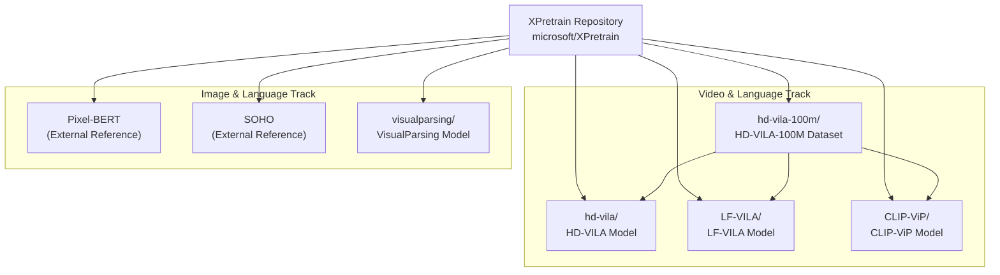
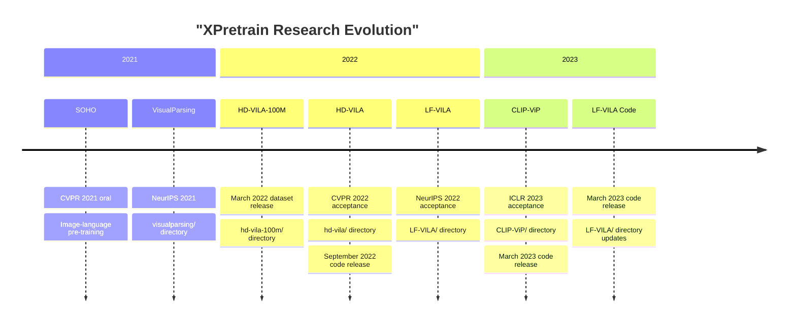
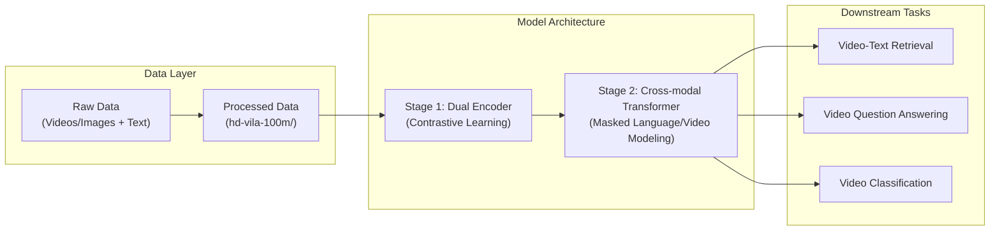
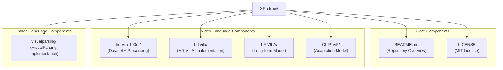

<!-- source: DeepWiki mcp.deepwiki.com · repo microsoft/XPretrain · page 1 XPretrain Overview · fetched 2026-10-26 -->

# XPretrain Overview

Relevant source files

The following files were used as context for generating this wiki page:

- [README.md](README.md)

## Purpose and Scope

This document provides a comprehensive overview of the XPretrain repository, which serves as a centralized collection of multi-modality learning research from Microsoft Research's MSM (Multimedia Search and Mining) group. The repository encompasses both video-language and image-language pre-training models, datasets, and related research implementations spanning 2021-2023.

For specific implementation details of individual models, see the Video-Language Research Track ([#2](#2)) and Image-Language Research Track ([#3](#3)). For development setup and configuration guidance, see the Development Guide ([#4](#4)).

## Repository Architecture

XPretrain functions as an umbrella repository containing multiple independent research projects that share common themes in multi-modality learning and pre-training methodologies. The repository is organized into distinct research tracks with their own codebases, datasets, and model implementations.

### Multi-modality Learning Tracks

Sources: [README.md:1-66]()

The repository implements two primary research tracks:

| Track | Components | Purpose |
|-------|------------|---------|
| **Video & Language** | `hd-vila-100m/`, `hd-vila/`, `LF-VILA/`, `CLIP-ViP/` | Video-language understanding and pre-training |
| **Image & Language** | `visualparsing/`, external references | Image-language understanding and pre-training |

## Research Timeline and Publications

### Code Repository Structure with Publication Timeline

Sources: [README.md:31-37]()

### Research Progression Model

The repository demonstrates a clear research progression where foundational work enables subsequent innovations:

| Year | Innovation | Code Location | Key Contribution |
|------|------------|---------------|------------------|
| 2021 | VisualParsing | `visualparsing/` | Transformer-based image-language pre-training |
| 2022 | HD-VILA-100M | `hd-vila-100m/` | Large-scale video-language dataset foundation |
| 2022 | HD-VILA | `hd-vila/` | High-resolution video-language pre-training |
| 2022 | LF-VILA | `LF-VILA/` | Long-form video processing capabilities |
| 2023 | CLIP-ViP | `CLIP-ViP/` | Adaptation of image-text models to video |

## Technical Architecture Patterns

### Common Pre-training Framework

Sources: [README.md:7-30]()

### Repository File Structure

The codebase follows a modular structure where each research component maintains its own directory with complete implementation:

Sources: [README.md:1-66]()

## Research Contributions and Impact

### Video-Language Track Achievements

The video-language research track represents the primary focus of recent XPretrain developments:

| Model | Key Innovation | Technical Contribution |
|-------|----------------|----------------------|
| **HD-VILA-100M** | Large-scale dataset | 3.3M videos, 371.5K hours, high-resolution |
| **HD-VILA** | High-resolution VLP | Dual-stage training with masked modeling |
| **LF-VILA** | Long-form processing | MTC loss and HTWA for extended video content |
| **CLIP-ViP** | Transfer learning | Post-pretraining adaptation from image to video |

### Image-Language Track Foundation

The image-language components provide foundational research that informs video-language developments:

| Model | Publication Venue | Core Technology |
|-------|------------------|-----------------|
| **SOHO** | CVPR 2021 (oral) | Quantized visual tokens |
| **VisualParsing** | NeurIPS 2021 | Transformer-based architecture |
| **Pixel-BERT** | Research paper | End-to-end image-language pre-training |

Sources: [README.md:15-29]()

## Governance and Community

### Contribution Framework

XPretrain operates under Microsoft's standard open-source governance model with specific requirements for contributors:

- **Contributor License Agreement (CLA)** required for all contributions
- **Microsoft Open Source Code of Conduct** compliance mandatory
- **Security and issue reporting** through GitHub issue system
- **Primary contacts**: Bei Liu (`bei.liu@microsoft.com`) and Jianlong Fu (`jianf@microsoft.com`)

### Licensing and Usage

The repository implements Microsoft's standard licensing framework with considerations for research use, trademark guidelines, and responsible AI practices. For detailed licensing information, see Licensing ([#5.1](#5.1)). For responsible AI considerations specific to video-language models, see Responsible AI ([#5.2](#5.2)).

Sources: [README.md:40-66]()

---

