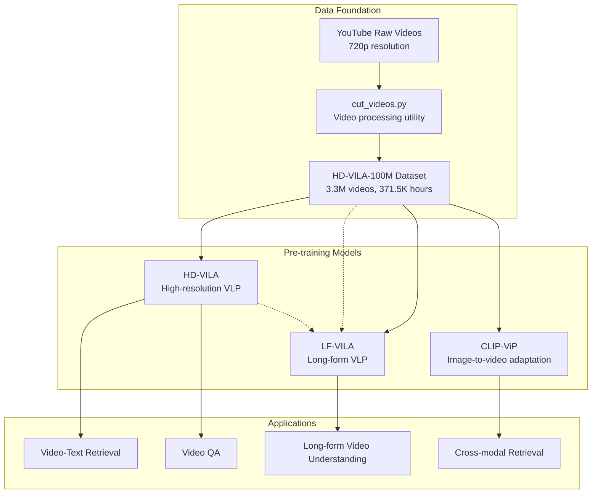
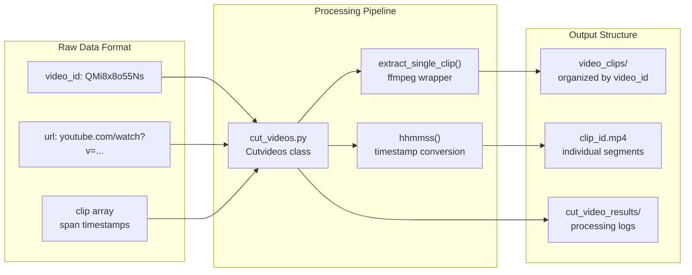
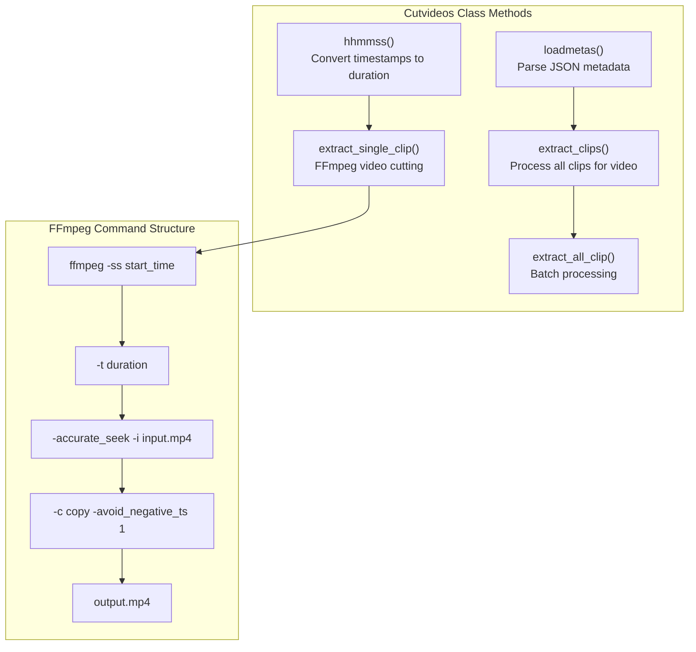
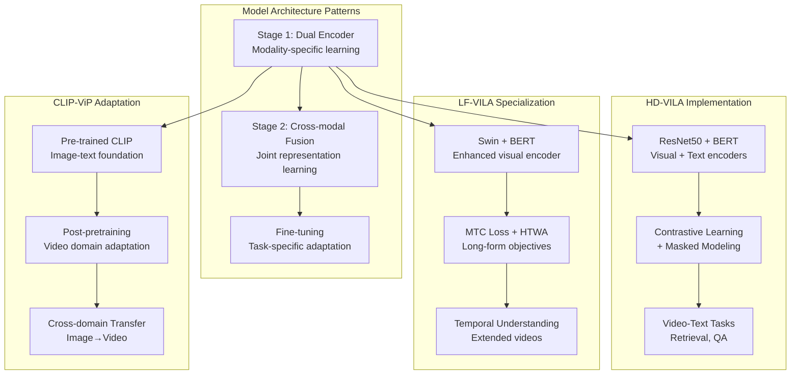
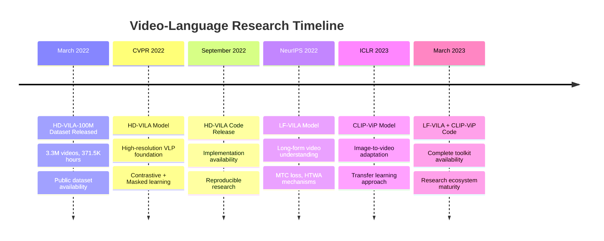

<!-- source: DeepWiki mcp.deepwiki.com · repo microsoft/XPretrain · page 2 Video-Language Research Track · fetched 2026-10-26 -->

# Video-Language Research Track

Relevant source files

The following files were used as context for generating this wiki page:

- [README.md](README.md)
- [hd-vila-100m/README.md](hd-vila-100m/README.md)
- [hd-vila-100m/src/cut_videos.py](hd-vila-100m/src/cut_videos.py)

## Purpose and Scope

This document covers the video-language research components within the XPretrain repository, encompassing the foundational HD-VILA-100M dataset and three specialized pre-training models: HD-VILA, LF-VILA, and CLIP-ViP. The track represents a comprehensive progression from large-scale dataset creation through various approaches to video-language understanding, spanning publications from CVPR 2022 through ICLR 2023.

For image-language research components, see [Image-Language Research Track](#3). For technical implementation details and environment setup, see [Development Guide](#4).

## Research Components Overview

The video-language track consists of four main components that build upon each other in a systematic progression:

| Component | Type | Publication | Purpose |
|-----------|------|-------------|---------|
| HD-VILA-100M | Dataset | March 2022 | Large-scale video-language corpus with 3.3M videos |
| HD-VILA | Pre-training Model | CVPR 2022 | High-resolution video-language representation learning |
| LF-VILA | Pre-training Model | NeurIPS 2022 | Long-form video understanding with temporal modeling |
| CLIP-ViP | Adaptation Method | ICLR 2023 | Transfer learning from image-text to video-text |

### Component Relationships

**Sources:** [README.md:1-66](), [hd-vila-100m/README.md:1-67]()

## Technical Architecture

### Data Foundation: HD-VILA-100M Dataset

The HD-VILA-100M dataset serves as the foundational data source for all video-language models in this track. The dataset contains 100 million video clips extracted from 3.3 million YouTube videos, totaling 371.5 thousand hours of content at 720p resolution.

#### Dataset Structure

The dataset metadata follows a structured format with video identifiers, YouTube URLs, and timestamp-based clip segmentation. Each video is divided into multiple clips based on ASR-generated transcription boundaries.

**Sources:** [hd-vila-100m/README.md:30-44](), [hd-vila-100m/src/cut_videos.py:27-78]()

#### Video Processing Implementation

The `Cutvideos` class in [hd-vila-100m/src/cut_videos.py:27-89]() implements the core video segmentation functionality:

The `extract_single_clip` method constructs FFmpeg commands with specific parameters for accurate temporal segmentation: `-ss` for start time, `-t` for duration, `-accurate_seek` for precise timing, and `-c copy` for efficient codec handling.

**Sources:** [hd-vila-100m/src/cut_videos.py:56-63](), [hd-vila-100m/src/cut_videos.py:41-49]()

### Model Progression and Relationships

The three video-language models represent different approaches to learning from the HD-VILA-100M dataset:

#### HD-VILA: High-Resolution Foundation

HD-VILA establishes the foundational approach for high-resolution video-language pre-training using the complete HD-VILA-100M dataset. The model focuses on learning robust video-text representations through contrastive learning and masked modeling objectives.

#### LF-VILA: Long-Form Specialization  

LF-VILA extends the HD-VILA approach specifically for long-form video understanding. It introduces specialized components for processing continuous clips with temporal dependencies, utilizing a subset of HD-VILA-100M containing videos with at least 4 continuous clips.

#### CLIP-ViP: Cross-Modal Adaptation

CLIP-ViP represents a different paradigm that adapts existing image-text models (CLIP) to video-language tasks through post-pretraining on HD-VILA-100M. This approach leverages the strong image-text representations already learned by CLIP and extends them to the temporal domain.

**Sources:** [README.md:15-19]()

## Research Evolution Timeline

The video-language research track demonstrates a clear progression from dataset creation through increasingly sophisticated modeling approaches:

This timeline reflects the systematic development from foundational dataset and baseline model through specialized approaches for long-form content and cross-modal transfer learning. The staggered code releases follow academic publication cycles while ensuring reproducibility.

**Sources:** [README.md:32-37]()

## Technical Integration Points

The video-language components share common infrastructure and processing patterns:

### Data Processing Pipeline

All models utilize the HD-VILA-100M dataset through standardized processing workflows implemented in `cut_videos.py`. The `Cutvideos` class provides consistent video segmentation functionality across different model training pipelines.

### Model Training Infrastructure  

Each model follows similar training patterns with stage-wise learning: initial dual-encoder training for modality-specific representations, followed by cross-modal fusion stages. The models share common dependency requirements and distributed training configurations.

### Evaluation Framework

The models are evaluated on overlapping downstream tasks including video-text retrieval, video question answering, and cross-modal understanding benchmarks, enabling direct performance comparisons across the different approaches.

**Sources:** [README.md:5-20](), [hd-vila-100m/src/cut_videos.py:1-110]()

---

