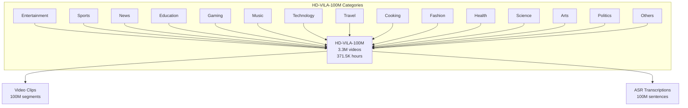
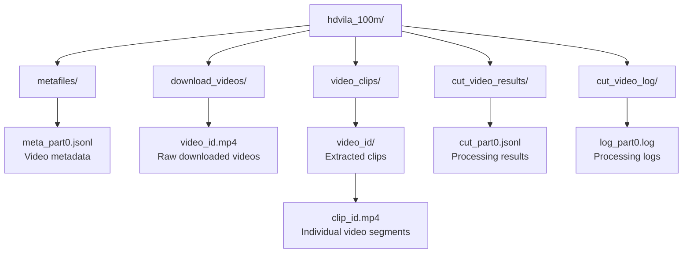
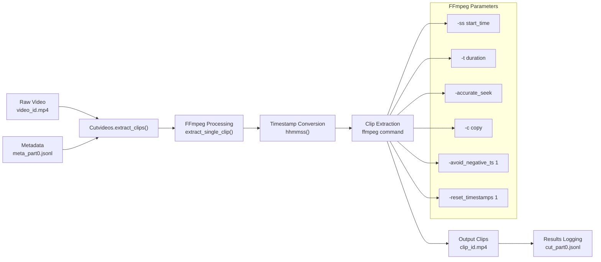

<!-- source: DeepWiki mcp.deepwiki.com · repo microsoft/XPretrain · page 2.1 HD-VILA-100M Dataset · fetched 2026-10-26 -->

# HD-VILA-100M Dataset

<details>
<summary>Relevant source files</summary>

The following files were used as context for generating this wiki page:

- [hd-vila-100m/README.md](hd-vila-100m/README.md)
- [hd-vila-100m/src/cut_videos.py](hd-vila-100m/src/cut_videos.py)

</details>


## Purpose and Scope

This document provides comprehensive documentation for the HD-VILA-100M dataset, a large-scale video-language dataset that serves as the foundational data source for video-language pre-training models in the XPretrain repository. This page covers the dataset structure, download process, video processing utilities, and technical implementation details.

For information about models that use this dataset, see [HD-VILA Model](#2.2), [LF-VILA Model](#2.3), and [CLIP-ViP Model](#2.4). For broader context about the video-language research track, see [Video-Language Research Track](#2).

## Dataset Overview

HD-VILA-100M is a large-scale, high-resolution, and diversified video-language dataset designed to facilitate multimodal representation learning. The dataset contains **3.3 million videos** distributed across **15 balanced categories**, providing a comprehensive foundation for video-language understanding tasks.

### Dataset Statistics

| Metric | Value |
|--------|--------|
| Video Count | 3.3M videos |
| Clip Count | 100M clips |
| Sentence Count | 100M sentences |
| Average Clip Length | 13.4 seconds |
| Average Sentence Length | 32.5 words |
| Total Duration | 371.5K hours |
| Resolution | 720p |
| Domain | Open domain |

The dataset achieves balanced representation across diverse content categories, ensuring comprehensive coverage for multimodal learning applications.

**Dataset Categories Distribution**


Sources: [hd-vila-100m/README.md:14-27]()

## Data Structure and Format

### Metadata Format

The dataset metadata follows a structured JSON format that defines video sources, clip boundaries, and temporal annotations:

```json
{   
    "video_id": "QMi8x8o55Ns",
    "url": "https://www.youtube.com/watch?v=QMi8x8o55Ns",
    "clip": [
        {
            "clip_id": "QMi8x8o55Ns.1.mp4", 
            "span": ["00:00:17.759", "00:00:23.279"]
        },
        {
            "clip_id": "QMi8x8o55Ns.16.mp4", 
            "span": ["00:04:52.140", "00:05:03.350"]
        }
    ]
}
```

### File Structure

**HD-VILA-100M Data Organization**


Sources: [hd-vila-100m/src/cut_videos.py:67-68](), [hd-vila-100m/src/cut_videos.py:94-99]()

## Download and Access

### Dataset Download

The complete dataset URLs and metadata can be accessed through the Azure Blob Storage endpoint. The download link provides access to all video URLs and corresponding timestamp information for clip extraction.

**Download Link**: The dataset is available through Azure Blob Storage with the following access pattern:
- Base URL: `hdvila.blob.core.windows.net/dataset/hdvila100m.zip`
- Access token and parameters are provided in the full download URL
- Updated as of June 28, 2022 with extended access through January 1, 2026

### Download Process

1. **Metadata Acquisition**: Download the compressed metadata file containing all video URLs and clip timestamps
2. **Video Download**: Retrieve raw videos from YouTube using the provided URLs
3. **Clip Extraction**: Process downloaded videos using the provided utilities to generate individual clips

Sources: [hd-vila-100m/README.md:29-44]()

## Video Processing Pipeline

### Processing Workflow

The video processing pipeline transforms raw YouTube videos into structured clip datasets using the `cut_videos.py` utility. This process handles timestamp-based segmentation and ensures proper video format consistency.

**Video Processing Architecture**


Sources: [hd-vila-100m/src/cut_videos.py:56-78]()

### Technical Implementation

#### Core Processing Class

The `Cutvideos` class handles the complete video processing workflow:

**Core Components**:
- **Initialization**: `__init__(metafile, workdir, resultfile)` - Sets up processing environment
- **Metadata Loading**: `loadmetas()` - Loads JSONL metadata files
- **Timestamp Processing**: `hhmmss(timestamp1, timestamp2)` - Converts timestamp formats to duration
- **Command Execution**: `run(cmd)` - Executes FFmpeg commands via subprocess
- **Clip Extraction**: `extract_single_clip(sb, in_filepath, out_filepath)` - Processes individual clips
- **Batch Processing**: `extract_all_clip()` - Handles complete dataset processing

#### FFmpeg Integration

The video processing leverages FFmpeg with specific parameters optimized for high-quality clip extraction:

```bash
ffmpeg -ss start_time -t duration -accurate_seek -i input_video -c copy \
       -avoid_negative_ts 1 -reset_timestamps 1 -y -hide_banner \
       -loglevel panic -map 0 output_clip
```

**Parameter Functions**:
- `-ss`: Seek to start timestamp
- `-t`: Set clip duration
- `-accurate_seek`: Ensure precise timestamp positioning
- `-c copy`: Copy streams without re-encoding
- `-avoid_negative_ts 1`: Handle timestamp edge cases
- `-reset_timestamps 1`: Reset output timestamps to zero

Sources: [hd-vila-100m/src/cut_videos.py:56-62]()

### Command Line Interface

The processing utility supports configurable parameters through command line arguments:

| Parameter | Default | Description |
|-----------|---------|-------------|
| `--workdir` | `./hdvila_100m` | Working directory for processing |
| `--metafile` | `meta_part0.jsonl` | Input metadata file |
| `--resultfile` | `cut_part0.jsonl` | Output results file |
| `--log` | `log_part0.log` | Processing log file |

**Usage Example**:
```bash
python cut_videos.py --workdir ./hdvila_100m \
                     --metafile meta_part0.jsonl \
                     --resultfile cut_part0.jsonl \
                     --log log_part0.log
```

Sources: [hd-vila-100m/src/cut_videos.py:12-19]()

## Technical Implementation Details

### Error Handling and Logging

The processing pipeline implements comprehensive error handling and logging mechanisms:

- **Directory Management**: `check_dirs(dirs)` ensures all required directories exist
- **Logging Configuration**: Structured logging with timestamps, module names, and line numbers
- **Process Monitoring**: Progress tracking using `tqdm` for batch operations
- **Exception Handling**: Validation of output file generation

### Performance Considerations

The implementation supports scalable processing through:
- **Batch Processing**: Processes multiple videos sequentially
- **Subprocess Management**: Isolated FFmpeg execution for each clip
- **File System Optimization**: Organized directory structure for efficient I/O
- **Memory Management**: Streaming JSON processing with `jsonlines`

**Processing Performance Metrics**:
- Supports parallel processing through job distribution
- Memory-efficient metadata loading
- Optimized FFmpeg parameters for speed and quality
- Comprehensive result tracking and validation

Sources: [hd-vila-100m/src/cut_videos.py:22-25](), [hd-vila-100m/src/cut_videos.py:101-110]()

## License and Usage

The HD-VILA-100M dataset is provided under specific licensing terms documented in the repository license file. Users should review the license agreement before accessing or using the dataset for research or commercial purposes.

**Citation**:
```bibtex
@inproceedings{xue2022hdvila,
    title={Advancing High-Resolution Video-Language Representation with Large-Scale Video Transcriptions},
    author={Xue, Hongwei and Hang, Tiankai and Zeng, Yanhong and Sun, Yuchong and Liu, Bei and Yang, Huan and Fu, Jianlong and Guo, Baining},
    booktitle={International Conference on Computer Vision and Pattern Recognition (CVPR)},
    year={2022}
}
```

Sources: [hd-vila-100m/README.md:47-66]()

---

