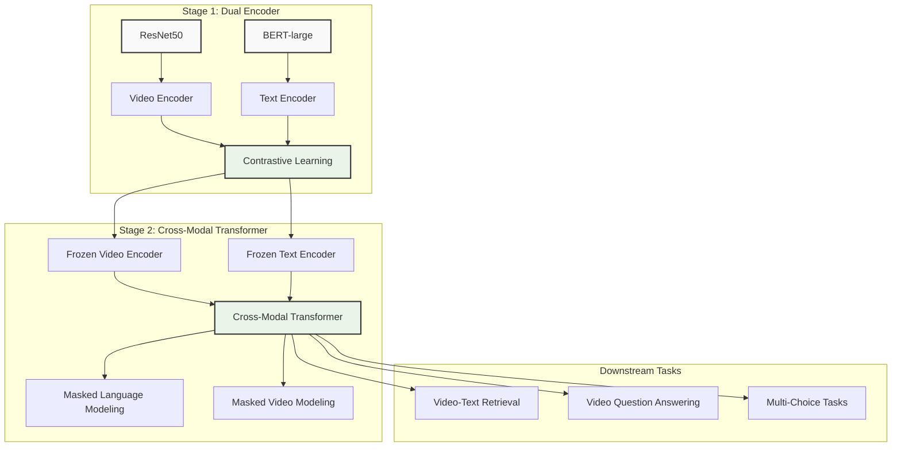
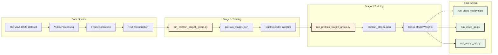
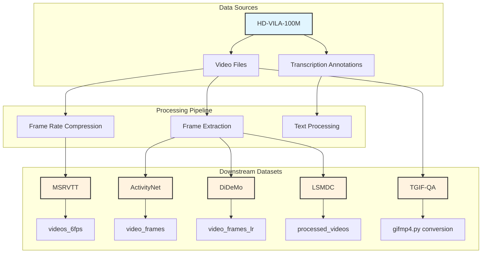

<!-- source: DeepWiki mcp.deepwiki.com · repo microsoft/XPretrain · page 2.2 HD-VILA Model · fetched 2026-10-26 -->

# HD-VILA Model

<details>
<summary>Relevant source files</summary>

The following files were used as context for generating this wiki page:

- [hd-vila/README.md](hd-vila/README.md)

</details>


## Purpose and Scope

This page documents the HD-VILA (High-resolution and Diversified Video-Language) model, a foundational video-language pre-training system within the XPretrain repository. HD-VILA establishes high-resolution video-language representations through a novel two-stage training approach using the HD-VILA-100M dataset.

For information about the underlying HD-VILA-100M dataset, see [2.1](#2.1). For the subsequent LF-VILA long-form adaptation, see [2.3](#2.3). For the CLIP-ViP transfer learning approach, see [2.4](#2.4).

## Model Overview and Architecture

HD-VILA implements a hybrid architecture combining a dual encoder for stage-one contrastive learning with a cross-modal Transformer for stage-two masked modeling. The model achieves state-of-the-art performance across 10 video-language understanding tasks and 2 text-to-visual generation tasks, with notable improvements of 40.4% R@1 on MSR-VTT zero-shot retrieval and 55.4% on LSMDC high-resolution datasets.

### HD-VILA Architecture Components



**Sources:** [hd-vila/README.md:15-23](), [hd-vila/README.md:78-94]()

### Training Process Flow



**Sources:** [hd-vila/README.md:78-94](), [hd-vila/README.md:100-130]()

## Two-Stage Training Process

### Stage 1: Contrastive Learning

The first stage implements contrastive learning using a dual encoder architecture. Pre-trained ResNet50 handles video encoding while BERT-large processes text inputs. This stage establishes foundational video-text correspondences through contrastive objectives.

**Training Command:**
```bash
horovodrun -np $NUM_GPUS python src/pretrain/run_pretrain_stage1_group.py \
    --config src/configs/pretrain_stage1.json
```

### Stage 2: Cross-Modal Transformer

The second stage introduces a cross-modal Transformer that operates on frozen representations from stage 1. This stage employs masked modeling objectives for both video and text modalities to learn deeper cross-modal interactions.

**Training Command:**
```bash
horovodrun -np $NUM_GPUS python src/pretrain/run_pretrain_stage2_group.py \
    --config src/configs/pretrain_stage2.json
```

**Configuration Requirements:**
- The `e2e_weights_path` parameter in `pretrain_stage2.json` must reference the stage 1 checkpoint path
- Stage 1 parameters remain frozen during stage 2 training

**Sources:** [hd-vila/README.md:78-94]()

## Implementation Structure

### Core Training Scripts

| Component | Script Path | Purpose |
|-----------|-------------|---------|
| Stage 1 Pre-training | `src/pretrain/run_pretrain_stage1_group.py` | Dual encoder contrastive learning |
| Stage 2 Pre-training | `src/pretrain/run_pretrain_stage2_group.py` | Cross-modal transformer training |
| Video Retrieval | `src/tasks/run_video_retrieval.py` | Fine-tuning for retrieval tasks |
| Video QA | `src/tasks/run_video_qa.py` | Fine-tuning for question answering |
| Multi-Choice Tasks | `src/tasks/run_msrvtt_mc.py` | MSRVTT multiple choice inference |

### Configuration Management

Configuration files are stored in `src/configs/` with task-specific JSON files:

| Task Category | Configuration Pattern | Example |
|---------------|----------------------|---------|
| Retrieval Tasks | `*_retrieval.json` | `msrvtt_retrieval.json` |
| QA Tasks | `*_qa.json` | `msrvtt_qa.json` |
| Pre-training | `pretrain_stage*.json` | `pretrain_stage1.json` |

**Sources:** [hd-vila/README.md:82-94](), [hd-vila/README.md:98-114]()

## Environment and Infrastructure

### Docker Environment

HD-VILA requires a specialized environment with Horovod for distributed training. The system uses the pre-built Docker image `tiankaihang/azureml_docker:horovod` or can be built from the provided Dockerfile.

**Container Launch:**
```bash
cd HD-VILA
source launch_container.sh $PATH_TO_STORAGE
```

### Hardware Requirements

- GPUs with Tensor Cores (recommended for mixed-precision training)
- Multi-GPU setup for distributed training via Horovod
- Sufficient storage for HD-VILA-100M dataset and processed video files

**Sources:** [hd-vila/README.md:42-49]()

## Data Processing and Dependencies

### Dataset Integration



### Data Download and Setup

The `scripts/download_data.sh` script handles:
- Pre-trained model weights (ResNet50, BERT-large)
- HD-VILA checkpoint downloads
- Downstream task annotations

**Video Processing Utilities:**
- Frame rate compression: Located in `scripts/process_raw_video/`
- Format conversion: `scripts/process_raw_video/gifmp4.py` for TGIF-QA
- Frame extraction for ActivityNet, DiDeMo, and LSMDC datasets

**Sources:** [hd-vila/README.md:53-76]()

## Downstream Applications

### Video-Text Retrieval

HD-VILA supports multiple retrieval benchmarks:

| Dataset | Configuration | Storage Path Pattern |
|---------|---------------|---------------------|
| MSRVTT | `msrvtt_retrieval.json` | `$PATH_TO_STORAGE/data/msrvtt_retrieval/` |
| ActivityNet | `activitynet_retrieval.json` | `$PATH_TO_STORAGE/data/activitynet_retrieval/` |
| DiDeMo | `didemo_retrieval.json` | `$PATH_TO_STORAGE/data/didemo_retrieval/` |
| LSMDC | `lsmdc_retrieval.json` | `$PATH_TO_STORAGE/data/lsmdc_retrieval/` |

### Video Question Answering

QA tasks require the same base pre-trained weights but use task-specific configurations:

| Task | Configuration | Description |
|------|---------------|-------------|
| MSRVTT-QA | `msrvtt_qa.json` | Open-ended video QA |
| TGIF-QA | `tgif_qa.json` | Animated GIF QA |
| MSRVTT-MC | Uses retrieval model | Multiple-choice inference |

### Multi-Choice Inference

The MSRVTT MC Test leverages the retrieval model architecture for multiple-choice tasks:

```bash
horovodrun -np $NUM_GPUS python src/tasks/run_msrvtt_mc.py \
  --config src/configs/msrvtt_retrieval.json \
  --do_inference 1 --output_dir $OUTPUT_DIR \
  --inference_split val --inference_model_step $STEP \
  --inference_txt_db /path/to/msrvtt_retrieval/mc_test.jsonl \
  --inference_img_db /path/to/msrvtt_video --inference_batch_size 64 \
  --inference_n_clips $INFERENCE_N_CLIPS
```

**Sources:** [hd-vila/README.md:96-130]()

## Performance and Results

HD-VILA achieves state-of-the-art performance across multiple benchmarks:

- **MSR-VTT Zero-shot Retrieval:** 40.4% relative improvement in R@1
- **LSMDC High-resolution:** 55.4% relative improvement  
- **10 VL Understanding Tasks:** New SOTA results
- **2 Text-to-Visual Generation Tasks:** Novel capabilities in editing and super-resolution

The model's effectiveness extends beyond traditional understanding tasks to generative applications, demonstrating the versatility of the learned video-language representations.

**Sources:** [hd-vila/README.md:22-23]()

---

