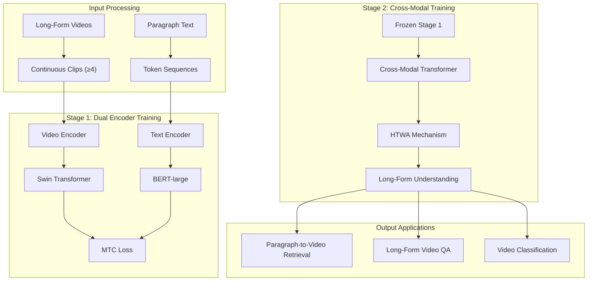
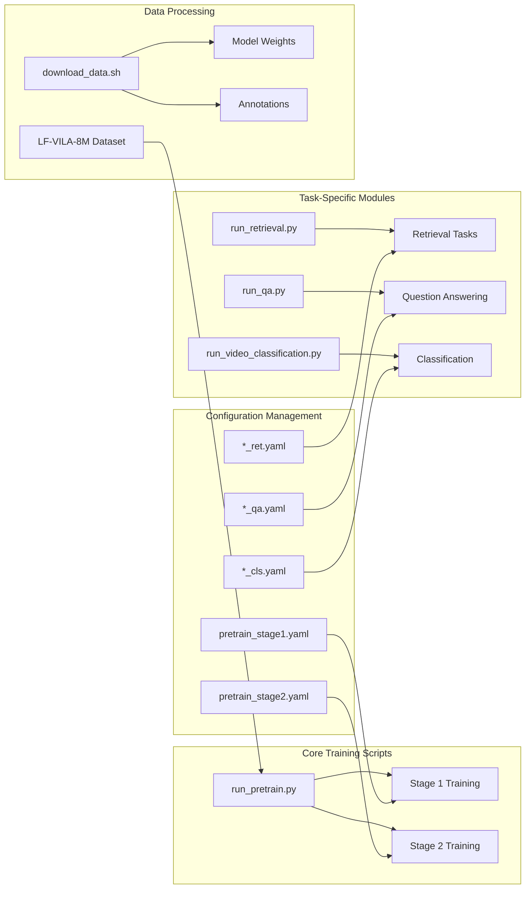
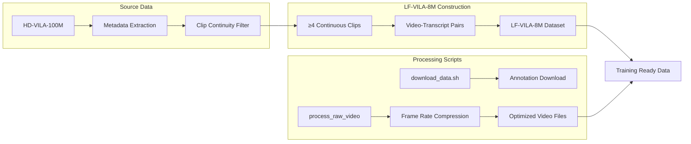

<!-- source: DeepWiki mcp.deepwiki.com · repo microsoft/XPretrain · page 2.3 LF-VILA Model · fetched 2026-10-26 -->

# LF-VILA Model

<details>
<summary>Relevant source files</summary>

The following files were used as context for generating this wiki page:

- [LF-VILA/README.md](LF-VILA/README.md)

</details>


## Purpose and Scope

This document covers the LF-VILA (Long-Form Video-Language) model implementation within the XPretrain repository. LF-VILA specializes in processing extended video content through novel Multimodal Temporal Contrastive learning and Hierarchical Temporal Window Attention mechanisms. This model addresses the specific challenges of long-form video-language understanding, distinguishing it from general video-language models.

For information about the foundational HD-VILA-100M dataset used by LF-VILA, see [HD-VILA-100M Dataset](#2.1). For the base HD-VILA model that LF-VILA builds upon, see [HD-VILA Model](#2.2). For adaptation approaches to video-language models, see [CLIP-ViP Model](#2.4).

## Architecture Overview

LF-VILA implements a two-stage training paradigm with specialized components for handling long-form video sequences and temporal relationships.

### Core Architecture Components



**LF-VILA Architecture and Training Pipeline**

Sources: [LF-VILA/README.md:1-131]()

### Model Implementation Structure



**LF-VILA Code Organization and Dependencies**

Sources: [LF-VILA/README.md:45-106]()

## Key Technical Innovations

### Multimodal Temporal Contrastive (MTC) Loss

The MTC loss mechanism enables fine-grained temporal alignment between long-form videos and paragraph descriptions. This addresses the challenge of learning temporal relationships across extended sequences where traditional contrastive approaches may fail to capture long-range dependencies.

### Hierarchical Temporal Window Attention (HTWA)

HTWA provides an efficient attention mechanism for processing long-form content by:
- Reducing computational complexity for extended sequences
- Maintaining long-range dependency modeling
- Enabling hierarchical temporal understanding

Sources: [LF-VILA/README.md:11-11]()

## Training Process

### Stage 1: Dual Encoder Pre-training

The first stage trains separate encoders for video and text modalities using the MTC loss:

```bash
deepspeed src/run_pretrain.py --distributed --blob_mount_dir /blob_mount --config src/configs/pretrain_stage1.yaml --deepspeed
```

Key characteristics:
- Uses Swin Transformer for video encoding
- Employs BERT-large for text encoding
- Implements MTC loss for temporal contrastive learning

Sources: [LF-VILA/README.md:67-71]()

### Stage 2: Cross-Modal Transformer Training

The second stage introduces cross-modal understanding while freezing Stage 1 parameters:

```bash
deepspeed src/run_pretrain.py --distributed --blob_mount_dir /blob_mount --config src/configs/pretrain_stage2.yaml --deepspeed
```

Key characteristics:
- Frozen dual encoder weights from Stage 1
- Cross-modal Transformer with HTWA mechanism
- Focus on long-form video-language understanding

Sources: [LF-VILA/README.md:73-78]()

## Dataset and Data Preparation

### LF-VILA-8M Dataset Construction

LF-VILA uses a specialized subset of HD-VILA-100M optimized for long-form content:

| Dataset Component | Description | Size |
|------------------|-------------|------|
| LF-VILA-8M | Long-form video subset | 8.5 million videos |
| Clip Requirement | Continuous clips per video | ≥4 clips minimum |
| Content Type | Video + transcript pairs | Long-form sequences |

The dataset construction process filters HD-VILA-100M to retain only videos with sufficient continuous clip coverage for long-form understanding tasks.

### Data Processing Pipeline



**LF-VILA Data Processing and Dataset Construction**

Sources: [LF-VILA/README.md:49-59]()

## Downstream Applications

### Retrieval Tasks

LF-VILA supports paragraph-to-video retrieval with specialized fine-tuning:

```bash
deepspeed src/tasks/run_retrieval.py --distributed --blob_mount_dir /blob_mount --config $CONFIG_PATH --deepspeed
```

Supported retrieval datasets:
- ActivityNet paragraph-to-video retrieval
- DiDeMo moment localization
- Condensed Movies retrieval

### Question Answering Tasks

Long-form video QA capabilities through dedicated training:

```bash
deepspeed src/tasks/run_qa.py --distributed --blob_mount_dir /blob_mount --config $CONFIG_PATH --deepspeed
```

Supported QA datasets:
- How2QA long-form video questions
- ActivityNet QA
- VIOLIN video reasoning

### Video Classification

Multi-class video understanding for long-form content:

```bash
deepspeed src/tasks/run_video_classification.py --distributed --blob_mount_dir /blob_mount --config $CONFIG_PATH --deepspeed
```

Supported classification datasets:
- COIN procedural video classification
- LVU video understanding benchmarks

Sources: [LF-VILA/README.md:84-106]()

## Configuration and Implementation

### Environment Setup

LF-VILA requires a specialized Docker environment with DeepSpeed support:

```bash
source launch_container.sh $PATH_TO_STORAGE $NAME
```

The recommended Docker image is `ycsun1972/azureml_docker:horovod_deepspeed_v2` which includes:
- Horovod for distributed training
- DeepSpeed for memory optimization
- GPU tensor core support

### Configuration Files Structure

| Configuration Type | File Pattern | Purpose |
|-------------------|--------------|---------|
| Pre-training Stage 1 | `pretrain_stage1.yaml` | Dual encoder training parameters |
| Pre-training Stage 2 | `pretrain_stage2.yaml` | Cross-modal transformer setup |
| Retrieval Tasks | `*_ret.yaml` | Task-specific retrieval configs |
| QA Tasks | `*_qa.yaml` | Question answering parameters |
| Classification | `*_cls.yaml` | Video classification settings |

### Model Weights and Dependencies

The model depends on several pre-trained components:
- Swin Transformer weights for video encoding
- BERT-large weights for text encoding
- Stage 1 model weights for Stage 2 training

These are automatically downloaded via the `scripts/download_data.sh` script.

Sources: [LF-VILA/README.md:26-46](), [LF-VILA/README.md:82-82]()

## Performance Characteristics

LF-VILA achieves notable improvements on long-form video understanding benchmarks:
- **16.1% relative improvement** on ActivityNet paragraph-to-video retrieval
- **2.4% improvement** on How2QA long-form video question answering

These performance gains demonstrate the effectiveness of the MTC loss and HTWA mechanisms for processing extended video content compared to traditional video-language models.

Sources: [LF-VILA/README.md:13-13]()

---

