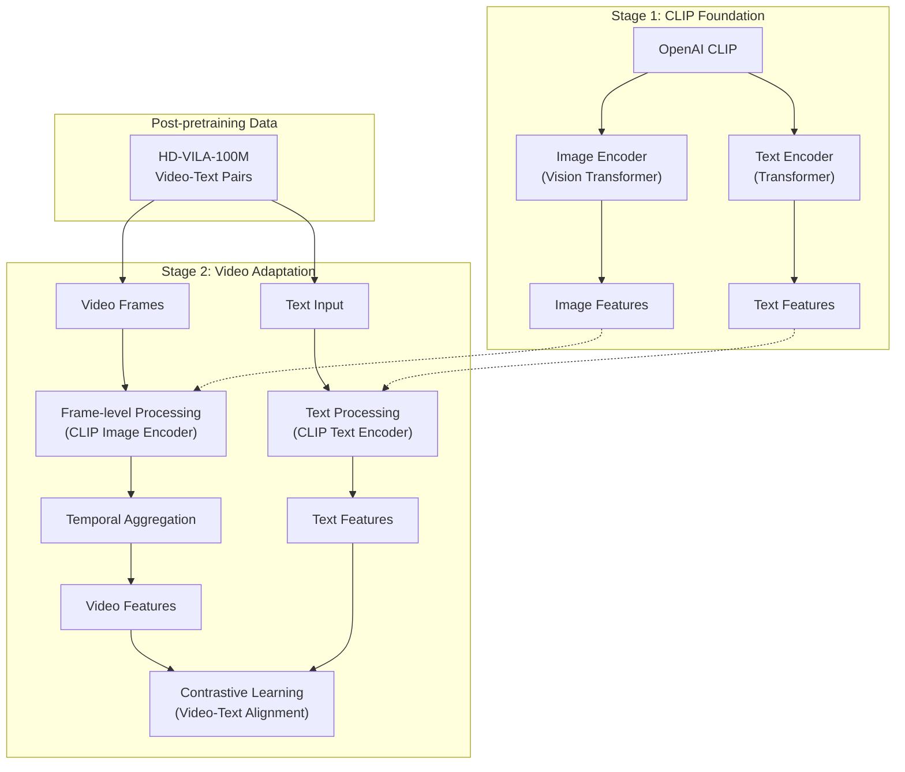
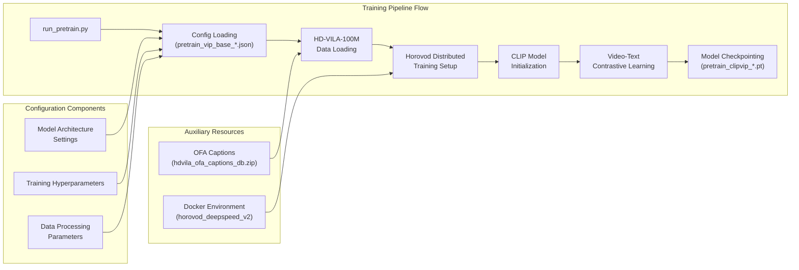
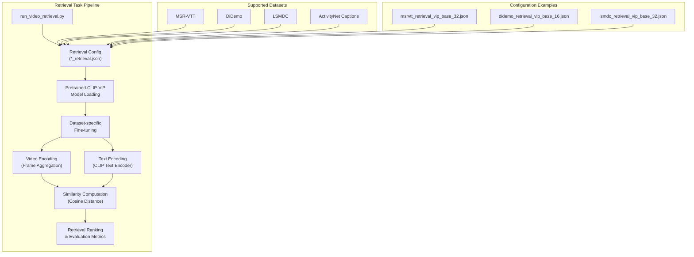
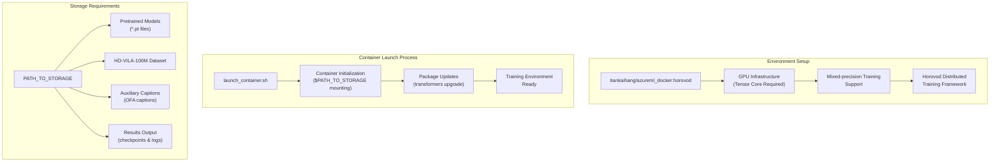

<!-- source: DeepWiki mcp.deepwiki.com · repo microsoft/XPretrain · page 2.4 CLIP-ViP Model · fetched 2026-10-26 -->

# CLIP-ViP Model

<details>
<summary>Relevant source files</summary>

The following files were used as context for generating this wiki page:

- [CLIP-ViP/README.md](CLIP-ViP/README.md)

</details>


## Purpose and Scope

This document covers the CLIP-ViP (CLIP Video Pretraining) model implementation within the XPretrain repository. CLIP-ViP is a post-pretraining adaptation approach that transfers image-text representations from the OpenAI CLIP model to video-language tasks using the HD-VILA-100M dataset. The model achieves state-of-the-art performance on multiple video retrieval benchmarks by bridging the domain gap between images and videos through targeted post-pretraining.

For information about the foundational HD-VILA-100M dataset used in CLIP-ViP training, see [HD-VILA-100M Dataset](#2.1). For the base HD-VILA model architecture that informs CLIP-ViP's design, see [HD-VILA Model](#2.2).

## Model Architecture and Adaptation Approach

CLIP-ViP follows a two-stage adaptation strategy that preserves the powerful image-text representations from CLIP while extending them to handle video-language understanding tasks.

### CLIP-ViP Architecture Overview



**CLIP-ViP Video Adaptation Pipeline**

Sources: [CLIP-ViP/README.md:11-11]()

### Model Variants

CLIP-ViP is available in two configurations that differ in their visual processing resolution:

| Model Variant | Visual Resolution | Configuration File | Pretrained Model |
|---------------|-------------------|-------------------|------------------|
| CLIP-ViP-B/32 | 224×224 (patch 32) | `pretrain_vip_base_32.json` | `pretrain_clipvip_base_32.pt` |
| CLIP-ViP-B/16 | 224×224 (patch 16) | `pretrain_vip_base_16.json` | `pretrain_clipvip_base_16.pt` |

Sources: [CLIP-ViP/README.md:30-34](), [CLIP-ViP/README.md:62-62]()

## Training Pipeline and Implementation

### Post-pretraining Process

CLIP-ViP employs a post-pretraining strategy where the frozen CLIP model is further trained on video-text data to adapt its representations for video understanding.



**CLIP-ViP Training Infrastructure and Data Flow**

Sources: [CLIP-ViP/README.md:56-62](), [CLIP-ViP/README.md:26-26](), [CLIP-ViP/README.md:15-17]()

### Training Command Structure

The post-pretraining process is executed using the following command pattern:

```bash
horovodrun -np $NUM_GPUS python src/pretrain/run_pretrain.py --config $CONFIG_PATH
```

The `$CONFIG_PATH` parameter references configuration files located in [src/configs/pretrain/](), specifically:
- `pretrain_vip_base_32.json` for CLIP-ViP-B/32
- `pretrain_vip_base_16.json` for CLIP-ViP-B/16

Sources: [CLIP-ViP/README.md:56-62]()

## Downstream Task Evaluation

### Text-to-Video Retrieval Implementation

CLIP-ViP's primary evaluation focuses on text-to-video retrieval tasks across multiple benchmarks. The retrieval system follows a dual-encoder architecture where video and text are encoded into a shared embedding space.



**CLIP-ViP Retrieval Task Architecture**

Sources: [CLIP-ViP/README.md:66-72]()

### Supported Evaluation Benchmarks

CLIP-ViP demonstrates state-of-the-art performance across multiple video retrieval benchmarks:

| Benchmark | Task Type | Configuration Pattern |
|-----------|-----------|----------------------|
| MSR-VTT | Text-to-video retrieval | `msrvtt_retrieval_vip_base_*.json` |
| DiDemo | Text-to-video retrieval | `didemo_retrieval_vip_base_*.json` |
| LSMDC | Text-to-video retrieval | `lsmdc_retrieval_vip_base_*.json` |
| ActivityNet Captions | Text-to-video retrieval | `activitynet_retrieval_vip_base_*.json` |

Sources: [CLIP-ViP/README.md:2-5](), [CLIP-ViP/README.md:72-72]()

### Retrieval Fine-tuning Command

Fine-tuning for retrieval tasks follows this command structure:

```bash
horovodrun -np $NUM_GPUS python src/tasks/run_video_retrieval.py --config $CONFIG_PATH
```

The configuration files for retrieval tasks are located in [src/configs/]() with the naming pattern `*_retrieval.json`.

Sources: [CLIP-ViP/README.md:66-72]()

## Environment and Infrastructure Requirements

### Docker Environment Setup

CLIP-ViP requires a specialized environment with distributed training capabilities:



**CLIP-ViP Infrastructure and Environment Dependencies**

Sources: [CLIP-ViP/README.md:15-17](), [CLIP-ViP/README.md:36-51]()

### Data Dependencies

CLIP-ViP requires several data components for operation:

1. **HD-VILA-100M Dataset**: Primary video-text training data
2. **Auxiliary OFA Captions**: Additional caption data from [hdvila_ofa_captions_db.zip]()
3. **Pretrained CLIP-ViP Models**: Available as `pretrain_clipvip_base_32.pt` and `pretrain_clipvip_base_16.pt`

Sources: [CLIP-ViP/README.md:24-34]()

## Integration with XPretrain Ecosystem

CLIP-ViP builds upon the HD-VILA foundation and represents the evolution toward more efficient adaptation strategies within the XPretrain video-language research track. The model demonstrates how existing image-text representations can be effectively transferred to video domains through targeted post-pretraining, offering a computationally efficient alternative to training video-language models from scratch.

Sources: [CLIP-ViP/README.md:96-96]()

---

