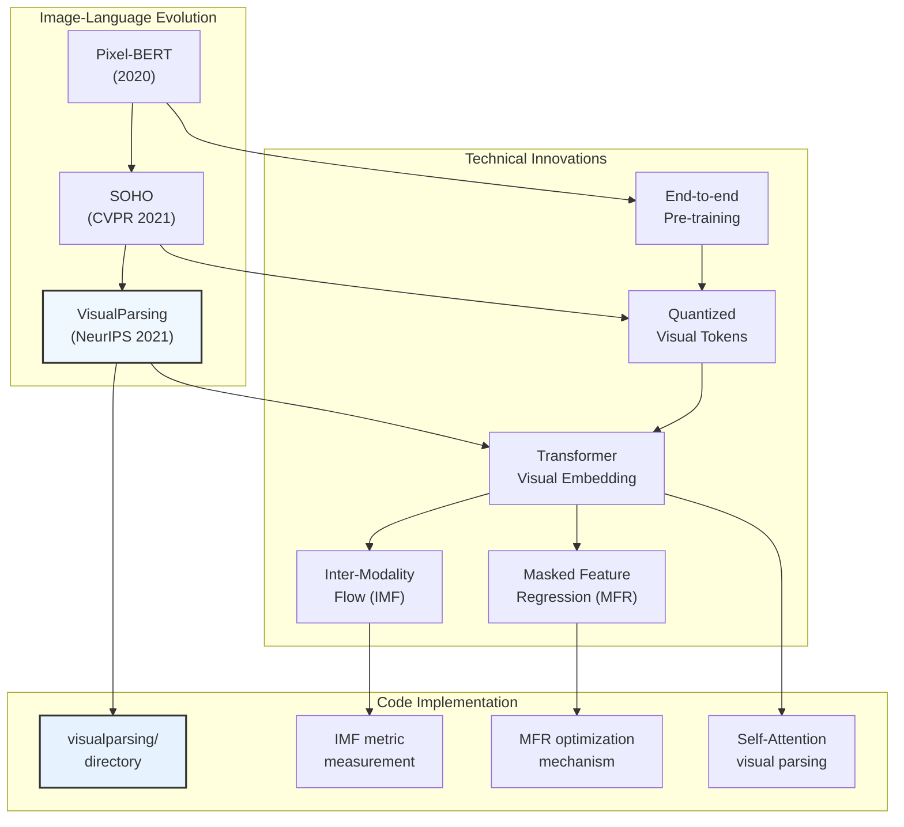
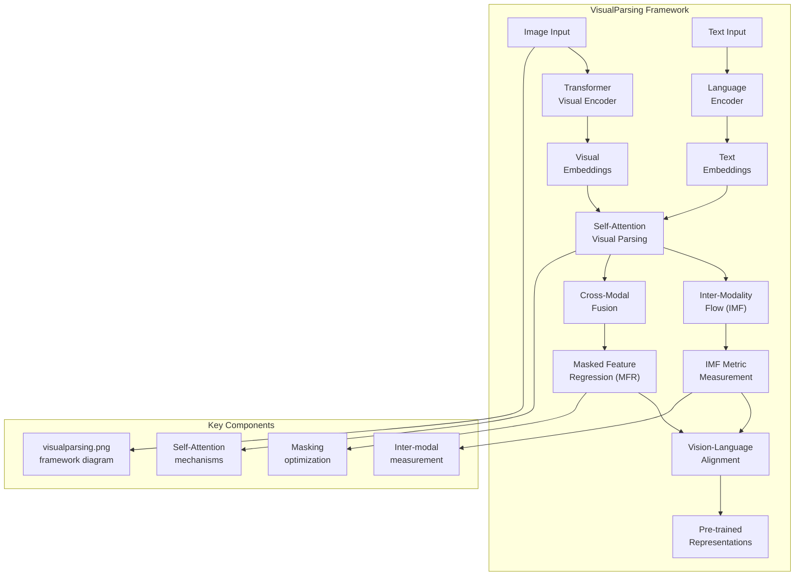
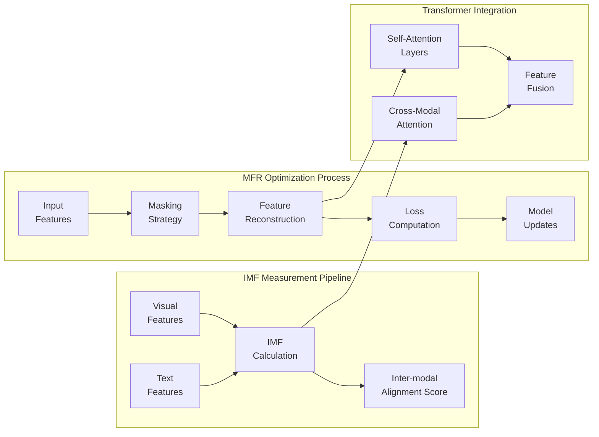

<!-- source: DeepWiki mcp.deepwiki.com · repo microsoft/XPretrain · page 3 Image-Language Research Track · fetched 2026-10-26 -->

# Image-Language Research Track

Relevant source files

The following files were used as context for generating this wiki page:

- [README.md](README.md)
- [visualparsing/README.md](visualparsing/README.md)

## Purpose and Scope

This document covers the image-language research components within the XPretrain repository, focusing on the evolution of vision-and-language pre-training models from foundational architectures to advanced transformer-based approaches. The image-language track represents the foundation for multimodal understanding research that preceded and informed the video-language developments.

For information about video-language models that build upon these image-language foundations, see [Video-Language Research Track](#2). For implementation details of the VisualParsing model specifically, see [VisualParsing Model](#3.1).

## Overview of Image-Language Models

The image-language research track encompasses three progressive model architectures that advance vision-and-language pre-training capabilities:

| Model | Publication | Key Innovation | Implementation Status |
|-------|-------------|----------------|---------------------|
| Pixel-BERT | arXiv 2020 | End-to-end image and language pre-training | External reference |
| SOHO | CVPR 2021 (oral) | Quantized visual tokens for improved efficiency | External reference |
| VisualParsing | NeurIPS 2021 | Transformer-based visual embedding with inter-modality mechanisms | Available in repository |

The progression demonstrates increasing sophistication in cross-modal understanding, culminating in the fully transformer-based VisualParsing approach that introduces novel mechanisms for measuring and optimizing inter-modal interactions.

Sources: [README.md:21-29](), [visualparsing/README.md:1-35]()

## Model Architecture Evolution

**Architecture Evolution Diagram**

This diagram illustrates the technical progression from basic end-to-end pre-training through quantized representations to sophisticated transformer-based visual parsing with specialized inter-modality mechanisms.

Sources: [README.md:21-29](), [visualparsing/README.md:7-14]()

## VisualParsing Technical Architecture

**VisualParsing Technical Framework**

This diagram shows the core architecture of the VisualParsing model, highlighting the transformer-based visual embedding approach and the novel Inter-Modality Flow (IMF) and Masked Feature Regression (MFR) mechanisms.

Sources: [visualparsing/README.md:9-14](), [visualparsing/README.md:16-21]()

## Inter-Modality Mechanisms

The VisualParsing model introduces two key technical innovations for measuring and optimizing cross-modal interactions:

### Inter-Modality Flow (IMF)

The `IMF` metric quantifies the interaction between vision and language modalities, providing a measurable approach to assess cross-modal alignment quality. This metric enables systematic evaluation of how effectively the model bridges visual and textual representations.

### Masked Feature Regression (MFR)

The `MFR` optimization mechanism operates within the Transformer architecture to promote inter-modality learning through strategic masking and reconstruction of features across modalities. This approach enhances the model's ability to understand relationships between visual and textual elements.

**Inter-Modality Learning Mechanisms**

This diagram details the technical implementation of IMF measurement and MFR optimization within the transformer-based architecture.

Sources: [visualparsing/README.md:11-14]()

## Research Timeline and Publications

The image-language research track represents a foundational period that established core multimodal learning principles later extended to video-language applications:

| Year | Model | Venue | Key Contribution |
|------|-------|-------|------------------|
| 2020 | Pixel-BERT | arXiv | Established end-to-end image-language pre-training paradigm |
| 2021 | SOHO | CVPR (oral) | Introduced quantized visual tokens for improved efficiency |
| 2021 | VisualParsing | NeurIPS | Advanced transformer-based visual embedding with inter-modality mechanisms |

The VisualParsing model represents the culmination of this research track, introducing sophisticated mechanisms for measuring and optimizing cross-modal interactions that inform subsequent video-language developments in the repository.

### Citation Information

The VisualParsing research can be cited using the BibTeX entry provided in [visualparsing/README.md:27-35]().

Sources: [README.md:21-29](), [visualparsing/README.md:3-6](), [visualparsing/README.md:27-35]()

## Technical Implementation

The VisualParsing model is the primary image-language component with available implementation in the repository. The model files are located in the `visualparsing/` directory, with the framework architecture illustrated in the included `visualparsing.png` diagram.

The implementation focuses on:

- **Transformer-based visual embedding**: Fully transformer architecture for processing visual inputs
- **Self-attention visual parsing**: Advanced attention mechanisms for understanding visual relationships  
- **Inter-modality optimization**: Specialized loss functions and training procedures for cross-modal alignment
- **Masking strategies**: Novel approaches to feature masking and reconstruction for improved learning

Sources: [visualparsing/README.md:9-14](), [visualparsing/README.md:16-21]()

---

