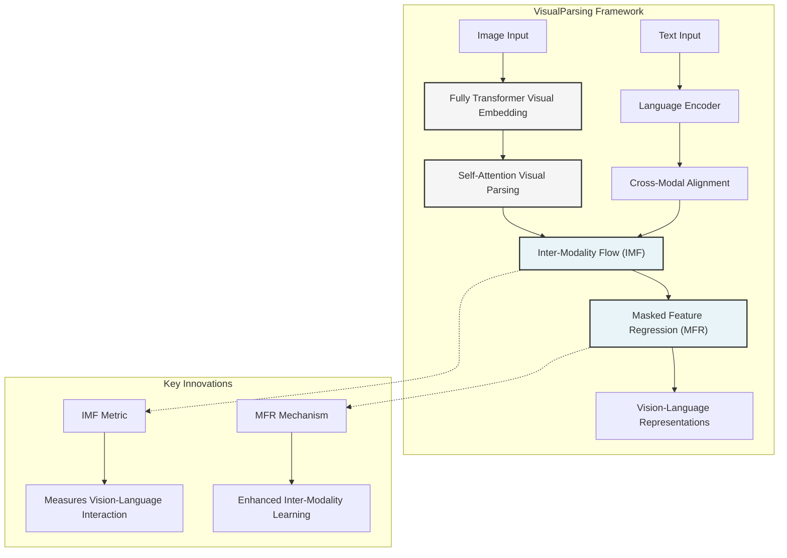
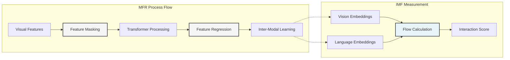
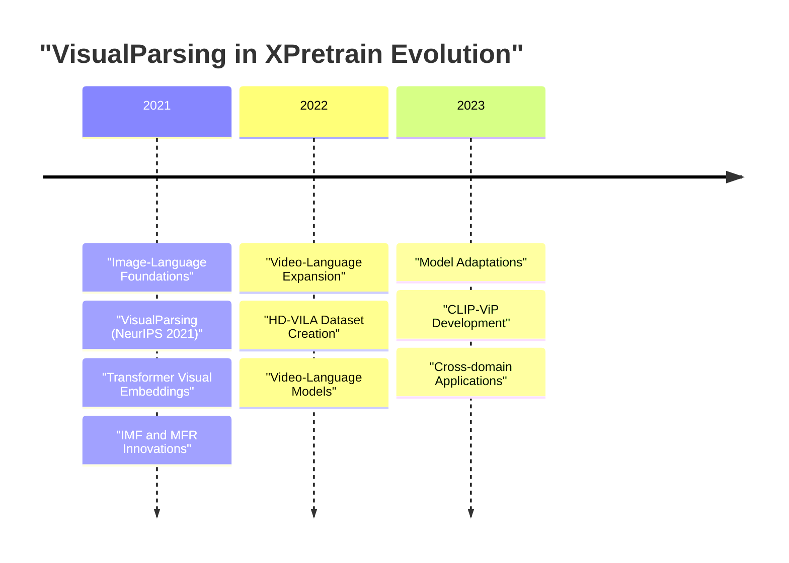
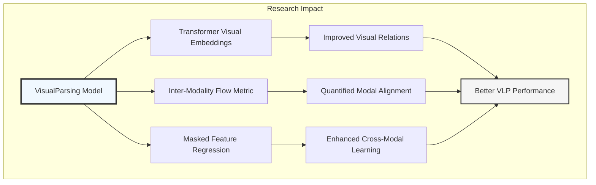

<!-- source: DeepWiki mcp.deepwiki.com · repo microsoft/XPretrain · page 3.1 VisualParsing Model · fetched 2026-10-26 -->

# VisualParsing Model

Relevant source files

The following files were used as context for generating this wiki page:

- [visualparsing/README.md](visualparsing/README.md)
- [visualparsing/visualparsing.png](visualparsing/visualparsing.png)

## Purpose and Scope

This document covers the VisualParsing model, a vision-language pre-training system that introduces fully Transformer-based visual embeddings for improved inter-modal alignment. The VisualParsing model is part of XPretrain's image-language research track and represents foundational work in transformer-based visual understanding published at NeurIPS 2021.

For information about other image-language models in the repository, see the [Image-Language Research Track](#3) overview. For video-language research, see the [Video-Language Research Track](#2).

## Overview

The VisualParsing model addresses a fundamental challenge in vision-language pre-training: how to better learn visual relations and promote alignment between visual and textual modalities. The system introduces two key innovations:

1. **Inter-Modality Flow (IMF)**: A metric for measuring interaction between vision and language modalities
2. **Masked Feature Regression (MFR)**: A novel masking optimization mechanism in Transformer architectures

### Core Architecture Concept

Sources: [visualparsing/README.md:9-14]()

## Technical Innovations

### Inter-Modality Flow (IMF)

The Inter-Modality Flow serves as a quantitative metric to measure the interaction strength between visual and linguistic modalities. This metric enables the model to assess how effectively information flows between different modal representations during the pre-training process.

### Masked Feature Regression (MFR)

The Masked Feature Regression mechanism extends traditional masking strategies by operating within the Transformer architecture to specifically enhance inter-modality learning. Unlike conventional masked language modeling, MFR focuses on regressing masked visual features to promote cross-modal understanding.

Sources: [visualparsing/README.md:11-14]()

## Integration with XPretrain Ecosystem

The VisualParsing model represents a foundational contribution to the image-language research track within XPretrain. As one of the earlier works (NeurIPS 2021), it established key principles that influenced subsequent developments in the repository.

### Research Timeline Position

Sources: [visualparsing/README.md:3]()

## Model Architecture Details

### Fully Transformer Visual Embedding

The VisualParsing model distinguishes itself by employing a fully Transformer-based approach for visual feature extraction, moving away from traditional CNN-based visual encoders. This architectural choice enables better integration with language processing components and more effective self-attention mechanisms for visual relation learning.

| Component | Description | Purpose |
|-----------|-------------|---------|
| Visual Transformer | Fully transformer-based visual processing | Learn visual relations through self-attention |
| IMF Metric | Inter-modality interaction measurement | Quantify vision-language alignment |
| MFR Mechanism | Masked feature regression optimization | Enhance cross-modal learning |
| Self-Attention | Visual parsing through attention | Extract relational visual features |

Sources: [visualparsing/README.md:9-10]()

## Research Contributions

The VisualParsing model's primary contributions to the vision-language pre-training field include:

1. **Architectural Innovation**: Introduction of fully Transformer-based visual embeddings for VLP
2. **Metric Development**: The IMF metric for quantifying inter-modal interactions  
3. **Optimization Technique**: MFR mechanism for enhanced cross-modal learning
4. **Attention-based Parsing**: Self-attention mechanisms for visual relation understanding

Sources: [visualparsing/README.md:9-14]()

## Publication and Citation

The VisualParsing model was published at NeurIPS 2021 under the title "Probing Inter-modality: Visual Parsing with Self-Attention for Vision-and-Language Pre-training." The work represents collaborative research between multiple institutions and contributes to the broader understanding of transformer-based multimodal learning.

**Research Team**: Hongwei Xue, Yupan Huang, Bei Liu, Houwen Peng, Jianlong Fu, Houqiang Li, and Jiebo Luo

**Publication Venue**: Advances in Neural Information Processing Systems (NeurIPS) 2021

Sources: [visualparsing/README.md:3-6](), [visualparsing/README.md:27-35]()

---

