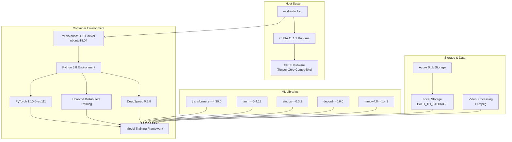
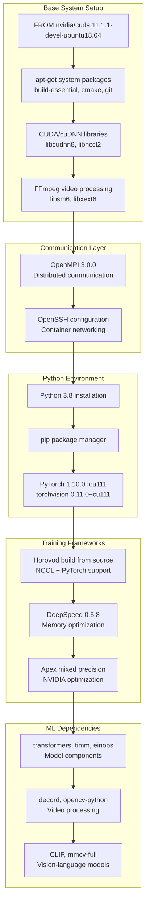
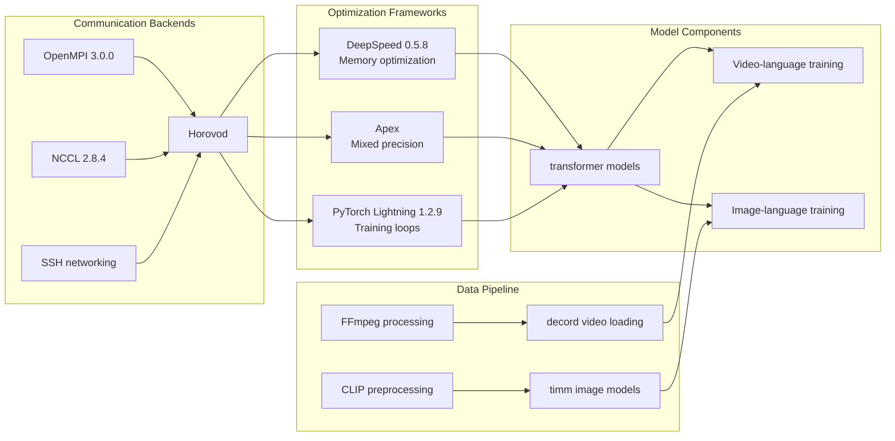
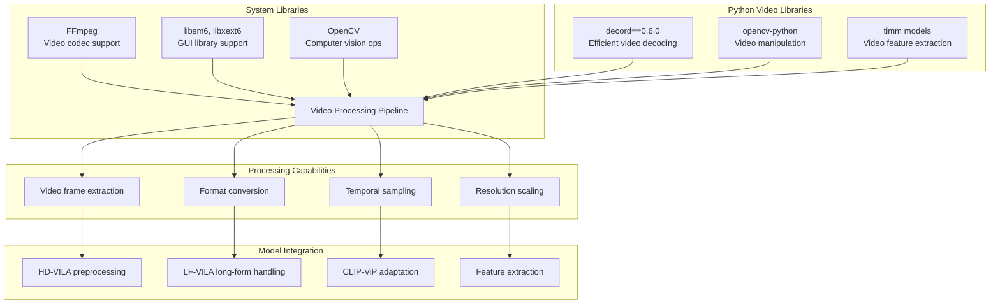
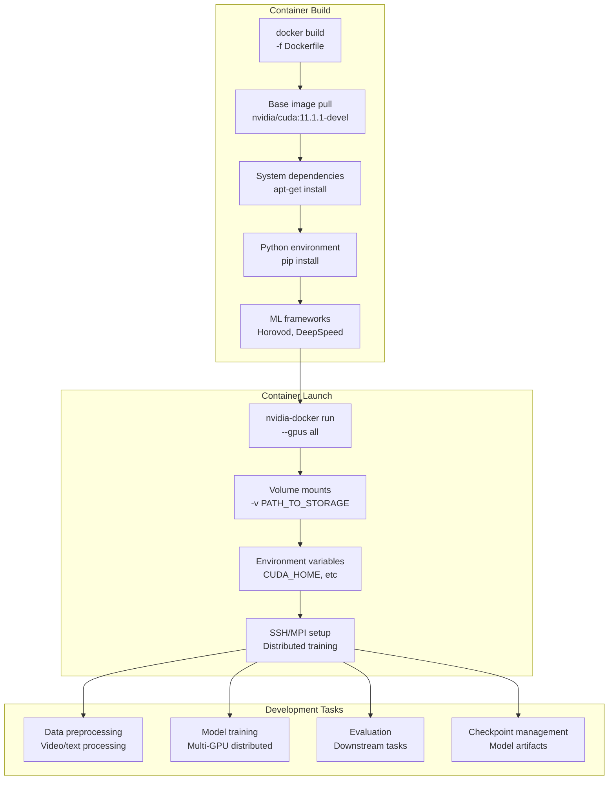

<!-- source: DeepWiki mcp.deepwiki.com · repo microsoft/XPretrain · page 4 Development Guide · fetched 2026-10-26 -->

# Development Guide

Relevant source files

The following files were used as context for generating this wiki page:

- [LF-VILA/docker/Dockerfile](LF-VILA/docker/Dockerfile)
- [LF-VILA/docker/requirements.txt](LF-VILA/docker/requirements.txt)

This document provides comprehensive guidance for developers working with XPretrain components, covering environment setup, containerized development workflows, and configuration management across the video-language and image-language research tracks. 

For information about specific model architectures and training procedures, see [HD-VILA Model](#2.2), [LF-VILA Model](#2.3), and [CLIP-ViP Model](#2.4). For dataset preparation and processing details, see [HD-VILA-100M Dataset](#2.1) and [Data Processing](#4.2). For licensing and responsible AI considerations, see [Legal and Governance](#5).

## Development Environment Architecture

The XPretrain repository uses a containerized development approach with Docker to ensure consistent environments across different research components. The development stack is built around GPU-accelerated training with distributed computing capabilities.

## Development Stack Architecture

Sources: [LF-VILA/docker/Dockerfile:1-134](), [LF-VILA/docker/requirements.txt:1-10]()

## Container Setup Process

The containerized environment follows a multi-stage build process that establishes the complete development stack including distributed training capabilities and video processing tools.

## Docker Build Pipeline

Sources: [LF-VILA/docker/Dockerfile:24-134]()

## Core Dependencies and Versions

The development environment maintains specific version constraints to ensure reproducibility across distributed training scenarios.

| Component | Version | Purpose |
|-----------|---------|---------|
| `nvidia/cuda` | 11.1.1-devel-ubuntu18.04 | Base CUDA development environment |
| `python` | 3.8 | Core Python runtime |
| `torch` | 1.10.0+cu111 | PyTorch framework with CUDA 11.1 support |
| `torchvision` | 0.11.0+cu111 | Computer vision utilities |
| `deepspeed` | 0.5.8 | Memory-efficient distributed training |
| `transformers` | 4.30.0 | Hugging Face transformer models |
| `timm` | 0.4.12 | PyTorch image models library |
| `decord` | 0.6.0 | Efficient video loading |
| `mmcv-full` | 1.4.2 | OpenMMLab computer vision framework |

Sources: [LF-VILA/docker/Dockerfile:7-11](), [LF-VILA/docker/requirements.txt:2-10]()

## Distributed Training Configuration

The container environment includes comprehensive distributed training support through multiple communication backends and optimization frameworks.

## Training Infrastructure Components

Sources: [LF-VILA/docker/Dockerfile:52-99](), [LF-VILA/docker/Dockerfile:108-121]()

## Environment Variables and Paths

The development environment expects specific configuration through environment variables and storage paths for data and model artifacts.

| Variable | Purpose | Example |
|----------|---------|---------|
| `CUDA_HOME` | CUDA installation path | `/usr/local/cuda` |
| `PATH_TO_STORAGE` | Local storage root | `/data/storage` |
| `HOROVOD_GPU_ALLREDUCE` | GPU communication backend | `NCCL` |
| `HOROVOD_NCCL_LINK` | NCCL linking mode | `SHARED` |
| `HOROVOD_WITH_PYTORCH` | PyTorch integration | `1` |

## Video Processing Dependencies

The container includes specialized video processing capabilities essential for video-language model development.

## Video Processing Pipeline

Sources: [LF-VILA/docker/Dockerfile:49-50](), [LF-VILA/docker/Dockerfile:119-120](), [LF-VILA/docker/requirements.txt:8]()

## Container Launch Workflow

The development workflow involves building the container with appropriate CUDA support and mounting storage volumes for data access.

## Development Container Workflow

Sources: [LF-VILA/docker/Dockerfile:1-134]()

## Configuration Management

The XPretrain components use JSON and YAML configuration files to manage model parameters, training settings, and data paths across different research tracks.

Configuration files typically specify:
- Model architecture parameters (`hidden_size`, `num_layers`, `attention_heads`)
- Training hyperparameters (`learning_rate`, `batch_size`, `epochs`)
- Data paths and preprocessing settings
- Distributed training configurations
- Evaluation and checkpoint settings

For specific configuration details for each model, refer to the individual model documentation: [HD-VILA Model](#2.2), [LF-VILA Model](#2.3), and [CLIP-ViP Model](#2.4).

## Development Prerequisites

Before beginning development with XPretrain components, ensure your system meets the following requirements:

| Requirement | Specification |
|-------------|---------------|
| GPU | NVIDIA GPU with Tensor Core support (V100, A100, RTX series) |
| CUDA | Version 11.1 or compatible |
| Docker | nvidia-docker2 runtime support |
| Storage | Sufficient space for datasets (TB-scale for video data) |
| Memory | 32GB+ RAM recommended for large-scale training |
| Network | High-bandwidth connection for distributed training |

Sources: [LF-VILA/docker/Dockerfile:1-11](), [LF-VILA/docker/requirements.txt:1-10]()

---

