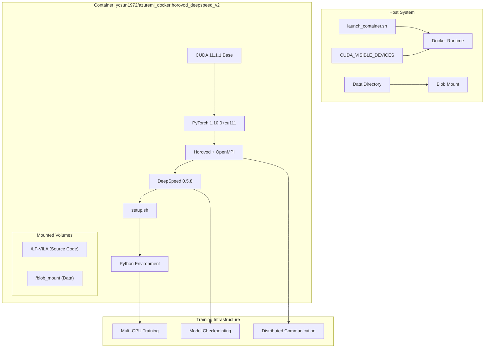
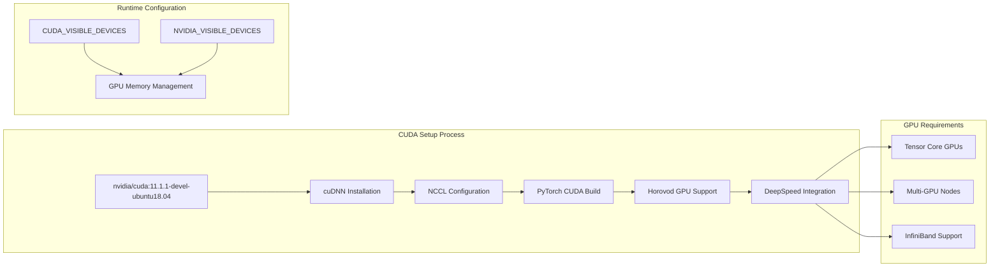
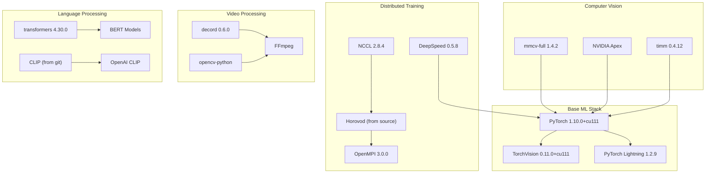
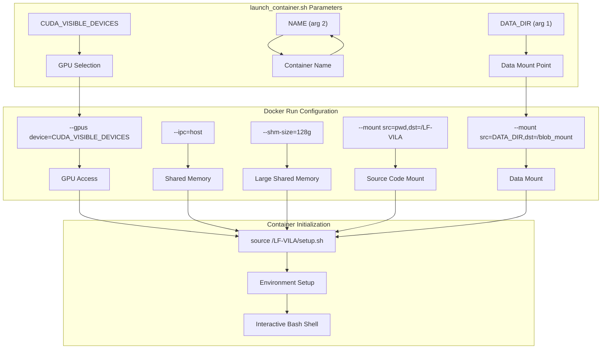
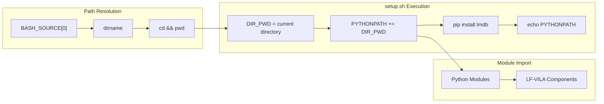

<!-- source: DeepWiki mcp.deepwiki.com · repo microsoft/XPretrain · page 4.1 Environment Setup · fetched 2026-10-26 -->

# Environment Setup

<details>
<summary>Relevant source files</summary>

The following files were used as context for generating this wiki page:

- [LF-VILA/docker/Dockerfile](LF-VILA/docker/Dockerfile)
- [LF-VILA/docker/requirements.txt](LF-VILA/docker/requirements.txt)
- [LF-VILA/launch_container.sh](LF-VILA/launch_container.sh)
- [LF-VILA/setup.sh](LF-VILA/setup.sh)

</details>


This document covers the development environment setup for XPretrain components, including Docker containerization, GPU infrastructure requirements, and dependency management. The environment setup is primarily focused on the distributed training infrastructure needed for large-scale video-language pre-training.

For information about data processing workflows after environment setup, see [Data Processing](#4.2). For model-specific configuration parameters, see [Configuration Management](#4.3).

## Purpose and Scope

The XPretrain environment setup provides a standardized Docker-based development environment optimized for:
- Multi-GPU distributed training using Horovod and DeepSpeed
- CUDA 11.1 compatibility with PyTorch 1.10.0
- Video processing capabilities with FFmpeg and Decord
- Large-scale dataset handling with Azure blob storage mounting

## Docker Environment Architecture

The XPretrain development environment is built around a containerized infrastructure that supports distributed training across multiple GPUs and nodes.

### Container Infrastructure Overview



Sources: [LF-VILA/launch_container.sh:9-16](), [LF-VILA/docker/Dockerfile:1-134]()

### Base Container Specifications

The Docker environment is built on specific versions to ensure compatibility across the distributed training stack:

| Component | Version | Purpose |
|-----------|---------|---------|
| CUDA | 11.1.1-devel-ubuntu18.04 | GPU compute platform |
| PyTorch | 1.10.0+cu111 | Deep learning framework |
| TorchVision | 0.11.0+cu111 | Computer vision utilities |
| cuDNN | 8.0.4.30-1+cuda11.1 | GPU-accelerated deep learning |
| NCCL | 2.8.4-1+cuda11.1 | Multi-GPU communication |

Sources: [LF-VILA/docker/Dockerfile:7-12]()

## GPU and CUDA Requirements

The environment requires specific GPU infrastructure and CUDA configuration for optimal performance.

### CUDA Configuration Flow



Sources: [LF-VILA/docker/Dockerfile:33-35](), [LF-VILA/launch_container.sh:5-7,14]()

### GPU Access Configuration

The `launch_container.sh` script manages GPU visibility and access:

```bash
# GPU device selection logic
if [ -z $CUDA_VISIBLE_DEVICES ]; then
   CUDA_VISIBLE_DEVICES='all'
fi

# Container GPU configuration
docker run --gpus device=$CUDA_VISIBLE_DEVICES \
   -e NVIDIA_VISIBLE_DEVICES=$CUDA_VISIBLE_DEVICES
```

Sources: [LF-VILA/launch_container.sh:5-7,14]()

## Dependency Management

The environment uses a layered dependency management approach with specific version pinning for reproducibility.

### Core Framework Dependencies



Sources: [LF-VILA/docker/Dockerfile:72-134](), [LF-VILA/docker/requirements.txt:1-10]()

### Requirements Installation Layers

The dependency installation follows a specific order to handle compilation dependencies:

1. **System packages**: [LF-VILA/docker/Dockerfile:24-47]()
2. **PyTorch ecosystem**: [LF-VILA/docker/Dockerfile:72-76]()
3. **Distributed training**: [LF-VILA/docker/Dockerfile:91-99]()
4. **Computer vision**: [LF-VILA/docker/Dockerfile:109-115]()
5. **Project-specific**: [LF-VILA/docker/requirements.txt:1-10]()

## Container Launch Process

The container launch process involves mounting data directories and configuring the runtime environment.

### Launch Script Workflow



Sources: [LF-VILA/launch_container.sh:1-16]()

### Usage Pattern

The typical container launch follows this pattern:

```bash
# Launch container with data directory and custom name
./launch_container.sh /path/to/data my_container_name

# Inside container, setup.sh is automatically sourced
source /LF-VILA/setup.sh  # Sets PYTHONPATH and installs lmdb
```

Sources: [LF-VILA/launch_container.sh:16](), [LF-VILA/setup.sh:4-8]()

## Environment Configuration

The `setup.sh` script provides the final environment configuration within the container.

### Python Path Configuration



Sources: [LF-VILA/setup.sh:4-9]()

### Runtime Environment Variables

The setup establishes several key environment variables:

| Variable | Value | Purpose |
|----------|-------|---------|
| `DIR_PWD` | Current directory path | Base path for project |
| `PYTHONPATH` | `$PYTHONPATH:$DIR_PWD` | Python module resolution |
| `CUDA_HOME` | `/usr/local/cuda` | CUDA toolkit location |

Sources: [LF-VILA/setup.sh:4-6](), [LF-VILA/docker/Dockerfile:133]()

## Infrastructure Requirements

### Minimum System Requirements

- **GPU**: NVIDIA GPUs with Tensor Core support (V100, A100, RTX series)
- **CUDA**: Version 11.1 or compatible
- **Memory**: Minimum 128GB shared memory for large batch training
- **Storage**: High-speed storage for dataset access (preferably NVMe SSD)
- **Network**: InfiniBand or high-speed Ethernet for multi-node training

### Container Resource Allocation

The container configuration optimizes for large-scale training:

- **Shared Memory**: 128GB (`--shm-size=128g`)
- **IPC**: Host IPC namespace for efficient inter-process communication
- **GPU Access**: All available GPUs or specified subset
- **Volume Mounts**: Bind mounts for code and data access

Sources: [LF-VILA/launch_container.sh:9-13]()

---

