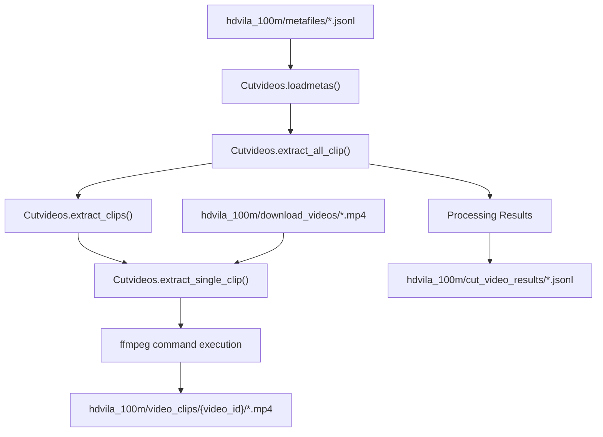
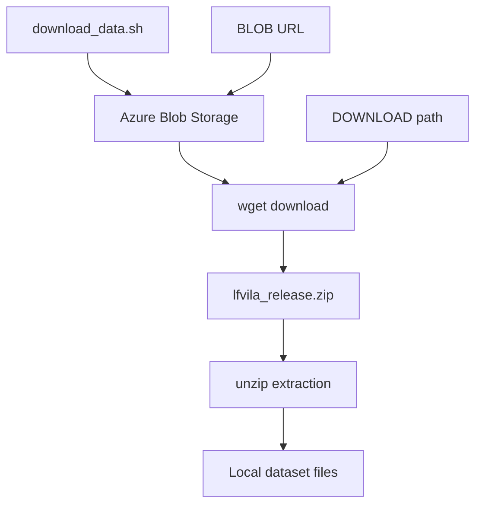
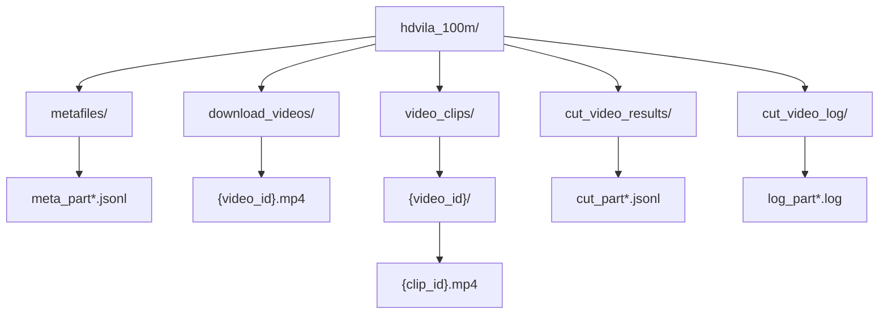
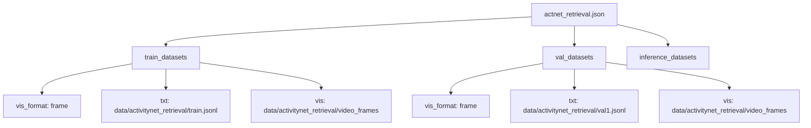
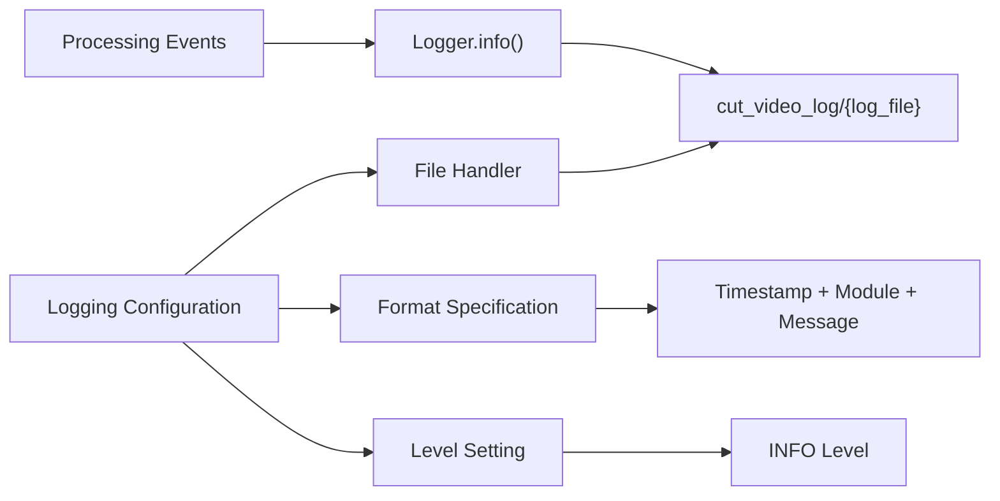

<!-- source: DeepWiki mcp.deepwiki.com · repo microsoft/XPretrain · page 4.2 Data Processing · fetched 2026-10-26 -->

# Data Processing

Relevant source files

The following files were used as context for generating this wiki page:

- [LF-VILA/scripts/download_data.sh](LF-VILA/scripts/download_data.sh)
- [hd-vila-100m/README.md](hd-vila-100m/README.md)
- [hd-vila-100m/src/cut_videos.py](hd-vila-100m/src/cut_videos.py)
- [hd-vila/scripts/process_raw_video/gif2mp4.py](hd-vila/scripts/process_raw_video/gif2mp4.py)
- [hd-vila/src/__init__.py](hd-vila/src/__init__.py)
- [hd-vila/src/configs/actnet_retrieval.json](hd-vila/src/configs/actnet_retrieval.json)

This document covers the data processing utilities, video format conversion tools, and dataset preparation workflows used across the XPretrain repository. The data processing systems handle video clipping, format conversion, dataset downloading, and file organization for multimodal training datasets.

For information about environment setup and dependencies required for data processing, see [Environment Setup](#4.1). For details about configuration management and parameter settings, see [Configuration Management](#4.3).

## Video Processing Pipeline

The XPretrain repository implements a comprehensive video processing pipeline that transforms raw YouTube videos into structured training clips. The primary workflow involves downloading metadata, processing full-length videos, and extracting clips based on temporal annotations.

### Video Clipping Workflow

The core video processing functionality is implemented in the `Cutvideos` class, which handles the extraction of video clips from full-length videos using ffmpeg.

**Video Clipping Workflow**

The `cut_videos.py` script processes video metadata in JSONL format, where each entry contains a video ID, URL, and clip specifications with start/end timestamps. The `extract_single_clip` method constructs ffmpeg commands with precise temporal parameters for accurate clip extraction.

Sources: [hd-vila-100m/src/cut_videos.py:27-89](), [hd-vila-100m/README.md:32-44]()

### FFmpeg Command Construction

The video clipping process uses specific ffmpeg parameters optimized for frame-accurate extraction:

| Parameter | Purpose | Value/Usage |
|-----------|---------|-------------|
| `-ss` | Start timestamp | Extracted from clip span |
| `-t` | Duration | Calculated using `hhmmss()` method |
| `-accurate_seek` | Precise seeking | Frame-accurate positioning |
| `-c copy` | Stream copying | No re-encoding |
| `-avoid_negative_ts 1` | Timestamp handling | Prevent negative timestamps |
| `-reset_timestamps 1` | Timestamp reset | Start from zero |

The `hhmmss` method converts timestamp strings to duration calculations, handling millisecond precision for accurate clip boundaries.

Sources: [hd-vila-100m/src/cut_videos.py:41-63]()

## Data Format Conversion

### GIF to MP4 Conversion

The repository includes utilities for converting GIF files to MP4 format for standardized video processing.

**GIF to MP4 Conversion Pipeline**

The `gif2mp4` function uses the MoviePy library to load GIF files and export them as MP4 videos, maintaining visual quality while ensuring compatibility with the video processing pipeline.

Sources: [hd-vila/scripts/process_raw_video/gif2mp4.py:5-14]()

## Dataset Download and Preparation

### Data Download Workflows

The repository provides automated scripts for downloading pre-processed datasets and model artifacts from cloud storage.

**LF-VILA Data Download Process**

The download scripts use Azure Blob Storage URLs with SAS tokens for secure access to dataset archives. The process includes automatic extraction and organization of downloaded files.

Sources: [LF-VILA/scripts/download_data.sh:1-7]()

### Dataset Structure Organization

The data processing pipeline creates a structured directory hierarchy for organized storage and efficient access:

**HD-VILA-100M Directory Structure**

The `check_dirs` function ensures proper directory creation before processing begins. Each video ID gets its own subdirectory within `video_clips` for organized clip storage.

Sources: [hd-vila-100m/src/cut_videos.py:22-25](), [hd-vila-100m/src/cut_videos.py:67-68](), [hd-vila-100m/src/cut_videos.py:94-99]()

## Data Path Configuration

### Configuration File Structure

Data processing operations rely on configuration files that specify dataset paths, formats, and processing parameters.

**Configuration-Driven Data Path Management**

The configuration system separates data paths from processing logic, enabling flexible dataset management across different environments and experiments.

Sources: [hd-vila/src/configs/actnet_retrieval.json:1-24]()

### Data Format Specifications

| Component | Format | Purpose | Path Pattern |
|-----------|--------|---------|--------------|
| `txt` | JSONL | Text annotations | `data/{dataset}/train.jsonl` |
| `vis` | Frame directories | Visual data | `data/{dataset}/video_frames` |
| `vis_format` | String | Processing mode | `"frame"` or `"video"` |

The configuration system supports both frame-based and video-based processing modes, allowing flexibility in how visual data is consumed during training and inference.

Sources: [hd-vila/src/configs/actnet_retrieval.json:4-8](), [hd-vila/src/configs/actnet_retrieval.json:11-15]()

## Processing Parameters and Logging

### Command-Line Interface

The video processing utilities provide configurable parameters through command-line arguments:

| Argument | Default | Purpose |
|----------|---------|---------|
| `--workdir` | `./hdvila_100m` | Base working directory |
| `--metafile` | `meta_part0.jsonl` | Input metadata file |
| `--resultfile` | `cut_part0.jsonl` | Output results file |
| `--log` | `log_part0.log` | Logging output file |

The argument parsing system enables batch processing of multiple metadata files and parallel execution across different data partitions.

Sources: [hd-vila-100m/src/cut_videos.py:12-19]()

### Logging and Monitoring

The processing pipeline implements comprehensive logging for monitoring progress and debugging issues:

**Logging System Architecture**

The logging system captures processing statistics, error conditions, and progress information with timestamped entries for operational monitoring.

Sources: [hd-vila-100m/src/cut_videos.py:95-107]()

---

