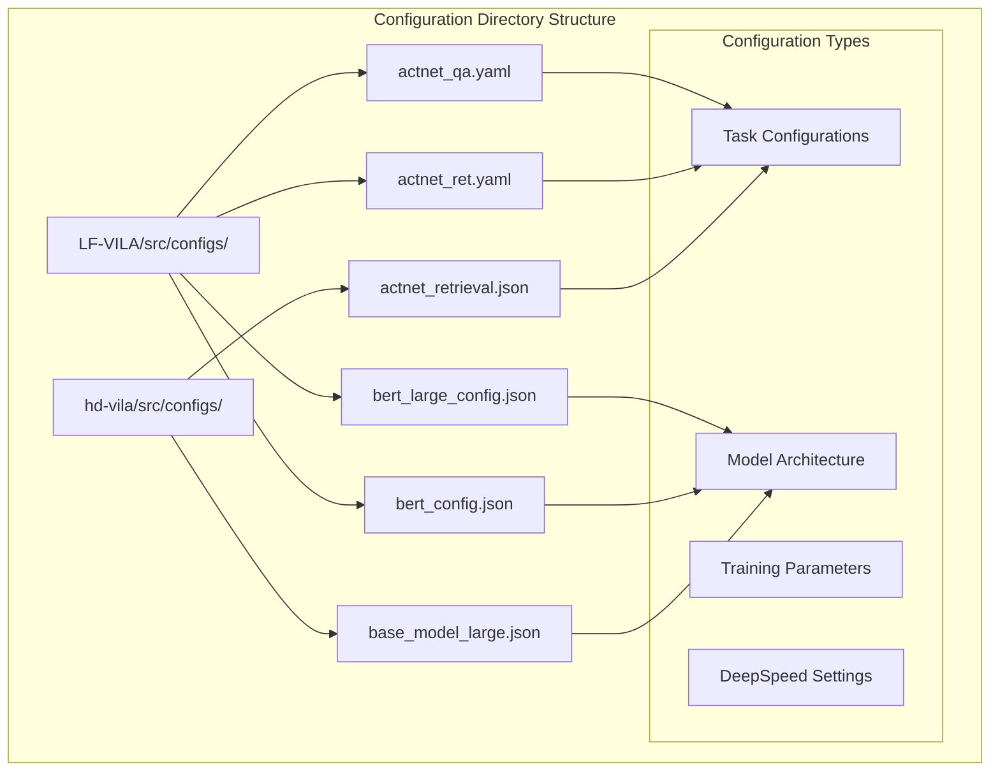
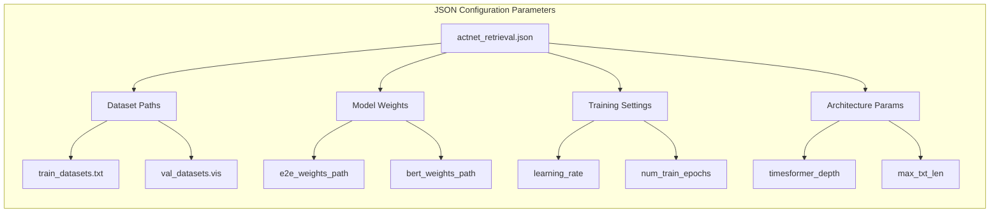
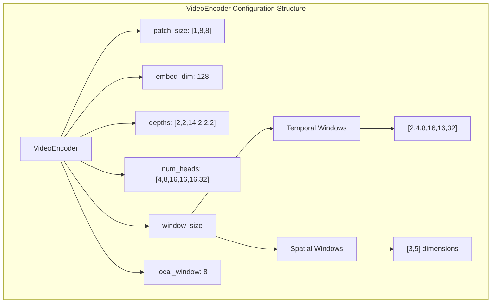
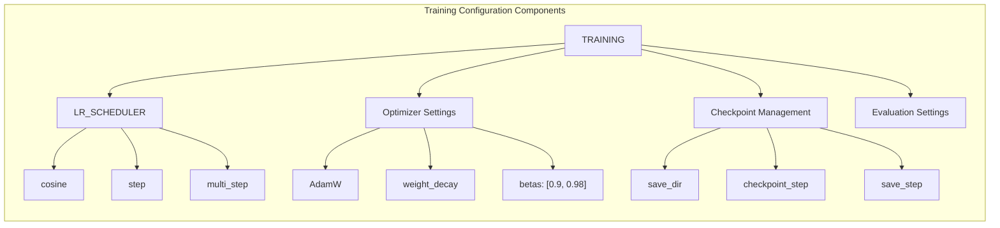
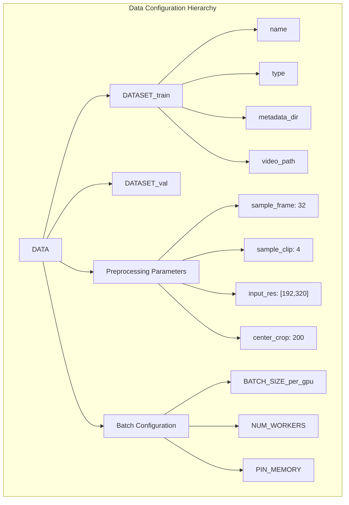
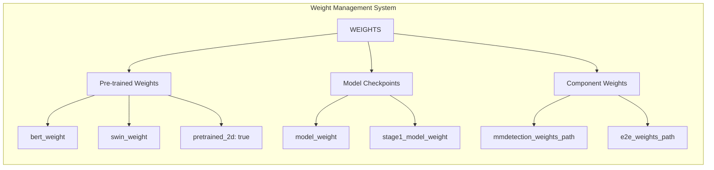
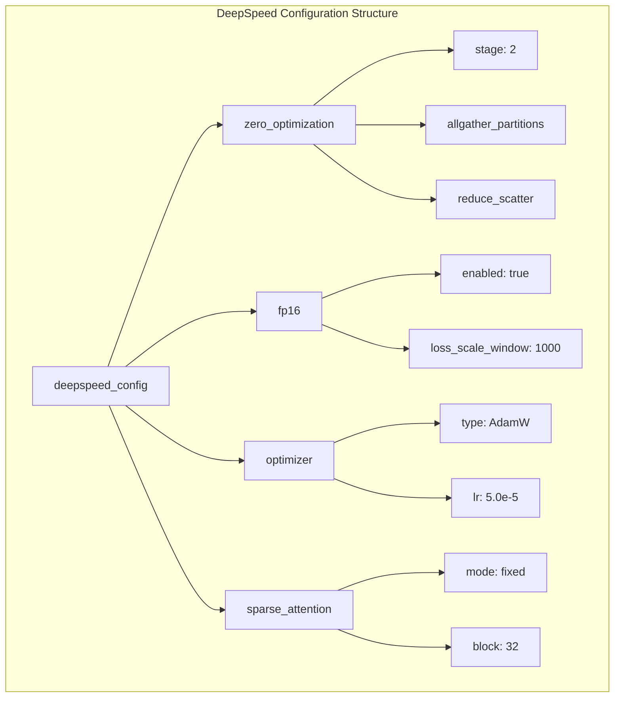

<!-- source: DeepWiki mcp.deepwiki.com · repo microsoft/XPretrain · page 4.3 Configuration Management · fetched 2026-10-26 -->

# Configuration Management

Relevant source files

The following files were used as context for generating this wiki page:

- [LF-VILA/src/configs/actnet_qa.yaml](LF-VILA/src/configs/actnet_qa.yaml)
- [LF-VILA/src/configs/actnet_ret.yaml](LF-VILA/src/configs/actnet_ret.yaml)
- [LF-VILA/src/configs/bert_config.json](LF-VILA/src/configs/bert_config.json)
- [hd-vila/scripts/process_raw_video/gif2mp4.py](hd-vila/scripts/process_raw_video/gif2mp4.py)
- [hd-vila/src/__init__.py](hd-vila/src/__init__.py)
- [hd-vila/src/configs/actnet_retrieval.json](hd-vila/src/configs/actnet_retrieval.json)

This document covers the configuration management systems used across XPretrain components, including file formats, parameter organization, and configuration patterns for different models and training scenarios. It provides guidance on how configurations are structured, loaded, and utilized during model training and inference.

For information about environment setup and dependency management, see [Environment Setup](#4.1). For data processing configuration details, see [Data Processing](#4.2).

## Configuration File Organization

XPretrain uses a hierarchical configuration system with different formats across components. The main configuration directories contain task-specific and model-specific parameter files that control training, inference, and model architecture settings.

Sources: [LF-VILA/src/configs/actnet_qa.yaml:1-134](), [LF-VILA/src/configs/actnet_ret.yaml:1-134](), [LF-VILA/src/configs/bert_config.json:1-24](), [hd-vila/src/configs/actnet_retrieval.json:1-102]()

## Configuration Format Standards

The repository employs two primary configuration formats with distinct usage patterns and parameter organization schemes.

### YAML Configuration Format

LF-VILA components use YAML format for comprehensive configuration management, organizing parameters into logical sections with hierarchical nesting.

| Section | Purpose | Key Parameters |
|---------|---------|----------------|
| `VideoEncoder` | Swin Transformer architecture | `patch_size`, `embed_dim`, `depths`, `num_heads` |
| `WEIGHTS` | Model checkpoint paths | `model_weight`, `bert_weight`, `swin_weight` |
| `DATA` | Dataset and preprocessing | `BATCH_SIZE_per_gpu`, `sample_frame`, `input_res` |
| `TRAINING` | Training hyperparameters | `EPOCHS`, `LR_SCHEDULER`, `weight_decay` |
| `deepspeed_config` | Distributed training settings | `zero_optimization`, `fp16`, `optimizer` |

### JSON Configuration Format

HD-VILA and BERT components utilize JSON format for configuration, providing flat parameter structures with direct key-value mappings.

Sources: [hd-vila/src/configs/actnet_retrieval.json:1-102](), [LF-VILA/src/configs/actnet_qa.yaml:1-134]()

## Model Architecture Configuration

Model architecture parameters define the structural components and dimensions for different model variants across the XPretrain ecosystem.

### Video Encoder Configuration

The `VideoEncoder` configuration block defines Swin Transformer parameters for video processing in LF-VILA models.

Sources: [LF-VILA/src/configs/actnet_qa.yaml:1-11](), [LF-VILA/src/configs/actnet_ret.yaml:1-11]()

### BERT Configuration Integration

BERT model configurations specify transformer architecture parameters for language understanding components.

| Parameter | Value | Purpose |
|-----------|-------|---------|
| `hidden_size` | 768 | Transformer hidden dimension |
| `num_hidden_layers` | 12 | Number of transformer layers |
| `num_attention_heads` | 12 | Multi-head attention configuration |
| `intermediate_size` | 3072 | Feed-forward network dimension |
| `max_position_embeddings` | 512 | Maximum sequence length |
| `vocab_size` | 30522 | Vocabulary size for tokenization |

Sources: [LF-VILA/src/configs/bert_config.json:9-22]()

## Training Configuration Management

Training configurations control optimization parameters, scheduling policies, and checkpoint management across different training stages and tasks.

### Learning Rate and Optimization

The training configuration supports multiple optimizer types and learning rate scheduling strategies with task-specific parameter tuning.

Sources: [LF-VILA/src/configs/actnet_qa.yaml:61-80](), [LF-VILA/src/configs/actnet_ret.yaml:57-80]()

### Stage-Based Training Configuration

LF-VILA implements multi-stage training with different configuration parameters for each training phase.

| Stage | Configuration File | Key Parameters |
|-------|-------------------|----------------|
| Stage 1 | `actnet_ret.yaml` | `stage: 1`, contrastive learning setup |
| Stage 2 | `actnet_qa.yaml` | `stage: 2`, cross-modal transformer training |

The `stage` parameter controls which training phase is executed, with different loss functions and model components activated accordingly.

Sources: [LF-VILA/src/configs/actnet_ret.yaml:16](), [LF-VILA/src/configs/actnet_qa.yaml:16]()

## Data Configuration Patterns

Data configuration sections define dataset loading parameters, preprocessing settings, and input format specifications for different tasks and model variants.

### Dataset Configuration Structure

Sources: [LF-VILA/src/configs/actnet_qa.yaml:33-58](), [LF-VILA/src/configs/actnet_ret.yaml:29-55]()

### Video Processing Parameters

Video processing configuration controls frame sampling, resolution, and clip extraction parameters for multi-modal training.

| Parameter | LF-VILA Value | HD-VILA Value | Purpose |
|-----------|---------------|---------------|---------|
| `sample_frame` | 32 | 13 | Frames per video clip |
| `sample_clip` | 4 | N/A | Clips per video |
| `input_res` | [192, 320] | [160, 256] | Input resolution |
| `sample_rate` | N/A | 4 | Frame sampling rate |

Sources: [LF-VILA/src/configs/actnet_qa.yaml:38-41](), [hd-vila/src/configs/actnet_retrieval.json:47-49]()

## Weight and Checkpoint Management

The configuration system manages model weights, checkpoints, and pre-trained component loading across different training stages and model variants.

### Weight Path Configuration

Sources: [LF-VILA/src/configs/actnet_qa.yaml:26-31](), [hd-vila/src/configs/actnet_retrieval.json:28-31]()

### Checkpoint Directory Structure

The configuration specifies standardized paths for model artifacts and training outputs with consistent naming conventions.

| Component | Path Pattern | Example |
|-----------|--------------|---------|
| LF-VILA Stage 1 | `project/lfvila/pretrained/` | `lfvila_stage1.bin` |
| LF-VILA Stage 2 | `project/lfvila/pretrained/` | `lfvila_stage2.bin` |
| HD-VILA E2E | `data/pretrained/` | `hdvila_stage2.pt` |
| BERT Weights | `data/pretrained/bert-large-uncased/` | `pytorch_model.bin` |

Sources: [LF-VILA/src/configs/actnet_qa.yaml:27-30](), [hd-vila/src/configs/actnet_retrieval.json:28-31]()

## DeepSpeed Integration Configuration

DeepSpeed configuration enables distributed training with memory optimization, mixed precision training, and advanced optimization strategies for large-scale model training.

### Zero Optimization Configuration

The `deepspeed_config` section defines Zero Redundancy Optimizer settings for memory-efficient distributed training.

Sources: [LF-VILA/src/configs/actnet_qa.yaml:81-128]()

### Mixed Precision Training Settings

DeepSpeed fp16 configuration enables automatic mixed precision training with dynamic loss scaling for stable gradient computation.

| Parameter | Value | Purpose |
|-----------|-------|---------|
| `enabled` | true | Enable fp16 training |
| `loss_scale` | 0 | Dynamic loss scaling |
| `loss_scale_window` | 1000 | Loss scale update frequency |
| `initial_scale_power` | 32 | Initial loss scale magnitude |
| `min_loss_scale` | 1 | Minimum loss scale value |

Sources: [LF-VILA/src/configs/actnet_qa.yaml:98-105]()

---

