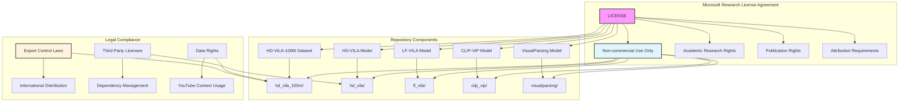
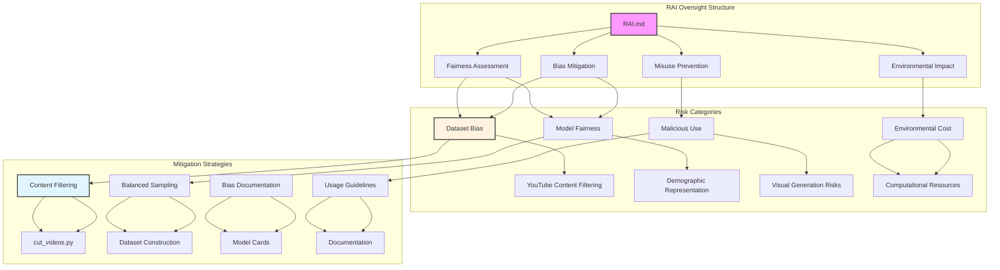

<!-- source: DeepWiki mcp.deepwiki.com · repo microsoft/XPretrain · page 5 Legal and Governance · fetched 2026-10-26 -->

# Legal and Governance

Relevant source files

The following files were used as context for generating this wiki page:

- [LICENSE](LICENSE)
- [RAI.md](RAI.md)

This document provides the comprehensive legal framework, licensing terms, responsible AI considerations, and governance structure for the XPretrain repository. It covers the Microsoft Research License Agreement, responsible AI guidelines, community standards, and compliance requirements that govern the use, distribution, and development of all components within the XPretrain ecosystem.

For detailed licensing information, see [Licensing](#5.1). For responsible AI implementation details, see [Responsible AI](#5.2). For community participation guidelines, see [Community Guidelines](#5.3).

## Legal Framework Overview

The XPretrain repository operates under a comprehensive legal framework that governs all research components, datasets, and models. The framework establishes clear boundaries for academic use while protecting intellectual property and ensuring responsible deployment.

## Legal Framework Architecture

Sources: [LICENSE:1-44]()

## License Grant and Restrictions

The XPretrain repository is governed by the Microsoft Research License Agreement, which establishes specific rights and limitations for users:

### Permitted Uses
- **Non-commercial research**: Teaching, academic research, public demonstrations, and personal experimentation
- **Publications**: Results from using the software may be published with appropriate Microsoft attribution
- **Derivative works**: Users may modify and create derivative works for non-commercial purposes

### Prohibited Activities
- Commercial software hosting services
- Distribution of the software or derivative works
- Reverse engineering or decompilation (except where legally permitted)
- Altering copyright, trademark, or patent notices
- Using Microsoft trademarks inappropriately

### Key Legal Terms

| Term | Definition | Code Reference |
|------|------------|----------------|
| Software | All XPretrain components including source code, models, and documentation | Repository root |
| Non-commercial | Academic research, teaching, demonstrations, personal experimentation | [LICENSE:8]() |
| Attribution | Required acknowledgment of Microsoft in publications | [LICENSE:9]() |
| Derivative Works | Modified versions or extensions of the software | All model directories |

Sources: [LICENSE:1-44]()

## Responsible AI Governance

The XPretrain project implements a comprehensive responsible AI framework that addresses potential risks and establishes mitigation strategies across all research components.

## Responsible AI Framework

Sources: [RAI.md:1-14]()

## Identified Risks and Mitigation

### Data Representation Risks
The repository acknowledges potential demographic underrepresentation in user-generated content and implements several mitigation strategies:

- **Balanced video categories**: Efforts to mitigate disparities across different content types
- **Content filtering**: Removal of explicit and violent content from training datasets
- **Bias documentation**: Transparent reporting of potential Western heteronormative bias

### Model Fairness Challenges
- **Standardized metrics**: Recognition that fairness measures lack industry consensus
- **Multi-dimensional challenges**: Acknowledgment of socio-technical complexity in bias assessment
- **Future research**: Identified opportunities for developing fairness benchmarks

### Malicious Use Prevention
- **Visual generation risks**: Specific concerns about misinformation and harm through generated content
- **Fine-tuning oversight**: Emphasis on careful consideration of downstream applications
- **Scenario-specific assessment**: Required evaluation of potential harms for production deployments

Sources: [RAI.md:3-12]()

## Compliance Requirements

### Export Control Compliance
The software is subject to United States export laws and regulations, requiring users to:
- Comply with all domestic and international export laws
- Adhere to restrictions on destinations, end users, and end use
- Reference Microsoft export guidelines for additional information

### Third Party License Management
The repository may include third-party programs licensed by Microsoft, with:
- Notices provided for informational purposes
- Microsoft serving as the primary licensor
- Integration under the main research license agreement

### Feedback and Intellectual Property
- **Voluntary feedback**: All user feedback is voluntarily given and unrestricted
- **Microsoft rights**: Microsoft retains freedom to use feedback without obligation
- **Confidentiality**: No confidentiality obligations even for designated confidential feedback

Sources: [LICENSE:27-32](), [LICENSE:10]()

## Governance Structure

### Contact and Support Framework

| Role | Contact | Responsibility |
|------|---------|----------------|
| Technical Issues | Bei Liu (bei.liu@microsoft.com) | Pre-trained model support |
| Research Queries | Jianlong Fu (jianf@microsoft.com) | Academic collaboration |
| Legal Compliance | Microsoft Legal Team | License interpretation |
| Security Issues | Repository Issue System | Vulnerability reporting |

### Termination Conditions
The license automatically terminates under specific conditions:
- Breach of agreement terms
- Patent litigation against Microsoft or other parties
- Commercial use violations
- Redistribution violations

Upon termination, users must:
- Cease using all derivative works
- Stop distributing modifications
- Comply with surviving agreement sections

### Governing Law
- **Jurisdiction**: Washington state law without choice of law principles
- **Venue**: State and federal courts in King County, Washington
- **International considerations**: Local law rights preserved where applicable

Sources: [RAI.md:13-14](), [LICENSE:29-40]()

## Environmental and Sustainability Considerations

The repository acknowledges significant computational resource requirements and environmental impacts:

### Resource Optimization
- **Model efficiency**: Emphasis on reducing model size and computational effort
- **Future research priority**: Environmental impact reduction as essential development goal
- **Distributed training**: Efficient use of Horovod and DeepSpeed frameworks

### Sustainability Guidelines
- **Responsible scaling**: Consideration of environmental costs in model development
- **Efficiency metrics**: Integration of computational efficiency in research evaluation
- **Green computing**: Encouragement of environmentally conscious development practices

Sources: [RAI.md:3]()

---

