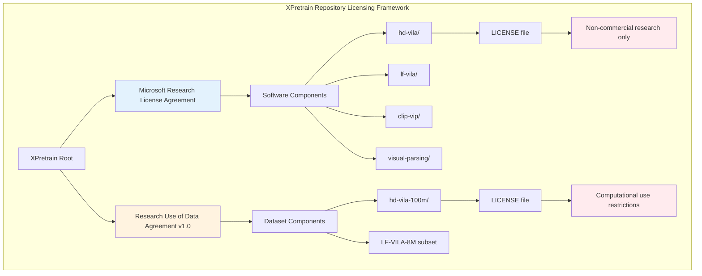
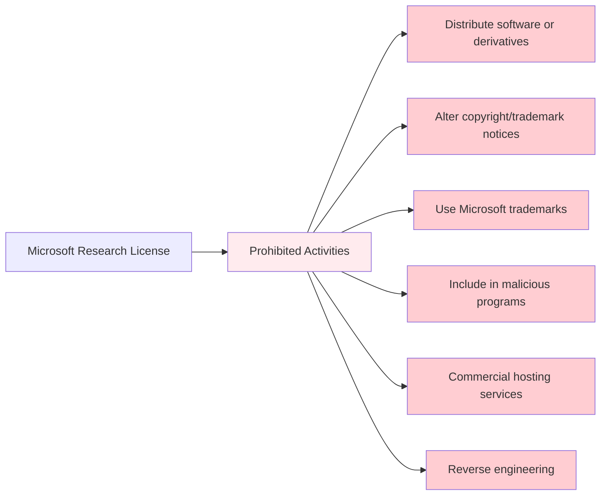
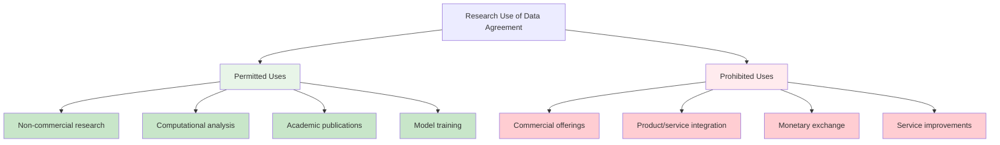
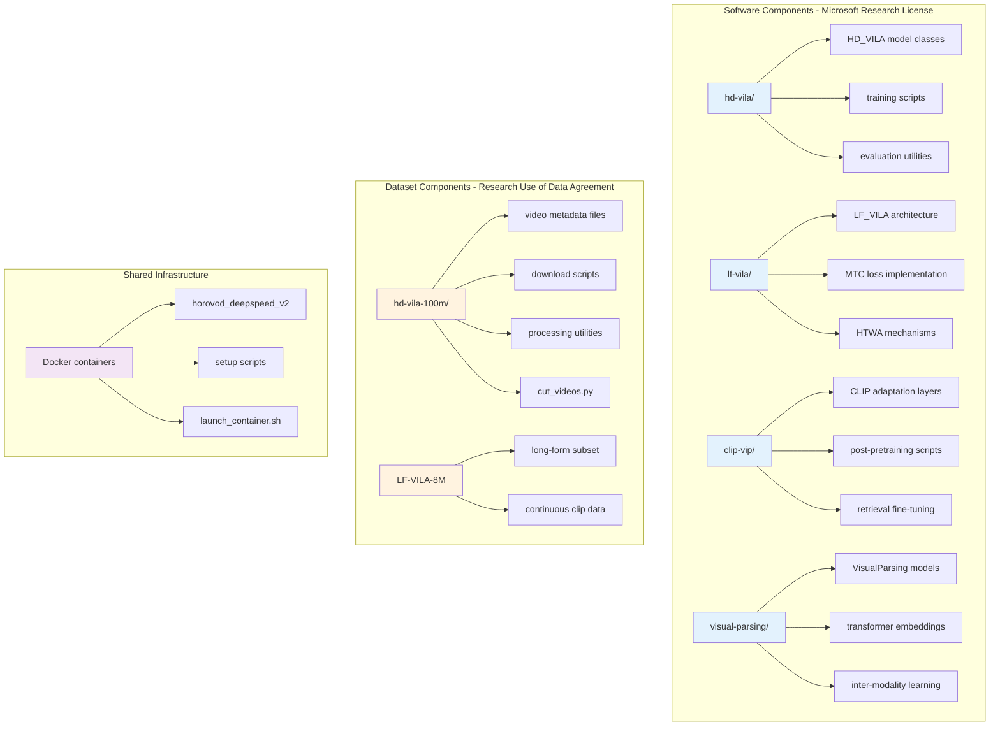

<!-- source: DeepWiki mcp.deepwiki.com · repo microsoft/XPretrain · page 5.1 Licensing · fetched 2026-10-26 -->

# Licensing

<details>
<summary>Relevant source files</summary>

The following files were used as context for generating this wiki page:

- [LICENSE](LICENSE)
- [hd-vila-100m/LICENSE](hd-vila-100m/LICENSE)
- [hd-vila/LICENSE](hd-vila/LICENSE)

</details>


This document provides a comprehensive overview of the licensing framework governing the XPretrain repository components, including software licenses for research code and data usage agreements for datasets. It covers the specific terms, restrictions, and compliance requirements that apply to different parts of the codebase and associated datasets.

For information about responsible AI considerations and ethical guidelines, see [Responsible AI](#5.2). For community guidelines and contribution policies, see [Community Guidelines](#5.3).

## Licensing Structure Overview

The XPretrain repository operates under a dual licensing framework that distinguishes between software components and dataset resources. This structure ensures appropriate legal coverage for both research code and large-scale multimodal datasets.



**Licensing Framework Mapping**
- Root-level `LICENSE` applies to all software components
- Dataset-specific licenses govern data usage and redistribution
- Each model directory inherits the appropriate licensing terms

Sources: [LICENSE:1-44](), [hd-vila/LICENSE:1-44](), [hd-vila-100m/LICENSE:1-70]()

## Microsoft Research License Agreement

The Microsoft Research License Agreement governs all software components within the XPretrain repository, including model implementations, training scripts, and utility functions. This license is consistently applied across all research code directories.

### Key Permissions

| Permission | Scope | Restrictions |
|------------|-------|--------------|
| **Use** | Non-commercial purposes only | Teaching, academic research, public demonstrations, personal experimentation |
| **Modify** | Create derivative works | Must maintain non-commercial use |
| **Publish** | Research results and papers | Required attribution to Microsoft |
| **Copy** | Software replication | Within license terms |

### Distribution Restrictions

The license explicitly prohibits several distribution activities:



**Technical Limitations Enforcement**
- Software contains built-in technical limitations
- Users cannot circumvent these restrictions
- Commercial use explicitly prohibited across all components

Sources: [LICENSE:12-26](), [hd-vila/LICENSE:12-26]()

### Termination Conditions

The license includes automatic termination clauses that affect all XPretrain components:

- **Breach Termination**: Any violation of license terms triggers immediate termination
- **Patent Litigation**: Suing Microsoft or related parties over patents terminates the license
- **Cessation Requirement**: Must stop using and distributing all derivative works upon termination

Sources: [LICENSE:29-29](), [hd-vila/LICENSE:29-29]()

## Research Use of Data Agreement

The Research Use of Data Agreement v1.0 specifically governs dataset components, primarily the HD-VILA-100M dataset and its derivatives. This agreement provides more specific terms for computational data usage in research contexts.

### Computational Use Definition

The agreement defines "Computational Use" as activities necessary to enable data analysis by computer systems. This directly applies to:

- Video processing pipelines in `hd-vila-100m/`
- Feature extraction workflows
- Model training procedures using the dataset
- Analysis and evaluation scripts

### Data Usage Restrictions



**Non-Commercial Research Scope**
- Includes research funded by commercial entities
- Excludes any product or service improvements
- No monetary compensation for data use or redistribution

Sources: [hd-vila-100m/LICENSE:25-27]()

### Redistribution Requirements

When redistributing data under this agreement, specific obligations apply:

1. **Attribution Preservation**: Include all original credit and attribution information
2. **License Binding**: Bind downstream recipients to R-UDA terms
3. **Documentation Requirements**: Maintain provenance information

**Results vs. Data Distinction**
- "Results" include AI models trained on data (with de minimis data portions)
- "Data" refers to the original material in modified or unmodified form
- Results may be distributed under different terms than raw data

Sources: [hd-vila-100m/LICENSE:35-40](), [hd-vila-100m/LICENSE:67-67]()

## Component-Specific Licensing Matrix

The following diagram maps specific repository components to their applicable licensing terms:



**Infrastructure Licensing**
- Docker containers and setup scripts fall under Microsoft Research License
- Configuration files and environment scripts are software components
- Data processing utilities bridge both licensing frameworks

Sources: [hd-vila/LICENSE:1-44](), [hd-vila-100m/LICENSE:1-70]()

## Export Control and Compliance

Both licensing agreements include specific compliance requirements that apply to all XPretrain components:

### Export Restrictions

The software components are subject to United States export laws and regulations:

- **Destination Restrictions**: Certain countries and regions may be prohibited
- **End User Controls**: Restrictions on specific user categories
- **End Use Limitations**: Prohibited applications and purposes
- **Documentation Reference**: [www.microsoft.com/exporting](http://www.microsoft.com/exporting) for current regulations

### Governing Law Framework

| Aspect | Specification |
|--------|---------------|
| **Governing Law** | State of Washington laws |
| **Jurisdiction** | King County, Washington courts |
| **Choice of Law** | No reference to choice of law principles |
| **Legal Effect** | Does not override local country laws |

### Assignment and Transfer Restrictions

- **No Assignment**: Cannot transfer license rights without Microsoft's written consent
- **Void Transfers**: Attempted unauthorized assignments are automatically void
- **Third Party Restrictions**: Cannot transfer software or agreements to third parties

Sources: [LICENSE:31-42](), [hd-vila/LICENSE:31-42]()

## Disclaimer and Warranty Terms

Both licensing frameworks include comprehensive warranty disclaimers that affect all repository components:

### Software Warranty Disclaimer

```
THE SOFTWARE IS LICENSED "AS-IS." YOU BEAR THE RISK OF USING IT. 
MICROSOFT GIVES NO EXPRESS WARRANTIES, GUARANTEES OR CONDITIONS.
```

### Data Warranty Disclaimer

```
THE DATA IS PROVIDED ON AN "AS IS" BASIS, WITHOUT WARRANTIES OR 
CONDITIONS OF ANY KIND, EITHER EXPRESS OR IMPLIED.
```

**Liability Limitations**
- No liability for direct, indirect, incidental, or consequential damages
- Exclusions apply even with advance notice of potential damages
- Data providers make no representations about data rights

Sources: [LICENSE:43-44](), [hd-vila-100m/LICENSE:49-51]()

---

