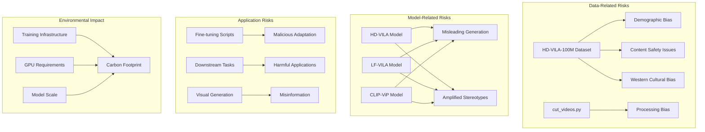
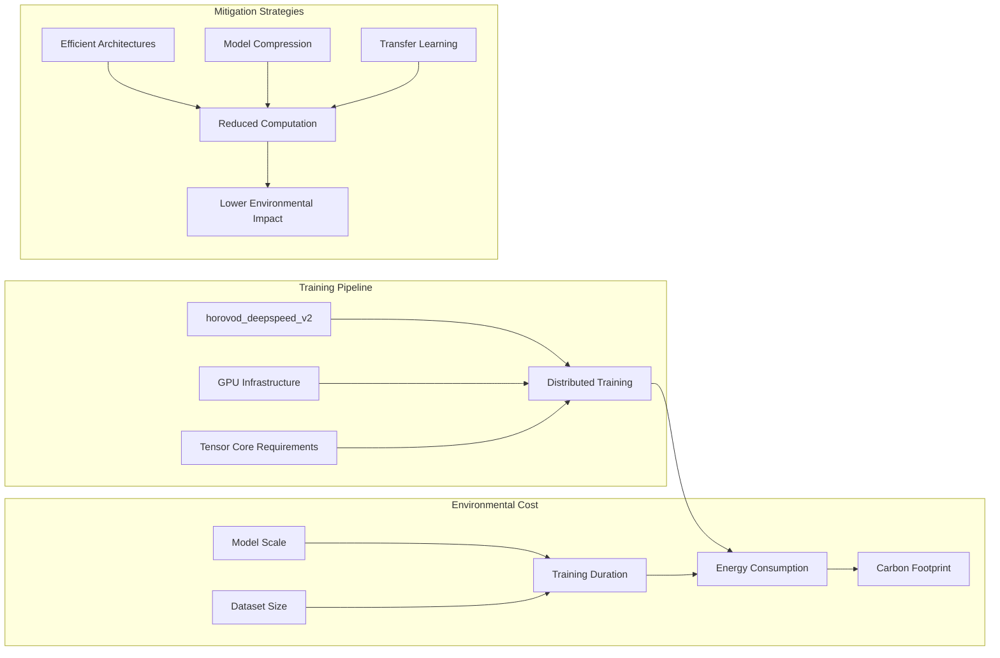
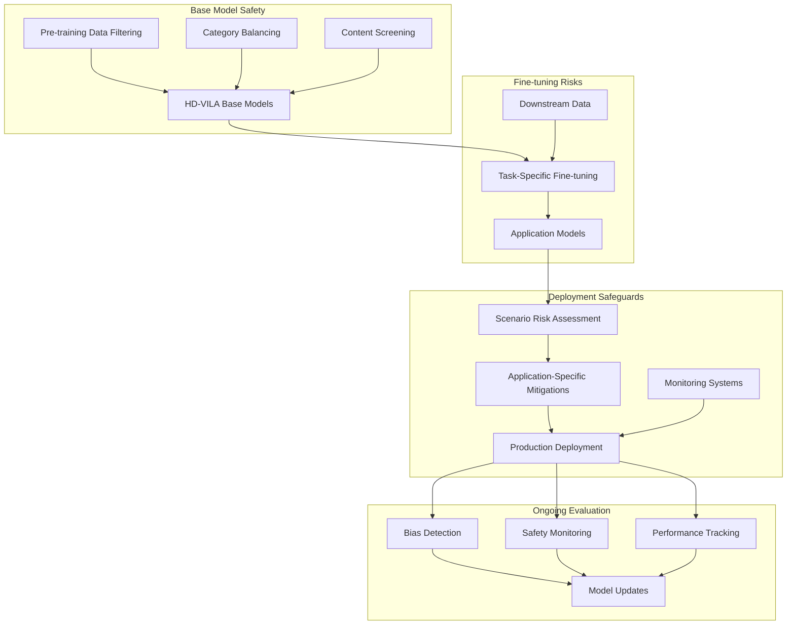

<!-- source: DeepWiki mcp.deepwiki.com · repo microsoft/XPretrain · page 5.2 Responsible AI · fetched 2026-10-26 -->

# Responsible AI

Relevant source files

The following files were used as context for generating this wiki page:

- [RAI.md](RAI.md)

This document outlines the responsible AI considerations, potential risks, mitigation strategies, and ethical guidelines for the video-language models and datasets within the XPretrain repository. It addresses fairness, bias, environmental impact, content safety, and deployment considerations specific to the multimodal learning research components.

For licensing and legal terms, see [Licensing](#5.1). For community conduct and security reporting, see [Community Guidelines](#5.3).

## Risk Categories and Sources

The XPretrain repository contains several risk categories that stem from the nature of video-language pre-training and the scale of data involved. These risks are inherent to the models and datasets developed across the research tracks.

### Risk Taxonomy and Code Components

**Sources:** [RAI.md:1-14]()

### Bias and Fairness Considerations

The video-language models exhibit multiple dimensions of bias that require ongoing attention:

| Bias Type | Source | Impact | Code Components |
|-----------|--------|--------|-----------------|
| Demographic | User-generated video data | Underrepresentation of certain groups | HD-VILA-100M dataset, data loaders |
| Cultural | Western-centric content | Heteronormative assumptions | Video selection algorithms |
| Linguistic | English-dominant captions | Limited multilingual capability | Text processing pipelines |
| Visual | Stereotypical depictions | Reinforced social biases | Visual encoders, cross-modal attention |

The repository acknowledges that standardized fairness measures have not been established in the field, presenting opportunities for future benchmark development.

**Sources:** [RAI.md:5-7]()

## Environmental Impact Assessment

The computational requirements for video-language pre-training contribute significantly to environmental impact through energy consumption and carbon emissions.

### Resource Utilization Mapping

The research emphasizes the importance of reducing model size and computational effort as essential directions for future work to minimize environmental impact.

**Sources:** [RAI.md:3]()

## Content Safety and Filtering

Despite content filtering efforts in the data preparation pipeline, residual safety concerns remain in the training data and model outputs.

### Content Safety Pipeline

The HD-VILA-100M dataset underwent filtering for explicit and violent content, but complete elimination cannot be guaranteed. This introduces risks for:

- **Generated Content**: Models may produce inappropriate visual or textual outputs
- **Amplified Biases**: Filtered but biased content may still influence model behavior  
- **Edge Cases**: Subtle inappropriate content may bypass filtering mechanisms

The video processing utilities in `cut_videos.py` and related scripts implement initial content filtering, but downstream applications require additional safety measures.

**Sources:** [RAI.md:7]()

## Mitigation Strategies and Implementation

### Model-Level Mitigations

Several mitigation approaches are implemented or recommended across the XPretrain components:

1. **Balanced Data Curation**: Video categories are balanced to reduce disparities in the HD-VILA-100M dataset
2. **Multi-Stage Training**: The two-stage pre-training approach allows for safety interventions between stages
3. **Transfer Learning**: CLIP-ViP leverages existing safe pre-training to reduce risks from scratch training

### Application-Level Considerations

**Sources:** [RAI.md:7,11]()

## Responsible Deployment Guidelines

### Pre-Deployment Assessment

Organizations implementing XPretrain models should conduct comprehensive risk assessments that include:

- **Scenario-Specific Harm Analysis**: Evaluate potential negative impacts in the target application domain
- **Bias Testing**: Test for demographic, cultural, and linguistic biases relevant to the use case
- **Content Safety Evaluation**: Assess output appropriateness for the intended audience
- **Fairness Metrics**: Develop application-appropriate fairness measurements

### Production Considerations

The transition from research models to production systems requires additional safeguards:

- **Fine-tuning Data Scrutiny**: Carefully evaluate training data for task-specific fine-tuning
- **Output Monitoring**: Implement real-time monitoring for inappropriate or biased outputs
- **User Feedback Systems**: Establish mechanisms for reporting problematic model behavior
- **Regular Auditing**: Conduct periodic reviews of model performance across demographic groups

**Sources:** [RAI.md:11-12]()

## Visual Generation Risks

Visual generation capabilities present particular concerns for misinformation and malicious use. The combination of video understanding and language processing enables:

- **Deepfake Generation**: Potential for creating misleading visual content
- **Contextual Manipulation**: Misrepresenting video content through altered captions
- **Synthetic Media**: Generation of non-existent but realistic video content

These risks require specialized mitigation strategies including watermarking, provenance tracking, and detection systems.

**Sources:** [RAI.md:9]()

## Research and Development Recommendations

### Future Work Priorities

1. **Fairness Benchmarks**: Develop standardized measures for evaluating fairness in video-language models
2. **Bias Detection Tools**: Create automated systems for identifying problematic outputs
3. **Efficient Architectures**: Research model compression and efficiency improvements
4. **Cultural Diversity**: Expand dataset coverage to include more diverse global perspectives

### Technical Improvements

- **Adversarial Testing**: Systematic evaluation of model robustness against harmful inputs
- **Interpretability**: Enhanced understanding of model decision-making processes
- **Privacy Preservation**: Techniques for protecting individual privacy in training data

**Sources:** [RAI.md:5-6]()

## Contact and Support

For responsible AI concerns, potential harms, or ethical questions related to the XPretrain models and datasets, contact:

- **Bei Liu**: bei.liu@microsoft.com
- **Jianlong Fu**: jianf@microsoft.com

Issues can also be submitted through the repository's standard issue tracking system for technical problems or responsible AI concerns.

**Sources:** [RAI.md:13-14]()

---

