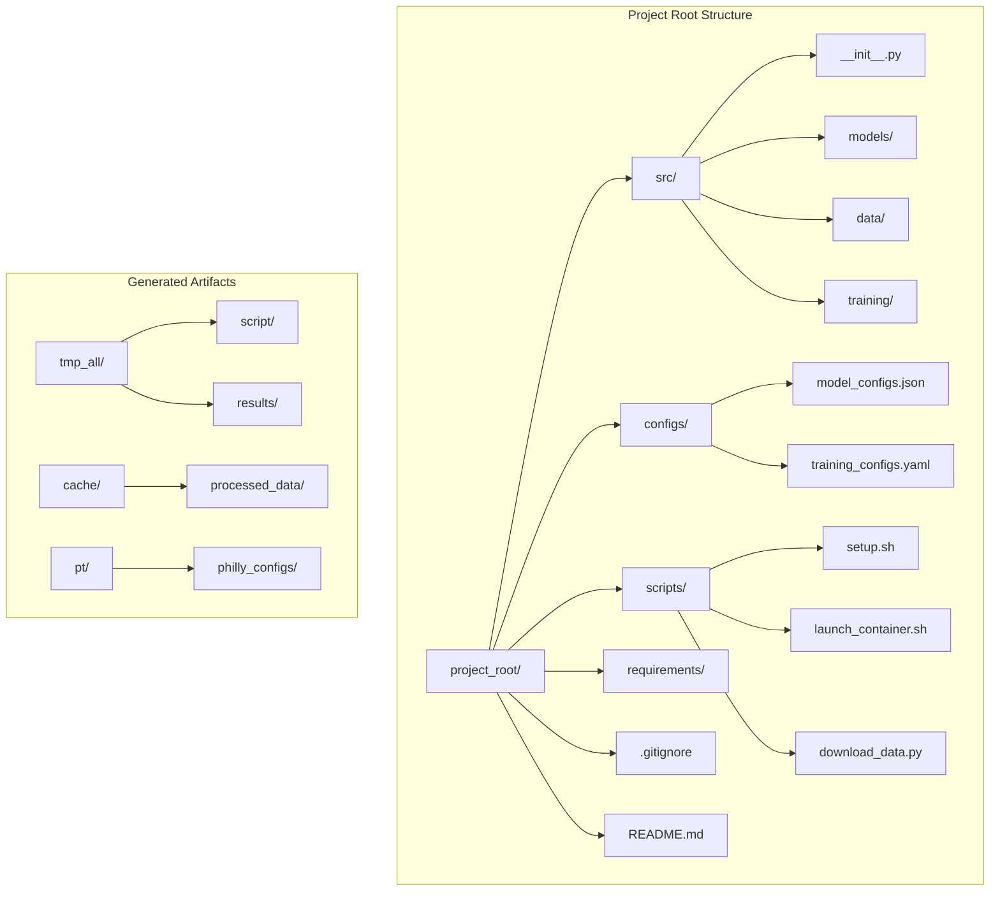
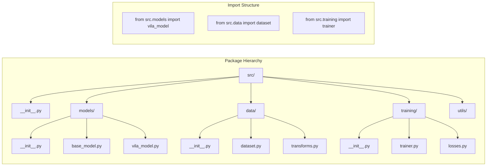
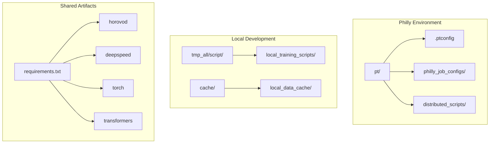
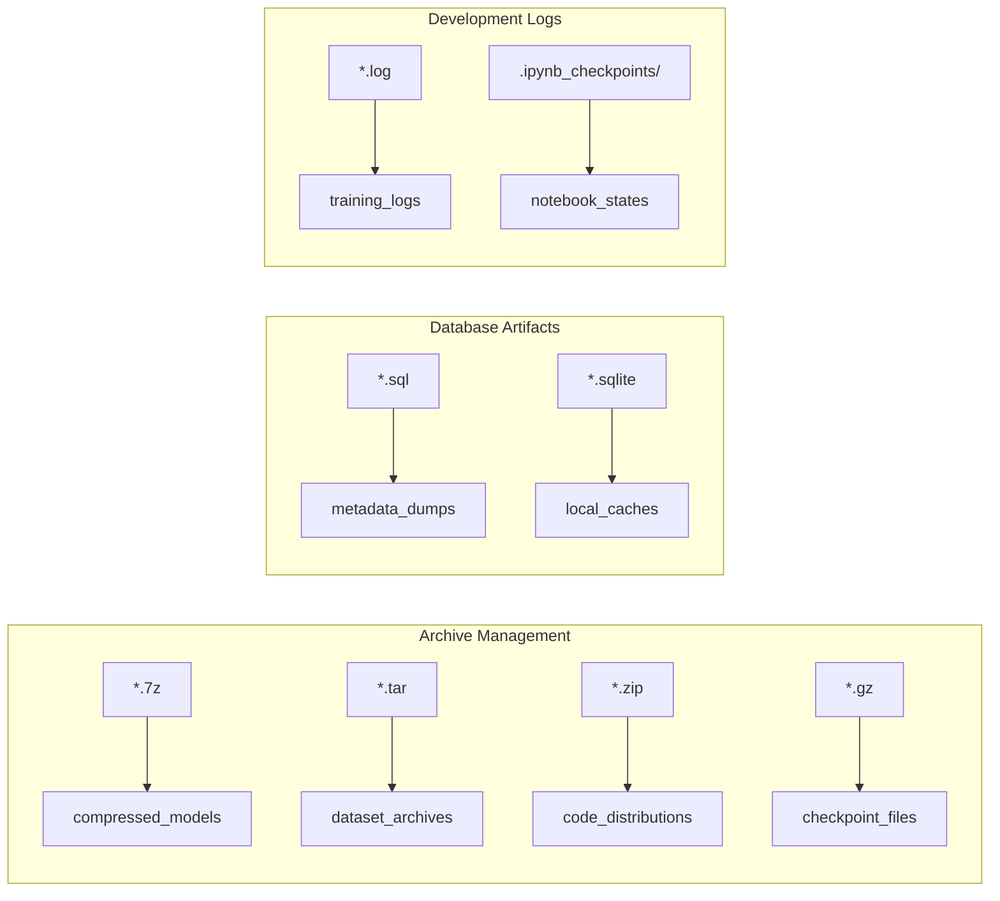
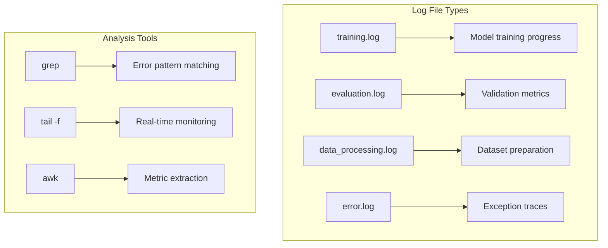
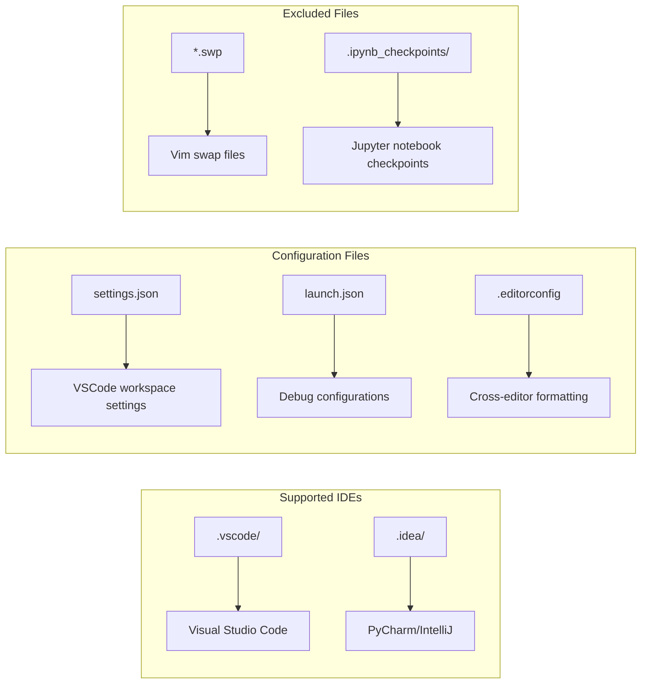

<!-- source: DeepWiki mcp.deepwiki.com · repo microsoft/XPretrain · page 6 Technical Appendices · fetched 2026-10-26 -->

# Technical Appendices

Relevant source files

The following files were used as context for generating this wiki page:

- [LF-VILA/.gitignore](LF-VILA/.gitignore)
- [LF-VILA/src/__init__.py](LF-VILA/src/__init__.py)

This document provides additional technical details, file structure information, and miscellaneous documentation for advanced users and developers working with the XPretrain repository. It covers internal implementation patterns, development artifacts, and troubleshooting guidance that complement the main documentation.

For environment setup procedures, see [Environment Setup](#4.1). For data processing workflows, see [Data Processing](#4.2). For configuration management, see [Configuration Management](#4.3).

## File Structure and Organization Patterns

The XPretrain repository follows consistent organizational patterns across its component projects. Each major component maintains a standardized structure that facilitates development and deployment.

### Standard Project Layout

**File Structure Patterns**
Sources: [LF-VILA/.gitignore:1-57]()

### Development Artifact Management

The `.gitignore` patterns reveal the types of files generated during development and training processes:

| Artifact Type | Pattern | Purpose |
|---------------|---------|---------|
| Build Results | `*/*results*/`, `*results*/` | Training outputs and evaluation results |
| Temporary Files | `tmp*/`, `tmp*.py` | Intermediate processing files |
| Cache Data | `cache/*`, `*/cache*/` | Processed datasets and model cache |
| Compiled Python | `*.pyc`, `**/__pycache__/` | Python bytecode files |
| Development Tools | `.vscode/`, `.idea/` | IDE configuration files |
| System Files | `.DS_Store`, `Thumbs.db` | OS-generated metadata |

Sources: [LF-VILA/.gitignore:13-56]()

## Python Package Structure

### Module Initialization Patterns

The XPretrain components use standard Python package initialization patterns to organize functionality:

Sources: [LF-VILA/src/__init__.py:1]()

## Development Environment Artifacts

### Philly Integration Patterns

The repository includes integration with Microsoft's Philly platform for distributed training:

Sources: [LF-VILA/.gitignore:6-9]()

### Temporary File Management

The development workflow generates various temporary files that are excluded from version control:

| File Pattern | Purpose | Lifecycle |
|--------------|---------|-----------|
| `tmp_all/script/` | Generated training scripts | Per-experiment |
| `tmp*.py` | Temporary Python modules | Development session |
| `*pickle` | Serialized data objects | Data processing |
| `*.log` | Training and evaluation logs | Per-run |
| `*.swp` | Editor swap files | Edit session |

Sources: [LF-VILA/.gitignore:4,17-19,40,44]()

## Build and Deployment Patterns

### Container and Distribution Management

The projects use containerized environments for consistent development and deployment:

Sources: [LF-VILA/.gitignore:25-46]()

## Advanced Debugging and Troubleshooting

### Common File System Issues

When working with XPretrain components, several file system patterns can indicate common issues:

| Pattern | Potential Issue | Resolution |
|---------|----------------|------------|
| Missing `cache/` directory | Data preprocessing incomplete | Re-run data preparation scripts |
| Large `tmp*/` directories | Interrupted training runs | Clean temporary files and restart |
| Permission errors on `pt/` | Philly configuration issues | Check `.ptconfig` settings |
| Missing `*results*/` | Training not completed | Verify training script execution |

### Log File Analysis

The system generates multiple types of log files for debugging:

Sources: [LF-VILA/.gitignore:40]()

## Configuration and State Management

### Checkpoint and Cache Patterns

The system maintains various types of cached data and checkpoints:

| Component | Cache Location | Content Type |
|-----------|----------------|---------------|
| Model Weights | `cache/models/` | Pre-trained and fine-tuned weights |
| Processed Data | `cache/data/` | Preprocessed video and text features |
| Evaluation Results | `*results*/` | Benchmark scores and analysis |
| Temporary Models | `tmp*/checkpoints/` | Training intermediate states |

### IDE and Editor Integration

The repository supports multiple development environments:

Sources: [LF-VILA/.gitignore:1,44-46]()

This technical appendix provides the foundational knowledge needed to understand the internal structure and development patterns used throughout the XPretrain repository, enabling advanced users to effectively navigate and extend the codebase.