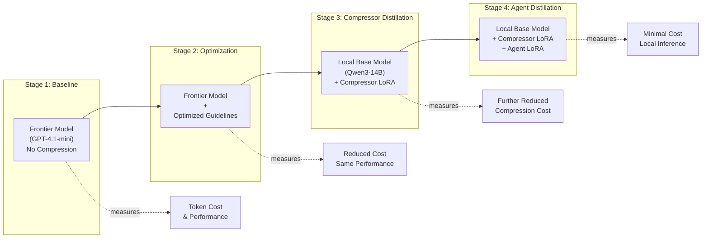
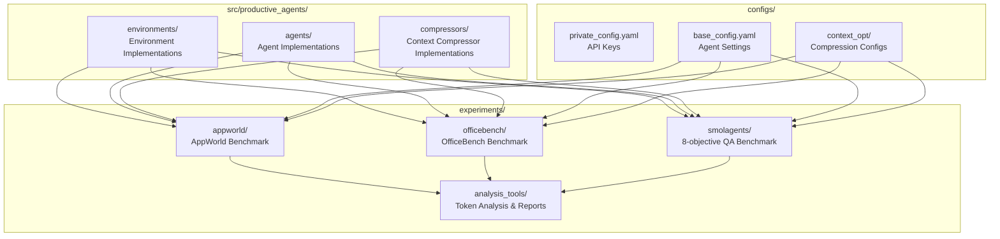
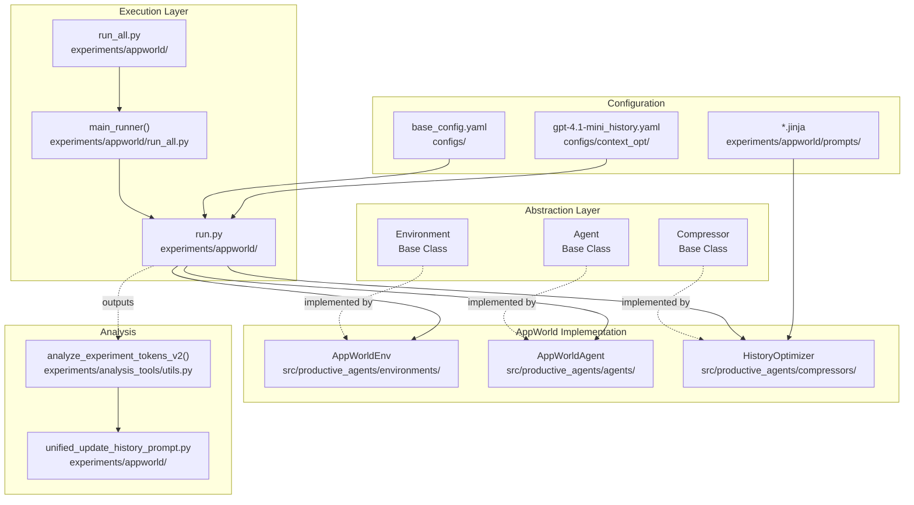
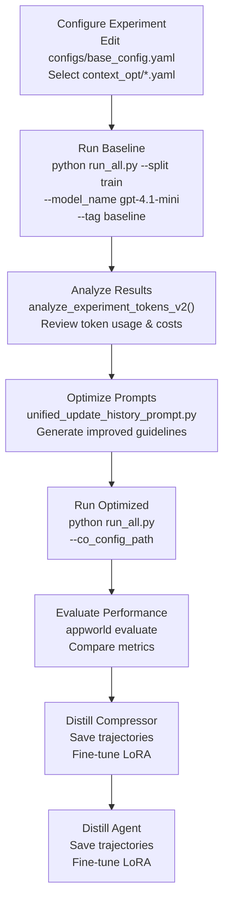

<!-- source: DeepWiki mcp.deepwiki.com · repo microsoft/acon · page 1 Home · fetched 2026-10-26 -->

# Home

<details>
<summary>Relevant source files</summary>

The following files were used as context for generating this wiki page:

- [README.md](README.md)
- [assets/concept.png](assets/concept.png)

</details>


## Purpose and Scope

This page provides an overview of the ACON (Agent Context Optimization) framework, its architecture, and core concepts. ACON is a research framework for optimizing context compression in long-horizon LLM agents, enabling systematic experimentation across multiple benchmarks with frontier and distilled models.

For installation and setup instructions, see [Installation](#2.1). For understanding the core concepts, see [Core Concepts](#3). For running experiments, see [Running Experiments](#5).

**Sources:** [README.md:1-42]()

## What is ACON?

ACON is a research framework designed to optimize how long-horizon LLM agents manage their context windows. As agents perform extended tasks with many interactions, their context accumulates, leading to increased token costs and potential information overload. ACON addresses this challenge through systematic context compression techniques.

The framework provides:

- **Standardized abstractions** for environments, agents, and context compressors
- **Three realistic benchmarks**: AppWorld (day-to-day tasks), OfficeBench (office productivity), and 8-objective QA (reasoning and retrieval)
- **Four-stage experimental pipeline** from baseline evaluation to model distillation
- **Comprehensive analysis tools** for token usage and cost tracking
- **Distillation support** for transferring optimization strategies to local models

**Sources:** [README.md:22-24](), [README.md:112-120]()

## Core Problem: Context Accumulation

Long-horizon agents face a fundamental challenge: as they interact with environments over many steps, their context windows grow with observations, actions, and intermediate reasoning. This leads to:

1. **Excessive token costs** - Each API call processes the entire accumulated context
2. **Information redundancy** - Historical observations contain repetitive or obsolete information
3. **Degraded performance** - Large contexts can confuse decision-making with irrelevant details
4. **Context window limits** - Eventually exceeding model maximum context lengths

ACON addresses these issues through **context compression**: selectively summarizing or filtering historical information while preserving details essential for future decisions.

**Sources:** [README.md:22]()

## Solution Approach

ACON implements a progressive optimization strategy:



**Pipeline Overview**

1. **Baseline**: Establish performance and cost metrics with frontier models
2. **Optimization**: Develop and validate context compression guidelines using prompt engineering
3. **Compressor Distillation**: Train a LoRA adapter to replicate compression behavior
4. **Agent Distillation**: Train a second LoRA adapter for complete agent reasoning

Each stage reduces operational costs while tracking performance degradation, enabling researchers to find optimal cost-performance trade-offs.

**Sources:** [README.md:132-136]()

## System Architecture

The ACON codebase is organized into three primary directories:



**Directory Structure**

| Directory | Purpose | Key Files |
|-----------|---------|-----------|
| `configs/` | Configuration files for API keys, agent settings, and compression parameters | `private_config.yaml`, `base_config.yaml`, `context_opt/*.yaml` |
| `src/productive_agents/` | Core abstractions for environments, agents, and compressors | `environments/`, `agents/`, `compressors/` |
| `experiments/` | Benchmark-specific runners, analysis tools, and training scripts | `appworld/`, `officebench/`, `smolagents/`, `analysis_tools/` |

**Sources:** [README.md:112-120]()

## Benchmark Implementations

ACON supports three distinct benchmarks, each targeting different aspects of agent capabilities:

| Benchmark | Domain | Tasks | Location |
|-----------|--------|-------|----------|
| **AppWorld** | Day-to-day personal task workflows | Database management, file operations, social interactions | `experiments/appworld/` |
| **OfficeBench** | Office productivity automation | Document processing, email management, scheduling | `experiments/officebench/` |
| **8-objective QA** | Lightweight reasoning and retrieval | Multi-objective question answering with tool use | `experiments/smolagents/` |

Each benchmark implements the same experimental pipeline but with domain-specific environments and task formats.

**Sources:** [README.md:122-131]()

## Core Components and Code Mapping

The following diagram maps ACON's conceptual components to their code implementations:



**Key Code Entities**

- **`main_runner()`** - Primary orchestration function in `experiments/appworld/run_all.py` that executes batches of tasks
- **`run.py`** - Single-task execution script in each benchmark directory
- **`analyze_experiment_tokens_v2()`** - Token and cost analysis function in `experiments/analysis_tools/utils.py`
- **`unified_update_history_prompt.py`** - Automated prompt optimization pipeline in `experiments/appworld/`
- **Environment/Agent/Compressor classes** - Core abstractions in `src/productive_agents/`

**Sources:** [README.md:112-120]()

## Experimental Workflow

A typical ACON experiment follows this workflow:



**Workflow Steps**

1. **Configuration** - Set up API keys and agent parameters
2. **Baseline Execution** - Run experiments with frontier models to establish metrics
3. **Analysis** - Use token analysis tools to identify optimization opportunities
4. **Optimization** - Refine compression guidelines through automated or manual prompt engineering
5. **Validation** - Re-run experiments with optimized configurations
6. **Evaluation** - Compare performance and cost metrics
7. **Distillation** - Train local models to replicate optimized behavior

**Sources:** [README.md:53-88](), [README.md:132-136]()

## Output Structure

Each experiment produces a structured output directory:

```
experiments/appworld/outputs/{model_name}_{tag}/{split}/
├── task_00000/
│   ├── history_optimizer_history.json  # Compression decisions
│   ├── llm_history.json                # Agent LLM interactions
│   ├── env_history.json                # Environment interactions
│   └── results.json                    # Task results
├── task_00001/
│   └── ...
└── experiment_summary.json             # Aggregate metrics
```

The output files serve multiple purposes:

- **Analysis** - `history_optimizer_history.json` and `llm_history.json` feed into token analysis
- **Training** - These files provide training data for LoRA distillation
- **Debugging** - Full interaction traces enable detailed error analysis
- **Evaluation** - `results.json` contains task outcomes for scoring

**Sources:** Based on system diagrams and experimental pipeline description

## Key Metrics

ACON tracks several metrics throughout experiments:

| Metric | Description | Source |
|--------|-------------|--------|
| **Input Tokens** | Tokens sent to LLM (including cached) | Token analysis tools |
| **Output Tokens** | Tokens generated by LLM | Token analysis tools |
| **Cached Tokens** | Tokens reused from provider cache | Token analysis tools |
| **Total Cost** | Estimated API cost based on pricing | `calculate_cost_components()` |
| **Task Success Rate** | Percentage of tasks completed successfully | Benchmark-specific evaluators |
| **Compression Ratio** | Original context size / compressed context size | Derived from token counts |

These metrics enable quantitative comparison across pipeline stages and configurations.

**Sources:** Based on analysis tools architecture diagram

## Research Foundation

ACON implements the methodology described in the research paper:

> **ACON: Optimizing Context Compression for Long-horizon LLM Agents**  
> _Minki Kang, Wei-Ning Chen, Dongge Han, Huseyin A. Inan, Lukas Wutschitz, Yanzhi Chen, Robert Sim, Saravan Rajmohan_  
> arXiv:2510.00615

The paper presents empirical results demonstrating cost reductions while maintaining task performance across the three benchmark families.

**Citation**

```bibtex
@misc{kang2025aconoptimizingcontextcompression,
      title={ACON: Optimizing Context Compression for Long-horizon LLM Agents}, 
      author={Minki Kang and Wei-Ning Chen and Dongge Han and Huseyin A. Inan and Lukas Wutschitz and Yanzhi Chen and Robert Sim and Saravan Rajmohan},
      year={2025},
      eprint={2510.00615},
      archivePrefix={arXiv},
      primaryClass={cs.AI},
      url={https://arxiv.org/abs/2510.00615}, 
}
```

**Sources:** [README.md:26-41]()

## Getting Started

To begin using ACON:

1. **Install dependencies** - See [Installation](#2.1) for detailed setup instructions
2. **Configure API keys** - Set up OpenAI credentials as described in [API Configuration](#2.2)
3. **Run first experiment** - Follow the quickstart guide in [Running Your First Experiment](#2.3)
4. **Understand core concepts** - Review [Context Optimization](#3.1) and the [Four-Stage Pipeline](#3.2)
5. **Explore benchmarks** - Choose a benchmark to experiment with: [AppWorld](#4.1), [OfficeBench and SmolAgents](#4.2)

For developers interested in extending ACON, see the [Development Guide](#10).

**Sources:** [README.md:43-88]()

## License and Contributing

ACON is released under the MIT License. The project welcomes contributions and suggestions. Contributors must agree to the Contributor License Agreement (CLA).

For community guidelines, see [Code of Conduct](#10.2). For contribution procedures, see [Support and Contributing](#10.3). For legal information, see [Project Information](#12).

**Sources:** [README.md:144-165]()

---

