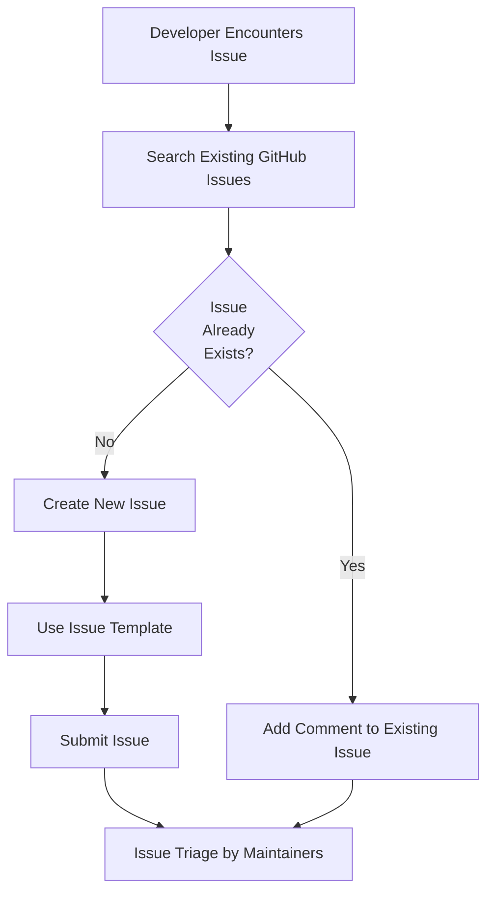
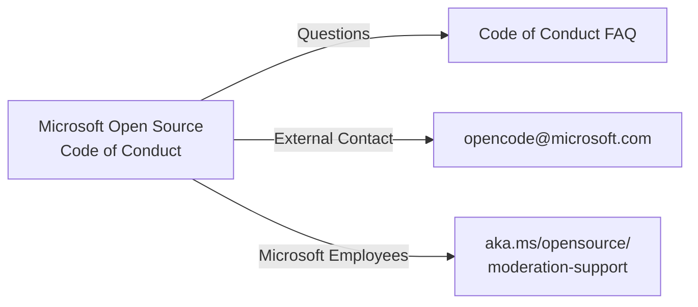
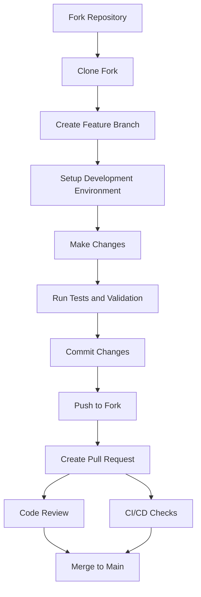
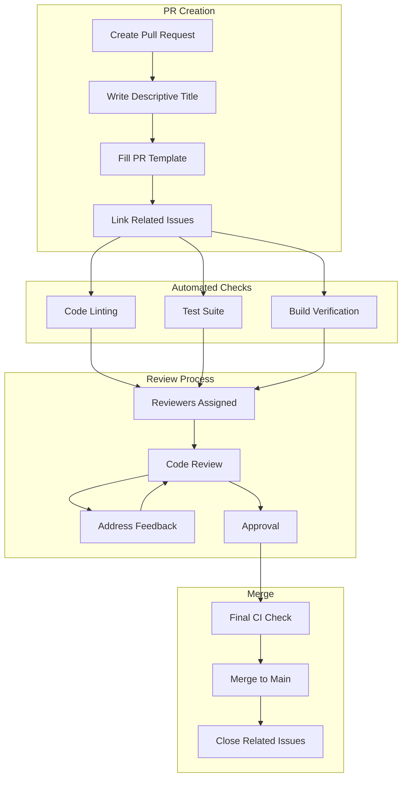

<!-- source: DeepWiki mcp.deepwiki.com · repo microsoft/acon · page 10.3 Support and Contributing · fetched 2026-10-26 -->

# Support and Contributing

<details>
<summary>Relevant source files</summary>

The following files were used as context for generating this wiki page:

- [CODE_OF_CONDUCT.md](CODE_OF_CONDUCT.md)
- [SUPPORT.md](SUPPORT.md)

</details>


This document covers how to get help with the ACON framework and how to contribute to the project. It outlines the support resources available, the contribution process, and community guidelines.

For information about setting up your development environment, see [Development Environment](#10.1). For community standards and behavior expectations, see [Code of Conduct](#10.2).

---

## Getting Support

### Issue Tracking

ACON uses **GitHub Issues** to track bugs and feature requests. Before filing a new issue, search existing issues to avoid duplicates.

**Issue Filing Process:**



**Sources:** [SUPPORT.md:1-14]()

### Support Resources

The following resources are available for help and questions:

| Resource | Purpose | Link |
|----------|---------|------|
| **README** | Primary documentation and quick start | [README.md]() |
| **GitHub Issues** | Bug reports and feature requests | https://github.com/microsoft/acon/issues |
| **Issue Search** | Find existing solutions | GitHub issue search |

### Microsoft Support Policy

Support for ACON is limited to the resources listed in this document. The project follows the standard Microsoft open source support model, which provides community-based support through GitHub Issues and documentation.

**Support Scope:**
- Bug fixes for critical issues
- Feature requests (evaluated based on project goals)
- Documentation improvements
- Security vulnerability reports (see [Security Policy](#12.2))

**Out of Scope:**
- Production deployment support
- Custom implementation consulting
- Guaranteed response times

**Sources:** [SUPPORT.md:11-13]()

---

## Community Guidelines

### Code of Conduct

ACON has adopted the **Microsoft Open Source Code of Conduct**. All contributors and community members are expected to adhere to these standards.

**Key Principles:**
- Be respectful and inclusive
- Accept constructive criticism gracefully
- Focus on what is best for the community
- Show empathy towards other community members

### Code of Conduct Resources



**Available Resources:**

| Resource | Description | Contact |
|----------|-------------|---------|
| **Code of Conduct** | Full text of conduct standards | https://opensource.microsoft.com/codeofconduct/ |
| **FAQ** | Frequently asked questions | https://opensource.microsoft.com/codeofconduct/faq/ |
| **Email Contact** | Questions or concerns | opencode@microsoft.com |
| **Internal Support** | Microsoft employees only | aka.ms/opensource/moderation-support |

**Sources:** [CODE_OF_CONDUCT.md:1-11]()

---

## Contributing to ACON

### Contribution Workflow



### Setting Up for Contribution

Before making contributions, ensure your development environment is properly configured:

**Prerequisites:**
1. Python 3.11+ installed
2. Git configured with your credentials
3. Fork of the ACON repository
4. Development environment set up (see [Development Environment](#10.1))

**Initial Setup Commands:**

```bash
# Clone your fork
git clone https://github.com/YOUR_USERNAME/acon.git
cd acon

# Add upstream remote
git remote add upstream https://github.com/microsoft/acon.git

# Create feature branch
git checkout -b feature/your-feature-name
```

### Types of Contributions

ACON welcomes various types of contributions:

| Contribution Type | Examples | Entry Point |
|-------------------|----------|-------------|
| **Bug Fixes** | Fixing crashes, incorrect outputs | GitHub Issues |
| **Features** | New benchmarks, optimization algorithms | Feature requests |
| **Documentation** | Wiki improvements, code comments | Documentation issues |
| **Analysis Tools** | New metrics, visualization tools | [experiments/analysis_tools/]() |
| **Prompt Engineering** | Better prompts, compression strategies | [experiments/prompts/]() |
| **Configuration** | New model configs, optimization strategies | [experiments/context_opt/]() |

### Contribution Best Practices

**Code Quality:**
- Follow existing code style and conventions
- Add docstrings to new functions and classes
- Include type hints where appropriate
- Keep functions focused and modular

**Testing:**
- Test your changes with at least one benchmark
- Verify token analysis still works
- Check that configuration loading works correctly
- Ensure backward compatibility

**Documentation:**
- Update relevant wiki pages for feature changes
- Add comments for complex logic
- Update configuration schema documentation if needed
- Include examples in docstrings

**Commits:**
- Write clear, descriptive commit messages
- Reference related issues in commits
- Keep commits atomic and focused
- Sign commits if required by policy

### Pull Request Process



**PR Checklist:**
- [ ] Code follows existing style
- [ ] Tests pass locally
- [ ] Documentation updated
- [ ] Commit messages are clear
- [ ] PR description explains changes
- [ ] Related issues are linked
- [ ] Breaking changes are documented

### Areas for Contribution

The following areas are particularly welcome for community contributions:

**High Priority:**

1. **Benchmark Integrations**
   - Adding support for new benchmarks
   - Improving existing benchmark adapters
   - Entry points: [experiments/appworld/](), [experiments/officebench/](), [experiments/smolagents/]()

2. **Analysis and Visualization**
   - New analysis metrics
   - Visualization dashboards
   - Performance profiling tools
   - Entry points: [experiments/analysis_tools/utils.py]()

3. **Prompt Optimization**
   - Better compression prompts
   - Domain-specific system prompts
   - Multi-language prompt templates
   - Entry points: [experiments/prompts/]()

4. **Configuration Templates**
   - Pre-tuned configurations for different use cases
   - Model-specific optimization parameters
   - Entry points: [experiments/context_opt/]()

**Medium Priority:**

5. **Documentation**
   - Tutorial improvements
   - API documentation
   - Code examples
   - Entry points: Wiki pages, code docstrings

6. **Testing**
   - Unit tests for core components
   - Integration tests for pipelines
   - Benchmark validation tests
   - Entry points: Test directories

7. **Model Support**
   - Support for new LLM providers
   - Additional base models for distillation
   - Entry points: Model configuration files

### Contribution Recognition

Contributors are recognized in several ways:

- **Contributors File**: All contributors are listed in project documentation
- **Release Notes**: Significant contributions are highlighted in release notes
- **GitHub Profile**: Contributions appear in your GitHub contribution graph
- **Community Recognition**: Notable contributions may be featured in project updates

**Sources:** [SUPPORT.md:1-14](), [CODE_OF_CONDUCT.md:1-11]()

---

## Communication Channels

### Primary Channels

| Channel | Purpose | Usage |
|---------|---------|-------|
| **GitHub Issues** | Bug reports, feature requests | Public, tracked |
| **Pull Requests** | Code contributions, reviews | Public, collaborative |
| **Discussions** | General questions, ideas | Public, informal |

### Response Expectations

While ACON is a community-supported project without guaranteed response times, maintainers aim to:

- Triage new issues within 1 week
- Review pull requests within 2 weeks
- Respond to security issues within 24-48 hours

**Note:** These are goals, not guarantees. Response times may vary based on maintainer availability.

### Contact Information

For specific types of inquiries:

- **General Questions**: Create a GitHub Discussion
- **Bug Reports**: Create a GitHub Issue
- **Security Issues**: See [Security Policy](#12.2)
- **Code of Conduct Violations**: opencode@microsoft.com

**Sources:** [SUPPORT.md:1-14](), [CODE_OF_CONDUCT.md:7-10]()

---

## Special Contribution Topics

### Contributing Analysis Tools

The token analysis system ([experiments/analysis_tools/utils.py]()) is a key component for evaluating experiments. Contributions should:

1. Maintain backward compatibility with existing cache formats
2. Update `SCHEMA_VERSION` if cache structure changes
3. Add comprehensive docstrings
4. Include example usage

**Key Functions to Extend:**
- `analyze_experiment_tokens_v2`: Main analysis entry point
- `detect_experiment_type`: Benchmark detection logic
- `calculate_cost_components`: Cost calculation logic

### Contributing Prompt Templates

When contributing prompt templates ([experiments/prompts/]()):

1. Use Jinja2 template syntax
2. Follow existing naming conventions
3. Document template variables
4. Test with multiple benchmarks
5. Provide example configurations

**Template Types:**
- System prompts: [experiments/prompts/system_prompt.jinja]()
- Agent prompts: [experiments/prompts/prompt_v*.jinja]()
- Compression prompts: [experiments/prompts/prompt_history_v*.jinja]()

### Contributing Configurations

Context optimization configurations ([experiments/context_opt/]()) require:

1. YAML format following existing schema
2. Clear documentation of parameters
3. Validation against multiple tasks
4. Performance metrics in PR description

**Configuration Categories:**
- History compression: `*_history.yaml`
- Observation compression: `*_obs.yaml`
- Combined strategies: Base configurations

**Sources:** Directory structure analysis from high-level diagrams

---

## License and Legal

All contributions to ACON must comply with the MIT License. By submitting a pull request, you agree that your contributions will be licensed under the same license.

See [License](#12.1) for full license text and terms.

**Contributor License Agreement:**
- Contributions must be original work
- You grant Microsoft rights to use your contributions
- You retain copyright to your contributions
- Your contributions are licensed under MIT

**Sources:** License implications from [SUPPORT.md:13]()

---

