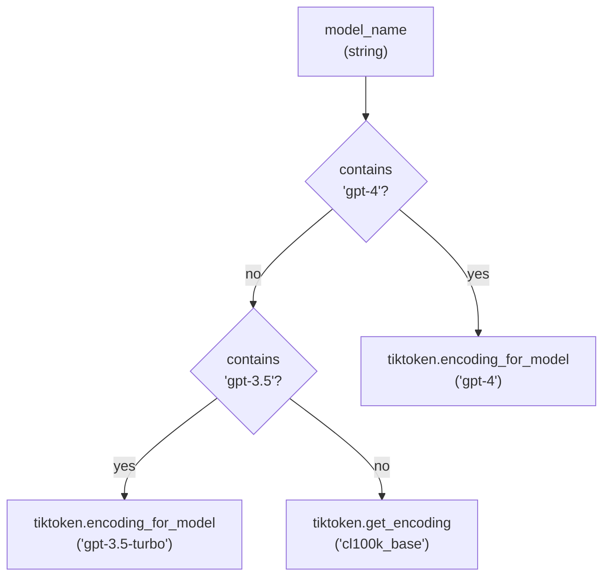
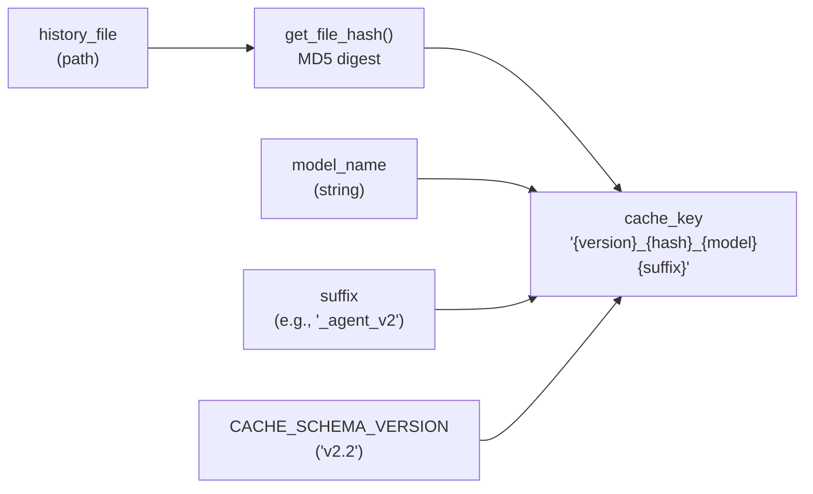
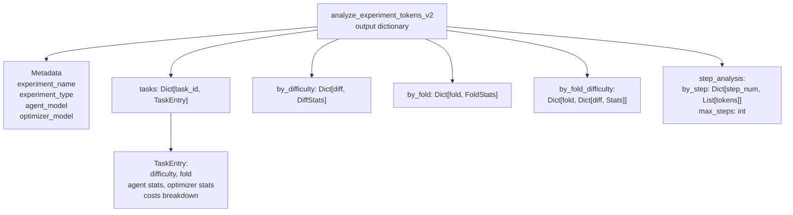
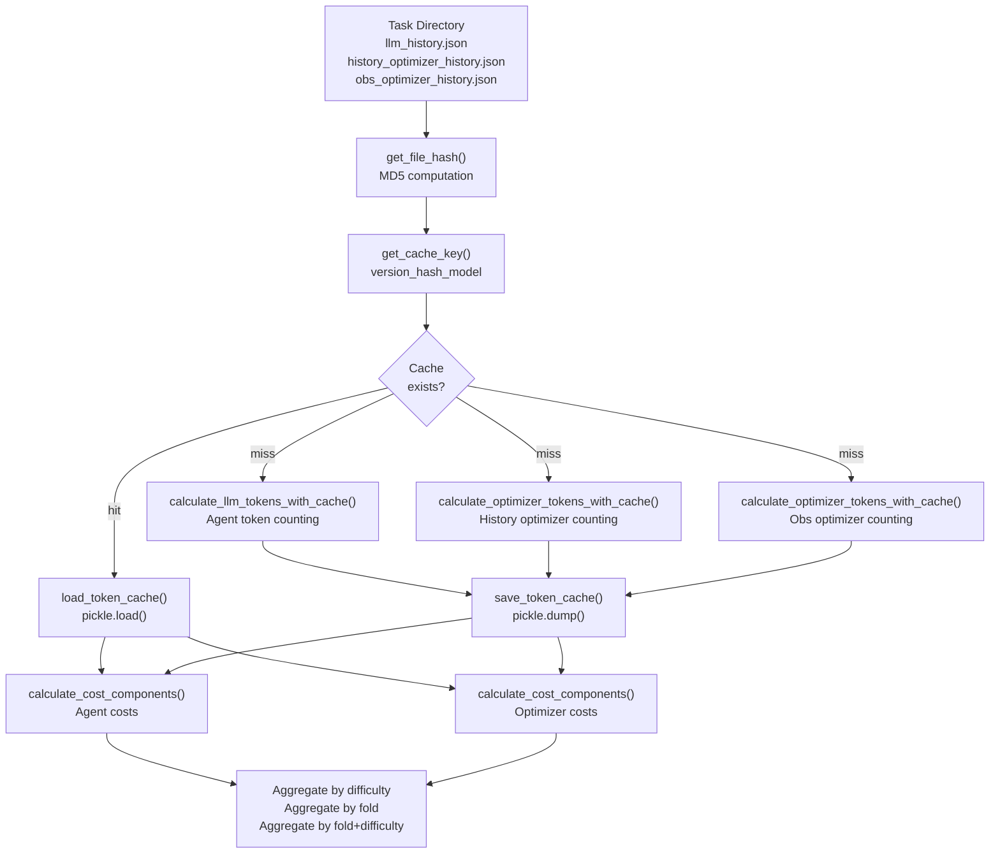
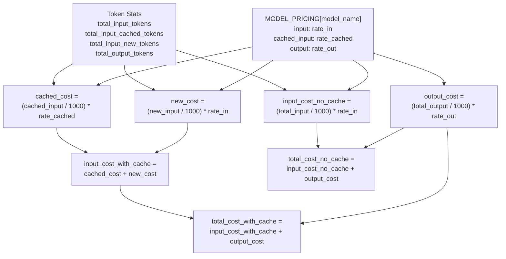

<!-- source: DeepWiki mcp.deepwiki.com · repo microsoft/acon · page 11 Reference · fetched 2026-10-26 -->

# Reference

<details>
<summary>Relevant source files</summary>

The following files were used as context for generating this wiki page:

- [experiments/analysis_tools/utils.py](experiments/analysis_tools/utils.py)
- [experiments/appworld/configs/base_config.yaml](experiments/appworld/configs/base_config.yaml)

</details>


This page provides detailed technical reference documentation for the ACON framework's core components, data structures, and APIs. It serves as a lookup guide for developers working with ACON's analysis tools, configuration system, and data formats.

For step-by-step guides on using these components, see [Running Experiments](#5) and [Analysis and Optimization](#7). For architectural context, see [Architecture](#9).

## Purpose and Scope

This reference section documents:

- **Model pricing constants** and cost calculation formulas
- **Token counting functions** with cache-aware prefix matching
- **Analysis functions** for experiment evaluation
- **Configuration schemas** for experiments and context optimization
- **Dataset and output formats** for experiment results
- **Cache system** specifications and versioning

The reference focuses on precise API signatures, data structures, and implementation details rather than usage patterns or workflows.

---

## Model Pricing Reference

ACON uses model-specific pricing to calculate costs across experiments. Pricing is stored as cost per 1,000 tokens.

### MODEL_PRICING Dictionary

The `MODEL_PRICING` constant defines pricing for supported models:

| Model | Input (per 1K tokens) | Cached Input (per 1K tokens) | Output (per 1K tokens) |
|-------|----------------------|------------------------------|------------------------|
| `gpt-4.1` | $0.003 | $0.00075 | $0.012 |
| `gpt-4.1-mini` | $0.0008 | $0.0002 | $0.0032 |

```python
MODEL_PRICING: Dict[str, Dict[str, float]] = {
    'gpt-4.1': {
        'input': 3 / 1000,
        'cached_input': 0.75 / 1000,
        'output': 12 / 1000,
    },
    'gpt-4.1-mini': {
        'input': 0.8 / 1000,
        'cached_input': 0.2 / 1000,
        'output': 3.2 / 1000,
    },
}
```

**Sources:** [experiments/analysis_tools/utils.py:26-40]()

### Cost Calculation Components

The `calculate_cost_components` function computes detailed cost breakdowns:

**Function Signature:**
```python
def calculate_cost_components(stats: Dict, model_name: str) -> Dict[str, float]
```

**Input Stats Keys:**
- `total_input_tokens`: Total input tokens across all requests
- `total_input_cached_tokens`: Tokens served from cache
- `total_input_new_tokens`: Tokens not in cache (newly processed)
- `total_output_tokens`: Total generated tokens

**Output Keys:**
- `input_cost_no_cache`: Cost assuming no cache hits
- `input_cost_with_cache`: Cost with cache discount applied
- `output_cost`: Cost of generated tokens
- `total_cost_no_cache`: Total without cache benefits
- `total_cost_with_cache`: Total with cache benefits

**Sources:** [experiments/analysis_tools/utils.py:55-90]()

---

## Token Counting Reference

### Encoding Selection

The `_get_encoding` function selects appropriate tiktoken encodings based on model names:



**Sources:** [experiments/analysis_tools/utils.py:95-117]()

### Cache-Aware Prefix Matching

The `_common_prefix_len` function implements cache simulation:

**Function Signature:**
```python
def _common_prefix_len(a: List[int], b: List[int]) -> int
```

**Algorithm:** Returns the length of the longest common prefix between two token ID sequences. This simulates provider-side prompt caching by identifying which tokens can be reused from previous requests.

**Example:**
```python
a = [100, 200, 300, 400]
b = [100, 200, 350, 450]
# Returns: 2 (tokens 100 and 200 match)
```

**Sources:** [experiments/analysis_tools/utils.py:120-126]()

---

## Agent Token Analysis Functions

### calculate_llm_tokens_with_cache

Computes token usage for agent LLM interactions with cache-aware counting.

**Function Signature:**
```python
def calculate_llm_tokens_with_cache(
    llm_history,
    model_name: str = 'gpt-4.1'
) -> Dict
```

**Input Format:**
```python
llm_history: List[List[Dict]]  # List of sessions
# Each session is a list of messages:
# [
#   {"role": "system", "content": "..."},
#   {"role": "user", "content": "..."},
#   {"role": "assistant", "content": "..."},
#   ...
# ]
```

**Output Structure:**
```python
{
    'total_input_tokens': int,
    'total_input_cached_tokens': int,
    'total_input_new_tokens': int,
    'total_output_tokens': int,
    'total_tokens_no_cache': int,
    'total_tokens_with_cache': int,
    'total_dependency': float,
    'num_steps': int,
    'peak_tokens': int,
    'step_breakdown': [
        {
            'session': int,
            'step': int,
            'input_tokens_total': int,
            'input_tokens_cached': int,
            'input_tokens_new': int,
            'output_tokens': int,
            'dependency': float,
            'total_tokens_step_no_cache': int,
            'total_tokens_step_with_cache': int
        },
        ...
    ]
}
```

**Dependency Metric:**
```
dependency = ((n_input + 2 * n_output) * n_output) / 2
```
where `n_input` excludes system prompt tokens.

**Sources:** [experiments/analysis_tools/utils.py:131-231]()

### calculate_optimizer_tokens_with_cache

Computes token usage for context optimizer interactions, supporting two formats.

**Function Signature:**
```python
def calculate_optimizer_tokens_with_cache(
    history_file: str,
    model_name: str = 'gpt-4.1-mini',
    agent_llm_history_file: Optional[str] = None
) -> Dict
```

**Format A (Legacy):** Simple turn-based list
```python
[
    [system_prompt, user_text, assistant_response],
    [system_prompt, user_text, assistant_response],
    ...
]
```

**Format B (Advanced):** Chat messages with agent sequence caching
```python
[
    [
        system_prompt,  # Usually empty string for Format B
        [  # List of message dicts
            {"role": "system", "content": "..."},
            {"role": "user", "content": "..."},
            {"role": "assistant", "content": "..."}
        ],
        optimizer_response  # String
    ],
    ...
]
```

**Advanced Caching:** Format B enables cross-file caching. The optimizer can reuse prefixes from:
1. Previous optimizer turns (standard prefix caching)
2. Agent LLM input sequences from `llm_history.json` (cross-file caching)

**Output Structure:** Same as `calculate_llm_tokens_with_cache`, plus:
```python
{
    ...
    'advanced_cache': bool,  # True if Format B was detected
    'total_input_cached_tokens_from_agent': int,  # Format B only
    'total_input_cached_tokens_from_prev': int,   # Format B only
}
```

**Sources:** [experiments/analysis_tools/utils.py:234-438]()

---

## Cache System Reference

### Cache Configuration

```python
CACHE_SCHEMA_VERSION = "v2.2"  # Incremented when logic changes
TOKEN_USAGE_CACHE_DIR = Path('analysis/cache/token_usage')
```

The cache system prevents redundant token calculations by storing results keyed on file content hash, model name, and schema version.

### Cache Key Generation



**Function Signature:**
```python
def get_cache_key(file_path: str, model_name: str, suffix: str = '') -> Optional[str]
```

**Example Key:**
```
v2.2_a1b2c3d4e5f6_gpt-4.1_agent_v2
```

**Sources:** [experiments/analysis_tools/utils.py:466-478]()

### Cache Operations

**Load Cache:**
```python
def load_token_cache(cache_key: Optional[str]) -> Optional[Dict]
```
Returns pickled data from `{TOKEN_USAGE_CACHE_DIR}/{cache_key}.pkl` or `None` if not found.

**Save Cache:**
```python
def save_token_cache(cache_key: Optional[str], token_data: Dict) -> None
```
Serializes `token_data` to pickle file with error handling.

**Sources:** [experiments/analysis_tools/utils.py:481-503]()

---

## Experiment Analysis Functions

### analyze_experiment_tokens_v2

The main analysis function that processes entire experiments and generates comprehensive statistics.

**Function Signature:**
```python
def analyze_experiment_tokens_v2(
    experiment_name: str,
    agent_model: str = 'gpt-4.1',
    optimizer_model: str = 'gpt-4.1',
    folds: Optional[List[str]] = None,
    verbose: bool = False
) -> Optional[Dict]
```

**Experiment Name Formats:**
- Prefixed: `[AppWorld] experiment_name`
- Prefixed: `[OfficeBench] experiment_name`
- Prefixed: `[SmolAgents] experiment_name`
- Raw: `experiment_name` (auto-detected)

**Folds Filter:** When specified, only tasks from these folds are analyzed:
- `'train'`
- `'dev'`
- `'test_normal'`
- `'test_challenge'`

**Output Structure:**



**DiffStats/FoldStats Structure:**
```python
{
    'agent': {
        'input_tokens': int,
        'input_cached_tokens': int,
        'input_new_tokens': int,
        'output_tokens': int,
        'num_tasks': int,
        'avg_steps': float,
        'peak_tokens_total': int,
        'dependency_total': float,
        'avg_input_tokens': float,        # Computed
        'avg_input_cached_tokens': float, # Computed
        'avg_input_new_tokens': float,    # Computed
        'avg_output_tokens': float,       # Computed
        'avg_peak_tokens': float,         # Computed
        'avg_dependency': float,          # Computed
        'input_cost_no_cache_total': float,
        'input_cost_with_cache_total': float,
        'output_cost_total': float,
        'total_cost_no_cache_total': float,
        'total_cost_with_cache_total': float,
        'avg_input_cost_no_cache': float,    # Computed
        'avg_input_cost_with_cache': float,  # Computed
        'avg_output_cost': float,            # Computed
        'avg_total_cost_no_cache': float,    # Computed
        'avg_total_cost_with_cache': float,  # Computed
    },
    'optimizer': {
        # Same structure as agent
    }
}
```

**Sources:** [experiments/analysis_tools/utils.py:638-1136]()

---

## Experiment Detection and Path Resolution

### detect_experiment_type

Locates experiment output directories and determines benchmark type.

**Function Signature:**
```python
def detect_experiment_type(experiment_name: str) -> Tuple[Optional[str], Optional[Path]]
```

**Return Values:**
```python
('appworld', Path('/path/to/experiments/appworld/outputs/experiment_name'))
('officebench', Path('/path/to/experiments/officebench/outputs/experiment_name'))
('smolagents', Path('/path/to/experiments/smolagents/outputs/experiment_name'))
(None, None)  # Not found
```

**Search Order:**
1. Check prefixed format (e.g., `[AppWorld] name`)
2. Check all `APPWORLD_BASE_PATHS`
3. Check all `OFFICEBENCH_BASE_PATHS`
4. Check all `SMOLAGENTS_BASE_PATHS`

**Base Path Constants:**
```python
APPWORLD_BASE_PATH = EXPERIMENTS_ROOT / 'appworld' / 'outputs'
OFFICEBENCH_BASE_PATH = EXPERIMENTS_ROOT / 'officebench' / 'outputs'
SMOLAGENTS_BASE_PATH = EXPERIMENTS_ROOT / 'smolagents' / 'outputs'

# Fallback paths (for alternate output directories)
APPWORLD_BASE_PATHS = [APPWORLD_BASE_PATH, EXPERIMENTS_ROOT / 'appworld' / 'outputs_gpt5']
OFFICEBENCH_BASE_PATHS = [OFFICEBENCH_BASE_PATH, EXPERIMENTS_ROOT / 'officebench' / 'outputs_gpt5']
SMOLAGENTS_BASE_PATHS = [SMOLAGENTS_BASE_PATH, EXPERIMENTS_ROOT / 'smolagents' / 'outputs_gpt5']
```

**Sources:** [experiments/analysis_tools/utils.py:454-576]()

### Task Directory Patterns

Different benchmarks use different directory structures:

| Benchmark | Pattern |
|-----------|---------|
| AppWorld | `{experiment_path}/{fold}/task_{id}` |
| OfficeBench | `{experiment_path}/{fold}/{level}-{id}/{subtask}` |
| SmolAgents | `{experiment_path}/{fold}/samples/{sample_id}` |

**Sources:** [experiments/analysis_tools/utils.py:755-762]()

---

## Task Metadata Functions

### get_task_difficulty

Determines task difficulty from metadata or evaluation data.

**Function Signature:**
```python
def get_task_difficulty(
    task_id: str,
    evaluation_data: Optional[Dict] = None,
    task_dir_path: Optional[str] = None,
    experiment_type: str = 'appworld'
) -> str
```

**Return Values:**
- AppWorld: `'1'`, `'2'`, `'3'`, or `'unknown'`
- OfficeBench: `'level_1'`, `'level_2'`, `'level_3'`, or `'unknown'`

**Resolution Order:**
1. Load from `{EXPERIMENTS_ROOT}/appworld/data/tasks/{task_id}/ground_truth/metadata.json`
2. Check provided `evaluation_data` dictionary
3. For OfficeBench: parse from task_id format `{level}-{id}`
4. Return `'unknown'`

**Sources:** [experiments/analysis_tools/utils.py:599-619]()

### get_task_fold

Extracts fold name from task directory path.

**Function Signature:**
```python
def get_task_fold(task_dir_path: Optional[str]) -> str
```

**Fold Mapping:**
```python
{
    'train': 'train',
    'dev': 'dev',
    'test_normal': 'test_normal',
    'test': 'test_normal',       # Alias
    'test_challenge': 'test_challenge',
    'challenge': 'test_challenge' # Alias
}
```

**Algorithm:** Scans path components (case-insensitive) for known fold names.

**Sources:** [experiments/analysis_tools/utils.py:622-633]()

---

## Report Generation Functions

### build_markdown_cost_table

Generates Markdown tables with cost statistics by difficulty.

**Function Signature:**
```python
def build_markdown_cost_table(title: str, by_difficulty: dict) -> str
```

**Table Columns:**
1. Difficulty
2. Agent Tasks (count)
3. Agent Avg Steps
4. Agent Avg Peak Tokens
5. Agent Avg Dependency
6. Agent Avg Total Cost (no cache)
7. Agent Avg Total Cost (with cache)
8. Optimizer Tasks (count)
9. Optimizer Avg Peak Tokens
10. Optimizer Avg Dependency
11. Optimizer Avg Total Cost (no cache)
12. Optimizer Avg Total Cost (with cache)

**Features:**
- Automatic sorting of difficulties (numeric first, then lexicographic)
- Overall average row with weighted means
- Dependency metric aggregation

**Sources:** [experiments/analysis_tools/utils.py:1141-1240]()

### build_markdown_cost_doc

Assembles complete Markdown document with overall and per-fold tables.

**Function Signature:**
```python
def build_markdown_cost_doc(
    title: str,
    by_difficulty: dict,
    by_fold_difficulty: dict
) -> str
```

**Fold Display Order:**
```python
['train', 'dev', 'test_normal', 'test_challenge', 'unknown', ...]
```
Additional folds appear alphabetically after the standard set.

**Sources:** [experiments/analysis_tools/utils.py:1243-1273]()

### build_cost_csv

Generates CSV format for programmatic analysis.

**Function Signature:**
```python
def build_cost_csv(by_difficulty: dict, by_fold_difficulty: dict) -> str
```

**CSV Columns:**
```
fold, difficulty,
agent_num_tasks, agent_avg_steps, agent_avg_peak_tokens, agent_avg_dependency,
agent_avg_total_cost_no_cache, agent_avg_total_cost_with_cache,
optimizer_num_tasks, optimizer_avg_peak_tokens, optimizer_avg_dependency,
optimizer_avg_total_cost_no_cache, optimizer_avg_total_cost_with_cache
```

**Row Types:**
1. Overall rows: `fold='overall'`, one per difficulty
2. Overall average: `fold='overall'`, `difficulty='Overall Average'`
3. Per-fold rows: `fold={fold_name}`, one per difficulty
4. Per-fold averages: `fold={fold_name}`, `difficulty='Overall Average'`

**Sources:** [experiments/analysis_tools/utils.py:1276-1413]()

---

## Configuration Schema Reference

### Base Configuration (base_config.yaml)

The base configuration provides default settings for experiments.

**Schema:**

```yaml
# Experiment identification
exp_id: string          # Experiment identifier
model_name: string      # LLM model name (e.g., "gpt-4o")
tag: string            # Experiment tag for output directory

# Agent behavior
debug_mode: boolean     # Enable debug logging
max_iter: integer      # Maximum agent iterations
use_workflow_memory: boolean    # Enable workflow memory
use_thinking_tokens: boolean    # Enable thinking tokens

# Prompt configuration
prompt_file: string|null   # Path to custom prompt file

# Environment settings
experiment_name: string    # Environment experiment name
max_interactions: integer  # Maximum environment interactions

# Context optimization
co_config: string|null    # Path to context optimization config

# Output control
save_trajectory: boolean   # Save environment trajectory
save_llm_history: boolean  # Save LLM interaction history
```

**Default Values:**
- `max_iter`: 50
- `max_interactions`: 50
- `debug_mode`: true
- `use_thinking_tokens`: true
- `use_workflow_memory`: false

**Sources:** [experiments/appworld/configs/base_config.yaml:1-25]()

---

## Data Flow Diagrams

### Token Analysis Pipeline

This diagram shows how data flows through the token analysis system:



**Sources:** [experiments/analysis_tools/utils.py:638-1136]()

### Cost Component Calculation

This diagram maps the cost calculation formula to code:



**Sources:** [experiments/analysis_tools/utils.py:55-90]()

---

## File Format Specifications

### llm_history.json Format

Agent LLM interaction history stored per task.

**Structure:**
```json
[
  [
    {"role": "system", "content": "System prompt text"},
    {"role": "user", "content": "User message"},
    {"role": "assistant", "content": "Assistant response"},
    {"role": "user", "content": "Next user message"},
    {"role": "assistant", "content": "Next assistant response"}
  ],
  [
    {"role": "system", "content": "System prompt for session 2"},
    {"role": "user", "content": "User message session 2"},
    {"role": "assistant", "content": "Assistant response session 2"}
  ]
]
```

**Session Semantics:** Each top-level array element represents a distinct conversation session. Sessions may have different system prompts or represent different task attempts.

**Message Requirements:**
- Each message must have `role` and `content` fields
- Valid roles: `"system"`, `"user"`, `"assistant"`
- Content is a string

**Sources:** [experiments/analysis_tools/utils.py:131-231]()

### history_optimizer_history.json Format

Context optimizer interaction history with two supported formats.

**Format A (Legacy):**
```json
[
  ["system prompt text", "user prompt text", "optimizer response"],
  ["system prompt text", "user prompt text", "optimizer response"]
]
```

**Format B (Advanced):**
```json
[
  [
    "",  // Empty system prompt (system messages in messages list)
    [
      {"role": "system", "content": "System prompt"},
      {"role": "user", "content": "Current observation"},
      {"role": "assistant", "content": "Previous action"},
      {"role": "user", "content": "History to compress"}
    ],
    "Compressed summary output"
  ]
]
```

**Format Detection:** The function automatically detects format by checking if the second element of the first turn is a list (Format B) or string (Format A).

**Advanced Caching in Format B:** The optimizer can reuse token sequences from agent's `llm_history.json` file located in the same directory.

**Sources:** [experiments/analysis_tools/utils.py:234-438]()

### obs_optimizer_history.json Format

Observation optimizer history uses the same format as `history_optimizer_history.json`.

**Purpose:** Stores compression of environment observations rather than action history.

**Sources:** [experiments/analysis_tools/utils.py:844-907]()

### env_history.json Format

Environment interaction history.

**Structure:**
```json
[
  {
    "observation": "Environment observation text",
    "action": "Agent action",
    "reward": 0.0,
    "done": false,
    "info": {}
  },
  ...
]
```

**Sources:** [experiments/analysis_tools/utils.py:508-527]()

### appworld_trajectory.json Format

AppWorld-specific trajectory format.

**Structure:**
```json
{
  "task_id": "task_12345",
  "trajectory": [
    {
      "step": 1,
      "action": "...",
      "observation": "...",
      "metadata": {}
    },
    ...
  ]
}
```

**Sources:** [experiments/analysis_tools/utils.py:508-518]()

---

## Function Reference Summary

### Core Analysis Functions

| Function | Purpose | Input | Output |
|----------|---------|-------|--------|
| `calculate_llm_tokens_with_cache` | Count agent tokens with caching | `llm_history` list, `model_name` | Token stats dict |
| `calculate_optimizer_tokens_with_cache` | Count optimizer tokens with caching | `history_file` path, `model_name` | Token stats dict |
| `calculate_cost_components` | Compute cost breakdown | Stats dict, `model_name` | Cost components dict |
| `analyze_experiment_tokens_v2` | Analyze entire experiment | `experiment_name`, models, folds | Full analysis dict |

### Utility Functions

| Function | Purpose | Input | Output |
|----------|---------|-------|--------|
| `_get_encoding` | Get tiktoken encoding | `model_name` | Encoding object |
| `_common_prefix_len` | Cache prefix matching | Two token ID lists | Integer length |
| `get_file_hash` | MD5 hash of file | `file_path` | Hash string or None |
| `get_cache_key` | Generate cache key | File path, model, suffix | Cache key string |
| `load_token_cache` | Load cached results | `cache_key` | Cached data or None |
| `save_token_cache` | Save cache | Cache key, data | None |

### Experiment Helpers

| Function | Purpose | Input | Output |
|----------|---------|-------|--------|
| `detect_experiment_type` | Locate experiment directory | `experiment_name` | Type string, Path |
| `get_available_experiments` | List all experiments | None | List of experiment names |
| `get_task_difficulty` | Extract task difficulty | Task ID, eval data, path | Difficulty string |
| `get_task_fold` | Extract fold name | Task directory path | Fold string |
| `calculate_env_steps` | Count environment steps | Task directory path | Dict with `num_steps` |

### Report Generation

| Function | Purpose | Input | Output |
|----------|---------|-------|--------|
| `build_markdown_cost_table` | Create Markdown table | Title, by_difficulty dict | Markdown string |
| `build_markdown_cost_doc` | Create full Markdown doc | Title, stats dicts | Markdown string |
| `build_cost_csv` | Create CSV report | Stats dicts | CSV string |

**Sources:** [experiments/analysis_tools/utils.py:1416-1445]()

---

## Constants Reference

### Path Constants

```python
EXPERIMENTS_ROOT: Path           # Root experiments directory
APPWORLD_BASE_PATH: Path         # experiments/appworld/outputs
OFFICEBENCH_BASE_PATH: Path      # experiments/officebench/outputs
SMOLAGENTS_BASE_PATH: Path       # experiments/smolagents/outputs
APPWORLD_BASE_PATHS: List[Path]  # All appworld output directories
OFFICEBENCH_BASE_PATHS: List[Path]  # All officebench output directories
SMOLAGENTS_BASE_PATHS: List[Path]   # All smolagents output directories
TOKEN_USAGE_CACHE_DIR: Path      # analysis_tools/cache/token_usage
```

**Sources:** [experiments/analysis_tools/utils.py:444-461]()

### Versioning Constants

```python
CACHE_SCHEMA_VERSION = "v2.2"
```

**Version History:**
- `v2.2`: Current version with dependency metrics and advanced optimizer caching
- Previous versions: Incremented when token counting logic or cache schema changes

**Sources:** [experiments/analysis_tools/utils.py:42-44]()

---

## Error Handling

### Missing Files

All analysis functions gracefully handle missing files by returning zero-initialized statistics:

```python
{
    'total_input_tokens': 0,
    'total_input_cached_tokens': 0,
    'total_input_new_tokens': 0,
    'total_output_tokens': 0,
    'total_tokens_no_cache': 0,
    'total_tokens_with_cache': 0,
    'num_steps': 0  # or 'num_turns': 0
}
```

### Cache Failures

Cache load/save operations catch all exceptions and continue processing:
- Failed cache loads return `None` and trigger recalculation
- Failed cache saves log a warning but don't interrupt analysis

### Unknown Models

Unknown models in `MODEL_PRICING` return empty pricing dict (all costs = 0):

```python
_get_pricing('unknown-model')  # Returns: {}
```

**Sources:** [experiments/analysis_tools/utils.py:47-52](), [experiments/analysis_tools/utils.py:494-503]()

---

For detailed usage examples of these functions, see [Token and Cost Analysis](#7.1). For configuration file formats, see [Configuration Schema Reference](#11.1). For dataset formats, see [Dataset Formats](#11.2).

---

