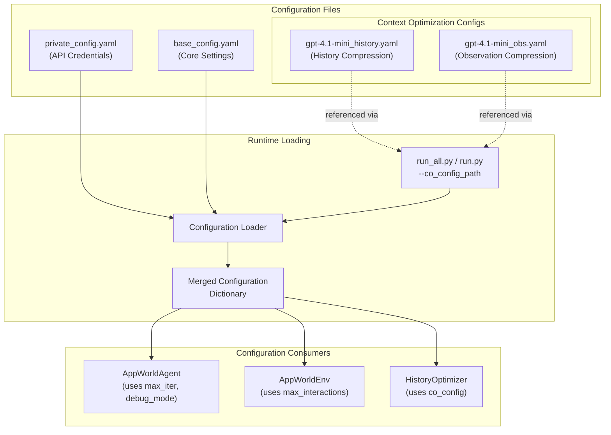
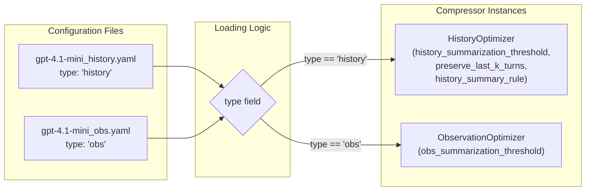
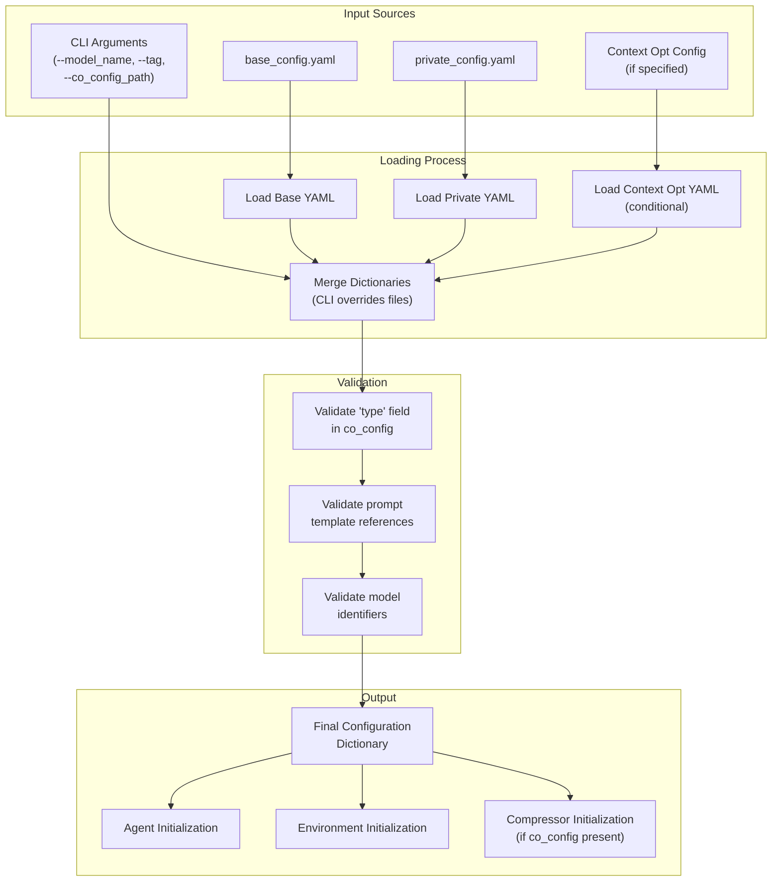

<!-- source: DeepWiki mcp.deepwiki.com · repo microsoft/acon · page 11.1 Configuration Schema Reference · fetched 2026-10-26 -->

# Configuration Schema Reference

<details>
<summary>Relevant source files</summary>

The following files were used as context for generating this wiki page:

- [experiments/appworld/configs/base_config.yaml](experiments/appworld/configs/base_config.yaml)
- [experiments/appworld/configs/context_opt/gpt-4.1-mini_history.yaml](experiments/appworld/configs/context_opt/gpt-4.1-mini_history.yaml)
- [experiments/appworld/configs/context_opt/gpt-4.1-mini_obs.yaml](experiments/appworld/configs/context_opt/gpt-4.1-mini_obs.yaml)

</details>


This page provides a complete reference for all configuration options in the ACON framework. It documents the schema for base configuration files, context optimization configurations, and how these configurations are structured and loaded.

For information about creating and customizing configurations for specific use cases, see [Configuration](#6). For details on prompt templates referenced in configurations, see [Prompt Templates](#6.3).

## Configuration File Types

ACON uses a hierarchical configuration system with three main types of configuration files:

1. **Base Configuration** (`base_config.yaml`) - Defines core agent behavior, environment settings, and execution parameters
2. **Context Optimization Configuration** (e.g., `gpt-4.1-mini_history.yaml`) - Defines context compression strategies for history or observations
3. **Private Configuration** (`private_config.yaml`) - Stores sensitive credentials like API keys (not committed to version control)

Configuration files are YAML-formatted and support overriding through command-line arguments and file merging.

## Configuration File Hierarchy

The following diagram illustrates how different configuration files relate to each other and to the execution pipeline:



Sources: [experiments/appworld/configs/base_config.yaml:1-25](), [experiments/appworld/configs/context_opt/gpt-4.1-mini_history.yaml:1-9](), [experiments/appworld/configs/context_opt/gpt-4.1-mini_obs.yaml:1-7]()

## Base Configuration Schema

The base configuration file (`base_config.yaml`) defines all core settings for running experiments. The following table documents all available fields:

| Field | Type | Required | Default | Description |
|-------|------|----------|---------|-------------|
| `exp_id` | string | No | `"appworld_base"` | Experiment identifier used for tracking and naming |
| `model_name` | string | Yes | `"gpt-4o"` | LLM model identifier (e.g., `gpt-4o`, `gpt-4.1-mini`, `qwen3-14b`) |
| `tag` | string | No | `"base"` | Experiment tag appended to output directory names |
| `debug_mode` | boolean | No | `true` | Enables verbose logging and debugging output |
| `max_iter` | integer | No | `50` | Maximum number of agent reasoning iterations per task |
| `use_workflow_memory` | boolean | No | `false` | Enables workflow memory for tracking subtask completion |
| `use_thinking_tokens` | boolean | No | `true` | Uses thinking token mode for agent reasoning |
| `prompt_file` | string | No | `null` | Path to custom prompt template (overrides default) |
| `experiment_name` | string | No | `"minimal_test"` | Environment-specific experiment name |
| `max_interactions` | integer | No | `50` | Maximum number of environment interactions |
| `co_config` | string | No | `null` | Path to context optimization configuration file |
| `save_trajectory` | boolean | No | `true` | Saves environment trajectory to disk |
| `save_llm_history` | boolean | No | `true` | Saves LLM interaction history to disk |

### Example Base Configuration

```yaml
# Base configuration for AppWorld experiments
exp_id: "appworld_base"
model_name: "gpt-4o"
tag: "base"

# Agent settings
debug_mode: true
max_iter: 50
use_workflow_memory: false
use_thinking_tokens: true

# Prompt settings
prompt_file: null

# Environment settings
experiment_name: "minimal_test"
max_interactions: 50

# Context optimization settings
co_config: null

# Output settings
save_trajectory: true
save_llm_history: true
```

Sources: [experiments/appworld/configs/base_config.yaml:1-25]()

## Context Optimization Configuration Schema

Context optimization configurations are loaded separately and referenced via the `co_config` field in the base configuration or the `--co_config_path` CLI argument. There are two types of context optimization configurations based on the `type` field.

### Configuration Type Diagram

The following diagram shows how configuration type determines which compressor is instantiated:



Sources: [experiments/appworld/configs/context_opt/gpt-4.1-mini_history.yaml:1](), [experiments/appworld/configs/context_opt/gpt-4.1-mini_obs.yaml:1]()

### History Compression Configuration

History compression configurations control how conversation history is compressed when it exceeds token thresholds.

| Field | Type | Required | Default | Description |
|-------|------|----------|---------|-------------|
| `type` | string | Yes | N/A | Must be `"history"` for history compression |
| `model` | string | Yes | N/A | Model used for history compression (e.g., `gpt-4.1-mini`) |
| `compressor_type` | string | Yes | N/A | Compression strategy: `"full"` for complete compression |
| `prompts` | object | Yes | N/A | Dictionary mapping prompt roles to template names |
| `prompts.prompt_system` | string | Yes | N/A | System prompt template name (e.g., `"system_prompt"`) |
| `prompts.prompt_history_user` | string | Yes | N/A | History compression prompt template (e.g., `"prompt_history_v2"`) |
| `history_summarization_threshold` | integer | Yes | N/A | Token threshold triggering history compression (e.g., `4096`) |
| `preserve_last_k_turns` | integer | No | `1` | Number of recent turns to preserve uncompressed |
| `history_summary_rule` | string | Yes | N/A | Summary accumulation rule: `"reset"` or `"accumulate"` |

### Example History Compression Configuration

```yaml
type: "history"
model: "gpt-4.1-mini"
compressor_type: "full"
prompts:
  prompt_system: "system_prompt"
  prompt_history_user: "prompt_history_v2"
history_summarization_threshold: 4096
preserve_last_k_turns: 1
history_summary_rule: "reset"
```

Sources: [experiments/appworld/configs/context_opt/gpt-4.1-mini_history.yaml:1-9]()

### Observation Compression Configuration

Observation compression configurations control how environment observations are compressed before being passed to the agent.

| Field | Type | Required | Default | Description |
|-------|------|----------|---------|-------------|
| `type` | string | Yes | N/A | Must be `"obs"` for observation compression |
| `model` | string | Yes | N/A | Model used for observation compression (e.g., `gpt-4.1-mini`) |
| `compressor_type` | string | Yes | N/A | Compression strategy: `"full"` for complete compression |
| `prompts` | object | Yes | N/A | Dictionary mapping prompt roles to template names |
| `prompts.prompt_system` | string | Yes | N/A | System prompt template name (e.g., `"system_prompt"`) |
| `prompts.prompt_user` | string | Yes | N/A | Observation compression prompt template (e.g., `"prompt_user"`) |
| `obs_summarization_threshold` | integer | Yes | N/A | Token threshold triggering observation compression (e.g., `256`) |

### Example Observation Compression Configuration

```yaml
type: "obs"
model: "gpt-4.1-mini"
compressor_type: "full"
prompts:
  prompt_system: "system_prompt"
  prompt_user: "prompt_user"
obs_summarization_threshold: 256
```

Sources: [experiments/appworld/configs/context_opt/gpt-4.1-mini_obs.yaml:1-7]()

## Configuration Loading and Merging

The following diagram illustrates the configuration loading and merging process at runtime:



Sources: [experiments/appworld/configs/base_config.yaml:1-25](), [experiments/appworld/configs/context_opt/gpt-4.1-mini_history.yaml:1-9](), [experiments/appworld/configs/context_opt/gpt-4.1-mini_obs.yaml:1-7]()

## Prompt Template References

The `prompts` dictionary in context optimization configurations references prompt template files by name. These templates are Jinja2 files located in the `experiments/appworld/prompts/` directory.

| Configuration Field | Expected Template File | Purpose |
|---------------------|----------------------|---------|
| `prompts.prompt_system` | `system_prompt.jinja` | System instructions for the compressor model |
| `prompts.prompt_history_user` | `prompt_history_v2.jinja` | User message template for history summarization |
| `prompts.prompt_user` | `prompt_user.jinja` | User message template for observation refinement |

The template names are resolved at runtime by appending `.jinja` and searching in the prompts directory.

Sources: [experiments/appworld/configs/context_opt/gpt-4.1-mini_history.yaml:4-6](), [experiments/appworld/configs/context_opt/gpt-4.1-mini_obs.yaml:4-6]()

## Model Identifier Conventions

The `model` and `model_name` fields accept the following conventions:

### OpenAI Models
- `gpt-4o` - GPT-4 Optimized model
- `gpt-4.1-mini` - GPT-4.1 Mini model (context compression)
- `gpt-4o-mini` - GPT-4 Optimized Mini variant

### Local Models
- `qwen3-14b` - Qwen3 14B base model
- `qwen3-14b-lora-compressor` - Qwen3 with compressor LoRA adapter
- `qwen3-14b-lora-agent` - Qwen3 with stacked LoRA adapters

Model identifiers determine which API endpoint or model server is used during execution.

Sources: [experiments/appworld/configs/base_config.yaml:3](), [experiments/appworld/configs/context_opt/gpt-4.1-mini_history.yaml:2]()

## Configuration Override Precedence

When multiple configuration sources specify the same field, the following precedence order applies (highest to lowest):

1. **Command-line arguments** (e.g., `--model_name gpt-4o`)
2. **Context optimization configuration** (loaded via `--co_config_path`)
3. **Base configuration** (`base_config.yaml`)
4. **Private configuration** (`private_config.yaml`)
5. **Default values** (hardcoded in the application)

This precedence allows for flexible configuration management where shared defaults can be defined in base configurations while experiment-specific overrides are applied via CLI arguments.

Sources: [experiments/appworld/configs/base_config.yaml:1-25]()

## History Summary Rules

The `history_summary_rule` field in history compression configurations controls how summaries accumulate:

| Rule | Behavior | Use Case |
|------|----------|----------|
| `"reset"` | Each summary replaces previous summaries | When complete context reset is acceptable |
| `"accumulate"` | Each summary is appended to previous summaries | When maintaining continuity is critical |

The `"reset"` rule is more token-efficient but may lose context, while `"accumulate"` preserves more information at the cost of growing summary length.

Sources: [experiments/appworld/configs/context_opt/gpt-4.1-mini_history.yaml:9]()

## Compressor Type Options

The `compressor_type` field determines the compression strategy:

| Type | Description | Implementation |
|------|-------------|----------------|
| `"full"` | Complete compression of all turns beyond threshold | Compresses entire history/observation into a summary |
| `"partial"` | Selective compression preserving key elements | Not currently implemented in provided configs |

Currently, all provided configurations use `compressor_type: "full"`.

Sources: [experiments/appworld/configs/context_opt/gpt-4.1-mini_history.yaml:3](), [experiments/appworld/configs/context_opt/gpt-4.1-mini_obs.yaml:3]()

## Token Threshold Configuration

Token thresholds determine when compression is triggered:

- **`history_summarization_threshold`**: Applied to cumulative conversation history length. Common values: `4096`, `8192`, `16384` tokens.
- **`obs_summarization_threshold`**: Applied to individual observation length. Common values: `256`, `512`, `1024` tokens.

These thresholds should be configured based on:
1. Model context window size
2. Cost optimization goals
3. Task complexity requirements

Lower thresholds trigger compression more frequently, reducing costs but potentially losing important context.

Sources: [experiments/appworld/configs/context_opt/gpt-4.1-mini_history.yaml:7](), [experiments/appworld/configs/context_opt/gpt-4.1-mini_obs.yaml:7]()

## Configuration Validation

The framework performs validation on loaded configurations:

1. **Type Validation**: Ensures `type` field is either `"history"` or `"obs"` for context optimization configs
2. **Model Validation**: Verifies model identifiers are recognized
3. **Prompt Validation**: Checks that referenced prompt templates exist
4. **Threshold Validation**: Ensures threshold values are positive integers
5. **Required Field Validation**: Confirms all required fields are present

Invalid configurations result in runtime errors with descriptive messages indicating the issue.

Sources: [experiments/appworld/configs/context_opt/gpt-4.1-mini_history.yaml:1-9](), [experiments/appworld/configs/context_opt/gpt-4.1-mini_obs.yaml:1-7]()

---

