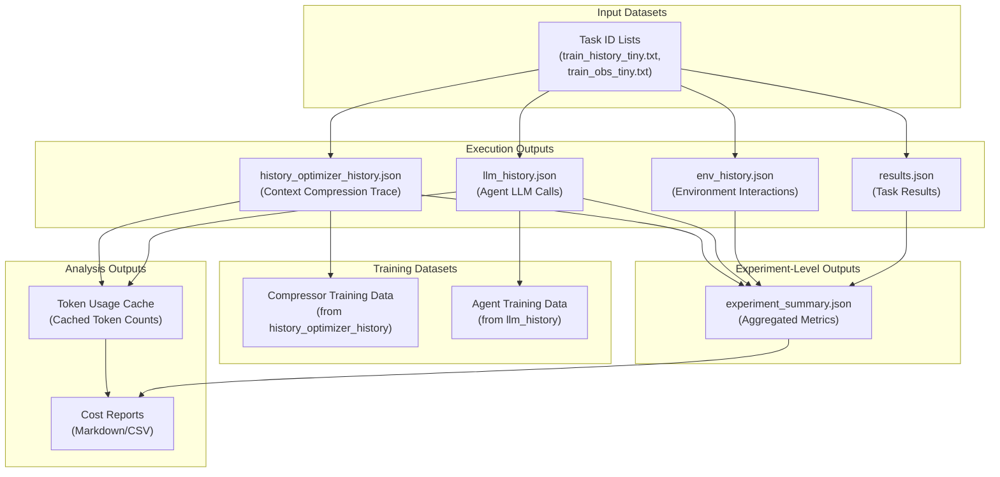
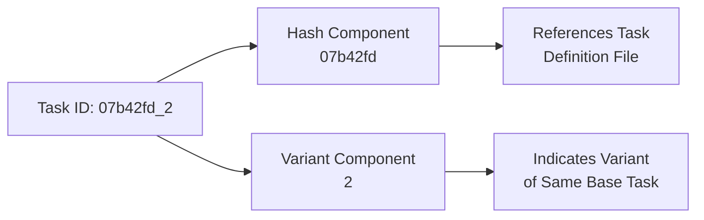
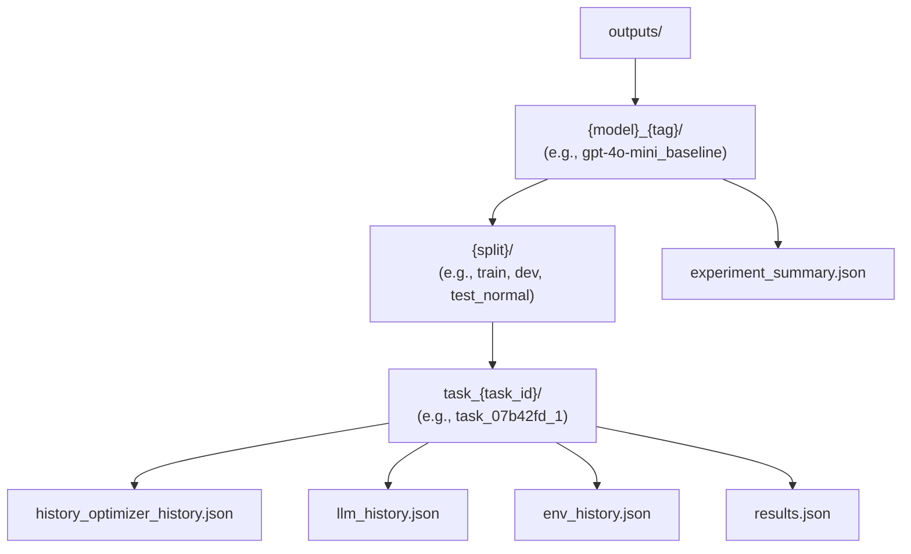
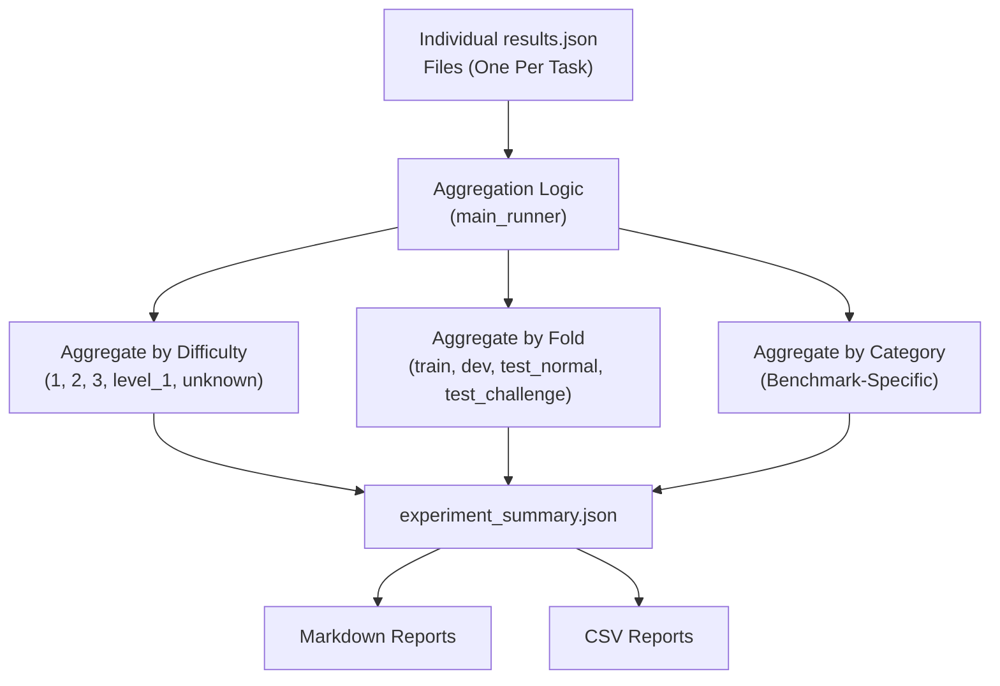
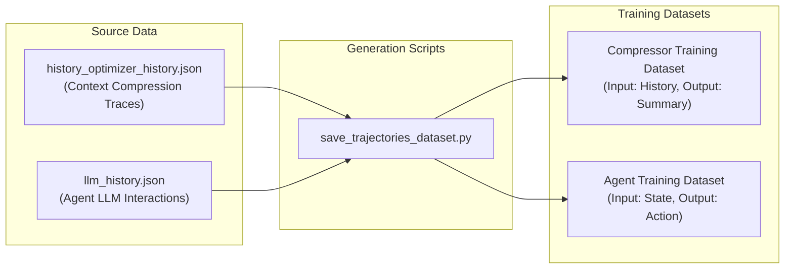
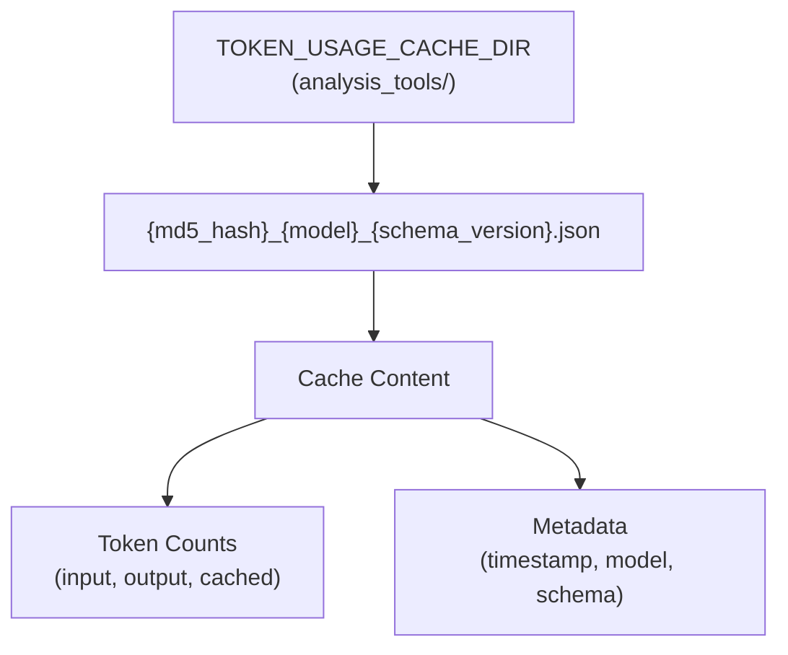
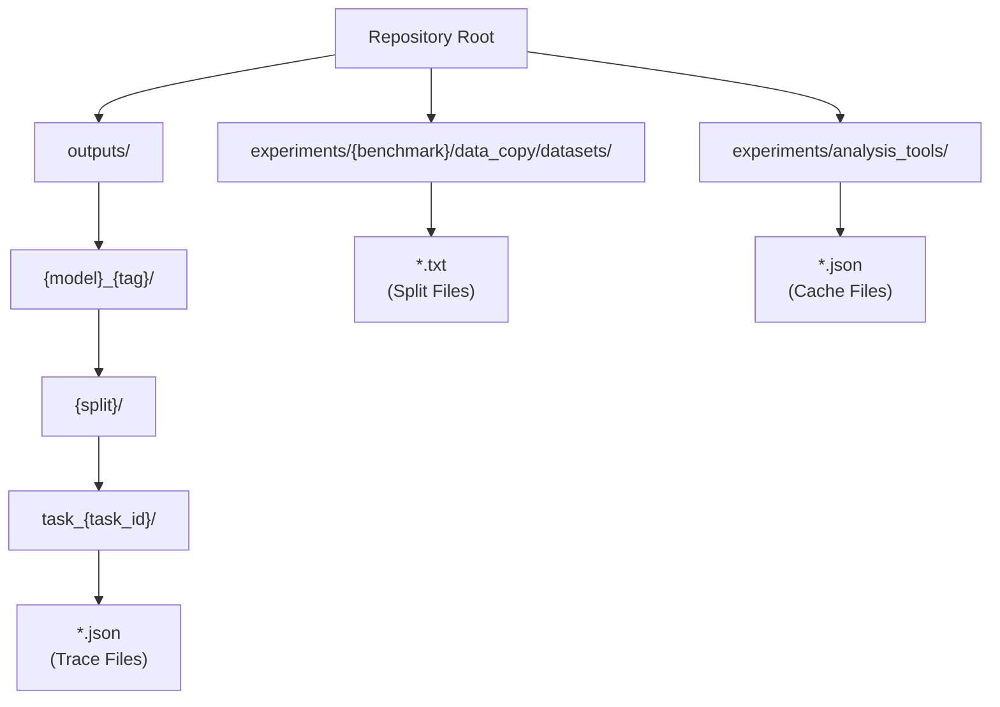

<!-- source: DeepWiki mcp.deepwiki.com · repo microsoft/acon · page 11.2 Dataset Formats · fetched 2026-10-26 -->

# Dataset Formats

<details>
<summary>Relevant source files</summary>

The following files were used as context for generating this wiki page:

- [experiments/appworld/data_copy/datasets/train_history_tiny.txt](experiments/appworld/data_copy/datasets/train_history_tiny.txt)
- [experiments/appworld/data_copy/datasets/train_obs_tiny.txt](experiments/appworld/data_copy/datasets/train_obs_tiny.txt)

</details>


## Purpose and Scope

This page provides technical specifications for all dataset and output formats used in the ACON framework. It covers:

- Task ID list formats for experiment splits
- Execution trace formats (optimizer history, LLM history, environment history)
- Results and summary formats
- Training dataset formats for LoRA fine-tuning

For information about configuring experiments that generate these outputs, see [Configuration](#6). For information about analyzing these outputs, see [Token and Cost Analysis](#7.1).

## Overview of Dataset Types

ACON generates and consumes several types of datasets throughout the experimental pipeline. The following diagram illustrates the flow of data from task definitions through execution to analysis:

### Dataset Flow in ACON Pipeline



Sources: System diagrams (Diagram 1, Diagram 3), [experiments/appworld/data_copy/datasets/]()

## Task ID List Format

Task ID lists define which tasks are included in each experimental split. These files are used to control which tasks are executed in batch experiments.

### Format Specification

| Field | Type | Description |
|-------|------|-------------|
| Format | Plain text | One task ID per line |
| Task ID Pattern | String | Format: `{hash}_{variant}` |
| Hash | 7-character hex | Unique task identifier |
| Variant | Integer | Task variant number (1, 2, or 3) |
| Line Endings | Unix (LF) | Standard newline characters |

### Example Structure

```
07b42fd_1
07b42fd_2
07b42fd_3
229360a_1
229360a_3
22cc237_1
```

### File Locations and Naming

| File Name | Purpose | Typical Size |
|-----------|---------|--------------|
| `train_history_tiny.txt` | Tasks for history compression training | 39 tasks |
| `train_obs_tiny.txt` | Tasks for observation compression training | 18 tasks |
| `{split}.txt` | General split definition (train, dev, test_normal, test_challenge) | Varies |

Sources: [experiments/appworld/data_copy/datasets/train_history_tiny.txt:1-39](), [experiments/appworld/data_copy/datasets/train_obs_tiny.txt:1-18]()

### Task ID Structure Diagram



Sources: [experiments/appworld/data_copy/datasets/train_history_tiny.txt:1-39]()

## Execution Trace Formats

During task execution, ACON generates detailed trace files that capture all interactions between the agent, context optimizer, and environment. These traces are stored in the output directory structure: `outputs/{model}_{tag}/{split}/task_{task_id}/`

### Directory Structure Diagram



Sources: System diagrams (Diagram 3)

### history_optimizer_history.json

This file captures the complete trace of context compression operations performed by the history optimizer during task execution.

#### Format Specification

| Field | Type | Description |
|-------|------|-------------|
| Root Structure | Array | List of compression events |
| Event Type | Object | Contains compression input, output, and metadata |

#### Event Object Schema

| Field | Type | Description |
|-------|------|-------------|
| `step` | Integer | Step number in task execution |
| `input_messages` | Array[Object] | Messages sent to compression model |
| `output_message` | Object | Compressed/summarized output |
| `model` | String | Model used for compression (e.g., "gpt-4o-mini") |
| `timestamp` | ISO 8601 | When compression occurred |
| `tokens_in` | Integer | Input token count |
| `tokens_out` | Integer | Output token count |
| `compression_ratio` | Float | Ratio of output to input tokens |

#### Usage

This file is consumed by:
- Token analysis tools for calculating compression costs
- Training dataset generation for compressor LoRA fine-tuning
- Prompt optimization pipeline for evaluating compression effectiveness

Sources: System diagrams (Diagram 3, Diagram 4)

### llm_history.json

This file records all LLM API calls made by the agent during task execution, including prompts, responses, and token usage.

#### Format Specification

| Field | Type | Description |
|-------|------|-------------|
| Root Structure | Array | List of agent LLM interactions |
| Interaction Type | Object | Contains prompt, response, and metadata |

#### Interaction Object Schema

| Field | Type | Description |
|-------|------|-------------|
| `step` | Integer | Step number in task execution |
| `prompt` | String or Array[Object] | Full prompt sent to LLM |
| `response` | String | LLM response text |
| `model` | String | Model identifier (e.g., "gpt-4o-2024-11-20") |
| `temperature` | Float | Sampling temperature |
| `timestamp` | ISO 8601 | When call was made |
| `tokens_prompt` | Integer | Prompt token count |
| `tokens_completion` | Integer | Completion token count |
| `tokens_cached` | Integer | Cached prompt tokens (if applicable) |
| `finish_reason` | String | Completion reason ("stop", "length", etc.) |

#### Usage

This file is consumed by:
- Token analysis tools for calculating agent costs
- Training dataset generation for agent LoRA fine-tuning
- Performance evaluation and debugging

Sources: System diagrams (Diagram 3, Diagram 4)

### env_history.json

This file captures the complete trace of environment interactions, including actions taken by the agent and observations received from the environment.

#### Format Specification

| Field | Type | Description |
|-------|------|-------------|
| Root Structure | Array | List of environment interactions |
| Interaction Type | Object | Contains action, observation, and metadata |

#### Interaction Object Schema

| Field | Type | Description |
|-------|------|-------------|
| `step` | Integer | Step number in task execution |
| `action` | Object or String | Action executed by agent |
| `observation` | Object or String | Environment response |
| `reward` | Float | Reward received (if applicable) |
| `done` | Boolean | Whether episode terminated |
| `info` | Object | Additional environment information |
| `timestamp` | ISO 8601 | When interaction occurred |

#### Benchmark-Specific Variations

Different benchmarks may have different observation and action formats:

| Benchmark | Action Format | Observation Format |
|-----------|---------------|-------------------|
| AppWorld | Structured JSON with API calls | Structured JSON with API responses |
| OfficeBench | Structured commands | Document state and feedback |
| SmolAgents | Tool invocations | Tool outputs and feedback |

Sources: System diagrams (Diagram 1, Diagram 3)

## Results and Summary Formats

### results.json

This file contains the final evaluation results for a single task execution.

#### Format Specification

| Field | Type | Description |
|-------|------|-------------|
| `task_id` | String | Task identifier |
| `success` | Boolean | Whether task was completed successfully |
| `score` | Float | Task-specific score (0.0 to 1.0) |
| `steps_taken` | Integer | Total number of steps |
| `total_tokens` | Integer | Total tokens used across all calls |
| `total_cost` | Float | Total cost in USD |
| `execution_time` | Float | Wall-clock time in seconds |
| `error` | String or null | Error message if task failed |
| `metadata` | Object | Benchmark-specific additional data |

#### Example Structure

```json
{
  "task_id": "07b42fd_1",
  "success": true,
  "score": 1.0,
  "steps_taken": 15,
  "total_tokens": 42503,
  "total_cost": 0.0085,
  "execution_time": 127.3,
  "error": null,
  "metadata": {
    "difficulty": 2,
    "category": "scheduling"
  }
}
```

Sources: System diagrams (Diagram 3)

### experiment_summary.json

This file aggregates results across all tasks in an experiment split, providing experiment-level statistics.

#### Format Specification

| Field | Type | Description |
|-------|------|-------------|
| `experiment_name` | String | Model and tag identifier |
| `split` | String | Data split (train, dev, test_normal, test_challenge) |
| `total_tasks` | Integer | Total number of tasks executed |
| `successful_tasks` | Integer | Number of tasks completed successfully |
| `success_rate` | Float | Percentage of successful tasks |
| `average_score` | Float | Mean score across all tasks |
| `total_tokens` | Integer | Total tokens used in experiment |
| `total_cost` | Float | Total cost in USD |
| `average_tokens_per_task` | Float | Mean tokens per task |
| `average_cost_per_task` | Float | Mean cost per task |
| `execution_time` | Float | Total wall-clock time in seconds |
| `tasks` | Array[Object] | Per-task summary results |

#### Aggregation Dimensions

The summary supports multiple aggregation views:

| Dimension | Values | Purpose |
|-----------|--------|---------|
| Difficulty | 1, 2, 3, level_1, unknown | Performance by task difficulty |
| Fold | train, dev, test_normal, test_challenge | Performance by data split |
| Category | Benchmark-specific | Performance by task category |

Sources: System diagrams (Diagram 3, Diagram 4)

### Summary Aggregation Flow



Sources: System diagrams (Diagram 4)

## Training Dataset Formats

ACON generates training datasets from execution traces for LoRA fine-tuning. These datasets follow a structured format suitable for supervised fine-tuning.

### Dataset Generation Pipeline



Sources: System diagrams (Diagram 1, Diagram 2)

### Compressor Training Dataset Format

This dataset is extracted from `history_optimizer_history.json` files and used to fine-tune the compressor LoRA.

#### Format Specification

| Field | Type | Description |
|-------|------|-------------|
| Format | JSONL | One training example per line |
| Example Structure | Object | Contains input and output fields |

#### Example Object Schema

| Field | Type | Description |
|-------|------|-------------|
| `input` | String or Array[Object] | Full history to be compressed |
| `output` | String | Compressed/summarized history |
| `task_id` | String | Source task identifier |
| `step` | Integer | Step within task |
| `tokens_in` | Integer | Input token count |
| `tokens_out` | Integer | Output token count |

#### Example

```json
{
  "input": "Step 1: Created a new email draft...\nStep 2: Added recipient...",
  "output": "Created email draft and added recipient john@example.com",
  "task_id": "07b42fd_1",
  "step": 3,
  "tokens_in": 150,
  "tokens_out": 20
}
```

Sources: System diagrams (Diagram 1, Diagram 2)

### Agent Training Dataset Format

This dataset is extracted from `llm_history.json` files and used to fine-tune the agent LoRA.

#### Format Specification

| Field | Type | Description |
|-------|------|-------------|
| Format | JSONL | One training example per line |
| Example Structure | Object | Contains input and output fields |

#### Example Object Schema

| Field | Type | Description |
|-------|------|-------------|
| `input` | String or Array[Object] | Agent prompt (system + history + observation) |
| `output` | String | Agent action/response |
| `task_id` | String | Source task identifier |
| `step` | Integer | Step within task |
| `success` | Boolean | Whether this action led to task success |

#### Example

```json
{
  "input": "System: You are a helpful agent...\nHistory: Previous steps...\nObservation: Current state...",
  "output": "Action: SendEmail(to='john@example.com', subject='Meeting')",
  "task_id": "07b42fd_1",
  "step": 5,
  "success": true
}
```

Sources: System diagrams (Diagram 1, Diagram 2)

### Training Dataset File Locations

| Dataset Type | Source Files | Output Location | Purpose |
|--------------|--------------|-----------------|---------|
| Compressor | `history_optimizer_history.json` | Configured in training script | Fine-tune compressor LoRA |
| Agent | `llm_history.json` | Configured in training script | Fine-tune agent LoRA |

Sources: System diagrams (Diagram 1, Diagram 2)

## Token Usage Cache Format

The token analysis system maintains a cache to avoid redundant token calculations. This cache uses MD5 hashing and schema versioning to ensure validity.

### Cache File Structure



Sources: System diagrams (Diagram 4)

### Cache Object Schema

| Field | Type | Description |
|-------|------|-------------|
| `schema_version` | String | Cache schema version identifier |
| `model` | String | Model identifier |
| `timestamp` | ISO 8601 | Cache creation time |
| `token_counts` | Object | Calculated token counts |
| `messages_hash` | String | MD5 hash of input messages |

### Cache Key Generation

The cache key is generated using:
1. MD5 hash of input messages
2. Model identifier
3. Schema version

This ensures cache invalidation when any of these components change.

Sources: System diagrams (Diagram 4)

## Cost Report Formats

The analysis system generates cost reports in two formats: Markdown tables and CSV files.

### Markdown Report Format

Markdown reports provide human-readable cost breakdowns with multiple aggregation dimensions.

#### Example Structure

```markdown
# Cost Analysis Report

## By Difficulty

| Difficulty | Tasks | Total Cost | Avg Cost | Total Tokens | Avg Tokens |
|-----------|-------|------------|----------|--------------|------------|
| 1         | 50    | $12.50     | $0.25    | 625,000      | 12,500     |
| 2         | 75    | $28.75     | $0.38    | 1,437,500    | 19,167     |
| 3         | 25    | $15.00     | $0.60    | 750,000      | 30,000     |

## By Fold

| Fold          | Tasks | Total Cost | Avg Cost | Total Tokens | Avg Tokens |
|--------------|-------|------------|----------|--------------|------------|
| train        | 100   | $40.00     | $0.40    | 2,000,000    | 20,000     |
| dev          | 30    | $12.00     | $0.40    | 600,000      | 20,000     |
| test_normal  | 20    | $8.00      | $0.40    | 400,000      | 20,000     |
```

Sources: System diagrams (Diagram 4)

### CSV Report Format

CSV reports provide machine-readable cost data for further analysis.

#### Column Schema

| Column | Type | Description |
|--------|------|-------------|
| `task_id` | String | Task identifier |
| `difficulty` | Integer or String | Task difficulty level |
| `fold` | String | Data split |
| `total_tokens` | Integer | Total tokens used |
| `input_tokens` | Integer | Input tokens |
| `output_tokens` | Integer | Output tokens |
| `cached_tokens` | Integer | Cached tokens |
| `total_cost` | Float | Total cost in USD |
| `input_cost` | Float | Input token cost |
| `output_cost` | Float | Output token cost |
| `cached_cost` | Float | Cached token cost |

Sources: System diagrams (Diagram 4)

## Format Validation and Schema Evolution

### Schema Versioning

All JSON formats use implicit schema versioning through the presence/absence of fields. When schema changes occur:

1. The token cache schema version is incremented
2. Old cache files are invalidated
3. New calculations use the updated schema

### Validation Locations

| Format | Validation Location | Error Handling |
|--------|-------------------|----------------|
| Task ID Lists | During task loading | Skip invalid lines, log warnings |
| Execution Traces | During JSON serialization | Fail task execution on errors |
| Training Datasets | During dataset generation | Skip invalid examples, log warnings |
| Cache Files | During cache loading | Regenerate on validation failure |

Sources: System diagrams (Diagram 4)

## File Path Conventions

ACON uses consistent file path conventions across all benchmarks and configurations:

### Path Pattern Diagram



Sources: System diagrams (Diagram 3), [experiments/appworld/data_copy/datasets/]()

### Standard Paths

| Path Component | Pattern | Example |
|---------------|---------|---------|
| Output Root | `outputs/` | `outputs/` |
| Model Directory | `{model}_{tag}/` | `gpt-4o-mini_baseline/` |
| Split Directory | `{split}/` | `train/` |
| Task Directory | `task_{task_id}/` | `task_07b42fd_1/` |
| Dataset File | `{split}_{type}_tiny.txt` | `train_history_tiny.txt` |
| Cache File | `{hash}_{model}_{version}.json` | `abc123_gpt-4o-mini_v1.json` |

Sources: System diagrams (Diagram 3, Diagram 4), [experiments/appworld/data_copy/datasets/]()

---

