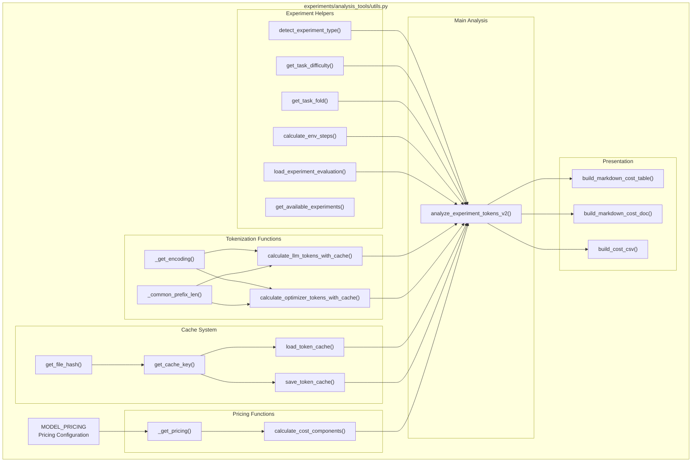
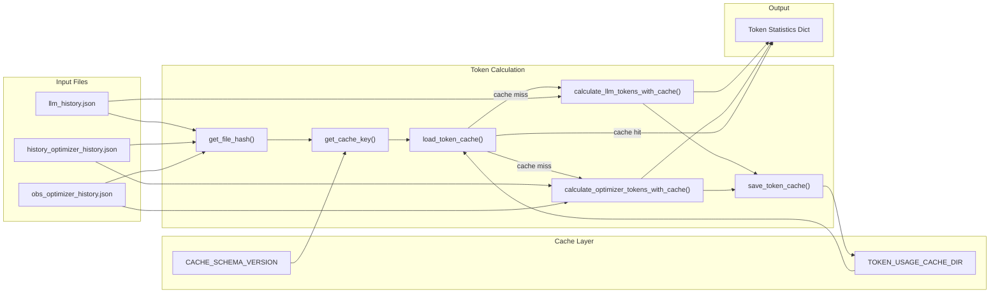
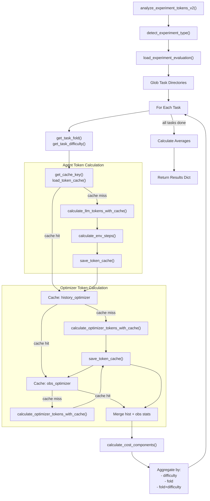

<!-- source: DeepWiki mcp.deepwiki.com · repo microsoft/acon · page 11.3 Analysis Functions Reference · fetched 2026-10-26 -->

# Analysis Functions Reference

<details>
<summary>Relevant source files</summary>

The following files were used as context for generating this wiki page:

- [experiments/analysis_tools/utils.py](experiments/analysis_tools/utils.py)

</details>


## Purpose and Scope

This page provides complete API reference documentation for all analysis utility functions in the ACON framework. These functions are located in `experiments/analysis_tools/utils.py` and provide capabilities for:

- Token counting with cache-aware prefix matching
- Cost calculation based on model pricing
- Experiment metadata extraction and aggregation
- Markdown and CSV report generation

For practical guides on using these functions, see:
- [Token and Cost Analysis](#7.1) for usage examples
- [analyze_experiment_tokens_v2](#7.1.1) for detailed workflow guide
- [Cache System](#7.1.2) for cache configuration
- [Cost Reporting](#7.1.3) for report formats

**Sources:** [experiments/analysis_tools/utils.py:1-11]()

---

## Module Architecture

### System Component Overview



**Sources:** [experiments/analysis_tools/utils.py:1-1445]()

### Token Calculation Data Flow



**Sources:** [experiments/analysis_tools/utils.py:131-438](), [experiments/analysis_tools/utils.py:464-504]()

---

## Model Pricing

### MODEL_PRICING Dictionary

The `MODEL_PRICING` dictionary defines cost rates per 1,000 tokens for supported models. All prices are in dollars per 1K tokens.

| Model | Input Rate | Cached Input Rate | Output Rate |
|-------|------------|-------------------|-------------|
| `gpt-4.1` | 0.003 | 0.00075 | 0.012 |
| `gpt-4.1-mini` | 0.0008 | 0.0002 | 0.0032 |

**Usage:**
```python
from experiments.analysis_tools.utils import MODEL_PRICING

# Access pricing for a model
gpt4_pricing = MODEL_PRICING['gpt-4.1']
input_cost_per_1k = gpt4_pricing['input']  # 0.003
cached_cost_per_1k = gpt4_pricing['cached_input']  # 0.00075
output_cost_per_1k = gpt4_pricing['output']  # 0.012
```

**Sources:** [experiments/analysis_tools/utils.py:26-40]()

### CACHE_SCHEMA_VERSION

Current cache schema version for token calculation results. Increment this constant when token counting logic or cached data structure changes.

**Current Value:** `"v2.2"`

**Sources:** [experiments/analysis_tools/utils.py:42-44]()

---

## Pricing Functions

### _get_pricing

```python
def _get_pricing(model_name: str) -> Dict[str, float]
```

Returns the pricing map for a given model name.

**Parameters:**
- `model_name` (str): Name of the model (e.g., `"gpt-4.1"`, `"gpt-4.1-mini"`)

**Returns:**
- `Dict[str, float]`: Dictionary with keys `'input'`, `'cached_input'`, `'output'` containing rates per 1K tokens
- Empty dict `{}` if model is unknown (results in zero costs)

**Example:**
```python
pricing = _get_pricing('gpt-4.1')
# {'input': 0.003, 'cached_input': 0.00075, 'output': 0.012}

unknown_pricing = _get_pricing('unknown-model')
# {}
```

**Sources:** [experiments/analysis_tools/utils.py:47-52]()

### calculate_cost_components

```python
def calculate_cost_components(stats: Dict, model_name: str) -> Dict[str, float]
```

Calculates cost breakdown for a set of token statistics using model pricing.

**Parameters:**
- `stats` (Dict): Token statistics dictionary with keys:
  - `'total_input_tokens'`: Total input tokens
  - `'total_input_cached_tokens'`: Cached input tokens
  - `'total_input_new_tokens'`: New (non-cached) input tokens
  - `'total_output_tokens'`: Output tokens generated
- `model_name` (str): Model name for pricing lookup

**Returns:**
- `Dict[str, float]`: Cost breakdown with keys:
  - `'input_cost_no_cache'`: Input cost without cache discount
  - `'input_cost_with_cache'`: Input cost with cache discount applied
  - `'output_cost'`: Output token cost
  - `'total_cost_no_cache'`: Total without cache discount
  - `'total_cost_with_cache'`: Total with cache discount

**Example:**
```python
stats = {
    'total_input_tokens': 10000,
    'total_input_cached_tokens': 8000,
    'total_input_new_tokens': 2000,
    'total_output_tokens': 1000
}
costs = calculate_cost_components(stats, 'gpt-4.1')
# {
#     'input_cost_no_cache': 0.03,  # 10000/1000 * 0.003
#     'input_cost_with_cache': 0.012,  # (8000/1000 * 0.00075) + (2000/1000 * 0.003)
#     'output_cost': 0.012,  # 1000/1000 * 0.012
#     'total_cost_no_cache': 0.042,
#     'total_cost_with_cache': 0.024
# }
```

**Sources:** [experiments/analysis_tools/utils.py:55-90]()

---

## Tokenization Functions

### _get_encoding

```python
def _get_encoding(model_name: str)
```

Returns a tiktoken encoding object with automatic fallbacks and installation.

**Parameters:**
- `model_name` (str): Model name for encoding selection

**Returns:**
- `tiktoken.Encoding`: Encoding object for tokenization

**Behavior:**
- Automatically installs `tiktoken` if not available
- Uses `gpt-4` encoding for names containing `'gpt-4'`
- Uses `gpt-3.5-turbo` encoding for names containing `'gpt-3.5'`
- Falls back to `cl100k_base` encoding for unknown models

**Example:**
```python
enc = _get_encoding('gpt-4.1')
tokens = enc.encode("Hello, world!")
# [9906, 11, 1917, 0]
```

**Sources:** [experiments/analysis_tools/utils.py:95-117]()

### _common_prefix_len

```python
def _common_prefix_len(a: List[int], b: List[int]) -> int
```

Returns the length of the common prefix between two token ID sequences. Used to simulate cache billing where repeated prompt prefixes are charged at a discount.

**Parameters:**
- `a` (List[int]): First token ID sequence
- `b` (List[int]): Second token ID sequence

**Returns:**
- `int`: Number of matching tokens at the start of both sequences

**Example:**
```python
seq_a = [1, 2, 3, 4, 5]
seq_b = [1, 2, 3, 9, 10]
prefix_len = _common_prefix_len(seq_a, seq_b)
# 3  (tokens [1, 2, 3] match)
```

**Sources:** [experiments/analysis_tools/utils.py:120-126]()

### calculate_llm_tokens_with_cache

```python
def calculate_llm_tokens_with_cache(
    llm_history, 
    model_name: str = 'gpt-4.1'
)
```

Computes agent token usage with cache-aware input counting. Tracks prefix overlap between steps to simulate provider caching.

**Parameters:**
- `llm_history`: List of sessions, where each session is a list of message dicts with `'role'` and `'content'` keys
- `model_name` (str, optional): Model name for tokenization. Default: `'gpt-4.1'`

**Returns:**
- `Dict`: Token statistics with keys:
  - `'total_input_tokens'`: Sum of all input tokens
  - `'total_input_cached_tokens'`: Tokens matched from previous step prefix
  - `'total_input_new_tokens'`: Non-cached input tokens
  - `'total_output_tokens'`: Tokens in assistant responses
  - `'total_tokens_no_cache'`: Total without cache consideration
  - `'total_tokens_with_cache'`: Total with cache consideration
  - `'total_dependency'`: Sum of dependency metric across steps
  - `'num_steps'`: Number of assistant messages
  - `'peak_tokens'`: Maximum input tokens in any single step
  - `'step_breakdown'`: List of per-step statistics

**Step Breakdown Structure:**
Each entry in `'step_breakdown'` contains:
- `'session'`: Session index (1-based)
- `'step'`: Step number within session
- `'input_tokens_total'`: Total input tokens for this step
- `'input_tokens_cached'`: Cached tokens from prefix match
- `'input_tokens_new'`: New tokens not in cache
- `'output_tokens'`: Output tokens generated
- `'dependency'`: `((n_input_no_system + 2 * n_output) * n_output) / 2`
- `'total_tokens_step_no_cache'`: Total tokens for step without cache
- `'total_tokens_step_with_cache'`: Total tokens for step with cache

**Example:**
```python
llm_history = [
    [
        {'role': 'system', 'content': 'You are a helpful assistant.'},
        {'role': 'user', 'content': 'What is 2+2?'},
        {'role': 'assistant', 'content': '2+2 equals 4.'}
    ]
]

stats = calculate_llm_tokens_with_cache(llm_history, 'gpt-4.1')
# {
#     'total_input_tokens': 25,
#     'total_input_cached_tokens': 0,  # First step has no cache
#     'total_input_new_tokens': 25,
#     'total_output_tokens': 8,
#     'num_steps': 1,
#     'peak_tokens': 25,
#     ...
# }
```

**Sources:** [experiments/analysis_tools/utils.py:131-231]()

### calculate_optimizer_tokens_with_cache

```python
def calculate_optimizer_tokens_with_cache(
    history_file: str,
    model_name: str = 'gpt-4.1-mini',
    agent_llm_history_file: Optional[str] = None,
)
```

Computes optimizer token usage with support for two history formats and advanced caching.

**Parameters:**
- `history_file` (str): Path to optimizer history JSON file
- `model_name` (str, optional): Model name for tokenization. Default: `'gpt-4.1-mini'`
- `agent_llm_history_file` (Optional[str], optional): Path to agent's `llm_history.json` for advanced cache matching. If `None`, attempts to load from same directory as `history_file`

**Supported Formats:**

**Format A (Legacy):** Each turn is `[system_prompt, user_text, assistant_response]`
- Uses simple previous-turn prefix caching

**Format B (Advanced):** Each turn is `[system_prompt, messages_list, optimizer_response]`
- `messages_list` contains chat message dicts with `'role'` and `'content'`
- Caches against both previous optimizer turns AND agent step sequences
- Only the first response string (index 2) counts as optimizer output

**Returns:**
- `Dict`: Token statistics (same structure as `calculate_llm_tokens_with_cache` but with `'num_turns'` instead of `'num_steps'`)
- Additional keys for Format B:
  - `'total_input_cached_tokens_from_agent'`: Tokens cached from agent sequences
  - `'total_input_cached_tokens_from_prev'`: Tokens cached from previous optimizer turn
  - `'advanced_cache'`: `True` to indicate Format B was used

**Example:**
```python
# Format A
stats_a = calculate_optimizer_tokens_with_cache(
    'task_1/history_optimizer_history.json',
    'gpt-4.1-mini'
)

# Format B with agent cache
stats_b = calculate_optimizer_tokens_with_cache(
    'task_1/history_optimizer_history.json',
    'gpt-4.1-mini',
    agent_llm_history_file='task_1/llm_history.json'
)
# stats_b includes 'advanced_cache': True
```

**Sources:** [experiments/analysis_tools/utils.py:234-438]()

---

## Cache System Functions

### Configuration Constants

| Constant | Value | Purpose |
|----------|-------|---------|
| `TOKEN_USAGE_CACHE_DIR` | `Path('analysis/cache/token_usage')` | Directory for cache files |
| `CACHE_SCHEMA_VERSION` | `"v2.2"` | Schema version for invalidation |

**Sources:** [experiments/analysis_tools/utils.py:444-452]()

### get_file_hash

```python
def get_file_hash(file_path: str) -> Optional[str]
```

Computes MD5 hash of a file for cache key generation.

**Parameters:**
- `file_path` (str): Path to file

**Returns:**
- `Optional[str]`: MD5 hash hexdigest, or `None` if file doesn't exist or read fails

**Example:**
```python
hash_val = get_file_hash('task_1/llm_history.json')
# "a3f5c8d9b2e1..."
```

**Sources:** [experiments/analysis_tools/utils.py:466-473]()

### get_cache_key

```python
def get_cache_key(file_path: str, model_name: str, suffix: str = '') -> Optional[str]
```

Generates a cache key incorporating schema version, file hash, model name, and optional suffix.

**Parameters:**
- `file_path` (str): Path to history file
- `model_name` (str): Model name used for tokenization
- `suffix` (str, optional): Additional suffix for key differentiation (e.g., `'_agent_v2'`, `'_opt_hist_v2'`)

**Returns:**
- `Optional[str]`: Cache key string like `"v2.2_<hash>_<model><suffix>"`, or `None` if file hash fails

**Example:**
```python
key = get_cache_key('task_1/llm_history.json', 'gpt-4.1', '_agent_v2')
# "v2.2_a3f5c8d9b2e1..._gpt-4.1_agent_v2"
```

**Sources:** [experiments/analysis_tools/utils.py:476-478]()

### load_token_cache

```python
def load_token_cache(cache_key: Optional[str])
```

Loads cached token statistics from disk.

**Parameters:**
- `cache_key` (Optional[str]): Cache key from `get_cache_key()`

**Returns:**
- Cached token statistics dict if cache hit
- `None` if cache key is `None`, cache file doesn't exist, or unpickling fails

**Example:**
```python
cache_key = get_cache_key('task_1/llm_history.json', 'gpt-4.1', '_agent_v2')
cached_stats = load_token_cache(cache_key)
if cached_stats:
    print("Cache hit!")
else:
    print("Cache miss, need to compute")
```

**Sources:** [experiments/analysis_tools/utils.py:481-491]()

### save_token_cache

```python
def save_token_cache(cache_key: Optional[str], token_data)
```

Saves token statistics to cache file.

**Parameters:**
- `cache_key` (Optional[str]): Cache key from `get_cache_key()`
- `token_data`: Token statistics dictionary to cache

**Returns:**
- None

**Side Effects:**
- Creates cache directory if it doesn't exist
- Writes pickle file to `TOKEN_USAGE_CACHE_DIR/<cache_key>.pkl`
- Logs warning if save fails

**Example:**
```python
stats = calculate_llm_tokens_with_cache(llm_history, 'gpt-4.1')
cache_key = get_cache_key('task_1/llm_history.json', 'gpt-4.1', '_agent_v2')
save_token_cache(cache_key, stats)
```

**Sources:** [experiments/analysis_tools/utils.py:494-503]()

---

## Experiment Helper Functions

### Path Constants

| Constant | Value | Purpose |
|----------|-------|---------|
| `EXPERIMENTS_ROOT` | `Path(__file__).resolve().parents[1]` | Root experiments directory |
| `APPWORLD_BASE_PATH` | `EXPERIMENTS_ROOT / 'appworld' / 'outputs'` | AppWorld outputs directory |
| `APPWORLD_BASE_PATHS` | List of existing output paths | Supports multiple output directories |
| `OFFICEBENCH_BASE_PATH` | `EXPERIMENTS_ROOT / 'officebench' / 'outputs'` | OfficeBench outputs directory |
| `OFFICEBENCH_BASE_PATHS` | List of existing output paths | Supports multiple output directories |
| `SMOLAGENTS_BASE_PATH` | `EXPERIMENTS_ROOT / 'smolagents' / 'outputs'` | SmolAgents outputs directory |
| `SMOLAGENTS_BASE_PATHS` | List of existing output paths | Supports multiple output directories |

**Sources:** [experiments/analysis_tools/utils.py:441-461]()

### calculate_env_steps

```python
def calculate_env_steps(task_dir: str, experiment_type='appworld')
```

Extracts the number of environment steps from task output files.

**Parameters:**
- `task_dir` (str): Path to task directory
- `experiment_type` (str, optional): One of `'appworld'`, `'officebench'`, `'smolagents'`. Default: `'appworld'`

**Returns:**
- `Dict`: `{'num_steps': int}` containing step count

**Behavior:**
- For AppWorld: Reads `appworld_trajectory.json` and counts `trajectory` list length
- For others: Reads `env_history.json` and counts list length
- Returns `{'num_steps': 0}` if file not found or read fails

**Example:**
```python
steps = calculate_env_steps('outputs/gpt-4.1_baseline/train/task_123', 'appworld')
# {'num_steps': 15}
```

**Sources:** [experiments/analysis_tools/utils.py:508-527]()

### load_experiment_evaluation

```python
def load_experiment_evaluation(experiment_name: str, split='train')
```

Loads AppWorld evaluation results for an experiment.

**Parameters:**
- `experiment_name` (str): Experiment name (with or without `'[AppWorld] '` prefix)
- `split` (str, optional): Data split name. Default: `'train'`

**Returns:**
- `Tuple[Dict, Dict]`: `(individual_results, aggregate_results)`
  - `individual_results`: Task-level evaluation data
  - `aggregate_results`: Aggregated metrics
- Returns `({}, {})` if evaluation file not found

**Example:**
```python
individual, aggregate = load_experiment_evaluation('[AppWorld] gpt-4.1_baseline', 'train')
# individual: {'task_123': {'difficulty': 2, 'success': True, ...}, ...}
# aggregate: {'avg_success_rate': 0.75, ...}
```

**Sources:** [experiments/analysis_tools/utils.py:530-540]()

### detect_experiment_type

```python
def detect_experiment_type(experiment_name: str)
```

Detects the benchmark type and locates the experiment directory.

**Parameters:**
- `experiment_name` (str): Experiment name, optionally prefixed with `'[AppWorld] '`, `'[OfficeBench] '`, or `'[SmolAgents] '`

**Returns:**
- `Tuple[Optional[str], Optional[Path]]`: `(experiment_type, experiment_path)`
  - `experiment_type`: One of `'appworld'`, `'officebench'`, `'smolagents'`, or `None`
  - `experiment_path`: Path to experiment directory, or `None` if not found

**Search Order:**
1. Checks prefixed names in corresponding base paths
2. Searches all base paths for unprefixed names

**Example:**
```python
exp_type, exp_path = detect_experiment_type('[AppWorld] gpt-4.1_baseline')
# ('appworld', Path('.../experiments/appworld/outputs/gpt-4.1_baseline'))

exp_type, exp_path = detect_experiment_type('gpt-4.1_baseline')
# Searches all base paths, returns first match
```

**Sources:** [experiments/analysis_tools/utils.py:543-576]()

### get_available_experiments

```python
def get_available_experiments()
```

Lists all available experiments across all benchmark types.

**Parameters:**
- None

**Returns:**
- `List[str]`: Sorted list of experiment names with benchmark prefixes

**Example:**
```python
experiments = get_available_experiments()
# [
#     '[AppWorld] gpt-4.1_baseline',
#     '[AppWorld] gpt-4.1_history',
#     '[OfficeBench] gpt-4.1_baseline',
#     '[SmolAgents] gpt-4.1_baseline',
#     ...
# ]
```

**Sources:** [experiments/analysis_tools/utils.py:579-596]()

### get_task_difficulty

```python
def get_task_difficulty(
    task_id: str, 
    evaluation_data=None, 
    task_dir_path: Optional[str]=None, 
    experiment_type='appworld'
)
```

Determines the difficulty level of a task.

**Parameters:**
- `task_id` (str): Task identifier
- `evaluation_data` (optional): Evaluation data dict containing task metadata
- `task_dir_path` (Optional[str], optional): Path to task directory
- `experiment_type` (str, optional): Benchmark type. Default: `'appworld'`

**Returns:**
- `str`: Difficulty level
  - For AppWorld: `'1'`, `'2'`, `'3'`, or `'unknown'`
  - For OfficeBench: `'level_1'`, `'level_2'`, `'level_3'`, or `'unknown'`

**Lookup Order:**
1. AppWorld: Checks `data/tasks/<task_id>/ground_truth/metadata.json`
2. Checks `evaluation_data` if provided
3. OfficeBench: Parses task ID pattern `<level>-<number>`
4. Returns `'unknown'` if no difficulty found

**Example:**
```python
# AppWorld task
diff = get_task_difficulty('task_123', experiment_type='appworld')
# '2'

# OfficeBench task
diff = get_task_difficulty('1-5', experiment_type='officebench')
# 'level_1'
```

**Sources:** [experiments/analysis_tools/utils.py:599-619]()

### get_task_fold

```python
def get_task_fold(task_dir_path: Optional[str]) -> str
```

Extracts the data fold (split) from a task directory path.

**Parameters:**
- `task_dir_path` (Optional[str]): Path to task directory

**Returns:**
- `str`: Fold name
  - One of: `'train'`, `'dev'`, `'test_normal'`, `'test_challenge'`, `'unknown'`
  - Normalizes `'test'` to `'test_normal'`
  - Normalizes `'challenge'` to `'test_challenge'`

**Example:**
```python
fold = get_task_fold('outputs/exp/train/task_123')
# 'train'

fold = get_task_fold('outputs/exp/test_challenge/task_456')
# 'test_challenge'

fold = get_task_fold(None)
# 'unknown'
```

**Sources:** [experiments/analysis_tools/utils.py:622-633]()

---

## Main Analysis Function

### analyze_experiment_tokens_v2

```python
def analyze_experiment_tokens_v2(
    experiment_name: str, 
    agent_model='gpt-4.1', 
    optimizer_model='gpt-4.1', 
    folds: Optional[List[str]] = None,
    verbose=False
)
```

Main analysis function that computes comprehensive token usage and cost statistics for an entire experiment.

**Parameters:**
- `experiment_name` (str): Name of experiment (with or without benchmark prefix)
- `agent_model` (str, optional): Model name for agent token counting. Default: `'gpt-4.1'`
- `optimizer_model` (str, optional): Model name for optimizer token counting. Default: `'gpt-4.1'`
- `folds` (Optional[List[str]], optional): List of folds to analyze. If `None`, analyzes all folds
- `verbose` (bool, optional): Print progress messages. Default: `False`

**Returns:**
- `Optional[Dict]`: Analysis results dictionary, or `None` if experiment not found

### Return Value Structure

```python
{
    'experiment_name': str,
    'experiment_type': str,  # 'appworld', 'officebench', or 'smolagents'
    'agent_model': str,
    'optimizer_model': str,
    'evaluation_data_available': bool,
    
    'tasks': {
        '<task_id>': {
            'difficulty': str,
            'fold': str,
            'agent': {
                'total_input_tokens': int,
                'total_input_cached_tokens': int,
                'total_input_new_tokens': int,
                'total_output_tokens': int,
                'total_tokens_no_cache': int,
                'total_tokens_with_cache': int,
                'num_steps': int,
                'peak_tokens': int,
                'total_dependency': float,
                'step_breakdown': [...]
            },
            'optimizer': {
                'total_input_tokens': int,
                'total_input_cached_tokens': int,
                'total_input_new_tokens': int,
                'total_output_tokens': int,
                'total_tokens_no_cache': int,
                'total_tokens_with_cache': int,
                'num_turns': int,
                'peak_tokens': int,
                'total_dependency': float,
                'history_optimizer': {...},
                'obs_optimizer': {...}
            },
            'costs': {
                'agent': {
                    'input_cost_no_cache': float,
                    'input_cost_with_cache': float,
                    'output_cost': float,
                    'total_cost_no_cache': float,
                    'total_cost_with_cache': float
                },
                'optimizer': {...},
                'total_no_cache': float,
                'total_with_cache': float
            }
        },
        ...
    },
    
    'by_difficulty': {
        '<difficulty>': {
            'agent': {
                'input_tokens': int,
                'input_cached_tokens': int,
                'input_new_tokens': int,
                'output_tokens': int,
                'num_tasks': int,
                'avg_steps': float,
                'peak_tokens_total': int,
                'dependency_total': float,
                'avg_input_tokens': float,
                'avg_input_cached_tokens': float,
                'avg_input_new_tokens': float,
                'avg_output_tokens': float,
                'avg_peak_tokens': float,
                'avg_dependency': float,
                'input_cost_no_cache_total': float,
                'input_cost_with_cache_total': float,
                'output_cost_total': float,
                'total_cost_no_cache_total': float,
                'total_cost_with_cache_total': float,
                'avg_input_cost_no_cache': float,
                'avg_input_cost_with_cache': float,
                'avg_output_cost': float,
                'avg_total_cost_no_cache': float,
                'avg_total_cost_with_cache': float
            },
            'optimizer': {...}
        },
        ...
    },
    
    'by_fold': {
        '<fold>': {
            'agent': {...},
            'optimizer': {...}
        },
        ...
    },
    
    'by_fold_difficulty': {
        '<fold>': {
            '<difficulty>': {
                'agent': {...},
                'optimizer': {...}
            },
            ...
        },
        ...
    },
    
    'step_analysis': {
        'by_step': {
            1: [token_count_1, token_count_2, ...],
            2: [token_count_1, token_count_2, ...],
            ...
        },
        'max_steps': int
    }
}
```

### Analysis Workflow



**Sources:** [experiments/analysis_tools/utils.py:638-1136]()

### Example Usage

```python
from experiments.analysis_tools.utils import analyze_experiment_tokens_v2

# Analyze full experiment
results = analyze_experiment_tokens_v2(
    '[AppWorld] gpt-4.1_baseline',
    agent_model='gpt-4.1',
    optimizer_model='gpt-4.1-mini',
    verbose=True
)

# Access overall statistics
print(f"Total tasks: {len(results['tasks'])}")

# Access difficulty-based aggregates
for difficulty, stats in results['by_difficulty'].items():
    agent_stats = stats['agent']
    print(f"Difficulty {difficulty}:")
    print(f"  Avg steps: {agent_stats.get('avg_steps', 0):.2f}")
    print(f"  Avg cost: ${agent_stats.get('avg_total_cost_with_cache', 0):.4f}")

# Access fold-based aggregates
for fold, stats in results['by_fold'].items():
    print(f"Fold {fold}: {stats['agent']['num_tasks']} tasks")

# Analyze specific folds only
dev_results = analyze_experiment_tokens_v2(
    '[AppWorld] gpt-4.1_baseline',
    folds=['dev'],
    verbose=False
)
```

**Sources:** [experiments/analysis_tools/utils.py:638-1136]()

---

## Presentation Functions

### build_markdown_cost_table

```python
def build_markdown_cost_table(title: str, by_difficulty: dict) -> str
```

Generates a Markdown table showing per-difficulty cost statistics.

**Parameters:**
- `title` (str): Table title
- `by_difficulty` (dict): Difficulty-keyed stats dict (from `analyze_experiment_tokens_v2()['by_difficulty']`)

**Returns:**
- `str`: Markdown formatted table with:
  - Columns: Difficulty, Agent metrics (tasks, steps, peak tokens, dependency, costs), Optimizer metrics
  - Rows: One per difficulty level, plus overall average row
  - Numeric sorting for difficulty levels

**Example:**
```python
results = analyze_experiment_tokens_v2('[AppWorld] gpt-4.1_baseline')
md_table = build_markdown_cost_table(
    "GPT-4.1 Baseline Cost Analysis",
    results['by_difficulty']
)
print(md_table)
```

**Output Format:**
```markdown
## GPT-4.1 Baseline Cost Analysis

| Difficulty | Agent Tasks | Agent Avg Steps | Agent Avg Peak Tokens | Agent Avg Dependency | ...
|---|---:|---:|---:|---:|...
| 1 | 50 | 12.34 | 5432.1 | 123.45 | ...
| 2 | 45 | 15.67 | 7890.2 | 234.56 | ...
| **Overall Average** | **95** | **13.89** | **6543.2** | **175.32** | ...
```

**Sources:** [experiments/analysis_tools/utils.py:1141-1240]()

### build_markdown_cost_doc

```python
def build_markdown_cost_doc(
    title: str, 
    by_difficulty: dict, 
    by_fold_difficulty: dict
) -> str
```

Builds a comprehensive Markdown document with overall and per-fold cost tables.

**Parameters:**
- `title` (str): Document title
- `by_difficulty` (dict): Overall difficulty stats
- `by_fold_difficulty` (dict): Nested dict `{fold: {difficulty: stats}}`

**Returns:**
- `str`: Multi-section Markdown document containing:
  - Overall cost table
  - Per-fold cost tables (in order: train, dev, test_normal, test_challenge, unknown, others)
  - Only includes folds with data

**Example:**
```python
results = analyze_experiment_tokens_v2('[AppWorld] gpt-4.1_baseline')
md_doc = build_markdown_cost_doc(
    "GPT-4.1 Baseline Analysis",
    results['by_difficulty'],
    results['by_fold_difficulty']
)

# Save to file
with open('analysis.md', 'w') as f:
    f.write(md_doc)
```

**Sources:** [experiments/analysis_tools/utils.py:1243-1273]()

### build_cost_csv

```python
def build_cost_csv(by_difficulty: dict, by_fold_difficulty: dict) -> str
```

Builds a CSV export of cost statistics for spreadsheet analysis.

**Parameters:**
- `by_difficulty` (dict): Overall difficulty stats
- `by_fold_difficulty` (dict): Nested dict `{fold: {difficulty: stats}}`

**Returns:**
- `str`: CSV formatted data with columns:
  - `fold`: `'overall'`, `'train'`, `'dev'`, `'test_normal'`, `'test_challenge'`, etc.
  - `difficulty`: Difficulty level or `'Overall Average'`
  - Agent metrics: `agent_num_tasks`, `agent_avg_steps`, `agent_avg_peak_tokens`, `agent_avg_dependency`, costs
  - Optimizer metrics: `optimizer_num_tasks`, `optimizer_avg_peak_tokens`, `optimizer_avg_dependency`, costs

**Example:**
```python
results = analyze_experiment_tokens_v2('[AppWorld] gpt-4.1_baseline')
csv_data = build_cost_csv(
    results['by_difficulty'],
    results['by_fold_difficulty']
)

# Save to file
with open('analysis.csv', 'w') as f:
    f.write(csv_data)
```

**Output Format:**
```csv
fold,difficulty,agent_num_tasks,agent_avg_steps,agent_avg_peak_tokens,...
overall,1,50,12.34,5432.1,...
overall,2,45,15.67,7890.2,...
overall,Overall Average,95,13.89,6543.2,...
train,1,30,11.50,5123.4,...
train,Overall Average,75,12.67,5890.1,...
dev,1,10,13.20,5789.3,...
...
```

**Sources:** [experiments/analysis_tools/utils.py:1276-1413]()

---

## Module Exports

The module exports all public functions via `__all__`:

```python
__all__ = [
    'MODEL_PRICING',
    '_get_pricing',
    'calculate_cost_components',
    '_get_encoding',
    '_common_prefix_len',
    'calculate_llm_tokens_with_cache',
    'calculate_optimizer_tokens_with_cache',
    'EXPERIMENTS_ROOT',
    'APPWORLD_BASE_PATH',
    'APPWORLD_BASE_PATHS',
    'OFFICEBENCH_BASE_PATH',
    'OFFICEBENCH_BASE_PATHS',
    'SMOLAGENTS_BASE_PATH',
    'SMOLAGENTS_BASE_PATHS',
    'get_file_hash',
    'get_cache_key',
    'load_token_cache',
    'save_token_cache',
    'calculate_env_steps',
    'load_experiment_evaluation',
    'detect_experiment_type',
    'get_available_experiments',
    'get_task_difficulty',
    'get_task_fold',
    'analyze_experiment_tokens_v2',
    'build_markdown_cost_table',
    'build_markdown_cost_doc',
    'build_cost_csv',
]
```

**Sources:** [experiments/analysis_tools/utils.py:1416-1445]()

---

## Complete Usage Example

```python
from experiments.analysis_tools.utils import (
    analyze_experiment_tokens_v2,
    build_markdown_cost_doc,
    build_cost_csv
)

# 1. Analyze experiment
print("Analyzing experiment...")
results = analyze_experiment_tokens_v2(
    experiment_name='[AppWorld] gpt-4.1_history',
    agent_model='gpt-4.1',
    optimizer_model='gpt-4.1-mini',
    folds=['train', 'dev'],
    verbose=True
)

if results is None:
    print("Experiment not found!")
    exit(1)

# 2. Print summary statistics
print("\n=== Summary ===")
print(f"Experiment: {results['experiment_name']}")
print(f"Type: {results['experiment_type']}")
print(f"Total tasks analyzed: {len(results['tasks'])}")

# 3. Print cost breakdown by difficulty
print("\n=== By Difficulty ===")
for difficulty, stats in results['by_difficulty'].items():
    agent = stats['agent']
    optimizer = stats['optimizer']
    print(f"\nDifficulty {difficulty}:")
    print(f"  Tasks: {agent['num_tasks']}")
    print(f"  Avg steps: {agent.get('avg_steps', 0):.2f}")
    print(f"  Avg agent cost (with cache): ${agent.get('avg_total_cost_with_cache', 0):.4f}")
    print(f"  Avg optimizer cost (with cache): ${optimizer.get('avg_total_cost_with_cache', 0):.4f}")

# 4. Generate Markdown report
md_report = build_markdown_cost_doc(
    "GPT-4.1 with History Compression",
    results['by_difficulty'],
    results['by_fold_difficulty']
)
with open('cost_analysis.md', 'w') as f:
    f.write(md_report)
print("\nMarkdown report saved to cost_analysis.md")

# 5. Generate CSV export
csv_data = build_cost_csv(
    results['by_difficulty'],
    results['by_fold_difficulty']
)
with open('cost_analysis.csv', 'w') as f:
    f.write(csv_data)
print("CSV export saved to cost_analysis.csv")

# 6. Access individual task data
task_id = list(results['tasks'].keys())[0]
task_data = results['tasks'][task_id]
print(f"\n=== Example Task: {task_id} ===")
print(f"Difficulty: {task_data['difficulty']}")
print(f"Fold: {task_data['fold']}")
print(f"Agent steps: {task_data['agent']['num_steps']}")
print(f"Agent total tokens: {task_data['agent']['total_tokens_with_cache']}")
print(f"Total cost: ${task_data['costs']['total_with_cache']:.4f}")
```

**Sources:** [experiments/analysis_tools/utils.py:1-1445]()

---

