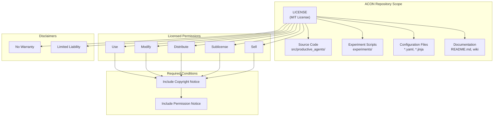
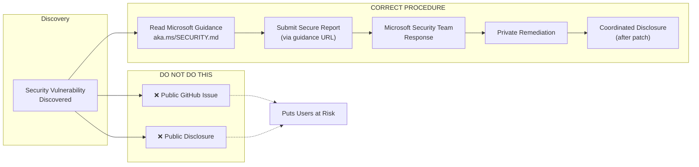
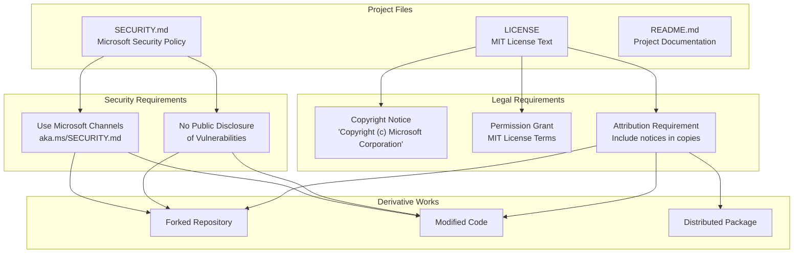

<!-- source: DeepWiki mcp.deepwiki.com · repo microsoft/acon · page 12 Project Information · fetched 2026-10-26 -->

# Project Information

<details>
<summary>Relevant source files</summary>

The following files were used as context for generating this wiki page:

- [LICENSE](LICENSE)
- [SECURITY.md](SECURITY.md)

</details>


This document provides legal, licensing, and security information for the ACON (Agent Context Optimization) framework. It covers the project's open-source license terms, security vulnerability reporting procedures, and copyright attribution.

For technical documentation about using the framework, see [Getting Started](#2). For contribution guidelines and community standards, see [Development Guide](#10).

---

## Overview

The ACON framework is an open-source research project maintained by Microsoft Corporation. The project is distributed under the MIT License and follows Microsoft's standard security reporting procedures for GitHub repositories.

**Sources:** [LICENSE:1-22](), [SECURITY.md:1-14]()

---

## License Terms

### MIT License

The ACON framework is licensed under the MIT License, one of the most permissive open-source licenses. This license grants broad permissions to users while maintaining minimal restrictions.

**Copyright:** Microsoft Corporation

**License Type:** MIT License (SPDX: MIT)

**Sources:** [LICENSE:1-4]()

### Permissions Granted

The MIT License grants the following rights without restriction:

| Permission | Description |
|------------|-------------|
| **Use** | Run the software for any purpose, commercial or non-commercial |
| **Copy** | Create copies of the software and documentation |
| **Modify** | Make changes to the source code |
| **Merge** | Combine the software with other projects |
| **Publish** | Share the software publicly |
| **Distribute** | Distribute copies to others |
| **Sublicense** | Grant licenses to others under different terms |
| **Sell** | Sell copies of the software |

**Sources:** [LICENSE:5-9]()

### License Conditions

The license requires two conditions to be met:

1. **Copyright Notice Inclusion:** The copyright notice must be included in all copies or substantial portions of the software
2. **Permission Notice Inclusion:** This permission notice must be included in all copies or substantial portions of the software

These notices ensure attribution is maintained throughout the distribution chain.

**Sources:** [LICENSE:10-13]()

### Warranty Disclaimer

The software is provided "AS IS" without warranty of any kind. The license explicitly disclaims:

- **Express warranties:** No explicit guarantees about functionality
- **Implied warranties:** No implicit guarantees including:
  - MERCHANTABILITY: Fitness for commercial use
  - FITNESS FOR A PARTICULAR PURPOSE: Suitability for specific use cases
  - NON-INFRINGEMENT: Freedom from intellectual property violations

**Sources:** [LICENSE:15-18]()

### Liability Limitations

The license limits liability for the authors and copyright holders:

- No liability for claims, damages, or other liability
- Applies whether in contract, tort, or otherwise
- Covers actions arising from, out of, or in connection with the software or its use

**Sources:** [LICENSE:18-21]()

### License Coverage Diagram



**Sources:** [LICENSE:1-22]()

---

## Security Policy

### Microsoft Security Standards

Microsoft takes security seriously for all software products and services, including all source code repositories in Microsoft's GitHub organizations. The ACON repository follows Microsoft's standardized security reporting procedures.

**Sources:** [SECURITY.md:3-6]()

### Security Vulnerability Reporting

#### Critical Rule: Do Not Use Public GitHub Issues

**IMPORTANT:** Security vulnerabilities must NEVER be reported through public GitHub issues. Public disclosure of security vulnerabilities can put users at risk before patches are available.

**Sources:** [SECURITY.md:8]()

#### Proper Reporting Channel

For security reporting information, Microsoft maintains centralized guidance that includes:

- **Reporting locations:** Where to submit security reports
- **Contact information:** Whom to contact for security issues
- **Policies:** Microsoft's security response procedures
- **Response timelines:** Expected response and remediation schedules

**Official Security Guidance:** The current reporting procedures are documented at:
```
https://aka.ms/SECURITY.md
```

This URL provides the latest guidance for all Microsoft repositories and is kept up-to-date with current contact information and procedures.

**Sources:** [SECURITY.md:10-12]()

### Security Reporting Workflow



**Sources:** [SECURITY.md:8-12]()

### Security Scope

The security policy applies to the entire ACON repository, including:

| Component | Security Coverage |
|-----------|------------------|
| **Core Framework** | `src/productive_agents/` - Agent and environment implementations |
| **Experiment Scripts** | `experiments/` - Execution and analysis tools |
| **Configuration System** | YAML configs, Jinja templates - Input validation concerns |
| **Dependencies** | Python packages in `requirements.txt` - Supply chain security |
| **API Integration** | OpenAI API client code - Credential handling |
| **Model Serving** | Local model servers - Network security |
| **Data Handling** | Trajectory storage, dataset generation - Data privacy |

**Sources:** [SECURITY.md:1-14]()

---

## Project Metadata

### Repository Information

| Attribute | Value |
|-----------|-------|
| **Owner** | Microsoft Corporation |
| **Organization** | github.com/microsoft |
| **Repository** | acon |
| **License** | MIT License |
| **Copyright Holder** | Microsoft Corporation |
| **Primary Language** | Python |
| **Project Type** | Research Framework |

**Sources:** [LICENSE:3]()

### Copyright Attribution

All files in the repository are copyright of Microsoft Corporation unless otherwise noted. The copyright notice appears in the LICENSE file:

```
Copyright (c) Microsoft Corporation.
```

This copyright applies to:
- Source code in `src/`
- Experiment scripts in `experiments/`
- Configuration files (`*.yaml`, `*.jinja`)
- Documentation files (`README.md`, wiki content)
- Analysis tools and utilities

**Sources:** [LICENSE:3]()

### Document Versioning

The security policy document follows Microsoft's standardized format:

```
<!-- BEGIN MICROSOFT SECURITY.MD V1.0.0 BLOCK -->
...
<!-- END MICROSOFT SECURITY.MD BLOCK -->
```

The version marker (`V1.0.0`) indicates the schema version of Microsoft's security guidance format, ensuring consistency across all Microsoft repositories.

**Sources:** [SECURITY.md:1](), [SECURITY.md:14]()

---

## Legal Compliance Structure



**Sources:** [LICENSE:1-22](), [SECURITY.md:1-14]()

---

## Summary

The ACON framework is provided as open-source software under the MIT License from Microsoft Corporation. Users have broad permissions to use, modify, and distribute the software with minimal restrictions. The primary requirements are attribution (including copyright and permission notices) and acknowledgment that the software is provided without warranty.

Security is a priority for Microsoft. Any security vulnerabilities must be reported through Microsoft's secure channels at `https://aka.ms/SECURITY.md`, never through public GitHub issues.

**Key Takeaways:**

1. **License:** MIT License - very permissive, commercial use allowed
2. **Copyright:** Microsoft Corporation holds copyright
3. **Attribution Required:** Include copyright and license notices in all copies
4. **No Warranty:** Software provided "AS IS" without guarantees
5. **Security Reporting:** Use `https://aka.ms/SECURITY.md`, never public issues
6. **Full Text:** See [LICENSE]() for complete license terms
7. **Security Details:** See [SECURITY.md]() for current reporting procedures

**Sources:** [LICENSE:1-22](), [SECURITY.md:1-14]()

---

