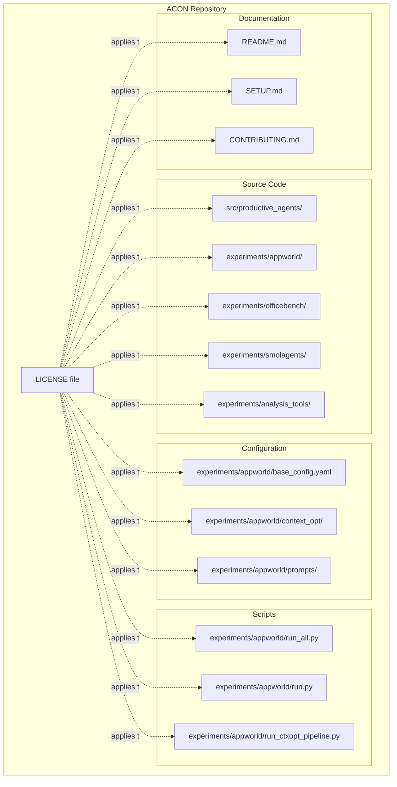
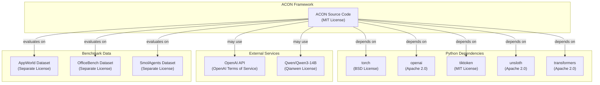

<!-- source: DeepWiki mcp.deepwiki.com · repo microsoft/acon · page 12.1 License · fetched 2026-10-26 -->

# License

<details>
<summary>Relevant source files</summary>

The following files were used as context for generating this wiki page:

- [LICENSE](LICENSE)

</details>


This page documents the software license terms for the ACON framework. The license defines the legal terms under which the software may be used, modified, and distributed.

For information about contributing to the project, see [Code of Conduct](#10.2) and [Support and Contributing](#10.3). For security-related concerns, see [Security Policy](#12.2).

## Overview

The ACON framework is released under the MIT License, a permissive open-source software license. The license is held by Microsoft Corporation and applies to all software and documentation files in the repository at https://github.com/microsoft/acon.

**Sources:** [LICENSE:1-22]()

## License Text

The complete license text is as follows:

```
MIT License

Copyright (c) Microsoft Corporation.

Permission is hereby granted, free of charge, to any person obtaining a copy
of this software and associated documentation files (the "Software"), to deal
in the Software without restriction, including without limitation the rights
to use, copy, modify, merge, publish, distribute, sublicense, and/or sell
copies of the Software, and to permit persons to whom the Software is
furnished to do so, subject to the following conditions:

The above copyright notice and this permission notice shall be included in all
copies or substantial portions of the Software.

THE SOFTWARE IS PROVIDED "AS IS", WITHOUT WARRANTY OF ANY KIND, EXPRESS OR
IMPLIED, INCLUDING BUT NOT LIMITED TO THE WARRANTIES OF MERCHANTABILITY,
FITNESS FOR A PARTICULAR PURPOSE AND NONINFRINGEMENT. IN NO EVENT SHALL THE
AUTHORS OR COPYRIGHT HOLDERS BE LIABLE FOR ANY CLAIM, DAMAGES OR OTHER
LIABILITY, WHETHER IN AN ACTION OF CONTRACT, TORT OR OTHERWISE, ARISING FROM,
OUT OF OR IN CONNECTION WITH THE SOFTWARE OR THE USE OR OTHER DEALINGS IN THE
SOFTWARE
```

**Sources:** [LICENSE:1-22]()

## Permissions Granted

The MIT License grants the following permissions without restriction:

| Permission | Description |
|------------|-------------|
| **Use** | Run the software for any purpose, including commercial use |
| **Copy** | Make copies of the software |
| **Modify** | Modify the source code to create derivative works |
| **Merge** | Combine the software with other software |
| **Publish** | Make the software publicly available |
| **Distribute** | Share copies with others |
| **Sublicense** | Grant licenses to third parties under different terms |
| **Sell** | Sell copies or derivative works commercially |

**Sources:** [LICENSE:5-9]()

## License Requirements

The MIT License imposes minimal requirements on users:

### Copyright Notice Requirement

The copyright notice and permission notice must be included in all copies or substantial portions of the software. This applies to:
- Complete distributions of the ACON framework
- Partial distributions that include substantial portions
- Derivative works based on ACON components

**Sources:** [LICENSE:12-13]()

### Warranty Disclaimer

The software is provided "as is" without warranty of any kind. The license explicitly disclaims:
- **Express warranties**: No explicit guarantees are provided
- **Implied warranties**: No implied warranties of merchantability or fitness for purpose
- **Liability protection**: Authors and copyright holders are not liable for claims, damages, or other liability arising from the software

**Sources:** [LICENSE:15-21]()

## License Coverage Scope

### What Is Covered



**Diagram: MIT License Coverage Across Repository Components**

The MIT License applies to all files in the ACON repository, including:
- Python source code in `src/productive_agents/` and `experiments/`
- Configuration files (`.yaml`, `.jinja` templates)
- Execution scripts (`run_all.py`, `run.py`, etc.)
- Documentation files (`.md` files)

**Sources:** [LICENSE:1-22]()

### What Is Not Covered

The license does not grant rights to:
- **Third-party dependencies**: Each dependency retains its own license (e.g., PyTorch, OpenAI SDK)
- **API services**: Use of external APIs (OpenAI, etc.) is subject to their respective terms of service
- **Benchmark datasets**: AppWorld, OfficeBench, and SmolAgents datasets may have separate licensing
- **Trademark**: The Microsoft name and trademarks are not licensed for use

**Sources:** [LICENSE:1-22]()

## Relationship to Dependencies and Services



**Diagram: License Relationships Between ACON and Dependencies**

When using ACON, users must comply with:
- **ACON's MIT License**: For the framework code itself
- **Dependency licenses**: Each Python package has its own license terms
- **API terms of service**: When using OpenAI or other commercial APIs
- **Model licenses**: When using pre-trained models like Qwen3-14B
- **Dataset licenses**: When accessing benchmark datasets

**Sources:** [LICENSE:1-22]()

## Practical Implications for Users

### Research Use

The MIT License permits unrestricted research use of ACON. Researchers may:
- Run experiments on any benchmark
- Modify agent implementations, compressors, or environments
- Publish results without restriction
- Share modified versions with collaborators

The copyright notice requirement [LICENSE:12-13]() means modified versions should retain the original license text.

### Commercial Use

The MIT License permits commercial applications. Organizations may:
- Integrate ACON components into commercial products
- Use ACON for internal business applications
- Sell services built on ACON technology
- Sublicense modified versions under different terms

However, the warranty disclaimer [LICENSE:15-21]() means Microsoft Corporation provides no guarantees about the software's suitability for any purpose.

### Derivative Works

Users creating derivative works should:
1. Include the copyright notice from [LICENSE:12-13]()
2. Include the permission notice
3. Include the warranty disclaimer
4. Clearly indicate modifications made to the original code

**Sources:** [LICENSE:1-22]()

## Copyright Holder

The copyright is held by **Microsoft Corporation**, as stated in [LICENSE:3](). All contributions to the repository become part of the collectively licensed work under the MIT License.

Contributors should review the contribution guidelines at [Support and Contributing](#10.3) for information about the contribution process.

**Sources:** [LICENSE:3]()

## Summary Table

| Aspect | Details |
|--------|---------|
| **License Type** | MIT License (permissive open-source) |
| **Copyright Holder** | Microsoft Corporation |
| **Commercial Use** | Permitted without restriction |
| **Modification** | Permitted without restriction |
| **Distribution** | Permitted with copyright notice |
| **Warranty** | None (provided "as is") |
| **Liability** | Authors/copyright holders not liable |
| **Key Requirement** | Include copyright and permission notice in distributions |

**Sources:** [LICENSE:1-22]()

---

