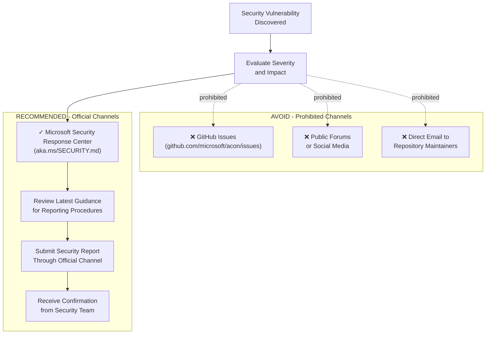
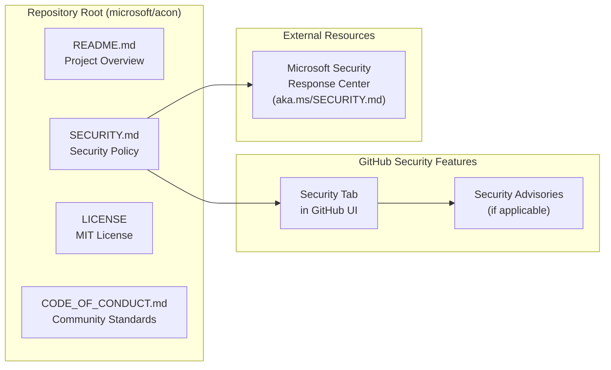
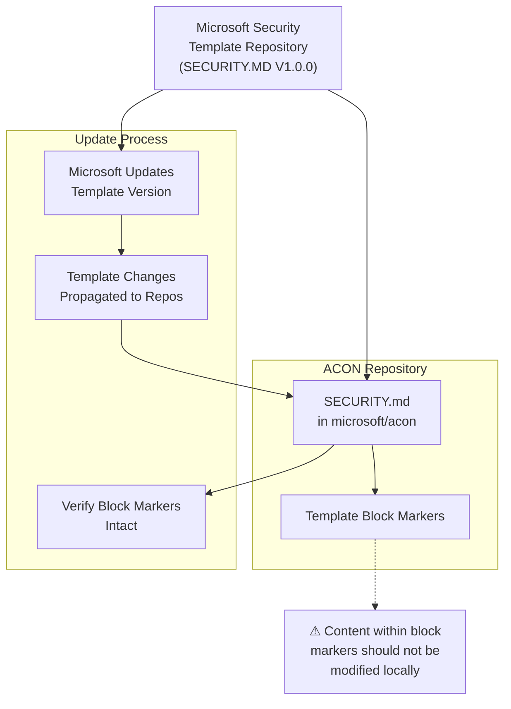

<!-- source: DeepWiki mcp.deepwiki.com · repo microsoft/acon · page 12.2 Security Policy · fetched 2026-10-26 -->

# Security Policy

<details>
<summary>Relevant source files</summary>

The following files were used as context for generating this wiki page:

- [SECURITY.md](SECURITY.md)

</details>


## Purpose and Scope

This page documents the security reporting procedures and policies for the ACON project. It explains how to report security vulnerabilities responsibly, what channels to use, and where to find the latest security guidance for Microsoft repositories.

For information about contributing to the project, see [Support and Contributing](#10.3). For general project information, see [Project Information](#12).

---

## Security Commitment

Microsoft takes the security of software products and services seriously, including all source code repositories managed through GitHub organizations. The ACON project follows Microsoft's standard security reporting procedures to ensure vulnerabilities are handled appropriately and responsibly.

**Sources:** [SECURITY.md:5-6]()

---

## Reporting Security Vulnerabilities

### Critical Rule: Do Not Use Public Channels

Security vulnerabilities **must not** be reported through public GitHub issues. Public disclosure of security vulnerabilities before they are addressed can put all users of the software at risk.

**Sources:** [SECURITY.md:8]()

### Proper Reporting Channels

Security reports should be submitted through Microsoft's official security reporting channels. The authoritative guidance for reporting security vulnerabilities in Microsoft repositories is available at:

**[https://aka.ms/SECURITY.md](https://aka.ms/SECURITY.md)**

This resource provides:
- Current reporting locations
- Contact information for security teams
- Reporting policies and procedures
- Expected response timelines

**Sources:** [SECURITY.md:10-12]()

---

## Security Reporting Workflow

The following diagram illustrates the proper workflow for reporting security vulnerabilities in the ACON project:



**Sources:** [SECURITY.md:8-12]()

---

## Repository Security Documentation Location

The security policy is documented in the repository root directory, making it easily discoverable through GitHub's security features:



**Sources:** [SECURITY.md:1-14]()

---

## Security.md File Structure

The `SECURITY.md` file follows Microsoft's standardized template (version 1.0.0) and contains the following sections:

| Section | Line Range | Content |
|---------|------------|---------|
| Header | [1:1]() | Microsoft Security.md block identifier |
| Security Statement | [5-6]() | Microsoft's security commitment |
| Reporting Prohibition | [8]() | Warning against public GitHub issues |
| Reporting Guidance | [10-12]() | Link to official security reporting procedures |
| Footer | [14:14]() | Block end marker |

**Sources:** [SECURITY.md:1-14]()

---

## Template Compliance

The ACON project uses the official Microsoft Security.md template, identified by the following markers:

```
<!-- BEGIN MICROSOFT SECURITY.MD V1.0.0 BLOCK -->
...
<!-- END MICROSOFT SECURITY.MD BLOCK -->
```

These markers indicate:
- **Template Version**: V1.0.0
- **Template Type**: Standard Microsoft repository security policy
- **Maintenance**: Template is maintained by Microsoft and should not be modified locally

**Sources:** [SECURITY.md:1](), [SECURITY.md:14]()

---

## Prohibited vs. Recommended Actions

### ❌ Prohibited Actions

The following actions should **never** be taken when discovering a security vulnerability:

| Action | Why Prohibited | Reference |
|--------|---------------|-----------|
| Creating public GitHub issues | Exposes vulnerability to potential attackers | [SECURITY.md:8]() |
| Posting on forums or social media | Creates widespread public disclosure | General security practice |
| Direct email to repository contributors | Bypasses official security review process | General security practice |
| Discussing in pull request comments | Public and not monitored by security teams | General security practice |

### ✓ Recommended Actions

The following actions are recommended when discovering a security vulnerability:

| Action | Why Recommended | Reference |
|--------|----------------|-----------|
| Review aka.ms/SECURITY.md | Provides current, authoritative guidance | [SECURITY.md:10-12]() |
| Use official reporting channels | Ensures proper handling by security experts | [SECURITY.md:10-12]() |
| Provide detailed information | Helps security teams reproduce and fix issues | General security practice |
| Maintain confidentiality | Protects users until fix is available | General security practice |

**Sources:** [SECURITY.md:8-12]()

---

## Security Policy Update Process

The following diagram shows how the security policy in the ACON repository is maintained:



**Sources:** [SECURITY.md:1](), [SECURITY.md:14]()

---

## Additional Security Resources

### For Researchers

Security researchers looking to report vulnerabilities in Microsoft products should:

1. Visit [https://aka.ms/SECURITY.md](https://aka.ms/SECURITY.md) for current guidance
2. Review Microsoft's vulnerability disclosure policies
3. Follow the coordinated vulnerability disclosure process
4. Wait for confirmation before any public disclosure

### For Users

Users who discover potential security issues should:

1. **Do not** attempt to exploit the vulnerability
2. Report through official channels at [https://aka.ms/SECURITY.md](https://aka.ms/SECURITY.md)
3. Provide as much detail as possible about the issue
4. Monitor for security advisories and updates

### For Developers

Developers working on ACON should:

1. Review security best practices for LLM applications
2. Be aware of potential security implications when handling API keys (see [API Configuration](#2.2))
3. Keep dependencies updated to address known vulnerabilities
4. Follow the security policy when contributing code

**Sources:** [SECURITY.md:10-12]()

---

## Scope of Security Policy

This security policy applies to:

- **The ACON Framework Codebase**: All code in the `microsoft/acon` repository
- **Dependencies**: Third-party libraries and packages used by ACON
- **Generated Models**: LoRA adapters and trained models produced by ACON
- **Configuration Files**: Including sensitive files like `private_config.yaml` (see [API Configuration](#2.2))

This security policy does **not** apply to:

- **Benchmark Data Sources**: External datasets from AppWorld, OfficeBench, or SmolAgents
- **Third-Party APIs**: OpenAI API or other external services (report to respective vendors)
- **Downstream Applications**: Custom applications built using ACON

**Sources:** [SECURITY.md:5-6]()

---

## Security Best Practices for ACON Users

While not part of the formal security policy, users of ACON should follow these security best practices:

### API Key Management

1. Store API keys in `private_config.yaml` (excluded from version control)
2. Never commit API keys to public repositories
3. Use environment variables or secure credential management systems
4. Rotate API keys periodically

See [API Configuration](#2.2) for detailed guidance.

### Model Security

1. Validate and sanitize inputs before processing
2. Be aware that LLM outputs may contain unexpected content
3. Review generated code or actions before execution
4. Implement rate limiting when using external APIs

### Data Privacy

1. Avoid processing sensitive personal data in experiments
2. Review privacy implications of benchmark datasets
3. Secure experiment outputs containing potentially sensitive information
4. Follow organizational data handling policies

**Sources:** General security practices (not directly from SECURITY.md)

---

## Summary

The ACON project follows Microsoft's standard security reporting procedures. Security vulnerabilities should be reported through the official channels at [https://aka.ms/SECURITY.md](https://aka.ms/SECURITY.md) and **never** through public GitHub issues. The `SECURITY.md` file in the repository root provides authoritative guidance and is maintained as part of Microsoft's standard security template.

**Sources:** [SECURITY.md:1-14]()