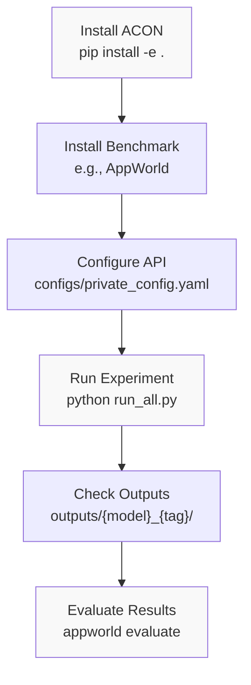
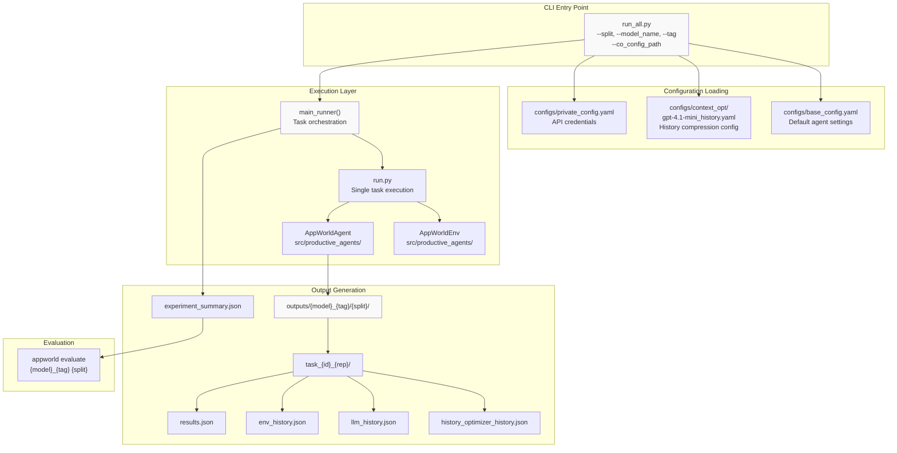
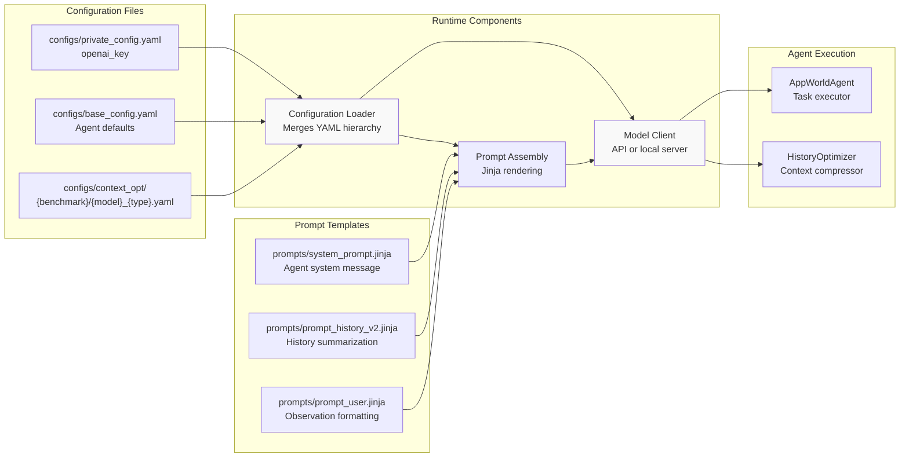

<!-- source: DeepWiki mcp.deepwiki.com · repo microsoft/acon · page 2 Getting Started · fetched 2026-10-26 -->

# Getting Started

<details>
<summary>Relevant source files</summary>

The following files were used as context for generating this wiki page:

- [README.md](README.md)
- [configs/private_config_dummy.yaml](configs/private_config_dummy.yaml)
- [experiments/appworld/README.md](experiments/appworld/README.md)

</details>


This page provides a quick introduction to installing ACON and running your first context optimization experiment. It covers the essential prerequisites, the basic workflow, and where to find results. For detailed installation instructions, see [Installation](#2.1). For step-by-step experiment execution, see [Running Your First Experiment](#2.3).

## Purpose and Scope

This guide walks through the minimal steps required to:
1. Install ACON and its dependencies
2. Configure API credentials
3. Execute a basic AppWorld experiment with context compression
4. Locate and interpret the output

For information about the theoretical foundation of context optimization, see [Core Concepts](#3). For advanced configuration options, see [Configuration](#6).

## Prerequisites

ACON requires:
- **Python 3.11 or higher**
- **Git LFS** (for downloading AppWorld data)
- **OpenAI API key** (for frontier model experiments)
- Approximately 10GB disk space for benchmark data

The framework supports both frontier models (OpenAI API) and local models (with fine-tuned LoRA adapters). Getting started focuses on frontier models, which require minimal setup.

**Sources:** [README.md:94-95]()

## High-Level Workflow

The following diagram illustrates the basic workflow for getting started with ACON:

**Workflow: From Installation to First Results**



**Sources:** [README.md:53-89](), [experiments/appworld/README.md:1-89]()

## Installation Process

### Core Framework Installation

Clone the repository and install ACON in editable mode:

```bash
git clone https://github.com/microsoft/acon.git
cd acon
pip install -e .
```

The `-e` flag installs ACON in editable mode, allowing you to modify the source code without reinstalling.

**Sources:** [README.md:98-102]()

### Benchmark Installation (AppWorld)

ACON supports three benchmarks (AppWorld, OfficeBench, SmolAgents). For getting started, AppWorld is recommended due to its comprehensive documentation and data availability.

```bash
# Install Git LFS first
git lfs install

# Clone and install AppWorld
git clone https://github.com/StonyBrookNLP/appworld
cd appworld
pip install -e .
appworld install --repo
appworld download data

# Move data directory to ACON structure
mv data /path/to/acon/experiments/appworld/
```

The `appworld download data` command downloads approximately 8GB of task data and environment snapshots.

**Sources:** [README.md:55-63](), [experiments/appworld/README.md:6-23]()

For detailed installation instructions including troubleshooting, see [Installation](#2.1).

## API Configuration

ACON requires an OpenAI API key for frontier model experiments. Create a configuration file with your credentials:

1. Navigate to the `configs/` directory
2. Copy `private_config_dummy.yaml` to `private_config.yaml`
3. Add your OpenAI API key

**File Structure:**

```yaml
openai_key: "your_api_key_here"
```

The framework loads this configuration at runtime via [configs/private_config.yaml]().

**Sources:** [README.md:106-110](), [configs/private_config_dummy.yaml:1]()

For additional configuration options including local model serving, see [API Configuration](#2.2).

## Running Your First Experiment

The following diagram shows the exact code entities involved in executing a basic experiment:

**Experiment Execution Flow: Code Entity Mapping**



**Sources:** [experiments/appworld/README.md:26-88](), [README.md:65-86]()

### Basic Command Structure

Navigate to the AppWorld experiment directory and execute:

```bash
cd experiments/appworld
python run_all.py \
    --split train \
    --model_name gpt-4.1-mini \
    --tag baseline \
    --co_config_path configs/context_opt/gpt-4.1-mini_history.yaml
```

**Key Parameters:**

| Parameter | Purpose | Example Values |
|-----------|---------|----------------|
| `--split` | Dataset partition to run | `train`, `dev`, `test_normal`, `test_challenge` |
| `--model_name` | LLM to use for agent reasoning | `gpt-4.1`, `gpt-4.1-mini`, `gpt-4o` |
| `--tag` | Experiment identifier (output suffix) | `baseline`, `history_compression`, `optimized` |
| `--co_config_path` | Context optimization configuration | Path to YAML config file |

The `--tag` parameter creates a unique output directory: `outputs/{model_name}_{tag}/`.

**Sources:** [experiments/appworld/README.md:30-64](), [README.md:75-79]()

### Debugging Your First Run

For initial testing, use the `--debug` flag to run a single task:

```bash
python run_all.py \
    --split train \
    --model_name gpt-4.1-mini \
    --tag test_run \
    --co_config_path configs/context_opt/gpt-4.1-mini_history.yaml \
    --debug
```

This executes only the first task in the split, allowing you to verify configuration and API connectivity.

**Sources:** [experiments/appworld/README.md:42]()

For complete command-line reference and advanced options, see [Command-Line Reference](#5.3).

## Understanding Output Structure

ACON generates comprehensive execution traces for each experiment. The output directory structure follows this pattern:

```
experiments/appworld/outputs/
└── {model_name}_{tag}/
    ├── experiment_summary.json          # Aggregated metrics across all tasks
    └── {split}/                         # train, dev, test_normal, test_challenge
        ├── task_{id}_{rep}/             # One directory per task execution
        │   ├── appworld_trajectory.json # AppWorld-specific action log
        │   ├── env_history.json         # Environment state transitions
        │   ├── history_optimizer_history.json  # Context compression traces
        │   ├── llm_history.json         # Agent LLM interactions
        │   ├── step_alignment.json      # Turn-by-turn alignment
        │   └── results.json             # Task outcome and metrics
        └── ...
```

**Key Output Files:**

| File | Content | Used For |
|------|---------|----------|
| `experiment_summary.json` | Success rate, token usage, cost aggregated across all tasks | Performance evaluation |
| `history_optimizer_history.json` | Input/output pairs for context compression calls | Training compressor LoRA (Stage 1) |
| `llm_history.json` | Input/output pairs for agent reasoning calls | Training agent LoRA (Stage 2) |
| `env_history.json` | Environment observations and state changes | Debugging agent behavior |
| `results.json` | Task completion status and metrics | Individual task analysis |

**Sources:** [experiments/appworld/README.md:67-88]()

### Evaluating Results

After experiment completion, evaluate performance using the AppWorld CLI:

```bash
appworld evaluate {model_name}_{tag} {split}
```

For example:

```bash
appworld evaluate gpt-4.1-mini_baseline train
```

This command reads `experiment_summary.json` and computes benchmark-specific metrics such as success rate and average turns per task.

**Sources:** [experiments/appworld/README.md:39](), [README.md:39]()

For detailed information about output formats and metrics, see [Output and Results](#5.4).

## Next Steps

After successfully running your first experiment, you can:

1. **Analyze token usage and costs** - See [Token and Cost Analysis](#7.1)
2. **Optimize context compression prompts** - See [Context Optimization Pipeline](#7.2)
3. **Train local models with distillation** - See [Model Distillation](#8)
4. **Explore other benchmarks** - See [OfficeBench and SmolAgents](#4.2)
5. **Customize agent behavior** - See [Configuration](#6)

The typical research workflow follows a four-stage pipeline (baseline → optimization → compressor distillation → agent distillation) described in [Four-Stage Pipeline](#3.2).

## Configuration System Overview

The following diagram maps ACON's configuration files to their runtime roles:

**Configuration System: File-to-Component Mapping**



**Sources:** [README.md:104-110](), [experiments/appworld/README.md:172-184]()

The configuration system uses YAML files for declarative settings and Jinja2 templates for dynamic prompt generation. At runtime, configurations are merged in this priority order:

1. `private_config.yaml` - API credentials (highest priority)
2. Context optimization config (specified via `--co_config_path`)
3. `base_config.yaml` - Default settings (lowest priority)

For detailed configuration options, see [Base Configuration](#6.1) and [Context Optimization Configuration](#6.2).

**Sources:** [README.md:104-110](), [configs/private_config_dummy.yaml:1]()

---

