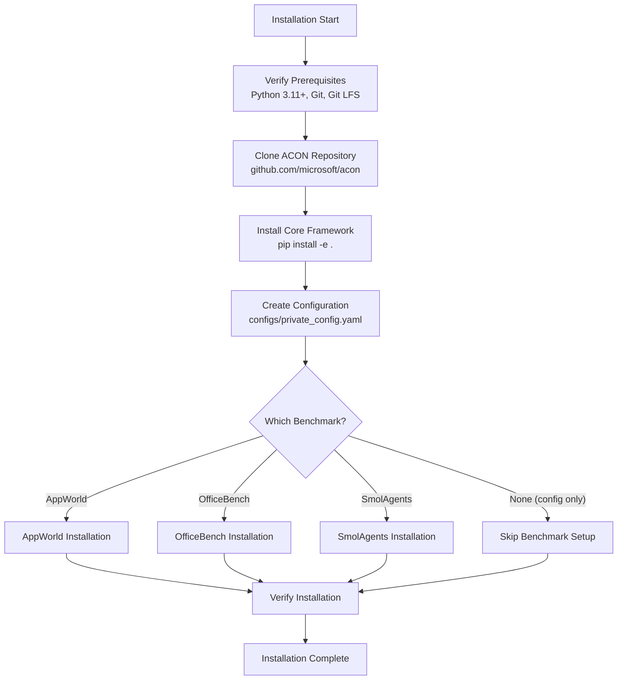
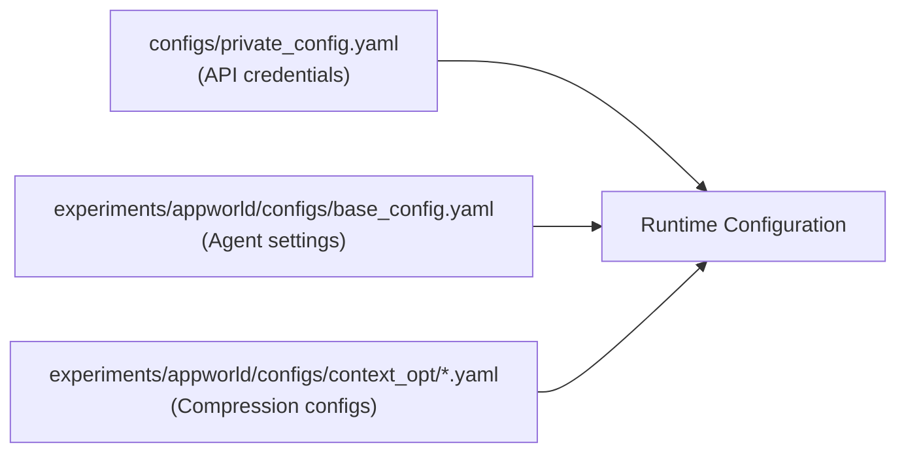
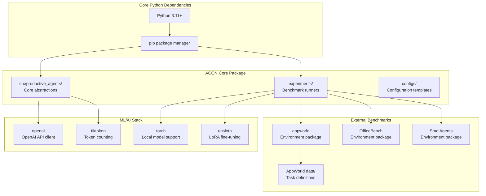

<!-- source: DeepWiki mcp.deepwiki.com · repo microsoft/acon · page 2.1 Installation · fetched 2026-10-26 -->

# Installation

<details>
<summary>Relevant source files</summary>

The following files were used as context for generating this wiki page:

- [.gitignore](.gitignore)
- [README.md](README.md)
- [experiments/appworld/README.md](experiments/appworld/README.md)

</details>


This page provides detailed instructions for installing the ACON framework and its dependencies. For information about configuring API credentials after installation, see [API Configuration](#2.2). For running your first experiment after installation, see [Running Your First Experiment](#2.3).

## Overview

The ACON framework installation consists of three main components:

1. **Core ACON framework** - Python package with agent abstractions and utilities
2. **Benchmark environments** - External packages for AppWorld, OfficeBench, and SmolAgents
3. **API credentials** - Configuration files for model providers

The installation process varies depending on which benchmarks you plan to use. This guide covers all scenarios.

---

## Prerequisites

The following requirements must be met before installing ACON:

| Component | Requirement | Notes |
|-----------|-------------|-------|
| **Python** | 3.11 or higher | Required for all functionality |
| **Git** | Latest stable | For cloning repositories |
| **Git LFS** | Latest stable | Required for AppWorld data files |
| **pip** | Latest stable | Python package manager |

**Operating System Support**: ACON has been tested on Linux and macOS. Windows support is possible but not officially tested.

**Hardware Requirements**: Varies by use case:
- Baseline experiments with API models: Minimal (any modern CPU)
- Local model inference: GPU with 16GB+ VRAM recommended
- Model fine-tuning: GPU with 40GB+ VRAM or multi-GPU setup

Sources: [README.md:94-95]()

---

## Installation Flow Overview



**Diagram: ACON Installation Workflow** - Shows the sequential steps required to install ACON and benchmark environments.

Sources: [README.md:91-110](), [experiments/appworld/README.md:6-23]()

---

## Core Framework Installation

### Step 1: Clone the Repository

```bash
git clone https://github.com/microsoft/acon.git
cd acon
```

This creates a local copy of the ACON codebase with the following structure:

```
acon/
├── configs/                 # Configuration templates
├── experiments/             # Benchmark runners and analysis tools
├── src/productive_agents/   # Core abstractions
└── README.md
```

Sources: [README.md:99-100]()

### Step 2: Install the Package

```bash
pip install -e .
```

The `-e` flag installs ACON in **editable mode**, which means:
- Changes to source files take effect immediately without reinstallation
- The package is linked to the current directory rather than copied
- Useful for development and experimentation

**What Gets Installed**: This command processes the package metadata and installs:
- Core dependencies (PyTorch, OpenAI SDK, tiktoken, etc.)
- The `productive_agents` module from [src/productive_agents/]()
- Command-line utilities for running experiments

**Dependency Resolution**: The installation pulls required packages including:
- `openai` - For API-based model access
- `tiktoken` - For token counting
- `torch` - For local model serving (optional)
- `unsloth` - For efficient LoRA fine-tuning (optional)

Sources: [README.md:101-102]()

---

## Configuration Setup

### Creating the Private Configuration File

After installing the core framework, create a configuration file for API credentials:

```bash
touch configs/private_config.yaml
```

Edit `configs/private_config.yaml` with your API key:

```yaml
openai_key: "sk-proj-..."
```

**Important**: The `private_config.yaml` file is ignored by Git ([.gitignore:463]()) to prevent accidental credential exposure.

**Configuration File Hierarchy**:



**Diagram: Configuration File Loading** - Shows how different configuration files are merged at runtime.

The `private_config.yaml` file provides API credentials that are merged with benchmark-specific configurations during experiment execution. See [API Configuration](#2.2) for detailed credential setup.

Sources: [README.md:106-110](), [.gitignore:463]()

---

## Benchmark-Specific Installation

### AppWorld Benchmark

AppWorld requires a separate installation of the upstream environment package.

#### Step 1: Install Git LFS

Git LFS is required for downloading large data files:

```bash
git lfs install
```

#### Step 2: Clone and Install AppWorld

```bash
git clone https://github.com/StonyBrookNLP/appworld
cd appworld
pip install -e .
```

This installs the `appworld` package which provides:
- `AppWorldEnv` - Environment simulator
- `appworld` CLI - Command-line tools for installation and evaluation
- Task definitions and ground truth data

Sources: [experiments/appworld/README.md:8-17]()

#### Step 3: Install AppWorld Repository

```bash
appworld install --repo
```

The `--repo` flag installs additional repository components required for environment initialization.

#### Step 4: Download Data

```bash
appworld download data
```

This downloads the benchmark dataset, which includes:
- Task definitions for train, dev, test_normal, and test_challenge splits
- Ground truth trajectories for evaluation
- App state and API definitions

#### Step 5: Move Data to ACON Directory

```bash
cd ..
mv appworld/data /path/to/acon/experiments/appworld/
```

**Critical**: The data directory must be located at `experiments/appworld/data/` for the experiment runners to resolve paths correctly. The runners expect this structure:

```
experiments/appworld/
├── data/
│   └── datasets/
│       ├── train/
│       ├── dev/
│       ├── test_normal/
│       └── test_challenge/
├── configs/
└── run_all.py
```

Sources: [experiments/appworld/README.md:19-23]()

---

### OfficeBench and SmolAgents

Installation instructions for these benchmarks are available in their respective documentation:

- **OfficeBench**: See [experiments/officebench/README.md]()
- **SmolAgents**: See [experiments/smolagents/README.md]()

Both follow similar patterns but have different data requirements and environment setup steps.

Sources: [README.md:126-141]()

---

## Dependency Architecture



**Diagram: Dependency Structure** - Shows how ACON components depend on external packages and benchmark environments.

Sources: [README.md:91-102](), [.gitignore:343-344]()

---

## Verification

After installation, verify that ACON is properly configured:

### Test 1: Import Core Modules

```bash
python -c "import productive_agents; print('Core modules loaded successfully')"
```

If this succeeds, the core framework is installed correctly.

### Test 2: Verify Configuration

```bash
python -c "import yaml; print(yaml.safe_load(open('configs/private_config.yaml')))"
```

This should print your configuration without errors. Do not share the output as it contains your API key.

### Test 3: Test AppWorld Integration (if installed)

```bash
cd experiments/appworld
python -c "import appworld; print('AppWorld available')"
```

### Test 4: Run Debug Mode Experiment (optional)

Run a single task in debug mode to verify end-to-end functionality:

```bash
cd experiments/appworld
python run_all.py \
    --split train \
    --model_name gpt-4.1-mini \
    --tag installation_test \
    --co_config_path configs/context_opt/gpt-4.1-mini_history.yaml \
    --debug
```

The `--debug` flag limits execution to a single task for quick verification. See [Running Your First Experiment](#2.3) for details.

Sources: [experiments/appworld/README.md:42]()

---

## Directory Structure After Installation

After completing all installation steps, your ACON directory should look like this:

```
acon/
├── configs/
│   └── private_config.yaml          # Created during configuration
├── experiments/
│   ├── appworld/
│   │   ├── data/                    # Moved from AppWorld install
│   │   │   └── datasets/
│   │   ├── configs/
│   │   │   ├── base_config.yaml
│   │   │   └── context_opt/
│   │   ├── prompts/
│   │   └── run_all.py
│   ├── officebench/
│   ├── smolagents/
│   ├── analysis_tools/
│   ├── prompt_optimizer/
│   └── training/
├── src/
│   └── productive_agents/           # Installed as package
└── README.md
```

**Ignored Directories**: The following directories are created during execution but ignored by Git:

| Directory | Purpose | Reference |
|-----------|---------|-----------|
| `experiments/appworld/outputs/` | Experiment results | [.gitignore:438]() |
| `experiments/appworld/experiments/` | Temporary execution data | [.gitignore:446]() |
| `experiments/analysis_tools/analysis*/` | Analysis outputs | [.gitignore:452-457]() |
| `experiments/training/dataset/` | Training datasets | [.gitignore:460]() |
| `finetuned_models/` | LoRA checkpoints | [.gitignore:441]() |

Sources: [.gitignore:425-463](), [README.md:113-120]()

---

## Optional Dependencies

Depending on your use case, you may need additional packages:

### For Local Model Serving

If you plan to serve local models (e.g., Qwen3-14B with LoRA adapters), install:

```bash
pip install torch transformers accelerate
```

### For Model Fine-tuning

For LoRA fine-tuning as described in [Model Distillation](#8), install:

```bash
pip install unsloth
```

The `unsloth` package provides efficient fine-tuning capabilities for the distillation stages.

### For Development

If you plan to contribute to ACON, install development dependencies:

```bash
pip install pytest black mypy
```

See [Development Guide](#10) for more information.

Sources: [.gitignore:343-344]()

---

## Troubleshooting

### Common Installation Issues

**Issue**: `pip install -e .` fails with dependency conflicts

**Solution**: Create a fresh virtual environment:
```bash
python -m venv acon_env
source acon_env/bin/activate  # On Windows: acon_env\Scripts\activate
pip install -e .
```

**Issue**: `git lfs` command not found when installing AppWorld

**Solution**: Install Git LFS for your platform:
- Ubuntu/Debian: `sudo apt-get install git-lfs`
- macOS: `brew install git-lfs`
- Windows: Download from https://git-lfs.github.com/

**Issue**: AppWorld data not found during experiment execution

**Solution**: Verify data directory location:
```bash
ls experiments/appworld/data/datasets/
```
Should show `train/`, `dev/`, `test_normal/`, `test_challenge/` directories.

**Issue**: Import errors for `productive_agents`

**Solution**: Ensure you ran `pip install -e .` from the `acon/` root directory, not a subdirectory.

Sources: [experiments/appworld/README.md:8-23]()

---

## Next Steps

After completing installation:

1. **Configure API credentials**: See [API Configuration](#2.2) for detailed credential setup
2. **Run your first experiment**: See [Running Your First Experiment](#2.3) for a step-by-step walkthrough
3. **Understand core concepts**: See [Core Concepts](#3) for framework fundamentals

For benchmark-specific details, refer to:
- [AppWorld Benchmark](#4.1) - Day-to-day task workflows
- [OfficeBench and SmolAgents](#4.2) - Other supported benchmarks

Sources: [README.md:44-51](), [README.md:138-141]()

---

