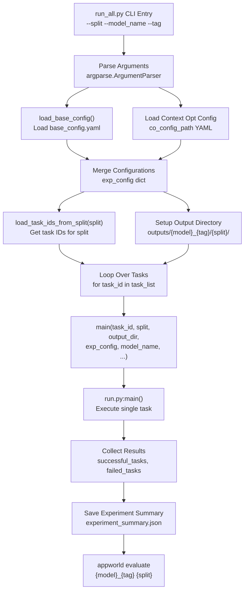
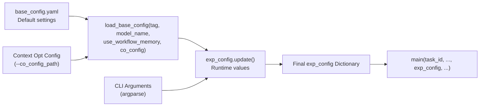
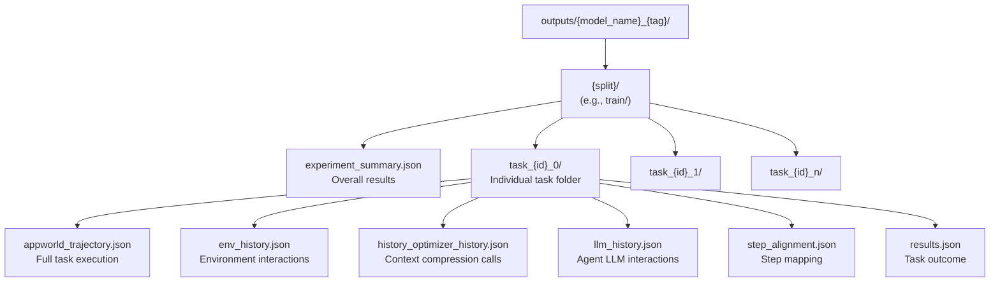

<!-- source: DeepWiki mcp.deepwiki.com · repo microsoft/acon · page 2.3 Running Your First Experiment · fetched 2026-10-26 -->

# Running Your First Experiment

<details>
<summary>Relevant source files</summary>

The following files were used as context for generating this wiki page:

- [experiments/appworld/README.md](experiments/appworld/README.md)
- [experiments/appworld/configs/base_config.yaml](experiments/appworld/configs/base_config.yaml)
- [experiments/appworld/run_all.py](experiments/appworld/run_all.py)

</details>


## Purpose and Scope

This guide provides a step-by-step walkthrough for running your first ACON experiment using the AppWorld benchmark. It covers environment setup, executing a baseline experiment, understanding outputs, and evaluating results.

For detailed installation instructions, see [Installation](#2.1). For API key configuration, see [API Configuration](#2.2). For comprehensive experiment running options across all benchmarks, see [Running Experiments](#5). For in-depth AppWorld benchmark information, see [AppWorld Benchmark](#4.1).

## Prerequisites

Before running your first experiment, ensure you have:

1. Completed the installation steps in [Installation](#2.1)
2. Configured your OpenAI API keys as described in [API Configuration](#2.2)
3. Python 3.11+ environment with all dependencies installed

## AppWorld Environment Setup

The AppWorld benchmark requires additional setup beyond the base ACON installation. This includes installing the upstream AppWorld package and downloading the benchmark data.

### Installing AppWorld Package

```bash
# Enable Git LFS for large file support
git lfs install

# Clone the AppWorld repository
git clone https://github.com/StonyBrookNLP/appworld
cd appworld

# Install AppWorld package in editable mode
pip install -e .

# Install AppWorld repository components
appworld install --repo

# Download benchmark data
appworld download data
```

**Sources:** [experiments/appworld/README.md:6-17]()

### Moving Data to ACON Directory

After downloading, move the `data/` directory into the ACON AppWorld experiments folder:

```bash
# From the appworld clone directory
mv data /path/to/acon/experiments/appworld/
```

The expected directory structure:

```
experiments/appworld/
├── data/
│   └── datasets/
│       ├── train/
│       ├── dev/
│       ├── test_normal/
│       └── test_challenge/
├── configs/
├── prompts/
├── run.py
└── run_all.py
```

**Sources:** [experiments/appworld/README.md:19-23]()

## Running Your First Baseline Experiment

The simplest experiment runs an agent on AppWorld tasks without context compression. This establishes a baseline for comparison.

### Basic Command Structure

```bash
cd experiments/appworld

python run_all.py \
    --split train \
    --model_name gpt-4.1 \
    --tag baseline \
    --co_config_path configs/context_opt/appworld/gpt-4.1_history_v2.yaml
```

**Sources:** [experiments/appworld/README.md:30-39]()

### Experiment Execution Flow



**Sources:** [experiments/appworld/run_all.py:75-363]()

### Key Command-Line Arguments

The `run_all.py` script accepts several important arguments:

| Argument | Description | Default | Example |
|----------|-------------|---------|---------|
| `--split` | Dataset split to run | `train` | `train`, `dev`, `test_normal`, `test_challenge` |
| `--model_name` | LLM model identifier | `gpt-4o` | `gpt-4.1`, `gpt-4o` |
| `--tag` | Experiment label/suffix | `debug` | `baseline`, `history_compression` |
| `--co_config_path` | Path to context optimization config | `None` | `configs/context_opt/appworld/gpt-4.1_history_v2.yaml` |
| `--debug` | Enable debug mode (runs 1 task only) | `False` | `--debug` |
| `--max_iter` | Maximum agent iterations per task | `50` | `100` |
| `--continue_existing` | Skip tasks with existing outputs | `False` | `--continue_existing` |
| `--rerun_failed` | Rerun only failed tasks from previous run | `False` | `--rerun_failed` |

**Sources:** [experiments/appworld/run_all.py:79-96](), [experiments/appworld/README.md:58-64]()

### Running in Debug Mode

For first-time users, it's recommended to run with the `--debug` flag to verify setup:

```bash
cd experiments/appworld

python run_all.py \
    --split train \
    --model_name gpt-4.1 \
    --tag baseline_test \
    --co_config_path configs/context_opt/appworld/gpt-4.1_history_v2.yaml \
    --debug
```

Debug mode runs only the first task and provides detailed console output, allowing you to verify:
- API keys are configured correctly
- AppWorld data is accessible
- Configuration files are valid
- Output directories are writable

**Sources:** [experiments/appworld/README.md:42](), [experiments/appworld/run_all.py:187-225]()

## Configuration Assembly Process

The experiment configuration is assembled from multiple sources at runtime:



The configuration merging happens in this order:

1. **Base Config**: Loaded from `configs/base_config.yaml`
2. **Context Optimization Config**: Loaded from `--co_config_path` if provided
3. **Runtime Overrides**: Applied from command-line arguments

Key configuration parameters set by `load_base_config()`:

| Parameter | Source | Purpose |
|-----------|--------|---------|
| `exp_id` | Runtime | Experiment identifier (`{tag}_{model_name}`) |
| `model_name` | CLI arg | LLM model to use |
| `tag` | CLI arg | Experiment label |
| `max_iter` | CLI arg or base | Maximum iterations per task |
| `use_workflow_memory` | CLI arg | Enable workflow memory |
| `use_thinking_tokens` | Base config | Enable thinking tokens |
| `co_config` | Loaded file | Context optimization configuration |
| `experiment_name` | Runtime | Constructed experiment name |

**Sources:** [experiments/appworld/run_all.py:33-57](), [experiments/appworld/run_all.py:122-137](), [experiments/appworld/configs/base_config.yaml:1-25]()

## Understanding Experiment Outputs

After running an experiment, outputs are organized in a structured directory hierarchy:

### Output Directory Structure



**Sources:** [experiments/appworld/README.md:67-84]()

### Key Output Files

Each task directory contains several important files:

| File | Description | Used For |
|------|-------------|----------|
| `appworld_trajectory.json` | Complete task trajectory in AppWorld format | Official evaluation |
| `env_history.json` | Detailed environment state history | Debugging, analysis |
| `history_optimizer_history.json` | All context compression LLM calls | Token analysis, distillation |
| `llm_history.json` | All agent reasoning LLM calls | Token analysis, agent distillation |
| `step_alignment.json` | Mapping between agent steps and env steps | Step-level debugging |
| `results.json` | Task success/failure and metadata | Quick result lookup |

**Sources:** [experiments/appworld/README.md:74-80]()

### Experiment Summary File

The `experiment_summary.json` file at the split level contains aggregated results:

```json
{
  "experiment_config": { /* full configuration */ },
  "split": "train",
  "total_tasks": 100,
  "successful_tasks": ["task_1", "task_5", ...],
  "failed_tasks": ["task_3", "task_7", ...],
  "success_rate": 0.85,
  "total_time_seconds": 3600.5,
  "run_timestamp": 1234567890.0,
  "cost_summary": {
    "total_cost_usd": 12.45,
    "total_input_tokens": 150000,
    "total_output_tokens": 50000,
    "total_tokens": 200000,
    "total_requests": 500,
    "average_cost_per_task": 0.1245,
    "task_costs": { "task_1": 0.12, ... }
  }
}
```

**Sources:** [experiments/appworld/run_all.py:320-346]()

## Evaluating Results

After experiment completion, use the AppWorld evaluation command to compute official metrics:

```bash
appworld evaluate gpt-4.1_baseline train
```

The evaluation command:
- Reads trajectories from `outputs/gpt-4.1_baseline/train/`
- Validates action sequences against ground truth
- Computes success rates and other metrics
- Updates `experiment_summary.json` with official scores

**Sources:** [experiments/appworld/README.md:39](), [experiments/appworld/README.md:86-88]()

### Console Output During Execution

During experiment execution, `run_all.py` provides progress information:

In **debug mode**:
```
============================================================
Running task task_123 (1/100) from train split
============================================================
✅ Task task_123 completed successfully!
```

In **batch mode** (non-debug):
```
Running tasks ━━━━━━━━━━━━━━━━━━━━━━━━━━ 45/100 00:15:30 00:18:45
```

After completion:
```
============================================================
APPWORLD EXPERIMENT COMPLETED
============================================================
Split: train
Model: gpt-4.1
Tag: baseline
Total tasks: 100
Successful: 85
Failed: 15
Success rate: 85.0%
Total experiment time: 01:23:45
============================================================
TOKEN USAGE AND COST SUMMARY
============================================================
Total Requests: 1,234
Total Input Tokens: 567,890
Total Output Tokens: 123,456
Total Tokens: 691,346
TOTAL COST: $12.456789
Average cost per task: $0.124568
============================================================
```

**Sources:** [experiments/appworld/run_all.py:187-318]()

## Running With Context Compression

Once you've established a baseline, you can run experiments with context compression enabled:

```bash
cd experiments/appworld

python run_all.py \
    --split train \
    --model_name gpt-4.1 \
    --tag history_compression \
    --co_config_path configs/context_opt/appworld/gpt-4.1_history_v2.yaml
```

This command is identical to the baseline, except:
- The `--tag` is different to distinguish output directories
- Context compression is activated via the configuration in `co_config_path`

The context optimization configuration enables the agent to compress historical context when it exceeds a token threshold, reducing API costs while maintaining performance.

**Sources:** [experiments/appworld/README.md:44-54]()

## Next Steps

After successfully running your first experiment:

1. **Analyze Token Usage and Costs**: See [Token and Cost Analysis](#7.1) to understand resource consumption
2. **Optimize Context Compression**: See [Context Optimization Pipeline](#7.2) to improve compression prompts
3. **Run Comprehensive Experiments**: See [Batch Experiment Execution](#5.2) for advanced execution options
4. **Explore Other Benchmarks**: See [Benchmarks](#4) for OfficeBench and SmolAgents
5. **Train Local Models**: See [Model Distillation](#8) to distill frontier models to local models

For troubleshooting and common issues, see [Support and Contributing](#10.3).

**Sources:** [experiments/appworld/README.md:90-134]()

---

