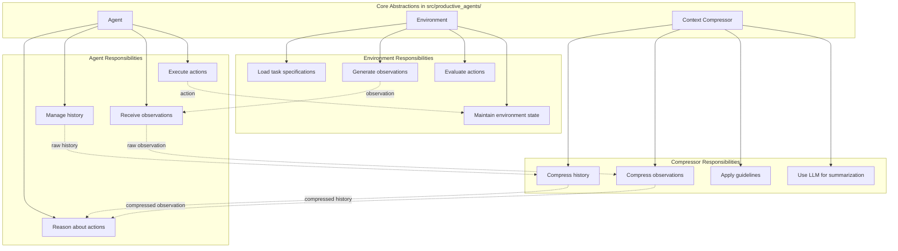
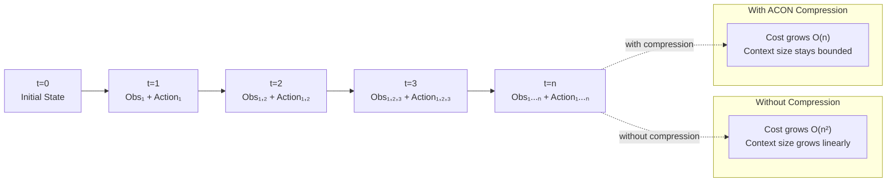
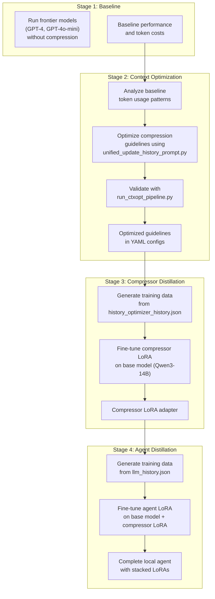
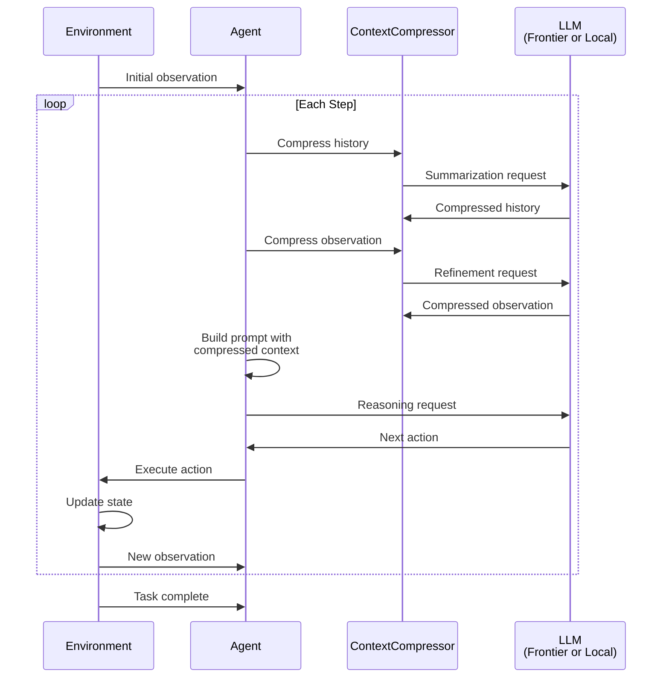
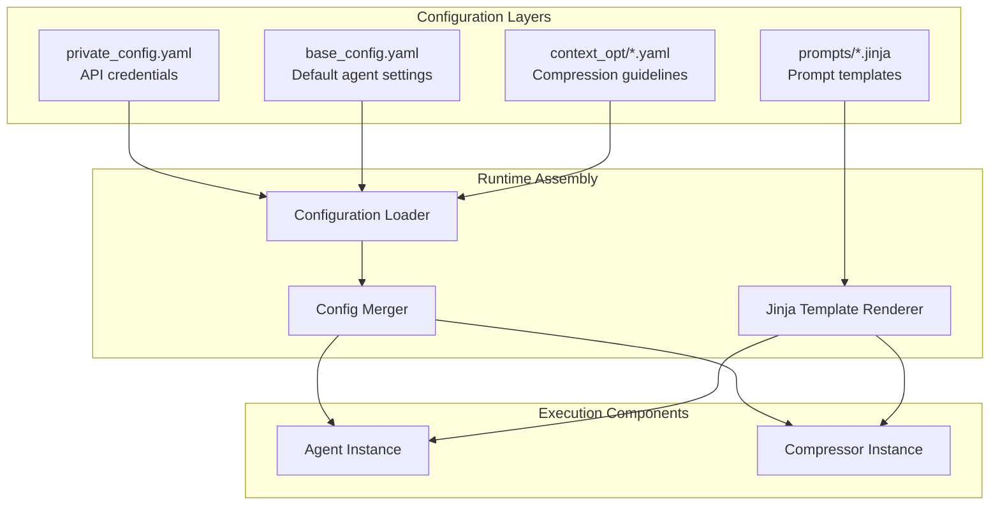
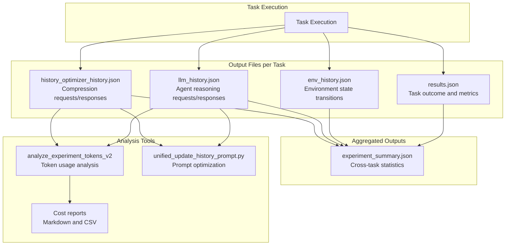

<!-- source: DeepWiki mcp.deepwiki.com · repo microsoft/acon · page 3 Core Concepts · fetched 2026-10-26 -->

# Core Concepts

Relevant source files

The following files were used as context for generating this wiki page:

- [README.md](README.md)
- [assets/concept.png](assets/concept.png)

This document introduces the fundamental concepts underlying the ACON framework. It covers the core abstractions (environments, agents, and context compressors), explains what context optimization is and why it matters for long-horizon agents, and provides an overview of the four-stage experimental pipeline.

For detailed information about specific topics:
- For setting up and running experiments, see [Running Experiments](#5)
- For benchmark-specific details, see [Benchmarks](#4)
- For configuration and customization, see [Configuration](#6)
- For analysis and optimization procedures, see [Analysis and Optimization](#7)

## What is ACON?

ACON (Agent Context Optimization) is a research framework for optimizing context compression in long-horizon LLM agents. The framework addresses a fundamental challenge: as agents execute multi-step tasks, their conversation history grows continuously, leading to increased token costs and potential context window limitations.

The framework provides:
- **Standardized abstractions** for environments, agents, and context compressors
- **Multi-benchmark support** across AppWorld, OfficeBench, and 8-objective QA
- **A four-stage pipeline** from baseline experiments to fully distilled local models
- **Analysis tools** for token usage, cost tracking, and prompt optimization

**Sources:** [README.md:1-41]()

## Core Abstractions

ACON defines three primary abstractions that work together to enable context-optimized agent execution:

### Environment

The `Environment` abstraction represents the task execution environment. It is responsible for:
- Loading task specifications and initial state
- Maintaining the current state of the environment
- Generating observations in response to agent actions
- Evaluating action success and computing rewards

Each benchmark (AppWorld, OfficeBench, SmolAgents) implements this abstraction differently based on its domain requirements.

### Agent

The `Agent` abstraction implements the decision-making logic. It:
- Receives observations from the environment
- Reasons about what action to take next
- Executes actions by calling environment APIs
- Maintains a history of past observations and actions

The agent uses LLMs (either frontier models like GPT-4 or distilled local models) to perform reasoning.

### Context Compressor

The `Context Compressor` is responsible for reducing the size of the agent's context while preserving task-critical information. It operates on two types of inputs:

1. **History Compression**: Summarizes the sequence of past observations and actions
2. **Observation Compression**: Refines the current observation to remove redundant details

Compressors use LLM-based summarization guided by optimization guidelines.

**Sources:** [README.md:22-24](), [README.md:116-119]()

## The Context Optimization Problem

Long-horizon agents face a critical challenge: **unbounded memory growth**. As tasks progress through multiple steps, the agent's context accumulates:

Without compression, each LLM call includes all previous history, leading to:
- **Quadratic token costs**: Each step adds more tokens to be re-processed
- **Context window limits**: Eventually exceeding model capacity
- **Degraded performance**: Irrelevant details dilute important information

Context optimization addresses this by compressing history at each step, maintaining bounded context size while preserving task-critical information.

**Sources:** [README.md:22-23]()

## Four-Stage Experimental Pipeline

ACON follows a systematic four-stage pipeline that progresses from baseline measurements to fully optimized local models:

### Stage 1: Baseline

Establish baseline performance using frontier models without compression. This measures:
- Task success rates
- Token usage per task
- Total costs
- Performance bottlenecks

### Stage 2: Context Optimization

Optimize compression guidelines through automated prompt engineering:
1. Analyze token usage patterns from baseline experiments
2. Generate candidate compression guidelines
3. Evaluate each guideline on validation tasks
4. Select the best-performing configuration

The output is a YAML configuration file (e.g., `gpt-4.1-mini_history.yaml`) containing optimized compression instructions.

### Stage 3: Compressor Distillation

Train a local model to replicate the compression behavior:
1. Extract compression examples from `history_optimizer_history.json`
2. Fine-tune a LoRA adapter on a base model (e.g., Qwen3-14B)
3. The resulting model can perform compression locally without API calls

### Stage 4: Agent Distillation

Train a local model to replicate the agent reasoning:
1. Extract agent decision examples from `llm_history.json`
2. Fine-tune a second LoRA adapter on the base model
3. Stack both LoRA adapters to create a complete local agent

The final model performs both compression and reasoning locally, eliminating API dependencies.

**Sources:** [README.md:132-136]()

## Agent-Environment Interaction Flow

The following diagram shows how components interact during task execution:

### Execution Flow Details

1. **Initialization**: Environment loads the task and provides initial observation
2. **History Compression**: Agent sends accumulated history to compressor
3. **Observation Compression**: Agent sends current observation to compressor
4. **Reasoning**: Agent uses compressed context to determine next action
5. **Action Execution**: Environment processes action and updates state
6. **Iteration**: Process repeats until task completion

The key insight is that compression happens **before reasoning**, ensuring the agent always works with bounded context.

**Sources:** [README.md:22-24]()

## Configuration-Driven Design

ACON uses a layered configuration system to control all aspects of execution:

### Configuration Components

| Component | Purpose | Example |
|-----------|---------|---------|
| `private_config.yaml` | API keys and credentials | OpenAI API key |
| `base_config.yaml` | Default agent settings | Model name, temperature, max tokens |
| `context_opt/*.yaml` | Compression guidelines | History/observation compression rules |
| `prompts/*.jinja` | Prompt templates | System prompts, user prompts |

The system merges these configurations at runtime, with later configurations overriding earlier ones. This enables easy experimentation by swapping configuration files without code changes.

**Sources:** [README.md:104-110]()

## Output and Traceability

ACON generates comprehensive outputs for each task execution, enabling detailed analysis and reproducibility:

### Output File Descriptions

- **`history_optimizer_history.json`**: Complete log of all compression operations, including input context, guidelines, and compressed output
- **`llm_history.json`**: Complete log of agent reasoning, including prompts sent to LLM and responses received
- **`env_history.json`**: Complete log of environment interactions, including actions executed and observations returned
- **`results.json`**: Task outcome (success/failure), final state, and execution metrics
- **`experiment_summary.json`**: Aggregated statistics across all tasks in the experiment

These outputs enable:
- Debugging agent behavior
- Analyzing token usage patterns
- Training distilled models
- Optimizing compression guidelines

**Sources:** [README.md:82-86]()

## Model Serving Options

ACON supports two model serving configurations, allowing seamless transitions from frontier to local models:

| Configuration | Compressor Model | Agent Model | Use Case |
|---------------|------------------|-------------|----------|
| **Frontier** | OpenAI API (e.g., gpt-4o-mini) | OpenAI API (e.g., gpt-4o) | Baseline experiments, optimization |
| **Local** | Base model + Compressor LoRA | Base model + Compressor LoRA + Agent LoRA | Production deployment, cost reduction |

The local configuration uses **stacked LoRA adapters** on a single base model (e.g., Qwen3-14B), where:
1. The compressor LoRA is applied for compression operations
2. Both LoRAs are stacked for agent reasoning operations

This architecture enables complete local execution without external API dependencies.

**Sources:** [README.md:132-136]()

## Summary

ACON provides a complete framework for context optimization in long-horizon agents:

1. **Core Abstractions**: Environment, Agent, and Context Compressor work together to enable bounded-context execution
2. **Four-Stage Pipeline**: Systematic progression from baseline to optimized to distilled models
3. **Configuration-Driven**: YAML configs and Jinja templates enable rapid experimentation
4. **Comprehensive Traceability**: Detailed outputs support analysis, debugging, and training
5. **Flexible Deployment**: Support for both frontier and local models

The framework standardizes context optimization research across multiple benchmarks while providing tools for every stage of the optimization process.

**Sources:** [README.md:1-142]()

---

