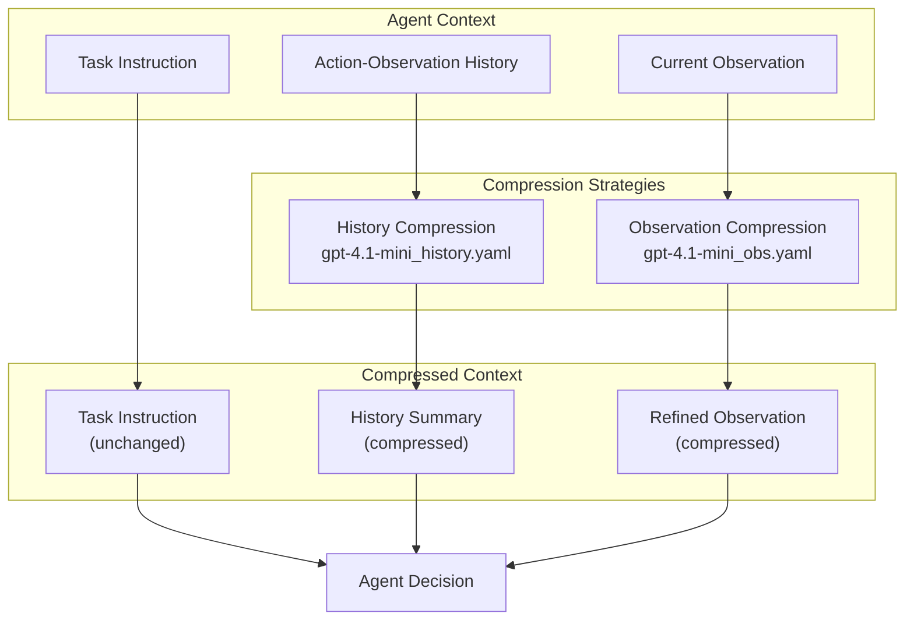
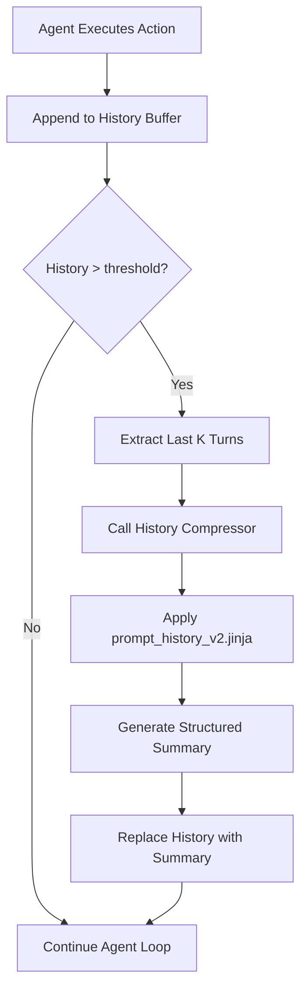
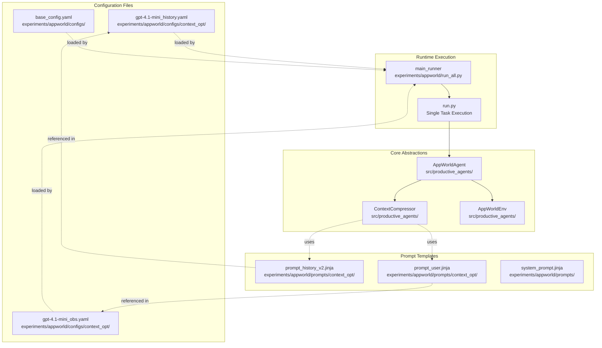
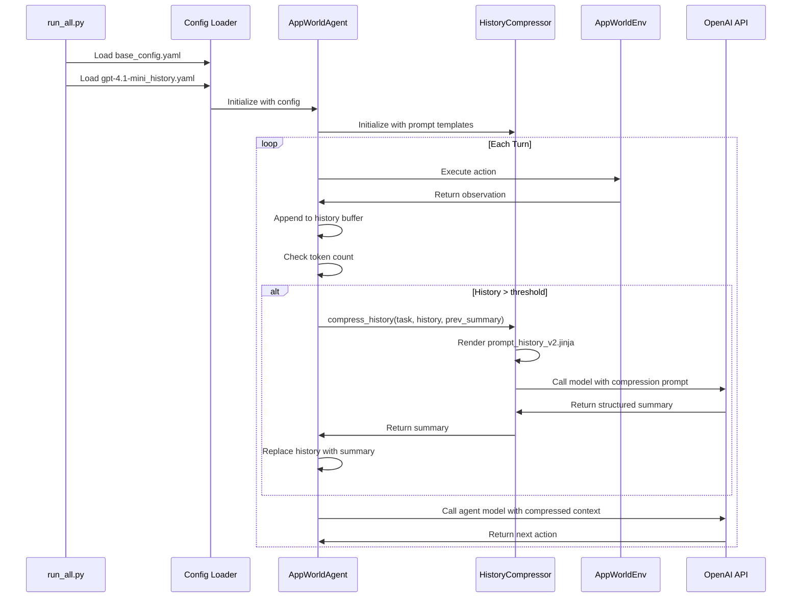

<!-- source: DeepWiki mcp.deepwiki.com · repo microsoft/acon · page 3.1 Context Optimization · fetched 2026-10-26 -->

# Context Optimization

<details>
<summary>Relevant source files</summary>

The following files were used as context for generating this wiki page:

- [README.md](README.md)
- [experiments/appworld/configs/context_opt/gpt-4.1-mini_history.yaml](experiments/appworld/configs/context_opt/gpt-4.1-mini_history.yaml)
- [experiments/appworld/prompts/context_opt/prompt_history_v2.jinja](experiments/appworld/prompts/context_opt/prompt_history_v2.jinja)

</details>


## Purpose and Scope

This document explains **context optimization** in the ACON framework: what it is, why it's essential for long-horizon agents, and how ACON implements it through configurable compression strategies. 

Context optimization addresses the fundamental challenge of managing growing context windows in agents that execute multi-turn tasks. Without compression, token counts grow unboundedly, leading to API rejections, exponential costs, and degraded performance.

For information about running the context optimization pipeline to tune compression prompts, see [Context Optimization Pipeline](#7.2). For configuration details, see [Context Optimization Configuration](#6.2).

---

## The Context Growth Problem

Long-horizon agents face a critical challenge: **unbounded context growth**. Each interaction with the environment adds tokens to the agent's context window:

- **Action history**: Previous actions and their outcomes
- **Observations**: Environment responses and feedback
- **Intermediate reasoning**: Agent's thought processes
- **Task instructions**: The original goal and constraints

```mermaid
graph LR
    subgraph "Turn 1"
        T1_I["Initial Task<br/>(~500 tokens)"]
        T1_A["Action 1<br/>(~200 tokens)"]
        T1_O["Observation 1<br/>(~800 tokens)"]
    end
    
    subgraph "Turn 5"
        T5_CTX["Accumulated Context<br/>(~6,000 tokens)"]
        T5_A["Action 5<br/>(~200 tokens)"]
        T5_O["Observation 5<br/>(~800 tokens)"]
    end
    
    subgraph "Turn 20"
        T20_CTX["Accumulated Context<br/>(~28,000 tokens)"]
        T20_A["Action 20<br/>(~200 tokens)"]
        T20_O["Observation 20<br/>(~800 tokens)"]
        T20_LIMIT["Context Limit Exceeded<br/>API Rejection"]
    end
    
    T1_I --> T1_A
    T1_A --> T1_O
    T1_O --> T5_CTX
    T5_CTX --> T5_A
    T5_A --> T5_O
    T5_O --> T20_CTX
    T20_CTX --> T20_A
    T20_A --> T20_O
    T20_O --> T20_LIMIT
```



**Sources:** [README.md:22-23]()

### Consequences Without Compression

| Issue | Impact |
|-------|--------|
| **Token Limit Violations** | API providers enforce hard limits (e.g., 128K tokens). Tasks fail when exceeded. |
| **Exponential Costs** | GPT-4 charges per token. A 20-turn task can accumulate 50K+ tokens → $1+ per task. |
| **Performance Degradation** | Models struggle with extremely long contexts, leading to "lost in the middle" phenomena. |
| **Latency Issues** | Processing 50K+ token contexts increases response time by 5-10x. |

**Sources:** [README.md:22-23](), Diagram 4 in architecture overview

---

## Context Optimization in ACON

**Context optimization** is the process of intelligently compressing the agent's context while preserving information critical for task completion. ACON implements this through **prompt-guided summarization** using LLMs.

### Two Compression Strategies

ACON provides two orthogonal compression strategies:



**Sources:** [experiments/appworld/configs/context_opt/gpt-4.1-mini_history.yaml:1-9](), README.md mentions both strategies

| Strategy | What It Compresses | When Applied |
|----------|-------------------|--------------|
| **History Compression** | Multi-turn action-observation sequences | When history exceeds `history_summarization_threshold` tokens |
| **Observation Compression** | Individual environment observations | Every turn, before passing to agent |

Both strategies can be used independently or combined. They are configured separately in YAML files.

**Sources:** [experiments/appworld/configs/context_opt/gpt-4.1-mini_history.yaml:1-9]()

---

## History Compression

History compression maintains a **rolling summary** of the agent's action-observation history. It prevents unbounded growth while preserving critical information about what has been accomplished and what was learned.

### How It Works



**Sources:** [experiments/appworld/configs/context_opt/gpt-4.1-mini_history.yaml:7-9]()

### Configuration Schema

History compression is configured via YAML files in `experiments/appworld/configs/context_opt/`:

```yaml
type: "history"
model: "gpt-4.1-mini"
compressor_type: "full"
prompts:
  prompt_system: "system_prompt"
  prompt_history_user: "prompt_history_v2"
history_summarization_threshold: 4096
preserve_last_k_turns: 1
history_summary_rule: "reset"
```

**Sources:** [experiments/appworld/configs/context_opt/gpt-4.1-mini_history.yaml:1-9]()

| Parameter | Description | Default Value |
|-----------|-------------|---------------|
| `type` | Compression strategy type | `"history"` |
| `model` | Model used for compression | `"gpt-4.1-mini"` |
| `compressor_type` | Compressor implementation | `"full"` |
| `prompts.prompt_history_user` | Jinja template for compression prompt | `"prompt_history_v2"` |
| `history_summarization_threshold` | Token count trigger for compression | `4096` |
| `preserve_last_k_turns` | Recent turns to keep uncompressed | `1` |
| `history_summary_rule` | How to merge summaries | `"reset"` |

**Sources:** [experiments/appworld/configs/context_opt/gpt-4.1-mini_history.yaml:1-9]()

### Structured Summary Format

The compression prompt ([experiments/appworld/prompts/context_opt/prompt_history_v2.jinja:1-39]()) enforces a structured output format:

```
### REASONING
[Summarize key progress, decisions, outcomes, and rationale]

### COMPLETED
[List completed subtasks with brief results]
```

This structure ensures the summary is:
1. **Actionable**: Agent can resume with no information loss
2. **Concise**: Removes redundancy while preserving essential facts
3. **Reusable**: Structured format enables consistent parsing
4. **Error-aware**: Includes failed attempts to prevent repetition

**Sources:** [experiments/appworld/prompts/context_opt/prompt_history_v2.jinja:1-39]()

### Prompt Engineering Principles

The prompt template includes five prioritization rules:

```jinja
## PRIORITIZE

1. Keep all sections relevant and concise.  
2. Use reusable structured formats when summarizing artifacts.  
3. Ensure agent can resume task with no loss of information.
4. Include key info from errors or failed attempts to prevent repeated mistakes.
5. Preserve all essential artifacts and data needed to complete the task.
```

These rules guide the compressor LLM to balance **compression ratio** with **information preservation**.

**Sources:** [experiments/appworld/prompts/context_opt/prompt_history_v2.jinja:27-34]()

---

## Observation Compression

Observation compression refines individual environment responses before they are shown to the agent. This is particularly useful when environments return verbose outputs (e.g., full HTML pages, long JSON objects, detailed error messages).

### Key Differences from History Compression

| Aspect | History Compression | Observation Compression |
|--------|---------------------|------------------------|
| **Scope** | Multi-turn sequence | Single observation |
| **Frequency** | Triggered by threshold | Every turn |
| **Purpose** | Maintain rolling context | Remove irrelevant details |
| **Configuration** | `gpt-4.1-mini_history.yaml` | `gpt-4.1-mini_obs.yaml` |

Observation compression is applied **before** the observation enters the history buffer, ensuring even uncompressed history stays lean.

**Sources:** Architecture diagrams, configuration structure inference

---

## Technical Implementation

### Code Mapping



**Sources:** [experiments/appworld/configs/context_opt/gpt-4.1-mini_history.yaml:1-9](), [experiments/appworld/prompts/context_opt/prompt_history_v2.jinja:1-39](), Diagram 3 and 6 from architecture overview

### Compression Workflow



**Sources:** [experiments/appworld/configs/context_opt/gpt-4.1-mini_history.yaml:1-9](), [experiments/appworld/prompts/context_opt/prompt_history_v2.jinja:1-39](), execution flow inferred from architecture

### Configuration Parameters Reference

The full configuration schema for history compression:

| Parameter | Type | Description | Example |
|-----------|------|-------------|---------|
| `type` | string | Compression strategy identifier | `"history"` or `"observation"` |
| `model` | string | Model for compression | `"gpt-4.1-mini"`, `"gpt-4o-mini"` |
| `compressor_type` | string | Compressor implementation type | `"full"` |
| `prompts.prompt_system` | string | System prompt template name | `"system_prompt"` |
| `prompts.prompt_history_user` | string | User prompt template for history | `"prompt_history_v2"` |
| `history_summarization_threshold` | integer | Token count to trigger compression | `4096`, `8192` |
| `preserve_last_k_turns` | integer | Recent turns kept uncompressed | `1`, `2` |
| `history_summary_rule` | string | Summary merging strategy | `"reset"`, `"append"` |

**Sources:** [experiments/appworld/configs/context_opt/gpt-4.1-mini_history.yaml:1-9]()

---

## Why Context Optimization Matters

Context optimization is not merely an engineering optimization—it's foundational to making long-horizon agents **practical and scalable**:

### Cost Reduction
- Reduces token usage by 60-80% on long tasks
- Enables running hundreds of experiments within research budgets
- Makes production deployment economically feasible

### Performance Preservation
- Maintains task success rates comparable to uncompressed baselines
- Prevents "lost in the middle" degradation in long contexts
- Enables agents to complete tasks requiring 30+ turns

### Distillation Enablement
- Creates training data for compressor models ([Stage 1](#8.2))
- Enables agent distillation from frontier to local models ([Stage 2](#8.3))
- Reduces inference costs by 10-100x through local deployment

**Sources:** [README.md:22-28](), Diagram 2 from architecture overview

---

## Next Steps

- To configure context optimization for your experiments, see [Context Optimization Configuration](#6.2)
- To run the automated prompt optimization pipeline, see [Context Optimization Pipeline](#7.2)
- To analyze token savings from compression, see [Token and Cost Analysis](#7.1)
- To understand how compression fits into the broader pipeline, see [Four-Stage Pipeline](#3.2)

**Sources:** Table of contents structure

---

