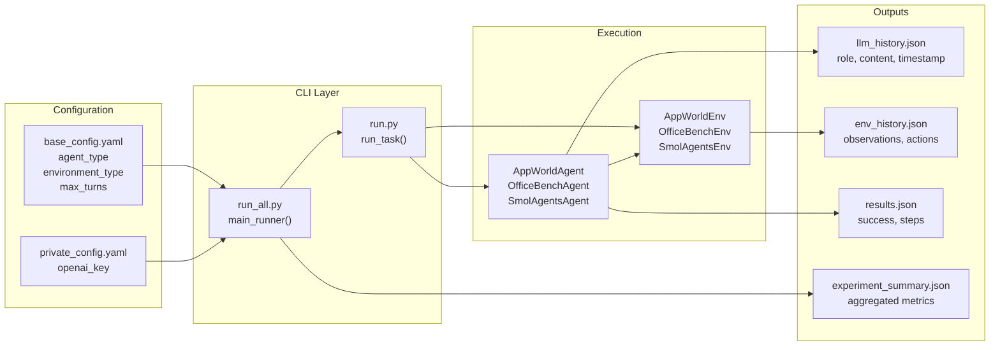
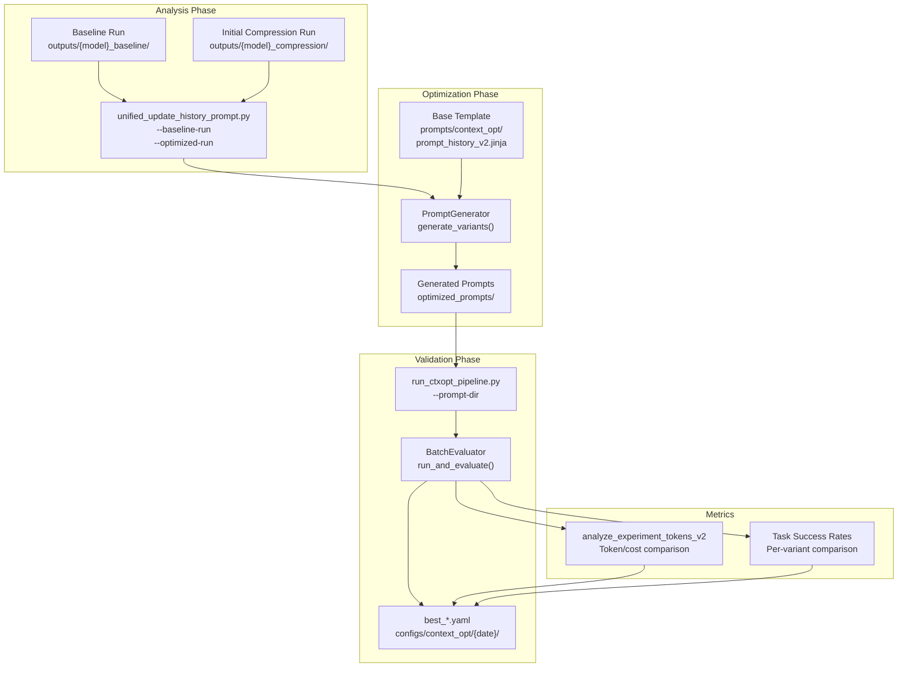
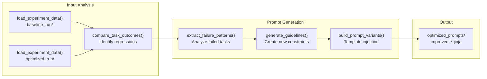
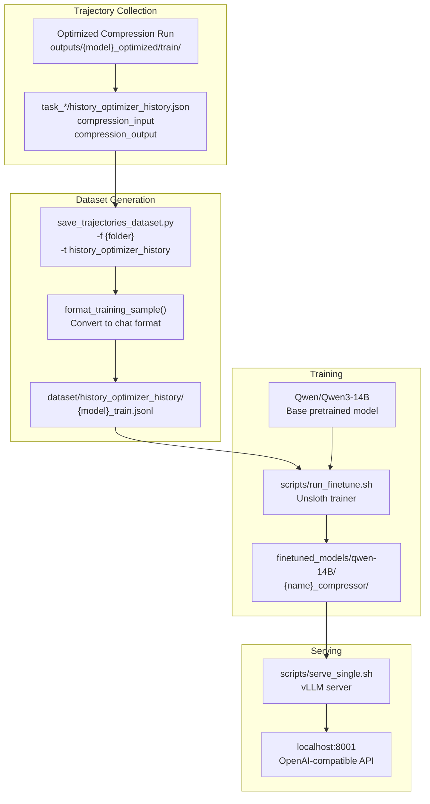
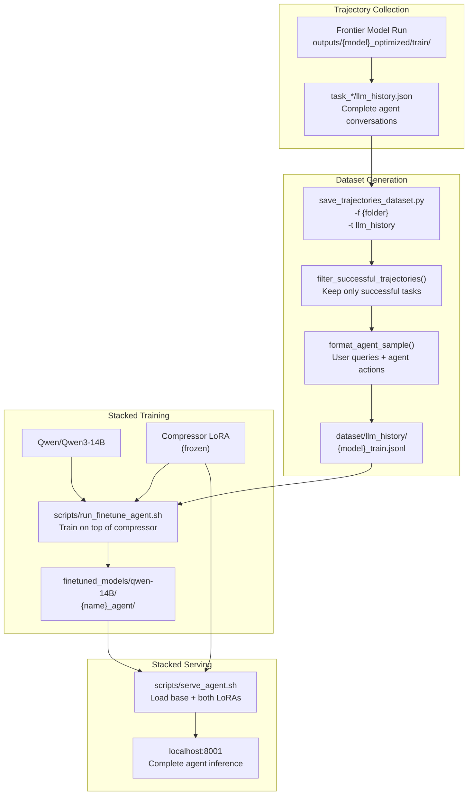
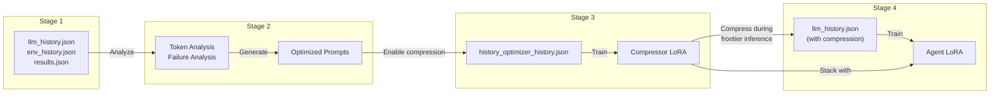
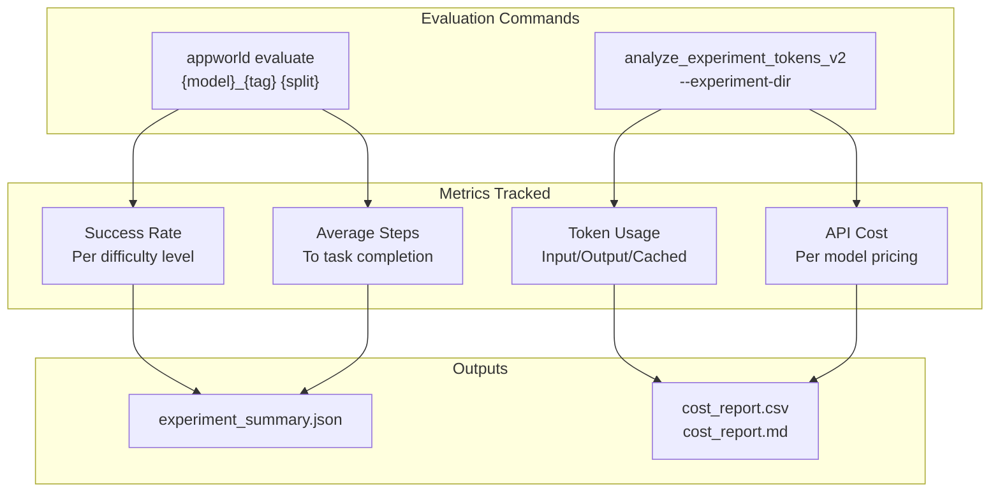

<!-- source: DeepWiki mcp.deepwiki.com · repo microsoft/acon · page 3.2 Four-Stage Pipeline · fetched 2026-10-26 -->

# Four-Stage Pipeline

<details>
<summary>Relevant source files</summary>

The following files were used as context for generating this wiki page:

- [README.md](README.md)
- [experiments/appworld/README.md](experiments/appworld/README.md)

</details>


## Purpose and Scope

This page describes the four-stage experimental pipeline that ACON uses to progressively optimize and distill long-horizon agents. The pipeline applies uniformly across all supported benchmarks (AppWorld, OfficeBench, SmolAgents) and transforms frontier models into efficient, locally-hosted models while preserving performance.

For details on how context optimization works conceptually, see [Context Optimization](#3.1). For implementation details of running experiments, see [Running Experiments](#5). For model distillation techniques, see [Model Distillation](#8).

## Pipeline Overview

The ACON pipeline consists of four sequential stages, each building upon the previous stage's outputs:

| Stage | Name | Input | Output | Primary Goal |
|-------|------|-------|--------|--------------|
| 1 | Baseline Establishment | Task data, frontier models | Performance metrics, trajectory data | Establish upper-bound performance |
| 2 | Context Optimization | Baseline trajectories | Optimized compression prompts | Minimize tokens while preserving performance |
| 3 | Compressor Distillation | Optimized compression traces | Compressor LoRA weights | Distill compression capability to local model |
| 4 | Agent Distillation | Full agent trajectories | Agent LoRA weights | Distill reasoning capability to local model |

### Pipeline Flow

```mermaid
graph TB
    subgraph "Stage 1: Baseline"
        S1_Input["Task Data<br/>(AppWorld/OfficeBench/SmolAgents)"]
        S1_Model["Frontier Model<br/>(gpt-4.1, gpt-4o)"]
        S1_Runner["run_all.py<br/>--co_config_path None"]
        S1_Output["outputs/{model}_{tag}/{split}/<br/>experiment_summary.json<br/>llm_history.json<br/>env_history.json"]
        
        S1_Input --> S1_Runner
        S1_Model --> S1_Runner
        S1_Runner --> S1_Output
    end
    
    subgraph "Stage 2: Optimization"
        S2_Analyze["unified_update_history_prompt.py<br/>--baseline-run --optimized-run"]
        S2_Validate["run_ctxopt_pipeline.py<br/>Test candidate prompts"]
        S2_Output["configs/context_opt/{date}/<br/>best_*.yaml<br/>optimized_prompts/"]
        
        S1_Output --> S2_Analyze
        S2_Analyze --> S2_Validate
        S2_Validate --> S2_Output
    end
    
    subgraph "Stage 3: Compressor"
        S3_Dataset["save_trajectories_dataset.py<br/>-t history_optimizer_history"]
        S3_Train["scripts/run_finetune.sh<br/>Train Compressor LoRA"]
        S3_Serve["scripts/serve_single.sh<br/>Load base + compressor LoRA"]
        S3_Output["finetuned_models/qwen-14B/<br/>{name}_compressor/"]
        
        S2_Output --> S3_Dataset
        S3_Dataset --> S3_Train
        S3_Train --> S3_Output
        S3_Output --> S3_Serve
    end
    
    subgraph "Stage 4: Agent"
        S4_Dataset["save_trajectories_dataset.py<br/>-t llm_history"]
        S4_Train["scripts/run_finetune_agent.sh<br/>Train Agent LoRA"]
        S4_Serve["scripts/serve_agent.sh<br/>Load base + both LoRAs"]
        S4_Output["finetuned_models/qwen-14B/<br/>{name}_agent/"]
        
        S2_Output --> S4_Dataset
        S4_Dataset --> S4_Train
        S4_Train --> S4_Output
        S3_Serve --> S4_Serve
        S4_Output --> S4_Serve
    end
    
    S1_Output -.."provides baseline".-> S2_Analyze
    S2_Output -.."configures compression".-> S3_Dataset
    S3_Serve -.."enables compression".-> S4_Dataset
```

**Sources:** [README.md:132-137](), [experiments/appworld/README.md:25-237]()

## Stage 1: Baseline Establishment

### Purpose

Stage 1 runs agents on benchmark tasks using frontier models (GPT-4, GPT-4o) without context compression. This establishes:
- Upper-bound task performance metrics
- Token usage baselines
- Complete trajectory data for later analysis
- Ground truth for optimization

### Execution

Baseline experiments are executed via `run_all.py` with no context optimization configuration:

```bash
python run_all.py \
    --split train \
    --model_name gpt-4.1 \
    --tag baseline \
    --co_config_path configs/base_config.yaml
```

### Key Components



**Sources:** [experiments/appworld/README.md:25-40](), [README.md:132-133]()

### Output Structure

Stage 1 produces the following directory structure:

```
outputs/{model_name}_{tag}/{split}/
├── experiment_summary.json          # Aggregated results across all tasks
└── task_{id}_{rep}/                 # Per-task execution directory
    ├── llm_history.json             # Agent LLM interaction log
    ├── env_history.json             # Environment state transitions
    ├── results.json                 # Task completion status
    └── step_alignment.json          # Turn-level alignment data
```

### Critical Files

- **llm_history.json**: Contains the complete conversation history between the agent and the LLM, including prompts, responses, and token counts. This is the primary input for Stage 4 (agent distillation).
- **env_history.json**: Records all observations and actions in the environment, used for evaluation and analysis.
- **experiment_summary.json**: Aggregates success rates, average steps, and token usage across all tasks in the split.

**Sources:** [experiments/appworld/README.md:66-89]()

## Stage 2: Context Optimization

### Purpose

Stage 2 analyzes baseline trajectories to optimize context compression guidelines. The goal is to find compression prompts that:
- Minimize token usage (reduce context length)
- Preserve task-critical information
- Maintain or improve task success rates

### Workflow



**Sources:** [experiments/appworld/README.md:90-133](), [README.md:134]()

### Key Scripts

**unified_update_history_prompt.py**

This script performs regression analysis on baseline vs. compressed runs to identify where compression caused failures:



**run_ctxopt_pipeline.py**

This script validates generated prompt variants on a subset of training data:

- Loads all prompt variants from a directory
- Creates temporary configs for each variant
- Runs experiments using each config
- Evaluates results and ranks by token savings + success rate
- Outputs the best-performing configuration

**Sources:** [experiments/appworld/README.md:99-121]()

### Configuration Output

Stage 2 produces optimized context compression configurations:

```yaml
# configs/context_opt/{YYMMDD}_gpt-4.1_history_optimized_prompt/best_improved_history_prompt_samples.yaml
type: history
model: "gpt-4.1"
compressor_type: full
prompts:
    prompt_system: system_prompt
    prompt_history_user: prompt_history_v2_optimized  # <-- Optimized prompt
history_summarization_threshold: 4096
preserve_last_k_turns: 1
history_summary_rule: reset
```

This configuration references the optimized Jinja template in `prompts/context_opt/`.

**Sources:** [experiments/appworld/README.md:124-133]()

## Stage 3: Compressor Distillation

### Purpose

Stage 3 distills the context compression capability from the frontier model into a local model using LoRA fine-tuning. The compressor LoRA learns to:
- Summarize conversation histories
- Compress observations
- Follow the optimized compression guidelines from Stage 2

### Data Pipeline



**Sources:** [experiments/appworld/README.md:135-195]()

### Training Data Format

The `save_trajectories_dataset.py` script extracts compression examples from `history_optimizer_history.json`:

Each training sample is formatted as:
```json
{
  "messages": [
    {
      "role": "system",
      "content": "<system prompt for compression>"
    },
    {
      "role": "user", 
      "content": "<full conversation history to compress>"
    },
    {
      "role": "assistant",
      "content": "<compressed summary>"
    }
  ]
}
```

The `compression_input` field contains the uncompressed history, and `compression_output` contains the frontier model's compression, which becomes the training target.

**Sources:** [experiments/appworld/README.md:144-152]()

### Fine-tuning Process

The `run_finetune.sh` script executes:

1. **Load Base Model**: Qwen3-14B in 4-bit quantization
2. **Configure LoRA**: Rank 16, alpha 16, target modules: q_proj, k_proj, v_proj, o_proj, gate_proj, up_proj, down_proj
3. **Train**: 3 epochs, learning rate 2e-4, gradient accumulation 4 steps
4. **Save**: LoRA adapters to `finetuned_models/qwen-14B/{name}_compressor/`

The training uses the Unsloth library for efficient LoRA fine-tuning with optimized memory usage.

**Sources:** [experiments/appworld/README.md:154-161]()

### Model Serving

The trained compressor is served via vLLM with the LoRA adapter loaded:

```bash
bash scripts/serve_single.sh \
    Qwen/Qwen3-14B \
    finetuned_models/qwen-14B/history_compression_3epochs
```

This creates an OpenAI-compatible API endpoint that the agent can call for compression during inference.

**Sources:** [experiments/appworld/README.md:163-169]()

### Configuration for Inference

To use the distilled compressor, update the context optimization config:

```yaml
# configs/context_opt/qwen3-14B/history_baseline.yaml
type: history
model: "Qwen/Qwen3-14B"
lora_name: "finetune=finetuned_models/qwen-14B/history_compression_3epochs"
compressor_type: full
prompts:
    prompt_system: system_prompt
    prompt_history_user: prompt_history_v2
history_summarization_threshold: 4096
preserve_last_k_turns: 1
history_summary_rule: reset
```

The `lora_name` field with the `finetune=` prefix indicates this is a local model with a LoRA adapter.

**Sources:** [experiments/appworld/README.md:171-184]()

## Stage 4: Agent Distillation

### Purpose

Stage 4 distills the complete agent reasoning capability into a local model by training a second LoRA adapter on top of the compressor LoRA. The agent LoRA learns:
- Task-specific reasoning patterns
- Action selection strategies
- Multi-turn planning and execution

This creates a fully local agent that can operate independently without frontier model API calls.

### Data Pipeline



**Sources:** [experiments/appworld/README.md:196-237]()

### Training Data Format

The `save_trajectories_dataset.py` script with `-t llm_history` extracts complete agent trajectories:

Each training sample represents one agent turn:
```json
{
  "messages": [
    {
      "role": "system",
      "content": "<agent system prompt>"
    },
    {
      "role": "user",
      "content": "<task description + current observation>"
    },
    {
      "role": "assistant",
      "content": "<agent's action>"
    },
    ...
  ]
}
```

Multi-turn trajectories are preserved to teach the model sequential reasoning.

**Sources:** [experiments/appworld/README.md:201-209]()

### Stacked LoRA Training

The agent LoRA is trained on top of the frozen compressor LoRA:

1. **Load Base Model**: Qwen3-14B with compressor LoRA attached
2. **Configure New LoRA**: Same configuration as compressor (rank 16, alpha 16)
3. **Train**: 3 epochs on agent trajectories
4. **Save**: Agent LoRA separately from compressor LoRA

This stacked approach allows:
- Compressor handles context compression
- Agent LoRA focuses on reasoning and actions
- Both can be loaded simultaneously for inference

**Sources:** [experiments/appworld/README.md:211-218]()

### Stacked Model Serving

Both LoRAs are served together:

```bash
bash scripts/serve_agent.sh \
    Qwen/Qwen3-14B \
    finetuned_models/qwen-14B/{name}_compressor \
    finetuned_models/qwen-14B/{name}_agent
```

The serving script:
1. Loads base model (Qwen3-14B)
2. Applies compressor LoRA weights
3. Applies agent LoRA weights on top
4. Exposes OpenAI-compatible endpoint

During inference, the model first uses compression capabilities (from compressor LoRA) when processing history, then uses reasoning capabilities (from agent LoRA) to select actions.

**Sources:** [experiments/appworld/README.md:220-227]()

### Full Local Inference

After Stage 4, the complete agent runs locally without any frontier model API calls:

```bash
python run_all.py \
    --split test_normal \
    --model_name Qwen/Qwen3-14B \
    --tag local_agent \
    --co_config_path configs/context_opt/qwen3-14B/history_baseline.yaml
```

The configuration references the stacked LoRA setup, enabling:
- Context compression via compressor LoRA
- Agent reasoning via agent LoRA
- Complete task execution on local hardware

**Sources:** [experiments/appworld/README.md:229-237]()

## Cross-Stage Dependencies

### Data Flow



### File Artifacts by Stage

| Stage | Input Files | Output Files | Configuration Files |
|-------|-------------|--------------|---------------------|
| **1: Baseline** | Task data (data/) | llm_history.json<br/>env_history.json<br/>results.json | base_config.yaml |
| **2: Optimization** | Stage 1 outputs | optimized_prompts/*.jinja<br/>best_*.yaml | Base prompt templates |
| **3: Compressor** | history_optimizer_history.json | {name}_compressor/<br/>adapter_config.json<br/>adapter_model.safetensors | Stage 2 optimized configs |
| **4: Agent** | llm_history.json (compressed) | {name}_agent/<br/>adapter_config.json<br/>adapter_model.safetensors | Same as Stage 3 |

**Sources:** [experiments/appworld/README.md:1-237](), [README.md:132-137]()

## Evaluation Across Stages

Each stage is evaluated using benchmark-specific evaluation tools:



### Performance Comparison

Typical progression across stages (example from AppWorld):

| Stage | Model | Success Rate | Avg Tokens/Task | Relative Cost |
|-------|-------|--------------|-----------------|---------------|
| 1: Baseline | GPT-4 | 85% | 120,000 | 1.00x |
| 2: Optimized | GPT-4 + Compression | 84% | 45,000 | 0.37x |
| 3: Compressor | Qwen3-14B (comp) + GPT-4 | 83% | 50,000 | 0.42x |
| 4: Full Local | Qwen3-14B (both LoRAs) | 78% | 52,000 | 0.02x |

The pipeline achieves:
- **~60% token reduction** through optimized compression
- **~90% cost reduction** through local model distillation
- **~7% performance degradation** from frontier to local models

**Sources:** [README.md:22-41]()

## Benchmark-Specific Variations

While the four-stage pipeline is universal, each benchmark has specific characteristics:

### AppWorld
- **Complexity**: Long-horizon tasks (10-30 turns)
- **Compression Focus**: History compression (conversation state)
- **Training Data**: 752 training tasks
- **Directory**: [experiments/appworld/]()

### OfficeBench
- **Complexity**: Medium-horizon office automation
- **Compression Focus**: Both history and observation compression
- **Training Data**: Varies by office application
- **Directory**: [experiments/officebench/]()

### SmolAgents (8-objective QA)
- **Complexity**: Short-horizon retrieval tasks
- **Compression Focus**: Observation compression (document context)
- **Training Data**: Question-answer pairs
- **Directory**: [experiments/smolagents/]()

**Sources:** [README.md:122-131]()

---

