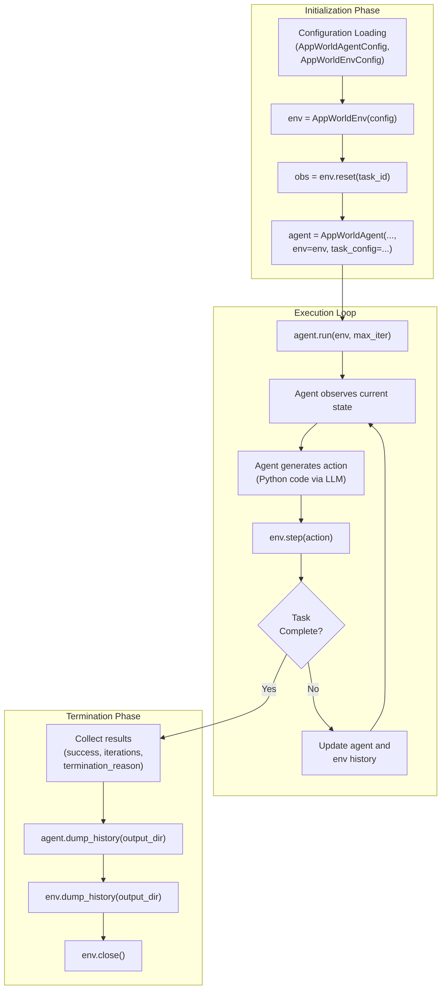
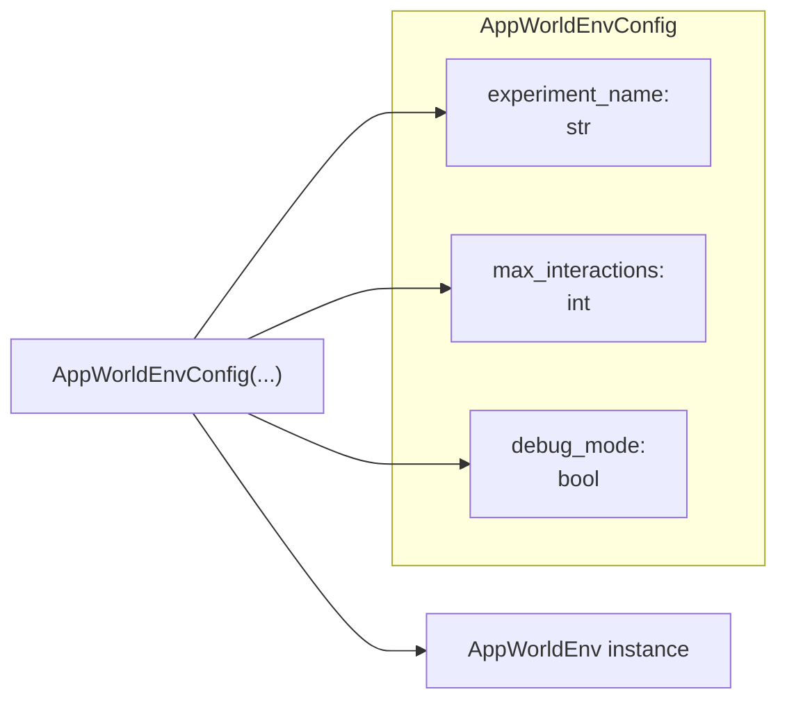
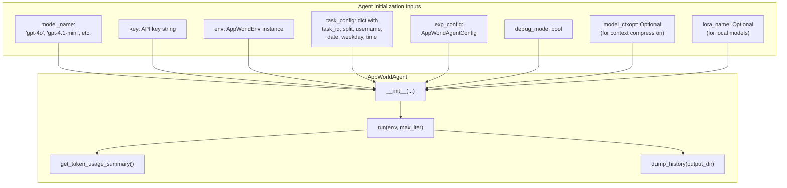
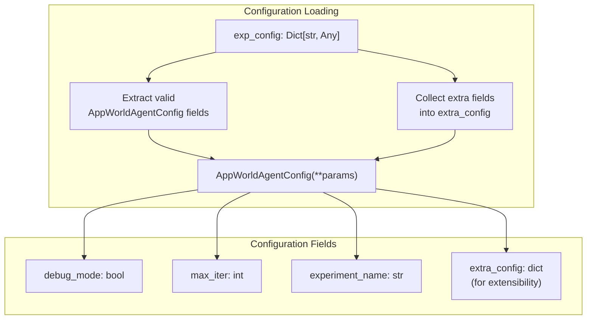
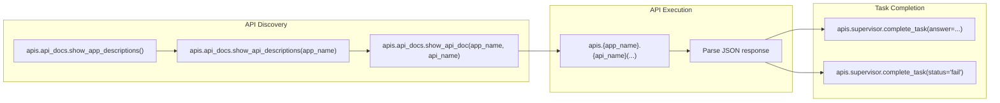
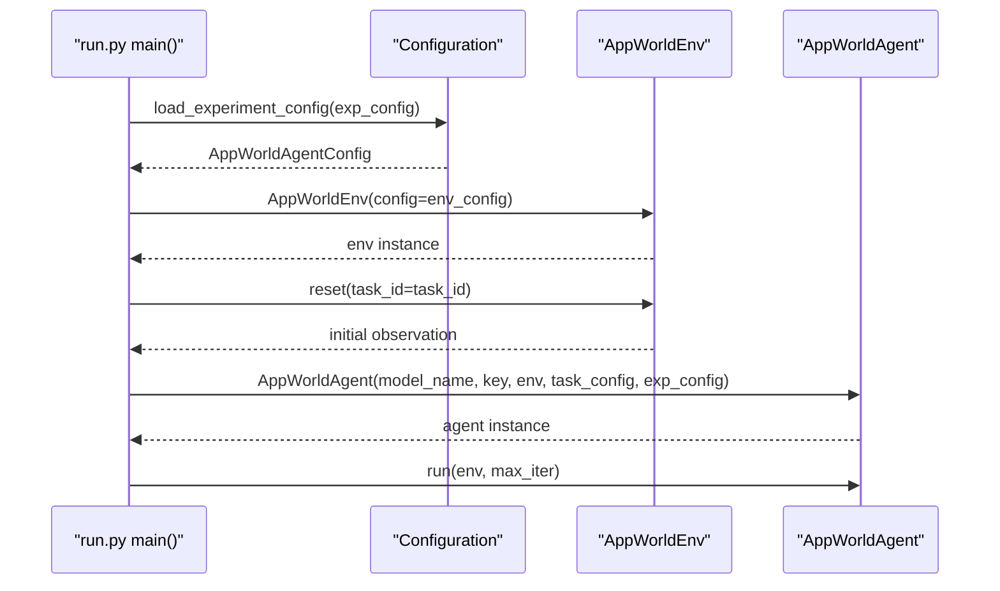
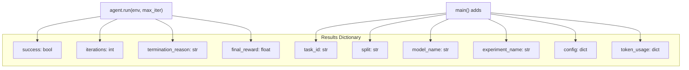
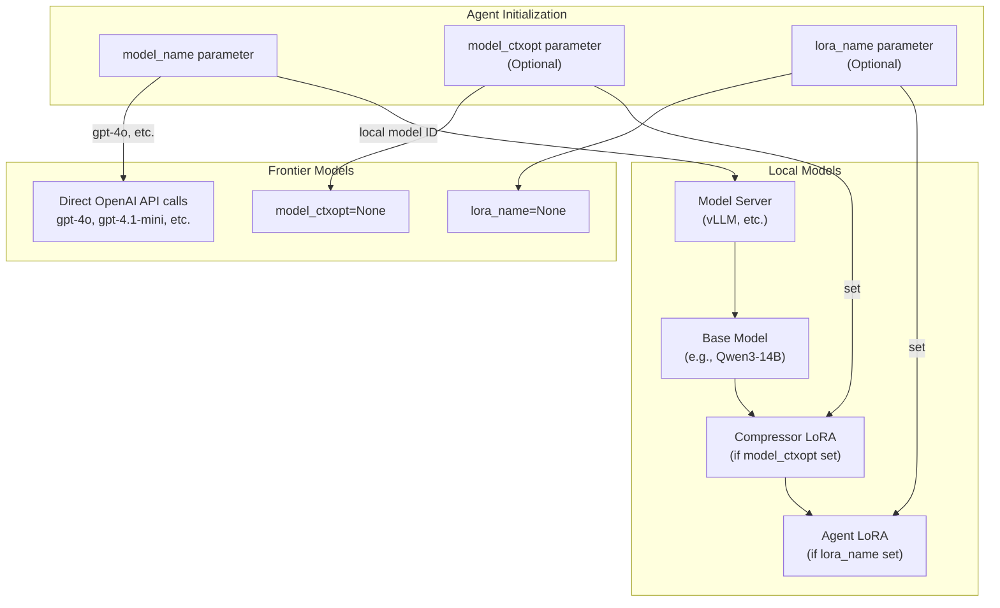

<!-- source: DeepWiki mcp.deepwiki.com · repo microsoft/acon · page 3.3 Agents and Environments · fetched 2026-10-26 -->

# Agents and Environments

<details>
<summary>Relevant source files</summary>

The following files were used as context for generating this wiki page:

- [experiments/appworld/prompts/prompt_v1.jinja](experiments/appworld/prompts/prompt_v1.jinja)
- [experiments/appworld/run.py](experiments/appworld/run.py)

</details>


This page describes the core agent-environment abstraction in ACON and how agents interact with benchmark environments to solve tasks. For information about specific benchmark implementations, see [AppWorld Benchmark](#4.1) and [OfficeBench and SmolAgents](#4.2). For details on running experiments with these components, see [Running Experiments](#5).

## Purpose and Scope

The ACON framework implements a standard agent-environment interface that enables autonomous task execution across multiple benchmarks. This abstraction separates the decision-making logic (agents) from the task execution context (environments), allowing for modular experimentation with different agent implementations, context optimization strategies, and model backends.

This page covers:
- The agent-environment abstraction pattern
- Environment lifecycle and task management
- Agent decision-making and action execution
- The interaction loop protocol
- History tracking and output generation

## Agent-Environment Abstraction

ACON follows a standard reinforcement learning-style agent-environment pattern where agents observe state, take actions, and receive feedback in an iterative loop until task completion.

### Core Classes

The framework defines specialized agent and environment classes for each benchmark family:

| Benchmark | Environment Class | Agent Class | Configuration Classes |
|-----------|------------------|-------------|----------------------|
| AppWorld | `AppWorldEnv` | `AppWorldAgent` | `AppWorldEnvConfig`, `AppWorldAgentConfig` |
| OfficeBench | `OfficeBenchEnv` | `OfficeBenchAgent` | `OfficeBenchEnvConfig`, `OfficeBenchAgentConfig` |
| SmolAgents | `SmolAgentsEnv` | `SmolAgentsAgent` | `SmolAgentsEnvConfig`, `SmolAgentsAgentConfig` |

**Sources:** [experiments/appworld/run.py:15-16]()

### Agent-Environment Interaction Protocol



**Sources:** [experiments/appworld/run.py:54-206]()

## Environment Implementation

### Environment Lifecycle

Environments manage task state and provide the execution context for agent actions.

#### Environment Configuration

The `AppWorldEnvConfig` dataclass defines environment parameters:



**Sources:** [experiments/appworld/run.py:103-107]()

#### Environment Initialization and Reset

The environment initialization pattern follows these steps:

1. **Construction:** `env = AppWorldEnv(config=env_config)` creates the environment instance
2. **Reset:** `obs = env.reset(task_id=task_id)` loads a specific task and returns initial observation
3. **Execution:** Environment processes actions via `env.step(action)`
4. **Cleanup:** `env.close()` releases resources

**Sources:** [experiments/appworld/run.py:117-121, 203]()

### Environment Responsibilities

Environments are responsible for:

| Responsibility | Description | Implementation |
|---------------|-------------|----------------|
| Task Loading | Load task specifications from benchmark data | `env.reset(task_id)` |
| State Management | Maintain current task state and execution context | Internal state tracking |
| Action Execution | Execute agent actions and return results | `env.step(action)` |
| Termination Detection | Detect task completion or failure conditions | Return termination flags |
| History Tracking | Record full execution trajectory | `env.dump_history(output_dir)` |

**Sources:** [experiments/appworld/run.py:117-121, 176]()

## Agent Implementation

### Agent Architecture



**Sources:** [experiments/appworld/run.py:138-147]()

### Agent Configuration

The `AppWorldAgentConfig` dataclass encapsulates agent behavior parameters:



**Sources:** [experiments/appworld/run.py:28-51]()

### Agent Decision-Making Process

The agent operates in a multi-step conversation pattern where it:

1. **Observes** the current environment state (task instruction, previous actions, execution results)
2. **Reasons** about what action to take next using an LLM
3. **Generates** Python code to execute via the environment's API
4. **Executes** the code and observes the result
5. **Iterates** until the task is complete or max iterations reached

#### Agent Prompt Structure

The agent receives instructions via a structured Jinja template ([experiments/appworld/prompts/prompt_v1.jinja:1-152]()) that includes:

| Prompt Component | Purpose | Lines |
|-----------------|---------|-------|
| System Role | Defines agent as autonomous AI assistant | 1-4 |
| API Discovery Instructions | Explains how to explore available APIs | 6-17 |
| Example Walkthrough | Shows complete task solving example | 19-119 |
| Key Instructions | Lists 17 critical rules and guidelines | 124-143 |
| Task Specification | Provides actual task to solve | 145-151 |

**Sources:** [experiments/appworld/prompts/prompt_v1.jinja:1-152]()

#### API Interaction Pattern

The agent interacts with the environment through a Python REPL interface that provides:



**Sources:** [experiments/appworld/prompts/prompt_v1.jinja:6-16, 113-116, 141]()

## Task Execution Flow

### Initialization Sequence



**Sources:** [experiments/appworld/run.py:100-152]()

### Execution Loop

The agent execution follows this pattern:

1. **Initialize:** Agent receives task and initial observation
2. **Generate:** Agent uses LLM to generate Python code based on current state
3. **Execute:** Environment executes the code and returns result
4. **Update:** Both agent and environment update their internal history
5. **Check:** Evaluate termination conditions (task complete, max iterations, failure)
6. **Repeat:** Continue until termination

**Sources:** [experiments/appworld/run.py:152]()

### Task Configuration

The `task_config` dictionary provides contextual information to the agent:

```python
task_config = {
    'task_id': task_id,              # Unique task identifier
    'split': split,                   # Dataset split (train/dev/test)
    'experiment_name': experiment_name,
    'username': 'user',
    'date': datetime.now().strftime('%Y-%m-%d'),
    'weekday': datetime.now().strftime('%A'),
    'time': datetime.now().strftime('%H:%M:%S'),
}
```

**Sources:** [experiments/appworld/run.py:127-135]()

## History Tracking and Output

### History Files

Both agents and environments maintain detailed execution histories that are saved to the output directory:

| File | Generated By | Content | Used For |
|------|-------------|---------|----------|
| `llm_history.json` | Agent | All LLM requests and responses | Token analysis, agent distillation |
| `history_optimizer_history.json` | Agent | Context optimization LLM calls | Compressor distillation, cost analysis |
| `env_history.json` | Environment | Complete action-observation trajectory | Task evaluation, debugging |
| `results.json` | Main runner | Task execution summary | Experiment aggregation |

**Sources:** [experiments/appworld/run.py:173-176]()

### Results Dictionary

The execution results contain comprehensive information about task completion:



**Sources:** [experiments/appworld/run.py:158-165, 195-200]()

### Token Usage Tracking

Agents provide detailed token usage and cost information via `get_token_usage_summary()`:

```python
token_summary = {
    'model_name': str,              # Model identifier
    'total_requests': int,          # Number of LLM calls
    'total_input_tokens': int,      # Input tokens consumed
    'total_output_tokens': int,     # Output tokens generated
    'total_tokens': int,            # Total tokens
    'input_cost_usd': float,        # Input cost in USD
    'output_cost_usd': float,       # Output cost in USD
    'total_cost_usd': float,        # Total cost in USD
}
```

**Sources:** [experiments/appworld/run.py:154-193]()

## Agent Instructions and Constraints

The agent prompt template defines critical operational constraints that guide agent behavior:

### Key Operational Rules

| Rule Category | Examples | Purpose |
|--------------|----------|---------|
| Code Generation | Only generate valid code blocks, no markdown formatting | Ensure executable code |
| State Management | Variables persist across code blocks | Enable multi-step reasoning |
| Incremental Execution | Write small chunks, verify before irreversible changes | Reduce errors |
| Environment Constraints | Standard library only, no OS-level access | Security and isolation |
| API Usage | Use provided APIs, not Python packages | Standardized interaction |
| Result Pagination | Consider all pages for paginated results | Complete data retrieval |
| Temporal Handling | Use proper time boundaries and Python datetime | Accurate temporal queries |
| Personal Information | Access via supervisor app APIs | Centralized data access |
| Task Completion | Call `apis.supervisor.complete_task()` with answer | Explicit termination |
| Answer Format | Entity or number only, not full sentences | Standardized evaluation |
| Autonomy | Make all decisions without asking for clarifications | Full autonomy |

**Sources:** [experiments/appworld/prompts/prompt_v1.jinja:124-143]()

### API Discovery Workflow

The agent follows a structured three-step API discovery process:

1. **List Available Apps:** `apis.api_docs.show_app_descriptions()` returns all available apps
2. **List App APIs:** `apis.api_docs.show_api_descriptions(app_name='...')` lists APIs for a specific app
3. **Get API Specification:** `apis.api_docs.show_api_doc(app_name='...', api_name='...')` provides detailed parameter and response schemas

**Sources:** [experiments/appworld/prompts/prompt_v1.jinja:6-16]()

## Model Backend Integration

### Frontier vs. Local Models

Agents support two model serving modes:



**Sources:** [experiments/appworld/run.py:64, 145-146]()

### Context Optimization Integration

When `model_ctxopt` is specified, the agent uses a separate model (potentially with a compressor LoRA) to perform context compression before sending prompts to the main agent model. This enables the two-stage distillation process where:

1. **Compressor LoRA:** Fine-tuned to compress observation and history contexts
2. **Agent LoRA:** Fine-tuned to perform reasoning with compressed contexts

**Sources:** [experiments/appworld/run.py:64, 145]()

## Complete Execution Example

The following table shows a complete execution flow for a single task:

| Step | Code | Description |
|------|------|-------------|
| 1 | `env_config = AppWorldEnvConfig(experiment_name="test", max_interactions=50, debug_mode=True)` | Create environment configuration |
| 2 | `env = AppWorldEnv(config=env_config)` | Initialize environment |
| 3 | `obs = env.reset(task_id="task_123")` | Load task and get initial observation |
| 4 | `agent_config = AppWorldAgentConfig(debug_mode=True, max_iter=50)` | Create agent configuration |
| 5 | `task_config = {'task_id': 'task_123', 'split': 'train', ...}` | Prepare task metadata |
| 6 | `agent = AppWorldAgent(model_name="gpt-4o", key=api_key, env=env, task_config=task_config, exp_config=agent_config)` | Initialize agent |
| 7 | `results = agent.run(env, max_iter=50)` | Execute task (main loop) |
| 8 | `token_summary = agent.get_token_usage_summary()` | Get token usage statistics |
| 9 | `agent.dump_history(output_dir)` | Save agent history files |
| 10 | `env.dump_history(output_dir)` | Save environment trajectory |
| 11 | `env.close()` | Clean up resources |

**Sources:** [experiments/appworld/run.py:54-206]()

---

